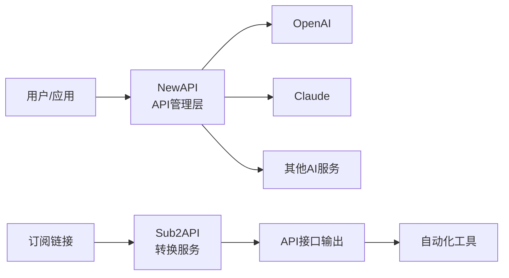
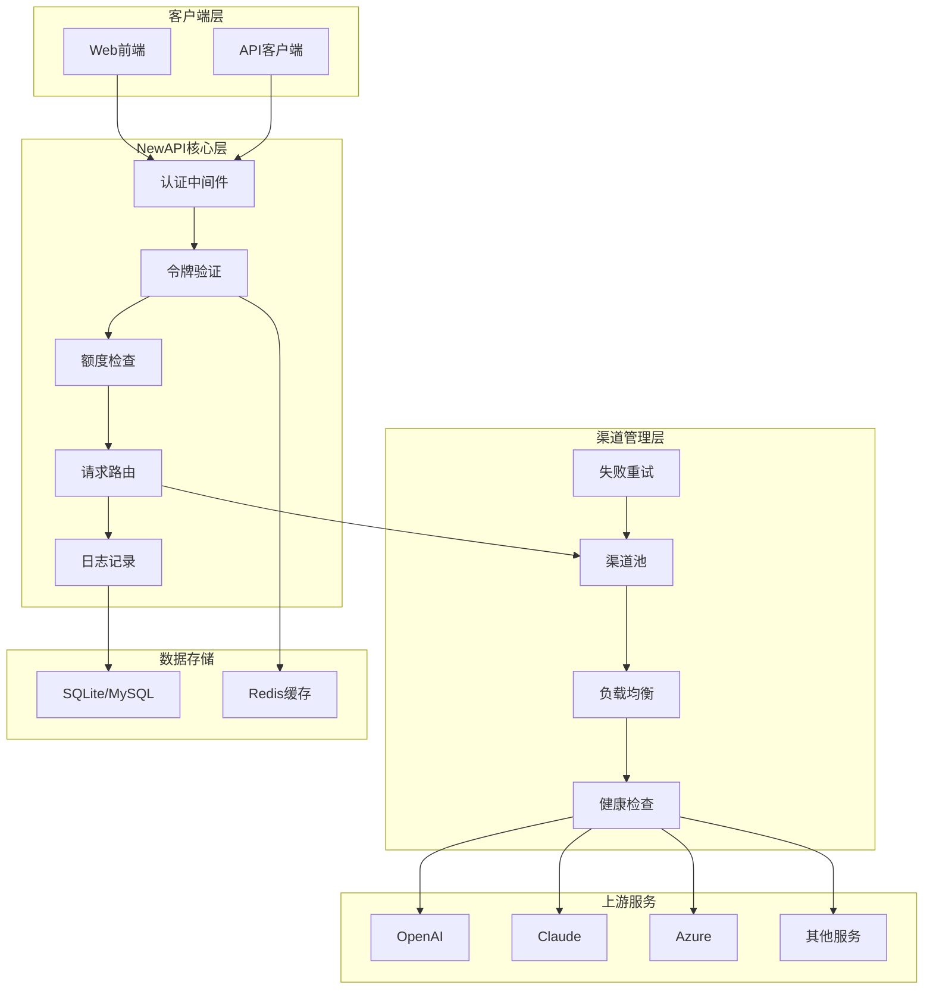
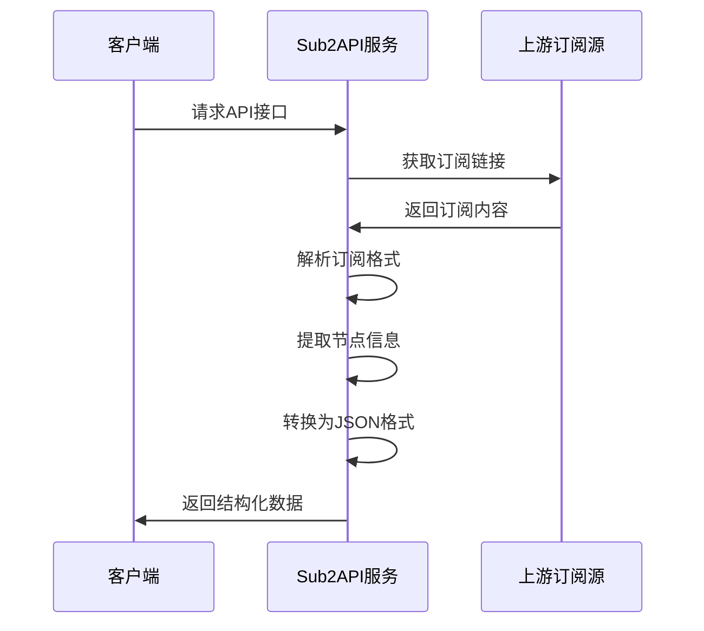
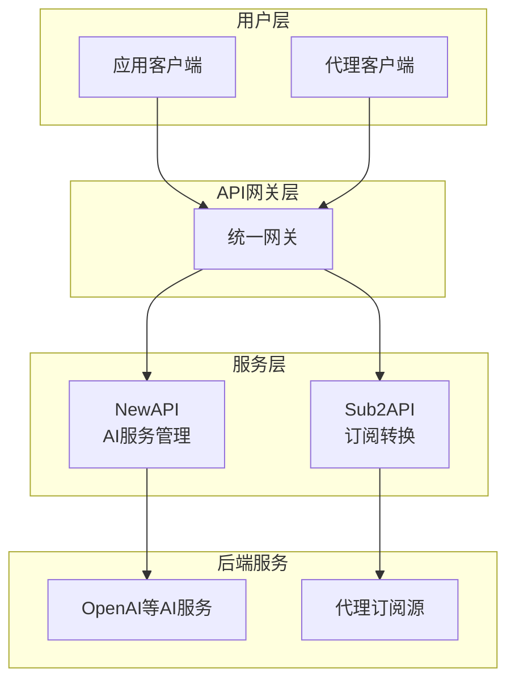

[toc]


# NewAPI 和 Sub2API 完整指南

## 项目概述

### NewAPI 简介

NewAPI 是一个开源的 API 管理和分发系统，专门用于管理多个 AI 服务提供商的 API 密钥。它作为一个中间层，允许用户统一管理、监控和分发来自不同供应商（如 OpenAI、Claude、Azure等）的 API 访问。

**核心价值**：

- 统一的 API 入口管理
- 多渠道密钥池管理
- 用户额度控制和计费
- 请求日志和监控
- 令牌（Token）管理系统

### Sub2API 简介

Sub2API 是一个将订阅链接（Subscription URL）转换为 API 接口的转换工具，主要应用于网络代理服务的订阅管理场景。它可以将传统的订阅链接转换成标准化的 API 接口，便于程序化访问和管理。

**核心价值**：

- 订阅链接到 API 的转换
- 节点信息结构化输出
- 支持多种订阅格式
- 便于自动化集成

## 两者的关系与定位

| 对比维度 | NewAPI                     | Sub2API                      |
| -------- | -------------------------- | ---------------------------- |
| 主要用途 | AI API 密钥管理和分发      | 代理订阅链接转 API           |
| 应用场景 | AI 服务集成、API 中转      | 代理节点管理、自动化订阅     |
| 目标用户 | AI 应用开发者、API 服务商  | 代理服务使用者、运维人员     |
| 核心功能 | 密钥池、额度控制、请求转发 | 订阅解析、格式转换、节点输出 |
| 技术栈   | Go 后端 + React 前端       | 轻量级转换服务               |



------

## NewAPI 深度解析

### 核心概念

#### 渠道（Channel）

渠道是 NewAPI 中连接到上游 AI 服务提供商的配置单元。每个渠道包含：

- **渠道类型**：OpenAI、Azure、Claude、Google PaLM 等
- **API 密钥**：用于访问上游服务的凭证
- **API 基础地址**：上游服务的端点 URL
- **模型列表**：该渠道支持的模型
- **优先级**：多渠道场景下的选择顺序
- **权重**：负载均衡的权重值

#### 令牌（Token）

令牌是 NewAPI 分发给下游用户的访问凭证，类似于 API Key。

**令牌属性**：

- 名称和标识
- 所属用户
- 剩余额度
- 使用限制（QPM、QPD）
- 模型权限
- 过期时间

#### 额度系统（Quota System）

NewAPI 使用额度系统进行使用量计费和控制：

| 计费单位 | 说明                     | 换算关系         |
| -------- | ------------------------ | ---------------- |
| Token    | 实际消耗的 AI 模型 token | 基础单位         |
| 额度     | 系统内部计费单位         | 可自定义兑换比例 |
| 倍率     | 不同模型的费率系数       | 根据上游定价设置 |

**计费公式**：

```
消耗额度 = (prompt_tokens × 模型倍率 + completion_tokens × 模型倍率) × 额度倍率
```

#### 用户分组（Group）

用户分组用于批量管理用户权限和配置：

- **模型访问权限**：控制可用的 AI 模型
- **倍率设置**：为不同分组设置不同的计费倍率
- **额度优先级**：充值和消费的顺序策略

### 系统架构



### 工作流程

**典型请求处理流程**：

1. **请求接收**：客户端发送 API 请求到 NewAPI
2. **令牌验证**：验证请求头中的 Authorization token
3. **权限检查**：检查令牌是否有权访问请求的模型
4. **额度检查**：验证用户剩余额度是否足够
5. **渠道选择**：根据优先级、权重、健康状态选择合适的渠道
6. **请求转发**：将请求转发到选定的上游服务
7. **响应处理**：接收上游响应，计算消耗额度
8. **额度扣除**：从用户账户扣除相应额度
9. **日志记录**：记录请求详情到数据库
10. **返回响应**：将处理后的响应返回给客户端

### 部署配置

#### 环境准备

**系统要求**：

- 操作系统：Linux、Windows、macOS
- 数据库：SQLite（默认）或 MySQL/PostgreSQL
- 可选：Redis（用于缓存和会话）
- 内存：最低 512MB，推荐 1GB+
- 磁盘：最低 100MB，日志可能需要更多空间

#### Docker 部署（推荐）

```yaml
version: '3.8'

services:
  newapi:
    image: calciumion/new-api:latest
    container_name: newapi
    restart: always
    ports:
      - "3000:3000"
    environment:
      - SQL_DSN=newapi.db
      - SESSION_SECRET=random_string_here
      - INITIAL_ROOT_TOKEN=your_root_token
    volumes:
      - ./data:/data
    command: --log-dir /data/logs
```

**启动命令**：

```bash
docker-compose up -d
```

#### 二进制部署

```bash
# 下载最新版本
wget https://github.com/Calcium-Ion/new-api/releases/latest/download/new-api_linux_amd64

# 赋予执行权限
chmod +x new-api_linux_amd64

# 运行服务
./new-api_linux_amd64 --port 3000 --log-dir ./logs
```

#### 核心配置参数

| 参数     | 环境变量           | 说明              | 默认值       |
| -------- | ------------------ | ----------------- | ------------ |
| 端口     | PORT               | HTTP 服务监听端口 | 3000         |
| 数据库   | SQL_DSN            | 数据库连接字符串  | newapi.db    |
| 会话密钥 | SESSION_SECRET     | 用于加密会话数据  | 随机生成     |
| 根令牌   | INITIAL_ROOT_TOKEN | 初始管理员令牌    | 空           |
| Redis    | REDIS_CONN_STRING  | Redis 连接地址    | 空（不使用） |
| 日志目录 | LOG_DIR            | 日志文件存储位置  | ./logs       |

### 渠道配置实践

#### OpenAI 渠道配置

```json
{
  "type": "openai",
  "name": "OpenAI官方",
  "base_url": "https://api.openai.com/v1",
  "key": "sk-xxxxxxxxxxxxxxxx",
  "models": [
    "gpt-4",
    "gpt-4-turbo-preview",
    "gpt-3.5-turbo"
  ],
  "priority": 10,
  "weight": 100
}
```

#### Azure OpenAI 渠道配置

```json
{
  "type": "azure",
  "name": "Azure OpenAI",
  "base_url": "https://your-resource.openai.azure.com",
  "key": "your-azure-key",
  "models": ["gpt-4"],
  "other": {
    "api-version": "2023-12-01-preview"
  }
}
```

#### Claude 渠道配置

```json
{
  "type": "claude",
  "name": "Claude API",
  "base_url": "https://api.anthropic.com",
  "key": "sk-ant-xxxxxxxxxxxxxxxx",
  "models": [
    "claude-3-opus-20240229",
    "claude-3-sonnet-20240229"
  ]
}
```

### 模型倍率配置

模型倍率决定了不同模型的计费标准，应根据上游实际定价设置：

| 模型            | 输入倍率 | 输出倍率 | 说明            |
| --------------- | -------- | -------- | --------------- |
| gpt-3.5-turbo   | 0.5      | 1.5      | 经济型模型      |
| gpt-4           | 30       | 60       | 高性能模型      |
| gpt-4-turbo     | 10       | 30       | 性价比平衡      |
| claude-3-opus   | 15       | 75       | Claude 最强模型 |
| claude-3-sonnet | 3        | 15       | Claude 平衡模型 |

**配置建议**：

- 定期根据上游定价调整倍率
- 为不同用户组设置不同倍率实现差异化定价
- 使用整数倍率简化计费逻辑

### 用户和令牌管理

#### 创建用户流程

1. 管理员登录后台
2. 进入用户管理界面
3. 点击"创建新用户"
4. 填写用户信息：
   - 用户名（必填）
   - 显示名称
   - 用户组
   - 初始额度
5. 设置用户权限和限制
6. 保存并生成用户账号

#### 令牌创建和管理

**令牌类型**：

- **系统令牌**：用于系统间调用，不受额度限制
- **普通令牌**：受用户额度限制的常规令牌
- **临时令牌**：有时间限制的一次性令牌

**创建令牌步骤**：

1. 选择关联用户
2. 设置令牌名称
3. 配置模型权限
4. 设置使用限制（可选）
   - 每分钟请求数（QPM）
   - 每天请求数（QPD）
   - IP 白名单
5. 设置过期时间
6. 生成并保存令牌

**令牌使用示例**：

```bash
curl https://your-newapi-domain.com/v1/chat/completions \
  -H "Content-Type: application/json" \
  -H "Authorization: Bearer sk-xxxxxxxxxxxxxx" \
  -d '{
    "model": "gpt-3.5-turbo",
    "messages": [{"role": "user", "content": "Hello"}]
  }'
```

### 监控和日志

#### 日志系统

NewAPI 提供多层次的日志记录：

**系统日志**：

- 应用启动和关闭事件
- 配置变更记录
- 错误和异常信息

**请求日志**：

- 请求时间戳
- 令牌标识
- 模型名称
- 输入/输出 token 数量
- 消耗额度
- 响应时间
- 状态码

**数据库表结构**：

```sql
CREATE TABLE logs (
    id INTEGER PRIMARY KEY AUTOINCREMENT,
    created_at DATETIME,
    user_id INTEGER,
    token_name TEXT,
    type INTEGER,
    model_name TEXT,
    prompt_tokens INTEGER,
    completion_tokens INTEGER,
    quota INTEGER,
    content TEXT,
    channel_id INTEGER
);
```

#### 监控指标

**关键监控项**：

- 请求成功率
- 平均响应时间
- 各渠道健康状态
- 用户额度消耗速率
- 错误类型分布
- 热门模型使用统计

**告警设置建议**：

- 渠道连续失败次数 > 3
- 系统整体成功率 < 95%
- 某用户额度消耗异常（突增）
- 磁盘空间不足 < 10%

### 最佳实践

#### 渠道配置优化

**多渠道负载均衡**：

```
优先级策略：优先 > 官方渠道 > 备用渠道
权重策略：高质量渠道高权重，确保分布合理
```

**健康检查**：

- 启用自动健康检查
- 设置合理的超时时间（建议 30s）
- 失败后自动切换到备用渠道

**密钥轮转**：

- 定期更新 API 密钥
- 使用多个密钥分散风险
- 为每个渠道设置独立的密钥

#### 额度管理策略

**充值策略**：

- 支持人工充值和自动充值
- 设置充值记录和追踪
- 为 VIP 用户提供额度赠送

**消费控制**：

- 为不同用户组设置日/月消费上限
- 实施额度预警机制（剩余 < 10% 时通知）
- 对异常消费行为进行监控和拦截

#### 安全加固

**访问控制**：

- 启用 IP 白名单限制管理后台访问
- 对关键操作启用二次验证
- 定期审计用户和令牌

**数据保护**：

- 定期备份数据库
- 敏感信息加密存储
- 日志脱敏处理（隐藏完整 API key）

**限流保护**：

```
用户级限流：每个令牌的 QPM/QPD
渠道级限流：避免触发上游限制
全局限流：保护系统整体稳定性
```

#### 性能优化

**缓存策略**：

- 使用 Redis 缓存热点数据（用户信息、令牌验证）
- 缓存模型列表和倍率配置
- 设置合理的缓存过期时间

**数据库优化**：

- 为高频查询字段建立索引
- 定期清理过期日志（保留 30-90 天）
- 大表分区存储

**连接池管理**：

- 配置合理的数据库连接池大小
- 设置上游 HTTP 连接的超时和重试
- 使用连接复用减少开销

------

## Sub2API 深度解析

### 核心概念

#### 订阅链接（Subscription URL）

订阅链接是代理服务提供商提供的一个 URL，访问该 URL 可以获取节点配置信息。

**常见订阅格式**：

- Base64 编码的节点列表
- YAML 格式（Clash）
- JSON 格式（Quantumult）
- SIP008 格式（Shadowsocks）

#### 节点信息（Node Info）

节点是单个代理服务器的配置信息，包含：

| 字段      | 说明       | 示例              |
| --------- | ---------- | ----------------- |
| 类型      | 协议类型   | ss、vmess、trojan |
| 地址      | 服务器地址 | example.com       |
| 端口      | 服务端口   | 443               |
| 密码/UUID | 认证凭证   | password123       |
| 加密方式  | 加密算法   | aes-256-gcm       |
| 备注      | 节点名称   | 香港节点01        |

### 工作原理



### 支持的订阅格式

#### Base64 格式

最简单的订阅格式，每行一个节点配置，整体进行 Base64 编码。

**原始内容示例**：

```
ss://YWVzLTI1Ni1nY206cGFzc3dvcmQ=@example.com:8388#节点1
vmess://eyJ2IjoiMiIsInBzIjoi6IqC54K5MiIsImFkZCI6ImV4YW1wbGUuY29tIiwicG9ydCI6IjQ0MyIsImlkIjoidXVpZCIsImFpZCI6IjAiLCJuZXQiOiJ3cyIsInR5cGUiOiJub25lIiwiaG9zdCI6IiIsInBhdGgiOiIvIiwidGxzIjoidGxzIn0=
```

**Sub2API 输出**：

```json
{
  "nodes": [
    {
      "type": "ss",
      "server": "example.com",
      "port": 8388,
      "method": "aes-256-gcm",
      "password": "password",
      "name": "节点1"
    },
    {
      "type": "vmess",
      "server": "example.com",
      "port": 443,
      "uuid": "uuid",
      "alterId": 0,
      "network": "ws",
      "tls": true,
      "name": "节点2"
    }
  ]
}
```

#### Clash 格式

Clash 使用 YAML 格式配置，结构清晰，功能丰富。

**Clash 订阅示例**：

```yaml
proxies:
  - name: "香港节点"
    type: ss
    server: hk.example.com
    port: 443
    cipher: aes-256-gcm
    password: "your-password"
    udp: true
    
  - name: "美国节点"
    type: vmess
    server: us.example.com
    port: 443
    uuid: xxxxxxxx-xxxx-xxxx-xxxx-xxxxxxxxxxxx
    alterId: 0
    cipher: auto
    tls: true
    network: ws
    ws-opts:
      path: /path
      headers:
        Host: us.example.com
```

#### SIP008 格式

Shadowsocks 标准 JSON 格式。

```json
{
  "version": 1,
  "servers": [
    {
      "id": "server1",
      "remarks": "香港节点",
      "server": "hk.example.com",
      "server_port": 8388,
      "password": "password",
      "method": "aes-256-gcm"
    }
  ]
}
```

### 部署配置

#### Docker 部署

```dockerfile
FROM python:3.9-slim

WORKDIR /app

COPY requirements.txt .
RUN pip install --no-cache-dir -r requirements.txt

COPY . .

EXPOSE 8000

CMD ["python", "sub2api.py"]
```

**docker-compose.yml**：

```yaml
version: '3.8'

services:
  sub2api:
    build: .
    container_name: sub2api
    restart: always
    ports:
      - "8000:8000"
    environment:
      - CACHE_EXPIRE=300
      - MAX_NODES=200
    volumes:
      - ./cache:/app/cache
```

#### 环境变量配置

| 变量         | 说明               | 默认值      |
| ------------ | ------------------ | ----------- |
| PORT         | 服务端口           | 8000        |
| CACHE_EXPIRE | 缓存过期时间（秒） | 300         |
| MAX_NODES    | 最大节点数限制     | 200         |
| TIMEOUT      | 上游请求超时（秒） | 10          |
| USER_AGENT   | 请求头 User-Agent  | Sub2API/1.0 |

### API 接口设计

#### 转换接口

**端点**：`GET /convert`

**请求参数**：

| 参数   | 类型    | 必填 | 说明                   |
| ------ | ------- | ---- | ---------------------- |
| url    | string  | 是   | 订阅链接 URL           |
| format | string  | 否   | 输出格式（json、yaml） |
| filter | string  | 否   | 节点过滤规则           |
| limit  | integer | 否   | 返回节点数量限制       |

**请求示例**：

```bash
curl "http://localhost:8000/convert?url=https://example.com/sub&format=json&limit=10"
```

**响应格式**：

```json
{
  "code": 0,
  "message": "success",
  "data": {
    "total": 25,
    "filtered": 10,
    "nodes": [
      {
        "id": "node_1",
        "type": "ss",
        "name": "香港-01",
        "server": "hk1.example.com",
        "port": 443,
        "method": "aes-256-gcm",
        "password": "xxxxx",
        "latency": 45,
        "location": {
          "country": "HK",
          "city": "Hong Kong"
        }
      }
    ],
    "updated_at": "2024-01-15T12:00:00Z"
  }
}
```

#### 节点测速接口

**端点**：`POST /test`

**请求体**：

```json
{
  "nodes": [
    {
      "type": "ss",
      "server": "example.com",
      "port": 8388,
      "method": "aes-256-gcm",
      "password": "password"
    }
  ],
  "timeout": 5
}
```

**响应示例**：

```json
{
  "results": [
    {
      "node_id": 0,
      "status": "ok",
      "latency": 45,
      "speed": "12.5 MB/s"
    }
  ]
}
```

### 节点过滤和筛选

#### 按地区过滤

```bash
# 只返回香港节点
curl "http://localhost:8000/convert?url=SUB_URL&filter=region:HK"

# 排除美国节点
curl "http://localhost:8000/convert?url=SUB_URL&filter=!region:US"
```

#### 按协议过滤

```bash
# 只返回 Shadowsocks 节点
curl "http://localhost:8000/convert?url=SUB_URL&filter=type:ss"

# 返回 VMess 和 Trojan
curl "http://localhost:8000/convert?url=SUB_URL&filter=type:vmess,trojan"
```

#### 按关键词过滤

```bash
# 名称包含"Premium"的节点
curl "http://localhost:8000/convert?url=SUB_URL&filter=name:Premium"

# 排除包含"试用"的节点
curl "http://localhost:8000/convert?url=SUB_URL&filter=!name:试用"
```

#### 组合过滤规则

过滤规则可以使用 `&` 组合多个条件：

```bash
curl "http://localhost:8000/convert?url=SUB_URL&filter=region:HK&filter=type:ss&limit=5"
```

### 缓存机制

**缓存策略**：

- 使用 URL 的 MD5 值作为缓存键
- 缓存订阅内容和解析结果
- 支持手动刷新缓存

**缓存控制**：

```bash
# 强制刷新缓存
curl "http://localhost:8000/convert?url=SUB_URL&refresh=true"

# 查看缓存状态
curl "http://localhost:8000/cache/status"
```

**缓存响应头**：

```
X-Cache: HIT
X-Cache-Age: 145
Cache-Control: max-age=300
```

### 最佳实践

#### 安全建议

**访问控制**：

- 使用 API 密钥认证
- 实施 IP 白名单
- 限制请求频率

**数据保护**：

- 不记录原始订阅内容
- 敏感字段加密传输
- 定期清理缓存

**示例配置**：

```yaml
security:
  api_key_required: true
  ip_whitelist:
    - 192.168.1.0/24
    - 10.0.0.0/8
  rate_limit:
    requests_per_minute: 60
    burst: 10
```

#### 性能优化

**并发处理**：

```python
# 使用异步请求处理多个订阅
import asyncio
import aiohttp

async def fetch_multiple_subs(urls):
    async with aiohttp.ClientSession() as session:
        tasks = [fetch_sub(session, url) for url in urls]
        return await asyncio.gather(*tasks)
```

**缓存预热**：

- 定时任务提前更新热门订阅
- 使用 Redis 共享缓存
- 实施多级缓存策略

**连接复用**：

```python
# 复用 HTTP 连接
session = requests.Session()
adapter = HTTPAdapter(
    pool_connections=10,
    pool_maxsize=20,
    max_retries=3
)
session.mount('http://', adapter)
session.mount('https://', adapter)
```

#### 监控和日志

**关键指标**：

- 转换成功率
- 平均处理时间
- 缓存命中率
- 节点数量统计
- 各协议占比

**日志结构**：

```json
{
  "timestamp": "2024-01-15T12:00:00Z",
  "level": "info",
  "event": "conversion",
  "subscription_url": "https://example.com/sub",
  "total_nodes": 25,
  "filtered_nodes": 10,
  "duration_ms": 234,
  "cache_hit": true
}
```

#### 错误处理

**常见错误类型**：

| 错误码 | 说明             | 处理方式               |
| ------ | ---------------- | ---------------------- |
| 400    | 请求参数错误     | 检查 URL 和参数格式    |
| 404    | 订阅链接无效     | 验证订阅链接可访问性   |
| 422    | 订阅格式无法解析 | 检查订阅内容格式       |
| 429    | 请求过于频繁     | 降低请求频率或使用缓存 |
| 500    | 服务器内部错误   | 查看服务器日志         |
| 502    | 上游服务不可用   | 检查上游订阅服务状态   |

**重试策略**：

```python
from tenacity import retry, stop_after_attempt, wait_exponential

@retry(
    stop=stop_after_attempt(3),
    wait=wait_exponential(multiplier=1, min=2, max=10)
)
def fetch_subscription(url):
    response = requests.get(url, timeout=10)
    response.raise_for_status()
    return response.content
```

------

## NewAPI 与 Sub2API 集成方案

虽然 NewAPI 和 Sub2API 服务于不同的场景，但在某些架构中可以协同工作。

### 集成架构



### 统一认证方案

使用统一的 Token 系统管理两个服务的访问权限：

```python
# 统一认证中间件
def verify_token(token):
    # 验证 token 有效性
    user = db.query_user_by_token(token)
    if not user:
        return False
    
    # 检查服务权限
    if service == 'newapi':
        return user.has_permission('ai_api')
    elif service == 'sub2api':
        return user.has_permission('proxy_api')
    
    return False
```

### 统一计费方案

为 AI API 调用和代理订阅服务建立统一的计费体系：

| 服务类型     | 计费单位     | 费率     |
| ------------ | ------------ | -------- |
| GPT-3.5 调用 | 每 1K tokens | 10 积分  |
| GPT-4 调用   | 每 1K tokens | 100 积分 |
| 订阅转换     | 每次请求     | 1 积分   |
| 节点测速     | 每次测试     | 5 积分   |

### 监控大盘

统一展示两个服务的运行状态：

**关键指标**：

- 总请求量（AI + 订阅）
- 成功率对比
- 用户活跃度
- 收入统计
- 资源使用情况

------

## 常见问题解答

### NewAPI 相关

**Q: 如何选择数据库？**

A:

- 小规模部署（< 100 用户）：使用 SQLite，无需额外配置
- 中等规模（100-1000 用户）：使用 MySQL，性能更好
- 大规模（> 1000 用户）：使用 PostgreSQL + Redis，支持高并发

**Q: 渠道频繁失败怎么办？**

A: 排查步骤：

1. 检查 API 密钥是否有效
2. 验证网络连通性（防火墙、代理）
3. 确认上游服务状态
4. 查看错误日志获取详细信息
5. 调整超时时间和重试策略

**Q: 如何防止额度被刷？**

A:

- 设置每个令牌的 QPM/QPD 限制
- 启用 IP 限流
- 监控异常消费模式
- 对高额消费设置人工审核
- 使用验证码或二次确认

**Q: 多个渠道如何负载均衡？**

A: 负载均衡策略：

1. 优先级：先按优先级分组
2. 权重：同优先级内按权重分配
3. 健康检查：排除不可用渠道
4. 轮询：在可用渠道间轮询分配

### Sub2API 相关

**Q: 订阅链接解析失败？**

A: 可能原因：

- 订阅格式不支持或已变更
- 链接需要认证但未提供
- 订阅内容为空
- 编码格式错误（非 UTF-8）

解决方法：

```bash
# 手动下载订阅内容检查
curl -v "订阅链接" -o subscription.txt

# 检查编码
file -i subscription.txt

# 查看原始内容
cat subscription.txt
```

**Q: 如何提高转换速度？**

A:

- 启用缓存减少重复请求
- 使用异步处理并发转换
- 优化解析算法
- 预加载热门订阅
- 使用 CDN 加速订阅源访问

**Q: 节点信息不完整？**

A:

- 订阅源本身可能不完整
- 解析器可能需要更新
- 某些自定义字段未被识别
- 使用标准格式重新生成订阅

**Q: 如何实现订阅自动更新？**

A:

```python
from apscheduler.schedulers.background import BackgroundScheduler

def update_subscriptions():
    # 获取所有需要更新的订阅
    subscriptions = db.get_active_subscriptions()
    
    for sub in subscriptions:
        try:
            # 获取最新内容
            content = fetch_subscription(sub.url)
            # 解析并更新
            nodes = parse_subscription(content)
            db.update_nodes(sub.id, nodes)
        except Exception as e:
            log.error(f"Update failed: {sub.url}, {e}")

# 每5分钟更新一次
scheduler = BackgroundScheduler()
scheduler.add_job(update_subscriptions, 'interval', minutes=5)
scheduler.start()
```

------

## 总结

NewAPI 和 Sub2API 分别解决了 AI API 管理和代理订阅转换两个不同领域的问题。理解它们的核心概念、工作原理和最佳实践，能够帮助你在实际项目中更好地应用这些工具。

**NewAPI 核心要点**：

- 多渠道管理实现高可用
- 精细的额度控制系统
- 完善的监控和日志
- 安全的令牌管理机制

**Sub2API 核心要点**：

- 灵活的格式转换能力
- 强大的节点过滤功能
- 高效的缓存机制
- RESTful API 设计

根据具体场景选择合适的工具，并遵循最佳实践进行部署和配置，能够构建稳定、高效的服务系统。