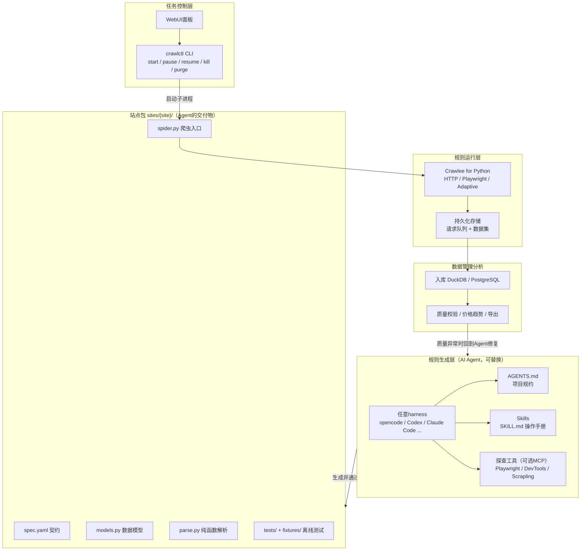
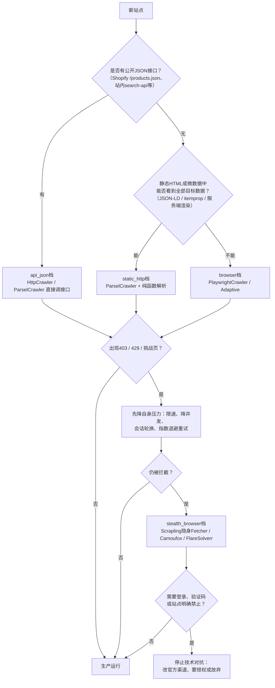
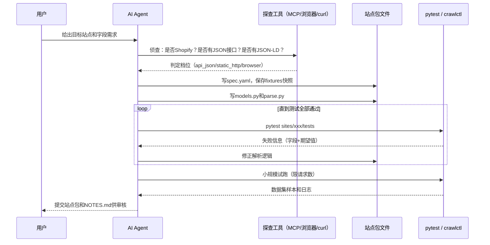
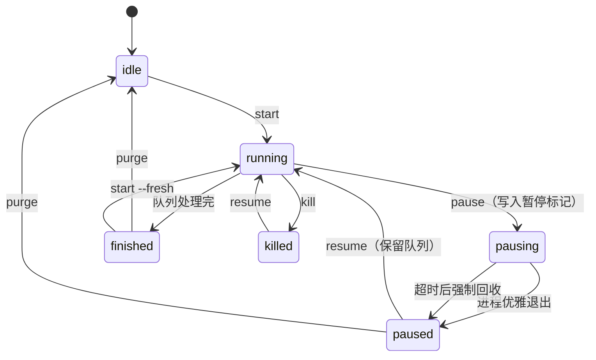
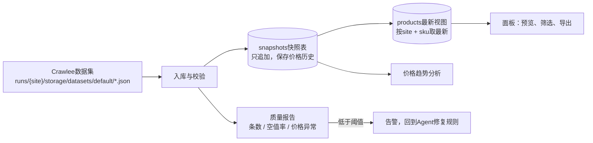

[toc]


## 结论先行：四层架构的推荐组合

本文面向"**AI驱动的商品数据采集系统**"（AI-driven product data collection system）的选型与架构，所有关键结论都经过2026年10月下旬的**联网核实与本地实测**（核实与实验过程见文末"信息依据"一节），知识截止时间约2026-10-27。

核心思路一句话：**AI只在"写规则"时出场，不在"跑规则"时出场**。Agent产出的是确定性的代码、契约和测试；运行时零LLM调用，成本低、结果可复现、可审计。

| 层 | 推荐方案（主选） | 备选／补充 | 依据（本文实证） |
| --- | --- | --- | --- |
| **规则生成层**（AI Agent） | 不绑定harness的"三件套"：**`AGENTS.md`＋Agent Skills（`SKILL.md`）＋项目CLI**；MCP只作探查增强 | Playwright MCP、Chrome DevTools MCP、Scrapling MCP；browser-use／Stagehand 做交互式探查 | `SKILL.md`已被Claude Code、OpenAI Codex（2025-12起）、OpenCode官方支持，成为跨工具事实标准 |
| **规则运行层**（框架） | **Crawlee for Python**（1.11.0） | **Scrapy 2.19**（保守稳妥）；**Scrapling**（困难站点隐身档＋自适应解析）；Crawl4AI（探查与schema起草） | 本文用Crawlee实测跑通"采集→暂停→续跑→去重"，并在真实Shopify站20秒采集1000商品（含颜色/尺码变体） |
| **任务控制层** | 自建轻量控制面 **`crawlctl.py`**（本文已在Windows实测修复）＋Streamlit面板 | Scrapy系用Scrapyd＋Gerapy；多节点再评估Crawlab（社区版近三年无新版） | `crawlctl`的start/pause/resume/kill/purge全流程在中文Windows实测通过，发现并修复tasklist编码bug |
| **数据管理分析** | **DuckDB**（单机分析）＋Streamlit | PostgreSQL＋Metabase／Superset（多人协作时） | 无需部署服务即可直接分析Crawlee数据集的JSON文件 |

框架选型的**一句话结论**：执行层选**Crawlee for Python**；**Scrapy**适合已有积累或追求最大语料成熟度的团队；**Scrapling**不作执行层主力，但它的隐身Fetcher（基于Camoufox）和自适应解析是困难站点档位的最佳补充，且官方提供MCP与Agent Skill；**Crawl4AI／Firecrawl／ScrapeGraphAI**定位是"内容转Markdown给LLM"，不适合承担商品结构化采集的执行层（许可证、自托管残缺或运行时调LLM的成本问题，逐条论证见后文）。

---

## 背景与问题定义

### 系统的四层结构

用户规划的系统分四层，其中前两层是"爬取数据"这个核心目标的关键，后两层是锦上添花：

1. **规则生成层**：AI agent阅读目标网站，产出采集规则；
2. **规则运行层**：执行采集规则的框架，规则必须与框架API适配；
3. **任务管理控制层**：启动／暂停／恢复／回收／清理，任务状态可见；
4. **数据分析管理层**：入库、预览、导出、质量监控。



**图解**：
- **站点包**（Site Package）是整个系统的关键接口：Agent层只负责产出站点包，运行层只负责执行站点包，两边靠文件约定解耦。因此把Agent从opencode换成Codex，或把运行框架从Crawlee换成Scrapy，另一侧都不用改。
- **控制层只认CLI**：WebUI只是调用CLI的外壳；Agent也可以调用同一套CLI做小规模试跑，人机共用一个接口。
- **闭环**：数据层的质量检查（如空值率突增）是网站改版的信号，可把问题交回Agent修复规则，这是"AI驱动"的长期价值所在。

### 商品数据采集的输入

结合实际任务（用户提供的欧美电商站点清单，覆盖英／德／法／意／西／美），目标字段通常包括：产品名称、价格、描述、图片URL、分类、品牌，以及**产品变体**（Product Variant，即颜色、尺码、型号等选项组合，每个变体往往有独立价格和库存）。

---

## AI时代爬虫方案全景（2026年10月快照）

下面的方案分六大类。**star数与维护状态均来自2026-10-26/27的GitHub API查询**，比各类博文的转述更可靠（调研中发现第三方文章标注的star数从3.3万到101万不等，全部不可信）。

| 类别 | 方案 | 许可证 | star（2026-10-27） | 维护状态 | 一句话定位 |
| --- | --- | --- | --- | --- | --- |
| 老牌工业级 | **Scrapy** | BSD-3 | 65,033 | 活跃（2.19.0，2026-09） | 大规模采集的工业标准，语料最多 |
| 现代工程化 | **Crawlee for Python** | Apache-2.0 | 9,626 | 活跃（1.11.0，2026-10-15） | Apify出品，一套API覆盖静态＋浏览器 |
| 现代工程化 | Crawlee for JavaScript | Apache-2.0 | 26,268 | 活跃 | 同上，Node.js版 |
| 自适应＋隐身 | **Scrapling** | BSD-3 | 89,842 | 活跃（个人维护） | "从单请求到全站爬取"的全家桶，隐身＋自适应 |
| AI原生 | **Crawl4AI** | Apache-2.0 | 86,303 | 活跃 | 网页转LLM友好的Markdown，带schema抽取 |
| AI原生 | **Firecrawl** | **AGPL-3.0** | 195,568 | 活跃（公司运营） | 抓取即API；自托管版功能残缺 |
| AI原生 | ScrapeGraphAI | MIT | 32,246 | 库更新放缓，重心转向商业API | LLM驱动的爬取图，运行时调模型 |
| 浏览器Agent | **browser-use** | MIT | 119,191 | 活跃 | 自然语言驱动浏览器，每步调LLM |
| 浏览器Agent | Stagehand | MIT | —（Browserbase维护） | 活跃 | 代码＋AI动作混合，带缓存 |
| 浏览器Agent | Skyvern | **AGPL-3.0** | 23,280 | 活跃 | 视觉语言模型驱动的工作流自动化 |
| 浏览器Agent | AgentQL | MIT（SDK） | 1,491 | 活跃（TinyFish） | 用"查询语言"定位网页元素，查询服务商业 |
| 国产 | DrissionPage | **自定义（商用需授权）** | 12,543 | 活跃 | 浏览器控制＋requests合体，中文资料多 |
| 反检测底座 | Camoufox | MPL-2.0 | 12,809 | **已恢复活跃**（2026-10仍密集提交） | C++层改造的Firefox |
| 反检测底座 | nodriver | **AGPL-3.0** | 4,893 | 活跃 | 绕开WebDriver直接驱Chrome |
| 反检测底座 | patchright | Apache-2.0 | 约4,000 | 活跃 | 打补丁的Playwright |
| 反检测底座 | SeleniumBase（UC模式） | MIT | 13,176 | 活跃 | undetected-chromedriver路线的集大成者 |
| 反检测底座 | FlareSolverr | MIT | 16,045 | **已恢复活跃**（2026-10） | 代理解Cloudflare挑战的旁路服务 |

**必读的三个横向事实**：
- **免费开源不等于可以商用**。DrissionPage官方明确"个人免费使用，须商用请联系作者获取授权"；Firecrawl与Skyvern是AGPL-3.0（提供网络服务需开源修改部分）；nodriver也是AGPL-3.0。商用项目在选型时必须把许可证当成一票否决项来核对。
- **"个人维护"与"公司维护"的持续性风险不同**。Scrapling star增速惊人但由个人（D4Vinci/Karim Shoair）维护；Crawlee背后是Apify公司。把生产系统押在单一维护者的项目上要有逃生预案。
- **AI原生框架不等于AI驱动系统的正确底座**。Crawl4AI、Firecrawl的产出物是"给LLM读的Markdown"，而商品采集要的是"给程序读的结构化字段"；两者方向不同（论证见"关键决策二"）。

### 新兴方案和传统方案到底差在哪

以商品采集场景为坐标系，两类方案的真实差异不在"能不能抓"，而在三件事：

| 维度 | 传统方案（Scrapy／BeautifulSoup时代） | 新兴方案（2024-2026出现） | 对商品采集意味着什么 |
| --- | --- | --- | --- |
| **对现代网页的适配** | 纯HTTP＋选择器，动态页要自己拼插件 | 内置浏览器渲染、自动在HTTP与浏览器间切换（如Crawlee的`AdaptivePlaywrightCrawler`）、隐身指纹 | 商品价格库存常由JS加载，新兴方案开箱即用 |
| **对AI的亲和度** | 语料多但API面大（中间件、管道、信号） | 提供MCP服务、官方Agent Skill、LLM抽取策略、`llms.txt`文档 | 决定"AI写规则的正确率"——这恰是本系统的第一层 |
| **运维内建程度** | 队列持久化要靠`JOBDIR`等机制自己配 | 请求队列默认落盘、会话池、指纹轮换、重试退避内建 | 直接决定"暂停／恢复／断点续跑"这些控制层功能的实现成本 |

**应该**看清的一点：新兴方案并未取代Scrapy，而是在Scrapy的短板（现代网页适配、AI亲和）上补位。Scrapy至今仍是多份2026年评测中"大规模生产爬取"的默认答案（Scrapfly 2026-10评测、Datahut 2026-09评测）。

---

## 商品数据采集场景的特点与对应策略

### 先看真实站点长什么样（14站侦查实测）

用用户提供的站点清单抽样14个站，用crawlee自带的**impit**客户端（模拟Firefox 133指纹的HTTP客户端）做侦查，检测项：响应状态、是否Shopify、是否有JSON-LD结构化数据、是否被拦截。实测结果（2026-10-27）：

| 站点 | 状态 | 指纹特征 | 判定 |
| --- | --- | --- | --- |
| squishable.com | 200 | `x-shopify-stage`响应头，`/products.json`可用 | **Shopify接口档** |
| shop.littlesleepyhead.com | 200 | 同上，`/products.json`可用 | **Shopify接口档** |
| hopscotchstore.com | 200 | 同上 | **Shopify接口档** |
| curiousmindsbusybags.com | 200 | 同上 | **Shopify接口档** |
| toysandtreasures.com | 200 | 同上 | **Shopify接口档** |
| ecatering.co.uk | 200 | 同上 | **Shopify接口档** |
| celloelectronics.com | 200 | 同上 | **Shopify接口档** |
| lords-electrical.co.uk | 200 | URL含`/checkout/cart`、`/widgets/cms/`，判定为**Shopware 6** | 静态HTML＋微数据档 |
| lighting2lightbulbs.com | 200 | Apache | 静态HTML档 |
| heatingcentreonline.co.uk | 301 | LiteSpeed | 需处理重定向 |
| www2.hm.com | 302 | AkamaiGHost，任务清单标注"异步加载" | **动态渲染档** |
| claires.com | **403** | Cloudflare，清单标注"403" | **反爬档** |
| autoparti.it | **403** | Cloudflare，清单标注"反爬" | **反爬档** |
| grillworkssupply.com | 连接失败 | — | 站点不可达 |

两个直接改变架构设计的发现：

- **抽样中一半的站是Shopify**。所有Shopify站都暴露`/products.json`接口，直接返回带变体（颜色/尺码）、价格、库存、图片的完整JSON，**根本不需要解析HTML**。这验证了"接口优先"不是理论，而是这类站点清单里的第一大概率事件。
- **拦截站清一色是Cloudflare 403**，且用模拟浏览器指纹的纯HTTP客户端无法通过——应对它们需要独立的隐身档位，而不是选一个"更厉害的框架"。

### 抓取阶梯：按档位升级，而不是选一个万能框架



**图解**：
- **档位由侦查决定，写进站点包的`spec.yaml`**，运行层按档位选择爬虫类。四档共用同一套`parse.py`纯函数和Pydantic模型，升级档位时解析代码原样复用（实测验证，见后文）。
- **接口优先**的收益实测：Shopify档20秒采完1000商品；而同等数据量走HTML解析通常要数千请求。
- **反爬应对的第一步永远是降低自身压力**（限速、并发、会话复用）。很多429只是请求太快。升级到隐身浏览器档（Camoufox等）成本高一个数量级，且**遇登录墙／验证码／明确禁止就必须停**——这是红线，不是技术参数。

### 两个商品专项技术：接口与结构化数据

**Shopify`/products.json`专项**。这是本场景最重要的"作弊码"：

- 每个Shopify店都暴露`https://{域名}/products.json?limit=250&page=N`，返回商品数组；`limit`最大250。
- 每个商品自带`variants`数组，含各变体的`option1/2/3`（对应颜色、尺码等选项名在`options`字段）、`price`、`available`、`sku`——**颜色/尺码采集需求在此原生满足**。
- **坑（实测发现）**：`products.json`里**没有币种字段**（解析后`currency`全为空）。币种要么按站点常识指定，要么从商品页HTML的`og:price:currency`meta标签读取（Shopware站实测存在该标签）。
- 判定方法：响应头出现`x-shopify-stage`，或页面源码含`cdn.shopify.com`。
- Shopify官方社区有店主讨论封锁该接口的帖子，说明该接口属于灰色地带的公开行为：**限速访问、只取公开目录数据、尊重robots.txt**，被要求停止时停止。

**结构化数据专项（JSON-LD／微数据）**。非Shopify站的详情页，优先找`<script type="application/ld+json">`里的schema.org **Product**块（名称/价格/币种/库存/图片齐全，通常由建站系统自动生成），其次找`itemprop`微数据meta标签。实测Shopware 6站（lords-electrical.co.uk）的详情页：

- 无JSON-LD块，但存在`<meta itemprop="price" content="749">`、`<meta itemprop="priceCurrency" content="GBP">`、`og:title`／`og:description`和`<h1>`——**四行选择器就能拿到全部核心字段**，且这些标签由建站系统输出，改版抗性远高于页面CSS类名。
- **必须**把"找结构化数据"作为Agent的固定探查步骤写进规约（后文`AGENTS.md`示例里有对应条目）。

---

## 关键决策一：采集规则用脚本还是配置文件

这是本系统第一层与第二层的接口问题，值得单独论证。候选形式有三种：**纯脚本**（Python代码）、**纯配置**（YAML/JSON声明选择器）、**混合**（声明式契约＋代码实现）。

### 先盘点业界先例

| 方案 | 规则形式 | 形式选择的原因 |
| --- | --- | --- |
| Scrapy | 纯代码（Spider类）＋少量settings | 页面差异太大，声明式表达不了复杂解析 |
| Crawlee | 纯代码 | 同上 |
| Scrapling | 纯代码 | 同上 |
| Crawl4AI | **JSON schema**（`JsonCssExtractionStrategy`）＋可选LLM生成schema | 列表型页面用"容器选择器＋字段选择器"即可表达，值得声明式 |
| Firecrawl | API＋JSON schema（extract端点） | 同上，作为服务边界必须声明式 |
| AgentQL | 自研查询语言（接近自然语言的选择器DSL） | 试图用受控语言降低AI与人的表达成本 |
| Skyvern | YAML工作流＋代码块 | 流程编排声明式，复杂步骤内嵌代码 |
| browser-use | 自然语言＋Python代码 | 完全交给LLM运行时规划 |
| **本文方案** | **混合**：`spec.yaml`（契约）＋Python代码（解析） | 见下 |

规律很清晰：**"what"（抓哪个站、哪些字段、什么礼貌参数）适合声明式；"how"（怎么从这页HTML里抠出数据）只能代码表达**。凡是试图把"how"也塞进配置的纯配置方案，最终都长出了逃生舱（Skyvern的代码块、Crawl4AI的自定义解析回调）。

### 论证：为什么混合式最优

| 论证维度 | 纯脚本 | 纯配置（YAML/JSON选择器） | 混合（契约＋代码） |
| --- | --- | --- | --- |
| **表达能力** | 完整 | 差：正则、分页、接口翻页、变体映射很快超出声明式能力 | 完整（代码负责how） |
| **可测试性** | 好 | 差：配置正确性难单测 | 好：解析纯函数＋离线快照测试 |
| **AI可写可修性** | 好，AI擅长改代码 | 表面简单，实则**调试噩梦**：选择器错了没有断言可看，AI只能反复试 | 好：测试失败信息直接指明字段和期望值，AI可自我迭代 |
| **机器可读的控制信息** | 差：埋在代码常量里 | 好 | 好：礼貌参数、质量门槛、档位全在`spec.yaml`，控制层直接读取 |
| **审计与diff** | 一般 | 好 | 好：契约diff一眼看出"这次改了什么" |
| **运行时安全边界** | 差：AI生成的任意代码直接跑，风险面大 | 好 | 中：代码被限定在`parse.py`纯函数内，无网络无IO，风险面可控 |

结论（**推荐**）：采用**站点包混合形式**——`spec.yaml`声明"what"，Python代码实现"how"，Pydantic模型做数据契约，pytest做验收标准。它同时满足三个AI时代特有的诉求：**AI的产出物有客观验收标准**（测试通过才算交付）、**控制层有机器可读的契约**、**危险面被限制在纯函数里**。

`spec.yaml`示例与字段释义（本例为实测过的真实站点包）：

```yaml
site: curiousmindsbusybags
display_name: "Curious Minds Busy Bags（美国儿童教具，Shopify）"
start_urls:
  - "https://www.curiousmindsbusybags.com/products.json?limit=250&page=1"
strategy: api_json                # api_json | static_http | browser | stealth_browser
politeness:
  max_concurrency: 2
  max_tasks_per_minute: 30
  respect_robots_txt: true
schema: models.Product
fields_required: [handle, title, price, available, url]
quality:
  min_items: 100
  max_null_ratio:
    vendor: 0.05
    product_type: 0.3
schedule: "0 4 * * *"
notes: >
  侦查确认：Shopify 站（x-shopify-stage 响应头），/products.json 可用，
  部分商品含 8 个以上变体。首页由 Cloudflare 代理，但 JSON 接口不受影响。
```

| 字段 | 含义 | 注意事项 |
| --- | --- | --- |
| `site` | 站点唯一标识，同时是目录名与运行目录名 | 定下后不改，否则历史队列与数据对不上 |
| `start_urls` | 爬取入口 | 续跑时重新入队，按URL去重，不会重复抓取（实测验证） |
| `strategy` | 抓取档位，对应抓取阶梯 | 由控制层与运行层共同读取 |
| `politeness.max_concurrency` | 最大并发请求数 | 对应Crawlee的`ConcurrencySettings` |
| `politeness.max_tasks_per_minute` | 每分钟请求上限 | 比并发数更直接地控制对目标站的压力 |
| `politeness.respect_robots_txt` | 是否遵守`robots.txt` | 默认`true` |
| `schema` | Pydantic数据模型路径 | 数据契约的唯一事实来源 |
| `fields_required` | 必须非空的字段 | 验收与质量监控共用 |
| `quality.min_items` | 单次全量采集最低条数 | 低于它说明被封或改版 |
| `quality.max_null_ratio` | 各字段最大空值比例 | 空值率突增通常是选择器失效 |
| `schedule` | cron表达式（分 时 日 月 周） | 控制层读取 |
| `notes` | Agent的侦查结论 | 给下一个维护者（人或AI）看 |

---

## 关键决策二：采集规则运行框架选型

### 评估维度

| 维度 | 具体问题 |
| --- | --- |
| **灵活性** | 能否用同一套代码处理静态页、动态页和JSON接口？能否自定义中间环节？ |
| **可用性** | 新手上手难度、文档质量、错误信息可读性 |
| **稳定性** | 维护方背景、版本节奏、API破坏性变更频率 |
| **现代化** | 原生asyncio、类型提示、浏览器集成、HTTP/2、TLS指纹、HTTP客户端现代性 |
| **AI掌握度** | 训练语料中的代码量（决定AI写得是否地道），API是否简单规律、是否易被Skill约束 |
| **抓取能力** | 静态、动态、限流、反爬各档位的应对手段 |
| **对Agent的额外支持** | MCP、LLM抽取、schema生成、AI爬虫类、官方Skill |
| **任务运维** | 请求队列持久化（暂停/续跑）、重试、会话池、代理轮换 |

### 逐个评述（结论均为独立判断，依据见后文"信息依据"）

**Crawlee for Python——主选**。理由有四，全部经本文实测：

1. **一套API覆盖全部低中档位**。`ParselCrawler`（静态HTTP）、`PlaywrightCrawler`（浏览器）、`AdaptivePlaywrightCrawler`（自动在两者间切换）共享同一套路由／请求队列／存储抽象。本文实测了`ParselCrawler`全流程；`AdaptivePlaywrightCrawler`的`with_parsel_static_parser`／`with_beautifulsoup_static_parser`工厂方法在1.11.0中存在（本地内省确认），**但注意它需要安装`crawlee[adaptive-crawler]`额外依赖**（会拉入playwright、browserforge、scikit-learn，体积不小）。
2. **运维能力内建**：请求队列默认落盘、按URL去重，重启自动续跑（实测：中断后重启，已处理URL全部跳过，无重复数据）；会话池、重试、browserforge指纹内建。
3. **对Agent的额外支持最多**：1.x已发布`PydanticAiCrawler`（LLM按Pydantic模型抽取，需装`crawlee[pydantic-ai]`）和`StagehandCrawler`（浏览器动作AI化，需装`crawlee[stagehand]`），两者均出现在正式changelog中；默认HTTP客户端已在v1.0换为**impit**（带浏览器TLS指纹的Rust实现）。
4. **Apify公司维护**，v1.0（2025-09）后版本节奏稳定（月度级），文档含changelog与升级指南。

主要风险与对策：比Scrapy新，**AI可能写出旧版（0.x）或JS版API**。对策：锁定版本＋用Skill提供已验证API片段（本文实测片段可直接进Skill）＋测试兜底。

**Scrapy——保守备选，依然可靠**。2.19.0（2026-09）持续发版，原生支持`async def`回调，65k star与最大的训练语料意味着**AI写Scrapy代码的正确率最高**；请求队列断点续跑用`JOBDIR`机制。短板：动态页要拼`scrapy-playwright`第三方插件（1.46k star，活跃，但在Windows上有事件循环限制，官方教程专门提醒）；反爬（指纹、隐身）全靠自己组装。**如果团队已有Scrapy积累，选它完全合理**——站点包约定不变，把`spider.py`换成Scrapy Spider、`crawlctl`续跑改用`JOBDIR`即可。

**Scrapling——困难站点补充与Agent探查工具，不作执行层主力**。它是本轮调研中变化最大的项目：从"自适应解析库"长成了"从单请求到全站爬取"的框架（89.8k star，BSD-3，官方文档确认具备Spider框架、`crawldir`断点续跑、AutoThrottle限速、robots遵守、内置Shopify商品模板、JSON/CSV导出、MCP服务与**官方Agent Skill**）。理论上它已能承担执行层，但本文仍不建议把它作为主选，理由有三：**主要由个人维护**（生产系统持续性风险）；隐身能力借自Camoufox（本仓库防检测专题文档的评价是"隐身是借来的，官方只对Cloudflare背书"）；AI对其新API的熟练度低（语料少）。**推荐用法**：一是在`stealth_browser`档用它的隐身Fetcher取页面、交给同一套`parse.py`解析（分档而不换系统）；二是作为Agent的MCP探查工具（其MCP号称能剥离网页中的提示词注入内容，对Agent安全有价值）。

**Crawl4AI——探查与schema起草，不做执行层**。86.3k star、Apache-2.0、文档0.9.x。它的抽取策略分两类：`JsonCssExtractionStrategy`／`JsonXPathExtractionStrategy`（纯选择器schema，**不调LLM**）和`LLMExtractionStrategy`（每页调LLM）；v0.5.0起提供`generate_schema`，用LLM**一次性**生成选择器schema，之后免LLM复用。这个"一次性生成schema"正是规则生成层想要的模式——**可以用它起草选择器，再固化为站点包代码**。但它不承担执行层的原因：输出面向Markdown/文本流，缺商品采集需要的队列持久化、断点续跑等运维内建；把批量采集押在它上面等于放弃了执行层的运维基座。

**Firecrawl——不选**。195.6k star是全场最高，但三个硬伤对本场景一票否决：核心**AGPL-3.0**（对外提供采集服务需开源修改部分）；**自托管版功能残缺**（官方自托管文档明示部分能力仅托管版可用，代理与限流自理）；产出物是Markdown流，与"结构化商品字段"错位。它适合RAG语料采集，不适合商品价格监控。

**ScrapeGraphAI——不选**。公司重心已转向商业API，开源库更新放缓；运行时逐页调LLM，成本与稳定性都不适合批量采集；第三方评测直指其慢、产能不适合生产。

**browser-use／Stagehand／Skyvern／AgentQL——探查与兜底，不做执行层**。2026年的多方对比（含18任务交叉评测）结论一致：browser-use自主性最强且token成本约为Playwright MCP方案的三分之一，适合"让AI自己逛站找接口"的探查阶段；Stagehand是"代码骨架＋AI动作"的混合模式，适合个别需要智能交互的步骤；Skyvern（AGPL-3.0）偏表单与工作流自动化；AgentQL用受控查询语言定位元素（1.5k star，查询服务商业）。**共同点：每步（或按需）调LLM，成本随页面数线性增长，结果不可复现**——生产批量采集必须避免。

**DrissionPage——许可证红线，默认不选**。国产，浏览器控制＋requests合体，中文资料多，个人学习很好用；但**官方许可明确商用需向作者购买授权**，且无框架级队列。个人练习可用，商业项目换Playwright系。

**Playwright（原生）与反检测底座**。Playwright（98.6k star）是被Crawlee／Scrapling封装的底座，本文不直接裸用。反检测工具链现状（详见本仓库防检测专题文档）：**Camoufox已恢复活跃**（2026-10仍在密集提交，内置uBlock）；nodriver过检率高但AGPL-3.0；patchright是打补丁的Playwright；SeleniumBase UC模式是Chrome路线集大成者；FlareSolverr已恢复维护，可作旁路代理。这些归入`stealth_browser`档的工具箱，不改变框架选型。

### 汇总对比表

| 框架 | 版本（核实时） | 静态 | 动态 | 反爬 | AI掌握度 | Agent支持 | 断点续跑 | 许可证 | 结论 |
| --- | --- | --- | --- | --- | --- | --- | --- | --- | --- |
| **Crawlee for Python** | 1.11.0 | 强 | 强（内置Playwright/Adaptive） | 中强（会话池/指纹/impit） | 中（需Skill补丁） | **AI爬虫类＋指纹客户端** | **队列落盘（实测）** | Apache-2.0 | **主选** |
| **Scrapy** | 2.19.0 | 强 | 中（需scrapy-playwright） | 弱（自己组装） | **最高** | 无官方 | JOBDIR | BSD-3 | 保守备选 |
| **Scrapling** | 快速演进 | 强 | 强 | **强**（隐身/CF挑战） | 中低 | **MCP＋官方Skill** | crawldir | BSD-3 | 隐身档＋探查 |
| Crawl4AI | 0.9.x文档 | 中 | 强 | 中 | 中 | LLM抽取/schema生成 | 有限 | Apache-2.0 | 探查/schema起草 |
| Firecrawl | — | 中 | 强 | 强（托管版） | 中 | 官方MCP | — | **AGPL-3.0** | 不选 |
| ScrapeGraphAI | 放缓 | 中 | 强 | 中 | 中 | — | — | MIT | 不选 |
| browser-use/Stagehand | 活跃 | — | 强 | 弱 | — | 本身是Agent | — | MIT | 探查/兜底 |
| DrissionPage | 活跃 | 中 | 强 | 中强 | 中（中文） | 无 | 无 | **商用需授权** | 个人可用 |

### 按场景速查

| 场景 | 用什么 |
| --- | --- |
| Shopify及其他有JSON接口的站 | Crawlee `ParselCrawler`直调接口（实测20秒1000商品） |
| 服务端渲染的HTML（Shopware/WooCommerce/Magento） | Crawlee `ParselCrawler`＋JSON-LD／itemprop解析 |
| 需要JS渲染的价格库存 | Crawlee `PlaywrightCrawler`或`AdaptivePlaywrightCrawler` |
| Cloudflare 403／严格检测 | 先降速降并发；仍不行换Scrapling隐身Fetcher／Camoufox／FlareSolverr；遇验证码与登录墙停手 |
| "AI看看这个站怎么抓"的探查 | Playwright MCP／Chrome DevTools MCP／browser-use，产出侦查报告写进`NOTES.md` |
| 选择器失效的临时兜底 | `PydanticAiCrawler`式LLM抽取一次＋告警，随即由Agent重写规则 |

### 适用边界与兼容性

- **操作系统**：推荐栈（Crawlee＋Playwright）在Windows/macOS/Linux均可运行；本文在Windows 11＋Python 3.12实测通过，控制层脚本的POSIX与Windows差异已分别处理（进程组信号vs`taskkill /T`）。
- **Python版本**：Crawlee for Python要求3.10+（实测3.12）。锁定版本（`pyproject.toml`）是必须的，Crawlee的0.x→1.x有破坏性变更。
- **网络环境**：国内试验环境安装Playwright浏览器需要代理或镜像；生产部署在海外服务器时要注意数据中心IP更易被识别为机器流量。
- **规模边界**：本方案单机百站以内很从容；上千站点、多节点再引入Crawlab类平台（其社区版近三年无新版，需谨慎评估）。

---

## 规则生成层：不绑定harness的AI Agent设计

### 为什么能做到不绑定

opencode、Codex、Claude Code等coding agent的共同能力只有三项：**读写文件、执行shell、读取项目说明文件**。把"采集规则开发"的全部知识和工具落到这三项上，就能在不同harness间迁移：

| 机制 | 作用 | 可移植性（2026-10核实） |
| --- | --- | --- |
| **`AGENTS.md`** | 项目级规约：目录约定、验收标准、禁止事项 | 高。`agents.md`标准站点与OpenAI官方文档确认Codex读取；Claude Code读`CLAUDE.md`，用一行引用或符号链接复用 |
| **Agent Skills（`SKILL.md`）** | 按需加载的操作手册，如"如何新建站点包" | **已成跨工具事实标准**：Claude Code首创，OpenAI Codex 2025-12官方支持（官方仓库`docs/skills.md`），OpenCode官方文档原生支持；连Scrapling都发布了官方Agent Skill |
| **项目CLI**（`crawlctl`、`pytest`） | 验证、试跑、查状态 | **最高**。能执行shell就能用，作为主接口 |
| **MCP服务** | 浏览器探查、网络抓包、隐身抓取 | 中。各家配置格式不同，作为可选增强 |

### 站点包目录约定

```bash
sites/
└── curiousmindsbusybags/        # 站点标识，小写+下划线
    ├── spec.yaml              # 契约：入口、档位、礼貌参数、质量门槛
    ├── models.py              # Pydantic数据模型
    ├── parse.py               # 纯函数解析（不联网）
    ├── spider.py              # 爬虫入口（由crawlctl启动）
    ├── tests/
    │   ├── fixtures/          # 页面快照（HTML/JSON）
    │   └── test_parse.py      # 离线单测
    └── NOTES.md               # Agent侦查记录：接口、反爬现象、改版历史
```

### Agent开发一个站点包的标准流程



**图解**：
- **先侦查后编码**：Shopify接口、JSON-LD、itemprop三类"捷径"必须在写选择器之前检查，实测中约一半站点因此从"写爬虫"变成"调接口"。
- **快照优先**：抓一次页面存进`fixtures/`，后续迭代全部离线，不因调试反复压目标站。
- **小规模试跑**：环境变量限制请求数，端到端通了再交人审核。

### `AGENTS.md`示例

```markdown
# 项目规约：商品数据采集

## 你的任务
为 `sites/<site>/` 生成或修复"站点包"。交付物必须通过
`pytest sites/<site>/tests` 和一次小规模试跑。

## 必须遵守
- 侦查顺序：先查是否Shopify（`x-shopify-stage`头、`/products.json`），
  再查JSON接口和`application/ld+json`，最后才写CSS选择器。
  档位判定写进 spec.yaml 的 strategy 和 NOTES.md。
- 解析逻辑只能写在 `parse.py`，并且是纯函数：输入Selector或dict，输出models.py中的模型。
- 先把页面快照保存到 `tests/fixtures/`，再写解析代码；测试不得联网。
- 礼貌参数：并发与限速按 spec.yaml；遵守 robots.txt。
- 试跑命令：`python crawlctl.py start <site> --fresh`（先设小请求上限）。
- 已验证的API片段以 `skills/crawlee-site/SKILL.md` 为准，不要使用文档里没有的API。
  特别是：`ConcurrencySettings` 必须显式传 min_concurrency/desired_concurrency/max_concurrency。

## 禁止
- 禁止采集个人信息（手机号、住址、评论者身份等）。
- 禁止绕过登录、付费墙或验证码；遇到403/挑战页先降速，无效则在NOTES.md报告并停止。
- 禁止修改 `crawlctl.py` 和其他站点的目录。
```

### Skill示例 `skills/crawlee-site/SKILL.md`

Skill的作用是**把经过验证的API用法喂给Agent**，防止它凭记忆编造API。以下片段全部来自本文实测（crawlee 1.11.0）：

```markdown
---
name: crawlee-site
description: 新建或修复 sites/ 下的 Crawlee 站点包时使用。包含已验证的 Crawlee for Python 1.11 用法片段、目录约定和验收步骤。
---

# 新建站点包
1. 复制 `sites/_template/` 到 `sites/<site>/`。
2. 用 `curl -sL <url> -o tests/fixtures/<name>.html` 或浏览器工具保存快照。
3. 编写 models.py → parse.py → tests，运行 `python -m pytest sites/<site>/tests -q`。

# 已验证的API片段（crawlee==1.11.0，不要使用这里以外的写法）
- 静态页/JSON接口：`ParselCrawler`，handler参数类型 `ParselCrawlingContext`。
- 并发设置必须显式三参：
  `ConcurrencySettings(min_concurrency=1, desired_concurrency=2, max_concurrency=2, max_tasks_per_minute=30)`
  （只传max_concurrency会抛 ValueError: desired_concurrency cannot be greater than max_concurrency）。
- 路由：`@crawler.router.default_handler` 与 `@crawler.router.handler("LABEL")`；
  入队：`await ctx.enqueue_links(selector="...", label="DETAIL")`。
- 读原始响应体（JSON接口）：`body = await ctx.http_response.read()`。
- 输出：`await ctx.push_data(model.model_dump(mode="json"))`。
- 优雅停止：`crawler.stop(reason=...)`（BasicCrawler方法，已验证存在）。
- 需要渲染：`PlaywrightCrawler`；混合站点：`AdaptivePlaywrightCrawler.with_parsel_static_parser()`
  —— 需安装 `crawlee[adaptive-crawler]` 额外依赖。
- 存储位置环境变量：`CRAWLEE_STORAGE_DIR`；启动清空开关：`CRAWLEE_PURGE_ON_START`
  （设为0才能续跑；两者均从 Configuration 模型内省核实）。
- LLM抽取（可选装）：`PydanticAiCrawler` 需 `crawlee[pydantic-ai]`；
  `StagehandCrawler` 需 `crawlee[stagehand]`。

# 遇到 403 / 429 / 挑战页
先把 politeness 参数减半重试；仍失败就停止，在NOTES.md记录响应特征，
不要自行引入绕过方案。
```

### 探查工具（MCP与浏览器Agent，可选）

| 工具 | 用途 | 说明 |
| --- | --- | --- |
| **Playwright MCP**（微软官方） | 让Agent操作真实浏览器、读无障碍树、截图 | `npx @playwright/mcp@latest`（参数以官方文档为准） |
| **Chrome DevTools MCP**（Google官方） | 查看**网络请求**、性能、控制台，找JSON接口最有效 | 启动方式以官方文档为准 |
| **Scrapling MCP** | 带隐身能力的抓取，返回预处理后的精简内容；宣称可剥离网页中的提示词注入 | 安装`scrapling[ai]`后运行`scrapling mcp`（以官方文档为准） |
| **browser-use / Stagehand** | 自主探查：让AI自己逛站、找接口、记笔记 | 探查阶段好用，禁止用于生产批量采集（成本与可复现性） |

---

## 实测记录一：练习站端到端（可照抄的骨架）

[books.toscrape.com](https://books.toscrape.com/)是公开爬虫练习站（约1000本图书，带价格/库存/评分/分页）。以下代码在本地（Windows 11，Python 3.12，crawlee 1.11.0）**实际运行通过**，实测结论：首跑采集5条数据、字段全部正确；`CRAWLEE_PURGE_ON_START=0`重启后续跑到12条且全部URL唯一；写暂停标记后优雅停止在17条，删除标记恢复后继续到24条、无重复。

**`sites/books_toscrape/models.py`：数据契约**

```python
from datetime import datetime, timezone
from decimal import Decimal

from pydantic import BaseModel, Field, HttpUrl


class Product(BaseModel):
    sku: str = Field(min_length=1, description="商品唯一编号，本站为UPC")
    title: str = Field(min_length=1)
    price: Decimal = Field(gt=0)
    currency: str | None = None
    in_stock: bool
    stock_qty: int | None = Field(default=None, ge=0)
    rating: int | None = Field(default=None, ge=1, le=5)
    url: HttpUrl
    crawled_at: datetime = Field(default_factory=lambda: datetime.now(timezone.utc))
```

| 字段 | 含义 | 约束的作用 |
| --- | --- | --- |
| `sku` | 商品唯一编号，用于去重和关联价格历史 | `min_length=1`：取不到就校验失败，及时暴露选择器失效 |
| `price` | 价格，用`Decimal` | **金额必须用Decimal**，避免float精度误差 |
| `in_stock`/`stock_qty` | 是否有货/库存数量 | 数量可为空：很多站点不公开 |
| `rating` | 1到5星 | 超范围说明解析错误 |
| `crawled_at` | 采集时间（UTC） | 价格趋势的时间轴，**统一UTC存储** |

**`sites/books_toscrape/parse.py`：纯函数解析**

```python
import re
from decimal import Decimal

from parsel import Selector

from models import Product

RATING = {"One": 1, "Two": 2, "Three": 3, "Four": 4, "Five": 5}


def parse_detail(sel: Selector, url: str) -> Product:
    """解析商品详情页。只依赖输入的HTML，不联网，便于离线测试。"""
    main = sel.css("div.product_main")
    price_text = main.css("p.price_color::text").get(default="").strip()      # 例如 "£51.77"
    stock_text = " ".join(t.strip() for t in main.css("p.availability::text").getall()).strip()
    qty = re.search(r"\((\d+) available\)", stock_text)                      # "In stock (22 available)"
    rating_cls = main.css("p.star-rating::attr(class)").get(default="")       # "star-rating Three"
    info = {
        row.css("th::text").get(): row.css("td::text").get()
        for row in sel.css("table.table-striped tr")
    }
    return Product(
        sku=info.get("UPC") or "",
        title=main.css("h1::text").get(default="").strip(),
        price=Decimal(re.sub(r"[^\d.]", "", price_text) or "0"),
        currency="GBP" if "£" in price_text else None,
        in_stock="In stock" in stock_text,
        stock_qty=int(qty.group(1)) if qty else None,
        rating=RATING.get(rating_cls.replace("star-rating", "").strip()),
        url=url,
    )
```

要点：**价格只提数字**（`re.sub(r"[^\d.]", "", ...)`），即使编码问题把`£`显示成乱码也不影响价格；取不到值时故意填`""`或`"0"`，**让Pydantic校验失败报错**，而不是静默产出脏数据。

**`sites/books_toscrape/tests/test_parse.py`：离线测试**

```python
from decimal import Decimal
from pathlib import Path

from parsel import Selector

from parse import parse_detail

FIX = Path(__file__).parent / "fixtures"
URL = "https://books.toscrape.com/catalogue/a-light-in-the-attic_1000/index.html"


def test_detail_a_light_in_the_attic():
    html = (FIX / "a-light-in-the-attic.html").read_text(encoding="utf-8")
    p = parse_detail(Selector(text=html), URL)
    assert p.title == "A Light in the Attic"
    assert p.price == Decimal("51.77")
    assert p.currency == "GBP"
    assert p.in_stock and p.stock_qty == 22
    assert p.rating == 3
    assert p.sku
```

快照准备：`curl -sL "<上述URL>" -o tests/fixtures/a-light-in-the-attic.html`。断言中的期望值已与实测采集结果核对一致（标题、£51.77、库存22、3星）。让测试可导入的最简单方式是在站点目录下执行`python -m pytest tests -q`，或加`conftest.py`把站点目录加入`sys.path`。

**`sites/books_toscrape/spider.py`：爬虫入口（实测版）**

```python
import asyncio
import os
import sys
from datetime import timedelta
from pathlib import Path

sys.path.insert(0, str(Path(__file__).parent))

from crawlee import ConcurrencySettings
from crawlee.crawlers import ParselCrawler, ParselCrawlingContext

from parse import parse_detail

START_URLS = ["https://books.toscrape.com/"]
PAUSE_FLAG = Path(os.environ.get("CRAWL_PAUSE_FLAG", "PAUSE"))


async def watch_pause(crawler: ParselCrawler) -> None:
    """后台轮询暂停标记文件，发现后让爬虫优雅停止（处理中的请求先完成）。"""
    while not PAUSE_FLAG.exists():
        await asyncio.sleep(0.5)
    crawler.stop(reason="pause flag detected")


async def main() -> None:
    crawler = ParselCrawler(
        max_requests_per_crawl=int(os.environ.get("MAX_REQUESTS", "2000")),
        max_request_retries=3,
        request_handler_timeout=timedelta(seconds=60),
        # 实测坑：必须显式三参，只传max_concurrency会抛ValueError
        concurrency_settings=ConcurrencySettings(
            min_concurrency=1, desired_concurrency=2, max_concurrency=2, max_tasks_per_minute=60
        ),
    )

    @crawler.router.default_handler
    async def list_page(ctx: ParselCrawlingContext) -> None:
        # 列表页：详情链接交给DETAIL处理器，下一页回到默认处理器
        await ctx.enqueue_links(selector="article.product_pod h3 a", label="DETAIL")
        await ctx.enqueue_links(selector="li.next a")

    @crawler.router.handler("DETAIL")
    async def detail_page(ctx: ParselCrawlingContext) -> None:
        product = parse_detail(ctx.selector, ctx.request.url)
        await ctx.push_data(product.model_dump(mode="json"))

    watcher = asyncio.create_task(watch_pause(crawler))
    try:
        await crawler.run(START_URLS)
    finally:
        watcher.cancel()


if __name__ == "__main__":
    asyncio.run(main())
```

关键设计（全部实测验证）：
- **暂停不能写在handler里**：在handler中检测到暂停就`return`会让当前请求被标记为"已处理"导致数据丢失。用**独立的后台任务**调`crawler.stop()`：爬虫不再领新请求，进行中的请求正常完成。
- **续跑依赖存储不清空**：`CRAWLEE_PURGE_ON_START=0`（内省`Configuration`确认的官方变量名）。重启后`START_URLS`重新入队但按URL去重，未处理请求继续执行。
- **`ConcurrencySettings`必须显式传`min_concurrency`／`desired_concurrency`／`max_concurrency`**：只传`max_concurrency`会抛`ValueError: desired_concurrency cannot be greater than max_concurrency`。这类"文档不写、一跑才知"的坑，正是要把已验证片段写进Skill的原因。

**动态页面变体**：数据需要JS渲染时，把爬虫换成`PlaywrightCrawler`，`parse.py`原样复用——把渲染后的HTML交给同一个解析函数即可，这体现"解析与抓取分离"：

```python
from parsel import Selector
from crawlee.crawlers import PlaywrightCrawler, PlaywrightCrawlingContext

crawler = PlaywrightCrawler(headless=True, browser_type="chromium", max_requests_per_crawl=200)


@crawler.router.handler("DETAIL")
async def detail_page(ctx: PlaywrightCrawlingContext) -> None:
    await ctx.page.wait_for_selector("div.product_main h1")
    html = await ctx.page.content()
    product = parse_detail(Selector(text=html), ctx.request.url)
    await ctx.push_data(product.model_dump(mode="json"))
```

（此变体段未实机运行——本地未下载Playwright浏览器；API按官方文档核对。）

---

## 实测记录二：真实Shopify站全流程（接口档）

目标：`curiousmindsbusybags.com`（用户清单中的真实站点）。完整代码见前文`spec.yaml`与下方解析器；通过`crawlctl`控制层运行。

**`sites/curiousmindsbusybags/parse.py`：Shopify JSON解析（纯函数）**

```python
"""Shopify /products.json 商品解析：纯函数，不联网。"""
import json
import re
from decimal import Decimal

from models import Product, Variant

_TAG = re.compile(r"<[^>]+>")


def _strip_html(html: str | None) -> str | None:
    if not html:
        return None
    return _TAG.sub(" ", html).replace("&nbsp;", " ").strip()[:2000] or None


def parse_shopify_product(raw: dict, base_url: str) -> Product:
    """把Shopify products.json的一个product对象转为Product模型。"""
    options = raw.get("options") or []
    # options形如 [{"name": "Size", "position": 1, "values": [...]}, ...]
    opt_names = {f"option{i}": o.get("name", f"option{i}") for i, o in enumerate(options, start=1)}

    variants = []
    prices: list[Decimal] = []
    for v in raw.get("variants") or []:
        price = Decimal(str(v.get("price") or "0"))
        prices.append(price)
        ov = {opt_names[k]: str(val) for k, val in v.items() if k in opt_names and val not in (None, "", "Default Title")}
        variants.append(Variant(
            option_values=ov,
            price=price,
            available=bool(v.get("available")),
            sku=v.get("sku") or None,
        ))

    images = raw.get("images") or []
    return Product(
        handle=raw.get("handle") or "",
        title=(raw.get("title") or "").strip(),
        vendor=raw.get("vendor"),
        product_type=raw.get("product_type"),
        description=_strip_html(raw.get("body_html")),
        price=min(prices) if prices else Decimal("0"),
        currency=None,  # 实测坑：products.json不含币种字段，需从页面og:price:currency或站点常识补充
        available=any(v.get("available") for v in (raw.get("variants") or [])),
        image_url=(images[0].get("src") if images and isinstance(images[0], dict) else None),
        variants=variants,
        url=f"{base_url.rstrip('/')}/products/{raw.get('handle')}",
    )


def parse_products_json(text: str, base_url: str) -> list[Product]:
    data = json.loads(text)
    return [parse_shopify_product(p, base_url) for p in data.get("products", [])]
```

**`sites/curiousmindsbusybags/spider.py`：接口档爬虫（实测版）**

```python
"""Shopify接口档采集器：只请求/products.json，不解析HTML。

翻页：page从1递增，直到某页products不足limit或达到MAX_PAGES。
"""
import asyncio
import os
import sys
from datetime import timedelta
from pathlib import Path

sys.path.insert(0, str(Path(__file__).parent))

from crawlee import ConcurrencySettings, Request
from crawlee.crawlers import ParselCrawler, ParselCrawlingContext

from parse import parse_products_json

BASE_URL = os.environ.get("SHOPIFY_BASE", "https://www.curiousmindsbusybags.com")
PAGE_LIMIT = int(os.environ.get("PAGE_LIMIT", "250"))
MAX_PAGES = int(os.environ.get("MAX_PAGES", "4"))
PAUSE_FLAG = Path(os.environ.get("CRAWL_PAUSE_FLAG", "PAUSE"))


async def watch_pause(crawler: ParselCrawler) -> None:
    while not PAUSE_FLAG.exists():
        await asyncio.sleep(1.0)
    crawler.stop(reason="pause flag detected")


async def main() -> None:
    crawler = ParselCrawler(
        max_requests_per_crawl=int(os.environ.get("MAX_REQUESTS", "10")),
        max_request_retries=3,
        request_handler_timeout=timedelta(seconds=60),
        concurrency_settings=ConcurrencySettings(
            min_concurrency=1, desired_concurrency=2, max_concurrency=2, max_tasks_per_minute=30
        ),
    )

    async def handle_page(ctx: ParselCrawlingContext, page_no: int) -> None:
        body = await ctx.http_response.read()          # 读原始JSON响应体
        products = parse_products_json(body.decode("utf-8"), BASE_URL)
        for p in products:
            await ctx.push_data(p.model_dump(mode="json"))
        ctx.log.info(f"page {page_no}: {len(products)} products")
        if len(products) == PAGE_LIMIT and page_no < MAX_PAGES:
            nxt = Request.from_url(f"{BASE_URL}/products.json?limit={PAGE_LIMIT}&page={page_no + 1}",
                                   user_data={"page_no": page_no + 1})
            await ctx.add_requests([nxt])

    @crawler.router.default_handler
    async def products_page(ctx: ParselCrawlingContext) -> None:
        await handle_page(ctx, ctx.request.user_data.get("page_no", 1))

    first = Request.from_url(f"{BASE_URL}/products.json?limit={PAGE_LIMIT}&page=1", user_data={"page_no": 1})
    watcher = asyncio.create_task(watch_pause(crawler))
    try:
        await crawler.run([first])
    finally:
        watcher.cancel()


if __name__ == "__main__":
    asyncio.run(main())
```

**实测结果（2026-10-27，经`crawlctl start curiousmindsbusybags --fresh`启动）**：约20秒完成，`finished`状态；数据集1000条JSON、1000个唯一handle；**420个商品有6个以上变体（最多45个）**，变体的选项名/价格/库存齐全；有货率92.3%；描述、厂商、商品类型完整。变体示例：某商品45个变体对应"1 RANDOM Animal"到"1 GREEN DINOSAUR"等不同款式，价格从2.00到9.00。

这个结果给出了两条定量结论：**接口档的效率优势是数量级的**（1000商品只用了4个请求）；**颜色/尺码类产品属性采集在接口档是原生免费的**——变体数组直接给出，不需要AI理解页面语义。

---

## 实测记录三：控制层`crawlctl`全流程

`crawlctl.py`只依赖标准库，设计要点见下方代码后表格。**已在中文Windows 11实测**：start→产出数据→pause优雅停在6条→resume从断点继续到20条→kill→purge清空，状态机全部正确。实测中还发现并修复了一个**中文Windows专属bug**：`tasklist`输出是GBK编码，原版代码用`text=True`（UTF-8解码）会直接崩溃，已改为字节读取＋容错解码。POSIX分支（进程组信号）按API编写、未实机验证。

**任务状态机**



| 操作 | 语义 | 实现方式 | 数据影响 |
| --- | --- | --- | --- |
| **start** | 启动采集 | 启动子进程，每站点独立`CRAWLEE_STORAGE_DIR` | `--fresh`先清空队列 |
| **pause** | 优雅停止，可续跑 | 写暂停标记文件，爬虫内watcher调`crawler.stop()`；超时强杀 | 队列保留在磁盘 |
| **resume** | 从断点继续 | 不清空存储重新启动 | 已处理URL被去重跳过（实测） |
| **kill** | 立即释放资源 | Windows用`taskkill /T /F`连浏览器子进程一起结束；POSIX杀进程组 | 进行中的少量请求需重试 |
| **purge** | 删除队列和数据集 | 删除站点`storage`目录 | **不可逆**，先入库再清理 |
| **status** | 查看状态 | 读`state.json`并检测进程存活 | 无 |

**为什么"暂停"做成"停止＋续跑"而不是冻结进程**：POSIX的`SIGSTOP`/`SIGCONT`会让TCP连接和浏览器会话超时，Windows也没有对应机制；"优雅退出＋状态持久化"更可靠，且进程退出后浏览器内存全部释放。

**`crawlctl.py`（实测修复版）**

```python
#!/usr/bin/env python3
"""crawlctl: 采集任务控制CLI（跨平台，仅依赖标准库）。

用法:
  python crawlctl.py start  <site> [--fresh]       启动；--fresh 先清空历史队列
  python crawlctl.py pause  <site> [--timeout 60]  优雅暂停（队列保留在磁盘）
  python crawlctl.py resume <site>                 从磁盘队列继续
  python crawlctl.py kill   <site>                 强制回收进程（浏览器等资源随之释放）
  python crawlctl.py purge  <site>                 清理该站点的队列、数据集和状态
  python crawlctl.py status [site]                 查看状态（JSON）
"""
from __future__ import annotations

import argparse
import json
import os
import shutil
import subprocess
import sys
import time
from pathlib import Path

ROOT = Path(__file__).resolve().parent
SITES = ROOT / "sites"
RUNS = ROOT / "runs"
IS_WIN = os.name == "nt"


def run_dir(site: str) -> Path:
    return RUNS / site


def state_file(site: str) -> Path:
    return run_dir(site) / "state.json"


def pause_flag(site: str) -> Path:
    return run_dir(site) / "PAUSE"


def load_state(site: str) -> dict:
    f = state_file(site)
    return json.loads(f.read_text("utf-8")) if f.exists() else {"site": site, "status": "idle"}


def save_state(site: str, **kv) -> dict:
    st = load_state(site) | kv | {"updated_at": time.strftime("%Y-%m-%d %H:%M:%S")}
    run_dir(site).mkdir(parents=True, exist_ok=True)
    state_file(site).write_text(json.dumps(st, ensure_ascii=False, indent=2), "utf-8")
    return st


def pid_alive(pid: int | None) -> bool:
    if not pid:
        return False
    if IS_WIN:
        # 实测修复：tasklist在中文Windows上输出GBK编码，text=True的UTF-8解码会崩
        out = subprocess.run(["tasklist", "/FI", f"PID eq {pid}", "/NH"],
                             capture_output=True).stdout.decode("utf-8", errors="ignore")
        return str(pid) in out
    try:
        os.kill(pid, 0)
    except OSError:
        return False
    # 回收僵尸进程，避免kill(pid, 0)误判存活
    try:
        done, _ = os.waitpid(pid, os.WNOHANG)
        return done == 0
    except ChildProcessError:
        return True


def refresh(site: str) -> dict:
    """进程已退出时，根据暂停标记推断最终状态。"""
    st = load_state(site)
    if st.get("status") in ("running", "pausing") and not pid_alive(st.get("pid")):
        new = "paused" if pause_flag(site).exists() else "finished"
        st = save_state(site, status=new, pid=None)
    return st


def start(site: str, fresh: bool = False) -> dict:
    spider = SITES / site / "spider.py"
    if not spider.exists():
        sys.exit(f"spider not found: {spider}")
    st = refresh(site)
    if st["status"] in ("running", "pausing"):
        sys.exit(f"{site} is already {st['status']} (pid={st.get('pid')})")
    if fresh:
        purge(site)
    rd = run_dir(site)
    rd.mkdir(parents=True, exist_ok=True)
    pause_flag(site).unlink(missing_ok=True)
    env = os.environ | {
        "CRAWLEE_STORAGE_DIR": str(rd / "storage"),  # 每个站点独立存储
        "CRAWLEE_PURGE_ON_START": "0",               # 关键：不清空，才能续跑
        "CRAWL_PAUSE_FLAG": str(pause_flag(site)),
        "PYTHONUTF8": "1",                            # Windows下避免中文日志乱码
    }
    log = open(rd / "run.log", "a", encoding="utf-8")
    kw = {"creationflags": subprocess.CREATE_NEW_PROCESS_GROUP} if IS_WIN else {"start_new_session": True}
    p = subprocess.Popen([sys.executable, str(spider)], cwd=spider.parent, env=env,
                         stdout=log, stderr=subprocess.STDOUT, **kw)
    return save_state(site, status="running", pid=p.pid, started_at=time.strftime("%Y-%m-%d %H:%M:%S"))


def pause(site: str, timeout: int = 60) -> dict:
    st = refresh(site)
    if st["status"] != "running":
        sys.exit(f"{site} is {st['status']}, nothing to pause")
    pause_flag(site).touch()  # 爬虫内的watcher发现后调用crawler.stop()
    save_state(site, status="pausing")
    deadline = time.time() + timeout
    while time.time() < deadline:
        if not pid_alive(st["pid"]):
            return save_state(site, status="paused", pid=None)
        time.sleep(1)
    print(f"graceful pause timed out after {timeout}s, killing", file=sys.stderr)
    kill(site, keep_flag=True)
    return save_state(site, status="paused", pid=None)


def resume(site: str) -> dict:
    st = refresh(site)
    if st["status"] not in ("paused", "killed", "finished", "idle"):
        sys.exit(f"{site} is {st['status']}, cannot resume")
    return start(site, fresh=False)


def kill(site: str, keep_flag: bool = False) -> dict:
    st = load_state(site)
    pid = st.get("pid")
    if pid and pid_alive(pid):
        if IS_WIN:
            subprocess.run(["taskkill", "/PID", str(pid), "/T", "/F"], capture_output=True)
        else:
            import signal
            try:
                os.killpg(pid, signal.SIGKILL)  # 杀整个进程组，连同浏览器子进程
            except ProcessLookupError:
                pass
            time.sleep(0.5)
            pid_alive(pid)
    if not keep_flag:
        pause_flag(site).unlink(missing_ok=True)
    return save_state(site, status="killed", pid=None)


def purge(site: str) -> dict:
    st = refresh(site)
    if st["status"] in ("running", "pausing"):
        sys.exit(f"{site} is {st['status']}; pause/kill it first")
    shutil.rmtree(run_dir(site) / "storage", ignore_errors=True)
    pause_flag(site).unlink(missing_ok=True)
    return save_state(site, status="idle", pid=None)


def status(site: str | None) -> list[dict]:
    names = [site] if site else sorted(p.name for p in SITES.iterdir() if (p / "spider.py").exists())
    return [refresh(n) for n in names]


def main() -> None:
    ap = argparse.ArgumentParser(description=__doc__, formatter_class=argparse.RawDescriptionHelpFormatter)
    sub = ap.add_subparsers(dest="cmd", required=True)
    for name in ("start", "pause", "resume", "kill", "purge"):
        sp = sub.add_parser(name)
        sp.add_argument("site")
        if name == "start":
            sp.add_argument("--fresh", action="store_true", help="清空历史队列后重新开始")
        if name == "pause":
            sp.add_argument("--timeout", type=int, default=60, help="优雅暂停的最长等待秒数")
    sub.add_parser("status").add_argument("site", nargs="?")
    a = ap.parse_args()
    if a.cmd == "start":
        out = start(a.site, a.fresh)
    elif a.cmd == "pause":
        out = pause(a.site, a.timeout)
    elif a.cmd == "status":
        out = status(a.site)
    else:
        out = globals()[a.cmd](a.site)
    print(json.dumps(out, ensure_ascii=False, indent=2))


if __name__ == "__main__":
    main()
```

| 环境变量或文件 | 含义 |
| --- | --- |
| `CRAWLEE_STORAGE_DIR` | Crawlee存储根目录（请求队列、数据集、键值存储），每站点隔离于`runs/<site>/storage` |
| `CRAWLEE_PURGE_ON_START` | 启动时是否清空存储，**设为`0`是续跑的前提**（官方变量名，内省核实） |
| `CRAWL_PAUSE_FLAG` | 暂停标记文件路径，控制层与爬虫之间的约定 |
| `runs/<site>/state.json` | 任务状态：`status`、`pid`、时间戳 |
| `runs/<site>/run.log` | 爬虫日志（追加写入，UTF-8） |

**实测输出摘要（Windows 11）**：start后2.5秒产出5条；pause优雅停在6条（日志出现`pausing at 6`）；resume日志出现`mock spider starting at item 6`并最终`finished all 20 items`；kill返回`killed`；purge返回`idle`且数据清零。

**现成控制平台对比（2026-10核实）**：

| 方案 | 核实结果 | 适用 |
| --- | --- | --- |
| **自建`crawlctl`＋Streamlit** | 本文全流程实测通过 | **单机起步（推荐）** |
| Crawlab | 主仓最后一次代码提交2026-02，最新社区版发布仍是v0.6.3（2023-07）；曾推出的crawlab-lite自2023-02起无更新 | 多节点需求时再评估，社区版活跃度存疑 |
| Scrapyd＋Gerapy | Scrapyd（官方）活跃；Gerapy 2026-07仍有提交 | 选Scrapy时使用 |
| ScrapydWeb | 仓库已404（2026-10查询），不再维护 | 避免选用 |
| Prefect/Dagster/APScheduler | 通用调度编排 | 定时任务多、需依赖编排时在外层包一层 |
| Apify平台 | Crawlee原生云平台，有免费额度但不能自托管 | 不符合开源自建目标 |

---

## 数据管理与分析层

### 数据流和存储模型



**图解**：**快照表只追加**——每次采集都把`(site, sku, price, stock, crawled_at)`追加一行，价格历史自然形成，这正是商品数据最有价值的部分；**最新视图**用SQL窗口函数按`(site, sku)`取`crawled_at`最大的一行；**质量报告**对照`spec.yaml`的`quality`段，是网站改版的预警器。

**存储选型**：单机用**DuckDB**（零部署，直接查询JSON/CSV/Parquet）；多人协作或长期运行用**PostgreSQL**＋Metabase/Superset做BI。两者可以先用前者后迁移。**避免**一开始就上分布式数据库——本场景的数据量（每站几千商品、按天快照）单机绰绰有余。

### 面板示例：控制和分析合一（Streamlit＋DuckDB）

以下代码**未实测**（本地未安装streamlit/duckdb），逻辑按API编写，目录过滤细节以实际版本为准：

```python
# panel.py  启动：streamlit run panel.py
import json
import subprocess
import sys
from pathlib import Path

import duckdb
import streamlit as st

ROOT = Path(__file__).resolve().parent


def ctl(*args: str) -> str:
    r = subprocess.run([sys.executable, str(ROOT / "crawlctl.py"), *args],
                       capture_output=True, text=True, encoding="utf-8")
    return r.stdout or r.stderr


st.set_page_config(page_title="商品采集控制台", layout="wide")
rows = json.loads(ctl("status") or "[]")
site = st.sidebar.selectbox("站点", [r["site"] for r in rows]) if rows else None
tab_ctl, tab_data = st.tabs(["任务控制", "数据分析"])

with tab_ctl:
    st.dataframe(rows, use_container_width=True)
    if site:
        for col, cmd in zip(st.columns(5), ["start", "pause", "resume", "kill", "purge"]):
            if col.button(cmd, key=cmd, type="primary" if cmd == "start" else "secondary"):
                st.code(ctl(cmd, site), language="json")
        log = ROOT / "runs" / site / "run.log"
        if log.exists():
            st.text_area("最近日志", log.read_text("utf-8", errors="replace")[-4000:], height=300)

with tab_data:
    if site:
        ds = ROOT / "runs" / site / "storage" / "datasets" / "default"
        files = [str(p) for p in ds.glob("*.json") if not p.name.startswith("__")] if ds.exists() else []
        if not files:
            st.info("暂无数据")
        else:
            con = duckdb.connect()
            df = con.execute("SELECT * FROM read_json_auto(?)", [files]).df()
            c1, c2, c3 = st.columns(3)
            c1.metric("商品数", len(df))
            c2.metric("有货比例", f"{df['available'].mean():.0%}")
            c3.metric("均价", f"{df['price'].astype(float).mean():.2f}")
            st.dataframe(df, use_container_width=True)
            st.download_button("导出CSV（Excel兼容）",
                               df.to_csv(index=False).encode("utf-8-sig"),
                               file_name=f"{site}.csv", mime="text/csv")
```

要点：**导出CSV用`utf-8-sig`**（带BOM），否则Windows上Excel打开中文乱码；`pause`按钮会阻塞到优雅退出，规模大了应改异步任务或FastAPI＋前端；Crawlee数据集目录里有`__`开头的元数据文件，读取时要过滤。

---

## 限流与反爬：合规前提下的稳健做法

本次侦查的量化背景：抽样14站中2站直接Cloudflare 403（纯HTTP客户端无法通过），多数200站也由Cloudflare代理。应对按阶梯走：

| 等级 | 做法 |
| --- | --- |
| **必须** | 限速（`max_tasks_per_minute`）、限制并发、429指数退避；遵守`robots.txt`与网站服务条款；只采公开目录数据 |
| **应该** | 接口优先（Shopify档实测4个请求完成1000商品，本身就是对目标站最小的压力）；增量采集；非高峰时段运行 |
| **应该** | 用框架自带的会话池与指纹（Crawlee默认启用browserforge指纹；HTTP客户端impit自带浏览器TLS指纹） |
| **可以** | 对公开数据使用代理池分散来源；严格检测的站用隐身浏览器档（Camoufox／Scrapling隐身Fetcher／SeleniumBase UC／patchright／nodriver，工具对比与共存细节见本仓库防检测专题文档）；FlareSolverr（已恢复维护）可作旁路代理 |
| **避免** | 破解验证码、绕过登录或付费墙、采集个人信息、高频压测式抓取；把全自主浏览器Agent用于生产批量采集 |

**红线条款**：遇到登录墙、验证码或网站明确禁止，**停止技术对抗**，转向官方API或授权渠道。国内合规风险涉及《网络安全法》《数据安全法》《个人信息保护法》及刑法"非法获取计算机信息系统数据"等条款，数据使用方式还可能涉及《反不正当竞争法》；海外生产需评估GDPR等目标地区法律。这不是法律意见，商业项目请咨询法务。

反检测工具的许可证提醒：**nodriver与Skyvern为AGPL-3.0**；Camoufox为MPL-2.0；patchright为Apache-2.0；SeleniumBase为MIT。商用集成前逐一核对。

---

## 环境搭建（跨平台，考虑国内网络）

推荐用**uv**管理Python项目（跨平台、快、可锁定版本，多机复现友好）：

```bash
# Linux / macOS
curl -LsSf https://astral.sh/uv/install.sh | sh
# 国内可选：清华PyPI镜像
export UV_DEFAULT_INDEX="https://pypi.tuna.tsinghua.edu.cn/simple"

uv init crawl-system && cd crawl-system
uv add "crawlee[parsel,playwright]" pydantic pytest streamlit duckdb pyyaml
uv run playwright install chromium        # 下载浏览器，体积较大，建议走代理
```

```powershell
# Windows PowerShell
powershell -ExecutionPolicy ByPass -c "irm https://astral.sh/uv/install.ps1 | iex"
$env:UV_DEFAULT_INDEX = "https://pypi.tuna.tsinghua.edu.cn/simple"
$env:PYTHONUTF8 = "1"
uv add "crawlee[parsel,playwright]" pydantic pytest streamlit duckdb pyyaml
uv run playwright install chromium
```

| 场景 | Linux / macOS | Windows（PowerShell） |
| --- | --- | --- |
| 本地代理（如mihomo，端口按实际） | `export HTTPS_PROXY=http://127.0.0.1:7890 HTTP_PROXY=http://127.0.0.1:7890` | `$env:HTTPS_PROXY="http://127.0.0.1:7890"; $env:HTTP_PROXY="http://127.0.0.1:7890"` |
| Playwright浏览器下载慢 | 走代理；或设`PLAYWRIGHT_DOWNLOAD_HOST`镜像（镜像地址用前核实） | 同左，用`$env:`语法 |
| GitHub资源加速 | 原链接前加`https://gh-proxy.com/`等加速前缀（第三方服务，可用性会变化，用前测试） | 同左 |
| npx启动MCP | `npm config set registry https://registry.npmmirror.com` | 同左 |

**跨平台注意事项**：
- **换行符**：仓库加`.gitattributes`写`* text=auto eol=lf`，防止Windows编辑的`.sh`因CRLF无法在`*nix`运行。
- **中文编码**：文件读写一律显式`encoding="utf-8"`；Windows设`PYTHONUTF8=1`（`crawlctl`已为子进程设置）；调用Windows系统命令（如`tasklist`）时**不要**用`text=True`按UTF-8解码（实测教训，中文系统输出GBK）。
- **进程控制**：POSIX用进程组＋信号，Windows用`CREATE_NEW_PROCESS_GROUP`＋`taskkill /T`，`crawlctl`已分别处理并实测Windows分支。
- **非ASCII提醒**：部分国外工具的CLI输出/日志对中文支持不佳（如Windows下tasklist编码问题、部分工具不认中文路径），站点目录名**只用小写英文＋下划线**。

---

## 落地路线图（建议推进顺序）

1. **跑通第一个站点**：照抄本文Books to Scrape骨架，手工完成models/parse/测试/试跑，理解每一层。
2. **交给Agent**：写好`AGENTS.md`与Skill，让Agent用清单里的真实站点（从Shopify档开始，成功率最高）生成站点包，你只审核`NOTES.md`与测试。
3. **分档扩站**：静态档、动态档逐级扩大；每个困难站在`NOTES.md`记录侦查结论；403站进入隐身档评估流程。
4. **加入面板与数据层**：Streamlit管理多站点，DuckDB入库建立价格历史，质量报告对照`spec.yaml`。
5. **质量闭环**：不达标自动生成"修复任务"交回Agent；此时系统才真正"AI驱动"。
6. **再考虑**：多节点（评估Crawlab现状）、PostgreSQL＋BI、调度编排（APScheduler/Prefect）。

## 最佳实践清单

- **必须**：运行阶段零LLM——AI产出可测试的确定性规则，生成或修复时才付AI成本。
- **必须**：解析写成纯函数，离线快照测试，Pydantic校验，金额用`Decimal`，时间用UTC。
- **必须**：限速、遵守robots与服务条款，不采个人信息，不绕登录验证码；商用前核对每个依赖的许可证。
- **必须**：新站点先侦查（Shopify接口→JSON接口→JSON-LD/itemprop→CSS选择器），档位写进`spec.yaml`。
- **应该**：锁定框架版本，用Skill喂已验证API片段（含本文实测的三条坑）；暂停用"优雅停止＋持久化续跑"实现。
- **应该**：每站点独立存储目录、日志与状态，方便单独清理排错。
- **可以**：MCP增强探查；`PydanticAiCrawler`或Crawl4AI`generate_schema`起草选择器后固化为代码；数据质量异常自动回修。
- **避免**：全自主浏览器Agent跑生产批量采集；在handler里`return`实现暂停；`purge`前不入库；把系统押在单一维护者的项目或自定义商用许可证的库上；在中文Windows用`text=True`读系统命令输出。

---

## 信息依据与知识截止日期

**总体核实时间**：2026年10月26日至27日。star数、许可证、维护状态来自GitHub API当日查询；版本号来自官方changelog／PyPI；行为结论来自本地实测（Windows 11＋Python 3.12＋crawlee 1.11.0）。第三方聚合文章仅用于发现线索与交叉验证，不作为数据来源。

**官方来源**（依重要性）：
- Crawlee for Python：[v1发布博客](https://crawlee.dev/blog/crawlee-for-python-v1)、[changelog（1.11.0，2026-10-15）](https://crawlee.dev/python/docs/changelog)、[quick start](https://crawlee.dev/python/docs/quick-start)、[Pydantic AI crawler指南（experimental）](https://crawlee.dev/python/docs/next/guides/pydantic-ai-crawler)；本地内省`Configuration`与crawler导出核实环境变量与AI爬虫类
- Crawl4AI：[GitHub仓库](https://github.com/unclecode/crawl4ai)（Apache-2.0）、[LLM-Free Strategies文档（0.9.x）](https://docs.crawl4ai.com/extraction/no-llm-strategies)、[v0.5.0发布说明（generate_schema）](https://docs.crawl4ai.com/blog/releases/0.5.0/)
- Scrapling：[GitHub仓库](https://github.com/D4Vinci/Scrapling)（README含Spider/crawldir/MCP/Agent Skill说明）、[官方文档](https://scrapling.readthedocs.io/en/latest)
- Scrapy：[scrapy.org](https://scrapy.org)（2.19.0，2026-09）、[scrapy-playwright仓库](https://github.com/scrapy-plugins/scrapy-playwright)
- Firecrawl：[自托管官方文档](https://docs.firecrawl.dev/contributing/self-host)（AGPL-3.0与自托管限制）、[仓库issue #1964](https://github.com/firecrawl/firecrawl/issues/1964)
- Agent Skills：[agents.md标准](https://agents.md)、[OpenAI Codex官方skills文档](https://github.com/openai/codex/blob/main/docs/skills.md)、[OpenCode官方skills文档](https://opencode.ai/docs/skills)
- Shopify：[products.json用法（Simplescraper）](https://simplescraper.io/blog/how-to-scrape-shopify-data-no-code)、[开发者指南（dev.to）](https://dev.to/dentedlogic/the-shopify-productsjson-trick-scrape-any-store-25x-faster-with-python-4p95)、[Shopify社区封锁讨论](https://community.shopify.com/t/how-can-i-prevent-scraping-of-products-json-on-my-shopify-store/369383)

**第三方与社区来源**（交叉验证用）：
- Scrapfly：[10 Best Open-Source Web Scrapers（2026-10）](https://scrapfly.io/blog/posts/best-open-source-web-scrapers)、[Stagehand vs Browser Use](https://scrapfly.io/blog/posts/stagehand-vs-browser-use)、隐身浏览器横评
- Apify官方博客：[Crawl4AI vs Firecrawl](https://blog.apify.com/crawl4ai-vs-firecrawl)
- 浏览器Agent对比：[fp8.co三工具对比（2026-04）](https://fp8.co/articles/Browser-Use-vs-Stagehand-vs-Playwright-MCP-AI-Agent-Browser-Automation)、[Towards AI 106k-star横评（2026-07）](https://pub.towardsai.net/browser-use-vs-playwright-mcp-vs-stagehand-the-106k-star-winner-just-ditched-its-own-framework-a226447da96d)、[sdet.qa对比](https://sdet.qa/blog/stagehand-vs-browser-use-vs-playwright-mcp)
- ScrapeGraphAI现状：[官方仓库](https://github.com/ScrapeGraphAI/Scrapegraph-ai)与公司官网动向
- DrissionPage：[官方商用授权声明](https://www.drissionpage.cn/support)与[仓库LICENSE](https://github.com/g1879/DrissionPage/blob/master/LICENSE)
- Crawlab：[仓库](https://github.com/crawlab-team/crawlab)（API核实发布与提交记录）
- 反检测工具链横评与本地验证：本仓库文档《cloakbrowser和patchright等@防机器人检测@应对自动化抗检测方案对比》

**本地实测记录**（本文新增的独立证据）：
- Crawlee端到端：books.toscrape采集/暂停/续跑/去重全流程；`ConcurrencySettings`三参坑；`CRAWLEE_PURGE_ON_START`与`CRAWLEE_STORAGE_DIR`官方变量名（模型内省）
- 真实Shopify站：curiousmindsbusybags 20秒1000商品（4个请求，含45变体样本）
- 14站侦查：7个Shopify（`/products.json`全部可用）、2个Cloudflare 403、1个Akamai 302、1个Shopware 6（itemprop微数据完整）
- `crawlctl`控制层：Windows全流程（start/pause/resume/kill/purge）＋GBK编码bug发现与修复

**搜索分类框架与实际使用的搜索词**（多轮迭代，供复查与续搜）：
- 全景与竞品发现：`best open source web scraping frameworks 2026 comparison`、`crawl4ai alternatives open source AI web scraper 2026`、`Scrapling vs Crawlee vs Crawl4AI vs Firecrawl comparison`
- 逐项核实：`Crawlee for Python 1.0 release changelog PydanticAiCrawler`、`crawlee python CRAWLEE_STORAGE_DIR purge storage environment variable`、`Crawl4AI license Apache github stars 2026`、`Scrapling Spider pause resume crawldir documentation`、`Scrapy latest release 2026 scrapy-playwright maintenance`
- 商业与许可证：`Firecrawl self-host AGPL license limitations`、`DrissionPage license 商用 许可证`、`Crawlab 爬虫管理平台 2026 community edition release`
- Agent支持：`Agent Skills SKILL.md opencode codex claude code support 2026`、`playwright mcp vs browser-use vs stagehand web agents 2026 comparison scraping`、`OpenAI Codex skills official documentation AGENTS.md`
- 反检测链：`camoufox patchright nodriver 2026 maintenance status anti-detection browser`
- 商品专项：`Shopify products.json endpoint scraping e-commerce product data JSON-LD schema.org extraction`、`crawl4ai JsonCssExtractionStrategy LLMExtractionStrategy schema without LLM docs`
- 第二轮起的新词（来自第一轮结果的线索）：`ScrapeGraphAI 2026 status maintained or abandoned`（源自Firecrawl替代品列表）、`FlareSolverr`／`SeleniumBase UC`（源自反检测横评）、`crawlab-lite`（源自Crawlab搜索）

**遗漏审计**（可能覆盖不全的类别与下一轮建议搜索词）：
- Rust/Go系高性能爬虫：`spider-rs/spider`（2.8k star，MIT）未深入；`katana projectdiscovery`、`colly 2026`
- 托管型AI抓取服务边界：Zyte API、Bright Data、ScraperAPI、r.jina.ai Reader（免费档）与自建方案的取舍
- Playwright MCP的录制回放与storage state（登录态复用）细节：`playwright mcp record session storage state`
- Camoufox与Playwright版本同步的维护风险跟踪：`camoufox firefox version sync playwright 2026`
- 电商垂直模板：Shopify之外，WooCommerce／Magento／Bigcommerce的公开接口与JSON-LD惯例：`woocommerce store api scraping magento graphql public`
- 合规判例：`电商 数据爬取 不正当竞争 判例 2026`、`hiQ v LinkedIn 2026`后续
- 数据分析层的BI细节（Metabase/Superset选型）未展开：`metabase vs superset 2026 small team`


