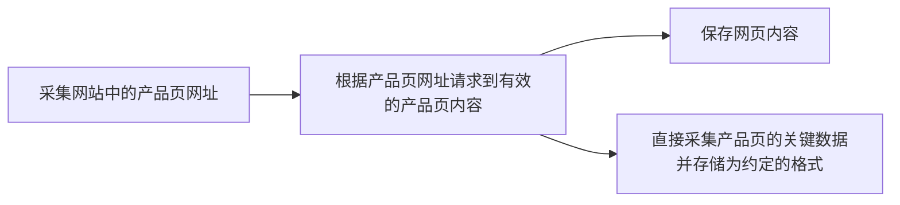

[toc]

# 采集任务说明

本文介绍对于一个给定的网站,采集该网站的所有(或尽可能完整)产品数据的基本流程.包括以下基本内容:

1. 如何访问网站产品页面并抓取有效的内容.
2. 采集网站里的所有(或尽可能完整)的有效产品链接
3. 判断给定的网站的产品数据是否符合基本要求,是否值得采集,遇到反爬时是否坚持尝试.
4. 采集的每个产品数据字段要求,以及多余信息的的清理和过滤规则.
5. 采集的数据保存指南(数据格式和存储方式).
6. 人工采集产品数据的过程中总结下来的一些经验准则.

---

## 常见的反爬和基本的应对方案

本业务需要爬取的网站大多数比较简单,没有复杂人机验证.

但是可能会被检查客户端,例如:

- cloudflare和akamai,可能会返回403,
- 还有可能遇到频率限制429,
- 或者虽然返回200但是请求到的内容是无价值的而并不是真实的产品页面
- 或者网页主要内容通过js加载,因此有时需要调用浏览器来抓取信息;
- 产品页原码可以抓取但是关键内容(例如产品描述)

采集脚本的实现主要采用python,可能需要借助一些现代化的库(例如scrapling,cloakbrowser等)来提高内容抓取成功率.

**首先要求的是稳**(能采下来,且采的内容是对的),其次才是请求速度和频率(要避免过高频率导致被限流,或者过度消耗爬虫机器的资源导致卡顿).

## 采集工作的重要节点

下面列出的若干节点,前一个节点任务完成后,后续节点的任务才有完成的基础

通常,前两个节点都成功的情况下,任务的执行才有价值,否则任务失败;

任务失败时应该记录,批注原因和建议,便于后续人工复查;

## 工作节点说明（Discover / Fetch / Persist）

1. 网址采集:收集网站上的产品页网址,尽量完整而不遗漏,但也不重复
   - 优先寻找站点地图,但是站点有时候内容和网站并不相符,或者站点地图里面的链接不是有效的产品页链接,这类情况就视为站点地图无效(当做无站点地图处理)
   - 站点地图里面的链接资源可能指向产品页,分类或者其他类型的页面,可能是压缩包(常见有 `.gz`格式),需要解压(但是后缀不一定可靠,实际上可能是文本格式不需要解压,可以先测试文件真实类型);
   - 在站点地图中,产品链接主要放在 `<loc>https://...</loc>`标签对内,也有部分是 `<loc><![CDATA[[https://...]]]></loc>`的形式,使用合适的库解析或者编写合适的正则来提取链接(最好兼容这两种情况，例如`<loc[^>]*>(?:<!\[CDATA\[)?(.*?)(?:\]\]>)?</loc>`,可以解决大多数xml提取产品页url的问题)
   - 站点地图的访问有时也要求调用浏览器(先尝试curl-cffi库的请求,如果不行,考虑无头浏览器,例如scrapling库,先尝试访问其首页,过掉可能的cloudflare验证,然后凭借cookie再请求站点地图.),普通的请求脚本可能会被拒绝访问;
   - 没有站点地图的情况比较复杂;网站可能有分类导航,进入某个大的分类中,有产品列表页,有的还有分页列表,例如page1,page2,...;而有的是瀑布流加载,不能直观看出网站(分类)下有多少页产品,只有一个用于加载下一页的按钮或者随着鼠标滚动自动加载下一页内容.
   - 还应该注意网站的语言(市场),例如,网站可能面向多个国家(语言)用户,那么应该根据需要,仅采集对应语言的产品链接;
   - 总之,在没有**有效**站点地图,收集有效网站产品页链接或许是个**难点**,尤其是在网站带有反爬的情况下,需要调用无头甚至有头真实**浏览器**发起请求.(否则,被 Cloudflare 或 Akamai 保护的网站，采用普通的请求方式的脚本收集网站产品页面的URL都是个问题)
   - 采集到的产品链接应该及时收集起来并用合适的方式保存,例如**sqlite**数据库,或者保存到文本文件中;
2. 有效请求到产品页内容
   - 简单的或者不做反爬的网站,普通的脚本请求就能够拉取产品页原码,有些则需要客户端能够执行js代码从而获取有效的真实内容
   - 有的网站还会使用cloudflare,akamai等做反爬,这时候可以考虑使用**scrapling**库(可考虑配合cloakbrowser,nodriver等其他库)来请求网页数据(但是也不保证成功,对于cloudflare有专门的求解器选项来通过验证,但是对于akamai防护,目前缺少直接的通过支持)
   - 这部分任务的难度取决于原网站的反爬措施.
3. 按需将请求到的页面做处理
   - 执行产品内容采集:直接编写针对性的采集规则脚本,对页面关键内容做提取,保存为具有约定格式的文件中.
   - 或者采用分步的做法:保存产品页面(html)到本地,然后采集本地页面内容.

最后,不同网站的采集任务做好隔离;

 采集的数据保存的形式:保存为 csv 文件,包含如下字段

1. 名称
2. 价格
3. 图片
4. 描述
5. 分类
6. 品牌
7. 属性
8. 数据来源链接

前4个字段是必须的，不得为空(描述为空的情况下,考虑复制产品名称作为产品描述)，否则不是一个合格的产品页面；

通常仅需要采集如下 **字段**:

> 注意:采集之前要判断网站所属的语言,尤其是多语言网站,采集的部分要符合本次采集的市场语言/国家!

1. 产品名称(Name):

   - 大多数情况下是 `<h1>`标签中的内容,但是有时 `<title>`标签中的内容更合适;
   - 如果标签中包含产品网站域名(例如 `domain.com`),则应该将移除此子串片段,域名不应该出现在产品名中!
2. 产品价格(Sale price):

   - 价格通常比较容易采集,大多数可以从网页原码中的相关的元标签中采集到价格数值;
     - 但是少数情况价格甚至不在原码中而是动态加载,这时候考虑浏览器方案.
   - 我主要采集美国,英国和欧盟国家的产品网站,注意价格最终是十进制阿拉伯数字表示,美元和英镑如果价格中包含逗号,则应该将逗号移除;而对于欧元价格,其小数点和逗号的含义和美元价格表示法相反,此时通常将欧元价格中的小数点移除,然后观察有逗号的话替换成小数点;
   - 另一方面要注意产品的销售单位,大多数产品不需要纠结,但是像布料这类产品,销售单位可能不在产品描述主体位置，而在标记在售价附近,这时候应该能够提取销售单位(注意语言),然后拼接到产品描述开头,单独一个小段落;
   - 价格换算:有的多语言网站会根据用户请求到ip变换价格(单位),例如某个批次我要采集英国市场的产品数据(价格),那么如果用户用美国ip请求,看到的价格是面向美元的,那么需要根据汇率进行转换为英镑;
3. 产品主图片链接(ImageUrl):

   - 产品图片原网站可能有多张,我们只需要采集1张,主图即可.
   - 注意不要采集到缩略图,或者网站logo;如果图片**链接**或图片名包含缩略图字样(thumbnail),则检查其分辨率,如果不是很小的话,也可以采用;
4. 产品描述(Description):

   - 产品描述采集的是相关的html原码片段,例如 `
...
`,这样html表示的**表格**(`<table>`)也可以完整采集下来,便于我们后期在html中渲染;
   - 有些页面中的产品描述分散在多个地方,可以分别采集,不同片段之间用 ` `标签拼接;然后合并成一个字段;
   - 注意,采集到的html原码片段需要适当清洗:用合适的**正则**剔除掉标签属性,比如css等信息;
   - 产品描述方面只要采产品本身属性相关的信息,而销售店铺相关的信息,例如运费和快递详情,联系方式,客户评价等信息我们不需要,抽查测采一些产品页,如果采到了请尽可能过滤掉
     - 如果其中如果有电话号码,或者诸如联系我们...,或者点击按钮下载资料(例如pdf链接)的部分,应该剔除掉,这对我们没有用;
     - 产品描述中包含的跳转链接(不允许出现任何https链接!必要时替换为空格),或者图片,视频元素,也不需要,只需要文本;
     - 此外,诸如"点击查看更多","查看全部","正在加载(Loading...)"这类字样片段也应该剔除;
   - 将 `<h1>`,`<h2>`这类标题型的标签替换为 `<strong>`标签;
5. 产品分类(Categories):

   - 分类可能位于网页的元数据标签中,也可能在面包屑中,且面包屑中可能有多级,一般采集靠中间的**一级**就行;如果得到多级且被 `>`,`/`,`,`这类分隔符分割,则取第一部分即可
   - 注意分类含义不应该过于宽泛,比如有的面包屑第一级是"商店",这种分类是没有意义的,通常避免采集第一级面包屑;
     - 另外面包屑的最后一级可能是产品名,这也适合作为分类;
     - 此外Xpath的方式来采集分类往往很有效;
   - 总之,有时候合适的分类不一定存在于产品网页中,当没有合适的分类就用一个感叹号"!"兜底;
6. 产品品牌(brand):如果有的话就采集,没有就跳过
7. 产品属性(attribute):产品的属性可以理解为产品型号/尺寸/颜色/...这类可供用户选择的属性

   - 有的产品有属性,有的产品没有,那就不需要采;属性有的写在html原码中的某个标签中,特别的,可能在`<script>`标签中的某个json中;
   - 注意有的产品页面可以选择数量,比如1件/2件/... 这不是很有用的属性,可以不采集
8. 产品数据来源网址(PageUrl):记录原网址方便后期抽查校对

## 采集任务工作目录的组织

采集过程中会产生一些目录和文件,存放在任务根目录下;

每一个网站采集任务按照如下路径结构组织:

网站采集的任务根目录路径:`工作目录/国家代号/产品分类/采集任务创建日期/网站域名`,

> "国家代号"主要有:US,UK,DE,FR,ES,IT,以及CA,AU,SE,NO;分别对应美国,英国,德国,法国,西班牙,意大利,以及加拿大,澳大利亚,瑞典,挪威;

例如:`spider/US/家居用品/20260707/domian.com/`

### 合理保存采集到的网址

有的网站产品数量可达千万级别,网址采集阶段也应该选用合适的保存方式;

## 合理地存储采集数据

考虑到有的网站产品数量很多,不宜完全将采集结果保存在内存中;

考虑流式写入,即每采集一个产品,就记录一条数据,在此基础上考虑使用效率高的数据保存方式,主要是方便我及时检查问题,能够及时阻止错误的采集继续下去;

## 网页原码分析前的注意事项

虽然不多见,但是有时候请求到的产品页内容可能被编码,例如产品描述被编码为(URL Encode),为了采集到正确的内容,需要尝试一些常见的解码方式,例如URL Decode;

## 跳过采集的网站判断标准

有的网站是定制品站,例如衣服上打印用户给定的文字,或者塑料袋打印定制,这些网站跳过采集;

## 相关概念和术语

| 中文名称            | 英文术语                      | 含义                           | 示例                   |
| ------------------- | ----------------------------- | ------------------------------ | ---------------------- |
| 产品属性(属性名称)  | Product Attribute             | 描述产品特征的所有属性（广义） | 颜色、尺寸、重量、材质 |
| 可选属性 / 变体属性 | Variant Attribute / Option    | 用户可以选择的属性             | 尺码 S/M/L，颜色 红/蓝 |
| 属性值              | Attribute Value               | 属性的具体取值                 | “红色”、“XL”           |
| 变体                | Product Variant / SKU Variant | 一个具体组合                   | 红色 + XL              |
| SKU                 | Stock Keeping Unit            | 最小库存单位（唯一商品）       | 红色XL T恤的唯一编码   |

典型划分:

* “颜色”是 **属性（Attribute）**
* “红色”是 **属性值（Value）**
* “红色 + XL” 是 **变体（Variant）**
* “唯一库存编号”是 **SKU**

在现代电商（如 **Shopify**、**Amazon**）中,相关的概念有:

* **Option（选项）**
* **Variant（变体）**

更工程化的定义

* Attribute = 维度（dimension）
* Value = 枚举值（enum value）
* Variant = 笛卡尔积（Cartesian Product）

## 属性的采集规范和约定

如果产品页提供了产品属性搭配选项供用户选择(典型产品是服装,有的颜色不可选,有的有颜色可供选择,但是基本都有尺码可供用户选择;也有简单的属性值,例如一瓶除草剂的金含量,比如200ml,500ml,1000ml等).
部分属性不需要采集:例如数量(1件,2件,...),这类属性不需要采集;
另一种情况是每个属性值点击后都会跳转到新到链接,那么每个产品页视为一个单一的产品,属性也可以不采;
此外,定制的产品(比如收入一段文字打印在衣服上)的属性值过于个性化,也不适合采集,甚至这个网站如果是定制站,就直接跳过采集,执行下一个网站的采集;
以衣服为例:

* 如果该产品仅提供了尺码(size)供用户选择,并且可选项为:X,L,M三个可选值,那么最终保存到字段值为:`size#X|L|M`,这属于单组属性
* 如果该产品同时提供了尺码(size)和颜色(color),且颜色可选取值有:Red,Blue,Black;那么最终保存到字段值为:`size#X|L|M~color#Red|Blue|Black`,这属于多组属性(两组属性)

注意,产品的属性值可能很多,可能不止2组,也可能没有属性需要采集;
**属性字段的拼接规则**:每组属性的格式为 `属性名#属性选项值1|属性选项值2|...`(组内的属性(名)用 `#`和第一个属性选项链接起来,属性值之间用 `|`链接起来,当然使用 `>`链接组内的属性值选项也是可以的),如果有多组属性,则用 `~`分割开来;

> 注意,属性名或属性选项值本身字符串中禁止出现如下字符:`#`,`|`,`~`，`>`,否则会导致解析混乱;如果原属性名或属性选项值中包含这些字符(某些尺码中可能会用英语中的逗号 `,`代替阿拉伯数字中的 `.`号,可以考虑用外观类似逗号的字符代替逗号,例如 `‚`(Unicode 码点U+201A));
> 此外,属性选项中可能直接包含了套餐价格(例如200ml($10),500ml($20),或者相对基础款式进行差价标记,比如700ml(+$30)),这时候要去掉价格,包括价格可能带有的货币符号,保留和产品属性最相关的字符串,例如这里的200ml,700ml;

属性名和属性选项值字符串处理指南

> 在拼接成属性字段前,对属性名和属性选项值字符串进行如下字符替换处理:
> `attri_chars_translate_dict = {",": "‚", ":": " ", ";": "；"}`(python字符替换为例)

> 例如 `,`会被替换为 `‚`

最后,如果采集的属性字段值不应该出现重复的组,且组内也不应该出现重复的属性选项取值,例如 `size#X|L|M|X`(出现了2此`X`)应该经过去重处理得到 `size#X|L|M`;
又例如 `size#X|L|M|M~color#Red|Blue~color#Red|Blue`应该经过去重处理得到 `size#X|L|M~color#Red|Blue`(也就是每一组内都要去重)

## 采集字段的统一处理要求

- 移除多余的空格:
  - 移除字段边缘的空白字符;
  - 连续空白压缩:将采集到的字段值做多余空格压缩处理,例如使用正则将所有匹配 `\s+`的空白片段替换为单个空格;
- 产品描述主要来自于相关的原码片段,但是标签中可能带有大量非关键信息,比如css样式等,可以通过类似于 `<(\w+)[^>]*>`的正则来剔除掉标签属性,保留标签本身(替换为 `<$1>`),例如 `
...
`;保留为 `
...
`
- 对于产品描述,还应该执行以下正则替换(经验总结而来)

1. `(\\+r|\\+n)`替换为空
2. `\s*(</?\s*br\s*/?\s*>\s*)+`替换为 ` `

- 如果某个字段采集自json片段,那么有些字符会被编码,形如 `\uxxxx`;的形式,应该注意解码成人类可读的形式;
- 此外,产品描述中可能含有 `\r`,`\n`,甚至是被编码后带有多余 `\`和空格的 ` `标签,这类符号,应该去除(或者替换为 ` `标签);

## 采集测试案例

* [https://javaestate.com/](https://javaestate.com/) (简单站点,美国食品站点,单语言(英语),无需代理,有站点地图,但是有限流,请求不能过快,否则遇到429)
* [https://www.makpoint.es/](https://www.makpoint.es/) (需要国外ip访问,有站点地图,可以curl直接请求网页内容)
* [https://www.bedbathandbeyond.com/](https://www.bedbathandbeyond.com/) (需要浏览器+伪装请求,且站点地图不包含直接的产品页地址)
* [https://www.shopthebulkstore.com/](https://www.shopthebulkstore.com/) (美国食品网站,没有站点地图,可能有限流,需要浏览器或curl-cffi库伪装chrome指纹来请求页面)
* [https://www.skatepro.es/](https://www.skatepro.es/) (西班牙体育用品,有的产品有属性需要采集)