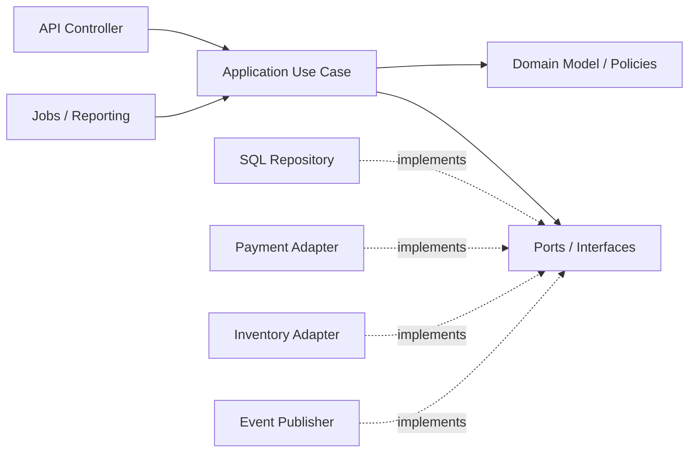
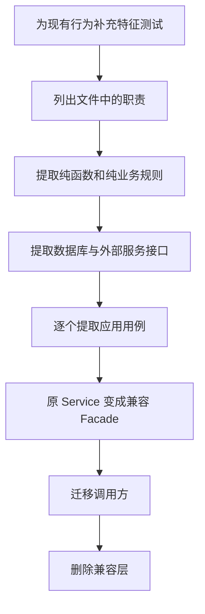

[toc]


## abstract

成熟项目里确实存在 5000 行、甚至几万行的大文件，但“存在”不等于“合理”。

判断关键不是项目是否成熟，而是这个文件属于哪一类：

| 大文件类型                                         | 5000+ 行是否可能合理 | 推荐处理                         |
| -------------------------------------------------- | -------------------: | -------------------------------- |
| **自动生成代码（Generated Code）**                 |                 合理 | 标记生成来源，禁止手改，排除检查 |
| **第三方代码（Vendor Code）**                      |                 合理 | 独立目录管理，排除检查           |
| **静态数据、协议表、语法表**                       |             有时合理 | 尽量生成；与业务逻辑分离         |
| **高度内聚的编译器、解析器、状态机**               |             有时合理 | 评估复杂度、测试性，而不只看行数 |
| **测试快照、Fixture**                              |             有时合理 | 与测试逻辑分离                   |
| **Controller、Service、React/Vue 组件**            |           通常不合理 | 按职责和用例拆分                 |
| **一个文件同时处理数据库、支付、库存、通知、报表** |           明显不合理 | 属于 **God File / God Object**   |
| **AI 每次开发都继续往同一个文件追加**              |           明显不合理 | 建立规则和 CI 门禁               |

一个真实的合理例外是 SQLite：它会把一百多个源文件组合成一个超过 20 万行的 `sqlite3.c`，目的是方便部署并让编译器做跨过程优化；该文件是由脚本生成的 **amalgamation（合并发行文件）**，而不是开发者日常维护业务代码的组织方式。

因此可以采用下面这个简单判断：

> **5000 行的生成文件可能完全正常；5000 行的手写业务 Service，大概率已经需要治理。**

---

## 不要只用“行数”判断

建议按下面几个问题检查一个大文件。这里展示的是**可公开的判断框架**，不是单纯凭经验说“5000 行一定不好”。

| 判断问题                | 健康信号             | 危险信号                               |
| ----------------------- | -------------------- | -------------------------------------- |
| **代码是否手写**        | 自动生成、第三方引入 | 开发者持续直接编辑                     |
| **有几个变更原因**      | 围绕一个领域概念变化 | 支付、库存、营销、报表任一变化都会改它 |
| **依赖多少外部系统**    | 少量明确依赖         | DB、Redis、MQ、支付、邮件全部注入      |
| **是否容易独立测试**    | 核心逻辑可纯函数测试 | 必须启动数据库和多个 Mock              |
| **函数复杂度如何**      | 短函数、浅分支       | 大量 `if/switch/try/catch` 嵌套        |
| **多人是否频繁修改**    | 低冲突               | 几乎每个需求都修改这个文件             |
| **能否清楚描述职责**    | “负责订单定价”       | “负责订单相关的所有东西”               |
| **AI 修改是否局部可控** | 修改集中在明确模块   | 每次都要读写整个大文件                 |

**文件行数只是触发检查的信号（Tripwire），不是最终架构目标。**

---

## 建议采用的规模控制

下面这套数值适合 **TypeScript/JavaScript 普通应用项目**，并不是所有语言的绝对标准。

| 指标                              |            推荐目标 |                     合并门禁 |
| --------------------------------- | ------------------: | ---------------------------: |
| 手写生产文件                      | **300～400 行以内** |      新文件不超过 **600 行** |
| 已有大文件                        |            逐步减少 | 超过 600 行后 **禁止净增长** |
| 单个函数/方法                     |   **40～60 行以内** |             不超过 **80 行** |
| 圈复杂度（Cyclomatic Complexity） |   不超过 **10～15** |            不超过 **15～20** |
| 嵌套深度                          |         不超过 3 层 |              不超过 **4 层** |
| 5000+ 行手写文件                  |        进入专项治理 |   原则上不再直接增加业务功能 |
| Generated/Vendor                  |              不限制 |       必须明确排除并禁止手改 |

ESLint 官方的 `max-lines` 默认值是 `300`，文档也明确说明虽然不存在客观唯一上限，但常见建议范围是 `100～500` 行，并认为文件通常不应达到数千行。`max-lines-per-function` 默认值是 `50`，`complexity` 的默认阈值是 `20`。

**推荐不要立即对所有旧文件执行 600 行硬限制**，否则结果通常是开发者批量添加禁用注释。更合理的是：

- **新文件执行硬上限**
- **小文件不能突破上限**
- **旧大文件允许暂时存在，但禁止继续增长**
- **生成文件显式豁免**
- **拆分大文件时逐步降低基线**

这是一种 **棘轮机制（Ratchet Mechanism）**：只允许质量保持或改善，不允许继续退化。

### 为什么 AI coding 特别容易出大文件？

AI 倾向于：

- 在现有文件里继续追加（context 方便）
- 一次生成大段完整功能
- 较少主动提出“该拆了”

结果就是文件快速膨胀，**可读性、可测试性、冲突率、AI 后续修改准确率**都下降。实践观察：超过约 **200–400 行**后，AI 对文件的整体把握会明显变差。

是否要设上限控制？**强烈建议设。**

硬性数字没有绝对标准，但社区和实践有清晰共识区间：

| 场景/工具                      | 常见建议/默认                                            | 说明                           |
| ------------------------------ | -------------------------------------------------------- | ------------------------------ |
| **ESLint `max-lines`**         | 默认 300，社区常 100–500                                 | 大多数人认为不应到数千行       |
| **Pylint `max-module-lines`**  | 默认 **1000**                                            | Python 模块上限                |
| **通用最佳实践**               | **目标 <300–500 行**；>500 开始警惕；>1000–2000 强烈重构 | 优先按**职责**拆，而非死卡数字 |
| **AI 友好硬限（solo/小团队）** | **200 行**（或 150 预警）                                | 让 AI 能一次完整理解文件       |
| **宽松生产限**                 | 800–1500（排除 generated）                               | 允许复杂但内聚的文件           |
| **函数级别**                   | 通常 <50 行（很多风格指南更严）                          | 比文件更重要                   |

**关键原则**（比死数字更重要）：

- **单一职责（Single Responsibility）** / 高内聚低耦合
- 一个文件应能快速回答“它主要干什么？”
- 相关函数/类放一起，不相关的拆出去
- **Generated 文件**明确标记并排除检查

### 拆分策略

不要只为拆而拆

- 按 **feature / domain / layer**（controller / service / repo / util）
- 提取 helper、private 方法到同目录 sibling 文件
- 大 class 拆成多个 focused class + composition
- 用 barrel/`index` 文件保持对外 API 干净
- 有测试保护时再大胆重构

AI 协作规则（写进 `AGENTS.md` / `CLAUDE.md` / 系统提示）
关键内容示例：

- 优先创建新文件而非无限扩展现有大文件
- 文件接近 300/500 行时，先规划拆分再继续加功能
- 拆分时按**领域/职责/变更频率**，而非机械按行数
- 新功能默认新模块 + 清晰导出

---

## 具体案例:订单服务

下面使用一个具有代表性的 TypeScript 项目案例。

假设项目经过半年 AI coding 后出现：

`src/modules/orders/order.service.ts`：**5380 行**

文件包含：

- 创建订单
- 商品查询
- 价格计算
- 优惠券计算
- VIP 折扣
- 库存检查和锁定
- Stripe、PayPal 支付
- 取消订单
- 退款
- 邮件通知
- 消息发布
- 订单导出
- 支付对账
- DTO 转换

### 拆分前的典型代码

以下是简化片段，实际文件还有大量类似方法：

```ts
export class OrderService {
  constructor(
    private readonly db: Database,
    private readonly inventoryClient: InventoryClient,
    private readonly stripeClient: StripeClient,
    private readonly paypalClient: PayPalClient,
    private readonly mailer: Mailer,
    private readonly eventBus: EventBus,
  ) {}

  async createOrder(input: CreateOrderInput): Promise<OrderDto> {
    const customer = await this.db.customers.findById(input.customerId);

    if (!customer) {
      throw new Error("Customer not found");
    }

    if (input.items.length === 0) {
      throw new Error("Order items cannot be empty");
    }

    let subtotal = 0;
    const orderItems: OrderItemRecord[] = [];

    for (const item of input.items) {
      const product = await this.db.products.findById(item.productId);

      if (!product) {
        throw new Error(`Product ${item.productId} not found`);
      }

      if (!product.enabled) {
        throw new Error(`Product ${item.productId} is disabled`);
      }

      const available = await this.inventoryClient.getAvailableQuantity(
        item.productId,
      );

      if (available < item.quantity) {
        throw new Error(`Product ${item.productId} is out of stock`);
      }

      subtotal += product.price * item.quantity;

      orderItems.push({
        productId: product.id,
        productName: product.name,
        unitPrice: product.price,
        quantity: item.quantity,
      });
    }

    let discount = 0;

    if (customer.level === "VIP") {
      discount += subtotal * 0.1;
    }

    if (input.couponCode) {
      const coupon = await this.db.coupons.findByCode(input.couponCode);

      if (!coupon || coupon.expired) {
        throw new Error("Invalid coupon");
      }

      if (coupon.type === "PERCENTAGE") {
        discount += subtotal * coupon.value;
      } else if (coupon.type === "FIXED") {
        discount += coupon.value;
      }
    }

    const totalAmount = Math.max(0, subtotal - discount);

    const order = await this.db.transaction(async (transaction) => {
      const created = await transaction.orders.insert({
        customerId: customer.id,
        items: orderItems,
        subtotal,
        discount,
        totalAmount,
        status: "PENDING",
      });

      await this.inventoryClient.reserve(created.id, input.items);

      if (input.paymentMethod === "STRIPE") {
        await this.stripeClient.charge({
          orderId: created.id,
          amount: totalAmount,
          token: input.paymentToken,
        });
      } else if (input.paymentMethod === "PAYPAL") {
        await this.paypalClient.charge({
          orderId: created.id,
          amount: totalAmount,
          token: input.paymentToken,
        });
      } else {
        throw new Error("Unsupported payment method");
      }

      await transaction.orders.updateStatus(created.id, "PAID");

      await this.mailer.sendOrderConfirmation(customer.email, created);
      await this.eventBus.publish("order.paid", {
        orderId: created.id,
      });

      return created;
    });

    return this.toOrderDto(order);
  }

  async cancelOrder(orderId: string): Promise<void> {
    // 另外 300 行
  }

  async refundOrder(orderId: string): Promise<void> {
    // 另外 400 行
  }

  async exportOrders(query: ExportOrderQuery): Promise<Buffer> {
    // 另外 600 行
  }

  async reconcilePayments(): Promise<void> {
    // 另外 800 行
  }

  private toOrderDto(order: OrderRecord): OrderDto {
    // 大量转换代码
  }
}
```

### 这个文件真正的问题

**5380 行只是表象，核心问题是不同变化原因被耦合在一起。**

| 文件中的代码          | 发生变化的原因   | 应归属的位置                    |
| --------------------- | ---------------- | ------------------------------- |
| 参数解析、DTO 转换    | API 变化         | `api/`                          |
| 创建、取消、退款流程  | 业务用例变化     | `application/`                  |
| VIP、优惠券和价格规则 | 营销规则变化     | `domain/pricing/`               |
| 订单状态转换          | 订单领域规则变化 | `domain/order.ts`               |
| SQL、ORM 查询         | 数据库变化       | `infrastructure/repositories/`  |
| Stripe、PayPal        | 支付供应商变化   | `infrastructure/payments/`      |
| 库存调用              | 库存系统变化     | `infrastructure/inventory/`     |
| 邮件和消息            | 通知机制变化     | `infrastructure/notifications/` |
| 导出和对账            | 后台任务变化     | `jobs/` 或 `reporting/`         |

这违反的主要不是“文件不得超过 600 行”，而是 **关注点分离（Separation of Concerns）** 和 **单一职责原则（Single Responsibility Principle）**。

---

## 推荐拆分后的目录

```text
src/modules/orders/
├── api/
│   ├── order.controller.ts
│   ├── order.request.ts
│   └── order.presenter.ts
├── application/
│   ├── create-order.ts
│   ├── cancel-order.ts
│   ├── refund-order.ts
│   └── get-order.ts
├── domain/
│   ├── order.ts
│   ├── order-item.ts
│   ├── order-errors.ts
│   └── pricing/
│       ├── order-pricing.ts
│       ├── discount-policy.ts
│       └── coupon-policy.ts
├── ports/
│   ├── order-repository.ts
│   ├── product-catalog.ts
│   ├── inventory-gateway.ts
│   ├── payment-gateway.ts
│   └── event-publisher.ts
├── infrastructure/
│   ├── repositories/
│   │   └── sql-order-repository.ts
│   ├── payments/
│   │   ├── payment-router.ts
│   │   ├── stripe-payment-gateway.ts
│   │   └── paypal-payment-gateway.ts
│   └── inventory/
│       └── http-inventory-gateway.ts
├── jobs/
│   ├── export-orders.ts
│   └── reconcile-payments.ts
└── index.ts
```

依赖关系可以整理为：



**应用用例负责编排，领域对象负责规则，基础设施负责外部系统。**

---

## 第一个拆分点：提取纯定价逻辑

原文件里最适合优先提取的，一般是：

- 无数据库写入
- 无远程调用
- 输入输出明确
- 容易写单元测试

例如价格计算。

### `domain/pricing/order-pricing.ts`

```ts
export interface PricedItem {
  productId: string;
  unitPrice: number;
  quantity: number;
}

export interface CustomerPricingProfile {
  level: "NORMAL" | "VIP";
}

export interface Coupon {
  type: "PERCENTAGE" | "FIXED";
  value: number;
}

export interface OrderQuote {
  subtotal: number;
  memberDiscount: number;
  couponDiscount: number;
  totalAmount: number;
}

export class OrderPricing {
  quote(
    customer: CustomerPricingProfile,
    items: PricedItem[],
    coupon?: Coupon,
  ): OrderQuote {
    const subtotal = items.reduce(
      (sum, item) => sum + item.unitPrice * item.quantity,
      0,
    );

    const memberDiscount =
      customer.level === "VIP" ? subtotal * 0.1 : 0;

    const couponDiscount = coupon
      ? this.calculateCouponDiscount(subtotal, coupon)
      : 0;

    const totalAmount = Math.max(
      0,
      subtotal - memberDiscount - couponDiscount,
    );

    return {
      subtotal,
      memberDiscount,
      couponDiscount,
      totalAmount,
    };
  }

  private calculateCouponDiscount(
    subtotal: number,
    coupon: Coupon,
  ): number {
    if (coupon.type === "PERCENTAGE") {
      return subtotal * coupon.value;
    }

    return coupon.value;
  }
}
```

现在这段代码：

- **不依赖数据库**
- **不依赖支付系统**
- **不发送邮件**
- **可以被独立测试**
- **营销规则修改时，只需要修改定价模块**

对应测试：

```ts
import { describe, expect, it } from "vitest";
import { OrderPricing } from "./order-pricing";

describe("OrderPricing", () => {
  it("applies VIP and percentage coupon discounts", () => {
    const pricing = new OrderPricing();

    const quote = pricing.quote(
      { level: "VIP" },
      [
        {
          productId: "product-1",
          unitPrice: 100,
          quantity: 2,
        },
      ],
      {
        type: "PERCENTAGE",
        value: 0.2,
      },
    );

    expect(quote).toEqual({
      subtotal: 200,
      memberDiscount: 20,
      couponDiscount: 40,
      totalAmount: 140,
    });
  });

  it("does not produce a negative total", () => {
    const pricing = new OrderPricing();

    const quote = pricing.quote(
      { level: "NORMAL" },
      [
        {
          productId: "product-1",
          unitPrice: 30,
          quantity: 1,
        },
      ],
      {
        type: "FIXED",
        value: 100,
      },
    );

    expect(quote.totalAmount).toBe(0);
  });
});
```

**拆分不是为了让文件变短，而是为了得到可以独立验证的业务能力。**

---

## 第二个拆分点：用接口隔离外部系统

不要让创建订单的用例直接知道 Stripe、PayPal、数据库和 HTTP 客户端的细节。

### `ports/payment-gateway.ts`

```ts
export interface PaymentRequest {
  orderId: string;
  amount: number;
  paymentMethod: "STRIPE" | "PAYPAL";
  paymentToken: string;
}

export interface PaymentAuthorization {
  authorizationId: string;
}

export interface PaymentGateway {
  authorize(
    request: PaymentRequest,
  ): Promise<PaymentAuthorization>;

  void(authorizationId: string): Promise<void>;
}
```

### `ports/inventory-gateway.ts`

```ts
export interface InventoryItem {
  productId: string;
  quantity: number;
}

export interface InventoryReservation {
  reservationId: string;
}

export interface InventoryGateway {
  reserve(
    orderId: string,
    items: InventoryItem[],
  ): Promise<InventoryReservation>;

  release(reservationId: string): Promise<void>;
}
```

### `ports/order-repository.ts`

```ts
import { Order } from "../domain/order";

export interface OrderRepository {
  findByIdempotencyKey(key: string): Promise<Order | null>;
  insert(order: Order): Promise<void>;
  save(order: Order): Promise<void>;
}
```

这里的 `Port` 是端口接口，Stripe、PayPal、SQL、HTTP 客户端则属于 **Adapter（适配器）**。

---

## 第三个拆分点：把创建订单变成独立用例

### `application/create-order.ts`

```ts
export class CreateOrder {
  constructor(
    private readonly customers: CustomerRepository,
    private readonly products: ProductCatalog,
    private readonly orders: OrderRepository,
    private readonly pricing: OrderPricing,
    private readonly inventory: InventoryGateway,
    private readonly payments: PaymentGateway,
    private readonly events: EventPublisher,
  ) {}

  async execute(command: CreateOrderCommand): Promise<OrderDto> {
    const existing = await this.orders.findByIdempotencyKey(
      command.idempotencyKey,
    );

    if (existing) {
      return toOrderDto(existing);
    }

    const customer = await this.customers.getRequired(command.customerId);
    const products = await this.products.getRequired(command.items);

    const quote = this.pricing.quote(
      customer,
      products.map((product) => ({
        productId: product.id,
        unitPrice: product.price,
        quantity: command.items.find(
          (item) => item.productId === product.id,
        )!.quantity,
      })),
      command.coupon,
    );

    const order = Order.create({
      customerId: customer.id,
      idempotencyKey: command.idempotencyKey,
      items: command.items,
      quote,
    });

    await this.orders.insert(order);

    let reservation: InventoryReservation | undefined;
    let payment: PaymentAuthorization | undefined;

    try {
      reservation = await this.inventory.reserve(
        order.id,
        command.items,
      );

      payment = await this.payments.authorize({
        orderId: order.id,
        amount: quote.totalAmount,
        paymentMethod: command.paymentMethod,
        paymentToken: command.paymentToken,
      });

      order.confirm({
        reservationId: reservation.reservationId,
        paymentAuthorizationId: payment.authorizationId,
      });

      await this.orders.save(order);
      await this.events.publish(order.releaseEvents());

      return toOrderDto(order);
    } catch (error) {
      if (payment) {
        await this.payments.void(payment.authorizationId);
      }

      if (reservation) {
        await this.inventory.release(reservation.reservationId);
      }

      order.markFailed();
      await this.orders.save(order);

      throw error;
    }
  }
}
```

这个用例仍然包含一定长度，因为它负责完整的创建订单流程，但它只负责一件事：

> **编排“创建订单”这个应用用例。**

它不再负责：

- Stripe SDK 调用细节
- PayPal SDK 调用细节
- SQL 拼接
- 优惠规则实现
- 邮件模板
- Excel 导出
- 对账任务

实际生产环境还应继续处理：

- **幂等性（Idempotency）**
- 支付成功但数据库保存失败
- 库存释放失败
- **事务发件箱（Transactional Outbox）**
- 重试和补偿
- Saga 状态持久化

不过这些问题现在可以分别解决，不必继续堆进一个 5000 行文件。

---

## 保留原有 API，避免一次性重写

拆分时不一定要立刻修改所有调用方。可以让原来的 `OrderService` 暂时变成 **Facade（外观层）**：

```ts
export class OrderService {
  constructor(
    private readonly createOrder: CreateOrder,
    private readonly cancelOrder: CancelOrder,
    private readonly refundOrder: RefundOrder,
  ) {}

  create(input: CreateOrderCommand): Promise<OrderDto> {
    return this.createOrder.execute(input);
  }

  cancel(input: CancelOrderCommand): Promise<void> {
    return this.cancelOrder.execute(input);
  }

  refund(input: RefundOrderCommand): Promise<void> {
    return this.refundOrder.execute(input);
  }
}
```

这样可以做到：

- **调用方不需要一次性全部修改**
- 每次只迁移一个用例
- 新旧实现可以进行结果对比
- 每个 PR 的变更范围比较可控
- 最后再删除这个兼容 Facade

---

## 安全的拆分顺序

**不要让 AI 一次性把 5000 行文件改成 30 个文件。**  
这种“大爆炸重构（Big-bang Refactoring）”很容易出现行为遗漏。

推荐顺序：



具体执行建议：

| 阶段         | 操作                           | 是否允许改变行为 |
| ------------ | ------------------------------ | ---------------: |
| 建立保护     | 为关键输入输出和副作用补测试   |               否 |
| 提取纯逻辑   | 定价、校验、状态转换           |               否 |
| 提取基础设施 | Repository、支付、库存 Adapter |               否 |
| 提取用例     | 创建、取消、退款分别迁移       |         原则上否 |
| 行为优化     | 补偿、幂等、Outbox             |    可以，单独 PR |
| 删除旧代码   | 清理 Facade 和无用依赖         |               否 |

**“结构重构”和“行为修改”应尽量分成不同 PR。**

---

## ESLint 上限配置

当前 ESLint 和 `typescript-eslint` 官方文档使用 Flat Config，可以通过 `eslint.config.mjs` 配置 TypeScript 文件规则。

对于已有大量遗留大文件的项目，建议先把文件限制设为 `warn`，函数和复杂度设为 `error`：

```js
// eslint.config.mjs
// @ts-check

import js from "@eslint/js";
import { defineConfig, globalIgnores } from "eslint/config";
import tseslint from "typescript-eslint";

export default defineConfig([
  globalIgnores([
    "dist/",
    "coverage/",
    "src/generated/",
    "**/*.generated.ts",
    "**/*.gen.ts",
    "vendor/",
  ]),

  {
    files: ["src/**/*.ts"],
    extends: [
      js.configs.recommended,
      tseslint.configs.recommended,
    ],
    rules: {
      "max-lines": [
        "warn",
        {
          max: 600,
          skipBlankLines: true,
          skipComments: true,
        },
      ],

      "max-lines-per-function": [
        "error",
        {
          max: 80,
          skipBlankLines: true,
          skipComments: true,
        },
      ],

      complexity: [
        "error",
        {
          max: 15,
        },
      ],

      "max-depth": ["error", 4],
      "max-params": ["error", 5],
    },
  },

  {
    files: ["test/**/*.ts", "tests/**/*.ts"],
    extends: [
      js.configs.recommended,
      tseslint.configs.recommended,
    ],
    rules: {
      "max-lines": [
        "warn",
        {
          max: 1000,
          skipBlankLines: true,
          skipComments: true,
        },
      ],
      "max-lines-per-function": [
        "warn",
        {
          max: 120,
          skipBlankLines: true,
          skipComments: true,
        },
      ],
      complexity: ["warn", 20],
    },
  },
]);
```

这里故意把：

- **生产文件**设置得更严格
- **测试文件**适度放宽
- **生成文件**完全排除
- **函数复杂度**设置成阻断错误
- **旧文件行数**暂时只预警

但仅靠 ESLint 的 `warn` 还不够，因为旧大文件可能继续增长，所以还需要一个增量门禁。

---

## 对旧大文件实施“只减不增”

例如：

- 当前文件 5380 行
- 这个 PR 修改前是 5380 行
- 修改后是 5400 行：**失败**
- 修改后是 5200 行：**通过**
- 下一个 PR 以 5200 行为基线，因此不能重新增长到 5380 行
- 新文件超过 600 行：**失败**

可以增加 `scripts/check-file-growth.mjs`：

```js
import { execFileSync } from "node:child_process";
import { readFileSync } from "node:fs";

const MAX_NEW_FILE_LINES = 600;
const baseSha = process.env.BASE_SHA;

if (!baseSha) {
  throw new Error("BASE_SHA is required");
}

function git(args) {
  return execFileSync("git", args, {
    encoding: "utf8",
    stdio: ["ignore", "pipe", "ignore"],
  });
}

function countLines(content) {
  return content
    .split(/\r?\n/)
    .filter((line) => line.trim().length > 0)
    .length;
}

function isExcluded(file) {
  return (
    file.includes("/generated/") ||
    file.includes("/vendor/") ||
    file.endsWith(".generated.ts") ||
    file.endsWith(".gen.ts")
  );
}

function readBaseFile(file) {
  try {
    return git(["show", `${baseSha}:${file}`]);
  } catch {
    return "";
  }
}

const changedFiles = git([
  "diff",
  "--name-only",
  "--diff-filter=AM",
  "--no-renames",
  baseSha,
  "HEAD",
  "--",
  "src/**/*.ts",
])
  .split(/\r?\n/)
  .filter(Boolean)
  .filter((file) => !isExcluded(file));

const violations = [];

for (const file of changedFiles) {
  const currentLines = countLines(readFileSync(file, "utf8"));
  const previousLines = countLines(readBaseFile(file));

  const allowedLines =
    previousLines > MAX_NEW_FILE_LINES
      ? previousLines
      : MAX_NEW_FILE_LINES;

  if (currentLines > allowedLines) {
    violations.push({
      file,
      previousLines,
      currentLines,
      allowedLines,
    });
  }
}

if (violations.length > 0) {
  console.error("File-size quality gate failed:");

  for (const violation of violations) {
    console.error(
      [
        violation.file,
        `previous=${violation.previousLines}`,
        `current=${violation.currentLines}`,
        `allowed=${violation.allowedLines}`,
      ].join(" "),
    );
  }

  process.exit(1);
}
```

这段脚本不会强迫你立即解决全部遗留问题，但它会阻止问题进一步恶化。

---

## 接入 GitHub Actions 合并门禁

GitHub Actions 可以由 `pull_request` 事件触发；受保护分支可以要求指定状态检查通过后才允许合并。

```yaml
name: quality-gate

on:
  pull_request:

jobs:
  quality:
    runs-on: ubuntu-latest

    steps:
      - name: Checkout
        uses: actions/checkout@v7
        with:
          fetch-depth: 0

      - name: Setup Node.js
        uses: actions/setup-node@v7
        with:
          node-version: 24
          cache: npm

      - name: Install dependencies
        run: npm ci

      - name: Run ESLint
        run: npm run lint

      - name: Prevent large-file growth
        env:
          BASE_SHA: ${{ github.event.pull_request.base.sha }}
        run: node scripts/check-file-growth.mjs

      - name: Run tests
        run: npm test
```

截至当前官方发布信息，`actions/checkout` 和 `actions/setup-node` 已提供 `v7` 版本。

然后在 GitHub 的 Branch Protection 或 Ruleset 中：

- 开启 **Require a pull request before merging**
- 开启 **Require status checks to pass before merging**
- 将 `quality` 设置为必需检查
- 对架构核心目录，可以要求 Code Owner 审查

GitHub 的 `CODEOWNERS` 可以让指定人员或团队自动成为相关文件的审查者，并能配合分支保护要求 Code Owner 批准。

例如：

```text
/src/modules/orders/domain/          @company/order-domain
/src/modules/orders/application/     @company/order-domain
/src/modules/orders/infrastructure/  @company/platform
/.github/                             @company/platform
/scripts/check-file-growth.mjs       @company/platform
```

---

## 写入 AI 编码规则

建议把规则写进 `AGENTS.md`、`CLAUDE.md` 或项目级 AI instructions，而不是每次临时提醒。

```markdown
## File and module boundaries

- Hand-written production files SHOULD remain below 400 effective lines.
- New hand-written production files MUST NOT exceed 600 effective lines.
- Existing files above 600 lines MUST NOT increase in size.
- Generated, vendor, snapshot, and fixture files are exempt only when clearly identified.
- Do not solve the limit by creating files named `part1`, `part2`, or generic `utils`.
- Split modules by responsibility, use case, domain concept, and reason to change.
- A file should have one primary responsibility that can be stated in one sentence.
- Before modifying a file above 1000 lines:
  - list its existing responsibilities;
  - identify the responsibility affected by the task;
  - propose an extraction boundary;
  - prefer extracting that responsibility before adding new behavior.
- Refactoring PRs should preserve behavior and include characterization tests.
- Do not combine a large structural refactor with unrelated feature changes.
```

还可以要求 AI 在生成代码前输出一个简短计划：

```markdown
Before implementation, report:

- files to modify;
- current responsibility of each file;
- estimated resulting file size;
- whether a new module should be introduced;
- tests that will prove behavior is preserved.

If a target file exceeds 600 lines, do not append code immediately.
First propose a responsibility-based extraction plan.
```

---

## 应避免的错误拆法

| 错误方式                             | 问题                   | 更合理的方式                         |
| ------------------------------------ | ---------------------- | ------------------------------------ |
| `order-service-part1.ts`、`part2.ts` | 只是机械切行           | 按 `create-order`、`refund-order` 拆 |
| 全部提取到 `utils.ts`                | 制造新的 God File      | 按领域概念命名                       |
| 一个函数拆成二十个无语义小函数       | 阅读需要不停跳转       | 提取完整业务步骤                     |
| 所有东西都抽象成通用框架             | 过度设计               | 先提取真实稳定边界                   |
| 一次 AI PR 修改几十个文件            | 难审查、难定位行为变化 | 一个职责一个 PR                      |
| 为通过规则删除注释和空行             | 指标好看但结构没改善   | 使用有效行数，并检查职责             |
| 每个类强制一个文件                   | 产生大量碎片           | 小型强相关类型可以同文件             |
| 直接禁用 `max-lines`                 | 技术债继续增长         | Generated 豁免，业务文件执行棘轮     |

**不要追求“每个文件都很短”，而要追求“每个文件都有清晰边界”。**

---

## 最终推荐方案

如果项目已经有很多 5000 行文件，建议按下面的优先级实施：

- **立即禁止新增 600 行以上的手写业务文件**
- **已有 600 行以上文件执行只减不增**
- **5000 行以上文件进入重构清单**
- **优先拆多人频繁修改、依赖多、复杂度高的文件**
- **先提取纯业务逻辑，再提取外部依赖，最后拆应用用例**
- **使用 Facade 保留原 API，避免大爆炸迁移**
- **把 ESLint、增量脚本和测试接入必需 CI 检查**
- **Generated、Vendor、Fixture 明确分类豁免**
- **将拆分原则写入 `AGENTS.md`，约束 AI 不要继续追加**
- **行数是门禁，职责边界才是最终目标**

最适合大部分 AI coding 项目的默认策略可以浓缩成一句话：

> **新文件不超过 600 行，目标控制在 300～400 行；旧大文件只减不增；5000 行手写业务文件停止扩建，按照业务用例和变化原因渐进拆分。**