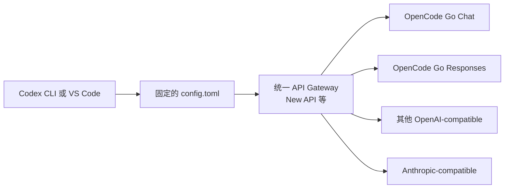
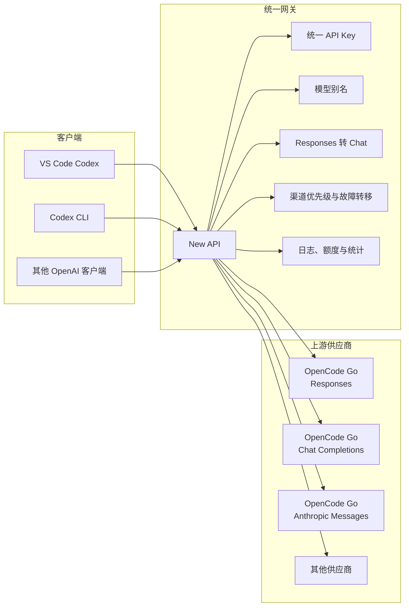

[toc]


## 核心结论

**CC Switch 的本地路由接管会碰 Codex 当前实际使用的 `config.toml`。**

它并不是只在自己数据库里保存供应商，然后让 Codex 自动发现代理。启用 Codex Local Routing 后，CC Switch 会把当前活动 Codex 配置中的供应商、模型和 `base_url` 改成指向本地代理；供应商真实配置保存在 CC Switch 数据库中，但 `$CODEX_HOME/config.toml` 是它与 Codex 之间的“活动配置交接文件”。CC Switch 的发布说明也明确称，本地接管期间活动的 `auth.json` 和 `config.toml` 会被临时改写。([GitHub](https://github.com/farion1231/cc-switch/blob/main/docs/release-notes/v3.16.1-en.md))

但是，你可以改变 **`$CODEX_HOME` 所指向的配置目录**。这样 CC Switch 修改的就不再是默认的：

```text
~/.codex/config.toml
```

而是：

```text
$CODEX_HOME/config.toml
```

需要注意：改变的是目录，不是让 Codex任意读取一个名为 `a.config.toml` 的主配置文件。

------

## Codex 当前的配置结构

Codex 的配置可以分成以下几层，优先级从高到低：

| 优先级 | 配置层           | 示例                                      |
| ------ | ---------------- | ----------------------------------------- |
| 1      | CLI 临时参数     | `codex --model xxx`、`--config key=value` |
| 2      | 项目配置         | `<repo>/.codex/config.toml`               |
| 3      | 命名配置 Profile | `$CODEX_HOME/a.config.toml`               |
| 4      | 用户主配置       | `$CODEX_HOME/config.toml`                 |
| 5      | 系统配置         | `/etc/codex/config.toml`                  |
| 6      | 内置默认值       | Codex 自带配置                            |

Codex 官方文档确认 CLI 与 IDE 扩展共享这一配置体系。([OpenAI Developers](https://developers.openai.com/codex/config-advanced))

### 主配置文件

默认是：

```text
~/.codex/config.toml
```

设置：

```bash
export CODEX_HOME="$HOME/.codex-opencode"
```

以后，Codex 使用的主配置就变成：

```text
~/.codex-opencode/config.toml
```

同时，该目录中的以下状态也会被隔离：

```text
config.toml
auth.json
history.jsonl
sessions/
logs/
SQLite 状态数据库
```

`CODEX_HOME` 是一个完整的 Codex Home，不只是单个配置文件路径。([OpenAI Developers](https://developers.openai.com/codex/config-advanced))

------

## CC Switch 能不能改另一份配置

### 可以改另一个 Codex Home

例如创建两套独立环境：

```text
~/.codex-a/
├── config.toml
├── auth.json
└── sessions/

~/.codex-b/
├── config.toml
├── auth.json
└── sessions/
```

启动 A 环境：

> 准备: 创建`~/.codex-a`目录,并创建其中的文件`config.toml`
>
> ```shell
> mkdir -pv ~/.codex-a && touch ~/.codex-a/config.toml
> ```

```bash
export CODEX_HOME="$HOME/.codex-a"
# 启动本地路由代理服务
cc-switch --app codex proxy enable

```

> 顺利的话,代理服务在本地将会启动. 如果之前运行过`codex`,那么`config.toml`中会有内容;
>
> 现在可以添加订阅,例如opencode go,然后配置其中的deepseek模型.
>
> 

类似的,也可以启动 B 环境：

```bash
export CODEX_HOME="$HOME/.codex-b"

cc-switch --app codex proxy enable
codex
```

关键规则是：

> CC Switch 和 Codex 必须看到同一个 `CODEX_HOME`。

如果 CC Switch 修改：

```text
~/.codex-a/config.toml
```

但 VS Code 中的 Codex 实际读取：

```text
~/.codex/config.toml
```

就会出现：

- CC Switch 显示路由已启用；
- 命令行可能正常；
- VS Code 仍然连接旧供应商；
- 模型列表和实际调用供应商不一致。

CC Switch CLI 当前的配置目录解析顺序是：

1. CC Switch 中手工指定的 Codex 配置目录；
2. 已存在的 `$CODEX_HOME`；
3. 默认 `$HOME/.codex`。([GitHub](https://github.com/saladday/cc-switch-cli))

### 不适合直接改任意文件名

不能简单告诉 Codex：

```bash
codex --config-file ~/configs/a.config.toml
```

Codex 当前没有这种“任意主配置路径”参数。

`--config` 的含义也不是指定配置文件，而是覆盖某个配置项：

```bash
codex --config model='"kimi-k3"'
```

所以它不能这样使用：

```bash
codex --config a.config.toml
```

------

## `a.config.toml` 实际上是 Codex Profile

Codex 当前支持命名配置文件：

```text
$CODEX_HOME/a.config.toml
$CODEX_HOME/b.config.toml
```

例如：

```toml
# ~/.codex/a.config.toml

model = "kimi-k3"
model_provider = "gateway-a"

[model_providers.gateway-a]
name = "Gateway A"
base_url = "https://gateway-a.example.com/v1"
env_key = "GATEWAY_A_KEY"
wire_api = "responses"
```

另一个：

```toml
# ~/.codex/b.config.toml

model = "deepseek-v4-flash"
model_provider = "gateway-b"

[model_providers.gateway-b]
name = "Gateway B"
base_url = "https://gateway-b.example.com/v1"
env_key = "GATEWAY_B_KEY"
wire_api = "responses"
```

命令行选择：

```bash
codex --profile a
```

或者：

```bash
codex --profile b
```

Codex 会先加载：

```text
$CODEX_HOME/config.toml
```

然后覆盖加载：

```text
$CODEX_HOME/a.config.toml
```

从 Codex 0.134.0 开始，这种独立的 `a.config.toml` 文件是官方 Profile 机制；旧式的 `[profiles.a]` 写法已不再是推荐路径。([OpenAI Developers](https://developers.openai.com/codex/config-advanced))

### 但它和 CC Switch 接管存在冲突点

CC Switch Local Routing 管理的是当前活动的：

```text
$CODEX_HOME/config.toml
```

而不是专门去修改：

```text
$CODEX_HOME/a.config.toml
```

因此，下面这种组合并不理想：

```text
config.toml       由 CC Switch 接管
a.config.toml     又覆盖 model_provider 和 base_url
```

Profile 的优先级高于主配置，所以 `a.config.toml` 可能把 CC Switch 写入主配置的本地代理地址再次覆盖掉。

因此，不应同时让两套机制争夺这些字段：

```toml
model
model_provider
model_providers
base_url
wire_api
```

更稳妥的选择是二选一：

| 模式               | 供应商切换由谁负责                       |
| ------------------ | ---------------------------------------- |
| CC Switch 模式     | 由 CC Switch 数据库和切换命令负责        |
| Codex Profile 模式 | 由 `codex --profile a` 负责              |
| 统一网关模式       | Codex 固定连接网关，由网关负责供应商路由 |

------

## VS Code 中是否固定对应 `config.toml`

通常是。

Codex IDE 扩展与 Codex CLI 共享配置层，用户配置默认来自：

```text
$CODEX_HOME/config.toml
```

VS Code 扩展右上角的：

```text
Codex Settings
→ Open config.toml
```

打开的就是当前用户主配置。([OpenAI Developers](https://developers.openai.com/codex/config-basic))

### VS Code 能否直接指定 `a.config.toml`

**目前不能像 CLI 一样直接在扩展界面中执行：**

```bash
codex --profile a
```

官方 Profile 选择目前明确是 CLI 参数机制。IDE 扩展没有公开的任意 Profile 文件选择器；相关的 IDE Profile 选择能力仍曾作为功能请求讨论。([OpenAI Developers](https://developers.openai.com/codex/config-advanced?utm_source=chatgpt.com))

所以，VS Code 中不能直接配置成：

```text
使用 ~/.codex/a.config.toml
```

但有下面几种可行方案。

------

## 方案一：为不同 VS Code 实例设置不同 `CODEX_HOME`

### Linux 或 macOS

创建配置目录：

```bash
mkdir -p "$HOME/.codex-a"
mkdir -p "$HOME/.codex-b"
```

启动 A：

```bash
CODEX_HOME="$HOME/.codex-a" \
code --user-data-dir "$HOME/.vscode-codex-a" /path/to/project
```

启动 B：

```bash
CODEX_HOME="$HOME/.codex-b" \
code --user-data-dir "$HOME/.vscode-codex-b" /path/to/project
```

使用单独的 `--user-data-dir` 可以避免命令被转交给已经运行、且继承了另一套环境变量的 VS Code 主进程。

对应关系是：

```text
VS Code A
└── CODEX_HOME=~/.codex-a
    └── config.toml

VS Code B
└── CODEX_HOME=~/.codex-b
    └── config.toml
```

### Windows PowerShell

A 环境：

```powershell
$env:CODEX_HOME = "$HOME\.codex-a"

code `
  --user-data-dir "$HOME\.vscode-codex-a" `
  "D:\Projects\ProjectA"
```

B 环境：

```powershell
$env:CODEX_HOME = "$HOME\.codex-b"

code `
  --user-data-dir "$HOME\.vscode-codex-b" `
  "D:\Projects\ProjectB"
```

修改环境变量后，需要重新启动对应的 VS Code 扩展宿主。Codex 项目问题追踪中也确认，IDE 扩展的配置目录可以由 `CODEX_HOME` 控制。([GitHub](https://github.com/openai/codex/issues/7971?utm_source=chatgpt.com))

### Remote SSH、WSL 和 Dev Container

环境变量必须设置在 **Codex 扩展实际运行的一侧**：

| VS Code 模式  | `CODEX_HOME` 应设置在哪里 |
| ------------- | ------------------------- |
| 本机 VS Code  | 本机启动 VS Code 的环境   |
| Remote SSH    | 远程服务器的扩展宿主环境  |
| WSL           | WSL Linux 环境            |
| Dev Container | 容器内环境                |

本机 Windows 的 `CODEX_HOME` 不会自动等同于远程 Linux 中的 `CODEX_HOME`。

------

## 方案二：使用项目 `.codex/config.toml`

每个项目可以有：

```text
ProjectA/.codex/config.toml
ProjectB/.codex/config.toml
```

但这里存在一个重要安全限制。

项目配置不能覆盖以下关键 Provider 设置：

```text
model_provider
model_providers
openai_base_url
chatgpt_base_url
```

Codex 会忽略这些项目级设置，并给出启动警告。这是为了防止一个不可信仓库把模型请求和凭据偷偷重定向到恶意服务器。([OpenAI Developers](https://developers.openai.com/codex/config-advanced))

因此这种写法不可行：

```toml
# ProjectA/.codex/config.toml

model_provider = "supplier-a"

[model_providers.supplier-a]
base_url = "https://supplier-a.example.com/v1"
```

但项目配置可以用于选择已存在的模型：

```toml
# ProjectA/.codex/config.toml

model = "ocg-kimi-k3"
model_reasoning_effort = "high"
```

前提是用户级主配置已经定义了一个统一 Provider，且该 Provider 能识别这个模型名。

这正是统一网关架构的优势。

------

## 方案三：让 `config.toml` 永远只连接统一网关

这是多供应商、多项目和 VS Code 场景中最干净的方案。



Codex 只需要一份固定配置：

```toml
model = "ocg-kimi-k3"
model_provider = "my_gateway"

[model_providers.my_gateway]
name = "My AI Gateway"
base_url = "https://gateway.example.com/v1"
env_key = "MY_GATEWAY_API_KEY"
wire_api = "responses"
```

以后不再由 CC Switch 修改它。

所有供应商切换、协议转换和密钥管理都发生在服务器网关中。

不同项目只需要：

```toml
# ProjectA/.codex/config.toml
model = "ocg-kimi-k3"
# ProjectB/.codex/config.toml
model = "ocg-deepseek-v4-flash"
```

或者在 VS Code 的模型选择器中切换网关公布的模型。

------

## CC Switch 与统一网关的本质差别

| 维度                     | CC Switch                  | New API                      | Sub2API                    |
| ------------------------ | -------------------------- | ---------------------------- | -------------------------- |
| 主要定位                 | 本地客户端配置切换器和代理 | 通用多模型 API 网关          | 订阅账号配额分发与账号池   |
| 是否修改 Codex 配置      | 会管理活动 `config.toml`   | 通常不需要                   | 通常不需要                 |
| 部署位置                 | 本机或个人服务器           | 中央服务器                   | 中央服务器                 |
| 多用户                   | 较弱                       | 强                           | 强                         |
| API Key 分发             | 基础                       | 完整                         | 完整                       |
| 额度和计费               | 基础统计                   | 渠道、用户、额度、计费       | Token 计费、并发、账号调度 |
| 多供应商路由             | 手工切换、故障转移         | 渠道、模型映射、权重、优先级 | 账号池、粘性会话、负载均衡 |
| Responses 转 Chat        | 支持                       | 当前版本已加入               | 不是其最突出的通用场景     |
| 适合 OpenCode Go API Key | 适合单用户                 | 很适合集中管理               | 可以研究，但不是首选       |
| 适合订阅账号池           | 有限                       | 取决于渠道                   | 核心用途                   |
| 运维复杂度               | 低                         | 中                           | 中到高                     |

------

## New API 是否更适合你的场景

对于下面的需求：

- 有多个上游供应商；
- OpenCode Go 中部分模型只支持 Chat Completions；
- Codex 需要 Responses；
- CLI 和 VS Code 都要使用；
- 不想反复改 `config.toml`；
- 不同项目要选择不同模型；
- 以后可能有多台电脑或多人使用；

**New API 类型的统一网关通常比 CC Switch 更灵活。**

New API 当前已经加入 Responses 请求向 Chat Completions 上游降级转换，包括请求、响应、流式事件、工具调用和 usage 映射；项目更新日志也明确记录了 Responses 与 Chat 的兼容转换。([GitHub](https://github.com/QuantumNous/new-api/pull/5209?utm_source=chatgpt.com))

推荐架构：



这样 Codex 端保持稳定：

```text
Codex config.toml
  → 固定 Gateway URL
  → 固定 Gateway API Key
  → 只切换 model 名称
```

------

## New API 也不是完全无风险

Codex 对 Responses API 的要求不止一个 `/v1/responses` 端点。

现代 Codex 还可能使用：

- SSE 流式事件
- function call/tool call
- reasoning item
- `previous_response_id`
- 长会话恢复
- Responses compact
- 客户端元数据
- 压缩请求体
- 多模态内容

New API 历史上出现过 Codex 的 `/v1/responses/compact`、额外字段以及流式处理兼容问题；虽然项目迭代很快，但升级后仍应进行 Codex 回归测试。([GitHub](https://github.com/QuantumNous/new-api/issues/4462?utm_source=chatgpt.com))

至少测试：

| 测试         | 验证内容            |
| ------------ | ------------------- |
| 普通对话     | 基础 Responses 请求 |
| 长流式回复   | SSE 事件转换        |
| 文件读取     | 工具声明和调用      |
| 文件修改     | 工具结果闭环        |
| Shell 命令   | JSON 参数完整性     |
| 长会话       | 压缩和上下文恢复    |
| 中断重试     | 错误转换和连接恢复  |
| 多供应商切换 | 模型映射和会话隔离  |

------

## Sub2API 是否更适合

你提到的 Sub2API 如果指 **Sub2API**，它的主要定位与 New API 不同。

Sub2API 主要是：

- 管理多个上游账号；
- 支持 OAuth 和 API Key 类型账号；
- 将订阅额度分发成平台 API Key；
- Token 级计费；
- 并发限制；
- 账号调度；
- 粘性会话；
- 多用户共享。([GitHub](https://github.com/Wei-Shaw/sub2api))

它更适合这种结构：

```text
多个 ChatGPT、Claude 或 Gemini 订阅账号
  → Sub2API 账号池
  → 生成平台 API Key
  → 多个用户或客户端
```

而你的主要目标是：

```text
OpenCode Go Chat Completions
  → 转换为 Codex Responses
```

这更接近通用协议网关，而不是订阅账号池管理。

另外，Responses 会话在多账号调度时需要 **Session Affinity（会话粘性）**。如果同一个 Codex 会话在不同上游账号之间漂移，加密上下文可能无法被另一账号解密。Sub2API 项目中曾专门处理过这一问题。([GitHub](https://github.com/Wei-Shaw/sub2api/issues/2991))

因此：

| 需求                          | 更适合                    |
| ----------------------------- | ------------------------- |
| OpenCode Go API Key 协议转换  | New API 或 CC Switch      |
| 一个人、本机使用              | CC Switch                 |
| 多设备共用固定端点            | New API                   |
| 多项目按模型名路由            | New API                   |
| 多用户、额度和日志管理        | New API                   |
| 多个订阅账号做账号池          | Sub2API                   |
| ChatGPT/Claude OAuth 订阅分发 | Sub2API，但需确认服务条款 |
| 不希望 Codex 配置被频繁改写   | New API 或其他独立网关    |

------

## 最推荐的落地设计

### 只有自己使用一台机器

继续使用 CC Switch：

```text
Codex
→ CC Switch Local Routing
→ OpenCode Go
```

让 CC Switch 独占管理 `$CODEX_HOME/config.toml`，不要再用 Codex Profile 覆盖 Provider 字段。

### 自己使用，但需要多套完全隔离环境

使用不同的 `CODEX_HOME`：

```text
~/.codex-official/config.toml
~/.codex-opencode/config.toml
~/.codex-company/config.toml
```

分别启动 VS Code：

```bash
CODEX_HOME="$HOME/.codex-opencode" \
code --user-data-dir "$HOME/.vscode-opencode" .
```

### 多供应商、多设备、VS Code 与 CLI 共用

搭建 New API：

```text
Codex CLI
Codex VS Code
其他客户端
    → 一份固定的 Gateway 地址
    → New API
    → 多个上游供应商
```

Codex 主配置保持不变：

```toml
model_provider = "gateway"
model = "ocg-kimi-k3"

[model_providers.gateway]
name = "Private Gateway"
base_url = "https://ai.example.com/v1"
env_key = "PRIVATE_GATEWAY_KEY"
wire_api = "responses"
```

不同项目只覆盖：

```toml
model = "ocg-deepseek-v4-flash"
```

这是最不容易产生配置竞争的方案。

------

## 最后的选择建议

你的场景中，优先级建议是：

1. **单机尝试和验证协议转换：CC Switch**
2. **多供应商、多个 VS Code 项目和长期稳定使用：New API**
3. **需要订阅账号池、配额分发和多用户计费：Sub2API**

最重要的设计原则是：

> 不要同时让 CC Switch、Codex Profiles、脚本和 VS Code 去修改或覆盖同一套 Provider 配置。

如果采用统一网关，就让 Codex 的 `config.toml` 永久固定指向网关；模型和供应商的变化全部在网关中完成。这会比维护 `a.config.toml`、`b.config.toml` 并让 VS Code 分别选择它们稳定得多。