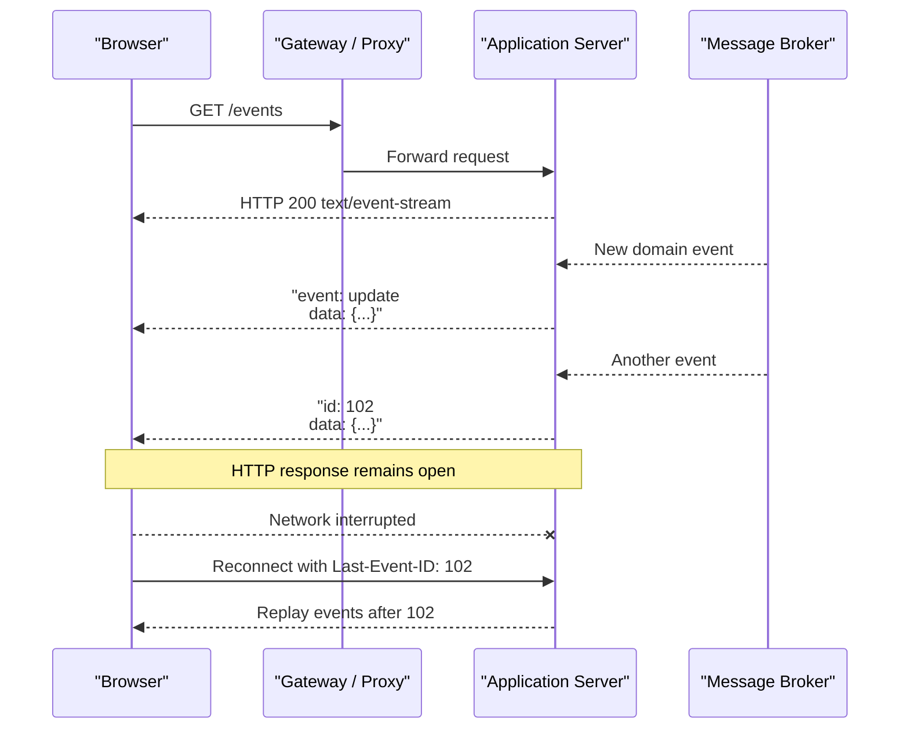
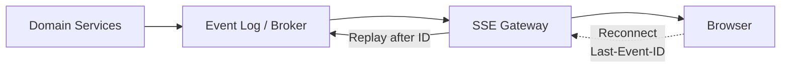
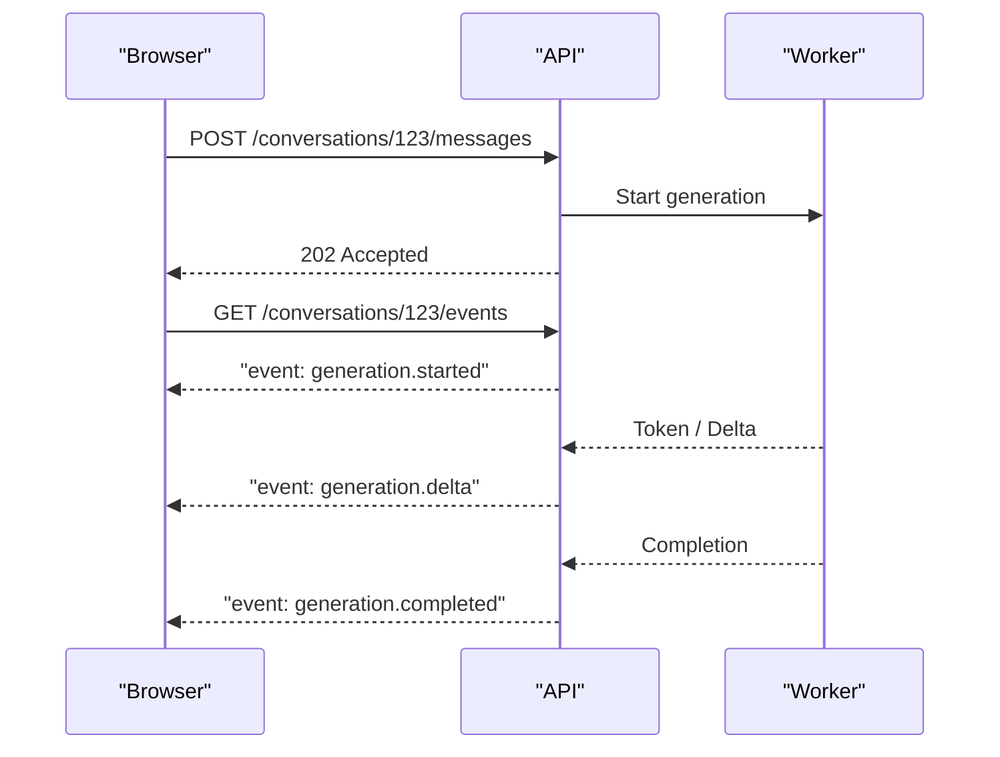
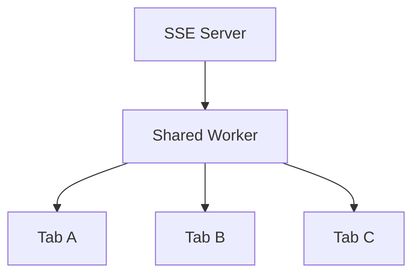
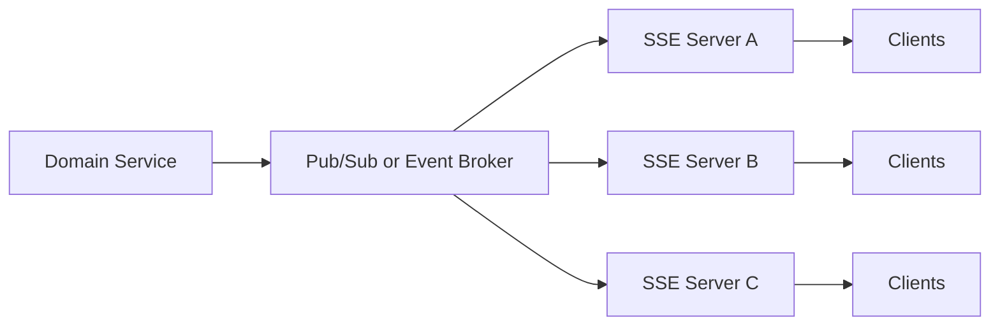
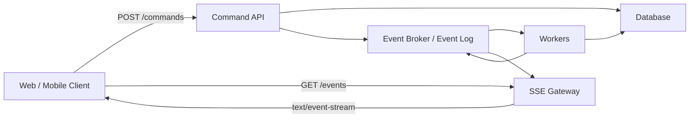

[toc]


## abstract

- SSE（Server-Sent Events）到底是什么，与“普通 HTTP 长连接”是什么关系？
- `text/event-stream` 的格式有哪些严格规则？
- `data`、`event`、`id`、`retry` 分别解决什么问题？
- 浏览器为什么能够自动断线重连？
- `Last-Event-ID` 能不能保证消息不丢？
- SSE 能不能携带 JSON？二进制呢？
- SSE 与 WebSocket、轮询（Polling）、长轮询（Long Polling）如何选择？
- 为什么开发环境正常，上了 Nginx/CDN/网关后却突然“卡住”？
- 为什么现代应用常采用“HTTP POST + SSE”而不是 WebSocket？
- AI 流式输出、任务进度、通知、实时日志等场景怎样设计？
- 如何处理认证、CORS、多标签页、限流、背压（Backpressure）和水平扩展？

------

## SSE 是什么

**SSE（Server-Sent Events，服务器发送事件）**是一套**让服务器通过 HTTP 持续向客户端发送事件**的标准机制。

浏览器侧主要通过：

```js
const source = new EventSource("/events");
```

建立连接。

服务器则返回：

```http
Content-Type: text/event-stream
```

然后**保持 HTTP 响应不结束**，不断向响应体写入事件。

WHATWG HTML Living Standard 仍将 SSE 定义为标准 Web 通信能力，并规定浏览器使用 `EventSource` 接收事件；当前主流浏览器引擎均支持该机制。([HTML Living Standard](https://html.spec.whatwg.org/dev/server-sent-events.html))

最重要的一句话是：

> SSE 是“服务器到客户端”的单向事件流，而不是双向通信协议。

也就是说：

```text
Client  -------- HTTP 请求 --------> Server
Client  <======= SSE 事件流 ========= Server
```

但“单向”并不意味着应用只能单向操作。

现代应用完全可以使用：

```text
POST /messages
POST /jobs
POST /commands
```

向服务器发送命令，再通过：

```text
GET /events
```

持续接收状态更新。

这其实是非常实用的一种现代架构。

------

## SSE 的整体工作模型



这里需要区分三个层次：

| 层次                | SSE 负责什么                         |
| ------------------- | ------------------------------------ |
| HTTP                | 建立请求和持续响应                   |
| `text/event-stream` | 定义事件如何编码                     |
| `EventSource`       | 浏览器连接、解析、派发事件、自动重连 |

因此 SSE **不是新的 TCP 协议，也不是 WebSocket 那样的协议升级**。

它仍然**使用普通 HTTP**。

------

## 与普通 HTTP 请求有什么不同

普通请求通常是：

```text
request
response
connection/request lifecycle ends
```

SSE 是：

```text
request
response headers
event
event
event
event
...
```

响应可能持续数分钟、数小时，甚至更久。

服务器不是一次性返回：

```json
[
  {"id": 1},
  {"id": 2},
  {"id": 3}
]
```

而是不断发送：

```text
data: {"id":1}

data: {"id":2}

data: {"id":3}
```

这里最容易忽略的一点是：

**事件之间必须通过空行分隔。**

WHATWG 规范明确规定 SSE 的 MIME 类型是 `text/event-stream`，事件流始终使用 UTF-8 编码。([HTML Living Standard](https://html.spec.whatwg.org/dev/server-sent-events.html))

------

## `text/event-stream` 协议格式

一个完整事件可以是：

```text
id: 42
event: order.updated
retry: 5000
data: {"orderId":"A100","status":"paid"}
```

注意最后有一个**空行**。

它等价于：

```text
id: 42\n
event: order.updated\n
retry: 5000\n
data: {"orderId":"A100","status":"paid"}\n
\n
```

浏览器读到最后这个空行之后，才认为一个事件结束。

### 核心字段

| 字段     | 含义               | 常见用途                    |
| -------- | ------------------ | --------------------------- |
| `data`   | 事件数据           | JSON、文本                  |
| `event`  | 自定义事件类型     | `order.updated`、`progress` |
| `id`     | 事件 ID            | 断线恢复、去重              |
| `retry`  | 建议客户端重连间隔 | 控制重连策略                |
| `:` 开头 | 注释               | Heartbeat / Keepalive       |

例如：

```text
event: price
id: 128
data: {"symbol":"ABC","price":10.5}
```

客户端：

```js
source.addEventListener("price", event => {
  const data = JSON.parse(event.data);
  console.log(data);
});
```

如果没有 `event`：

```text
data: hello
```

浏览器派发默认的：

```js
message
```

事件。WHATWG 规范明确规定默认事件类型为 `message`。([HTML Living Standard](https://html.spec.whatwg.org/dev/server-sent-events.html))

------

## 多个 `data` 行

SSE 允许：

```text
data: first line
data: second line
data: third line
```

浏览器得到的：

```js
event.data
```

类似：

```text
first line
second line
third line
```

规范定义了多个 `data:` 行会组合成一个事件数据，中间加入换行。([HTML Living Standard](https://html.spec.whatwg.org/dev/server-sent-events.html))

因此不应该把：

```text
data: ...
```

理解为“一行就是一个事件”。

真正的规则是：

> **空行结束一个事件。**

------

## 注释与 Heartbeat

以冒号开头：

```text
: heartbeat
```

这是 SSE 注释。

不会触发 `message`。

但它非常有用，因为网络路径中可能存在：

- Load Balancer
- Reverse Proxy
- NAT
- CDN
- API Gateway
- 企业代理

它们可能认为长期没有数据的连接已经“空闲”。

因此服务器可以定期发送：

```text
: ping
```

WHATWG 的作者指南甚至建议，可以大约每 15 秒发送一条注释，用来降低老旧代理因空闲超时断开连接的风险。实际生产环境应根据自己的网关超时配置确定周期，而不是机械固定为 15 秒。([HTML Living Standard](https://html.spec.whatwg.org/dev/server-sent-events.html))

一种常见做法：

```text
: heartbeat
```

每 15～30 秒发送一次。

注意 heartbeat 的目的不是业务通知，而是：

> 保持整个网络链路活跃。

------

## 浏览器 `EventSource`

最简单客户端：

```js
const source = new EventSource("/events");

source.onopen = () => {
  console.log("connected");
};

source.onmessage = event => {
  console.log(event.data);
};

source.onerror = error => {
  console.error("SSE error", error);
};
```

自定义事件：

```js
source.addEventListener("order.updated", event => {
  const order = JSON.parse(event.data);
  console.log(order);
});
```

关闭连接：

```js
source.close();
```

`EventSource` 定义了三个连接状态：([HTML Living Standard](https://html.spec.whatwg.org/dev/server-sent-events.html))

| 状态             | 常量         | 数值 |
| ---------------- | ------------ | ---- |
| 正在连接/重连    | `CONNECTING` | `0`  |
| 已连接           | `OPEN`       | `1`  |
| 已关闭且不再重连 | `CLOSED`     | `2`  |

例如：

```js
console.log(source.readyState);
```

------

## SSE 一个非常重要的能力：自动重连

假设连接是：

```text
Browser <----------------> Server
```

用户从 Wi-Fi 切换到移动网络：

```text
Browser <------ X -------> Server
```

原 TCP/QUIC 链路断掉。

普通流式 `fetch()` 通常需要应用自己处理重新连接。

原生 `EventSource` 则内置了：

```text
连接失败
    -> 等待
    -> 自动重新建立连接
```

这正是 SSE 非常适合：

- 通知
- 任务状态
- Dashboard
- 日志
- AI 输出事件
- 股票/行情更新

的重要原因之一。

规范还定义了：如果服务器希望客户端**不要继续自动重连**，可以返回：

```http
204 No Content
```

让 `EventSource` 停止重新建立连接。([HTML Living Standard](https://html.spec.whatwg.org/dev/server-sent-events.html))

------

## `id` 与 `Last-Event-ID`

这是理解可靠 SSE 的核心。

服务器发送：

```text
id: 1001
data: A

id: 1002
data: B

id: 1003
data: C
```

客户端收到：

```text
1001
1002
```

然后连接中断。

浏览器在重新建立 `EventSource` 连接时，可以把最后一个 Event ID 作为：

```http
Last-Event-ID: 1002
```

发送给服务器。

WHATWG 明确定义 `Last-Event-ID` 就是为了让重新连接时服务器知道客户端最后处理到哪个事件。([HTML Living Standard](https://html.spec.whatwg.org/dev/server-sent-events.html))

于是服务端可以：

```text
1003
1004
1005
```

继续发送。

------

## 一个非常重要的认识：SSE 不自动保证“不丢消息”

很多教程会产生这种误解：

> “SSE 有 `Last-Event-ID`，所以天然可靠。”

并不是。

`Last-Event-ID` 只是提供：

```text
客户端告诉服务器：
“我最后看到了哪个 ID”
```

至于服务器能不能恢复：

```text
1003
1004
1005
```

取决于**服务器有没有事件历史**。

例如你的服务器只是：

```js
res.write(newEvent);
```

事件发送完就扔掉：

```text
Event 1003
   |
   +--> socket
   |
   +--> gone forever
```

客户端断线后，即使说：

```http
Last-Event-ID: 1002
```

服务器也无法凭空重建 `1003`。

生产环境更合理的模型是：



事件可以存储于：

- Redis Streams
- Kafka
- PostgreSQL event table
- NATS JetStream
- 专门的 Event Store

具体选择取决于业务规模。

------

## 不要追求“Exactly Once”

浏览器可能：

```text
收到 event 100
连接中断
客户端实际上已经处理 100
服务端并不知道
重新连接
再次发送 100
```

因此业务层最好接受：

> **重复事件是可能的。**

设计事件：

```json
{
  "id": "evt_100",
  "type": "order.updated",
  "data": {}
}
```

客户端可维护：

```js
if (processedIds.has(eventId)) {
  return;
}
```

更重要的是让业务更新本身满足：

**幂等（Idempotency）**。

例如：

```text
set order.status = "paid"
```

通常比：

```text
order.balance += 100
```

更容易安全重放。

所以工程目标一般是：

```text
可恢复 + 可重放 + 可去重
```

而不是幻想 TCP/SSE 本身自动提供 exactly-once delivery。

------

## 一个最小 Node.js 服务端

下面用 Node.js 原生 HTTP API 演示核心机制。

```js
import http from "node:http";
import { once } from "node:events";

const clients = new Set();
let nextId = 1;

const server = http.createServer(async (req, res) => {
  if (req.url === "/events") {
    res.writeHead(200, {
      "Content-Type": "text/event-stream; charset=utf-8",
      "Cache-Control": "no-cache, no-transform",
      "X-Accel-Buffering": "no"
    });

    res.flushHeaders();

    clients.add(res);

    // 告诉代理和客户端：连接已经建立
    res.write(": connected\n\n");

    const heartbeat = setInterval(() => {
      res.write(": heartbeat\n\n");
    }, 15_000);

    req.on("close", () => {
      clearInterval(heartbeat);
      clients.delete(res);
    });

    return;
  }

  if (req.url === "/publish" && req.method === "POST") {
    const id = nextId++;

    const payload = JSON.stringify({
      id,
      message: `event ${id}`,
      createdAt: new Date().toISOString()
    });

    const frame =
      `id: ${id}\n` +
      `event: update\n` +
      `data: ${payload}\n\n`;

    for (const client of clients) {
      if (!client.write(frame)) {
        await once(client, "drain");
      }
    }

    res.writeHead(204);
    res.end();
    return;
  }

  res.writeHead(404);
  res.end();
});

server.listen(3000);
```

这里体现了几个重要实践：

```text
Content-Type: text/event-stream
```

定义 SSE。

```text
Cache-Control: no-cache, no-transform
```

避免中间缓存以及不必要的响应转换。

```text
X-Accel-Buffering: no
```

可以告诉 Nginx 不要缓存这条上游响应；Nginx 官方文档明确支持通过该响应头控制 proxy buffering。([Nginx](https://nginx.org/en/docs/http/ngx_http_proxy_module.html))

同时代码检查：

```js
client.write(...)
```

返回值。

这是为了考虑**背压（Backpressure）**。

------

## 什么是 Backpressure

假设服务器每秒产生：

```text
100 MB
```

而某个客户端只能消费：

```text
1 MB/s
```

如果服务器继续无限：

```js
write()
write()
write()
write()
```

就会不断累积缓冲区。

最终可能造成：

- 内存上涨
- GC 压力增加
- 单个慢客户端拖累服务器
- OOM

Node.js 的 HTTP response 本质上也是可写流，因此生产系统不能完全忽略流式写入的背压机制。Node 官方文档把 HTTP 和其他数据流建立在 Node Stream 模型之上。([Node.js](https://nodejs.org/api/http.html?utm_source=chatgpt.com))

实际大型系统还需要设计：

```text
slow consumer policy
```

例如：

- 超过缓冲阈值直接断开
- 丢弃可丢失的旧事件
- 将状态类事件合并
- 限制单连接输出速率

------

## 为什么 SSE 特别适合 JSON

协议本身是文本格式。

因此通常：

```text
data: {"type":"progress","value":42}
```

客户端：

```js
const payload = JSON.parse(event.data);
```

推荐把 SSE 当作：

```text
event envelope
+
JSON payload
```

例如：

```text
id: evt_123
event: task.progress
data: {"taskId":"T1","progress":42}
```

而不是自己设计：

```text
MESSAGE||123||TASK||42
```

JSON 的可读性和生态更好。

------

## 二进制数据怎么办

SSE 是 UTF-8 文本事件流。([HTML Living Standard](https://html.spec.whatwg.org/dev/server-sent-events.html))

理论上可以：

```text
binary
  -> Base64
  -> data:
```

但通常并不推荐。

Base64：

- 增加数据量
- 增加编码/解码开销
- 不适合大文件
- 不适合高速二进制流

如果业务是：

- 实时音频
- 视频
- 高频游戏状态
- 大量二进制消息

应该考虑：

- WebSocket
- WebRTC
- WebTransport
- 普通 HTTP 下载/媒体协议

而不是硬套 SSE。

------

## 现代应用最常见模式：POST + SSE

这是 SSE 非常值得掌握的架构。

例如 AI 对话：



上行：

```http
POST /messages
```

使用标准 HTTP。

下行：

```http
GET /events
```

使用 SSE。

它比把所有操作都塞进一个 WebSocket 通道有一个明显优势：

你的普通命令仍然拥有标准 HTTP 语义：

- HTTP Method
- Status Code
- Authentication
- Rate Limiting
- Logging
- Retry policy
- Observability

SSE 只负责实时输出。

------

## AI 流式输出为什么很适合 SSE

生成式 AI 的数据流天然是：

```text
server
  -> token
  -> token
  -> token
  -> tool event
  -> token
  -> completed
```

客户端在生成过程中通常不需要通过同一条连接不断向模型服务器反向发送信息。

因此模型非常接近：

```text
Request
   |
   +--> Stream Response
```

可以把流定义成语义事件：

```text
event: response.started
data: {"id":"resp_123"}

event: response.delta
data: {"text":"Hello"}

event: response.delta
data: {"text":" world"}

event: response.completed
data: {"usage":{"outputTokens":2}}
```

相比直接发送裸文本：

```text
Hello
 world
```

事件化设计更容易扩展：

- 文本 delta
- Tool Call
- Citation
- Usage
- Error
- Metadata
- Completion

这也是现代流式 API 很重要的设计思想。

------

## 任务进度也是典型应用

例如：

```http
POST /exports
```

返回：

```json
{
  "jobId": "job_123"
}
```

然后：

```http
GET /jobs/job_123/events
```

事件：

```text
event: progress
data: {"percent":10}

event: progress
data: {"percent":40}

event: progress
data: {"percent":90}

event: completed
data: {"downloadId":"file_456"}
```

特别适合：

- 数据导出
- 视频转码
- CI/CD
- 大模型推理
- 报表生成
- 文件处理
- 数据同步
- 批量任务

------

## 实时 Dashboard

传统方案：

```text
Browser
 |
 | GET /stats
 |
 wait 5s
 |
 | GET /stats
 |
 wait 5s
```

也就是 polling。

如果有：

```text
10,000 clients
```

每 5 秒请求一次，相当于：

```text
2000 requests/s
```

即使数据完全没变化。

SSE 可以变成：

```text
Client ---------------- Server

          data changed
Client <--------------- Server
```

只有状态变化时发送事件。

因此：

- 运维 Dashboard
- 服务监控
- 股票行情
- IoT 状态
- 实时统计

都可能适合 SSE。

当然，高频行情系统是否使用 SSE，还需要根据吞吐、延迟、消息大小和连接数具体判断。

------

## 实时日志

例如：

```text
event: log
data: {"level":"info","message":"build started"}

event: log
data: {"level":"info","message":"step 1 completed"}

event: log
data: {"level":"error","message":"test failed"}
```

适合：

- CI Build Log
- Container Log
- Deployment Log
- Background Job Log

不过这里一定要做：

- 权限控制
- 最大历史长度
- 连接超时
- 消费速度限制

否则慢客户端可能积压大量日志。

------

## SSE 与 WebSocket 怎么选

这是最重要的选型表。

| 特性             | SSE                | WebSocket                 |
| ---------------- | ------------------ | ------------------------- |
| 通信方向         | Server → Client    | 双向                      |
| 基于 HTTP        | 是                 | 握手后使用 WebSocket 协议 |
| 浏览器 API       | `EventSource`      | `WebSocket`               |
| 文本             | 非常适合           | 支持                      |
| 二进制           | 不适合             | 原生支持                  |
| 自动重连         | `EventSource` 内置 | 通常自己实现              |
| Event ID         | 标准机制           | 自己设计                  |
| 断线恢复         | 有标准基础能力     | 自己设计                  |
| HTTP 网关集成    | 通常较自然         | 需要 WebSocket 支持       |
| AI token stream  | 很适合             | 也可以                    |
| 通知/Dashboard   | 很适合             | 可以                      |
| 聊天双向实时协议 | 可采用 HTTP + SSE  | 非常适合                  |
| 游戏/高频双向    | 不合适             | 更适合                    |

简单经验：

```text
如果主要是服务器持续推给客户端
        -> 优先评估 SSE

如果客户端和服务器都需要高频实时发送
        -> 优先评估 WebSocket
```

不要因为“实时”两个字就自动选择 WebSocket。

------

## SSE 与 Polling

| 特性          | Polling        | SSE                |
| ------------- | -------------- | ------------------ |
| 实现难度      | 最简单         | 较简单             |
| 实时性        | 与轮询周期有关 | 高                 |
| 无变化时请求  | 仍然发生       | 通常无业务事件     |
| HTTP 请求数量 | 较多           | 长连接             |
| 网络环境要求  | 最宽松         | 需要长响应链路稳定 |
| 自动恢复      | 自己实现       | EventSource 支持   |

如果数据：

```text
一天变化两次
```

不一定需要 SSE。

普通轮询：

```text
每 5 分钟查询
```

可能更经济、更简单。

技术选型的原则应该是：

> 使用满足需求的最简单机制。

------

## Long Polling 与 SSE

Long Polling：

```text
GET /events
       |
       | server waits
       |
<------ event
connection ends

GET /events
       |
       | server waits
```

SSE：

```text
GET /events
       |
<------ event
<------ event
<------ event
<------ event
```

Long Polling 每收到一次结果往往需要重新发请求。

SSE 则保持一个持续响应。

------

## HTTP/1.1、HTTP/2、HTTP/3

一个常见旧认知是：

> “SSE 就是一根 HTTP/1.1 TCP 连接。”

现代环境里不应该这么理解。

SSE 定义的是 HTTP 上的事件流；因此部署链路可以使用 HTTP/1.1、HTTP/2，也可以运行于支持它的 HTTP/3 基础设施之上。([HTML Living Standard](https://html.spec.whatwg.org/dev/server-sent-events.html))

### HTTP/1.1 的问题

浏览器对于同一 Origin 的 HTTP/1.x 并发 TCP 连接数量通常有限制。Chrome 官方 DevTools 文档当前仍指出，在 HTTP/1.0/1.1 下，同一 Origin 已有 6 个 TCP 连接时，后续请求可能进入排队状态。([Chrome for Developers](https://developer.chrome.com/docs/devtools/network/reference))

如果每个 Tab：

```text
1 SSE connection
```

同时开很多 Tab，就可能碰到问题。

### HTTP/2

HTTP/2 可以在一个连接上复用多个 HTTP Stream：

```text
TCP connection
├── HTTP stream 1: /events
├── HTTP stream 3: /api
├── HTTP stream 5: /image
└── HTTP stream 7: /events
```

因此现代 SSE 服务非常适合部署在 HTTP/2 基础设施上。

### HTTP/3

HTTP/3 使用 QUIC，同样支持并行 HTTP Stream。

但是注意：

**不要为了 SSE 手工到处加：**

```http
Connection: keep-alive
```

HTTP/1.1 本身默认就是持久连接；HTTP/2 和 HTTP/3 更明确禁止应用生成 `Connection`、`Keep-Alive` 等 connection-specific header fields。([RFC Editor](https://www.rfc-editor.org/info/rfc9112/?utm_source=chatgpt.com))

所以现代代码更推荐：

```http
Content-Type: text/event-stream
Cache-Control: no-cache, no-transform
```

然后让 HTTP Server / Gateway 正确处理协议版本。

------

## Nginx 是最常见的坑之一

假设：

```text
Browser
   |
 Nginx
   |
Node.js
```

Node：

```js
res.write("data: hello\n\n");
```

你以为：

```text
Browser immediately receives
```

但可能实际上是：

```text
Node
 |
 | data
 v
Nginx buffer
 |
 | wait...
 |
 | wait...
 v
Browser
```

Nginx 官方文档说明：

```nginx
proxy_buffering on;
```

默认开启。

开启时 Nginx 会先读取、缓存上游响应；关闭以后才会将收到的数据同步向客户端转发。([Nginx](https://nginx.org/en/docs/http/ngx_http_proxy_module.html))

因此 SSE 路径通常配置：

```nginx
location /events {
    proxy_pass http://app;

    proxy_buffering off;
    proxy_cache off;

    proxy_read_timeout 1h;
}
```

或者应用返回：

```http
X-Accel-Buffering: no
```

Nginx 官方也明确支持通过这个响应头控制 buffering。([Nginx](https://nginx.org/en/docs/http/ngx_http_proxy_module.html))

不过生产环境真正需要检查的不只是 Nginx：

```text
Browser
  |
CDN
  |
WAF
  |
Load Balancer
  |
API Gateway
  |
Ingress
  |
Service Mesh
  |
Application
```

**任何一层**都可能：

- Buffer Response
- Idle Timeout
- Maximum Request Duration
- Compression Buffering
- Connection Reset

所以 SSE 调试必须采用：

> End-to-end 思维。

------

## 为什么不要盲目开启压缩

SSE 通常是一小段一小段：

```text
20 bytes
50 bytes
100 bytes
```

如果压缩层为了获得更好压缩率，把数据积累到几 KB 再 flush：

```text
App writes
App writes
App writes
       |
       v
compression buffer
       |
       v
eventually flush
```

用户就会感觉：

```text
不是流式输出
而是一批一批出现
```

因此对延迟敏感的 SSE endpoint，应该明确验证：

- Web Server 是否缓冲
- Compression 是否及时 flush
- CDN 是否变换响应
- Gateway 是否缓存

`Cache-Control: no-transform` 可以明确要求中间层不要转换响应表示；HTTP 缓存规范定义了该指令。([RFC Editor](https://www.rfc-editor.org/info/rfc9111/?utm_source=chatgpt.com))

------

## 认证是 SSE 的一个重要设计点

原生：

```js
new EventSource(url)
```

API 构造函数只有 URL 和 `withCredentials` 选项，没有类似：

```js
headers: {
  Authorization: "Bearer ..."
}
```

这样的参数。WHATWG 当前定义的构造形式就是 `EventSource(url[, { withCredentials }])`。([HTML Living Standard](https://html.spec.whatwg.org/dev/server-sent-events.html))

因此不能直接写：

```js
new EventSource("/events", {
  headers: {
    Authorization: "Bearer ..."
  }
});
```

这不是标准浏览器 `EventSource` API。

------

## 推荐的认证方式

### 同源 Cookie Session

最简单：

```text
https://app.example.com
https://app.example.com/events
```

浏览器使用正常 Cookie 身份。

这是原生 EventSource 很自然的方案。

### 跨域 Cookie

可以：

```js
const source = new EventSource(
  "https://api.example.com/events",
  {
    withCredentials: true
  }
);
```

规范规定 `withCredentials: true` 会使用 `include` credentials mode。([HTML Living Standard](https://html.spec.whatwg.org/dev/server-sent-events.html))

同时服务器必须配置正确 CORS。

------

## 不推荐把长期 Bearer Token 放 URL

有些实现这样做：

```text
/events?token=eyJ...
```

虽然技术上方便，但长期 token 出现在 URL 可能进入：

- Access Log
- Browser History
- Monitoring
- Proxy Log
- Analytics
- Referer 场景

因此通常不推荐直接把长期敏感凭证放 query string。

一种更好的设计是：

```text
POST /sse-ticket
        |
        v
short-lived one-time ticket

GET /events?ticket=abc
```

ticket：

- 生命周期很短
- 单次使用
- 限定用户
- 限定 channel

或者直接使用安全的 Cookie Session。

------

## 需要自定义 Header 或 POST streaming 怎么办

这时原生 `EventSource` 并不是唯一选择。

可以使用：

```js
fetch()
```

并读取响应：

```js
response.body
```

例如：

```js
const response = await fetch("/events", {
  method: "POST",
  headers: {
    Authorization: `Bearer ${token}`,
    "Content-Type": "application/json"
  },
  body: JSON.stringify({
    query: "hello"
  })
});

const reader = response.body.getReader();
const decoder = new TextDecoder();

while (true) {
  const { done, value } = await reader.read();

  if (done) {
    break;
  }

  const text = decoder.decode(value, {
    stream: true
  });

  console.log(text);
}
```

Fetch 标准中的响应 body 由流提供，允许应用逐步读取响应。([fetch.spec.whatwg.org](https://fetch.spec.whatwg.org/?utm_source=chatgpt.com))

这种方案的优势是：

- 可以 POST
- 可以 Authorization Header
- 可以自定义 Header
- 可以 AbortController
- 可以定义自己的 reconnect

代价是：

原生 `EventSource` 自带的：

```text
SSE parser
automatic reconnect
Last-Event-ID behavior
```

往往需要应用自己实现。

所以这是一个重要区分：

```text
SSE wire format
```

和：

```text
EventSource browser API
```

不是完全相同的概念。

你可以使用 SSE 格式，而不一定使用 `EventSource`。

------

## 多标签页问题

假设用户打开：

```text
Tab 1 -> SSE
Tab 2 -> SSE
Tab 3 -> SSE
Tab 4 -> SSE
```

实际上一个用户创建了四个服务器连接。

在 HTTP/1.x 下尤其容易受到每 Origin 连接数量限制影响。WHATWG 规范也专门提醒多个页面各自建立 `EventSource` 时可能碰到每服务器连接限制，并提到可以通过 Shared Worker 共享连接。([HTML Living Standard](https://html.spec.whatwg.org/dev/server-sent-events.html))

现代大型前端可以考虑：



不过是否值得这么做，要看实际连接规模。

如果使用 HTTP/2，而且用户通常只开 1～2 个页面，可能根本没有必要增加这种复杂度。

------

## 水平扩展

开发环境：

```text
Browser -> Node A
```

很容易。

生产：

```text
               -> Server A
Load Balancer  -> Server B
               -> Server C
```

假设用户建立 SSE 到：

```text
Server A
```

但一个订单事件发生在：

```text
Server C
```

Server A 怎么知道？

所以 SSE 应用通常需要：



也就是说：

> SSE connection state 是本地的，但业务事件不应该只存在于本地进程。

小型系统可以用：

```text
Redis Pub/Sub
```

需要 replay：

```text
Redis Streams
Kafka
Durable event log
```

------

## Pub/Sub 与 Replay 是两个问题

需要特别区分：

```text
Redis Pub/Sub
```

主要解决：

> “现在有什么事件？”

但客户端掉线后可能无法补以前的事件。

而：

```text
Redis Streams
Kafka
Event Log
```

更适合：

> “从 ID 1234 后重新读取。”

因此如果需要可靠断线恢复：

```text
Pub/Sub only
```

通常还不够。

------

## 事件设计建议

不要把所有东西都定义成：

```text
event: message
```

更推荐：

```text
event: task.started
event: task.progress
event: task.completed
event: task.failed
```

例如：

```text
id: evt_1001
event: task.progress
data: {"taskId":"T1","progress":20}
```

这种设计容易：

- 观察
- 调试
- 演化
- Schema 管理
- 客户端分发

------

## Payload 最好包含稳定结构

例如：

```json
{
  "eventId": "evt_1001",
  "eventType": "order.updated",
  "occurredAt": "2026-08-11T10:20:30Z",
  "data": {
    "orderId": "order_123",
    "status": "paid"
  }
}
```

哪怕 `event:` 已经包含：

```text
order.updated
```

payload 里保留一定的元数据，有时依然利于：

- 日志存储
- 重放
- 消息总线
- 非 SSE 消费者

但避免毫无意义地重复所有数据。

------

## Event ID 怎么设计

可以使用：

```text
数据库递增 ID
```

例如：

```text
102394
```

优点：

- 排序简单
- 查询 `id > lastId` 简单

或者：

```text
ULID
UUIDv7
stream offset
Kafka offset
Redis Stream ID
```

关键不是一定使用哪一种，而是 Event ID 最好满足：

- 唯一
- 稳定
- 可恢复
- 可以确定 replay 起点

不要使用：

```text
Math.random()
```

生成一个无法定位历史记录的 ID，然后期待 `Last-Event-ID` 自动解决恢复问题。

------

## Heartbeat 与业务事件分开

推荐：

```text
: heartbeat
```

而不是：

```text
event: heartbeat
data: {}
```

前者只是 SSE comment，不需要客户端业务代码处理。

这样职责更清晰：

```text
transport health
```

和：

```text
business events
```

分离。

------

## 服务端主动结束连接并不一定是错误

很多人希望：

```text
SSE 永远不断
```

实际上生产环境可能主动周期性重新建立连接，例如：

```text
30 min
1 h
```

这样可以：

- 清理异常连接状态
- 重新鉴权
- 避免无限生命周期
- 配合基础设施 connection lifetime

只要：

```text
reconnect
+
Last-Event-ID
+
replay
```

设计正确，连接短暂重建并不是灾难。

真正重要的是：

> 连接不是可靠性的边界，Event ID 与事件日志才是。

------

## 错误处理应该区分“连接错误”和“业务错误”

假设订单处理失败。

不一定应该：

```text
HTTP socket close
```

更合理的是发送：

```text
event: order.failed
data: {
  "orderId": "123",
  "code": "PAYMENT_DECLINED"
}
```

连接仍然正常。

所以：

```text
TCP/HTTP failure
```

和：

```text
business failure
```

必须分开。

------

## 可观测性怎么做

生产 SSE 应至少监控：

| 指标                | 意义                       |
| ------------------- | -------------------------- |
| Active connections  | 当前连接数                 |
| Connection duration | 连接生命周期               |
| Reconnect rate      | 网络/网关是否不稳定        |
| Events/sec          | 输出吞吐                   |
| Bytes/sec           | 网络吞吐                   |
| Replay count        | 断线恢复频率               |
| Slow consumer count | 慢客户端                   |
| Write latency       | 发送延迟                   |
| Event lag           | 事件产生到客户端发送的延迟 |
| Auth failures       | 认证问题                   |

一个特别重要的指标：

```text
event produced timestamp
             -
event delivered timestamp
```

即：

**Event Delivery Lag**。

如果：

```text
应用生成事件: 10:00:00
浏览器收到:   10:00:15
```

连接虽然“没断”，实际上实时性已经失效。

这类问题经常意味着：

```text
buffering
```

而不是应用逻辑错误。

------

## 容量规划

SSE 的核心成本不是：

```text
requests per second
```

而是：

```text
concurrent connections
```

例如：

```text
100,000 connected users
```

意味着需要维持大约：

```text
100,000 long-lived streams
```

关注：

- File Descriptor
- Socket Memory
- TLS/QUIC state
- Application client state
- Heartbeat traffic
- Broker subscriptions
- Load Balancer limits
- Connection draining

因此 SSE Server 应避免：

```text
1 connection = 1 operating system thread
```

现代服务通常采用异步 I/O / event loop / coroutine 模型。

------

## 防止“惊群”

假设：

```text
100,000 clients
```

同时连接。

服务器重启：

```text
100,000 connections lost
```

然后所有浏览器同时：

```text
reconnect NOW
```

就可能形成：

**Thundering Herd（惊群）**。

所以大型客户端/自定义 SSE client 通常应该使用：

```text
exponential backoff
+
jitter
```

例如：

```text
1.2 s
2.3 s
4.6 s
8.1 s
...
```

而不是所有客户端严格：

```text
1s
1s
1s
1s
```

原生 EventSource 会自行管理重连；如果采用 fetch-streaming 自定义客户端，则尤其应该主动实现 backoff 和 jitter。

------

## Graceful Shutdown

服务器部署时不要：

```text
kill process
```

立即让数万连接同时断开。

更合理：

```text
stop accepting new connections
        |
drain existing connections
        |
optionally signal retry/reconnect
        |
shutdown
```

并确保新连接可以被 Load Balancer 导向其他实例。

SSE 与普通 REST Server 的最大不同之一就是：

> 进程通常持有大量长期连接，因此 deployment 本身也是连接管理问题。

------

## 安全方面

SSE endpoint 仍然是 HTTP endpoint，因此至少考虑：

- Authentication
- Authorization
- CORS
- CSRF 与 Cookie 策略
- Rate limiting
- Connection limit
- Tenant isolation
- Sensitive log filtering

尤其不要只验证：

```text
“用户已经登录”
```

还必须验证：

```text
“这个用户是否有权订阅这个 channel”
```

例如：

```text
/events?project=123
```

不能因为 Alice 登录，就默认 Alice 可以订阅：

```text
project=456
```

------

## 不要把秘密信息放进 Event ID

Event ID 应该是：

```text
evt_19384
```

而不是：

```text
userId:token:secret
```

因为它会参与：

```http
Last-Event-ID
```

等协议流程。WHATWG 规范明确规定浏览器重新连接时会将最后事件 ID 用在 `Last-Event-ID` 请求头中。([HTML Living Standard](https://html.spec.whatwg.org/dev/server-sent-events.html))

把它视为协议元数据，而不是秘密存储空间。

------

## 常见错误

### 忘记空行

错误：

```text
data: hello
data: world
```

浏览器可能仍在等待：

```text
event ends where?
```

正确：

```text
data: hello

data: world
```

------

### Nginx buffering 没关

现象：

```text
server 每秒发送
browser 每 30 秒突然收到一大批
```

首先怀疑：

```text
buffering
```

Nginx 默认 proxy buffering 开启。([Nginx](https://nginx.org/en/docs/http/ngx_http_proxy_module.html))

------

### 没有 Heartbeat

现象：

```text
本地永远正常
生产 60 秒后断开
```

很可能是某层：

```text
idle timeout
```

------

### 认为 `onerror` 就是永久失败

EventSource 的错误事件可能只是：

```text
temporary disconnect
```

此时状态可能回到：

```js
EventSource.CONNECTING
```

因为它会尝试重连。规范明确将正在重连的状态定义为 `CONNECTING`。([HTML Living Standard](https://html.spec.whatwg.org/dev/server-sent-events.html))

------

### 认为 `Last-Event-ID` 自动存事件

错误思维：

```text
id field
=
server automatically has history
```

正确理解：

```text
id
=
client tells you replay position
```

历史仍需要应用自己保存。

------

### 每一个组件创建一个 EventSource

例如前端：

```text
Navbar     -> EventSource
Chat       -> EventSource
Dashboard  -> EventSource
Notifications -> EventSource
```

通常更合理：

```text
one connection
      |
      +-- notification
      +-- task.progress
      +-- dashboard.update
```

通过：

```text
event:
```

字段分流。

这样能减少连接资源，也降低 HTTP/1.x 多连接限制带来的风险。([HTML Living Standard](https://html.spec.whatwg.org/dev/server-sent-events.html))

------

## 推荐的现代 SSE 架构

中大型应用可以采用：



职责很清楚：

### Command API

负责：

```text
用户想做什么？
```

例如：

```http
POST /messages
POST /orders
POST /jobs
```

### Event Broker

负责：

```text
发生了什么？
```

例如：

```text
message.created
job.progress
job.completed
```

### SSE Gateway

负责：

```text
哪些用户应该实时看到这些事件？
```

这样：

```text
command
event
delivery
```

三个概念被清晰拆开。

------

## 一套比较成熟的事件流设计

服务端发送：

```text
id: 18642
event: job.progress
data: {"jobId":"job_123","progress":60,"version":1}

id: 18643
event: job.completed
data: {"jobId":"job_123","resultId":"file_456","version":1}
```

客户端：

```js
const source = new EventSource("/events");

source.addEventListener("job.progress", event => {
  const payload = JSON.parse(event.data);

  updateProgress(
    payload.jobId,
    payload.progress
  );
});

source.addEventListener("job.completed", event => {
  const payload = JSON.parse(event.data);

  showResult(payload.resultId);
});
```

不要让客户端根据：

```js
if (data.kind === 1)
```

这种神秘数字猜事件类型。

------

## SSE 适合与不适合什么

### 非常适合

- AI 文本/事件流
- 通知
- Dashboard
- Background Job Progress
- 实时日志
- Build/Deploy Status
- Feed updates
- 订单状态
- IoT 状态更新
- 服务健康事件

### 谨慎评估

- 高频金融行情
- 超大规模 Fan-out
- 每个事件非常大
- 网络环境存在严格长连接限制

### 通常不适合

- 在线多人游戏
- 视频流
- 音频流
- 高频双向交互
- 大量二进制数据
- P2P

------

## SSE、WebSocket、Polling 的快速决策法

可以用这棵简单决策树：

```text
需要实时更新吗？
|
+-- 否
|   -> 普通 HTTP
|
+-- 是
    |
    +-- 主要是 Server -> Client？
    |      |
    |      +-- 是
    |      |   -> SSE
    |      |
    |      +-- 否
    |
    +-- 双方是否都要高频发送数据？
           |
           +-- 是
           |   -> WebSocket
           |
           +-- 否
               -> HTTP + SSE 通常仍值得优先评估
```

------

## 最佳实践清单

生产使用 SSE 时，建议至少逐项检查：

- 使用 `Content-Type: text/event-stream`；事件流使用 UTF-8。([HTML Living Standard](https://html.spec.whatwg.org/dev/server-sent-events.html))
- 每个事件用空行正确结束。
- Payload 优先使用结构化 JSON。
- 用 `event:` 表达稳定的业务事件类型。
- 对需要恢复的事件提供稳定 `id:`。
- 服务端真正实现 `Last-Event-ID` 对应的 replay，而不仅仅发送 ID。([HTML Living Standard](https://html.spec.whatwg.org/dev/server-sent-events.html))
- 接受重复消息的可能，让处理逻辑幂等。
- 定期发送 `:` comment heartbeat，周期应小于链路中的最短 idle timeout。规范也建议用 comment heartbeat 对抗部分代理超时。([HTML Living Standard](https://html.spec.whatwg.org/dev/server-sent-events.html))
- 明确关闭 Nginx/API Gateway 等中间层的响应缓冲。([Nginx](https://nginx.org/en/docs/http/ngx_http_proxy_module.html))
- 验证 CDN、Ingress、Service Mesh 的 maximum connection duration。
- 对慢客户端设计 Backpressure 策略。
- 限制每用户、每租户、每 IP 的连接数量。
- 不要默认每个前端组件建立一条 SSE。
- HTTP/2/3 环境不要手动发送 `Connection: keep-alive`。([RFC Editor](https://www.rfc-editor.org/rfc/rfc9113.pdf?utm_source=chatgpt.com))
- 原生 `EventSource` 需要复杂 Authorization Header 时，考虑 Cookie、短期 ticket，或者使用 Fetch Streaming。`EventSource` 标准构造器本身不接受自定义 headers。([HTML Living Standard](https://html.spec.whatwg.org/dev/server-sent-events.html))
- 水平扩展时使用共享 Event Broker，而不是依赖单节点内存。
- 如果要求断线恢复，选择支持持久事件日志/replay 的机制。
- 部署时支持 graceful shutdown / connection draining。
- 监控 active connections、reconnect rate、event lag 和 slow consumers。

------

## 推荐的新手学习顺序

建议不要一上来学习 Kafka + Kubernetes + SSE。

先做四个小实验。

**基础实验**

实现：

```text
GET /events
```

每秒发送：

```text
data: hello
```

理解：

```text
HTTP response never ends
```

**事件实验**

增加：

```text
event:
id:
JSON data
```

学习：

```js
addEventListener()
```

**可靠性实验**

主动杀掉服务器，再启动。

观察：

```text
EventSource reconnect
Last-Event-ID
```

然后实现 replay。

**生产实验**

增加：

```text
Browser
  |
Nginx
  |
Application
```

亲自体验：

```text
proxy_buffering on
```

和：

```text
proxy_buffering off
```

的区别。

做到这一步以后，再研究：

```text
Redis Streams
Kafka
horizontal scaling
backpressure
connection draining
```

理解会容易很多。

------

## 最后建立这个心智模型

不要把 SSE 简单记成：

> “WebSocket 的简化版。”

更准确的理解是：

```text
SSE
=
HTTP 长响应
+
text/event-stream 事件格式
+
EventSource 浏览器 API
+
自动重新连接
+
Event ID / Last-Event-ID 恢复机制
```

现代应用中，它尤其适合这样的需求：

```text
Client --普通 HTTP命令--> Server
Client <--持续事件流------ Server
```

也就是：

> **上行使用标准 HTTP，下行使用 SSE。**

这类架构既保留 REST/HTTP 在认证、日志、状态码、网关和可观测性方面的优势，又能获得实时流式体验。对于 **AI streaming、后台任务进度、通知、Dashboard、实时日志和状态更新**，SSE 到今天依然是一项非常实用而且经常被低估的 Web 技术。