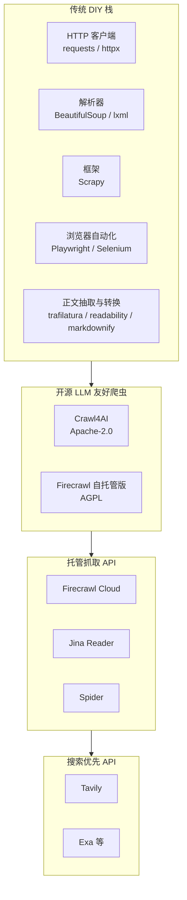
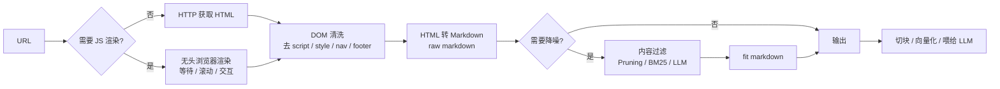
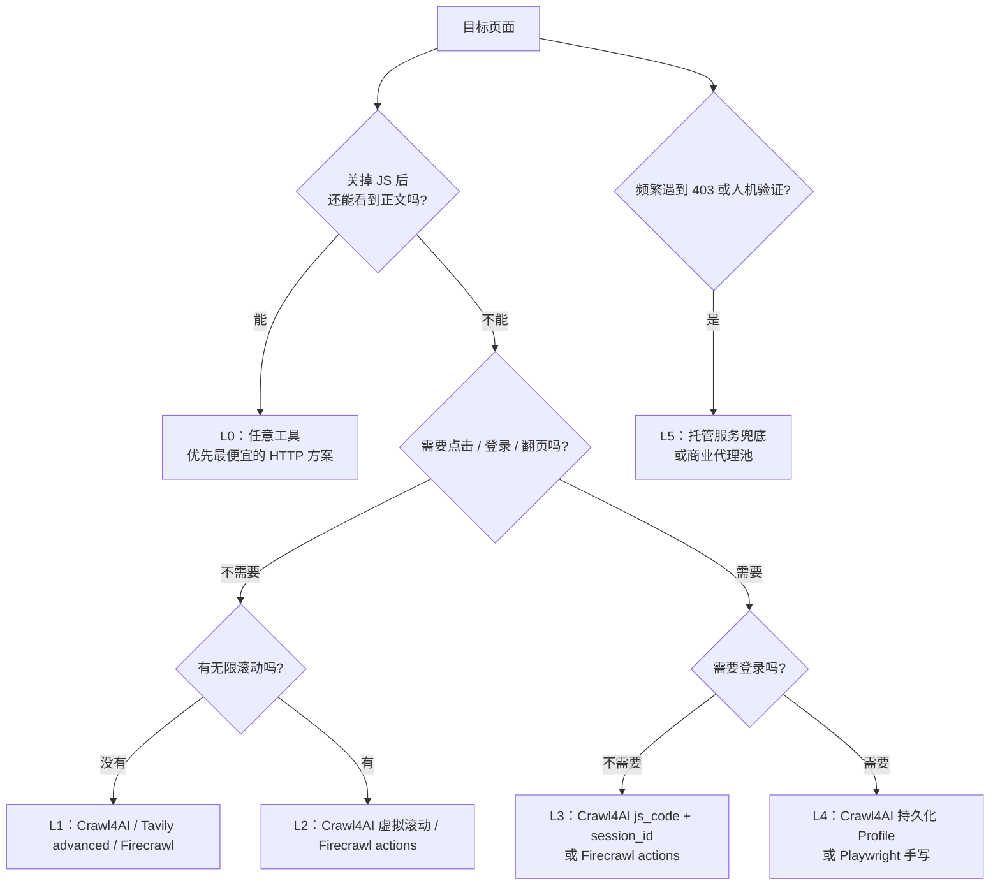
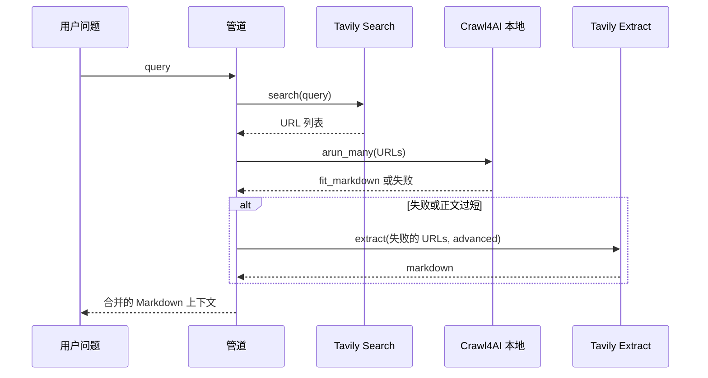

[toc]


**自报家门**：我是 Anthropic 开发的 Claude，具体是哪个版本我无法确定。

**可用工具与环境**：一个 Python/Bash 沙箱，里面带 `web_search` 函数，返回结果包含页面正文摘录。沙箱本身不能直接上网，所以没法实际运行爬虫做实测。本轮搜索在完成约 6 次查询后触发了次数上限，后面两次查询（Firecrawl 官方文档、Jina Reader 现状）没有成功。

**任务理解**：我以“AI 数据基础设施调研分析师 + 爬虫工程实践者”的身份，面向国内开发者（测试环境在国内，可以用代理；生产环境部署在海外），对比 AI 时代的网页转 Markdown 抓取方案和传统方案，给出选型与动态页面抓取建议。

## 信息依据与知识截止

| 类别        | 来源                                                         | 性质                                     |
| ----------- | ------------------------------------------------------------ | ---------------------------------------- |
| Crawl4AI    | [官方文档：Markdown Generation（v0.9.x）](https://docs.crawl4ai.com/core/markdown-generation/)、[Fit Markdown](https://docs.crawl4ai.com/core/fit-markdown/)、[GitHub CHANGELOG](https://github.com/unclecode/crawl4ai/blob/main/CHANGELOG.md)、[v0.9.4 发布说明](https://github.com/unclecode/crawl4ai/blob/main/docs/blog/release-v0.9.4.md) | 官方，一手                               |
| Tavily      | [Tavily Docs：Clean Content Extraction](https://docs.tavily.com/examples/quick-tutorials/extract-api)、[Tavily CLI](https://docs.tavily.com/documentation/tavily-cli)、[LangChain 集成](https://docs.tavily.com/documentation/integrations/langchain) | 官方，一手                               |
| Tavily 收购 | [Bloomberg 2026-02-10](https://www.bloomberg.com/news/articles/2026-02-10/nebius-agrees-to-buy-ai-agent-search-company-tavily-for-275-million)、[Futurum](https://futurumgroup.com/insights/does-nebius-acquisition-of-tavily-create-the-leading-agentic-cloud/)、[Sacra](https://sacra.com/c/tavily/) | 权威媒体、分析平台                       |
| 横向对比    | [Apify：Crawl4AI vs Firecrawl](https://blog.apify.com/crawl4ai-vs-firecrawl/)、[inference.net 对比](https://inference.net/content/crawl4ai-vs-firecrawl-vs-schematron/)、[Webfuse 对比](https://www.webfuse.com/compare/firecrawl-vs-crawl4ai) | 第三方评测（各自也有商业立场）           |
| 基准测试    | [Spider：1000 URL benchmark](https://spider.cloud/blog/firecrawl-vs-crawl4ai-vs-spider-honest-benchmark/) | **竞品厂商自测，有利益相关，只能作参考** |
| 厂商互评    | [Firecrawl vs Tavily（Firecrawl 官网）](https://www.firecrawl.dev/alternatives/firecrawl-vs-tavily)、[7 Best Firecrawl Alternatives（Tavily 博客）](https://www.tavily.com/blog/7-best-firecrawl-alternatives-for-ai-agents-in-2026) | **厂商营销内容，只采信事实部分**         |

**知识截止**：根据搜索结果的页面时间推算，本文信息大约截至 **2026 年 10 月下旬**。其中 Crawl4AI 最新版本为 **v0.9.4（2026-09-23）**。文中标注 **“（未在本轮核实）”** 的内容来自我的训练知识，可能已经过时，使用前请对照官方文档确认。

## 结论速览

- **两者都能把网页转成 Markdown，但定位完全不同。**
  - **Crawl4AI** 是开源（Apache-2.0）的 Python 爬虫库，**默认输出就是 Markdown**。它还能生成过滤掉噪声的 `fit_markdown`，需要自己部署、自己运维。
  - **Tavily** 是闭源的托管 API，以“**搜索优先**（search-first）”为核心。它的 **Extract 接口**支持 `format="markdown"`（默认值）或 `text`，另有 Crawl、Map 接口做整站抓取。Search 接口可以通过 `include_raw_content` 附带整页 Markdown。
- **动态页面方面**：Crawl4AI 基于 Playwright，能执行 JS、等待元素、滚动无限加载、多步交互，**可控性最强**，但反爬（anti-bot）需要自己处理。Tavily 的 `extract_depth="advanced"` 能处理 JS 渲染页面，但**不支持自定义交互**（点击、登录等）。
- **怎么选**（一句话版）：
  - **Agent 需要“先找后读”**：用 Tavily（或同类搜索 API）。
  - **已知 URL、批量、成本敏感、要私有化部署**：用 Crawl4AI。
  - **要托管、省心、强反爬**：考虑 Firecrawl 云服务。
  - **结构固定的大规模采集**：传统的 Scrapy 依然最高效，可以再接一个 Markdown 转换步骤。
  - 生产环境推荐“**自建为主 + 托管兜底**”的混合架构。

## 为什么 AI 时代需要新的抓取方案

传统爬虫的产出是**结构化字段**，比如价格、标题、发布时间，靠 CSS/XPath 选择器（selector）精确提取。LLM 应用的需求不一样：

- **RAG（检索增强生成，Retrieval-Augmented Generation）** 需要**干净、保留语义结构的正文**。标题层级、列表、表格、代码块都要保留，方便切块（chunking）和向量化。
- **AI Agent** 需要“**给我一个 URL 或一个问题，立刻返回模型能读的上下文**”，不能为每个网站写一套选择器。
- **Token 成本**：原始 HTML 里大量是导航栏、脚本和样式，直接喂给模型既浪费 Token 又干扰理解。Markdown 是目前公认的“**LLM 友好格式**”，信息密度高，结构也保留下来了。

inference.net 的对比文章特别强调：**抓取（crawl）和抽取（extraction）是两件不同的事**。Markdown 适合 RAG，但它**不等于结构化业务数据**。需要类型化的 JSON 时，还要另做 schema 抽取。这一点是后面选型的重要依据。

## 方案全景图



**图解**：从左到右（图中从上到下）是**抽象层级递增、控制力递减**的过程。

- **传统 DIY 栈**：每个环节都要自己拼装，控制力最强，工作量也最大。
- **开源 LLM 友好爬虫**：把“浏览器渲染、正文清洗、转 Markdown”打包好了，但仍然要自己部署。
- **托管抓取 API**：连浏览器集群、代理池都替你管好，按次或按 credit 计费。
- **搜索优先 API**：在抓取前面再加一层“**找到相关网页**”的能力，适合 Agent 直接调用。

箭头表示“上层通常建立在下层能力之上”，不代表某一层能完全替代另一层。

## 网页转 Markdown 的通用原理

无论用哪个工具，“网页 -> LLM 可用 Markdown”大致都要经过下面这条管道：



各环节的关键点：

| 环节                   | 作用                             | 典型难点                                  |
| ---------------------- | -------------------------------- | ----------------------------------------- |
| **获取**（fetch）      | 拿到 HTML                        | 反爬、限速、地域封锁                      |
| **渲染**（render）     | 执行 JS，拿到最终 DOM            | SPA 页面、懒加载、无限滚动                |
| **清洗**（cleaning）   | 去掉模板噪声（boilerplate）      | 导航、侧栏、广告、Cookie 弹窗混进正文     |
| **转换**（conversion） | HTML 转 Markdown                 | 表格（rowspan/colspan）、代码块、相对链接 |
| **过滤**（filtering）  | 只留“核心内容”或与查询相关的部分 | 过滤过度会丢信息，过滤不足会留噪声        |

这里要区分两个概念，Crawl4AI 文档明确区分了它们：

- **raw markdown**：把整个页面忠实转成 Markdown，信息完整但噪声多。
- **fit markdown**：经过内容过滤算法处理后的精简版，适合直接喂给 LLM。

Spider 的基准测试里有个指标叫“**噪声比**（noise ratio）”，衡量的就是这一步的质量：Firecrawl 6.8%，Crawl4AI 默认配置 11.3%。原文也指出 Crawl4AI 可配置，只是**默认配置留下的噪声更多**。

## Crawl4AI 详解

### 定位与现状

- **是什么**：开源 Python 库（Apache-2.0），底层用 Playwright 驱动浏览器，**默认输出 Markdown**。也能输出 JSON、清洗后的 HTML、截图、PDF、元数据等。
- **版本动态**：当前是 **v0.9.x** 系列。
  - **v0.9.0（2026-06-18）** 是一次“**默认安全**（secure-by-default）”的大版本，Docker API 服务器默认开启鉴权，除 `GET /health` 外的所有请求都要认证，属于破坏性变更。
  - **v0.9.3、v0.9.4** 都是安全版本：前者修复了 PDF 处理路径和 Playground 的若干漏洞；后者修复了 robots.txt 获取和链接预览两条 **SSRF（服务端请求伪造）** 路径，并引入了快约 10 倍的 `PruningContentFilterLXML`。
- **含义**：如果你把 Crawl4AI 的 **Docker 服务器暴露给不可信输入**（比如让 Agent 随意提交 URL），**必须升级到 0.9.4 或更高版本**。

### Markdown 生成机制

核心对象和字段：

| 名称                           | 含义                                                         |
| ------------------------------ | ------------------------------------------------------------ |
| `AsyncWebCrawler`              | 异步爬虫主对象，管理浏览器生命周期                           |
| `BrowserConfig`                | **浏览器级**配置：无头模式、代理、UA、持久化目录等           |
| `CrawlerRunConfig`             | **单次抓取级**配置：缓存、等待条件、JS 注入、Markdown 生成器等 |
| `DefaultMarkdownGenerator`     | 默认 Markdown 生成器，可以挂一个 `content_filter`            |
| `PruningContentFilterLXML`     | 基于文本密度、链接密度等启发式规则的**剪枝过滤器**，0.9.4 起成为默认；旧的 `PruningContentFilter` 已弃用，输出相同但慢约 10 倍 |
| `BM25ContentFilter`            | 基于 BM25 算法、按 `user_query` **做相关性过滤**             |
| `result.markdown.raw_markdown` | 全量 Markdown                                                |
| `result.markdown.fit_markdown` | 过滤后的 Markdown，**只有配置了 `content_filter` 时才有值**  |

过滤器参数：

| 参数                             | 含义                                                         |
| -------------------------------- | ------------------------------------------------------------ |
| `threshold`                      | 剪枝阈值。值越大保留越少、越激进；文档示例常用 0.4 到 0.6    |
| `threshold_type`                 | `"fixed"` 表示固定阈值；`"dynamic"` 表示根据页面特征动态调整 |
| `options={"ignore_links": True}` | 生成 Markdown 时去掉链接，进一步节省 Token                   |

**辨析**：Pruning 是“**与查询无关**”的通用降噪，适合 RAG 入库；BM25 是“**与查询相关**”的过滤，适合 Agent 带着问题读网页。另外，**BM25 对中文的效果需要谨慎评估**。BM25 依赖分词，中文不用空格分词，如果库内部按空白切分，中文页面的效果可能明显下降（**未在本轮核实**）。中文场景**推荐先用 Pruning**。

### 动态页面能力

以下 Crawl4AI 动态页面相关参数来自我的训练知识和官方文档常见用法，**v0.9.x 的具体参数名请对照官方文档核实**：

| 能力     | 典型参数或做法                                         | 说明                                                         |
| -------- | ------------------------------------------------------ | ------------------------------------------------------------ |
| 执行 JS  | `js_code=["..."]`                                      | 例如点击“加载更多”                                           |
| 等待条件 | `wait_for="css:.article"` 或 `wait_for="js:() => ..."` | 等到目标元素出现或条件为真才提取                             |
| 整页滚动 | `scan_full_page=True`                                  | 触发懒加载图片和内容                                         |
| 虚拟滚动 | Virtual Scroll 配置                                    | 处理 Twitter 式会**回收 DOM** 的无限流；Apify 对比文中也提到这一能力 |
| 多步会话 | `session_id`                                           | 在同一个页面上分步操作（翻页、展开）                         |
| 登录态   | 持久化浏览器上下文、`user_data_dir`                    | 复用已登录的 Profile                                         |
| 反检测   | stealth 或 undetected 模式、代理配置                   | 有一定作用，但**不等于商业级反爬**                           |

**第三方基准参考**（Spider 自测，有利益相关）：Crawl4AI 在静态页、JS 重度 SPA、受保护页面上的成功率分别是 **99.0%、93.7%、72.0%**；Firecrawl 是 **99.5%、96.6%、88.4%**。**结论是：Crawl4AI 处理普通动态页面没问题，短板在强反爬站点。**

## Tavily 详解

### 定位与现状

- **是什么**：专为 AI Agent 设计的**搜索 API**，闭源 SaaS，不能自托管。
- **重大变动**：**2026 年 2 月 10 日，Nebius 宣布以约 2.75 亿美元收购 Tavily**（来源：Bloomberg、Futurum、Sacra），计划把它整合进 Nebius AI 云平台。**对用户的影响**：短期 API 照常可用；中长期的定价、条款、数据驻留策略可能调整，**要做好供应商抽象层，避免强绑定**。

### 接口矩阵

Tavily 官方 LangChain 集成包 `langchain-tavily` 已覆盖 **Search、Extract、Map、Crawl、Research** 五类能力。旧的 `langchain_community` 里的 Tavily 工具已弃用。

| 接口         | 作用                                       | 是否返回 Markdown                                            |
| ------------ | ------------------------------------------ | ------------------------------------------------------------ |
| **Search**   | 搜索并返回 AI 排序后的结果、摘要片段、引用 | 默认是片段；设置 `include_raw_content="markdown"` 可附带整页内容 |
| **Extract**  | 给定 URL（可批量），返回清洗后的正文       | **是**，`format` 默认就是 `markdown`                         |
| **Map**      | 发现站点的 URL 结构                        | 只返回 URL 列表                                              |
| **Crawl**    | 从起始 URL 按深度和广度抓取多页            | 是，每页的正文                                               |
| **Research** | 多步深度研究                               | 生成报告                                                     |

### Extract 关键参数

| 参数                           | 取值                         | 含义                                                         |
| ------------------------------ | ---------------------------- | ------------------------------------------------------------ |
| `urls`                         | 字符串或列表                 | 要抽取的页面                                                 |
| `extract_depth`                | `basic`（默认）或 `advanced` | **`advanced` 能处理 JS 渲染页面、表格、嵌入内容**，速度慢一些但成功率更高 |
| `format`                       | `markdown`（默认）或 `text`  | 输出格式；官方说明 `text` 可能增加延迟                       |
| `query` 与 `chunks_per_source` | 字符串与整数                 | 按查询只返回最相关的若干片段，相当于托管版的“fit markdown”   |
| `include_images`               | 布尔                         | 是否返回图片                                                 |

**计费**（官方文档）：`basic` 每 5 个 URL 消耗 1 credit，`advanced` 每 5 个 URL 消耗 2 credits。

Crawl 关键参数（来自官方 CLI 文档）：

| 参数           | 默认值           | 含义                                   |
| -------------- | ---------------- | -------------------------------------- |
| `max_depth`    | 1（范围 1 到 5） | 从起始 URL 往下爬几层                  |
| `max_breadth`  | 20               | 每页最多跟进多少链接                   |
| `limit`        | 50               | 总页数上限                             |
| `instructions` | 无               | **自然语言指令**，例如“只跟进文档页面” |

### 动态页面能力

- **能做**：用 `advanced` 处理 JS 渲染页面，比如常见的 React/Vue SPA。
- **不能做**：自定义点击、表单填写、登录、滚动到指定位置等交互，也不能指定等待某个选择器。从公开文档看没有这类交互参数。
- **结论**：Tavily 适合“**读懂公开网页**”，不适合“**操作网页**”。

## Firecrawl 与其他同类方案

### Firecrawl

- **定位**：API 优先的托管爬虫，**默认输出 Markdown**，另有一个 AGPL 许可的自托管版本。
- **接口**：`/scrape` 抓单页，`/crawl` 抓整站，`/map` 发现 URL，`/extract` 做 LLM 结构化抽取。官方还宣传了 Search、Interact、Agent 等能力。
- **抽取风格**：**用自然语言描述要什么**，不写选择器，例如“提取博客标题和作者”，返回 JSON。
- **动态页面**：浏览器预热，能自动降级为轻量请求。官方 scrape 接口支持 `actions`（wait、click、write、scroll、screenshot 等）和 `waitFor`（**未在本轮核实**）。
- **需要注意**（**未在本轮核实**）：自托管版通常缺少云端版的部分反爬能力；而且 **AGPL 对 SaaS 化分发有传染性要求**，商业闭源产品集成前要做法务评估。

### 其他值得知道的方案

以下三项**未在本轮核实**：

- **Jina Reader**：在 URL 前加 `https://r.jina.ai/` 前缀就能拿到 Markdown，是门槛最低的方案，适合快速原型。可以通过请求头控制等待选择器、返回格式等。Jina AI 据报道已被 Elastic 收购，服务政策可能变化。**国内直连的可用性请自测。**
- **Spider**：Rust 实现的高吞吐托管爬虫。它自家基准声称吞吐量明显领先，但这是厂商自测，**需要独立复现**。
- **Exa**：语义搜索 API，带 contents 接口，是 Tavily 的直接竞品。

## 传统方案回顾

| 方案                                        | 角色                                    | 转 Markdown                                       | 动态页面                   | 适用                       |
| ------------------------------------------- | --------------------------------------- | ------------------------------------------------- | -------------------------- | -------------------------- |
| `requests`/`httpx` + `BeautifulSoup`/`lxml` | 获取 + 解析                             | 要配合 `markdownify`/`html2text`                  | 不支持                     | 静态页，简单脚本           |
| **Scrapy**                                  | 工业级爬虫框架：调度、去重、管道、限速  | 要自己加管道转换                                  | 要配合 `scrapy-playwright` | **大规模、结构固定的采集** |
| **Playwright**/Selenium/Puppeteer           | 浏览器自动化                            | 拿到 HTML 后再转换                                | **最强**，可以做任何交互   | 复杂交互、登录、测试       |
| **trafilatura**/readability                 | 正文抽取（去 boilerplate）              | trafilatura 支持输出 Markdown（**未在本轮核实**） | 不支持，只处理给定的 HTML  | 新闻、博客正文抽取         |
| `markitdown`（微软）                        | 文件转 Markdown（含 HTML、Office、PDF） | 支持                                              | 不支持，不是爬虫           | 本地文档转换               |

**AI 方案和传统方案的本质区别**：传统方案是“**组件**”，AI 方案是“**组装好的产品**”。

- Crawl4AI 本质上就是“Playwright + 清洗 + 转换 + 过滤”打包好，并为 LLM 场景调好了默认值。
- 所以**传统方案没有过时**。在“站点固定、字段固定、量极大”的场景，Scrapy 加选择器依然最便宜、最稳定、最可控。

## 综合对比

| 维度                | Crawl4AI                               | Tavily                          | Firecrawl                  | Jina Reader            | 传统栈（Scrapy/Playwright） |
| ------------------- | -------------------------------------- | ------------------------------- | -------------------------- | ---------------------- | --------------------------- |
| 形态                | 开源库 + Docker 服务                   | 闭源 SaaS                       | SaaS + AGPL 自托管         | SaaS                   | 开源组件                    |
| 许可与成本          | Apache-2.0，免费（只付服务器和代理钱） | 按 credit 计费                  | 按 credit 计费             | 免费额度 + 付费        | 免费                        |
| **网页转 Markdown** | 支持，默认输出，有 raw/fit 两档        | 支持，Extract 默认 `markdown`   | 支持，默认输出             | 支持                   | 需自己组装                  |
| **搜索能力**        | 无                                     | **核心能力**                    | 有 /search                 | 有 s.jina.ai（未核实） | 无                          |
| 整站抓取            | 支持深度爬取                           | 有 Crawl、Map                   | 有 /crawl、/map            | 弱                     | Scrapy 最强                 |
| **动态页面**        | 强：Playwright 全能力                  | 中：`advanced` 可渲染，不能交互 | 强：actions                | 中                     | **最强**，但全部要手写      |
| **反爬**            | 弱到中，需要自己配代理                 | 托管处理                        | 强（云端）                 | 中                     | 全部自己处理                |
| 结构化抽取          | 自带 LLM 策略（BYO-LLM）+ CSS 策略     | 无专门 schema 抽取              | /extract                   | 无                     | 选择器                      |
| 数据隐私            | **完全私有**                           | 数据经过第三方                  | 云端经过第三方，自托管私有 | 经过第三方             | 完全私有                    |
| 运维负担            | 高                                     | 无                              | 云端无，自托管高           | 无                     | 高                          |
| 国内网络            | 本地运行，只需拉取依赖                 | API 可能需要代理（建议自测）    | 同左                       | 同左                   | 本地运行                    |

## 动态页面抓取能力分级

把“动态”分成几个难度等级，比笼统地问“能不能抓动态页面”更有用：

| 等级                    | 场景举例                   | 需要的能力              | Crawl4AI                   | Tavily                   | Firecrawl       | 传统 Playwright  |
| ----------------------- | -------------------------- | ----------------------- | -------------------------- | ------------------------ | --------------- | ---------------- |
| **L0 静态或 SSR**       | 博客、文档站、新闻         | HTTP 即可               | 支持                       | 支持（basic）            | 支持            | 支持             |
| **L1 客户端渲染**       | React/Vue SPA              | 执行 JS、等待渲染       | 支持                       | 支持（advanced）         | 支持            | 支持             |
| **L2 懒加载或无限滚动** | 电商列表、社交信息流       | 滚动、虚拟滚动          | 支持                       | 部分（不能控制滚动深度） | 支持（actions） | 支持             |
| **L3 需要交互**         | 点“展开全文”、切 Tab、翻页 | 点击、输入、多步会话    | 支持                       | 不支持                   | 支持（actions） | 支持             |
| **L4 需要登录**         | 后台、会员内容             | Cookie 或持久化 Profile | 支持                       | 不支持                   | 有限（未核实）  | 支持             |
| **L5 强反爬**           | Cloudflare 挑战、指纹检测  | 住宅代理、指纹伪装      | 弱，需要外接代理和打码服务 | 托管处理，不保证成功     | 较强（云端）    | 弱，需要大量工程 |



**图解**：先用最简单的办法判断页面属于哪一级。在浏览器里禁用 JavaScript 后刷新，正文还在就是 L0。然后按“是否需要交互、是否需要登录”逐级往下判断。反爬（L5）和前面几级是**正交**的：任何一级的页面都可能同时有反爬，所以图里单独拉出一条分支。

## 怎么选：决策框架

```mermaid
flowchart TD
    S["你的需求"] --> Q1{"事先知道要抓哪些 URL 吗?"}
    Q1 -- "不知道，要先搜" --> Q2{"只要答案片段，<br>还是要整页内容?"}
    Q2 -- "片段或摘要" --> R1["Tavily Search"]
    Q2 -- "整页" --> R2["Tavily Search 加 include_raw_content<br>或 搜索 API 加 Crawl4AI 读取"]
    Q1 -- "知道" --> Q3{"数据能出境 / 交给第三方吗?"}
    Q3 -- "不能" --> R3["Crawl4AI 自托管"]
    Q3 -- "能" --> Q4{"量大且成本敏感?"}
    Q4 -- "是" --> R4["Crawl4AI 为主<br>失败的 URL 交给托管 API 兜底"]
    Q4 -- "否" --> Q5{"有强反爬或复杂交互吗?"}
    Q5 -- "有" --> R5["Firecrawl Cloud"]
    Q5 -- "没有" --> R6["Tavily Extract / Jina Reader<br>最省事"]
    S --> Q6{"站点固定、字段固定、<br>百万级规模?"}
    Q6 -- "是" --> R7["Scrapy 加选择器<br>需要正文时再转 Markdown"]
```



**图解**：第一个分叉“**是否事先知道 URL**”是最关键的。**搜索优先**的 Tavily 和**抓取优先**的 Crawl4AI、Firecrawl 解决的其实是两类问题。接下来依次看**数据合规、成本规模、反爬与交互**这三个约束。右下角那条 Scrapy 分支独立于其他分支：在大规模结构化采集场景，不必为了“AI 化”而放弃成熟的传统方案。

### 典型场景推荐

| 场景                                  | 推荐方案                                   | 理由                                                         |
| ------------------------------------- | ------------------------------------------ | ------------------------------------------------------------ |
| 给 Agent 加“联网搜索”工具             | **Tavily**                                 | 搜索、排序、引用一次完成，生态集成成熟（LangChain、LlamaIndex、MCP） |
| 把公司文档站或竞品官网灌进 RAG 知识库 | **Crawl4AI**（深度爬取 + Pruning）         | 免费、私有，`fit_markdown` 直接可用                          |
| 内网或敏感数据场景                    | **Crawl4AI 自托管**                        | 数据不出域，Apache-2.0 对商业友好                            |
| 无运维人力的小团队做原型              | Jina Reader 或 Tavily Extract              | 一行 HTTP 调用就能用                                         |
| 目标站反爬严重                        | Firecrawl Cloud 或商业抓取 API             | 自建反爬的成本往往高于订阅费                                 |
| 电商、招聘等字段型大规模采集          | **Scrapy**（必要时加 `scrapy-playwright`） | 吞吐、调度、去重成熟，按字段抽取更精确                       |

### 最佳实践

**必须**：

- **遵守 robots.txt、网站服务条款和相关法律**（比如国内的《个人信息保护法》《数据安全法》）。不要抓取个人隐私数据，不要绕过付费墙。Crawl4AI 有 `check_robots_txt` 选项可以开启。
- 对外暴露 Crawl4AI Docker 服务时，**升级到 0.9.4 或更高版本**，并开启鉴权，防止 SSRF。
- **限速与重试**：自建爬虫要设置并发上限和退避重试，避免对目标站造成压力。

**推荐**：

- **在业务代码和抓取供应商之间加一层抽象接口**，例如定义 `fetch_markdown(url) -> str`，方便替换和兜底。Tavily 被收购这件事就说明供应商会变。
- **用自己的真实目标站点做 PoC**，比较成功率、噪声比和成本。不要轻信任何厂商的基准测试，包括本文引用的 Spider 数据。
- RAG 入库**用 Pruning 过滤后的 fit markdown**，Agent 问答**用按查询过滤**（BM25 或 Tavily 的 `query` 参数）。
- 开启缓存（Crawl4AI 有 `cache_mode`），避免重复抓取。

**可以**：

- 采用“**Crawl4AI 处理大部分页面 + 托管 API 处理难啃页面**”的混合模式。Webfuse 的对比文章也提到很多团队这么做。

**避免**：

- **避免把原始 HTML 直接喂给 LLM**：浪费 Token，质量也差。
- **避免用 LLM 抽取做大批量的结构化采集**：成本高，还可能产生幻觉字段。结构固定时选择器更可靠。
- **避免在单一托管供应商上没有任何退路**。

## 综合示例：混合抓取管道

**场景**：你在做一个“技术调研 Agent”，用户问“Crawl4AI 最新版本有什么安全更新？”。管道分三步：

- 用 **Tavily Search** 找到相关网页（不知道 URL 时先搜）。
- 用 **Crawl4AI** 在本地把这些 URL 转成 fit markdown（免费、私有）。
- Crawl4AI 失败或正文过短时，自动交给 **Tavily Extract（advanced）** 兜底。



**图解**：时序图展示了“搜索、本地抓取、托管兜底”三段协作。`alt` 块表示只有本地抓取失败时才调用付费的 Extract 接口，以此控制成本。

下面的代码我没有在沙箱里运行过（沙箱没有外网），API 用法依据官方文档整理。**不同版本的参数可能有差异，请以官方文档为准。**

```python
"""
hybrid_fetch.py —— 搜索 + 本地抓取 + 托管兜底的混合管道示例
依赖: pip install "crawl4ai>=0.9.4" tavily-python
首次安装后运行: crawl4ai-setup   (安装 Playwright 浏览器)
环境变量:
  TAVILY_API_KEY   Tavily 密钥
  CRAWL_PROXY      可选，本地抓取用的代理，例如 http://127.0.0.1:7890
"""
import asyncio
import os
from pathlib import Path

from crawl4ai import AsyncWebCrawler, BrowserConfig, CrawlerRunConfig, CacheMode
from crawl4ai.markdown_generation_strategy import DefaultMarkdownGenerator

try:  # 0.9.4+ 推荐的 lxml 实现，约快 10 倍
    from crawl4ai.content_filter_strategy import PruningContentFilterLXML as Pruning
except ImportError:  # 兼容旧版本
    from crawl4ai.content_filter_strategy import PruningContentFilter as Pruning

from tavily import TavilyClient

MIN_CHARS = 500  # 正文少于该长度视为抽取失败(可能是反爬页或空壳 SPA)
tavily = TavilyClient(api_key=os.environ["TAVILY_API_KEY"])


def search_urls(query: str, k: int = 5) -> list[str]:
    """第一步: 用 Tavily 搜索拿到候选 URL"""
    resp = tavily.search(query=query, max_results=k)
    return [r["url"] for r in resp.get("results", [])]


async def crawl_local(urls: list[str]) -> dict[str, str]:
    """第二步: Crawl4AI 本地抓取, 返回 {url: fit_markdown}"""
    proxy = os.getenv("CRAWL_PROXY")
    browser_cfg = BrowserConfig(
        headless=True,
        proxy_config={"server": proxy} if proxy else None,
    )
    run_cfg = CrawlerRunConfig(
        cache_mode=CacheMode.ENABLED,  # 开启缓存, 避免重复抓取
        scan_full_page=True,           # 滚动整页, 触发懒加载
        page_timeout=60_000,           # 毫秒
        markdown_generator=DefaultMarkdownGenerator(
            content_filter=Pruning(threshold=0.45, threshold_type="dynamic"),
            options={"ignore_links": True},
        ),
    )
    out: dict[str, str] = {}
    async with AsyncWebCrawler(config=browser_cfg) as crawler:
        results = await crawler.arun_many(urls, config=run_cfg)
        for r in results:
            if r.success and r.markdown:
                md = r.markdown.fit_markdown or r.markdown.raw_markdown
                if len(md) >= MIN_CHARS:
                    out[r.url] = md
    return out


def extract_fallback(urls: list[str]) -> dict[str, str]:
    """第三步: 对失败的 URL 调用 Tavily Extract(advanced 可处理 JS 渲染)"""
    if not urls:
        return {}
    resp = tavily.extract(urls=urls, extract_depth="advanced", format="markdown")
    return {r["url"]: r.get("raw_content", "") for r in resp.get("results", [])}


async def main(query: str) -> None:
    urls = search_urls(query)
    docs = await crawl_local(urls)
    failed = [u for u in urls if u not in docs]
    docs.update(extract_fallback(failed))

    out_dir = Path("out")
    out_dir.mkdir(exist_ok=True)
    for i, (url, md) in enumerate(docs.items()):
        # 显式 UTF-8, 避免 Windows 默认 GBK 编码导致中文乱码或写入报错
        (out_dir / f"doc_{i}.md").write_text(f"<!-- {url} -->\n{md}", encoding="utf-8")
    print(f"本地成功 {len(urls) - len(failed)} 篇, 兜底 {len(failed)} 篇")


if __name__ == "__main__":
    asyncio.run(main("Crawl4AI 0.9.4 security release"))
```

关键设计点：

| 要点                           | 说明                                                         |
| ------------------------------ | ------------------------------------------------------------ |
| `MIN_CHARS`                    | **“成功但内容为空”比“失败”更常见**，比如拿到的是反爬挑战页或没渲染完的 SPA 空壳，所以要按正文长度判定 |
| `fit_markdown or raw_markdown` | 过滤器在某些页面上可能过滤过度，回退到全量 Markdown          |
| `threshold_type="dynamic"`     | 让剪枝阈值随页面特征自适应，比固定阈值更稳健                 |
| `encoding="utf-8"`             | **Windows 下必须显式指定**，否则可能按 GBK 写文件，导致中文乱码或报错 |
| 供应商抽象                     | 三个函数各自独立，以后把 Tavily 换成 Exa、Firecrawl，只需改对应函数 |

**动态交互示例**：对于“点击加载更多”这类 L3 页面，可以给 `CrawlerRunConfig` 加上 `js_code=["document.querySelector('button.load-more')?.click();"]` 和 `wait_for="css:.comment-item:nth-child(20)"`，意思是点击按钮后，等到至少出现第 20 条评论再提取。多次翻页可以配合 `session_id` 在同一个浏览器标签页里分步执行。

## 国内网络环境与跨平台注意事项

### 依赖安装

- **pip 镜像**：`pip install -i https://pypi.tuna.tsinghua.edu.cn/simple "crawl4ai>=0.9.4" tavily-python`（清华 TUNA 镜像）。
- **Playwright 浏览器下载**：`crawl4ai-setup` 会下载 Chromium，国内直连可能很慢。有两种办法：走代理，或者设置 `PLAYWRIGHT_DOWNLOAD_HOST` 指向国内镜像（比如 npmmirror 提供的 playwright 二进制镜像，**具体地址未在本轮核实，请自测**）。
- **GitHub 源码或 Release**：可以用 `https://gh-proxy.com/` 加原链接的方式加速，**可用性请自测**。

### 设置代理（以本地 mihomo 端口 7890 为例）

| 平台                      | 临时生效的命令                                               |
| ------------------------- | ------------------------------------------------------------ |
| Linux / macOS（bash/zsh） | `export HTTPS_PROXY=http://127.0.0.1:7890 HTTP_PROXY=http://127.0.0.1:7890` |
| Windows PowerShell        | `$env:HTTPS_PROXY="http://127.0.0.1:7890"; $env:HTTP_PROXY="http://127.0.0.1:7890"` |
| Windows CMD               | `set HTTPS_PROXY=http://127.0.0.1:7890`                      |

**辨析**：环境变量影响的是 **pip 和 Tavily SDK（HTTP 客户端）**。Crawl4AI **浏览器自己的流量**要通过 `BrowserConfig` 的代理参数单独配置，也就是示例里的 `CRAWL_PROXY`。两者是两条不同的链路。

### 部署与访问

- **生产环境部署在海外服务器**时，Tavily、Firecrawl 等 API 一般没有访问问题。Crawl4AI 推荐用官方 Docker 镜像部署，**记得开启鉴权**（0.9.0 起默认开启）。
- **国内测试环境**：Tavily、Jina 等海外 API 能否直连**请自行测试**。不行就走代理。

### 中文相关问题

- **截图乱码**：在 Docker 或精简 Linux 里截图时，缺少中文字体会出现方框（“豆腐块”）。要安装 `fonts-noto-cjk` 之类的 CJK 字体。
- **编码**：老旧中文站可能是 GBK 编码。浏览器渲染路线（Crawl4AI）一般能自动处理；纯 HTTP 路线要注意 `response.encoding` 的检测。
- **BM25 过滤**：前面提过，中文效果需要实测，**优先用 Pruning**。

## 局限说明与下一轮建议搜索词

本轮实际执行了约 6 次查询（Crawl4AI 文档与版本、Tavily Extract、Tavily 收购、横向对比），之后触发了搜索次数上限。**以下内容未能核实，标注为训练知识**：Firecrawl 的 actions 与自托管限制细节、Jina Reader 现状、Exa、Spider 的独立评测、trafilatura 的 Markdown 输出、国内同类方案。

如果需要补充，可以在下一轮对话中用这些搜索词：

- `Firecrawl self-hosted vs cloud fire-engine limitations 2026`：核实自托管版功能缺口。
- `Jina Reader r.jina.ai 2026 Elastic rate limit`：核实被收购后的服务政策。
- `Exa contents API vs Tavily extract 2026`：补齐搜索优先 API 的竞品对比。
- `博查 Web Search API` 和 `阿里云 IQS 信息查询服务`：**国内搜索加抽取方案**，对国内业务很重要，本轮没有覆盖。
- `ScrapeGraphAI` 和 `browser-use crawl markdown`：LLM 驱动的抓取与浏览器 Agent，是新兴方向。
- `independent benchmark web scraping API markdown quality 2026`：寻找**非厂商**的第三方基准测试，弥补本文基准数据的利益相关问题。