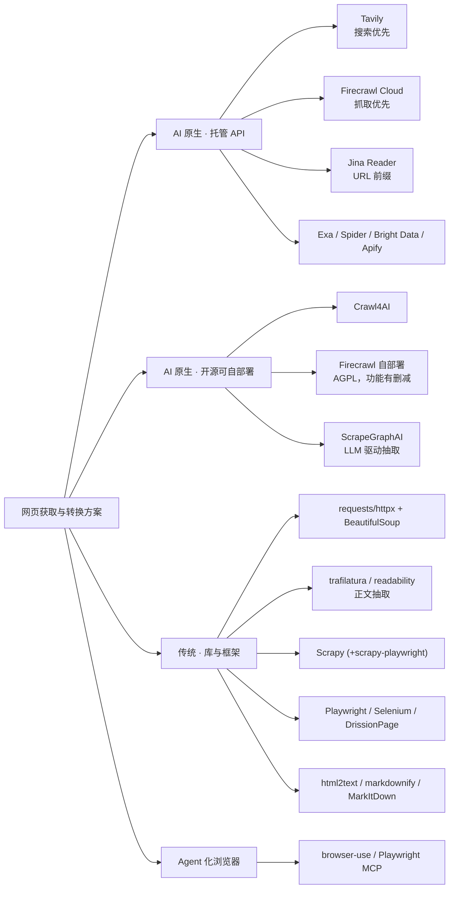
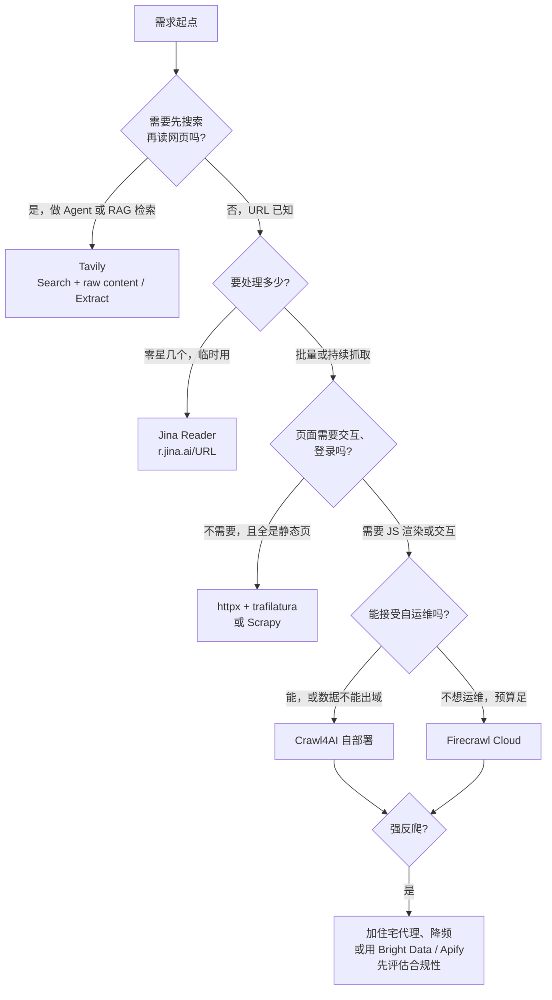
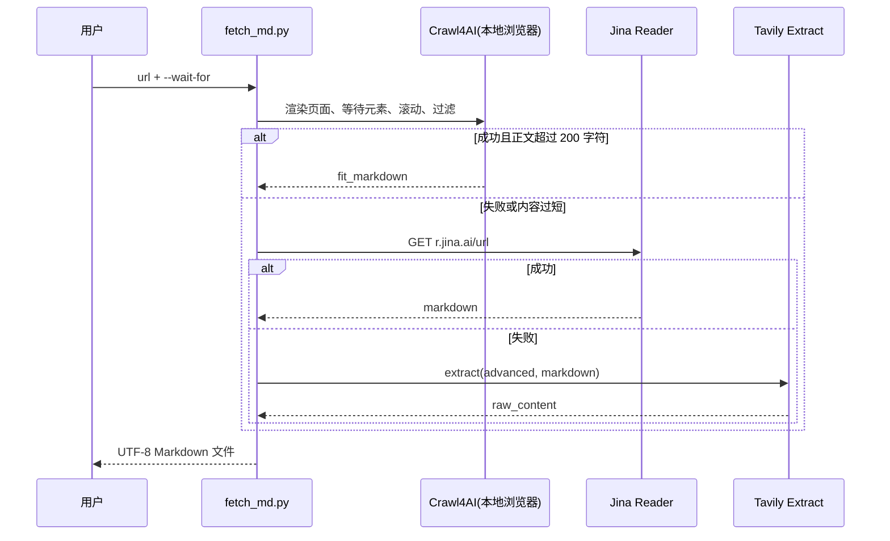

[toc]


## 结论速览

| 你的处境                                     | 推荐方案                                                     | 一句话理由                                                   |
| -------------------------------------------- | ------------------------------------------------------------ | ------------------------------------------------------------ |
| 做 Agent、RAG，主要需求是"先搜再读"          | **Tavily**（Search 带 `include_raw_content`，或 Extract）    | 搜索、排序、抽正文一个 API 解决，不用维护浏览器              |
| 要批量抓、能自部署、想零成本、要定制         | **Crawl4AI**                                                 | 开源，基于 Playwright 真浏览器，动态页面能力强，输出 `raw_markdown` 和 `fit_markdown` |
| 要托管服务，又要页面交互（点击、输入、滚动） | **Firecrawl**                                                | `actions` 能做交互，反爬能力比开源自部署更好                 |
| 只想临时把一个 URL 转成 Markdown             | **Jina Reader**（`r.jina.ai/URL`）                           | 在 URL 前加个前缀就能用，零代码                              |
| 静态页面量很大、成本敏感                     | **传统方案**：`httpx` + `trafilatura` 或 Scrapy              | 不开浏览器，便宜、快，非常成熟                               |
| 强反爬、需要登录、页面交互复杂               | Playwright、DrissionPage 自己写，或者 Bright Data / Apify 这类商业平台 | AI 封装帮不了你绕过风控，最后还是要靠浏览器控制和代理        |

## 为什么 AI 时代特别需要"网页转 Markdown"

传统爬虫的目标是**结构化数据**：用 CSS 或 XPath 选择器取出价格、标题这些字段，存进数据库。LLM 应用的目标变成了**给模型阅读的上下文**，于是出现了新问题：

- **Token 成本**：原始 HTML 里大量是 `<script>`、样式、导航和广告，直接喂给模型既浪费 token，又会干扰模型理解。
- **语义保真**：Markdown 保留了标题层级、列表、表格、链接这些结构，模型读起来容易，做 RAG 时也方便按标题切块（chunking）。
- **动态渲染**：现代网站大量用 SPA（单页应用），内容由 JavaScript 渲染，`requests` 拿到的往往只是一个空壳。

inference.net 的对比文章指出了一个容易被忽略的区别：**Markdown 适合 RAG，但它不等于结构化业务数据**。抓取（crawling）失败通常是因为被封禁或动态内容加载不出来；抽取（extraction）失败通常是因为 schema 漂移、字段缺失或 JSON 不合法。**"网页转 Markdown"和"抽取结构化 JSON"是两件不同的事**，选型前要先想清楚你要的是哪一个。

## 方案全景



**图解**：可以按两个维度区分这些方案：**谁来运行浏览器**（你自己还是供应商），以及**输出是给人看还是给模型看**。

- **AI 原生方案**：默认输出 Markdown，并且会去掉页面噪声。
- **传统方案**：给你的是原材料（HTML 或 DOM），需要自己拼"渲染 → 正文抽取 → 转 Markdown"这条链路。
- **Agent 化浏览器**：由 LLM 决定下一步点哪里，适合流程不固定的任务。它成本高、速度慢，不适合批量抓取。

## 核心问题：Crawl4AI 和 Tavily 都能转 Markdown 吗

**都能。** 区别如下。

| 维度                     | Crawl4AI                                                   | Tavily                                                       |
| ------------------------ | ---------------------------------------------------------- | ------------------------------------------------------------ |
| 形态                     | 开源 Python 库，另有 Docker 服务和 CLI                     | 托管 REST API，有 SDK 和 MCP                                 |
| 转 Markdown 的入口       | `result.markdown`（包含 `raw_markdown` 和 `fit_markdown`） | Extract API 的 `format="markdown"`；Search 的 `include_raw_content`；Crawl API |
| 降噪方式                 | 你自己选的内容过滤器：Pruning、BM25、LLM                   | 服务端黑盒处理；可以传 `query` 让它按相关性返回片段          |
| 浏览器                   | 本地 Playwright（Chromium 等），完全可控                   | 你看不到，也控制不了                                         |
| 交互（点击、输入、登录） | 支持：`js_code`、`wait_for`、`session_id` 等               | 不支持                                                       |
| 成本                     | 软件免费，花费在服务器、代理和运维上                       | 按 credit 计费，免费档约 1000 credits/月（来源：Bright Data 2026 对比文） |
| 最擅长                   | 批量抓取、深度定制、数据不出本机                           | Agent 的"搜索 + 阅读"，接入最快                              |

### Crawl4AI 的 Markdown 机制

根据官方文档（v0.9.x），开启内容过滤器后，`result.markdown` 里有两种形式：

- **`raw_markdown`**：完整的、没有过滤的 Markdown。
- **`fit_markdown`**：过滤器去掉或裁剪噪声段落之后的版本。

文档还提到一个新变化：**基于 BeautifulSoup 的 `PruningContentFilter` 已标记弃用，替代品是 lxml 重写的 `PruningContentFilterLXML`**。它在大页面上快约 10 倍，输出一致，并且已经是 `crwl` CLI 和 Docker 服务里 fit-markdown 接口的默认实现。

三种过滤器的区别：

| 过滤器                                 | 原理                                                     | 适用场景                         | 注意                                                         |
| -------------------------------------- | -------------------------------------------------------- | -------------------------------- | ------------------------------------------------------------ |
| `PruningContentFilter`（或 `...LXML`） | 按文本密度、链接密度、HTML 结构和 nav、footer 等模式剪枝 | 没有具体查询词，只想做通用的去噪 | `threshold` 要按站点调；中文页面建议实测                     |
| `BM25ContentFilter`                    | 按用户查询做 BM25 相关性筛选                             | 只想要和某个问题相关的段落       | BM25 依赖分词，**中文没有空格，默认分词效果存疑，务必实测**（我的推断，待核实） |
| `LLMContentFilter`                     | 让 LLM 判断哪些内容保留                                  | 页面结构复杂、对质量要求高       | 有 token 成本，速度慢                                        |

### Tavily 的 Markdown 机制

根据 Tavily Extract API 官方文档：

- **`format`**：`markdown` 返回 Markdown；`text` 返回纯文本，可能更慢。
- **`extract_depth`**：`basic` 或 `advanced`，默认 `basic`。`advanced` 能抽到表格、内嵌内容这类更复杂的结构，延迟和费用更高（计费细节以官网为准）。
- **`query` 与 `chunks_per_source`**：传入查询后，按相关性只返回每个 URL 最相关的若干片段，适合直接塞进 Agent 上下文。
- **`timeout`**：第三方转发文档写的是 1 到 60 秒，`basic` 默认 10 秒、`advanced` 默认 30 秒（以 Tavily 官方为准）。
- 返回结构：成功的在 `results[].raw_content`，失败的 URL 放在 `failed_results`。

Tavily 官方博客对自己和 Firecrawl 的区分很直白：**Firecrawl 强在抓取、爬站、格式化和页面交互；Tavily 强在 Agent 检索**，也就是找到合适的来源、给证据排序、返回模型可直接用的上下文。这个说法来自厂商自己，但定位描述是准确的。

## 主要方案逐个解析

### Crawl4AI：开源自部署的首选

- **是什么**：基于 Playwright 的异步 Python 爬虫库。Bright Data 2026 年的文章统计它有 **7.8 万以上 GitHub stars**，是这个赛道最热门的开源项目。
- **核心对象**：
  - **`AsyncWebCrawler`**：爬虫实例，用 `async with` 管理浏览器的生命周期。
  - **`BrowserConfig`**：浏览器级配置，如 `headless`、`proxy_config`、`user_agent`、持久化用户目录（复用登录态），新版本还有隐身相关选项。
  - **`CrawlerRunConfig`**：单次抓取的配置，如 `wait_for`、`js_code`、`cache_mode`、`markdown_generator`、`excluded_tags`。
  - **`CrawlResult`**：返回结果，包含 `success`、`markdown`、`html`、`links`、`error_message` 等字段。
- **其他能力**：深度爬取（BFS、DFS 策略）、结构化抽取（`JsonCssExtractionStrategy` 不用 LLM，`LLMExtractionStrategy` 用 LLM）、Docker 服务（提供 `/md`、`/crawl` 等接口，可接 MCP）、`crwl` 命令行。
- **短板**：Apify 和 Tavily 的文章都提到，**自部署意味着稳定性要你自己负责**，包括浏览器资源、代理池、反爬对抗和并发调度。Spider 的 1000 URL 基准测试（厂商自测）里，Firecrawl 成功率 95.3%，Crawl4AI 89.7%，差距主要出在有防护的页面上；但 Crawl4AI 本身不收费。

### Tavily：为 Agent 设计的检索层

- **四个接口**（Search、Extract、Map、Crawl）：
  - **Search**：搜索并返回排好序的结果；加上 `include_raw_content` 可以同时拿到正文（可选 markdown 或 text，参数以官方为准）。
  - **Extract**：给定 URL，返回正文。
  - **Map**：列出一个站点的 URL 结构。
  - **Crawl**：按深度、广度爬整个站点，可以用自然语言 `instructions` 指定只要哪类页面（训练知识，以官方文档为准）。
- **适合**：LangChain、LlamaIndex 和各种 Agent 框架开箱即用，官方有 `langchain-tavily` 包。
- **短板**：**没法和页面交互**，抓不了需要登录的内容，对抓取过程也没有控制权，成功率和内容质量全看服务端。数据要经过第三方，合规敏感的场景要评估。

### Firecrawl：托管抓取加交互

- **能力**（训练知识，以官方为准）：
  - `/scrape` 的 `formats` 可以选 markdown、html、links、screenshot、json 等。
  - `onlyMainContent` 默认开启。
  - **`actions`** 支持 wait、click、write、press、scroll、executeJavascript 等动作。
  - 另有 `/crawl`、`/map`、`/search`、`/extract` 等接口。
- **开源情况**：核心代码以 AGPL-3.0 开源，但**自部署版没有云端的反爬引擎等能力**，效果会比云端差。商业产品里嵌入 AGPL 代码要注意许可证义务。
- **口碑**：Spider 的测试认为 Firecrawl 的 Markdown 更干净、在有防护的页面上更稳；Bright Data 认为它**规模大了以后贵**，而且有些站点照样会封它（两家都是竞品，结论要打折看）。

### Jina Reader：零代码的 URL 转 Markdown

- 用法：`https://r.jina.ai/` 后面直接拼目标 URL。
- 常用请求头（训练知识，以官方为准）：
  - `X-Return-Format`：返回格式，可选 markdown、html、text、screenshot。
  - `X-Wait-For-Selector`：等待某个元素出现后再返回。
  - `X-Target-Selector`：只取某个区域。
  - `X-Remove-Selector`：剔除指定元素。
  - `X-Timeout`：超时时间。
  - `X-No-Cache`：不用缓存。
  - `X-Set-Cookie`：带 Cookie 请求。
  - `Authorization: Bearer <key>`：带 API Key 可以提高限额。
- 不带 key 也能用，但限速很低。Jina 还发布过专门做 HTML 转 Markdown 的小模型 ReaderLM-v2。**据我了解 Jina AI 已被 Elastic 收购（2025 年，待核实），长期服务条款以官方为准。**
- **适合**：调试、临时使用、给 Agent 当轻量级的读网页工具。不适合大规模抓取。

### 传统方案：仍然是性价比之王

| 方案                                 | 角色                                       | 动态页面                      | 转 Markdown                               | 推荐场景                           |
| ------------------------------------ | ------------------------------------------ | ----------------------------- | ----------------------------------------- | ---------------------------------- |
| `requests` / `httpx` + BeautifulSoup | 下载 + 解析                                | 不支持                        | 需要自己接 `markdownify` 或 `html2text`   | 简单静态页、精确抽字段             |
| **trafilatura**                      | 正文抽取（去导航、去广告）                 | 不支持（只处理已拿到的 HTML） | 支持 `output_format="markdown"`（新版本） | **静态新闻、博客的大批量正文抽取** |
| Scrapy                               | 工业级爬虫框架：调度、去重、管道           | 需要配 `scrapy-playwright`    | 需要自己接                                | 百万级 URL、增量爬取               |
| Playwright / Puppeteer / Selenium    | 浏览器自动化                               | 支持，能力最强                | 需要自己接                                | 交互复杂、登录、定制反检测         |
| DrissionPage（国产）                 | Python 控制 Chromium，可以和收发数据包结合 | 支持                          | 需要自己接                                | 国内社区很活跃，对中文资料友好     |
| MarkItDown（微软）                   | 各种文件转 Markdown                        | 不涉及                        | 支持                                      | Office、PDF、HTML 文件，不负责抓取 |

**关键认识**：Crawl4AI 本质上就是把"Playwright 渲染 + 正文抽取 + 转 Markdown + 缓存与调度"打包好的一体化方案。**如果你的页面都是静态的，`httpx` + `trafilatura` 的速度和成本往往能比浏览器方案好一个数量级**，因为不需要启动浏览器。这是基于原理的判断，没有实测数据。

### 其他值得知道的方案

- **ScrapeGraphAI**：用自然语言描述要抽什么，由 LLM 生成抽取逻辑。适合字段抽取，成本取决于 LLM。
- **browser-use、Playwright MCP**：让 LLM 一步步操作浏览器。流程不固定时好用，不适合批量。
- **Exa、Spider、Bright Data、Apify**：分别对应语义搜索加内容 API、Rust 实现的高速爬取、代理和反爬基础设施、Actor 市场。
- **国内方案**：博查（Bocha）搜索 API、阿里云 IQS、智谱的联网搜索和网页读取工具等，都可以作为国内可访问的"搜索 + 读取"替代。**本轮没能搜索核实它们的具体能力和价格**，列入下一轮搜索建议。

## 动态页面抓取能力

### 动态页面的难度分级

把"动态页面"拆成难度递增的几层，选型就清楚了：

| 层级                | 典型例子                     | 需要的能力                                     |
| ------------------- | ---------------------------- | ---------------------------------------------- |
| L0 静态             | 博客、文档站                 | HTTP 请求                                      |
| L1 JS 渲染          | React 或 Vue 写的 SPA        | 无头浏览器渲染并等待                           |
| L2 懒加载、无限滚动 | 信息流、商品列表             | 自动滚动，或者虚拟滚动处理                     |
| L3 交互             | 点"加载更多"、切 Tab、搜索框 | 点击、输入、执行 JS                            |
| L4 登录态           | 后台、会员内容               | Cookie 或持久化浏览器 profile、会话保持        |
| L5 反爬与风控       | Cloudflare、验证码、指纹检测 | 隐身浏览器、住宅代理、限速，有时根本无法自动化 |

### 各方案能做到哪一层

| 方案                      | L1                 | L2                                     | L3                                          | L4                             | L5                              |
| ------------------------- | ------------------ | -------------------------------------- | ------------------------------------------- | ------------------------------ | ------------------------------- |
| requests + trafilatura    | 不支持             | 不支持                                 | 不支持                                      | 部分（手动带 Cookie）          | 弱                              |
| **Crawl4AI**              | 支持               | 支持（`scan_full_page`、虚拟滚动配置） | 支持（`js_code`、`wait_for`、`session_id`） | 支持（持久化 profile、Cookie） | 中等（隐身选项 + 你自己的代理） |
| **Tavily**                | 支持（服务端处理） | 不确定，属于黑盒                       | 不支持                                      | 不支持                         | 取决于服务端                    |
| **Firecrawl Cloud**       | 支持               | 支持（scroll action）                  | 支持（actions）                             | 部分                           | 较强（云端引擎）                |
| Jina Reader               | 支持（浏览器引擎） | 有限                                   | 不支持                                      | 部分（`X-Set-Cookie`）         | 一般                            |
| Playwright / DrissionPage | 支持               | 支持                                   | 支持                                        | 支持                           | 取决于你投入多少                |

**结论**：

- **Tavily 能处理一般的 JS 渲染，但没有交互能力**。它的设计目标是"读懂公开网页"，不是"操作网页"。
- 需要 L3 和 L4 时选 **Crawl4AI**（自部署）或 **Firecrawl**（托管）。
- 到了 L5，任何 AI 封装都不是关键，**代理质量、访问频率和合规边界**才是。

### Crawl4AI 动态抓取的关键参数

| 参数                      | 所属对象           | 含义                                                         | 示例                                         |
| ------------------------- | ------------------ | ------------------------------------------------------------ | -------------------------------------------- |
| `wait_for`                | `CrawlerRunConfig` | 等待某个条件满足再取 HTML：`css:` 前缀表示等元素出现，`js:` 前缀表示等 JS 表达式为真 | `"css:.article-body"`                        |
| `js_code`                 | `CrawlerRunConfig` | 页面加载后执行的 JS（字符串或列表），用来点击、滚动          | `"document.querySelector('.more')?.click()"` |
| `session_id`              | `CrawlerRunConfig` | 多次 `arun` 复用同一个标签页，用于翻页或多步操作             | `"sess-1"`                                   |
| `scan_full_page`          | `CrawlerRunConfig` | 自动滚到底部，触发懒加载                                     | `True`                                       |
| `page_timeout`            | `CrawlerRunConfig` | 页面超时，单位毫秒                                           | `60000`                                      |
| `cache_mode`              | `CrawlerRunConfig` | 缓存策略，调试时建议 `CacheMode.BYPASS` 绕过缓存             | `CacheMode.BYPASS`                           |
| `remove_overlay_elements` | `CrawlerRunConfig` | 移除弹窗和遮罩                                               | `True`                                       |
| `proxy_config`            | `BrowserConfig`    | 代理设置                                                     | `{"server": "http://127.0.0.1:7890"}`        |
| `headless`                | `BrowserConfig`    | 是否无头运行；调试时设成 `False` 可以看到浏览器窗口          | `True`                                       |

**`wait_for` 和固定延时的区别**：**推荐用 `wait_for` 等目标元素出现**，不要用固定 sleep。固定延时在网络慢时会失败，在网络快时又白白浪费时间。

## 怎么选



**图解**：按顺序问四个问题。**是否需要搜索**决定要不要 Tavily；**规模**决定用零代码工具还是工程化方案；**是否需要交互**决定要不要浏览器；**能否自运维**决定开源还是托管。反爬是最后一道关卡，跟用哪个工具关系不大。

### 选型建议分级

- **必须**：
  - 先确认你要的是 **Markdown（给模型阅读）** 还是 **结构化 JSON（入库）**，两者的工具链和质量指标不同。
  - 遵守 robots.txt、站点服务条款和数据保护法规（国内有《个人信息保护法》《数据安全法》）。不要抓个人信息和明确禁止抓取的内容。
- **推荐**：
  - **分层架构**：静态页先走便宜的 HTTP 方案，失败或内容太短再升级到浏览器，最后才用付费 API。
  - Agent 场景直接用 Tavily，或者 Tavily 搜索加 Crawl4AI 读取，不要自己从零搭搜索。
  - 统一用 UTF-8 写文件，长期任务记录来源 URL 和抓取时间。
- **可以**：
  - 用 Crawl4AI 的 Docker 服务做内部"网页转 Markdown 微服务"，通过 MCP 给 IDE 或 Agent 用。
  - 用 `LLMContentFilter` 或 LLM 抽取处理少量高价值、结构复杂的页面。
- **避免**：
  - 用 browser-use 这类 Agent 浏览器做批量抓取，又慢又贵，结果也不稳定。
  - 在 Windows 控制台直接 print 中文却没设置编码，可能乱码或报错，见后文。
  - 把厂商自测的基准当作定论，**一定要用自己的目标站点做小样本测试**。

## 综合示例：分层"网页转 Markdown"工具

**场景**：你在做一个中文技术资讯 RAG 知识库。目标站点里有静态博客，也有 React 渲染的资讯页；开发机在国内，通过本地 mihomo 代理（`127.0.0.1:7890`）访问外网，生产环境在海外服务器。思路是**优先用本地免费的 Crawl4AI，失败了再降级到 Jina Reader，最后用 Tavily 兜底**。

这个例子把前面几个知识点串在一起：`wait_for` 处理动态页、`scan_full_page` 处理懒加载、`fit_markdown` 降噪、代理配置、UTF-8 输出，以及三种方案的互补关系。

### 安装（Linux、macOS、Windows 通用）

```bash
# 国内可加清华 PyPI 镜像；海外服务器去掉 -i 参数
pip install -U crawl4ai tavily-python requests -i https://pypi.tuna.tsinghua.edu.cn/simple
crawl4ai-setup      # 安装 Playwright 浏览器等依赖
crawl4ai-doctor     # 自检
```

国内下载 Playwright 浏览器可能很慢。可以先按下面的方式设置代理再执行 `crawl4ai-setup`，或者自己查 Playwright 的下载镜像环境变量（`PLAYWRIGHT_DOWNLOAD_HOST`，具体镜像地址需要核实）。

- Linux / macOS（bash、zsh）：`export HTTPS_PROXY=http://127.0.0.1:7890`
- Windows PowerShell：`$env:HTTPS_PROXY="http://127.0.0.1:7890"`
- Windows CMD：`set HTTPS_PROXY=http://127.0.0.1:7890`

### 脚本 `fetch_md.py`

```python
"""分层网页转 Markdown：Crawl4AI(本地) -> Jina Reader -> Tavily Extract"""
import argparse
import asyncio
import os
import sys
from pathlib import Path

import requests


async def via_crawl4ai(url: str, wait_for: str | None, proxy: str | None) -> str | None:
    try:
        from crawl4ai import AsyncWebCrawler, BrowserConfig, CrawlerRunConfig, CacheMode
        from crawl4ai.markdown_generation_strategy import DefaultMarkdownGenerator
        from crawl4ai.content_filter_strategy import PruningContentFilter
    except ImportError:
        print("[crawl4ai] 未安装，跳过", file=sys.stderr)
        return None

    browser_cfg = BrowserConfig(
        headless=True,
        proxy_config={"server": proxy} if proxy else None,
    )
    run_cfg = CrawlerRunConfig(
        cache_mode=CacheMode.BYPASS,
        wait_for=f"css:{wait_for}" if wait_for else None,
        scan_full_page=True,          # 自动滚动到底，触发懒加载
        remove_overlay_elements=True, # 移除弹窗/遮罩
        excluded_tags=["nav", "footer", "aside"],
        page_timeout=60_000,
        markdown_generator=DefaultMarkdownGenerator(
            content_filter=PruningContentFilter(threshold=0.45, threshold_type="dynamic"),
        ),
    )
    async with AsyncWebCrawler(config=browser_cfg) as crawler:
        result = await crawler.arun(url=url, config=run_cfg)
    if not result.success:
        print(f"[crawl4ai] 失败: {result.error_message}", file=sys.stderr)
        return None
    md = result.markdown.fit_markdown or result.markdown.raw_markdown
    return md if md and len(md.strip()) > 200 else None


def via_jina(url: str, wait_for: str | None, proxies: dict | None) -> str | None:
    headers = {"X-Return-Format": "markdown"}
    if key := os.getenv("JINA_API_KEY"):
        headers["Authorization"] = f"Bearer {key}"
    if wait_for:
        headers["X-Wait-For-Selector"] = wait_for
    try:
        r = requests.get(f"https://r.jina.ai/{url}", headers=headers, timeout=90, proxies=proxies)
        r.raise_for_status()
        return r.text if len(r.text.strip()) > 200 else None
    except requests.RequestException as e:
        print(f"[jina] 失败: {e}", file=sys.stderr)
        return None


def via_tavily(url: str) -> str | None:
    key = os.getenv("TAVILY_API_KEY")
    if not key:
        print("[tavily] 未设置 TAVILY_API_KEY，跳过", file=sys.stderr)
        return None
    from tavily import TavilyClient
    resp = TavilyClient(api_key=key).extract(urls=[url], extract_depth="advanced", format="markdown")
    results = resp.get("results", [])
    return results[0].get("raw_content") if results else None


async def main() -> int:
    p = argparse.ArgumentParser(description="分层网页转 Markdown")
    p.add_argument("url")
    p.add_argument("-o", "--output", type=Path, help="输出文件（UTF-8），缺省打印到标准输出")
    p.add_argument("--wait-for", help="等待出现的 CSS 选择器，如 .article-body")
    p.add_argument("--proxy", default=os.getenv("HTTPS_PROXY"), help="代理，如 http://127.0.0.1:7890")
    p.add_argument("--only", choices=["crawl4ai", "jina", "tavily"], help="只用某一层")
    a = p.parse_args()
    proxies = {"http": a.proxy, "https": a.proxy} if a.proxy else None

    layers = {
        "crawl4ai": lambda: via_crawl4ai(a.url, a.wait_for, a.proxy),
        "jina": lambda: asyncio.to_thread(via_jina, a.url, a.wait_for, proxies),
        "tavily": lambda: asyncio.to_thread(via_tavily, a.url),
    }
    for name, fn in layers.items():
        if a.only and name != a.only:
            continue
        md = await fn()
        if md:
            print(f"[ok] 由 {name} 完成，{len(md)} 字符", file=sys.stderr)
            if a.output:
                a.output.write_text(md, encoding="utf-8")
            else:
                sys.stdout.reconfigure(encoding="utf-8")
                print(md)
            return 0
    print("[fail] 所有层均失败", file=sys.stderr)
    return 1


if __name__ == "__main__":
    sys.exit(asyncio.run(main()))
```

### 用法与参数说明

用法示例：`python fetch_md.py https://example.com/news/123 --wait-for .article-body -o news.md`

| 参数或环境变量    | 含义                                                         |
| ----------------- | ------------------------------------------------------------ |
| `url`             | 目标网页地址（必填）                                         |
| `-o` / `--output` | 输出文件路径，固定用 UTF-8 写入；不填就输出到终端            |
| `--wait-for`      | 动态页面要等待出现的 CSS 选择器（不加 `css:` 前缀，脚本会自动加）；同时传给 Jina 的 `X-Wait-For-Selector` |
| `--proxy`         | 代理地址，默认读取 `HTTPS_PROXY` 环境变量；**海外服务器上一般不需要** |
| `--only`          | 只测试某一层，方便对比三种方案在同一页面上的效果             |
| `JINA_API_KEY`    | 可选，提高 Jina 的限额                                       |
| `TAVILY_API_KEY`  | Tavily 兜底层需要；没设置就跳过这一层                        |

**工作流程**：



**设计要点**：

- **用"正文长度大于 200 字符"作为质量闸门**：动态页面没渲染出来时，常见情况是返回成功但内容为空，只看 `success` 判断不出来。
- **成本递增的降级顺序**：本地免费，然后是 Jina（有免费额度），最后是 Tavily（按 credit 计费）。
- **说明**：沙箱里没装 crawl4ai，这个脚本只做了语法检查。Crawl4AI 各版本的参数（比如 `proxy_config`、`threshold_type`）可能有调整，**以你安装的版本文档为准**。

## 国内环境、跨平台与中文注意事项

- **网络访问**：
  - Tavily 和 Jina 都是海外服务，国内直连可能不稳定，需要代理。Crawl4AI 在本地运行，**抓国内站点时不需要代理**；抓海外站点时通过 `proxy_config` 设置代理。
  - 想要国内直接可用的"搜索 + 读取"API，可以评估博查、阿里云 IQS 等（本轮未核实）。
- **GitHub 资源**：克隆 Crawl4AI 或 Firecrawl 仓库时可以走代理；没有代理时可以试 `gh-proxy` 这类加速服务，但**本轮没有核实这些服务的可用性**，用前请先自测。
- **Windows 平台**：
  - Playwright 支持 Windows。
  - 控制台默认可能是 GBK 编码，**建议设置 `PYTHONUTF8=1`**（PowerShell 里用 `$env:PYTHONUTF8="1"`），或者像示例脚本一样调用 `reconfigure(encoding="utf-8")`。
  - Crawl4AI 的 Docker 方式在 Windows 上需要 WSL2 或 Docker Desktop。
- **Linux 服务器**：无头浏览器需要系统依赖库，`crawl4ai-setup` 或 `playwright install --with-deps` 会处理。用 Docker 镜像部署更省事、更容易复现。
- **中文内容质量**：
  - Pruning 这类按文本密度判断的过滤器，阈值通常是按英文页面调出来的，中文页面可能过滤过度或不足，**要用 `raw_markdown` 对照检查**。
  - BM25 过滤对中文分词的支持存疑，建议实测；必要时改用 `LLMContentFilter`，或者先拿 `raw_markdown`，再用自己的中文分词（如 jieba）做相关性筛选。

