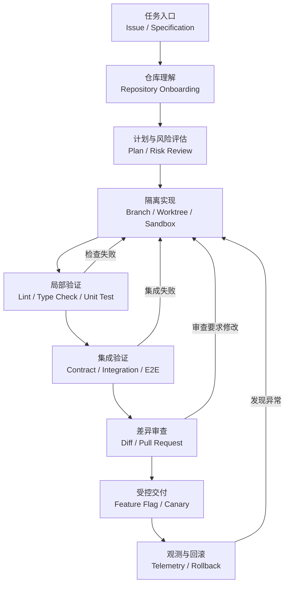
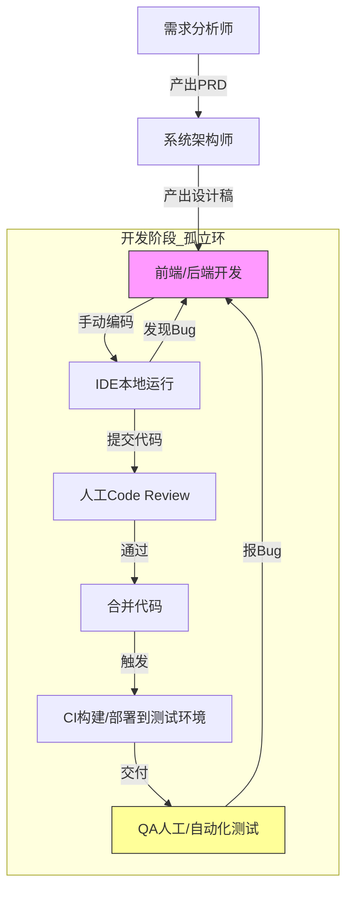
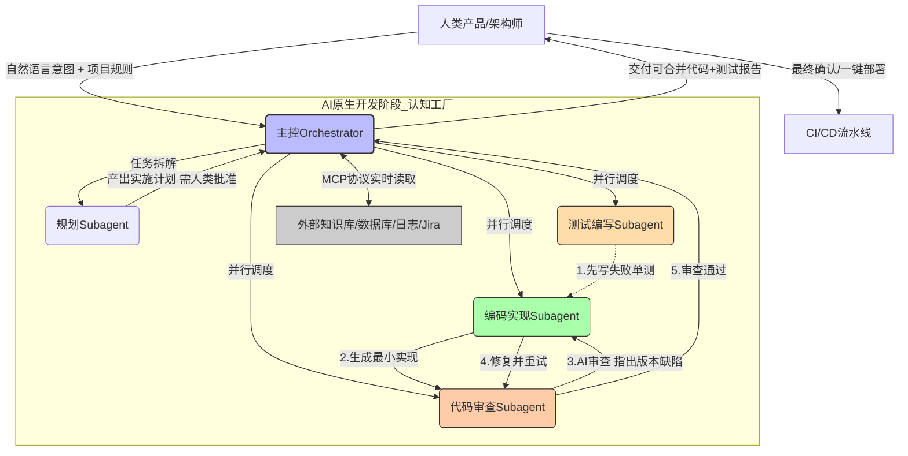
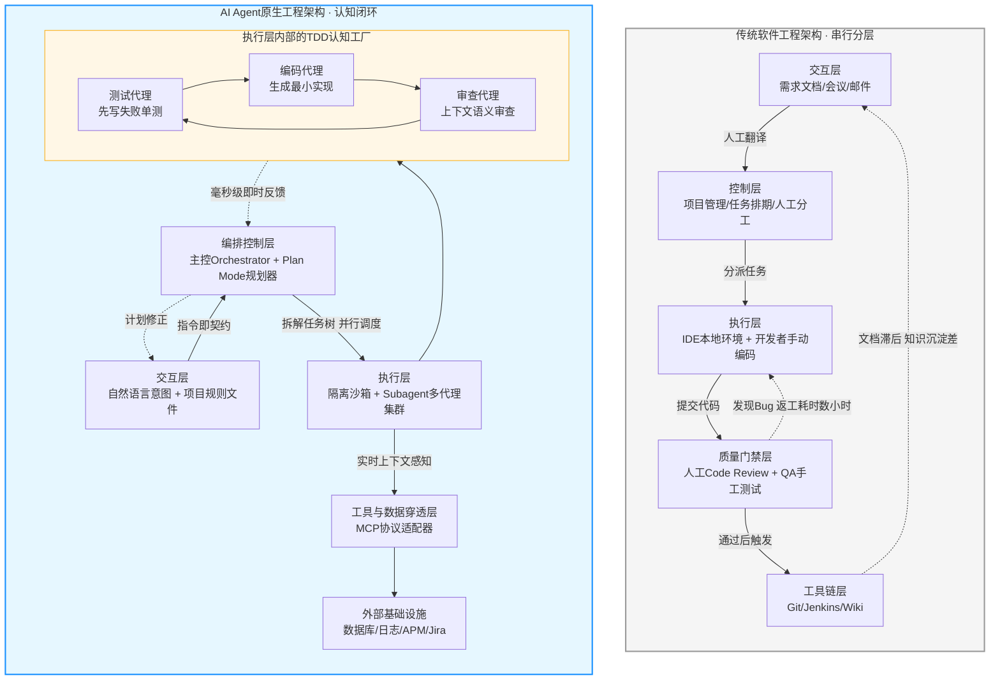

[toc]

## abstract

coding agent在处理大项目时,为了保证工程质量,会引入一些设计和环节(包含了一些术语),详细介绍并举例说明.

下面按“约束、流程、验证、协作、交付”五条主线展开。

## 内容大纲

本文将覆盖以下内容：

- Coding Agent 在大型项目中面临的主要困难
- 从需求到上线的完整 Agent 工程闭环
- 项目指令、上下文工程与仓库理解
- 规格驱动、任务拆分与多 Agent 协作
- 沙箱、权限、分支与工作区隔离
- 小步修改、测试、静态检查与持续集成
- Pull Request、代码审查与人工审批
- 数据库变更、灰度发布、监控和回滚
- Agent 评测、过程记录与失败恢复
- 常见术语、反模式与新手落地方案
- 一个端到端项目示例

------

## Coding Agent 是什么

Coding Agent，通常译为“编码智能体”或“编程智能体”，是能够围绕软件开发目标自主执行多步操作的 AI 系统。

它与普通代码补全工具的区别在于，它不只是生成一段代码，而是会形成类似下面的循环：

1. 理解任务。
2. 搜索仓库。
3. 阅读相关代码。
4. 制定实现计划。
5. 修改多个文件。
6. 运行构建、测试和检查命令。
7. 根据错误继续修复。
8. 汇总变更并提交审查。

现代 Coding Agent 已经能够读取代码库、编辑文件、运行命令、研究仓库并在独立分支中形成 Pull Request。([Claude Platform Docs](https://docs.anthropic.com/en/docs/claude-code/overview?utm_source=chatgpt.com))

但这并不意味着 Agent 可以不受约束地“自动完成整个项目”。大型项目中的真正难点通常不是生成代码，而是：

- 找到正确的修改位置；
- 理解隐含的业务规则；
- 避免破坏已有功能；
- 控制修改范围；
- 验证改动确实正确；
- 在失败时安全恢复；
- 让其他开发者能够理解和审查。

因此，大型项目关注的不是：

> Agent 能不能写出代码？

而是：

> 如何让 Agent 在有限权限、明确规则和可验证流程中稳定地产生高质量改动？

------

## 大型项目中的核心工程思想

可以把 Coding Agent 的工程质量归纳为五个管理对象。

| 管理对象              | 需要解决的问题                   | 典型设计                         |
| --------------------- | -------------------------------- | -------------------------------- |
| 上下文（Context）     | Agent 是否理解了正确的代码和规则 | 仓库地图、项目指令、按需检索     |
| 变更（Change）        | 修改范围是否可控                 | 小批次提交、分支隔离、变更预算   |
| 证据（Evidence）      | 如何证明改动正确                 | 测试、静态检查、构建、运行日志   |
| 权限（Permission）    | Agent 可以执行哪些操作           | 沙箱、最小权限、审批策略         |
| 协作（Collaboration） | 如何与人和其他 Agent 配合        | 计划文档、PR、CODEOWNERS、任务图 |

由此可以得到一个非常重要的原则：

> 大型项目的质量不能依赖 Agent “自觉”，而要依赖可执行、可验证、可审计的工程约束。

------

## 完整工作闭环



这个闭环包含三个关键特征：

- **每一步都有输入和输出**，而不是让 Agent 漫无目的地操作。
- **每一步都有验证标准**，不能只听 Agent 声称“已经完成”。
- **高风险操作必须经过额外门禁**，例如人工审批、CI 或发布平台授权。

------

## 仓库接入与项目指令

### Repository Onboarding

Agent 第一次进入大型仓库时，需要完成“仓库接入”（Repository Onboarding）。

它通常应当了解：

- 项目的主要业务目标；
- 仓库目录结构；
- 主要运行入口；
- 构建和测试方式；
- 核心模块之间的依赖关系；
- 编码规范；
- 禁止修改的区域；
- 发布和回滚流程。

一个合格的 Agent 不应该刚进入仓库就开始改代码，而应先回答：

- 这个项目使用什么技术栈？
- 哪些目录是源代码、测试和生成文件？
- 当前任务属于哪个业务模块？
- 相关逻辑是否已经存在？
- 哪些命令可以验证改动？
- 是否有项目级开发规则？

### Repository Instructions

很多 Coding Agent 支持存放在仓库中的持久化指令，例如：

- `AGENTS.md`
- `CLAUDE.md`
- `.github/copilot-instructions.md`
- 目录级 Agent 配置文件
- 团队自定义的规则文件

OpenAI Codex 可以从仓库不同目录读取分层的 `AGENTS.md` 指令；GitHub Copilot 也支持仓库级自定义指令。([OpenAI Developers](https://developers.openai.com/codex/agent-configuration/agents-md?utm_source=chatgpt.com))

一个简化的 `AGENTS.md` 示例：

```markdown
# Repository Guidelines

## Build and test

- Install dependencies with `pnpm install`.
- Run `pnpm lint` after modifying TypeScript files.
- Run `pnpm test --filter changed` for local verification.
- Run `pnpm typecheck` before creating a pull request.

## Architecture

- Business logic belongs in `packages/domain`.
- HTTP handlers must not access the database directly.
- Shared APIs must remain backward compatible.

## Change policy

- Do not modify generated files manually.
- Do not add production dependencies without approval.
- Avoid unrelated refactoring.
- Add a regression test for every bug fix.

## Security

- Never print secrets, tokens, passwords, or customer data.
- Do not enable external network access without approval.
```

### 指令不是强制机制

项目指令本质上通常是提供给模型的上下文，而不是严格的安全边界。

例如，Claude Code 文档明确区分了项目记忆与强制控制：项目指令属于上下文；需要阻止某些操作时，应使用权限设置或执行前 Hook。([Claude Platform Docs](https://docs.anthropic.com/en/docs/claude-code/memory?utm_source=chatgpt.com))

因此应当区分软约束和硬约束。

| 类型                      | 示例                          | 可靠程度                     |
| ------------------------- | ----------------------------- | ---------------------------- |
| 软约束（Soft Constraint） | “优先使用现有工具函数”        | Agent 可能误解或忽略         |
| 提示级规则                | `AGENTS.md` 中的编码规范      | 通常有效，但不能作为安全边界 |
| 自动检查                  | Linter、类型检查、测试        | 可以发现一部分违规           |
| 执行拦截                  | Hook、命令白名单、权限策略    | 可以直接阻止操作             |
| 平台门禁                  | 受保护分支、必需审查、CI 门禁 | 未通过就无法合并             |

最佳实践是：

> 用文档解释规则，用自动化检查发现违规，用权限和平台门禁阻止高风险违规。

------

## 规格驱动开发(SDD)

大型任务不应直接从一句自然语言需求跳到代码实现，而应先形成可验证的规格。

这通常称为：

- 规格驱动开发（Specification-Driven Development）
- 计划优先（Plan-First）
- 设计优先（Design-First）
- 执行计划（Execution Plan 或 ExecPlan）

对于需要跨多个模块、持续多个工作阶段的任务，可以将执行计划保存为仓库中的计划文档，以便 Agent 和开发者持续更新。OpenAI 的相关实践也建议为长时间、多步骤问题维护明确的计划文件。([OpenAI Developers](https://developers.openai.com/cookbook/articles/codex_exec_plans?utm_source=chatgpt.com))

### 一份合格的任务规格

| 内容                            | 需要回答的问题                 |
| ------------------------------- | ------------------------------ |
| 背景（Context）                 | 为什么要做这项改动？           |
| 目标（Goal）                    | 最终必须实现什么？             |
| 非目标（Non-Goals）             | 哪些内容明确不在此次范围内？   |
| 验收标准（Acceptance Criteria） | 什么结果算完成？               |
| 技术约束（Constraints）         | 兼容性、性能、安全要求是什么？ |
| 风险（Risks）                   | 可能破坏哪些现有功能？         |
| 验证计划（Verification Plan）   | 如何证明实现正确？             |
| 回滚方案（Rollback Plan）       | 上线异常时如何撤销？           |

例如：

```markdown
## Goal

为订单服务增加取消未支付订单的接口。

## Acceptance criteria

- 只有处于 `PENDING_PAYMENT` 状态的订单可以取消。
- 已支付、已发货和已关闭订单不得取消。
- 重复取消请求必须返回成功，不得产生重复事件。
- 成功取消后发布一次 `OrderCancelled` 事件。
- 旧客户端不需要修改即可继续使用现有接口。

## Non-goals

- 不修改退款逻辑。
- 不重新设计订单状态机。
- 不批量取消历史订单。

## Verification

- 添加状态转换单元测试。
- 添加重复请求的幂等性测试。
- 添加订单 API 集成测试。
- 运行订单服务完整测试套件。
```

### Definition of Done

完成定义（Definition of Done，DoD）用于防止 Agent 将“代码已经写完”误认为“任务已经完成”。

常见 DoD 包括：

- 功能满足验收标准；
- 新增测试通过；
- 原有测试没有回归；
- 类型检查和静态检查通过；
- 文档已更新；
- 数据库迁移经过验证；
- 兼容性得到确认；
- PR 描述完整；
- 监控和回滚方案已准备。

------

## 设计记录与架构决策

较大的设计选择不应只存在于对话记录中。

常见文档包括：

| 文档         | 英文名称                           | 适用场景                     |
| ------------ | ---------------------------------- | ---------------------------- |
| 需求说明     | Product Requirements Document，PRD | 描述产品目标和业务需求       |
| 技术方案     | Technical Design Document，TDD     | 描述技术实现方案             |
| 意见征求稿   | Request for Comments，RFC          | 需要多人讨论的重要设计       |
| 架构决策记录 | Architecture Decision Record，ADR  | 记录关键设计选择及理由       |
| 执行计划     | Execution Plan                     | 记录具体步骤、状态和验证方法 |

ADR 通常非常简洁：

```markdown
# Use an outbox for order events

## Status

Accepted

## Context

订单数据库提交成功后，消息发送可能失败，导致订单状态与事件不一致。

## Decision

使用事务型 Outbox。订单状态和待发送事件在同一数据库事务中写入。

## Consequences

- 提高事件投递可靠性。
- 增加 Outbox 表和后台发布任务。
- 事件消费者仍需保证幂等性。
```

这些记录可以降低 Agent 在后续任务中重新猜测架构意图的概率。

------

## 上下文工程

上下文工程（Context Engineering）指的是：为 Agent 选择、组织和维护完成任务所需的信息。

它比“写一个更长的提示词”更重要。

### 为什么不能直接把整个仓库放进上下文

大型仓库可能包含：

- 数百万行代码；
- 多种语言；
- 多个服务；
- 历史实现；
- 生成文件；
- 第三方依赖；
- 已废弃模块；
- 大量与当前任务无关的测试。

全部读取不仅成本高，还会引入噪声，使 Agent 将注意力放到错误代码上。

### 分层检索策略

推荐按照以下顺序理解仓库：

1. 阅读根目录说明和 Agent 指令。
2. 查看构建文件和工作区配置。
3. 找到任务涉及的模块。
4. 搜索关键类型、接口和业务词。
5. 追踪调用链和数据流。
6. 阅读相邻测试。
7. 最后才阅读具体实现细节。

### Repository Map

仓库地图（Repository Map）是对代码库的结构化摘要，例如：

```text
apps/
  api/              HTTP API 入口
  worker/           异步任务

packages/
  order-domain/     订单领域模型和状态机
  order-service/    订单应用服务
  event-bus/        事件发布抽象
  database/         ORM 和数据库迁移

tests/
  integration/      跨模块集成测试
  e2e/              端到端测试
```

更成熟的系统还会构建：

- 符号索引（Symbol Index）；
- 引用关系（Reference Graph）；
- 调用图（Call Graph）；
- 依赖图（Dependency Graph）；
- 所有权地图（Ownership Map）；
- 测试映射（Test Mapping）。

### Working Set

工作集（Working Set）是 Agent 当前真正需要关注的文件集合。

例如，订单取消任务的工作集可能只有：

- `Order.ts`
- `OrderService.ts`
- `OrderRepository.ts`
- `OrderController.ts`
- `OrderCancelled.ts`
- 对应测试文件

Agent 应当随着调查结果动态更新工作集，而不是无边界地继续阅读文件。

------

## 任务拆分

大型需求必须拆成可以独立验证的子任务。

这称为任务分解（Task Decomposition）。

一个好的子任务通常具备：

- 明确输入；
- 明确输出；
- 有限修改范围；
- 可独立验证；
- 失败后容易撤销；
- 与其他任务依赖关系清晰。

例如，“新增订单取消功能”可以拆成：

| 子任务             | 输出               | 验证         |
| ------------------ | ------------------ | ------------ |
| 调查现有订单状态机 | 调查结论           | 人工检查计划 |
| 增加领域状态转换   | 领域模型修改       | 单元测试     |
| 增加应用服务操作   | 服务层方法         | 服务测试     |
| 增加 HTTP 接口     | 路由和请求处理     | API 集成测试 |
| 增加取消事件       | 事件定义和发布逻辑 | 事件测试     |
| 更新文档           | API 文档           | 文档检查     |
| 完整回归           | 测试结果           | CI           |

### Task Graph

当子任务存在依赖时，可以形成任务图（Task Graph）或有向无环图（Directed Acyclic Graph，DAG）。

例如：

```text
调查状态机
    ├── 设计状态转换
    │       ├── 实现领域逻辑
    │       └── 编写领域测试
    └── 调查事件机制
            └── 实现取消事件

领域逻辑完成
    └── 实现应用服务
            └── 实现 HTTP 接口
                    └── 集成测试
```

不是所有任务都适合并行。只有满足以下条件时才适合并行：

- 修改文件基本不重叠；
- 接口已经确定；
- 输出可以独立验证；
- 不依赖另一个任务尚未完成的设计。

------

## 多 Agent 协作

复杂 Coding Agent 系统可能使用多个子智能体（Subagents）。

OpenAI Codex 等现代系统支持创建专用子 Agent 并行执行代码库调查或多步骤计划中的独立任务。([OpenAI Developers](https://developers.openai.com/codex/subagents?utm_source=chatgpt.com))

典型角色包括：

| 角色                 | 主要职责           |
| -------------------- | ------------------ |
| Planner Agent        | 分析需求、制定计划 |
| Explorer Agent       | 调查仓库和调用链   |
| Implementation Agent | 实现代码           |
| Test Agent           | 编写和运行测试     |
| Review Agent         | 审查差异和风险     |
| Security Agent       | 检查安全问题       |
| Integrator Agent     | 汇总结果、解决冲突 |

### 多 Agent 不等于无限并行

并行过度容易产生：

- 重复实现；
- 接口不一致；
- 文件冲突；
- 测试假设冲突；
- 上下文和成本快速膨胀；
- 没有 Agent 对最终整体负责。

因此，多 Agent 系统应当设置一个明确的集成者（Integrator）或主 Agent。

集成者负责：

- 决定任务边界；
- 分配只读任务和写入任务；
- 汇总调查结论；
- 解决设计冲突；
- 运行完整验证；
- 对最终差异负责。

### 推荐并行方式

适合并行：

- 一个 Agent 调查实现代码；
- 一个 Agent 调查相关测试；
- 一个 Agent调查文档和历史决策；
- 一个 Agent检查安全和兼容性。

不适合直接并行：

- 多个 Agent 同时修改同一个核心文件；
- 多个 Agent各自设计同一套接口；
- 数据库迁移和应用代码在接口未确定前同时开发。

------

## 分支和工作区隔离

Agent 不应直接在主分支上进行大型修改。

常见隔离方式包括：

- Git Branch；
- Git Worktree；
- 临时容器；
- 临时虚拟机；
- 独立云开发环境；
- 临时数据库。

### Branch

每个任务使用独立分支，例如：

```bash
git switch -c agent/order-cancellation
```

### Git Worktree

工作树（Git Worktree）允许同一仓库同时存在多个独立工作目录，适合多 Agent 并行：

```bash
git worktree add ../worktrees/order-api -b agent/order-api
git worktree add ../worktrees/order-tests -b agent/order-tests
```

好处包括：

- 不同 Agent 不会频繁切换同一个目录；
- 未提交文件不会互相覆盖；
- 每个任务有独立构建状态；
- 更容易比较和撤销结果。

但即使使用 Worktree，仍然要避免多个 Agent 修改相同模块，否则最终仍会产生合并冲突。

------

## 沙箱与最小权限

沙箱（Sandbox）用于限制 Agent 可以访问和修改的资源。

现代 Coding Agent 常将权限控制分成两层：

- 沙箱模式：技术上允许访问什么；
- 审批策略：什么时候必须暂停并请求授权。

例如，Codex 默认可以限制 Agent 的写入范围并关闭网络访问；超出沙箱、访问网络或执行受限制操作时，可以要求审批。([OpenAI Developers](https://developers.openai.com/codex/agent-approvals-security?utm_source=chatgpt.com))

### 权限分级

| 等级         | 可执行能力             | 适用阶段         |
| ------------ | ---------------------- | ---------------- |
| 只读         | 搜索和阅读代码         | 仓库调查         |
| 工作区写入   | 修改当前项目文件       | 普通实现         |
| 允许运行测试 | 执行已批准的构建命令   | 本地验证         |
| 受控网络访问 | 下载依赖或读取外部文档 | 特殊任务         |
| 基础设施写入 | 修改云资源或部署       | 高风险任务       |
| 生产访问     | 操作生产环境           | 原则上不直接授予 |

推荐采用最小权限原则（Principle of Least Privilege）：

> Agent 只获得完成当前步骤所需的最低权限，并且权限应有明确作用域和有效期。

### 必须审批的操作

通常应要求人工审批：

- 新增生产依赖；
- 修改 CI 或发布流程；
- 修改认证和授权代码；
- 访问外部网络；
- 读取密钥或凭证；
- 删除大量文件；
- 执行数据库迁移；
- 修改基础设施；
- 推送远程分支；
- 合并或发布；
- 操作生产环境。

### 密钥管理

不要把真实密钥直接写入提示、仓库指令或 Agent 日志。

更安全的方式是：

- 使用短期凭证；
- 使用专用服务账号；
- 限制凭证作用域；
- 对日志自动脱敏；
- 在隔离环境中注入环境变量；
- 操作完成后立即失效；
- 保留审计记录。

------

## 变更范围控制

大型项目中最危险的 Agent 行为之一，是在实现功能的同时“顺便重构”。

推荐遵循最小差异原则（Minimal Diff Principle）：

> 只修改完成任务所必需的内容。

### Change Budget

变更预算（Change Budget）是任务允许修改范围的显式约束。

可以包括：

- 预计修改文件数；
- 预计新增或删除代码行数；
- 允许修改的目录；
- 是否允许增加依赖；
- 是否允许更改公共接口；
- 是否允许数据库迁移。

例如：

```markdown
## Change budget

- 修改文件不超过 12 个。
- 不修改公共订单查询接口。
- 不增加新的生产依赖。
- 不修改支付模块。
- 不进行无关代码格式化。
```

它并不是绝对限制，但一旦超过，Agent 应暂停并重新评估计划。

### Blast Radius

爆炸半径（Blast Radius）表示一次变更可能影响的系统范围。

| 变更                 | 爆炸半径 |
| -------------------- | -------- |
| 私有辅助函数         | 较小     |
| 单个服务的内部接口   | 中等     |
| 公共 SDK 接口        | 较大     |
| 数据库表结构         | 较大     |
| 认证、权限、支付逻辑 | 很大     |
| 发布流水线或基础设施 | 很大     |

爆炸半径越大，应当增加：

- 设计审查；
- 测试层级；
- 人工审批；
- 灰度发布；
- 监控指标；
- 回滚准备。

### Vertical Slice

垂直切片（Vertical Slice）是先实现一条端到端但范围很小的功能路径。

与一次性完成整个模块相比，它更容易：

- 尽早暴露架构问题；
- 尽早运行集成测试；
- 减少长时间偏离目标；
- 获得人工反馈。

------

## 实现循环

Agent 的实现过程不应是“一次生成全部代码”，而应是短循环：

1. 选择一个最小子任务。
2. 检查相关代码和测试。
3. 做有限修改。
4. 运行最小验证命令。
5. 分析错误。
6. 修复或撤销。
7. 更新计划状态。
8. 进入下一个子任务。

这通常称为：

- Agent Loop；
- Edit-Test Loop；
- Observe-Act Loop；
- ReAct 式循环；
- 闭环执行（Closed-Loop Execution）。

关键规则是：

> 每次修改后尽快获得机器反馈，不要积累大量未经验证的改动。

------

## 测试策略

测试是判断 Agent 改动是否正确的主要证据之一。

但“测试通过”不一定等于“实现正确”，因为测试本身可能：

- 覆盖不完整；
- 断言错误；
- 没有验证关键副作用；
- 只验证正常路径；
- 被 Agent 为了通过而错误修改。

因此，应使用多层验证。

### 测试层级

| 层级       | 英文术语             | 验证内容                   |
| ---------- | -------------------- | -------------------------- |
| 单元测试   | Unit Test            | 单个函数、类或领域规则     |
| 组件测试   | Component Test       | 一个组件内部的协作         |
| 契约测试   | Contract Test        | 服务或 API 之间的接口约定  |
| 集成测试   | Integration Test     | 数据库、消息队列等真实集成 |
| 端到端测试 | End-to-End Test，E2E | 从用户入口到系统结果       |
| 回归测试   | Regression Test      | 已修复问题不会再次出现     |
| 冒烟测试   | Smoke Test           | 核心路径是否基本可用       |
| 性能测试   | Performance Test     | 延迟、吞吐量和资源消耗     |
| 安全测试   | Security Test        | 权限、输入、依赖等安全问题 |

### Regression Test

修复 Bug 时，推荐先增加一个能够稳定复现问题的回归测试。

流程通常是：

1. 编写测试。
2. 确认测试在旧代码上失败。
3. 修改实现。
4. 确认测试通过。
5. 运行相关回归测试。

如果新测试在修改前就能通过，它可能并没有真正复现原问题。

### Test Oracle

测试预言机（Test Oracle）指的是判定结果正确与否的依据。

例如：

- 预期返回值；
- 数据库最终状态；
- 发布的事件；
- 文件内容；
- HTTP 状态码；
- 日志或指标；
- 与参考实现的比较。

Agent 编写测试时，应特别审查测试预言机是否合理。

错误示例：

```typescript
expect(result).toBeDefined();
```

这个断言可能过于宽松。

更好的断言：

```typescript
expect(result).toEqual({
  orderId: "order-123",
  status: "CANCELLED",
});
```

### 测试不能随意修改

当现有测试失败时，Agent 应先判断：

- 实现破坏了正确行为；
- 测试已经过时；
- 测试环境存在问题；
- 测试不稳定；
- 需求确实要求改变原行为。

不能为了让 CI 变绿就删除断言、跳过测试或放宽预期。

------

## 静态检查与自动化质量门禁

测试之外，还需要自动化质量工具。

| 工具类别         | 英文术语                                  | 主要作用                     |
| ---------------- | ----------------------------------------- | ---------------------------- |
| 格式化器         | Formatter                                 | 统一代码格式                 |
| 代码检查器       | Linter                                    | 发现代码规范和潜在错误       |
| 类型检查器       | Type Checker                              | 验证类型一致性               |
| 静态分析         | Static Analysis                           | 分析控制流、数据流和缺陷模式 |
| 依赖扫描         | Dependency Scanning                       | 查找存在漏洞的依赖           |
| 密钥扫描         | Secret Scanning                           | 发现误提交的密钥             |
| 软件成分分析     | Software Composition Analysis，SCA        | 分析第三方组件风险           |
| 静态应用安全测试 | Static Application Security Testing，SAST | 查找代码安全缺陷             |
| 许可证检查       | License Check                             | 检查依赖许可证风险           |

### 验证顺序

为了快速反馈，通常按照从便宜到昂贵的顺序执行：

1. 格式检查；
2. Lint；
3. 类型检查；
4. 受影响单元测试；
5. 组件或集成测试；
6. 完整测试套件；
7. E2E、性能或安全测试。

这种方式称为分阶段验证（Staged Verification）。

------

## 增量验证与影响分析

大型仓库的完整测试可能需要很长时间，因此 Agent 可以先执行受影响测试（Affected Tests）。

判断依据包括：

- 修改了哪些文件；
- 哪些模块依赖这些文件；
- 哪些测试覆盖了相关模块；
- 公共接口是否发生变化；
- 构建系统维护的依赖图。

但最终是否需要运行完整测试，应根据变更风险决定。

| 变更类型       | 推荐最低验证                   |
| -------------- | ------------------------------ |
| 文档修改       | 文档构建和链接检查             |
| 私有函数修复   | 单元测试、Lint、类型检查       |
| 公共库接口修改 | 单元测试、契约测试、依赖方测试 |
| 数据库修改     | 迁移测试、集成测试、回滚测试   |
| 权限逻辑修改   | 单元、集成、E2E、安全测试      |
| 构建系统修改   | 完整构建和主要测试套件         |

------

## 持续集成

持续集成（Continuous Integration，CI）负责在受控环境中重复验证改动。

典型 CI 流水线包括：

```text
安装依赖
  → 格式检查
  → Lint
  → 类型检查
  → 单元测试
  → 构建
  → 集成测试
  → 安全扫描
  → 生成检查报告
```

本地测试通过不能替代 CI，因为本地环境可能与正式构建环境不同。

### Required Status Checks

受保护分支可以要求指定的状态检查全部通过后才能合并。GitHub 还可以要求人工审查、Code Owner 审批，并阻止直接推送或强制推送。([GitHub Docs](https://docs.github.com/repositories/configuring-branches-and-merges-in-your-repository/managing-protected-branches/about-protected-branches?utm_source=chatgpt.com))

这使得以下规则可以成为硬门禁：

- 测试未通过不能合并；
- 安全扫描未通过不能合并；
- 没有获得必要审批不能合并；
- 分支落后于主分支时不能合并；
- 特定目录必须由负责人审查。

------

## Pull Request 与差异审查

Pull Request，简称 PR，不只是合并代码的工具，也是 Agent 交付结果的主要审查界面。

一个好的 PR 应说明：

| 内容     | 说明                     |
| -------- | ------------------------ |
| What     | 修改了什么               |
| Why      | 为什么需要修改           |
| How      | 采用了什么实现方式       |
| Scope    | 哪些内容不在此次修改范围 |
| Testing  | 执行了哪些测试           |
| Risks    | 有什么潜在风险           |
| Rollback | 如何撤销                 |
| Evidence | 测试输出、截图或指标     |

### Agent Self-Review

在创建 PR 前，Agent 应执行自审（Self-Review）：

- 检查完整差异；
- 查找意外修改；
- 检查调试代码；
- 检查遗漏的错误处理；
- 检查公共接口变化；
- 检查测试是否真正覆盖需求；
- 检查文档是否同步；
- 检查是否包含密钥或敏感数据。

常见自审命令：

```bash
git status --short
git diff --stat
git diff
git diff --check
```

### Diff-Based Review

差异审查（Diff-Based Review）关注“这次究竟改了什么”，而不是重新阅读整个仓库。

Agent 应避免制造噪声差异，例如：

- 无关格式化；
- 大量文件排序变化；
- 自动生成文件异常更新；
- 没有必要的重命名；
- 同时进行功能开发和大规模重构。

差异越小，越容易发现真正的问题。

------

## 人工参与

Human-in-the-Loop，简称 HITL，表示关键步骤需要人工判断或批准。

大型项目中，人工主要负责：

- 确认需求和业务语义；
- 审查重要架构决策；
- 批准高风险操作；
- 判断测试是否足够；
- 审查安全和合规影响；
- 决定是否发布；
- 对最终结果承担责任。

推荐的自治等级：

| 等级     | Agent 能力           | 人工职责               |
| -------- | -------------------- | ---------------------- |
| 辅助模式 | 只提供建议和代码片段 | 人工执行全部操作       |
| 受控编辑 | 可修改工作区         | 人工审查每批修改       |
| 受控执行 | 可运行测试和检查     | 高风险命令需审批       |
| PR 模式  | 可创建分支和 PR      | 人工审查并合并         |
| 自动交付 | 可触发受控发布       | 平台门禁和异常审批     |
| 生产自治 | 可操作生产系统       | 仅适用于极少数成熟场景 |

对刚开始使用 Coding Agent 的团队，建议从“受控编辑”或“PR 模式”开始，而不是直接允许自动合并和自动部署。

------

## 数据库变更

数据库变更的风险通常高于普通代码修改。

Agent 需要考虑：

- 旧版本应用是否兼容新结构；
- 新版本应用是否兼容旧结构；
- 数据量是否会导致长时间锁表；
- 迁移是否可以重试；
- 是否可以回滚；
- 是否需要数据回填；
- 多实例滚动发布期间是否安全。

### Expand and Contract

扩展与收缩模式（Expand and Contract）是一种兼容性迁移方法。

例如将字段 `name` 拆为 `first_name` 和 `last_name`：

**Expand 阶段**

- 增加新字段；
- 新旧字段同时写入；
- 旧代码仍然可用。

**Migrate 阶段**

- 回填历史数据；
- 检查数据一致性。

**Contract 阶段**

- 读取切换到新字段；
- 停止写旧字段；
- 最后删除旧字段。

Agent 不应在一次发布中直接删除旧字段，除非能够证明没有任何旧版本或消费者仍在使用它。

------

## 发布控制

功能完成并不意味着应立即向全部用户开放。

### Feature Flag

功能开关（Feature Flag）允许在不重新部署代码的情况下控制功能是否启用。

它可以用于：

- 内部用户试用；
- 按租户开放；
- 按比例开放；
- 紧急关闭功能；
- A/B 实验。

### Canary Release

金丝雀发布（Canary Release）是先向少量实例或用户发布新版本，再逐步扩大范围。

例如：

```text
内部环境
  → 1% 流量
  → 5% 流量
  → 25% 流量
  → 100% 流量
```

每个阶段都应检查：

- 错误率；
- 延迟；
- 资源使用；
- 核心业务指标；
- 用户反馈。

### Rollback

回滚方案不能只是“重新部署旧版本”。

还要考虑：

- 数据库迁移能否回滚；
- 新版本写入的数据是否与旧版本兼容；
- 消息事件是否已经发送；
- 外部系统是否已经产生副作用；
- 缓存结构是否发生变化；
- 是否需要关闭 Feature Flag 而不是回退程序。

------

## 可观测性

可观测性（Observability）用于判断变更在真实环境中的行为。

三类基础信号包括：

| 信号     | 英文名称 | 示例                   |
| -------- | -------- | ---------------------- |
| 日志     | Logs     | 错误详情、关键业务事件 |
| 指标     | Metrics  | 请求量、错误率、延迟   |
| 链路追踪 | Traces   | 跨服务请求调用路径     |

Agent 实现新功能时，应考虑：

- 如何知道功能是否被调用；
- 如何知道调用是否成功；
- 如何发现异常增加；
- 日志是否包含足够上下文；
- 日志是否泄露敏感数据；
- 是否需要新增告警。

### SLI、SLO 和 Error Budget

| 术语         | 全称                    | 含义                              |
| ------------ | ----------------------- | --------------------------------- |
| SLI          | Service Level Indicator | 实际测量的服务指标                |
| SLO          | Service Level Objective | 期望达到的服务目标                |
| SLA          | Service Level Agreement | 对外承诺的服务协议                |
| Error Budget | 错误预算                | 在满足 SLO 前提下可以容忍的失败量 |

例如，订单取消接口的 SLI 可以是：

- 成功率；
- P95 延迟；
- 重复事件比例；
- 数据一致性错误数量。

------

## Agent 状态与记忆

大型任务可能跨越多个会话，因此需要保存进度。

常见机制包括：

- 计划文件；
- 任务清单；
- 决策日志；
- 已修改文件列表；
- 已运行命令；
- 测试结果；
- 未解决问题；
- 下一步操作。

### Checkpoint

检查点（Checkpoint）是一个可恢复的任务状态。

一个检查点可以记录：

```markdown
## Completed

- 找到订单状态转换逻辑。
- 添加取消状态转换测试。
- 实现领域层取消方法。

## Verification

- `pnpm test order-domain` passed.
- `pnpm typecheck` passed.

## Remaining

- 实现应用服务。
- 增加 HTTP 接口。
- 添加事件发布测试.

## Risks

- 需要确认重复取消是否必须发布事件。
```

### 不要把记忆当作事实

Agent 记忆可能：

- 过时；
- 不完整；
- 与当前分支不一致；
- 混入另一个任务的内容；
- 错误总结之前的代码。

因此，恢复任务时必须重新验证：

- 当前 Git 分支；
- 当前提交；
- 工作区状态；
- 计划文件；
- 相关代码；
- 最近测试结果。

------

## 失败处理

Agent 失败时不应无限重复相同命令。

推荐的失败处理循环是：

1. 收集实际错误信息；
2. 确认问题是否可以稳定复现；
3. 缩小失败范围；
4. 检查最近改动；
5. 提出多个可能原因；
6. 用最小实验排除原因；
7. 修复根因；
8. 重新执行验证；
9. 记录结论。

### 常用技术

| 技术     | 英文术语                 | 作用               |
| -------- | ------------------------ | ------------------ |
| 最小复现 | Minimal Reproduction     | 缩小问题范围       |
| 二分定位 | Git Bisect               | 查找引入问题的提交 |
| 回滚     | Rollback                 | 恢复已知可用状态   |
| 重放     | Replay                   | 重现请求或事件     |
| 故障注入 | Fault Injection          | 验证异常处理       |
| 根因分析 | Root Cause Analysis，RCA | 找到问题的根本原因 |

### Retry Budget

重试预算（Retry Budget）用于限制 Agent 在同一个失败路径上的重复次数。

例如：

- 同一命令连续失败三次后必须重新分析；
- 两次修复没有改变错误信息时必须停止；
- 超出预估修改范围时重新制定计划；
- 需要扩大权限时请求人工批准。

这可以避免 Agent 陷入“修改一点、重跑、继续猜测”的循环。

------

## 安全风险

### Prompt Injection

Agent 读取的内容可能包含恶意指令，例如：

- 代码注释；
- Issue 描述；
- README；
- 测试数据；
- 网页内容；
- 第三方包文档；
- 工具返回结果。

恶意内容可能试图让 Agent：

- 读取密钥；
- 上传代码；
- 关闭安全检查；
- 执行危险命令；
- 忽略项目规则。

因此，应明确区分：

- 用户或系统授权的指令；
- 仓库中的普通数据；
- 外部获取的不可信内容。

### Tool Allowlist

工具白名单（Tool Allowlist）用于规定 Agent 可以调用的工具或命令。

例如允许：

```text
git status
git diff
pnpm lint
pnpm typecheck
pnpm test
```

限制或审批：

```text
curl
ssh
docker push
kubectl
terraform apply
npm publish
git push
```

### Dependency Policy

Agent 添加依赖前应检查：

- 现有项目是否已有同类能力；
- 包是否仍在维护；
- 许可证是否兼容；
- 是否存在已知漏洞；
- 包体积和运行时影响；
- 是否需要新的网络权限；
- 是否会增加供应链风险。

大型项目通常要求新增生产依赖必须经过人工批准。

------

## Agent 评测

测试代码和评测 Agent 是两个不同问题：

- 软件测试判断本次代码改动是否正确；
- Agent 评测判断 Agent 是否能够稳定完成一类任务。

### 常见评测指标

| 指标                     | 含义                      |
| ------------------------ | ------------------------- |
| Task Success Rate        | 完成任务的比例            |
| First-Pass Success       | 第一次尝试即成功的比例    |
| Regression Rate          | 引入回归的比例            |
| Human Intervention Rate  | 需要人工介入的比例        |
| Test Pass Rate           | 最终测试通过比例          |
| Review Rejection Rate    | PR 被拒绝或要求重做的比例 |
| Time to Validated Change | 产生可验证改动所需时间    |
| Tool Error Rate          | 工具调用失败比例          |
| Unauthorized Action Rate | 尝试执行未授权操作的比例  |
| Revert Rate              | 合并后被撤销的比例        |

SWE-bench 是常见的仓库级软件工程 Agent 基准：系统需要根据真实 GitHub Issue，在代码仓库中生成解决问题的补丁。([GitHub](https://github.com/swe-bench/SWE-bench?utm_source=chatgpt.com))

不过，基准成绩不能直接代表企业项目效果。更长周期、跨文件、企业级任务仍然具有明显挑战；后续的 SWE-Bench Pro 等评测也专门强调了长时程软件工程任务的难度。([arXiv](https://arxiv.org/abs/2509.16941?utm_source=chatgpt.com))

团队最好建立自己的内部评测集，包括：

- 历史 Bug；
- 典型功能修改；
- 数据库迁移；
- 权限问题；
- 依赖升级；
- 性能回归；
- 文档和配置任务；
- 容易误解的业务规则。

------

## 常见关键术语

| 中文术语     | 英文术语或缩写                    | 简要说明                         |
| ------------ | --------------------------------- | -------------------------------- |
| 编码智能体   | Coding Agent                      | 可以自主执行多步编程任务的 AI    |
| 智能体循环   | Agent Loop                        | 观察、操作、验证、继续迭代的循环 |
| 上下文工程   | Context Engineering               | 为 Agent 选择和组织有效信息      |
| 仓库接入     | Repository Onboarding             | 初次理解项目结构、规则和运行方式 |
| 仓库地图     | Repository Map                    | 对目录、模块和依赖的结构化摘要   |
| 工作集       | Working Set                       | 当前任务真正相关的文件集合       |
| 规格驱动开发 | Specification-Driven Development  | 根据可验证规格进行开发           |
| 验收标准     | Acceptance Criteria               | 判断需求是否完成的具体条件       |
| 非目标       | Non-Goals                         | 明确不在本次工作范围内的内容     |
| 完成定义     | Definition of Done，DoD           | 从工程角度判断任务完成的标准     |
| 执行计划     | Execution Plan                    | 分步骤描述实现和验证方式         |
| 架构决策记录 | Architecture Decision Record，ADR | 保存重要设计决策及理由           |
| 任务分解     | Task Decomposition                | 将大任务拆成可验证子任务         |
| 子智能体     | Subagent                          | 执行专门子任务的 Agent           |
| 最小权限     | Least Privilege                   | 只授予完成任务必需的权限         |
| 沙箱         | Sandbox                           | 隔离和限制 Agent 执行环境        |
| 人工参与     | Human-in-the-Loop，HITL           | 关键步骤由人审批或判断           |
| 变更预算     | Change Budget                     | 对修改规模和范围的约束           |
| 爆炸半径     | Blast Radius                      | 改动可能影响的系统范围           |
| 最小差异     | Minimal Diff                      | 只产生必要修改                   |
| 测试预言机   | Test Oracle                       | 判断测试结果正确与否的依据       |
| 回归测试     | Regression Test                   | 防止问题再次出现的测试           |
| 静态分析     | Static Analysis                   | 不运行程序而分析代码缺陷         |
| 持续集成     | Continuous Integration，CI        | 自动构建和验证代码改动           |
| 持续交付     | Continuous Delivery，CD           | 自动准备或执行软件发布           |
| 功能开关     | Feature Flag                      | 动态控制功能是否启用             |
| 金丝雀发布   | Canary Release                    | 先向少量用户发布                 |
| 可观测性     | Observability                     | 通过日志、指标和追踪理解系统行为 |
| 检查点       | Checkpoint                        | 可以恢复的任务执行状态           |
| 根因分析     | Root Cause Analysis，RCA          | 分析故障的根本原因               |
| 供应链安全   | Supply Chain Security             | 管理依赖和构建链路风险           |

------

## 端到端示例

假设任务是：

> 在一个大型 TypeScript Monorepo 中，为订单服务增加“取消未支付订单”接口。

### 接收任务

Agent 首先整理需求，而不是直接编辑文件：

```markdown
## Goal

增加 `POST /orders/:id/cancel`。

## Rules

- 只允许取消未支付订单。
- 重复请求必须幂等。
- 成功取消时发布一次取消事件。
- 不得影响退款和支付流程。

## Verification

- 领域状态测试。
- 幂等性测试。
- API 集成测试。
- 订单服务完整测试。
```

### 调查仓库

Agent 阅读：

- 根目录 `AGENTS.md`；
- Monorepo 配置；
- 订单模块目录；
- 订单状态枚举；
- 现有状态转换；
- 相邻 API；
- 事件发布方式；
- 订单测试。

调查结论可能是：

```markdown
- 状态转换必须在 `Order` 聚合中完成。
- Controller 不允许直接访问 Repository。
- 事件通过事务型 Outbox 发布。
- API 错误使用统一的 `DomainErrorMapper`。
- 当前订单更新使用乐观锁。
```

### 制定计划

```markdown
- 在领域模型中增加 `cancel()`。
- 添加允许和禁止取消的状态测试。
- 在应用服务增加 `cancelOrder()`。
- 复用现有事务和 Outbox。
- 增加 HTTP Handler。
- 添加重复请求测试。
- 运行订单模块测试和完整类型检查。
```

### 隔离修改

创建独立分支或 Worktree：

```bash
git switch -c agent/order-cancellation
```

初始检查：

```bash
git status --short
pnpm test --filter order-domain
pnpm typecheck
```

初始检查用于确认仓库在修改前处于正常状态，避免把已有失败错误归因于 Agent。

### 编写回归和领域测试

先增加：

- 未支付订单可以取消；
- 已支付订单不能取消；
- 已发货订单不能取消；
- 已取消订单重复取消仍然成功；
- 重复取消不会重复产生领域事件。

### 实现最小领域修改

Agent 只修改订单聚合，不先修改 Controller 或数据库层。

完成后运行：

```bash
pnpm test --filter order-domain
pnpm lint --filter order-domain
pnpm typecheck
```

### 实现服务和接口

领域层稳定后，再依次实现：

- 应用服务；
- Repository 调用；
- 事务边界；
- Outbox 事件；
- HTTP Handler；
- 错误映射。

每完成一层都运行相应测试。

### 自审

Agent 检查：

```bash
git diff --stat
git diff
git diff --check
```

并确认：

- 没有修改支付模块；
- 没有添加新依赖；
- 没有无关格式化；
- 重复请求没有发布重复事件；
- 公共接口保持兼容；
- 错误响应符合项目规范。

### 创建 PR

PR 描述包含：

```markdown
## What changed

- 增加订单领域取消操作。
- 增加取消订单应用服务。
- 增加取消订单 HTTP 接口。
- 通过现有 Outbox 发布取消事件。

## Testing

- Order domain tests
- Order service integration tests
- API integration tests
- Type checking
- Lint

## Risks

- 状态转换规则错误可能导致已支付订单被取消。
- 幂等实现错误可能产生重复事件。

## Rollback

- 关闭订单取消 Feature Flag。
- 回滚应用版本。
- 本次修改不包含不可逆数据库迁移。
```

### CI 和人工审查

CI 执行：

- Lint；
- 类型检查；
- 单元测试；
- 集成测试；
- 安全扫描；
- 完整构建。

订单模块的 Code Owner 检查业务状态规则，平台负责人检查事件发布和事务逻辑。

### 灰度发布

先对内部账号开放 Feature Flag，观察：

- 取消请求成功率；
- 非法状态错误数量；
- 重复事件数量；
- API 延迟；
- Outbox 积压。

确认稳定后逐步扩大范围。

------

## 常见反模式

| 反模式                        | 主要问题               | 改进方式                  |
| ----------------------------- | ---------------------- | ------------------------- |
| 一句话需求直接开始编码        | 容易误解需求           | 先补充验收标准和非目标    |
| 一次修改几十个模块            | 难以验证和审查         | 拆成垂直切片              |
| 将整个仓库塞进上下文          | 噪声大、成本高         | 建立仓库地图和工作集      |
| 同时让多个 Agent 修改同一文件 | 冲突和设计不一致       | 明确所有权和集成者        |
| 测试失败就修改测试            | 掩盖真实回归           | 先判断需求和测试预言机    |
| 声称“测试应该通过”            | 没有证据               | 实际运行并保存结果        |
| 自动增加大量依赖              | 供应链和维护风险       | 新生产依赖必须审批        |
| 为了功能顺便重构              | 差异过大               | 功能修改与重构分离        |
| Agent 可直接合并主分支        | 缺少责任边界           | 使用 PR 和受保护分支      |
| 默认开放网络和生产权限        | 安全风险过高           | 沙箱、白名单和最小权限    |
| 只保留聊天记录                | 难以恢复和审计         | 使用计划、检查点和 PR     |
| 只看最终测试通过率            | 可能存在测试作弊或遗漏 | 审查差异、测试质量和风险  |
| 无限重试失败命令              | 成本高且没有进展       | 设置重试预算              |
| 自动发布全部用户              | 故障影响范围大         | Feature Flag 和金丝雀发布 |

------

## 新手落地方案

刚开始在大型项目中引入 Coding Agent 时，不需要一次性建设复杂平台。

### 最小可行配置

仓库中至少准备：

```text
AGENTS.md
README.md
CONTRIBUTING.md
.github/
  pull_request_template.md
  CODEOWNERS
```

`AGENTS.md` 说明：

- 构建命令；
- 测试命令；
- 目录职责；
- 禁止事项；
- 依赖策略；
- 安全规则。

CI 至少包含：

- 格式或 Lint；
- 类型检查；
- 单元测试；
- 构建；
- 基础依赖和密钥扫描。

分支规则至少包含：

- 禁止 Agent 直接推送主分支；
- 必须使用 PR；
- 必需 CI 检查；
- 至少一次人工审查；
- 核心目录要求 Code Owner 审批。

### 推荐任务模板

给 Agent 的任务尽量包含：

```markdown
## Goal

要实现的结果。

## Context

相关背景和已有设计。

## Acceptance criteria

可以验证的完成条件。

## Non-goals

明确不允许扩大到哪些内容。

## Constraints

兼容性、性能、安全和依赖限制。

## Validation

必须运行的测试和检查。

## Deliverables

代码、测试、文档和 PR 描述。
```

### 推荐自治边界

初期允许 Agent：

- 搜索和阅读仓库；
- 修改任务分支；
- 运行预先批准的测试命令；
- 生成计划和 PR 描述。

初期不允许 Agent：

- 合并主分支；
- 自动发布；
- 访问生产环境；
- 修改密钥；
- 修改云基础设施；
- 增加生产依赖；
- 执行不可逆数据库操作。

### 新手审查清单

在接受 Agent 的修改前，至少检查：

- 它解决的是不是正确问题？
- 修改范围是否符合计划？
- 是否存在无关改动？
- 测试是否在修改前能够失败？
- 是否实际运行了测试？
- 测试断言是否足够严格？
- 是否改变公共接口？
- 是否增加依赖或权限？
- 是否处理异常路径和幂等性？
- 是否有安全、性能或数据风险？
- 是否准备了回滚方式？
- PR 是否能让不了解任务的人看懂？

------

## 最重要的实践原则

可以将大型项目中的 Coding Agent 工程方法浓缩为以下原则：

- **先理解，再修改。**
- **先规格，再实现。**
- **大任务必须拆分。**
- **每个子任务都要能够独立验证。**
- **用仓库指令提供上下文，用自动化门禁执行规则。**
- **默认使用最小权限和隔离工作区。**
- **追求最小且聚焦的代码差异。**
- **测试结果必须来自真实执行，而不是模型推测。**
- **测试通过不是唯一证据，还要审查差异和测试质量。**
- **高风险变更必须增加人工审批。**
- **发布应当渐进，并且能够快速关闭或回滚。**
- **重要决策和任务状态必须写入持久化文档。**
- **Agent 可以执行工程工作，但最终责任仍由人和团队承担。**

从工程角度看，成熟的 Coding Agent 工作流并不是让 Agent 获得无限自由，而是建立一个“受约束的自治系统”：

> Agent 在明确目标下工作，在有限环境中操作，通过自动化反馈修正行为，使用可审查的差异交付结果，并在关键风险点接受人工控制。

这套内容还可以进一步改造成适用于 Java 微服务、Python 后端、前端 Monorepo 或 DevOps 基础设施项目的具体实施规范。

## 传统SE到AI-SE架构变迁示意图

传统软件工程和现代coding agent软件工程的基本开发流程的对比和架构示意图,尤其是开发阶段;

这是一个非常深刻的命题。传统软件工程的核心是**“人的流程管控”**，而现代Coding Agent软件工程的核心是**“模型的认知流程与工具链的编排”**。

针对你最关心的**开发阶段**，我将从**流程对比**和**架构演进**两个维度深度剖析，并用示意图为你拆解其本质差异。

---

### 一、 核心流程对比（聚焦开发阶段）

传统开发像**“流水线装配”**，开发阶段是孤立的单点；而Agent开发像**“蜂群协作”**，开发阶段是一个内嵌了测试、审查和部署的**认知闭环**。

| 维度           | 传统软件工程 (Human-Driven)                                  | 现代Coding Agent工程 (AI-Native)                             |
| :------------- | :----------------------------------------------------------- | :----------------------------------------------------------- |
| **开发起点**   | 产品经理（PM）产出PRD -> 架构师产出设计文档 -> 开发者**等待任务分派**。 | 开发者（或PM）用自然语言描述愿景 -> Agent启动**“计划模式（Plan Mode）”**，主动反问并生成结构化实施计划。 |
| **编码实现**   | 开发者在IDE手动敲击代码，依赖个人经验和Ctrl+C/V，编码占用**60%**以上时间。 | **编码仅占20%时间**。Agent通过**Subagent（子代理）**并行生成代码，且严格遵循**TDD（测试驱动开发）**：**先写失败的单测，再写实现代码**。 |
| **质量内建**   | 编码完成后，提交PR -> 人工Code Review -> 交给QA手工/自动化测试，**质量反馈滞后数小时甚至数天**。 | **质量关口左移到编码瞬间**。每次生成后，内置的**Code Reviewer Subagent**立即进行AI代码审查，并附带**静态安全扫描（SAST）**，即时修复。 |
| **调试与修复** | 开发者登陆服务器看日志，在脑海中进行“变量追踪”，定位Bug耗时极长。 | Agent通过**MCP（模型上下文协议）** 直接连接数据库、日志系统和APM（应用性能监控），**自主读取运行时上下文**，提出修复假设并自动验证。 |
| **知识传递**   | 依赖Wiki文档，写完即忘，新人上手慢。                         | 所有决策、计划、审查意见**固化为项目根目录的规则文件**（如`AGENTS.md`），成为Agent的长期记忆，确保每次会话行为一致。 |

---

### 二、 架构示意图（开发阶段深度拆解）

为了让你一眼看透本质，我用 **Mermaid** 绘制两张对比架构图。左侧是“人类串行孤岛”，右侧是“AI并行认知网络”。

#### 1. 传统软件工程开发阶段架构（线性孤岛式）

**痛点**：开发、审查、测试是串行的**“甩锅链条”**，上游问题要等到下游测试才能暴露，返工成本极高。

---

#### 2. 现代Coding Agent工程开发阶段架构（认知闭环式）
在这个架构中，**“人类”退居为架构师和终审法官**，所有执行层面由**“主控Agent（Orchestrator）”**编排多个专业Subagent完成。



---

### 三、 开发阶段最关键的4个“降维打击”式变革

结合上图，传统开发中的某些核心环节在Agent时代被彻底重塑：

#### 1. 测试驱动开发（TDD）的强制自动化
- **传统**：测试是“附加任务”，通常开发完再补，甚至不写。
- **Agent**：测试是**“第一公民”**。Agent的`测试编写Subagent`会根据实施计划，先构建完备的边界测试用例（包括异常输入），**等测试红灯亮起**，`编码Subagent`才开始写代码。这直接保证了**代码的天然可测性**。

#### 2. 开发即审查（Shift-Left Review）
- **传统**：审查是PR提交后的“门禁”。
- **Agent**：审查是**“开发中的同伴”**。`审查Subagent`不再只看格式（那是Lint干的），而是**基于上下文进行“语义审查”**，例如：“你这个循环里调用了远程API，但没有设置超时，且未考虑降级，建议引入熔断器。”——这种审查深度已经接近资深架构师的水平。

#### 3. 调试不再靠“猜”，而是靠“上下文感知”
- **传统**：`printf` 或 `logger.info`，然后肉眼扫日志。
- **Agent**：借助 **MCP（模型上下文协议）**，Agent在运行报错时，会**自动拉起数据库客户端查看当前数据状态**、**拉取APM链路追踪看耗时**。它像拥有“上帝视角”，直接给出根因分析，而不是仅输出堆栈信息。

#### 4. 从“写代码”变成“写契约与审查契约”
- **传统**：开发阶段的产出物是 `*.java` 或 `*.py`。
- **Agent**：开发阶段的**核心产出物是`实施计划.md`和`测试用例集`**。人类在这个阶段的主要工作是**审查Agent生成的计划逻辑是否合理**，而非逐行检查代码语法。只有计划被批准，代码才由机器生成。

---

### 四、 总结：开发者的角色跃迁

| 角色           | 传统职责                | 现代Agent工程职责                                            |
| :------------- | :---------------------- | :----------------------------------------------------------- |
| **你（人类）** | 编写代码、修Bug、写测试 | **定义系统边界、审核Agent的计划、评估AI审查的合理性、做出最终架构决策** |
| **IDE**        | 文本编辑器 + 编译器     | **Agent的“操作台”**，展示多代理的对话、计划和执行轨迹        |
| **测试环境**   | 最后的质检站            | **Agent的“日常演练场”**，每次代码生成都在模拟环境中即时验证  |

如果把这个架构落地到实际，你会发现开发阶段的**时间分配**发生了惊人变化：编码时间从70%骤降到20%，而**架构澄清、计划评审和测试用例设计**的时间提升到了80%——这正是我们常说的**“以人为本，AI为翼”**的真正形态。

既然你需要**架构对比示意图**，那我们抛开抽象的流程描述，直接进入**“分层架构（Layered Architecture）”**的视角。这是软件架构师最习惯的看图方式——它不只看步骤先后，更看**控制流、数据流和依赖方向**的根本性位移。

我为你绘制了两张并排的**分层架构堆栈图**，并会拆解传统架构和AI Agent架构在**开发阶段**的“降维打击”到底发生在哪一层。

---

### 架构对比示意图（分层堆栈视角）



---

### 四层架构的深度对比（开发阶段核心差异）

这张图里，最核心的架构博弈发生在**执行层（第三层）**和**质量门禁层（第四层）**的关系上：

| 架构层级                   | 传统工程（线性依赖）                                         | AI Agent工程（闭环自治）                                     | 降维打击点                                                   |
| :------------------------- | :----------------------------------------------------------- | :----------------------------------------------------------- | :----------------------------------------------------------- |
| **① 交互层**               | **“文书翻译”**：人类写冗长PRD，架构师转译成设计文档，信息衰减严重。 | **“意图直译”**：人类用自然语言描述愿景，Agent自动生成结构化的`实施计划.md`，并固化进项目根目录作为长期记忆。 | 沟通损耗从**40%**降至**趋近于0**，对齐成本消失。             |
| **② 控制层**               | **“中央集权”**：项目经理排期，任务按人头分配，资源闲置率高（前端忙死，后端等接口）。 | **“去中心化编排”**：主控Orchestrator像调度员，根据任务依赖动态生成DAG（有向无环图），并行唤醒多个Subagent。 | 开发阶段**并行度提升10倍**，不再依赖“人等任务”。             |
| **③ 执行层（开发主战场）** | **“黑箱作坊”**：开发者在IDE里单打独斗，编码占70%时间，调试靠`print`，代码质量全凭个人经验。 | **“透明工厂”**：沙箱内的 **TDD三角闭环（测试→编码→审查）** 高速自旋。**先写单测，再写实现，AI同伴即时审查**，三者互为上下游。 | **编码行为从“创造”变为“填补”**。人类只需确认测试用例是否覆盖需求，代码由机器填充，Bug率下降**60%+**。 |
| **④ 质量与工具穿透层**     | **“下游闸门”**：质量是独立阶段（QA/审查），在编码完成后才介入，发现问题返工成本极高。 | **“左移毛细血管”**：质量内建于执行层。同时，借助**MCP（模型上下文协议）**，Agent在编码时就能**实时读取生产数据库Schema、APM链路追踪和Jira历史工单**，写出的代码天然适配现有环境。 | **质量反馈从“小时级”压缩到“毫秒级”**，且上下文理解远超人类记忆极限。 |

---

### 架构进化的本质：从“状态机”到“认知循环”

如果用一句话点透这张图背后的哲学：

*   **传统架构**是**“有限状态机”**——开发、测试、部署是三个独立状态，靠人为事件（提交、点按钮）触发迁移，每步迁移都有巨大的上下文切换成本。
*   **Agent架构**是**“强化学习循环”**——执行层内部（测试→编码→审查）是一个高速自旋的**Critic-Actor网络**。测试代理是Critic（提要求），编码代理是Actor（给方案），审查代理是外部Reward模型（打反馈）。三者在一个沙箱内迭代，直到满足所有约束才向外输出。

---

### 实战中的直观体现（以修改一个老接口为例）

假设要修改一个10年前的高并发订单接口：

- **传统架构下**：你要花2小时看Wiki（可能已过时）→ 1小时找上下游调用关系 → 3小时写代码 → 提交后等2天QA回归，发现漏掉了一个边界条件，返工。
- **Agent架构下**：你的指令传入编排层 → 执行层的**审查代理**立即通过MCP连接APM，拿到该接口的实时流量拓扑；**测试代理**根据历史Bug模式生成边界测试集；**编码代理**在沙箱修改代码并瞬间跑完测试集。**10分钟后**，一个附带测试报告和影响面分析的新代码版本就摆在你面前，等你终审。

这就是为什么我们必须把架构图从“流程图”升级为“分层堆栈图”——因为真正的变革不是步骤先后，而是**权力（控制权）和知识（上下文）从人类的大脑，转移到了编排层（Orchestrator）和穿透层（MCP）**。

