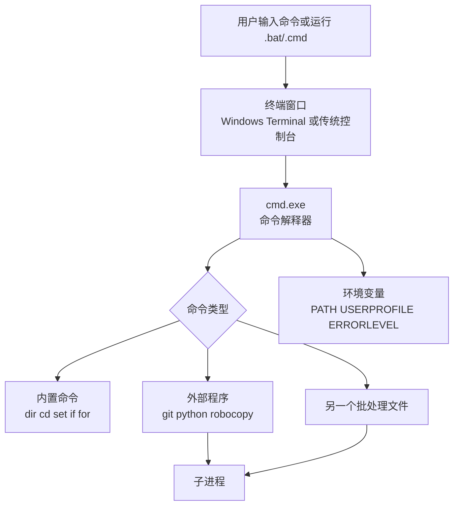

[toc]


## Windows cmd（批处理）系统化入门

`cmd` 通常指 **Command Prompt / 命令提示符** 背后的命令解释器 `cmd.exe`；批处理通常指把多条 cmd 命令写进 `.bat` 或 `.cmd` 文件，让 Windows 按顺序执行。

Microsoft 文档把 Windows 命令定位为可用于脚本和自动化的 Win32 控制台命令集，同时也明确说明 Windows 有两个主要命令行 shell：Command shell 和 PowerShell；

对于“最健壮、最新的 Windows 自动化”，官方更推荐 PowerShell。换句话说：**cmd 仍然值得学，但更适合兼容性、简单自动化、老系统维护、安装脚本、启动器和临时运维；复杂自动化优先考虑 PowerShell。** ([Microsoft Learn](https://learn.microsoft.com/en-us/windows-server/administration/windows-commands/windows-commands))

------

## 先建立正确心智模型

很多新手会把“终端窗口”“cmd”“批处理”“Windows 命令”混在一起。建议这样区分：

| 概念               | 作用                                   | 例子                                |
| ------------------ | -------------------------------------- | ----------------------------------- |
| 终端程序           | 提供窗口、标签页、字体、复制粘贴等界面 | Windows Terminal、传统控制台窗口    |
| Shell / 命令解释器 | 解析你输入的命令，决定怎么执行         | `cmd.exe`、PowerShell               |
| 命令               | 被 shell 执行的具体动作                | `dir`、`copy`、`ping`、`robocopy`   |
| 批处理文件         | 保存多条 cmd 命令的脚本文件            | `backup.bat`、`deploy.cmd`          |
| 外部程序           | 独立 `.exe`，由 cmd 启动               | `python.exe`、`git.exe`、`node.exe` |



现代 Windows 上，Windows Terminal 可以作为更舒适的终端外壳来打开 Command Prompt 配置；它支持标签页、配置、Unicode/UTF-8 字符显示和 GPU 加速文本渲染等能力，但它本身不是 `cmd.exe`，只是承载 shell 的终端应用。([Microsoft Learn](https://learn.microsoft.com/en-us/windows/terminal/))

------

## cmd 适合什么，不适合什么

| 场景                          | 是否推荐 cmd | 说明                                  |
| ----------------------------- | ------------ | ------------------------------------- |
| 简单复制、删除、启动程序      | 推荐         | 批处理非常方便                        |
| 安装包前后置脚本              | 推荐         | 兼容性好，很多软件仍使用              |
| 老系统、恢复环境、最小环境    | 推荐         | cmd 可用性强                          |
| 简单 CI/CD glue script        | 可用         | 适合少量命令串联                      |
| 复杂对象处理、JSON、HTTP、API | 不推荐       | PowerShell、Python 更合适             |
| 大型系统管理脚本              | 不推荐       | 错误处理、可读性、数据结构较弱        |
| 跨平台脚本                    | 不推荐       | 考虑 PowerShell 7、Python、Node、Bash |

cmd 的优势是“几乎到处都有、启动快、语法老但简单”；短板是字符串处理弱、转义规则复杂、编码容易踩坑、错误处理不够现代。

------

## 命令行语法怎么读

Microsoft 文档中的 Windows 命令语法有固定记号。理解这些记号后，读官方帮助会轻松很多。([Microsoft Learn](https://learn.microsoft.com/en-us/windows-server/administration/windows-commands/command-line-syntax-key))

| 记号       | 含义                     | 示例理解              |
| ---------- | ------------------------ | --------------------- |
| `普通文本` | 必须原样输入             | `dir` 就输入 `dir`    |
| `<name>`   | 占位符，需要替换成实际值 | `<file>` 换成 `a.txt` |
| `[option]` | 可选内容                 | 可写可不写            |
| `{a        | b}`                      | 必选其一              |
| `...`      | 可重复                   | 可以传多个文件或参数  |
| `/?`       | 常见帮助参数             | `dir /?` 查看帮助     |

例如：

```bat
copy [/y | /-y] <source> [<destination>]
```

可以理解为：`copy` 是命令；`/y` 和 `/-y` 可选其一；`<source>` 必填；`<destination>` 可选。

------

## 基础运行方式

| 目标             | 写法                     | 说明               |
| ---------------- | ------------------------ | ------------------ |
| 打开命令提示符   | 开始菜单搜索 `cmd`       | 交互执行           |
| 执行后退出       | `cmd /c "命令"`          | 适合从其他程序调用 |
| 执行后停留       | `cmd /k "命令"`          | 适合调试           |
| 运行批处理       | `script.bat`             | 当前 cmd 中执行    |
| 从资源管理器双击 | 双击 `.bat`              | 结束后窗口通常关闭 |
| 查看命令帮助     | `命令 /?` 或 `help 命令` | 新手最重要习惯之一 |

`cmd /c` 会执行指定命令后退出，`cmd /k` 会执行后保留命令处理器；`/v:on` 可启用延迟变量展开，`/e:on` 可启用命令扩展。([Microsoft Learn](https://learn.microsoft.com/en-us/windows-server/administration/windows-commands/cmd))

------

## 批处理文件的基本结构

推荐新手从这个模板开始：

```bat
@echo off
setlocal EnableExtensions DisableDelayedExpansion

rem 切换到脚本所在目录，避免“从哪里运行”影响相对路径
pushd "%~dp0" || (
    echo Failed to enter script directory.
    exit /b 1
)

echo Hello, batch.

popd
exit /b 0
```

逐行解释：

| 写法                      | 作用                                |
| ------------------------- | ----------------------------------- |
| `@echo off`               | 关闭命令回显，让输出更干净          |
| `setlocal`                | 让变量修改局限在当前批处理内        |
| `EnableExtensions`        | 启用常用 cmd 扩展语法               |
| `DisableDelayedExpansion` | 默认关闭延迟展开，避免 `!` 被误处理 |
| `pushd "%~dp0"`           | 进入脚本所在目录                    |
| `exit /b 0`               | 退出当前批处理并返回成功码          |

`setlocal` 会让之后的环境变量修改变成局部效果，遇到 `endlocal` 或批处理结束时恢复之前环境；它也可用于启用/禁用命令扩展和延迟变量展开。([Microsoft Learn](https://learn.microsoft.com/en-us/windows-server/administration/windows-commands/setlocal))

------

## 常用命令速查

| 类别     | 命令                          | 用途                     |
| -------- | ----------------------------- | ------------------------ |
| 帮助     | `help`、`命令 /?`             | 查看命令说明             |
| 目录     | `cd`、`pushd`、`popd`         | 切换目录                 |
| 查看     | `dir`、`tree`                 | 列出文件                 |
| 文件     | `copy`、`move`、`ren`、`del`  | 复制、移动、重命名、删除 |
| 目录     | `mkdir`、`rmdir`              | 创建、删除目录           |
| 内容     | `type`、`more`、`findstr`     | 查看和搜索文本           |
| 路径     | `where`                       | 查找可执行文件位置       |
| 网络     | `ping`、`ipconfig`、`netstat` | 基础网络诊断             |
| 进程     | `tasklist`、`taskkill`        | 查看和结束进程           |
| 复制增强 | `robocopy`                    | 更强的文件夹复制         |
| 环境变量 | `set`、`setx`                 | 临时或持久设置变量       |
| 流程控制 | `if`、`for`、`goto`、`call`   | 批处理逻辑               |
| 交互     | `choice`、`pause`、`set /p`   | 用户输入                 |

Microsoft 的 Windows Commands 文档提供了 A-Z 命令索引；实际学习时不需要背所有命令，应该围绕“文件、路径、变量、判断、循环、错误处理”逐步掌握。([Microsoft Learn](https://learn.microsoft.com/en-us/windows-server/administration/windows-commands/windows-commands))

------

## 路径、空格和引号规则

cmd 新手最常见错误之一是路径没有加引号。

错误示例：

```bat
copy C:\My Files\a.txt D:\Backup
```

正确示例：

```bat
copy "C:\My Files\a.txt" "D:\Backup\"
```

核心规则：

| 规则                             | 示例                               |
| -------------------------------- | ---------------------------------- |
| 路径可能包含空格时，一律加双引号 | `"C:\Program Files\App"`           |
| 变量表示路径时，也一律加双引号   | `"%USERPROFILE%\Desktop"`          |
| 不要写成 `set VAR = value`       | 这会把空格也当成变量名或值的一部分 |
| 推荐变量赋值写法                 | `set "VAR=value"`                  |
| 对用户输入保持怀疑               | 路径、文件名可能含特殊字符         |

cmd 文档明确指出，如果路径、文件名或传入信息含空格，应使用双引号；同时 `& < > [ ] | { } ^ = ; ! ' + , \` ~` 和空白等字符在命令行中有特殊意义，作为普通文本时需要引号或转义。([Microsoft Learn](https://learn.microsoft.com/en-us/windows-server/administration/windows-commands/cmd))

------

## 特殊字符和转义

cmd 的特殊字符很多，常见如下：

| 字符 | 含义                   | 作为普通字符时                 |
| ---- | ---------------------- | ------------------------------ |
| `&`  | 顺序执行多个命令       | `^&` 或放进引号                |
| `&&` | 前一个成功才执行后一个 | 需要理解 ERRORLEVEL            |
| `    |                        | `                              |
| `    | `                      | 管道                           |
| `>`  | 覆盖重定向输出         | `^>` 或放进引号                |
| `>>` | 追加重定向输出         | 追加到文件                     |
| `<`  | 输入重定向             | `^<`                           |
| `^`  | 转义符                 | 写字面量 `^` 常要 `^^`         |
| `%`  | 变量展开               | 批处理中写字面量 `%` 常用 `%%` |
| `!`  | 延迟变量展开           | 启用 delayed expansion 后特殊  |
| `()` | 命令分组               | 块中变量展开有坑               |

示例：

```bat
echo A ^& B
echo 1 ^> 0
echo pipe symbol: ^|
```

------

## 命令连接、管道和重定向

cmd 支持把多个命令组合起来。官方文档说明，`|` 可把一个命令输出送给另一个命令，`>` 可把输出写入文件，`&` 可组合多个命令，`&&` 表示前一命令成功才继续，`||` 表示前一命令失败才执行后续命令。([Microsoft Learn](https://learn.microsoft.com/en-us/windows-server/administration/windows-commands/cmd))

| 写法                 | 含义                     | 示例                           |
| -------------------- | ------------------------ | ------------------------------ |
| `cmd1 & cmd2`        | 无论成败都执行下一个     | `echo A & echo B`              |
| `cmd1 && cmd2`       | `cmd1` 成功才执行 `cmd2` | `mkdir out && copy a.txt out\` |
| `cmd1                |                          | cmd2`                          |
| `cmd1                | cmd2`                    | 管道                           |
| `cmd > file`         | 覆盖写入 stdout          | `dir > list.txt`               |
| `cmd >> file`        | 追加写入 stdout          | `echo done >> log.txt`         |
| `cmd 2> err.txt`     | 写入 stderr              | `tool 2> error.log`            |
| `cmd > all.txt 2>&1` | stdout 和 stderr 合并    | 常用于日志                     |

日志常用写法：

```bat
mytool.exe > "run.log" 2>&1
```

同时显示并写日志，cmd 原生没有 Unix `tee` 那样方便。若工具本身支持日志参数，优先用工具自己的日志参数；例如 `robocopy` 支持 `/log:`、`/log+:` 和 `/tee` 等日志相关选项。([Microsoft Learn](https://learn.microsoft.com/pt-br/windows-server/administration/windows-commands/robocopy?utm_source=chatgpt.com))

------

## 环境变量

cmd 使用环境变量保存字符串值。`set` 可显示、设置或删除 `cmd.exe` 环境变量；不带参数时显示当前环境变量，`set VAR=value` 设置变量，`set VAR=` 删除变量。([Microsoft Learn](https://learn.microsoft.com/en-us/windows-server/administration/windows-commands/set_1))

```bat
set "NAME=Carson"
echo %NAME%

set "NAME="
```

推荐写法：

```bat
set "OUT_DIR=%USERPROFILE%\Desktop\out"
```

不推荐：

```bat
set OUT_DIR=%USERPROFILE%\Desktop\out
```

虽然很多时候也能运行，但推荐写法可以避免不小心把尾部空格写进变量值。

常见内置变量：

| 变量               | 含义                         |
| ------------------ | ---------------------------- |
| `%CD%`             | 当前目录                     |
| `%DATE%`           | 当前日期，格式受区域设置影响 |
| `%TIME%`           | 当前时间，格式受区域设置影响 |
| `%USERPROFILE%`    | 当前用户主目录               |
| `%USERNAME%`       | 当前用户名                   |
| `%TEMP%` / `%TMP%` | 临时目录                     |
| `%PATH%`           | 可执行文件搜索路径           |
| `%ERRORLEVEL%`     | 上一个命令的退出码字符串表示 |

注意：`%DATE%`、`%TIME%` 会受系统区域设置影响，不适合写严肃的跨机器日期解析。更稳的做法是调用 PowerShell 获取 ISO 格式日期：

```bat
for /f %%i in ('powershell -NoProfile -Command "Get-Date -Format yyyyMMdd-HHmmss"') do set "TS=%%i"
echo %TS%
```

------

## 变量展开：百分号和感叹号

cmd 变量有两种重要展开方式：

| 写法    | 名称     | 何时使用                 |
| ------- | -------- | ------------------------ |
| `%VAR%` | 普通展开 | 大多数简单场景           |
| `!VAR!` | 延迟展开 | 循环或括号块内变量变化时 |

问题示例：

```bat
@echo off
set "N=0"

if exist "%SystemRoot%" (
    set "N=1"
    echo N is %N%
)
```

你可能期待输出 `1`，但可能看到旧值。原因是括号块整体解析时，`%N%` 已经被提前展开。

正确写法：

```bat
@echo off
setlocal EnableDelayedExpansion
set "N=0"

if exist "%SystemRoot%" (
    set "N=1"
    echo N is !N!
)
```

cmd 文档说明，启用延迟环境变量展开后，可以用 `!` 在运行时替换变量值。([Microsoft Learn](https://learn.microsoft.com/en-us/windows-server/administration/windows-commands/cmd))

实践建议：

| 场景                              | 建议                                      |
| --------------------------------- | ----------------------------------------- |
| 简单脚本                          | 用 `%VAR%`                                |
| `for (...) do (...)` 中变量会变化 | 开启 `EnableDelayedExpansion`，用 `!VAR!` |
| 数据可能包含 `!`                  | 谨慎使用延迟展开，必要时局部开启/关闭     |
| 新手不确定                        | 先写简单版本，再在循环块中改用 `!VAR!`    |

------

## 批处理参数

运行：

```bat
script.bat one two "three four"
```

在脚本中：

| 写法    | 含义                           |
| ------- | ------------------------------ |
| `%0`    | 脚本自身路径                   |
| `%1`    | 第一个参数：`one`              |
| `%2`    | 第二个参数：`two`              |
| `%3`    | 第三个参数：`three four`       |
| `%*`    | 所有参数                       |
| `%~1`   | 去掉外层引号后的第一个参数     |
| `%~f1`  | 第一个参数的完整路径           |
| `%~dp0` | 当前脚本所在目录，含盘符和路径 |
| `%~nx1` | 第一个参数的文件名和扩展名     |
| `%~x1`  | 第一个参数的扩展名             |

常用参数校验模板：

```bat
@echo off
setlocal

if "%~1"=="" (
    echo Usage: %~nx0 ^<input-file^>
    exit /b 2
)

if not exist "%~1" (
    echo File not found: "%~1"
    exit /b 1
)

echo Input file: "%~f1"
exit /b 0
```

注意 `^<input-file^>`：因为 `<` 和 `>` 是重定向符，所以在 `echo` 中作为普通字符时需要转义。

------

## 条件判断 if

`if` 用于批处理条件处理。官方语法包括判断 `ERRORLEVEL`、字符串相等、文件是否存在；启用命令扩展后，还支持 `/i` 忽略大小写比较、`defined` 判断变量是否存在等形式。([Microsoft Learn](https://learn.microsoft.com/en-us/windows-server/administration/windows-commands/if))

| 场景         | 写法                                | 说明                 |
| ------------ | ----------------------------------- | -------------------- |
| 文件存在     | `if exist "a.txt" echo found`       | 判断文件或目录       |
| 文件不存在   | `if not exist "a.txt" echo missing` | 取反                 |
| 字符串相等   | `if "%A%"=="yes" echo ok`           | 注意加引号           |
| 忽略大小写   | `if /i "%A%"=="YES" echo ok`        | 常用于用户输入       |
| 变量已定义   | `if defined A echo has A`           | 避免空变量比较坑     |
| 上个命令失败 | `if errorlevel 1 echo failed`       | 表示退出码大于等于 1 |

重要坑点：`if errorlevel 1` 的含义是 **ERRORLEVEL 大于等于 1**，不是等于 1。官方参数说明也是“前一个程序返回码等于或大于指定数字时为真”。([Microsoft Learn](https://learn.microsoft.com/en-us/windows-server/administration/windows-commands/if))

更现代、易读的错误判断写法：

```bat
some-command.exe
if errorlevel 1 (
    echo command failed
    exit /b 1
)
```

或者：

```bat
some-command.exe || (
    echo command failed
    exit /b 1
)
```

------

## 循环 for

`for` 是批处理中最重要也最容易劝退新手的命令。先记住核心差异：**在命令提示符直接输入时用 `%i`，在批处理文件中用 `%%i`。** 官方文档明确说明，命令行中使用单个 `%`，批处理文件中使用双 `%`。([Microsoft Learn](https://learn.microsoft.com/en-us/windows-server/administration/windows-commands/for))

### 遍历文件

```bat
for %%f in (*.txt) do (
    echo File: %%f
)
```

### 遍历目录

```bat
for /d %%d in (*) do (
    echo Directory: %%d
)
```

### 递归遍历文件

```bat
for /r "C:\Logs" %%f in (*.log) do (
    echo %%f
)
```

### 数字循环

```bat
for /l %%i in (1,1,5) do (
    echo %%i
)
```

含义是：从 `1` 开始，每次加 `1`，直到 `5`。

### 解析命令输出

```bat
for /f "tokens=*" %%l in ('dir /b *.txt') do (
    echo Line: %%l
)
```

更常见的例子：读取文本文件每一行。

```bat
for /f "usebackq tokens=* delims=" %%l in ("input.txt") do (
    echo %%l
)
```

`for /f` 常用选项：

| 选项         | 作用                                 |
| ------------ | ------------------------------------ |
| `tokens=1,2` | 取第 1、2 列                         |
| `tokens=*`   | 取整行剩余内容                       |
| `delims=,`   | 使用逗号分隔                         |
| `delims=`    | 不使用默认空格分隔，尽量保留整行     |
| `skip=1`     | 跳过第一行                           |
| `usebackq`   | 允许双引号表示文件名，反引号表示命令 |

示例：解析 CSV 的前两列，适合简单 CSV，不适合含复杂引号的标准 CSV。

```bat
for /f "tokens=1,2 delims=," %%a in ("users.csv") do (
    echo Name=%%a Email=%%b
)
```

------

## 子程序和 call

批处理可以用标签模拟函数。

```bat
@echo off
setlocal

call :say_hello Carson
call :say_hello Stella

exit /b 0

:say_hello
echo Hello, %~1
exit /b 0
```

规则：

| 写法               | 含义                     |
| ------------------ | ------------------------ |
| `:label`           | 定义标签                 |
| `call :label args` | 调用子程序               |
| `exit /b 0`        | 从子程序或批处理返回     |
| `goto label`       | 跳转，不会自动返回       |
| `goto :eof`        | 跳到文件末尾，常用于返回 |

建议：新脚本尽量少用 `goto`，多用 `call :function` 组织逻辑。

------

## 错误处理和退出码

Windows 命令通常用退出码表示结果：`0` 通常表示成功，非 `0` 通常表示失败；cmd 官方文档也说明，命令成功完成时返回退出码 `0` 或不返回退出码。([Microsoft Learn](https://learn.microsoft.com/en-us/windows-server/administration/windows-commands/cmd))

基础模板：

```bat
@echo off
setlocal

echo Running task...
some-tool.exe

if errorlevel 1 (
    echo Task failed with code %ERRORLEVEL%.
    exit /b %ERRORLEVEL%
)

echo Task succeeded.
exit /b 0
```

更适合串联命令的写法：

```bat
mkdir "out" || exit /b 1
copy "input.txt" "out\" || exit /b 1
echo Done.
exit /b 0
```

严谨一点的模板：

```bat
@echo off
setlocal EnableExtensions DisableDelayedExpansion

call :main %*
exit /b %ERRORLEVEL%

:main
if "%~1"=="" (
    echo Usage: %~nx0 ^<file^>
    exit /b 2
)

if not exist "%~1" (
    echo Missing file: "%~1"
    exit /b 1
)

echo Processing "%~f1"
rem 在这里执行真正逻辑
exit /b 0
```

特别注意：有些命令的非零退出码不一定等于失败。典型例子是 `robocopy`，它有自己的返回码语义；写自动化时要查对应命令文档，不要机械地认为“所有非零都是失败”。`robocopy` 是 Windows 中用于从一个位置复制文件数据到另一个位置的强力命令，并支持复制、重试、日志等大量选项。([Microsoft Learn](https://learn.microsoft.com/en-us/windows-server/administration/windows-commands/robocopy?utm_source=chatgpt.com))

------

## 编码、中文和乱码

中文环境下批处理经常遇到乱码，原因通常来自三层：

| 层级               | 可能问题                                    |
| ------------------ | ------------------------------------------- |
| 批处理文件本身编码 | 文件保存为 UTF-8、ANSI、OEM 时表现不同      |
| 控制台活动代码页   | `chcp` 决定当前控制台代码页                 |
| 外部程序输出编码   | `git`、`python`、`node`、老工具可能各不相同 |

`chcp` 用于更改当前控制台活动代码页；不带参数时显示当前代码页。Microsoft 文档还说明，改变代码页后，之后启动的程序会使用新代码页，而之前已启动的程序仍继续使用原代码页。([Microsoft Learn](https://learn.microsoft.com/en-us/windows-server/administration/windows-commands/chcp))

常见命令：

```bat
chcp
chcp 936
chcp 65001
```

| 代码页  | 常见含义       |
| ------- | -------------- |
| `936`   | 简体中文 GBK   |
| `65001` | UTF-8          |
| `437`   | 美国英语 OEM   |
| `850`   | 多语言 Latin I |

实践建议：

| 场景                             | 建议                                                   |
| -------------------------------- | ------------------------------------------------------ |
| 脚本只给自己用，主要中文 Windows | 可使用系统默认代码页，减少兼容问题                     |
| 需要 UTF-8 输出                  | 在 Windows Terminal 中测试 `chcp 65001`                |
| 脚本包含大量中文文本             | 优先考虑 PowerShell，编码更清晰                        |
| 需要兼容老工具                   | 不要盲目强制 `chcp 65001`                              |
| 需要日志稳定可解析               | 尽量让工具输出 UTF-8 或使用 PowerShell/Python 生成日志 |

一个相对稳妥的批处理做法是：命令和变量名尽量用 ASCII；中文只放在 `echo` 文本中，并在目标机器上实际测试显示和日志。

------

## 实用模板：安全复制目录

```bat
@echo off
setlocal EnableExtensions DisableDelayedExpansion

if "%~1"=="" (
    echo Usage: %~nx0 ^<source-dir^> ^<dest-dir^>
    exit /b 2
)

if "%~2"=="" (
    echo Usage: %~nx0 ^<source-dir^> ^<dest-dir^>
    exit /b 2
)

set "SRC=%~1"
set "DST=%~2"

if not exist "%SRC%\" (
    echo Source directory not found: "%SRC%"
    exit /b 1
)

mkdir "%DST%" 2>nul

robocopy "%SRC%" "%DST%" /e /r:2 /w:2 /log+:"copy.log"

rem Robocopy 返回码需要按其语义处理；这里示范一种常见保守处理：
if errorlevel 8 (
    echo Robocopy failed with code %ERRORLEVEL%.
    exit /b %ERRORLEVEL%
)

echo Copy completed with robocopy code %ERRORLEVEL%.
exit /b 0
```

说明：

| 片段               | 目的                         |
| ------------------ | ---------------------------- |
| `%~1`、`%~2`       | 获取去掉外层引号的参数       |
| `"%SRC%\"`         | 判断目录存在                 |
| `/e`               | 包含子目录，包括空目录       |
| `/r:2 /w:2`        | 失败重试 2 次，每次等待 2 秒 |
| `/log+:"copy.log"` | 追加日志                     |
| `if errorlevel 8`  | 按 robocopy 常见错误阈值处理 |

------

## 实用模板：按日期生成日志文件

```bat
@echo off
setlocal EnableExtensions DisableDelayedExpansion

for /f %%i in ('powershell -NoProfile -Command "Get-Date -Format yyyyMMdd-HHmmss"') do set "TS=%%i"

set "LOG=%~dp0logs\run-%TS%.log"
mkdir "%~dp0logs" 2>nul

echo Log file: "%LOG%"

(
    echo Started at %DATE% %TIME%
    echo Current dir: %CD%
    echo Running task...
) >> "%LOG%"

some-tool.exe >> "%LOG%" 2>&1
set "CODE=%ERRORLEVEL%"

echo Exit code: %CODE% >> "%LOG%"

exit /b %CODE%
```

这里用 PowerShell 只负责生成稳定时间戳；主体仍然是批处理。这种混合方式在现代 Windows 自动化中很实用。

------

## 实用模板：带确认的危险操作

```bat
@echo off
setlocal

set "TARGET=%~1"

if "%TARGET%"=="" (
    echo Usage: %~nx0 ^<target-dir^>
    exit /b 2
)

if not exist "%TARGET%\" (
    echo Directory not found: "%TARGET%"
    exit /b 1
)

echo You are about to delete files under:
echo "%TARGET%"
echo.

choice /m "Continue"
if errorlevel 2 (
    echo Cancelled.
    exit /b 0
)

del /q "%TARGET%\*.tmp"
if errorlevel 1 (
    echo Delete failed.
    exit /b 1
)

echo Done.
exit /b 0
```

危险命令建议永远做参数校验、路径回显、确认步骤。尤其不要写这种脚本：

```bat
del /q "%TARGET%\*.*"
```

除非你已经非常确定 `%TARGET%` 不为空、不为根目录、不为错误路径。

------

## 批处理中的注释

常用两种：

```bat
rem 这是正式注释
:: 这也是常见写法，但本质是标签风格
```

建议：

| 场景                   | 推荐                   |
| ---------------------- | ---------------------- |
| 普通注释               | `rem`                  |
| 简短脚本、非括号复杂块 | `::` 通常也可用        |
| 括号块内部             | 优先 `rem`，少用 `::`  |
| 注释中有特殊字符       | 注意转义或放到安全位置 |

------

## 常见坑点

| 坑                          | 错误示例               | 正确做法                         |
| --------------------------- | ---------------------- | -------------------------------- |
| 路径不加引号                | `copy %SRC% %DST%`     | `copy "%SRC%" "%DST%"`           |
| 变量赋值多了空格            | `set A = 1`            | `set "A=1"`                      |
| 循环中 `%VAR%` 不更新       | `echo %N%`             | 开启延迟展开，用 `!N!`           |
| 批处理中 `for` 变量少写 `%` | `for %i in (*) do ...` | `.bat` 中写 `%%i`                |
| 误解 `if errorlevel`        | 以为等于               | 实际是“大于等于”                 |
| 删除命令未校验路径          | `del "%DIR%\*"`        | 先判断、回显、确认               |
| 解析本地化输出              | 解析 `dir` 日期        | 用 PowerShell 或工具机器可读输出 |
| 日志只记录 stdout           | `cmd > log.txt`        | `cmd > log.txt 2>&1`             |
| 乱码                        | 盲目 `chcp 65001`      | 根据目标环境测试                 |
| 从不同目录运行失败          | 依赖当前目录           | `pushd "%~dp0"`                  |

------

## cmd 和 PowerShell 的边界

| 需求                   | cmd 写法体验                | PowerShell 写法体验              |
| ---------------------- | --------------------------- | -------------------------------- |
| 启动几个程序           | 简单                        | 也简单                           |
| 文件复制               | `copy`、`xcopy`、`robocopy` | `Copy-Item`，也可调用 `robocopy` |
| 文本替换               | 较麻烦                      | 更自然                           |
| JSON 处理              | 非常不适合                  | 原生友好                         |
| HTTP 请求              | 不适合                      | `Invoke-RestMethod`              |
| 服务、注册表、事件日志 | 可做但繁琐                  | 更适合                           |
| 跨平台                 | 不适合                      | PowerShell 7 可跨平台            |
| 老软件兼容脚本         | 很适合                      | 有时反而复杂                     |

一个现实建议：**会 cmd 是 Windows 基础能力；写新自动化时，先判断复杂度。超过几十行、涉及结构化数据、网络 API、对象处理，就考虑 PowerShell 或 Python。**

------

## 现代最佳实践

| 实践                           | 原因                       |
| ------------------------------ | -------------------------- |
| 脚本开头写 `@echo off`         | 输出更清晰                 |
| 使用 `setlocal`                | 避免污染调用者环境         |
| 变量赋值用 `set "A=value"`     | 避免尾部空格和特殊字符问题 |
| 所有路径变量加引号             | 兼容空格路径               |
| 使用 `%~dp0` 定位脚本目录      | 避免运行目录不一致         |
| 关键命令后检查退出码           | 自动化必须知道失败         |
| 日志写入文件                   | 便于排错                   |
| 危险操作先 dry-run 或确认      | 防止误删                   |
| 不解析人类可读输出             | 本地化、格式变化会破坏脚本 |
| 复杂数据交给 PowerShell/Python | cmd 不擅长结构化处理       |
| 不默认管理员运行               | 最小权限原则               |
| 不运行来源不明的 `.bat`        | 批处理可执行任意命令       |

------

## 推荐学习路线

| 阶段       | 学什么                                      | 能做什么         |
| ---------- | ------------------------------------------- | ---------------- |
| 入门       | `dir`、`cd`、`copy`、`del`、`mkdir`、`type` | 日常文件操作     |
| 基础脚本   | `.bat`、`@echo off`、参数、`set`            | 写简单自动化     |
| 路径和变量 | 引号、`%~dp0`、环境变量                     | 写可移植脚本     |
| 控制流     | `if`、`for`、`errorlevel`                   | 写有逻辑的脚本   |
| 调试       | `echo`、日志、`cmd /k`、逐步注释            | 快速定位问题     |
| 进阶       | `for /f`、延迟展开、子程序                  | 写中等复杂度脚本 |
| 现代化     | PowerShell 混用、Windows Terminal、UTF-8    | 处理现实环境问题 |
| 工程化     | 错误码规范、日志规范、dry-run               | 可维护自动化     |

最实用的学习方法不是背命令，而是反复练这些小任务：批量重命名、复制备份、清理日志、检查文件是否存在、调用外部工具、记录日志、失败时退出。掌握这些之后，cmd 批处理就已经能解决大多数轻量级 Windows 自动化问题。