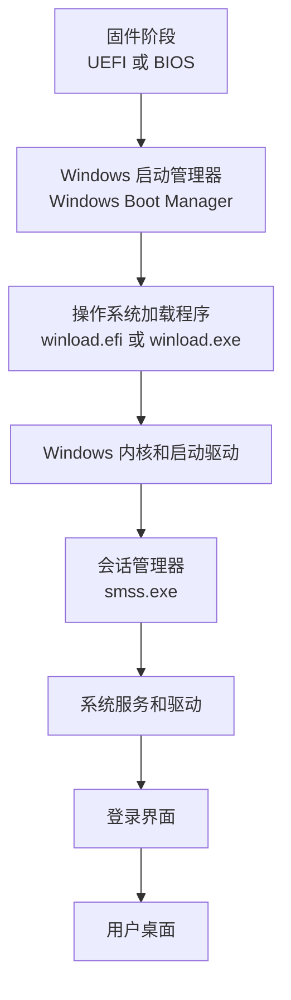
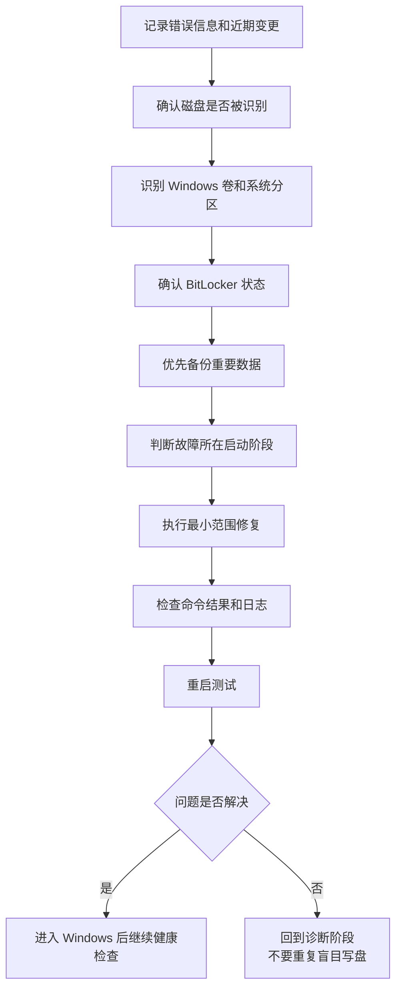

[toc]


## abstract

> CMD 命令提示符：从基础使用到 Windows 启动故障修复

CMD 命令提示符通常指由 `cmd.exe` 提供的 Windows 命令解释环境（Command Shell）。它并不是“旧式 DOS 系统”，而是现代 Windows 仍然内置并支持的一套命令行环境。

在正常 Windows 中，PowerShell、Windows Terminal 和图形化管理工具通常更加方便；但在 Windows 无法启动、进入 Windows 恢复环境（Windows Recovery Environment，WinRE）或 Windows 预安装环境（Windows Preinstallation Environment，WinPE）时，`cmd.exe` 往往是最稳定、最基础、最值得掌握的工具入口。

Windows 10、Windows 11 和当前 Windows Server 仍然内置完整的 Win32 控制台命令集，并支持使用批处理文件（Batch File）自动化任务。([Microsoft Learn](https://learn.microsoft.com/en-us/windows-server/administration/windows-commands/windows-commands?utm_source=chatgpt.com))

------

## 详细学习大纲

本文围绕以下内容展开：

- CMD、终端窗口、Shell 和控制台宿主之间的区别
- CMD 命令的基本组成和执行原理
- 内部命令与外部命令
- 文件系统、路径、盘符和工作目录
- 引号、通配符、转义字符与特殊字符
- 标准输入、标准输出、错误输出、重定向和管道
- 命令连接、退出码和错误判断
- 环境变量与变量展开
- 批处理脚本的基础结构
- 管理员权限和恢复环境权限
- Windows 正常 CMD、WinRE CMD 和安装介质 CMD 的区别
- Windows 启动链路及其故障分层
- WinRE 中识别 Windows 分区、EFI 分区和 BitLocker 状态
- 启动文件、BCD、UEFI/GPT 和 BIOS/MBR 的区别
- 使用 `bcdboot`、`bcdedit`、`bootrec` 和 `bootsect` 修复启动
- 使用 `chkdsk` 检查文件系统
- 使用离线 SFC 和 DISM 修复 Windows
- 处理更新挂起、驱动故障和服务故障
- 查看自动修复日志、事件日志和系统日志
- 在修复前备份重要数据
- 常见误区、高风险命令和最佳实践
- 典型故障案例与标准处理流程
- CMD 和 WinRE 常用命令速查表

------

## CMD、终端和 Shell 的关系

初学者经常把“命令提示符”“CMD”“控制台”和“终端”混为一谈。

它们并不是完全相同的概念。

| 概念             | 英文                | 作用                                                |
| ---------------- | ------------------- | --------------------------------------------------- |
| 命令解释器       | Command Interpreter | 读取并解释命令，例如 `cmd.exe`                      |
| Shell            | Shell               | 提供用户与操作系统交互的命令环境                    |
| 终端             | Terminal            | 显示文字、接收键盘输入的界面                        |
| 控制台宿主       | Console Host        | 为控制台程序提供窗口和输入输出支持                  |
| 命令提示符       | Command Prompt      | 通常指运行 `cmd.exe` 后看到的交互环境               |
| Windows Terminal | Windows Terminal    | 可承载 CMD、PowerShell、WSL 等多种 Shell 的终端应用 |

例如，在正常 Windows 中，可以在 Windows Terminal 的一个标签页中运行 CMD。

此时：

- Windows Terminal 是终端应用。
- `cmd.exe` 是 Shell 和命令解释器。
- `dir`、`cd`、`set` 等是 CMD 内部命令。
- `diskpart.exe`、`dism.exe` 等是 CMD 启动的外部程序。

可以把它理解为：


------

## CMD 不等于 DOS

现代 Windows 中的 CMD 不是运行在 DOS 操作系统上的传统命令环境。

两者虽然保留了许多相似命令，例如：

- `dir`
- `copy`
- `del`
- `cd`
- `type`

但现代 `cmd.exe`：

- 运行在 Win32/Windows 环境中。
- 支持 NTFS、权限控制、长文件名和网络路径。
- 可以启动现代 Windows 可执行程序。
- 可以调用 DISM、SFC、BCDBoot、DiskPart 等现代管理工具。
- 支持环境变量、命令扩展和批处理脚本。
- 可以访问 Windows API 所提供的系统功能。

因此，将 CMD 简单称为“DOS 命令”并不准确。

------

## 不同场景下的 CMD

| 场景         | 常见提示符                    | 操作对象               | 重要特点                |
| ------------ | ----------------------------- | ---------------------- | ----------------------- |
| 普通用户 CMD | `C:\Users\用户名>`            | 当前运行的 Windows     | 权限受限                |
| 管理员 CMD   | `C:\Windows\System32>`        | 当前运行的 Windows     | 可执行系统级操作        |
| WinRE CMD    | 常见为 `X:\Windows\System32>` | 磁盘上的离线 Windows   | 盘符可能变化            |
| 安装介质 CMD | 常见为 `X:\Sources>`          | 安装环境和磁盘上的系统 | 可通过 `Shift+F10` 打开 |
| WinPE CMD    | 常见为 `X:\Windows\System32>` | 部署或维护环境         | 工具组成取决于镜像      |

WinRE 基于 WinPE，并提供一组用于诊断和修复的命令行工具；但具体厂商恢复镜像可能经过定制，因此不能假定所有第三方程序或 PowerShell 一定存在。微软文档明确说明，可以从 WinRE 的命令提示符使用 Windows PE 命令行工具。([Microsoft Learn](https://learn.microsoft.com/en-us/windows-hardware/manufacture/desktop/windows-re-troubleshooting-features?view=windows-11&utm_source=chatgpt.com))

### 最重要的区别

在 WinRE 中：

> 当前提示符所在的 `X:` 通常是恢复环境自身，而不是硬盘中安装 Windows 的分区。

因此：

```cmd
X:\Windows\System32
```

一般表示 WinRE 自己的系统目录。

真正的 Windows 可能位于：

```text
C:\Windows
D:\Windows
E:\Windows
```

必须先确认盘符，不能想当然地把 `C:` 当成系统盘。

------

## 打开 CMD 的常用方法

### 正常 Windows 中

可以通过以下方式打开：

- 开始菜单搜索“命令提示符”。
- 在“运行”中输入 `cmd`。
- 在资源管理器地址栏输入 `cmd`。
- 在 Windows Terminal 中打开“命令提示符”配置文件。
- 右键选择“以管理员身份运行”。

### 正常 Windows 中安排下一次进入 WinRE

管理员 CMD 中可以执行：

```cmd
reagentc /info
```

查看 Windows RE 状态。

```cmd
reagentc /boottore
shutdown /r /t 0
```

`reagentc /boottore` 会安排下一次启动进入 Windows RE，而且只支持对当前在线 Windows 使用。([Microsoft Learn](https://learn.microsoft.com/zh-cn/windows-hardware/manufacture/desktop/reagentc-command-line-options?view=windows-11))

### Windows 无法启动时

常见入口包括：

- Windows 多次启动失败后自动进入 WinRE。
- 在登录界面按住 `Shift` 选择“重启”。
- 从高级启动菜单进入。
- 使用 Windows 安装 U 盘启动，然后选择“修复计算机”。
- 在安装界面按 `Shift+F10` 打开命令提示符。

通过安装介质进入时，一般选择：

```text
修复计算机
→ 疑难解答
→ 高级选项
→ 命令提示符
```

微软的 WinRE 启动故障排查文档同样建议从安装介质选择“修复计算机”，再进入命令提示符。([Microsoft Learn](https://learn.microsoft.com/zh-cn/troubleshoot/windows-server/performance/use-winre-to-troubleshoot-startup-issue))

------

## CMD 命令的基本结构

典型命令通常包含：

```text
命令名 参数 选项
```

例如：

```cmd
dir C:\Windows /a /o:n
```

其中：

- `dir`：命令名。
- `C:\Windows`：操作目标。
- `/a`：显示具有指定属性的文件，未指定属性时通常包含隐藏项目。
- `/o:n`：按名称排序。

不同 Windows 工具使用的参数风格可能不同：

```cmd
dir /a
manage-bde -status
dism /Image:W:\ /Cleanup-Image /ScanHealth
```

因此不要根据经验猜参数，应查看当前工具自己的帮助。

------

## 获取命令帮助

最重要的学习习惯是随时查看本机帮助。

### CMD 内部命令

```cmd
help
```

列出常见内部命令。

```cmd
help dir
```

查看 `dir` 的帮助。

### 大多数命令

```cmd
命令 /?
```

例如：

```cmd
chkdsk /?
bcdboot /?
diskpart /?
dism /?
sfc /?
```

### 分页查看长帮助

```cmd
dism /? | more
```

按空格键翻页，按 `Q` 退出。

### 查找命令的位置

```cmd
where dism
where bcdboot
where cmd
```

`where` 默认会搜索当前目录以及 `PATH` 环境变量中的目录。([Microsoft Learn](https://learn.microsoft.com/en-us/Windows-server/administration/windows-commands/where?utm_source=chatgpt.com))

------

## 内部命令与外部命令

### 内部命令

内部命令由 `cmd.exe` 自身实现，不对应一个独立的同名可执行文件。

常见内部命令包括：

- `cd`
- `dir`
- `copy`
- `del`
- `set`
- `echo`
- `if`
- `for`
- `call`
- `goto`
- `pushd`
- `popd`
- `exit`

例如：

```cmd
where cd
```

通常找不到 `cd.exe`，因为 `cd` 是 CMD 内部命令。

### 外部命令

外部命令是单独的可执行程序，例如：

- `diskpart.exe`
- `dism.exe`
- `sfc.exe`
- `bcdboot.exe`
- `bcdedit.exe`
- `chkdsk.exe`
- `manage-bde.exe`
- `notepad.exe`

可以使用：

```cmd
where diskpart
where dism
```

查找其实际位置。

### 为什么这个区别很重要

某些命令只能由 CMD 解释。

例如，从其他程序直接启动 `cd` 不一定有意义，因为它不是单独的可执行文件。此时需要调用：

```cmd
cmd /c cd
```

其中：

- `cmd /c`：执行后退出。
- `cmd /k`：执行后保留命令窗口。

------

## 盘符、当前目录和路径

### 查看当前目录

```cmd
cd
```

也可以查看环境变量：

```cmd
echo %CD%
```

### 列出目录内容

```cmd
dir
```

查看指定路径：

```cmd
dir C:\Windows
```

包括隐藏和系统文件：

```cmd
dir C:\ /a
```

递归查找文件：

```cmd
dir C:\Windows\winload.efi /s /a
```

### 切换目录

```cmd
cd C:\Windows
```

### CMD 中切换盘符的特殊规则

以下命令不一定会把当前盘符切换到 `D:`：

```cmd
cd D:\Windows
```

更可靠的写法是：

```cmd
cd /d D:\Windows
```

`/d` 同时切换盘符和目录。

也可以分开执行：

```cmd
D:
cd \Windows
```

这是 CMD 与许多 Unix Shell 不同的地方。

### 绝对路径与相对路径

绝对路径：

```text
W:\Windows\System32\Config\SYSTEM
```

相对路径：

```text
System32\Config\SYSTEM
```

根目录：

```text
\
```

当前目录：

```text
.
```

上一级目录：

```text
..
```

例如：

```cmd
cd ..
```

进入盘符根目录：

```cmd
cd \
```

### UNC 网络路径

网络共享路径一般形如：

```text
\\server\share\folder
```

CMD 不能总是直接把 UNC 路径作为普通“当前目录”。可以使用：

```cmd
pushd \\server\share
```

CMD 会在需要时临时映射盘符。

完成后：

```cmd
popd
```

不过在 WinRE 中，网络驱动、网络协议和凭据支持取决于恢复镜像，不能假定网络一定可用。

------

## 文件名、空格和双引号

路径中包含空格时，应使用双引号：

```cmd
cd /d "C:\Program Files"
copy "C:\My Files\report.txt" "D:\Backup Files\"
```

推荐养成一个习惯：

> 只要路径有可能包含空格，就加双引号。

错误示例：

```cmd
copy C:\My Files\report.txt D:\Backup
```

CMD 可能把它拆解成多个参数。

正确示例：

```cmd
copy "C:\My Files\report.txt" "D:\Backup\"
```

CMD 将空格、连接符号、重定向符号和括号等字符视为具有特殊意义的字符，必要时需要引号或转义。([Microsoft Learn](https://learn.microsoft.com/en-us/windows-server/administration/windows-commands/cmd))

------

## 通配符

CMD 常见通配符包括：

| 通配符 | 含义               |
| ------ | ------------------ |
| `*`    | 匹配任意数量的字符 |
| `?`    | 匹配一个字符       |

例如：

```cmd
dir *.log
```

查找当前目录中的日志文件。

```cmd
dir W:\Windows\*.log /s
```

递归查找日志。

```cmd
copy U:\Drivers\*.inf W:\Temp\
```

复制所有 INF 文件。

使用 `del`、`erase`、`move` 时必须格外谨慎，因为通配符可能匹配比预期更多的文件。

高风险示例：

```cmd
del *.* /s /q
```

不要在不理解当前目录和匹配范围时运行这类命令。

------

## 特殊字符与转义

CMD 中常见的特殊字符包括：

```text
&  <  >  |  (  )  ^
```

转义字符是脱字符：

```text
^
```

例如，要直接输出一个连接符号：

```cmd
echo A ^& B
```

输出：

```text
A & B
```

在批处理脚本中，括号、百分号和感叹号还涉及变量展开规则，复杂程度更高。

------

## 标准输入、标准输出和错误输出

控制台程序通常使用三个标准数据流：

| 编号 | 英文                    | 含义     |
| ---- | ----------------------- | -------- |
| `0`  | Standard Input，stdin   | 标准输入 |
| `1`  | Standard Output，stdout | 标准输出 |
| `2`  | Standard Error，stderr  | 标准错误 |

默认情况下，标准输出和错误输出都会显示在屏幕上。

------

## 输出重定向

### 覆盖写入文件

```cmd
dir W:\Windows > U:\Logs\windows-dir.txt
```

如果文件已存在，会被覆盖。

### 追加写入文件

```cmd
echo Finished >> U:\Logs\repair.txt
```

### 只保存错误输出

```cmd
dism /Image:W:\ /Cleanup-Image /ScanHealth 2> U:\Logs\dism-errors.txt
```

### 同时保存正常输出和错误输出

```cmd
dism /Image:W:\ /Cleanup-Image /ScanHealth > U:\Logs\dism.txt 2>&1
```

这里的顺序非常重要。

```cmd
command > log.txt 2>&1
```

含义是：

- 先把标准输出指向 `log.txt`。
- 再把标准错误指向当前标准输出的位置。

反过来写：

```cmd
command 2>&1 > log.txt
```

效果可能不同，因为错误输出可能已经被绑定到原来的屏幕输出。

CMD 官方文档支持使用 `>` 重定向输出，并使用管道将前一个命令的输出传递给后一个命令。([Microsoft Learn](https://learn.microsoft.com/en-us/windows-server/administration/windows-commands/cmd))

### 丢弃输出

特殊设备 `NUL` 可以丢弃内容：

```cmd
command >nul 2>&1
```

在故障排查阶段，不建议过早隐藏输出，因为错误信息通常很有价值。

------

## 管道

管道将前一个程序的标准输出交给后一个程序作为输入。

例如：

```cmd
dir W:\Windows\System32 /s | findstr /i "winload"
```

常见过滤命令包括：

- `find`
- `findstr`
- `more`
- `sort`

例如：

```cmd
dism /Image:W:\ /Get-Packages /Format:Table | more
driverquery | findstr /i "storage disk nvme"
```

需要注意：

> 并不是每个 Windows 命令都按照统一方式处理管道输入。

某些程序主要读取命令行参数，并不会主动读取标准输入。

------

## 命令连接

### 无条件连续执行

```cmd
command1 & command2
```

无论第一个命令成功还是失败，第二个命令都会执行。

### 前一个成功才继续

```cmd
command1 && command2
```

例如：

```cmd
mkdir U:\Logs && dir U:\Logs
```

### 前一个失败才执行

```cmd
command1 || command2
```

例如：

```cmd
dir W:\Windows || echo 未找到 Windows 目录
```

`&&` 只在前一条命令成功时执行后续命令，`||` 则用于前一条命令失败的情况。([Microsoft Learn](https://learn.microsoft.com/en-us/windows-server/administration/windows-commands/cmd?utm_source=chatgpt.com))

在恢复操作中，不建议把很多写操作连接成一行。

不推荐：

```cmd
diskpart /s repair.txt && bcdboot W:\Windows && chkdsk W: /f
```

更好的做法是逐条执行，观察每一步的输出。

------

## 退出码与 ERRORLEVEL

程序结束时通常会返回退出码（Exit Code）。

常见约定是：

- `0`：成功。
- 非 `0`：警告、部分成功或失败。

但这只是惯例，具体含义由程序决定。

查看上一条命令的退出码：

```cmd
echo %ERRORLEVEL%
```

例如：

```cmd
bcdboot W:\Windows
echo %ERRORLEVEL%
```

### 在批处理脚本中判断

```cmd
if errorlevel 1 echo 命令失败或返回警告
```

一个容易出错的规则是：

```cmd
if errorlevel 3
```

表示“退出码大于或等于 3”，并不是“退出码等于 3”。微软的 `if` 命令文档明确采用这种比较方式。([Microsoft Learn](https://learn.microsoft.com/en-us/windows-server/administration/windows-commands/if?utm_source=chatgpt.com))

需要判断多个值时，一般从大到小：

```cmd
if errorlevel 3 goto Error3
if errorlevel 2 goto Error2
if errorlevel 1 goto Error1
goto Success
```

也可以使用字符串比较：

```cmd
if "%ERRORLEVEL%"=="0" echo 成功
```

但应在目标命令之后立即判断，避免其他命令改变退出码。

### Robocopy 的特殊情况

`robocopy` 的某些非零退出码代表“存在差异”或“复制了文件”，不一定是失败。

因此不能一概认为：

```text
非零 = Robocopy 失败
```

自动化时应查阅 `robocopy /?` 中的退出码说明。

------

## 环境变量

查看所有环境变量：

```cmd
set
```

查看某个变量：

```cmd
echo %PATH%
echo %TEMP%
echo %SystemRoot%
echo %COMSPEC%
```

常见变量包括：

| 变量           | 含义                        |
| -------------- | --------------------------- |
| `%CD%`         | 当前目录                    |
| `%PATH%`       | 外部命令搜索路径            |
| `%PATHEXT%`    | 可执行文件扩展名列表        |
| `%SystemRoot%` | 当前运行环境的 Windows 目录 |
| `%COMSPEC%`    | 命令解释器路径              |
| `%TEMP%`       | 临时目录                    |
| `%ERRORLEVEL%` | 上一个程序的退出码          |

在 WinRE 中：

```cmd
echo %SystemRoot%
```

很可能显示：

```text
X:\Windows
```

这仍然只是恢复环境自身，不代表离线 Windows 的位置。

### 设置变量

```cmd
set OS=W:
set BACKUP=U:\Backup
```

更推荐：

```cmd
set "OS=W:"
set "BACKUP=U:\Backup"
```

这种写法可避免不小心把尾部空格放进变量值。

使用变量：

```cmd
dir "%OS%\Windows"
```

### 变量只对当前 CMD 会话有效

```cmd
set OS=W:
```

通常只影响当前 CMD 进程及其子进程。

关闭窗口后不会永久保存。

恢复操作中，这通常是好事，可以避免把临时设置写入离线系统。

------

## 变量展开与括号陷阱

考虑下面的批处理代码：

```cmd
set count=0
for %%F in (*.txt) do (
    set /a count=count+1
    echo %count%
)
```

CMD 通常会在执行整个括号块之前展开 `%count%`，因此输出结果可能不是预期值。

可以启用延迟变量展开（Delayed Expansion）：

```cmd
setlocal EnableDelayedExpansion
set count=0

for %%F in (*.txt) do (
    set /a count=count+1
    echo !count!
)

endlocal
```

启用延迟展开后，可以使用感叹号：

```text
!变量名!
```

在运行时获取变量值。CMD 官方文档明确说明，启用延迟环境变量展开后，可以使用感叹号进行运行时变量替换。([Microsoft Learn](https://learn.microsoft.com/en-us/windows-server/administration/windows-commands/cmd))

恢复环境中的手工操作通常不需要复杂批处理，但理解这一规则有助于阅读维护脚本。

------

## 批处理文件基础

CMD 批处理文件通常使用扩展名：

```text
.bat
.cmd
```

一个基本脚本：

```cmd
@echo off
setlocal

echo 开始检查
dir W:\Windows

if errorlevel 1 (
    echo 检查失败
    exit /b 1
)

echo 检查完成
exit /b 0
```

### 常见元素

| 语法        | 用途                   |
| ----------- | ---------------------- |
| `@echo off` | 不显示每条命令本身     |
| `rem`       | 注释                   |
| `setlocal`  | 隔离变量修改           |
| `endlocal`  | 结束局部环境           |
| `%1`        | 第一个参数             |
| `%2`        | 第二个参数             |
| `%*`        | 所有参数               |
| `%~dp0`     | 当前批处理文件所在目录 |
| `call`      | 调用另一个批处理或标签 |
| `exit /b`   | 退出当前脚本或子程序   |
| `goto`      | 跳转到标签             |
| `if`        | 条件判断               |
| `for`       | 循环和文本处理         |

交互式 CMD 与批处理文件中的 `for` 变量写法不同。

交互式：

```cmd
for %L in (C D E F) do echo %L
```

批处理文件：

```cmd
for %%L in (C D E F) do echo %%L
```

------

## 管理员权限

许多系统维护命令需要管理员权限，例如：

- `diskpart`
- `bcdedit`
- `bcdboot`
- `sfc`
- `dism`
- `chkdsk /f`
- `manage-bde`
- 写入系统注册表
- 修改服务
- 修改启动配置

正常 Windows 中，应打开“管理员命令提示符”。

WinRE 命令提示符本身通常已经处于高权限维护环境，但这不意味着所有磁盘都可以立即访问：

- BitLocker 分区可能仍然锁定。
- 某些磁盘可能处于脱机状态。
- 某些卷可能没有盘符。
- 文件系统损坏可能导致访问失败。
- 存储控制器驱动可能未加载。

“访问被拒绝”不一定只是权限问题。

------

## Windows 启动链路

理解启动故障时，最重要的不是背诵修复命令，而是判断故障发生在哪一层。

现代 Windows 启动可以概括为：



微软将 Windows 启动问题划分为预启动、启动管理器、操作系统加载程序和内核等阶段。UEFI 系统会加载 Windows Boot Manager 的 EFI 应用，随后由 Windows Boot Manager 启动 `winload.efi`；内核初始化后会把控制权交给 `smss.exe`。([Microsoft Learn](https://learn.microsoft.com/en-in/troubleshoot/windows-client/performance/windows-boot-issues-troubleshooting?utm_source=chatgpt.com))

### 按症状判断故障层级

| 症状                       | 可能层级              | 优先检查                        |
| -------------------------- | --------------------- | ------------------------------- |
| 固件中看不到硬盘           | 固件、硬件、控制器    | BIOS/UEFI、物理连接、存储模式   |
| 直接进入 BIOS/UEFI         | 启动项或磁盘识别      | 启动顺序、EFI 启动项            |
| `No bootable device`       | 启动分区或固件项      | ESP、BCD、启动模式              |
| `BOOTMGR is missing`       | BIOS/MBR 启动链       | 活动分区、启动代码、BCD         |
| `0xc000000e`、`0xc0000225` | BCD、设备路径         | BCD、系统分区、Windows 分区     |
| 找不到 `winload.efi`       | 启动文件或系统文件    | BCDBoot、SFC、文件系统          |
| 启动徽标后蓝屏             | 内核、驱动、更新      | 安全模式、更新、驱动、日志      |
| 自动修复循环               | 多种可能              | `SrtTrail.txt`、磁盘、更新、BCD |
| 能登录但黑屏               | Shell、显卡、用户配置 | 安全模式、事件日志、服务        |
| 登录后立即重启             | 驱动、服务、更新      | 安全模式、离线日志、更新回滚    |

不要看到任何启动问题都直接运行一套所谓“万能四连命令”。

------

## UEFI/GPT 与 BIOS/MBR

现代 Windows 11 计算机通常使用：

```text
UEFI 固件 + GPT 磁盘
```

较旧系统可能使用：

```text
传统 BIOS 或兼容模式 + MBR 磁盘
```

### 两种启动结构

| 项目               | UEFI/GPT                  | BIOS/MBR      |
| ------------------ | ------------------------- | ------------- |
| 固件               | UEFI                      | Legacy BIOS   |
| 磁盘分区表         | GPT                       | MBR           |
| 关键启动分区       | EFI System Partition，ESP | 活动系统分区  |
| 常见文件系统       | FAT32                     | NTFS          |
| Windows 启动管理器 | `bootmgfw.efi`            | `bootmgr`     |
| BCD 常见位置       | `\EFI\Microsoft\Boot\BCD` | `\Boot\BCD`   |
| OS Loader          | `winload.efi`             | `winload.exe` |
| “活动分区”标记     | 不使用                    | 使用          |
| `fixmbr` 意义      | 通常无关                  | 可能相关      |

BCDBoot 会在 UEFI/GPT 系统上创建 `\EFI\Microsoft\Boot` 目录，在 BIOS/MBR 系统上创建 `\Boot` 目录。([Microsoft Learn](https://learn.microsoft.com/en-us/windows-hardware/manufacture/desktop/bcdboot-command-line-options-techref-di?view=windows-11))

### 一个重要规则

> 不要在 GPT/UEFI 系统上随意把分区标记为 Active。

`active` 标志属于传统 BIOS/MBR 启动模型。

在 GPT 磁盘上盲目执行旧教程中的：

```cmd
active
```

通常不能修复 UEFI 启动，而且可能干扰后续判断。

------

## WinRE 故障处理的总原则

推荐遵循以下顺序：



### 修复前先做的事情

- 拍照或记录错误代码。
- 记录故障前发生的操作。
- 断开不必要的外置硬盘。
- 如果有多块系统盘，先确认目标磁盘。
- 识别 Windows 分区，不假设是 `C:`。
- 检查 BitLocker。
- 检查是否存在重要且未备份的数据。
- 在执行写入操作前记录原状态。
- 一次只修改一个层面。

------

## WinRE 中的示例盘符约定

下文使用以下示例：

| 示例盘符 | 含义                            |
| -------- | ------------------------------- |
| `W:`     | 离线 Windows 所在分区           |
| `S:`     | 临时分配给 EFI 或系统分区的盘符 |
| `U:`     | 外置 U 盘或备份盘               |
| `M:`     | Windows 安装介质                |

这些盘符只是示例。

实际操作时必须替换成机器上的真实盘符。

------

## 确认当前环境

进入命令提示符后，先执行：

```cmd
ver
echo %COMSPEC%
echo %SystemRoot%
echo %SystemDrive%
cd
```

查看磁盘：

```cmd
diskpart
list disk
list volume
exit
```

如果提示符位于 `X:`，一般说明正在操作恢复或安装环境。

不要对 `X:` 执行所谓“系统修复”，除非明确是在维护 WinRE 镜像本身。

------

## 使用 DiskPart 识别磁盘和分区

进入 DiskPart：

```cmd
diskpart
```

查看物理磁盘：

```cmd
list disk
```

查看卷：

```cmd
list volume
```

查看分区：

```cmd
list partition
```

查看选中对象的详细信息：

```cmd
select disk 0
detail disk
select volume 3
detail volume
```

退出：

```cmd
exit
```

DiskPart 可以管理磁盘、分区和卷，同时也包含 `clean`、`delete`、`format` 等破坏性命令。([Microsoft Learn](https://learn.microsoft.com/en-us/windows-server/administration/windows-commands/diskpart?utm_source=chatgpt.com))

### 诊断阶段通常只使用

- `list disk`
- `list volume`
- `list partition`
- `select`
- `detail`
- `assign`
- `remove`
- `exit`

### 不要在诊断阶段随意使用

```text
clean
delete
format
convert
create
active
```

特别是：

```cmd
clean
```

会移除目标磁盘上的分区或卷格式信息，不是“清理垃圾文件”。

------

## 确认 Windows 分区

### 方法一：使用 BCDEdit

```cmd
bcdedit
```

在 Windows Boot Loader 部分查看：

```text
osdevice
```

微软的 WinRE 排查流程也建议通过 BCDEdit 的 `osdevice` 判断系统卷盘符。([Microsoft Learn](https://learn.microsoft.com/zh-cn/troubleshoot/windows-server/performance/use-winre-to-troubleshoot-startup-issue))

但需要注意：

- 当前 BCD 可能损坏。
- WinRE 可能正在读取不同的 BCD 存储。
- 多系统环境可能出现多个加载项。

因此还要检查实际目录。

### 方法二：逐个检查 Windows 目录

```cmd
dir C:\Windows
dir D:\Windows
dir E:\Windows
```

更可靠的标志文件是：

```cmd
dir W:\Windows\System32\Config\SYSTEM
```

如果该文件存在，说明这个分区很可能包含完整 Windows 安装。

### 方法三：交互式自动查找

```cmd
for %L in (C D E F G H I J K L M N O P Q R S T U V W) do @if exist %L:\Windows\System32\Config\SYSTEM echo Windows candidate: %L:
```

在批处理文件中要把 `%L` 改成 `%%L`。

### 方法四：检查系统版本

确定候选盘符后：

```cmd
dism /Image:W:\ /Get-CurrentEdition
dism /Image:W:\ /Get-TargetEditions
```

也可以检查注册表文件或系统目录时间，但不要仅凭卷标判断。

------

## 检查 BitLocker

先执行：

```cmd
manage-bde -status
```

查看指定卷：

```cmd
manage-bde -status W:
```

如果卷已锁定，需要恢复密钥：

```cmd
manage-bde -unlock W: -RecoveryPassword 111111-222222-333333-444444-555555-666666-777777-888888
```

也可以使用外部恢复密钥文件：

```cmd
manage-bde -unlock W: -RecoveryKey U:\RecoveryKey.bek
```

`manage-bde -unlock` 支持使用恢复密码或恢复密钥解锁 BitLocker 卷。([Microsoft Learn](https://learn.microsoft.com/en-us/windows-server/administration/windows-commands/manage-bde-unlock?utm_source=chatgpt.com))

### 安全注意事项

- 48 位 BitLocker 恢复密码属于敏感凭据。
- 不要把恢复密码发布到论坛、截图或公开聊天中。
- 不要把恢复密码写入普通日志。
- 解锁已经足够时，不要急于运行完整解密。
- 不要把 `manage-bde -off` 当作普通修复步骤。
- 修改 UEFI、Secure Boot、TPM 或启动顺序可能触发 BitLocker 恢复。

如果没有合法恢复密钥，CMD 不能绕过 BitLocker 加密。

------

## 修复前备份数据

如果磁盘仍能读取，且数据没有其他备份，应优先备份。

### 使用 Robocopy

例如将用户文档复制到外置盘：

```cmd
robocopy "W:\Users\Alice\Documents" "U:\Rescue\Alice\Documents" /E /COPY:DAT /DCOPY:T /R:1 /W:1 /XJ /LOG:"U:\Rescue\robocopy-documents.log"
```

参数含义：

| 参数        | 含义                 |
| ----------- | -------------------- |
| `/E`        | 包括子目录和空目录   |
| `/COPY:DAT` | 复制数据、属性和时间 |
| `/DCOPY:T`  | 保留目录时间         |
| `/R:1`      | 失败时只重试一次     |
| `/W:1`      | 每次重试等待一秒     |
| `/XJ`       | 排除目录连接点       |
| `/LOG`      | 保存日志             |

`/XJ` 可以避免用户配置目录中的连接点导致递归或重复复制。([Microsoft Learn](https://learn.microsoft.com/en-us/windows-server/administration/windows-commands/robocopy?utm_source=chatgpt.com))

### 不建议在数据抢救中使用 `/MIR`

例如：

```cmd
robocopy Source Destination /MIR
```

`/MIR` 会让目标镜像与源一致，可能删除目标中“源目录不存在”的文件。

数据抢救的目标通常是尽可能多地复制文件，而不是同步删除。

### Robocopy 不可用时

可以使用：

```cmd
xcopy "W:\Users\Alice\Documents" "U:\Rescue\Documents\" /E /H /C /I /Y
```

其中：

- `/E`：包括空目录。
- `/H`：包括隐藏和系统文件。
- `/C`：遇到错误继续。
- `/I`：把目标当作目录。
- `/Y`：覆盖时不询问。

### 磁盘疑似物理故障时

如果出现以下现象，应优先制作镜像或交给数据恢复人员：

- 磁盘反复消失。
- 读取速度异常低。
- 出现大量 I/O 错误。
- 机械硬盘异响。
- SMART 或厂商诊断报告故障。
- 文件系统不断产生新错误。

此时直接运行长时间的：

```cmd
chkdsk /r
```

可能增加磁盘读取压力。

------

## 检查文件系统

### 只检查，不修复

```cmd
chkdsk W:
```

### 修复逻辑文件系统错误

```cmd
chkdsk W: /f
```

### 查找坏扇区并尝试恢复可读信息

```cmd
chkdsk W: /r
```

`/r` 包含 `/f` 的功能，并额外定位坏扇区、尝试恢复可读信息。([Microsoft Learn](https://learn.microsoft.com/en-us/windows-server/administration/windows-commands/chkdsk?utm_source=chatgpt.com))

### 强制卸载卷

```cmd
chkdsk W: /x
```

`/x` 会在需要时先卸载卷，并隐含 `/f`。

### 推荐顺序

普通逻辑错误：

```cmd
chkdsk W:
```

确认需要修复后：

```cmd
chkdsk W: /f
```

只有存在明显坏扇区或存储介质问题迹象时，才考虑：

```cmd
chkdsk W: /r
```

### 重要认识

CHKDSK 修复的是文件系统结构，例如：

- NTFS 元数据。
- 索引。
- 安全描述符。
- 空间位图。
- 文件记录。
- 文件与目录之间的链接关系。

它不负责修复：

- BCD 启动配置。
- Windows 组件存储。
- 第三方驱动错误。
- 注册表中的错误服务配置。
- 硬盘控制器固件。
- 物理损坏本身。

------

## 离线 SFC

系统文件检查器（System File Checker，SFC）用于检查和修复受 Windows 资源保护的系统文件。

正常 Windows 中：

```cmd
sfc /scannow
```

WinRE 中不能简单地运行同一条命令，因为那可能会检查当前的 WinRE，而不是硬盘上的 Windows。

应指定离线目标：

```cmd
sfc /scannow /offbootdir=W:\ /offwindir=W:\Windows
```

将日志写到外置盘：

```cmd
sfc /scannow /offbootdir=W:\ /offwindir=W:\Windows /offlogfile=U:\Logs\sfc-offline.log
```

SFC 官方参数中，`/offwindir` 用于指定离线 Windows 目录，`/offbootdir` 用于指定离线启动目录。([Microsoft Learn](https://learn.microsoft.com/en-us/windows-server/administration/windows-commands/sfc))

### SFC 的局限

SFC 主要从 Windows 组件存储中获取正确文件。

如果组件存储本身损坏，SFC 可能报告：

```text
Windows Resource Protection found corrupt files but was unable to fix some of them
```

这种情况下，应进一步考虑 DISM 修复组件存储，然后重新运行 SFC。

------

## 离线 DISM

DISM 是部署映像服务和管理工具（Deployment Image Servicing and Management）。

正常 Windows 使用：

```cmd
dism /Online
```

WinRE 中维护磁盘上的 Windows 应使用：

```cmd
dism /Image:W:\
```

关键区别：

```text
/Online
```

表示维护当前正在运行的系统。

```text
/Image:W:\
```

表示维护 `W:\` 下的离线 Windows 映像。

DISM 文档明确区分在线映像和离线映像：当前运行系统使用 `/Online`，离线系统使用 `/Image:<路径>`。([Microsoft Learn](https://learn.microsoft.com/en-us/windows-hardware/manufacture/desktop/dism-global-options-for-command-line-syntax?view=windows-11&utm_source=chatgpt.com))

### 检查组件存储状态

快速检查：

```cmd
dism /Image:W:\ /Cleanup-Image /CheckHealth
```

深入扫描：

```cmd
dism /Image:W:\ /Cleanup-Image /ScanHealth
```

尝试修复：

```cmd
dism /Image:W:\ /Cleanup-Image /RestoreHealth
```

在 WinRE 中，`RestoreHealth` 通常不能依赖 Windows Update，因此可能需要本地修复源。

------

## 使用安装介质作为 DISM 修复源

假设安装介质为 `M:`。

先查看映像索引：

```cmd
dism /Get-WimInfo /WimFile:M:\sources\install.wim
```

如果介质使用 `install.esd`：

```cmd
dism /Get-WimInfo /WimFile:M:\sources\install.esd
```

找到与目标 Windows 版本对应的索引后：

```cmd
dism /Image:W:\ /Cleanup-Image /RestoreHealth /Source:wim:M:\sources\install.wim:6 /LimitAccess
```

ESD 示例：

```cmd
dism /Image:W:\ /Cleanup-Image /RestoreHealth /Source:esd:M:\sources\install.esd:6 /LimitAccess
```

其中 `6` 只是示例，必须使用实际索引。

### 修复源应尽量匹配

修复源应尽量匹配目标系统的：

- Windows 版本。
- 版本分支。
- 体系结构。
- 语言。
- 版本 edition。
- 更新级别。

如果目标系统的累计更新级别高于安装介质，介质中可能缺少目标系统需要的新版组件，从而导致修复失败。微软也建议修复源具有适当的更新级别。([Microsoft Learn](https://learn.microsoft.com/en-us/windows-hardware/manufacture/desktop/configure-a-windows-repair-source?view=windows-11&utm_source=chatgpt.com))

### 推荐顺序

```cmd
chkdsk W: /f
dism /Image:W:\ /Cleanup-Image /ScanHealth
```

必要时：

```cmd
dism /Image:W:\ /Cleanup-Image /RestoreHealth /Source:wim:M:\sources\install.wim:<索引> /LimitAccess
```

然后：

```cmd
sfc /scannow /offbootdir=W:\ /offwindir=W:\Windows
```

DISM 用于修复组件存储，SFC 用于检查和修复受保护系统文件。([Microsoft Learn](https://learn.microsoft.com/en-us/windows-hardware/manufacture/desktop/repair-a-windows-image?view=windows-11))

------

## 处理更新后无法启动

如果问题明确发生在：

- 安装累计更新后。
- 更新过程中断电后。
- “正在配置更新”循环后。
- 更新撤销失败后。

优先尝试 WinRE 图形界面中的：

```text
高级选项
→ 卸载更新
```

命令行排查时：

```cmd
dism /Image:W:\ /Get-Packages /Format:Table
```

分页查看：

```cmd
dism /Image:W:\ /Get-Packages /Format:Table | more
```

查看特定包：

```cmd
dism /Image:W:\ /Get-PackageInfo /PackageName:<完整包标识>
```

只有在明确识别故障更新包时，才考虑：

```cmd
dism /Image:W:\ /Remove-Package /PackageName:<完整包标识>
```

### 撤销挂起的维护操作

```cmd
dism /Image:W:\ /Cleanup-Image /RevertPendingActions
```

这条命令适用于离线 Windows 的启动恢复场景，尤其是维护操作处于挂起状态、导致系统无法完成启动时。微软当前的 Windows 启动故障排查文档也给出了查看包、移除挂起包和执行 `RevertPendingActions` 的流程。([Microsoft Learn](https://learn.microsoft.com/en-us/troubleshoot/windows-client/performance/windows-boot-issues-troubleshooting?utm_source=chatgpt.com))

### 注意

不要把 `RevertPendingActions` 当作日常维护命令。

它更适合：

- 系统已经无法启动。
- 故障与更新或组件维护高度相关。
- 自动卸载更新没有成功。
- 已经备份重要数据。
- 已确认目标是离线 Windows，而不是 `X:` 中的 WinRE。

不建议手工删除：

```text
pending.xml
```

除非正在按照针对特定故障的权威支持流程操作。

------

## 检查和移除故障驱动

如果系统在安装某个驱动后立即蓝屏，可以先尝试：

```text
WinRE
→ 高级选项
→ 启动设置
→ 安全模式
```

Windows 启动设置可以启用安全模式、禁用驱动程序签名强制等诊断选项；启用了设备加密时，进入相关恢复选项可能要求 BitLocker 密钥。([微软支持](https://support.microsoft.com/en-us/windows/experience/startup-boot/windows-startup-settings?utm_source=chatgpt.com))

无法进入安全模式时，可以检查离线驱动：

```cmd
dism /Image:W:\ /Get-Drivers /Format:Table
```

查看指定驱动：

```cmd
dism /Image:W:\ /Get-DriverInfo /Driver:oem42.inf
```

确认是故障的第三方驱动后，才考虑：

```cmd
dism /Image:W:\ /Remove-Driver /Driver:oem42.inf
```

### 高风险警告

移除系统启动所需的驱动可能使 Windows 完全无法启动。微软的离线驱动维护文档明确警告：删除启动所需的驱动包会使 Windows 映像变得不可启动。([Microsoft Learn](https://learn.microsoft.com/en-us/windows-hardware/manufacture/desktop/add-and-remove-drivers-to-an-offline-windows-image?view=windows-11&utm_source=chatgpt.com))

尤其不要盲目删除：

- 存储控制器驱动。
- NVMe 驱动。
- RAID 驱动。
- 文件系统驱动。
- 磁盘加密过滤驱动。
- 芯片组关键驱动。
- 虚拟机启动磁盘驱动。

驱动回滚必须以“明确知道最近安装了哪个驱动”为前提。

------

## 离线禁用故障服务或驱动

如果已经明确知道某个第三方服务或驱动导致启动崩溃，可以加载离线 SYSTEM 注册表配置单元。

### 加载 SYSTEM 配置单元

```cmd
reg load HKLM\OFFSYS W:\Windows\System32\Config\SYSTEM
```

查看控制集：

```cmd
reg query HKLM\OFFSYS\Select
```

输出中可能包含：

```text
Current    REG_DWORD    0x1
Default    REG_DWORD    0x1
LastKnownGood    REG_DWORD    0x2
```

如果 `Current` 为 `0x1`，应检查：

```text
ControlSet001
```

例如：

```cmd
reg query HKLM\OFFSYS\ControlSet001\Services\ProblemService
```

### 修改前先导出

```cmd
reg export HKLM\OFFSYS\ControlSet001\Services\ProblemService U:\Logs\ProblemService-before.reg
```

### 禁用服务

```cmd
reg add HKLM\OFFSYS\ControlSet001\Services\ProblemService /v Start /t REG_DWORD /d 4 /f
```

常见 `Start` 值：

| 数值 | 含义             |
| ---- | ---------------- |
| `0`  | Boot，启动加载   |
| `1`  | System，系统加载 |
| `2`  | Automatic，自动  |
| `3`  | Manual，按需     |
| `4`  | Disabled，禁用   |

服务和驱动的启动配置位于 SYSTEM 注册表配置单元的 Services 树中。([Microsoft Learn](https://learn.microsoft.com/en-us/windows/win32/sysinfo/registry-hives?utm_source=chatgpt.com))

### 完成后卸载配置单元

```cmd
reg unload HKLM\OFFSYS
```

不要在配置单元仍加载时直接重启。

### 为什么不能直接编辑 CurrentControlSet

在离线注册表中，应先读取：

```text
HKLM\OFFSYS\Select
```

再确定实际使用的：

```text
ControlSet001
ControlSet002
```

不要假定离线配置单元中的运行时别名与正常启动后的行为完全一致。

### 使用边界

这种方法只适合：

- 已知确切服务名或驱动名。
- 故障与其安装时间高度吻合。
- 已保存原值。
- 可以在失败时恢复修改。
- 已备份重要数据。

不要批量禁用看不懂的系统服务。

------

## 查看自动修复日志

启动修复日志通常位于离线 Windows 中：

```text
W:\Windows\System32\Logfiles\Srt\SrtTrail.txt
```

查看：

```cmd
type W:\Windows\System32\Logfiles\Srt\SrtTrail.txt
```

分页：

```cmd
type W:\Windows\System32\Logfiles\Srt\SrtTrail.txt | more
```

用记事本打开：

```cmd
notepad W:\Windows\System32\Logfiles\Srt\SrtTrail.txt
```

### 不要只看最后一句

`SrtTrail.txt` 中出现：

```text
A recently serviced boot binary is corrupt
```

或者：

```text
Root cause found
```

并不总能直接证明唯一根因。

还需要结合：

- 磁盘检查结果。
- BCD 状态。
- 最近安装的更新。
- 最近安装的驱动。
- 事件日志。
- 文件时间。
- 蓝屏代码。

------

## 查看离线事件日志

Windows 事件日志通常位于：

```text
W:\Windows\System32\winevt\Logs
```

常见日志：

- `System.evtx`
- `Application.evtx`
- `Setup.evtx`

使用 `wevtutil` 查看离线日志：

```cmd
wevtutil qe "W:\Windows\System32\winevt\Logs\System.evtx" /lf:true /rd:true /c:30 /f:text
```

参数含义：

- `qe`：查询事件。
- `/lf:true`：参数是日志文件路径。
- `/rd:true`：从最新事件开始。
- `/c:30`：最多读取 30 条。
- `/f:text`：文本输出。

保存到文件：

```cmd
wevtutil qe "W:\Windows\System32\winevt\Logs\System.evtx" /lf:true /rd:true /c:100 /f:text > U:\Logs\System-last100.txt
```

`wevtutil` 支持查询事件日志，并可以把文件路径作为离线日志来源。([Microsoft Learn](https://learn.microsoft.com/en-us/windows-server/administration/windows-commands/wevtutil?utm_source=chatgpt.com))

### 常见关注对象

- Disk
- Ntfs
- volmgr
- storahci
- stornvme
- iaStor
- Kernel-Boot
- Kernel-Power
- Service Control Manager
- BugCheck
- WHEA-Logger

不同系统语言中的事件描述可能不同，因此事件来源和事件 ID 往往比关键字更可靠。

------

## 其他重要日志位置

| 日志         | 常见位置                                     | 用途                         |
| ------------ | -------------------------------------------- | ---------------------------- |
| 启动修复日志 | `Windows\System32\Logfiles\Srt\SrtTrail.txt` | 自动修复结果                 |
| CBS 日志     | `Windows\Logs\CBS\CBS.log`                   | SFC、组件维护                |
| DISM 日志    | `Windows\Logs\DISM\dism.log`                 | DISM 操作                    |
| 启动日志     | `Windows\ntbtlog.txt`                        | 已启用启动日志时记录驱动加载 |
| 安装日志     | `Windows\Panther\setupact.log`               | 安装和升级过程               |
| 安装错误日志 | `Windows\Panther\setuperr.log`               | 安装错误                     |
| 小型转储     | `Windows\Minidump`                           | 蓝屏转储                     |
| 完整转储     | `Windows\MEMORY.DMP`                         | 内核或完整转储               |

在 WinRE 中执行 DISM 时，可以显式指定日志：

```cmd
dism /Image:W:\ /Cleanup-Image /ScanHealth /LogPath:U:\Logs\dism-scan.log
```

这样可以避免混淆 WinRE 自身日志和离线 Windows 日志。

------

## BCD 是什么

BCD 是启动配置数据（Boot Configuration Data）。

它保存：

- Windows Boot Manager 配置。
- 可启动操作系统列表。
- 默认启动项。
- 启动菜单超时。
- 操作系统加载器位置。
- 设备和分区引用。
- 恢复环境入口。
- 调试、测试签名和安全启动相关配置。

BCD 不是一个普通文本文件，不能直接用记事本编辑。

### 查看当前 BCD

```cmd
bcdedit /enum all /v
```

`/enum` 枚举 BCD 项，`/v` 显示完整标识符。([Microsoft Learn](https://learn.microsoft.com/en-us/windows-hardware/manufacture/desktop/bcdedit-command-line-options?view=windows-11))

### 查看指定 BCD 存储

UEFI 示例：

```cmd
bcdedit /store S:\EFI\Microsoft\Boot\BCD /enum all /v
```

BIOS 示例：

```cmd
bcdedit /store S:\Boot\BCD /enum all /v
```

### 重要提醒

在 WinRE 中直接运行：

```cmd
bcdedit
```

不一定总是在读取你想修复的那个 BCD 文件。

多磁盘、多系统、外置系统盘和损坏的系统分区都可能造成歧义。

此时应使用：

```cmd
bcdedit /store <BCD文件路径>
```

明确指定目标。

------

## BCDBoot 是什么

BCDBoot 用于：

- 把启动环境文件复制到系统分区。
- 创建或修复 BCD 存储。
- 修复系统分区。
- 添加 Windows 启动项。
- 修复多 Windows 启动菜单。
- 在 UEFI 系统上配置 Windows Boot Manager 固件入口。

BCDBoot 可以使用 Windows 分区中的新副本重新创建系统分区启动文件。([Microsoft Learn](https://learn.microsoft.com/en-us/windows-hardware/manufacture/desktop/bcdboot-command-line-options-techref-di?view=windows-11))

基本语法：

```cmd
bcdboot <Windows目录>
```

例如：

```cmd
bcdboot W:\Windows
```

这是现代 Windows 启动文件修复中非常重要的命令。

------

## 修复 UEFI/GPT 启动

### 确认结构

进入 DiskPart：

```cmd
diskpart
list disk
list volume
```

典型 EFI System Partition 特征：

- 文件系统通常为 FAT32。
- 容量通常不大，但没有必须固定的大小。
- 可能没有盘符。
- 可能显示为隐藏或系统分区。

选中正确的 EFI 分区：

```cmd
select volume <编号>
```

临时分配盘符：

```cmd
assign letter=S
```

退出：

```cmd
exit
```

检查：

```cmd
dir S:\ /a
dir S:\EFI /a
```

确认 Windows 分区：

```cmd
dir W:\Windows\System32\Config\SYSTEM
```

### 首选：让 BCDBoot自动选择系统分区

在磁盘结构明确、只有一个目标系统盘时，先尝试：

```cmd
bcdboot W:\Windows /v
```

BCDBoot 会从 `W:\Windows` 复制启动文件，并尝试配置系统分区。

### 明确指定 EFI 分区

如果存在多个磁盘、多个 ESP 或自动选择失败：

```cmd
bcdboot W:\Windows /s S: /f UEFI /v
```

这会把 UEFI 启动文件写入 `S:`。

### `/s` 的重要细节

BCDBoot 官方文档指出：

- 使用 `/s` 可以明确指定系统分区。
- 在 UEFI 系统中，如果使用了 `/s`，BCDBoot 不会创建对应的 NVRAM 固件启动项，而会依赖固件的默认启动路径。
- 如果不使用 `/s`，BCDBoot 可以在识别系统分区后创建 Windows Boot Manager 固件项。([Microsoft Learn](https://learn.microsoft.com/en-us/windows-hardware/manufacture/desktop/bcdboot-command-line-options-techref-di?view=windows-11))

因此：

- 单磁盘、结构正常时，可以先使用 `bcdboot W:\Windows`。
- 多磁盘或分区有歧义时，使用 `/s S:` 明确目标。
- 显式使用 `/s` 后，还要检查 UEFI 固件中的 Windows Boot Manager 是否存在、顺序是否正确。

### 验证文件

```cmd
dir S:\EFI\Microsoft\Boot /a
```

检查 BCD：

```cmd
bcdedit /store S:\EFI\Microsoft\Boot\BCD /enum all /v
```

### 移除临时盘符

修复完成后可选：

```cmd
diskpart
select volume <EFI卷编号>
remove letter=S
exit
```

------

## 修复 BIOS/MBR 启动

只有确认机器使用传统 BIOS/MBR 时，才使用此流程。

### 找到系统分区

```cmd
diskpart
list disk
select disk 0
list partition
list volume
```

传统 BIOS 系统一般需要一个活动系统分区。

如果已经准确确认目标分区：

```cmd
select partition <编号>
active
```

错误地把其他分区标为活动分区可能导致系统从错误位置启动，因此不要猜。

为系统分区分配盘符：

```cmd
assign letter=S
exit
```

### 重建 BIOS 启动文件

```cmd
bcdboot W:\Windows /s S: /f BIOS /v
```

### 修复 MBR

```cmd
bootrec /fixmbr
```

### 扫描 Windows 安装

```cmd
bootrec /scanos
```

### 重建 BCD

```cmd
bootrec /rebuildbcd
```

微软仍在特定设备的官方恢复流程中提供 `/scanos`、`/rebuildbcd`、`/fixmbr` 和 `/fixboot`。([微软支持](https://support.microsoft.com/en-us/surface/startup/surface-turns-on-but-is-stuck-on-the-recovery-screen?utm_source=chatgpt.com))

### 修复分区启动代码

在明确属于 BIOS/MBR 启动代码问题时，可以考虑：

```cmd
bootsect /nt60 SYS /mbr
```

`bootsect /nt60` 写入与 Bootmgr 兼容的启动代码，`/mbr` 更新主启动记录而不修改分区表。([Microsoft Learn](https://learn.microsoft.com/en-us/windows-hardware/manufacture/desktop/bootsect-command-line-options?view=windows-11&utm_source=chatgpt.com))

这是高级操作，不应套用到 UEFI/GPT 系统。

------

## 如何理解 Bootrec

| 命令                  | 主要作用                               | 适用重点         |
| --------------------- | -------------------------------------- | ---------------- |
| `bootrec /scanos`     | 扫描未包含在当前 BCD 中的 Windows 安装 | BCD 丢失或不完整 |
| `bootrec /rebuildbcd` | 尝试把发现的 Windows 加入 BCD          | 启动菜单和 BCD   |
| `bootrec /fixmbr`     | 写入兼容 Windows 的 MBR 启动代码       | BIOS/MBR         |
| `bootrec /fixboot`    | 写入新的分区启动扇区                   | 传统启动链问题   |

### 现代系统中的最佳实践

对于 UEFI/GPT 系统：

- 不要把 `/fixmbr` 当作主要修复方式。
- 不要因为 `/fixboot` 返回“拒绝访问”就反复强行执行。
- 先确认 ESP。
- 优先用 BCDBoot 从正确 Windows 目录重新创建 EFI 启动文件。
- 检查 UEFI 中的 Windows Boot Manager 项。

对于 BIOS/MBR：

- 才需要重点考虑 MBR、活动分区和分区启动代码。

------

## `bootrec /scanos` 显示 0 个 Windows 安装

这不一定表示 Windows 文件已经消失。

可能原因包括：

- Windows 卷仍被 BitLocker 锁定。
- Windows 卷没有盘符。
- 文件系统损坏。
- BCD 或注册表严重损坏。
- 使用了与目标系统不匹配的恢复介质。
- 存储控制器驱动未加载。
- Windows 安装已经存在于当前 BCD 中，因此不被列为“未加入的安装”。
- 系统目录结构不完整。

检查顺序：

```cmd
manage-bde -status
diskpart
list volume
exit
dir W:\Windows
dir W:\Windows\System32\Config\SYSTEM
chkdsk W:
```

如果 Windows 目录完整，可以直接尝试：

```cmd
bcdboot W:\Windows
```

不要仅凭 `/scanos` 的结果就格式化分区。

------

## `bootrec /fixboot` 显示拒绝访问

在现代 UEFI/GPT 系统中，不应把 `/fixboot` 视为必经步骤。

处理方向应是：

- 确认当前到底是 UEFI/GPT 还是 BIOS/MBR。
- 确认是否选择了正确系统分区。
- 确认 EFI 分区是 FAT32。
- 确认 EFI 分区可正常读取。
- 使用 `bcdboot` 重建 EFI 启动文件。
- 检查 UEFI 固件启动项。

不要为了让 `/fixboot` “成功”而盲目：

- 格式化 EFI 分区。
- 删除整个 EFI 目录。
- 修改所有分区类型。
- 把 GPT 分区标为活动。
- 对每个卷运行启动代码写入命令。

------

## EFI 分区损坏时的处理边界

如果 EFI 分区存在但文件损坏，通常只需：

```cmd
bcdboot W:\Windows /s S: /f UEFI
```

如果 EFI 分区完全无法挂载或文件系统损坏，可以先：

```cmd
chkdsk S: /f
```

只有在以下条件全部满足时，才考虑重建或格式化 ESP：

- 已确认目标磁盘。
- 已确认是 UEFI/GPT。
- 已确认选中的是 EFI System Partition。
- 已确认该分区不包含其他系统的重要启动文件。
- 已备份必要的双启动或厂商启动文件。
- 已有可用安装介质。
- 已有完整数据备份。
- 理解格式化会删除整个 EFI 分区的启动内容。

以下命令风险极高：

```cmd
format S: /FS:FAT32
```

它不是常规启动修复步骤。

------

## 安全模式比离线修改更优先

如果系统能够进入启动设置，优先尝试：

- 安全模式。
- 带网络的安全模式。
- 启用启动日志。
- 低分辨率视频。
- 禁用自动重启。
- 禁用驱动程序签名强制，仅用于诊断特定驱动问题。

安全模式可以让 Windows 在最少驱动和服务条件下启动，便于：

- 卸载最近更新。
- 卸载驱动。
- 删除故障软件。
- 查看事件日志。
- 运行系统还原。
- 执行正常在线 DISM 和 SFC。

离线注册表修改、驱动移除和包移除应作为后续手段。

------

## WinRE 中使用记事本

在 WinRE CMD 中可以运行：

```cmd
notepad
```

记事本不仅用于查看日志，也可通过“文件 → 打开”对话框进行简单文件浏览。

常见用途：

- 确认盘符。
- 查看目录结构。
- 打开日志。
- 检查文件时间。
- 把日志另存到 U 盘。

但记事本文件对话框不是完整文件管理器，不适合替代可靠的数据备份命令。

------

## WinRE 中重启和关机

在 WinPE 或 WinRE 环境中，优先使用：

```cmd
wpeutil reboot
```

关机：

```cmd
wpeutil shutdown
```

`Wpeutil` 是 Windows PE 内置的命令行工具，并提供重启和关机命令。([Microsoft Learn](https://learn.microsoft.com/zh-cn/windows-hardware/manufacture/desktop/wpeutil-command-line-options?view=windows-11&utm_source=chatgpt.com))

也可以退出命令提示符返回恢复菜单：

```cmd
exit
```

------

## 典型案例：更新后自动修复循环

### 症状

- 系统更新后无法启动。
- 显示“正在准备自动修复”。
- 启动修复失败。
- 进入 WinRE。

### 推荐流程

确认 Windows 卷：

```cmd
diskpart
list volume
exit
dir W:\Windows\System32\Config\SYSTEM
```

检查 BitLocker：

```cmd
manage-bde -status W:
```

备份重要数据。

检查文件系统：

```cmd
chkdsk W: /f
```

查看启动修复日志：

```cmd
notepad W:\Windows\System32\Logfiles\Srt\SrtTrail.txt
```

查看包：

```cmd
dism /Image:W:\ /Get-Packages /Format:Table
```

如果明确是挂起更新导致：

```cmd
dism /Image:W:\ /Cleanup-Image /RevertPendingActions
```

检查组件存储：

```cmd
dism /Image:W:\ /Cleanup-Image /ScanHealth
```

运行离线 SFC：

```cmd
sfc /scannow /offbootdir=W:\ /offwindir=W:\Windows
```

重启：

```cmd
wpeutil reboot
```

不要在还没有确认故障层级时同时重建 BCD、删除驱动、移除更新和修改注册表。

------

## 典型案例：更换硬盘或克隆后找不到启动设备

### 常见原因

- EFI 启动文件仍在旧硬盘上。
- 新硬盘没有正确的 EFI 分区。
- UEFI 固件启动项仍指向旧硬盘。
- 克隆工具只复制了 Windows 分区，没有复制系统分区。
- 磁盘分区结构与固件启动模式不匹配。
- 多块硬盘导致 BCDBoot 写到了错误 ESP。

### 推荐处理

断开旧硬盘，避免写错启动分区。

确认新硬盘和 Windows 分区：

```cmd
diskpart
list disk
list volume
exit
```

为新硬盘 ESP 分配 `S:`。

确认 Windows 为 `W:`：

```cmd
dir W:\Windows\System32\Config\SYSTEM
```

重建启动：

```cmd
bcdboot W:\Windows /s S: /f UEFI /v
```

检查：

```cmd
dir S:\EFI\Microsoft\Boot /a
```

重启并在 UEFI 中选择新硬盘上的 Windows Boot Manager。

------

## 典型案例：安装 Linux 后 Windows 启动项消失

### 先区分两种情况

- Windows 启动文件仍在，只是 UEFI 启动顺序改变。
- Windows 的 EFI 文件或 BCD 被删除或覆盖。

### 检查

```cmd
diskpart
list volume
exit
```

挂载 ESP：

```cmd
diskpart
select volume <ESP编号>
assign letter=S
exit
```

查看：

```cmd
dir S:\EFI /a
dir S:\EFI\Microsoft\Boot /a
```

如果 Windows 目录完整：

```cmd
bcdboot W:\Windows
```

存在多 ESP 或自动选择不可靠时：

```cmd
bcdboot W:\Windows /s S: /f UEFI
```

注意显式指定 `/s` 后，应手工检查 UEFI 启动菜单和启动顺序。

不要删除整个：

```text
S:\EFI
```

其中可能同时包含：

- Microsoft 启动文件。
- Linux 引导程序。
- 厂商诊断工具。
- 固件更新工具。

------

## 典型案例：安装驱动后蓝屏

### 推荐顺序

先尝试安全模式。

如果安全模式成功：

- 卸载最近驱动。
- 使用设备管理器回滚。
- 卸载相关软件。
- 创建还原点或备份。
- 查看蓝屏转储。

如果安全模式也失败：

```cmd
dism /Image:W:\ /Get-Drivers /Format:Table
```

找到最近添加的第三方驱动：

```cmd
dism /Image:W:\ /Get-DriverInfo /Driver:oem42.inf
```

只有明确确认后才移除：

```cmd
dism /Image:W:\ /Remove-Driver /Driver:oem42.inf
```

如果只是服务导致启动失败，可以备份并离线禁用对应服务，而不是直接删除整个驱动包。

------

## 典型案例：找不到 Windows 分区

### 检查 DiskPart

```cmd
diskpart
list disk
list volume
exit
```

如果物理磁盘没有显示：

- 检查 BIOS/UEFI 是否识别磁盘。
- 检查 RAID、AHCI、VMD 或存储控制器模式。
- 加载厂商存储驱动。
- 检查虚拟机是否附加了正确磁盘。
- 检查硬盘物理连接。
- 考虑硬件故障。

如果磁盘显示但卷不显示：

- 分区表可能损坏。
- 磁盘可能处于脱机状态。
- 卷可能使用不受当前环境支持的布局。
- 存储空间、动态磁盘或 RAID 可能需要额外支持。
- 分区可能被误删。

此时不要运行：

```cmd
clean
convert
create partition
format
```

这些命令可能覆盖仍可恢复的磁盘结构。

------

## 常见误区

### 误区：WinRE 中 C 盘永远是 Windows

错误。

WinRE 会重新分配盘符。必须通过 `diskpart`、`bcdedit` 和实际目录确认。

### 误区：所有启动故障都运行 Bootrec 四连

错误。

UEFI/GPT、BIOS/MBR、驱动蓝屏、更新挂起和文件系统损坏是不同问题。

### 误区：CHKDSK 可以修复所有启动问题

错误。

CHKDSK 主要修复文件系统结构，不修复错误驱动和大部分 BCD 配置问题。

### 误区：SFC 和 DISM 是同一个工具

错误。

- SFC 侧重受保护系统文件。
- DISM 侧重 Windows 映像和组件存储。

### 误区：`/fixmbr` 会修复 UEFI 启动

通常错误。

UEFI 启动依赖 ESP 中的 EFI 文件和固件启动项，而不是传统 MBR 启动链。

### 误区：EFI 分区没有盘符就是坏了

错误。

ESP 正常情况下通常不会分配普通盘符。

### 误区：访问被拒绝就说明权限不够

不一定。

还可能是：

- 分区类型不适合该命令。
- 卷被加密。
- 文件系统损坏。
- 目标卷未正确挂载。
- 命令用于错误的启动架构。
- 文件或卷正在被占用。

### 误区：格式化 EFI 分区最省事

风险很高。

可能删除多系统和厂商工具的启动文件，而且很多问题只需重建 Microsoft 启动目录。

### 误区：网上找到的命令可以整段复制

不安全。

教程中的盘符、磁盘编号、卷编号、固件模式和 Windows 版本可能与你的设备完全不同。

------

## 高风险命令清单

以下命令不是不能使用，而是必须明确目标和后果。

| 命令或操作                     | 主要风险                            |
| ------------------------------ | ----------------------------------- |
| `diskpart clean`               | 删除磁盘分区或卷信息                |
| `format`                       | 删除目标卷文件系统内容              |
| `delete partition`             | 删除分区                            |
| `convert gpt`、`convert mbr`   | 改变磁盘分区结构                    |
| `active`                       | 可能让 BIOS 从错误分区启动          |
| `robocopy /MIR`                | 可能删除目标端多余文件              |
| `del /s /q`                    | 递归静默删除文件                    |
| `rd /s /q`                     | 递归删除目录                        |
| `dism /Remove-Driver`          | 可能删除启动关键驱动                |
| `dism /Remove-Package`         | 可能使组件状态更加复杂              |
| 注册表 `reg add`、`reg delete` | 可能导致系统或服务无法启动          |
| 格式化 ESP                     | 删除全部 EFI 启动文件               |
| 禁用 Secure Boot               | 改变安全边界并可能触发 BitLocker    |
| 修改存储控制器模式             | 可能导致 `INACCESSIBLE_BOOT_DEVICE` |

### 操作前自检

执行高风险命令前，至少回答：

- 当前是 UEFI/GPT 还是 BIOS/MBR？
- 目标磁盘编号是什么？
- 目标卷编号是什么？
- 目标盘符是否已经通过目录验证？
- BitLocker 是否已解锁？
- 是否有重要数据备份？
- 是否保存了原始配置？
- 是否知道如何撤销？
- 是否在修复正确的 Windows 安装？
- 命令是否会删除、格式化或覆盖数据？

有任何一个问题无法回答，就应暂停写入操作。

------

## 推荐的 WinRE 标准检查清单

### 环境检查

```cmd
ver
echo %SystemRoot%
echo %SystemDrive%
```

### 磁盘检查

```cmd
diskpart
list disk
list volume
exit
```

### BitLocker 检查

```cmd
manage-bde -status
```

### Windows 目录确认

```cmd
dir W:\Windows\System32\Config\SYSTEM
```

### 记录目录信息

```cmd
dir W:\ /a
dir W:\Windows /a
```

### 备份重要文件

```cmd
robocopy "W:\Users\用户名" "U:\Rescue\用户名" /E /COPY:DAT /DCOPY:T /R:1 /W:1 /XJ
```

### 文件系统检查

```cmd
chkdsk W:
```

### BCD 检查

```cmd
bcdedit /enum all /v
```

### 自动修复日志

```cmd
notepad W:\Windows\System32\Logfiles\Srt\SrtTrail.txt
```

### 更新状态

```cmd
dism /Image:W:\ /Get-Packages /Format:Table
```

### 组件存储

```cmd
dism /Image:W:\ /Cleanup-Image /ScanHealth
```

### 系统文件

```cmd
sfc /scannow /offbootdir=W:\ /offwindir=W:\Windows
```

### 重启

```cmd
wpeutil reboot
```

这是一份检查清单，而不是要求每次把所有命令全部执行一遍。

应根据症状选择最小必要步骤。

------

## 常用命令速查

### 目录与文件

| 命令       | 用途               |
| ---------- | ------------------ |
| `dir`      | 列出目录           |
| `cd`       | 查看或切换目录     |
| `cd /d`    | 同时切换盘符和目录 |
| `copy`     | 复制文件           |
| `xcopy`    | 复制目录树         |
| `robocopy` | 可靠复制大量文件   |
| `move`     | 移动文件           |
| `ren`      | 重命名             |
| `type`     | 显示文本文件       |
| `more`     | 分页显示           |
| `findstr`  | 文本搜索           |
| `where`    | 查找命令或文件     |
| `attrib`   | 查看或修改文件属性 |

### 环境与脚本

| 命令       | 用途               |
| ---------- | ------------------ |
| `set`      | 查看或设置环境变量 |
| `setlocal` | 开始局部环境       |
| `endlocal` | 结束局部环境       |
| `echo`     | 输出文字或变量     |
| `if`       | 条件判断           |
| `for`      | 循环和文本处理     |
| `call`     | 调用批处理或标签   |
| `goto`     | 跳转               |
| `exit /b`  | 返回退出码         |
| `cmd /c`   | 执行命令后退出     |
| `cmd /k`   | 执行命令后保留窗口 |

### 磁盘和文件系统

| 命令         | 用途                   |
| ------------ | ---------------------- |
| `diskpart`   | 管理磁盘、分区和卷     |
| `chkdsk`     | 检查和修复文件系统     |
| `mountvol`   | 查看或管理卷挂载点     |
| `vol`        | 查看卷标和序列号       |
| `manage-bde` | 管理 BitLocker         |
| `fsutil`     | 高级文件系统查询和管理 |

### 启动修复

| 命令       | 用途                           |
| ---------- | ------------------------------ |
| `bcdedit`  | 查看和编辑 BCD                 |
| `bcdboot`  | 创建或修复启动文件             |
| `bootrec`  | 扫描 Windows、修复传统启动结构 |
| `bootsect` | 写入卷启动代码或 MBR 启动代码  |
| `reagentc` | 配置 Windows RE                |
| `wpeutil`  | WinPE/WinRE 重启、关机等       |

### Windows 映像和系统文件

| 命令       | 用途                        |
| ---------- | --------------------------- |
| `sfc`      | 检查受保护系统文件          |
| `dism`     | 维护 Windows 映像和组件存储 |
| `reg`      | 查询和修改注册表            |
| `wevtutil` | 查询和管理事件日志          |
| `sc`       | 查询和配置服务              |
| `notepad`  | 查看日志和简单文件浏览      |

------

## 新手学习路线

### 先掌握只读命令

优先熟练：

```cmd
dir
cd
type
more
findstr
where
set
echo
diskpart
list disk
list volume
detail disk
detail volume
bcdedit
manage-bde -status
```

目标是能够：

- 看懂当前路径。
- 找到文件。
- 确认盘符。
- 区分磁盘和卷。
- 阅读命令输出。
- 保存日志。

### 再掌握低风险写操作

例如：

```cmd
mkdir
copy
robocopy
assign letter
remove letter
```

重点学习：

- 引号。
- 源路径与目标路径。
- 覆盖行为。
- 日志记录。
- 退出码。

### 然后学习系统修复

包括：

```cmd
chkdsk /f
sfc /scannow
dism /Cleanup-Image
bcdboot
```

重点理解每个工具修复的层次。

### 最后学习高级操作

包括：

- `bcdedit /set`
- `bootsect`
- 离线注册表。
- DISM 移除驱动。
- DISM 移除更新包。
- EFI 分区重建。
- 批处理自动化。

高级命令不应以“背下来”为目标，而应以“知道什么时候不该用”为目标。

------

## 最值得牢记的原则

> 先确认环境，再确认磁盘；先确认盘符，再运行修复命令。

> WinRE 中的 `X:` 通常是恢复环境，不是待修复 Windows。

> 对启动故障进行分层诊断，不要把所有问题都归结为 BCD。

> UEFI/GPT 系统以 EFI System Partition 和 BCDBoot 为核心；BIOS/MBR 才重点涉及 MBR、活动分区和传统启动代码。

> BitLocker 卷必须通过合法恢复密钥解锁，命令行不能绕过加密。

> 在磁盘疑似物理故障时，数据备份或镜像优先于文件系统修复。

> SFC 修复受保护系统文件，DISM 修复 Windows 映像和组件存储，CHKDSK 修复文件系统结构。

> 每次只执行一个有明确目的的写操作，并检查输出和退出码。

> 不运行自己无法解释后果的 DiskPart、格式化、删除、注册表或驱动移除命令。

> 启动恢复的最高目标不是“让某条命令显示成功”，而是在尽量不损害数据的前提下恢复一条完整、可验证的启动链路。

后续也适合将其中的 WinRE 内容单独整理为一份“启动故障现场操作手册”，压缩成按症状查找的决策树和命令卡片。