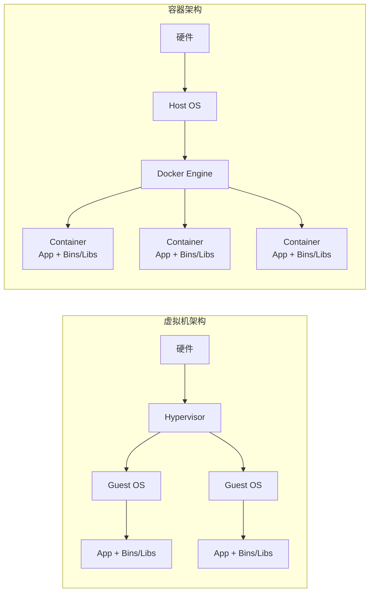
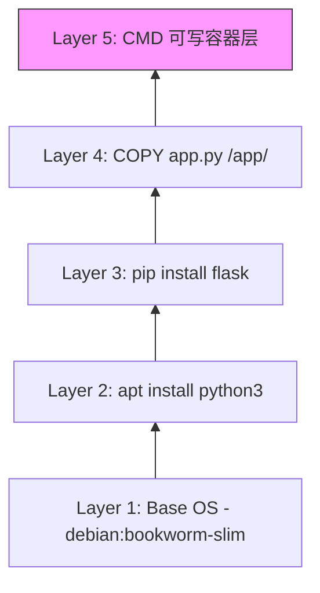
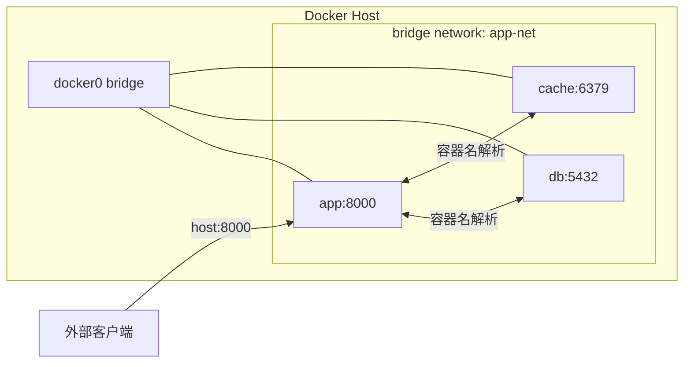
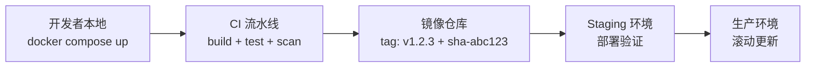
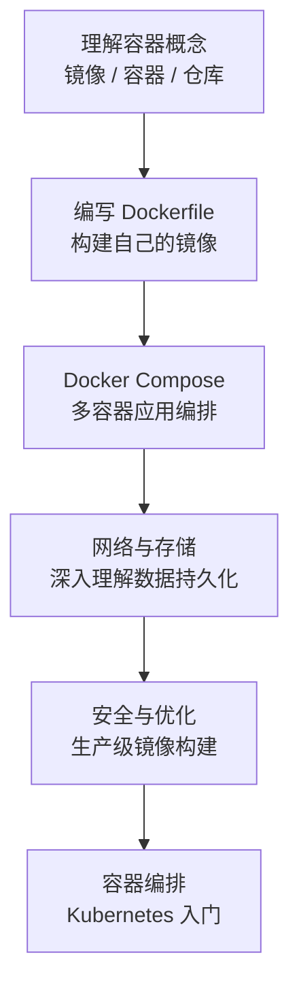

[toc]


# Docker 技术系统介绍

## 什么是 Docker

Docker 是一个开源的容器化平台，它将应用程序及其所有依赖（库、运行时、系统工具、配置文件）打包到一个标准化的单元中，称为**容器**。容器在任何支持 Docker 的环境中都能以相同的方式运行，从根本上解决了"在我机器上能跑"的问题。

Docker 的核心价值在于：环境一致性、快速部署、资源高效利用、以及应用隔离。

## 容器与虚拟机的区别



| 对比维度 | 虚拟机                     | 容器                      |
| -------- | -------------------------- | ------------------------- |
| 隔离级别 | 硬件级别，完整 OS          | 进程级别，共享内核        |
| 启动时间 | 分钟级                     | 秒级甚至毫秒级            |
| 镜像大小 | GB 级别                    | MB 级别（通常几十 MB）    |
| 资源开销 | 高（每个 VM 运行完整 OS）  | 低（共享宿主机内核）      |
| 性能     | 有虚拟化损耗               | 接近原生性能              |
| 密度     | 单机通常几个到几十个       | 单机可运行数百个容器      |
| 适用场景 | 需要完整 OS 隔离、异构内核 | 微服务、CI/CD、快速扩缩容 |

容器并非虚拟机的替代品，两者经常配合使用——在虚拟机中运行 Docker 是云环境的常见模式。

## 核心概念

### 镜像（Image）

镜像是一个只读的模板，包含运行应用所需的一切：代码、运行时、库、环境变量、配置文件。镜像采用**分层存储**（Union File System），每一层代表 Dockerfile 中的一条指令。



分层的好处：多个镜像可以共享底层，节省磁盘空间；构建时只有变化的层需要重建，加速构建过程。

### 容器（Container）

容器是镜像的运行实例。它在镜像的只读层之上添加一个可写层。容器之间相互隔离，各自拥有独立的文件系统、网络栈和进程空间。

核心关系：**镜像是类，容器是实例**。一个镜像可以创建多个容器。

### 仓库（Registry）

仓库是存储和分发镜像的服务。Docker Hub 是最大的公共仓库。企业通常使用私有仓库（如 Harbor、AWS ECR、GitHub Container Registry）。

镜像的完整命名格式为：`registry/namespace/repository:tag`

例如：`ghcr.io/myorg/myapp:v2.1.0`

### Docker Engine

Docker Engine 是 C/S 架构：

| 组件                | 职责                           |
| ------------------- | ------------------------------ |
| dockerd（守护进程） | 管理镜像、容器、网络、存储卷   |
| containerd          | 容器运行时，管理容器生命周期   |
| runc                | OCI 标准的底层容器运行时       |
| Docker CLI          | 用户与 Docker 交互的命令行工具 |

## Dockerfile 编写

Dockerfile 是构建镜像的蓝图。以下是一个 Python Web 应用的现代化示例：

```dockerfile
# 使用具体版本标签，避免 latest 带来的不确定性
FROM python:3.12-slim AS builder

WORKDIR /app

# 先复制依赖文件，利用缓存层
COPY requirements.txt .
RUN pip install --no-cache-dir --user -r requirements.txt

# 多阶段构建：最终镜像更小更安全
FROM python:3.12-slim

# 创建非 root 用户
RUN groupadd -r appuser && useradd -r -g appuser appuser

WORKDIR /app

# 从 builder 阶段复制已安装的依赖
COPY --from=builder /root/.local /home/appuser/.local
COPY --chown=appuser:appuser . .

USER appuser
ENV PATH=/home/appuser/.local/bin:$PATH

EXPOSE 8000

HEALTHCHECK --interval=30s --timeout=3s --retries=3 \
    CMD python -c "import urllib.request; urllib.request.urlopen('http://localhost:8000/health')"

CMD ["gunicorn", "--bind", "0.0.0.0:8000", "app:create_app()"]
```

### 常用指令说明

| 指令           | 用途           | 最佳实践                                           |
| -------------- | -------------- | -------------------------------------------------- |
| `FROM`         | 指定基础镜像   | 使用具体版本标签，优先选择 slim/alpine 变体        |
| `WORKDIR`      | 设置工作目录   | 始终使用绝对路径                                   |
| `COPY` / `ADD` | 复制文件到镜像 | 优先用 COPY，ADD 仅在需要自动解压时使用            |
| `RUN`          | 执行命令       | 合并相关命令减少层数，清理缓存                     |
| `ENV`          | 设置环境变量   | 敏感信息不要写在这里                               |
| `EXPOSE`       | 声明端口       | 仅作文档用途，不实际发布端口                       |
| `USER`         | 切换用户       | 生产镜像必须使用非 root 用户                       |
| `HEALTHCHECK`  | 健康检查       | 生产镜像应配置                                     |
| `CMD`          | 容器启动命令   | 使用 exec 格式（JSON 数组）                        |
| `ENTRYPOINT`   | 容器入口点     | 与 CMD 配合，ENTRYPOINT 定义命令，CMD 定义默认参数 |

### 构建缓存优化原则

Docker 按顺序执行指令，一旦某层缓存失效，后续所有层都需要重建。因此：

- 将变化频率低的指令放在前面（系统依赖安装）
- 将变化频率高的指令放在后面（应用代码复制）
- 依赖文件（package.json、requirements.txt、go.sum）单独复制并安装，再复制源码

## 常用命令

### 镜像操作

```bash
# 构建镜像
docker build -t myapp:v1.0 .

# 多平台构建（适用于 ARM/x86 混合环境）
docker buildx build --platform linux/amd64,linux/arm64 -t myapp:v1.0 --push .

# 查看本地镜像
docker images

# 拉取/推送镜像
docker pull nginx:1.25-alpine
docker push myregistry.io/myapp:v1.0

# 查看镜像分层
docker history myapp:v1.0

# 删除悬空镜像
docker image prune
```

### 容器操作

```bash
# 运行容器
docker run -d --name web -p 8080:80 --restart unless-stopped nginx:1.25-alpine

# 查看运行中的容器
docker ps

# 查看日志（实时跟踪）
docker logs -f --tail 100 web

# 进入容器调试
docker exec -it web /bin/sh

# 查看容器资源使用
docker stats

# 停止并删除容器
docker stop web && docker rm web

# 清理所有已停止的容器
docker container prune
```

### 数据卷操作

```bash
# 创建命名卷
docker volume create pgdata

# 挂载卷运行容器
docker run -d --name db \
    -v pgdata:/var/lib/postgresql/data \
    -e POSTGRES_PASSWORD_FILE=/run/secrets/db_pass \
    postgres:16-alpine

# 绑定挂载（开发环境常用）
docker run -d -v $(pwd)/src:/app/src:ro myapp:dev
```

## Docker Compose

Docker Compose 用于定义和运行多容器应用。使用 YAML 文件描述服务、网络和卷的关系。

以下是一个典型的 Web 应用 + 数据库 + 缓存的组合：

```yaml
# compose.yaml（Compose V2 推荐文件名）
services:
  app:
    build:
      context: .
      dockerfile: Dockerfile
      target: production
    ports:
      - "8000:8000"
    environment:
      - DATABASE_URL=postgresql://user:pass@db:5432/myapp
      - REDIS_URL=redis://cache:6379/0
    depends_on:
      db:
        condition: service_healthy
      cache:
        condition: service_started
    restart: unless-stopped
    deploy:
      resources:
        limits:
          memory: 512M
          cpus: "0.5"

  db:
    image: postgres:16-alpine
    volumes:
      - pgdata:/var/lib/postgresql/data
      - ./init.sql:/docker-entrypoint-initdb.d/init.sql:ro
    environment:
      POSTGRES_DB: myapp
      POSTGRES_USER: user
      POSTGRES_PASSWORD: pass
    healthcheck:
      test: ["CMD-SHELL", "pg_isready -U user -d myapp"]
      interval: 5s
      timeout: 3s
      retries: 5

  cache:
    image: redis:7-alpine
    command: redis-server --maxmemory 128mb --maxmemory-policy allkeys-lru

volumes:
  pgdata:
```

### Compose 常用命令

```bash
# 启动所有服务（后台运行）
docker compose up -d

# 查看服务状态
docker compose ps

# 查看某个服务的日志
docker compose logs -f app

# 重新构建并启动
docker compose up -d --build

# 停止并清理（保留卷）
docker compose down

# 停止并清理（包括卷和镜像）
docker compose down -v --rmi local
```

## 网络模型

Docker 提供多种网络驱动，满足不同场景：

| 网络类型 | 说明                           | 适用场景                     |
| -------- | ------------------------------ | ---------------------------- |
| bridge   | 默认网络，容器通过虚拟网桥通信 | 单机多容器通信               |
| host     | 容器直接使用宿主机网络栈       | 需要最大网络性能             |
| overlay  | 跨主机容器通信                 | Docker Swarm / 多节点集群    |
| none     | 无网络                         | 安全敏感的离线计算任务       |
| macvlan  | 容器获得独立 MAC 地址          | 需要容器直接出现在物理网络中 |



在自定义 bridge 网络中，容器可以通过**服务名**互相访问（内置 DNS 解析），无需硬编码 IP。这是 Compose 的默认行为。

## 数据持久化

容器的可写层随容器删除而消失。持久化数据有三种方式：

| 方式                   | 语法示例                             | 特点                                    | 适用场景         |
| ---------------------- | ------------------------------------ | --------------------------------------- | ---------------- |
| 命名卷（Volume）       | `-v pgdata:/var/lib/postgresql/data` | Docker 管理，可跨容器共享，支持驱动插件 | 数据库、持久状态 |
| 绑定挂载（Bind Mount） | `-v ./src:/app/src`                  | 直接映射宿主机目录                      | 开发环境热重载   |
| tmpfs                  | `--tmpfs /tmp`                       | 仅存在于内存中                          | 敏感临时数据     |

最佳实践：生产环境优先使用命名卷；绑定挂载加 `:ro`（只读）限制写入；敏感数据使用 Docker Secrets 或外部密钥管理。

## 安全最佳实践

### 镜像安全

- 使用官方或经过验证的基础镜像
- 固定镜像版本标签，避免 `latest`
- 使用多阶段构建，最终镜像不包含构建工具
- 定期扫描镜像漏洞：`docker scout cves myapp:v1.0`
- 使用 `.dockerignore` 排除敏感文件

`.dockerignore` 示例：

```text
.git
.env
*.secret
node_modules
__pycache__
```

### 运行时安全

- 始终以非 root 用户运行容器
- 使用只读文件系统：`--read-only`
- 限制资源：`--memory`、`--cpus`
- 删除不需要的 Linux capabilities：`--cap-drop ALL --cap-add NET_BIND_SERVICE`
- 不要在环境变量中传递密码，使用 Docker Secrets 或挂载密钥文件
- 启用内容信任：`export DOCKER_CONTENT_TRUST=1`

## 生产环境最佳实践

### 镜像构建

- 每个镜像只运行一个进程（单一职责）
- 使用 `.dockerignore` 减小构建上下文
- 合并 RUN 指令并清理包管理器缓存
- 为镜像打有意义的标签（语义化版本 + Git SHA）
- CI 中构建，不在生产服务器上构建

### 容器运行

- 设置 `--restart unless-stopped` 或 `always`
- 配置 HEALTHCHECK 让编排系统感知容器状态
- 日志输出到 stdout/stderr，由日志驱动收集
- 使用资源限制防止单个容器耗尽宿主机资源
- 敏感配置通过 Secrets 或环境变量注入，不要烘焙到镜像中

### 开发到生产的工作流



## Docker 与容器编排

当应用规模增长，单机 Docker 不再够用时，需要容器编排平台：

| 编排工具                   | 定位             | 适用规模           |
| -------------------------- | ---------------- | ------------------ |
| Docker Compose             | 单机多容器编排   | 开发环境、小型部署 |
| Docker Swarm               | Docker 原生集群  | 中小规模、简单需求 |
| Kubernetes                 | 行业标准编排平台 | 中大规模生产环境   |
| AWS ECS / Google Cloud Run | 托管容器服务     | 不想自建集群的团队 |

Docker 技能是学习 Kubernetes 的基础——镜像构建、Dockerfile 编写、网络和存储概念在编排平台中完全复用。

## 常见问题排查

| 问题               | 排查方向                                                     |
| ------------------ | ------------------------------------------------------------ |
| 容器启动后立即退出 | `docker logs <container>` 查看错误；检查 CMD 是否为前台进程  |
| 端口无法访问       | 确认 `-p` 映射正确；容器内服务绑定 `0.0.0.0` 而非 `127.0.0.1` |
| 镜像构建缓慢       | 检查 `.dockerignore`；优化层顺序利用缓存                     |
| 磁盘空间不足       | `docker system df` 查看占用；`docker system prune -a` 清理   |
| 容器间无法通信     | 确认在同一自定义网络中；使用服务名而非 IP                    |
| 文件权限问题       | 容器内 UID/GID 与挂载目录权限不匹配，用 `--chown` 或调整宿主机权限 |

## 学习路径建议



从一个简单的应用开始：将你熟悉的项目容器化，用 Compose 加上数据库，逐步添加健康检查、资源限制、多阶段构建。