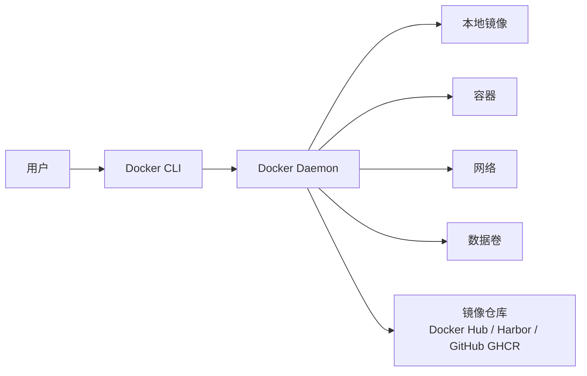
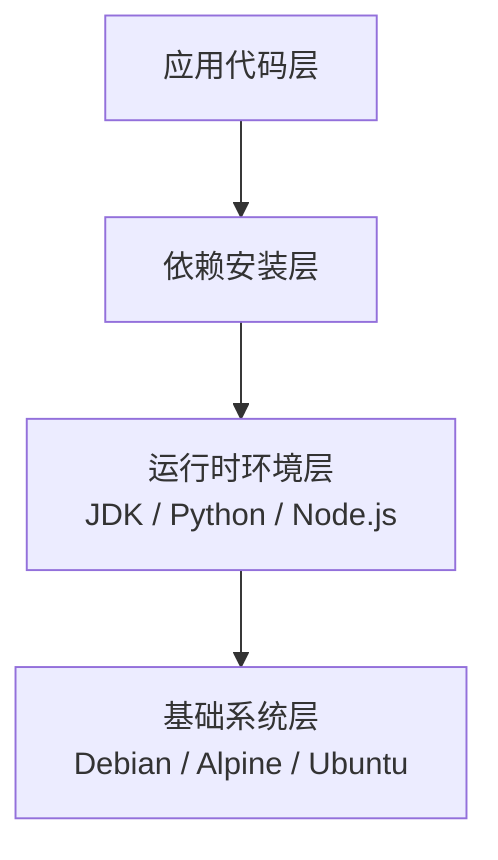
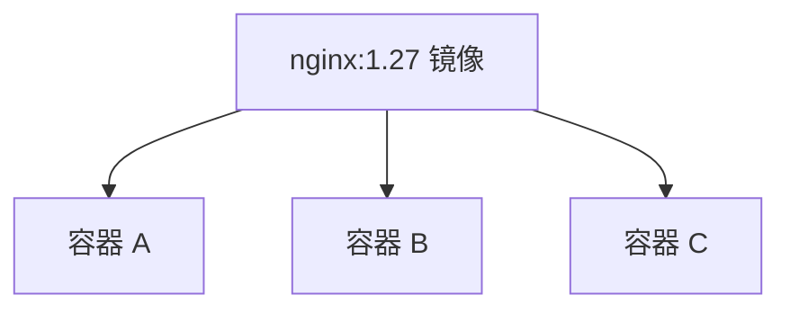
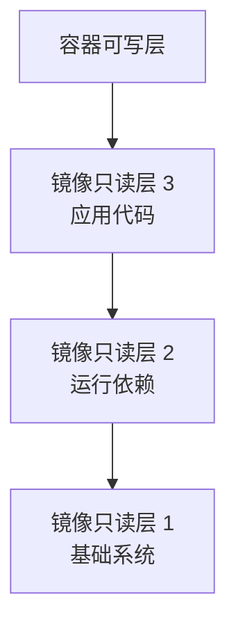
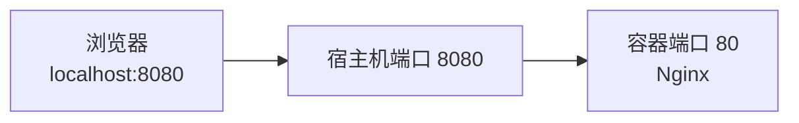
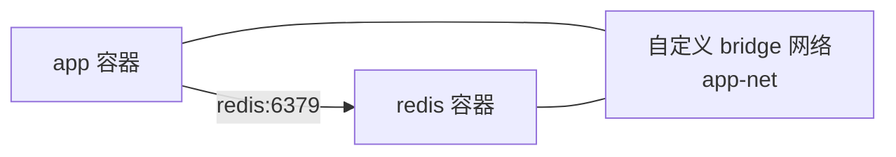
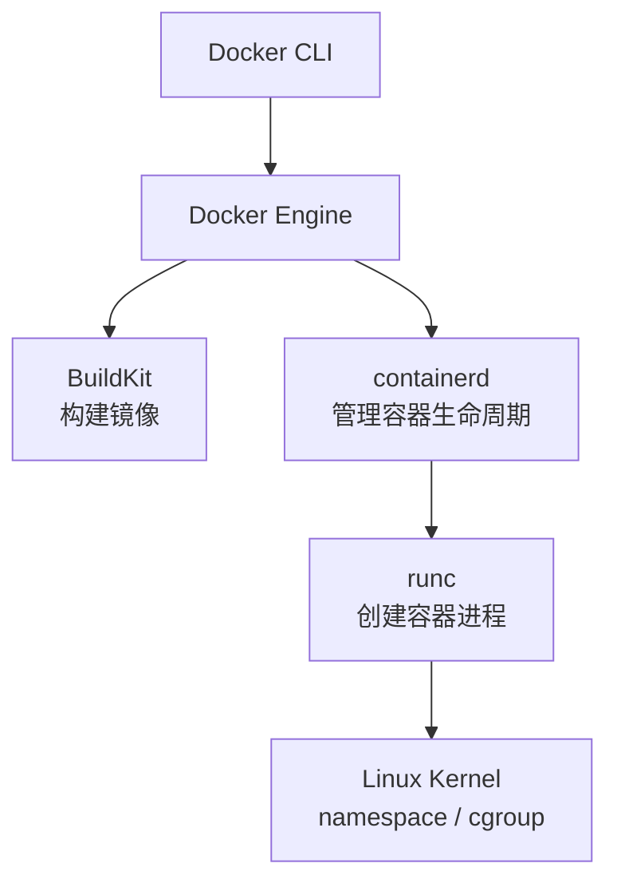

[toc]


# Docker 及其相关技术系统介绍

Docker 是当前最常用的容器化技术之一。它可以把应用程序及其运行依赖打包成统一的镜像，并在不同环境中以容器方式运行，从而解决“在我电脑上可以运行”的问题。

------

# Docker 解决了什么问题

传统部署方式通常依赖目标机器上的运行环境。

例如一个 Java Web 应用可能要求：

| 依赖项   | 示例                         |
| -------- | ---------------------------- |
| 操作系统 | Ubuntu、CentOS、Debian       |
| JDK      | JDK 17                       |
| 中间件   | Nginx、Redis、MySQL          |
| 系统库   | glibc、openssl、字体库       |
| 配置     | 环境变量、配置文件、启动参数 |

如果开发环境、测试环境、生产环境不一致，就容易出现各种问题。

Docker 的核心思想是：

> 把应用程序、依赖、配置和启动方式封装成一个标准化镜像，然后在任意支持容器运行时的环境中启动。

------

# Docker 的核心价值

| 价值        | 说明                                           |
| ----------- | ---------------------------------------------- |
| 环境一致性  | 开发、测试、生产环境尽量保持一致               |
| 快速部署    | 镜像一次构建，多处运行                         |
| 隔离性      | 每个容器拥有相对独立的进程、网络、文件系统视图 |
| 资源效率高  | 相比虚拟机，容器共享宿主机内核，更轻量         |
| 易于扩缩容  | 容器可以快速启动、停止、复制                   |
| 适合 DevOps | 与 CI/CD、Kubernetes、云原生体系天然契合       |

------

# 容器与虚拟机的区别

| 对比项   | 容器                                              | 虚拟机                             |
| -------- | ------------------------------------------------- | ---------------------------------- |
| 隔离方式 | 共享宿主机内核，通过 namespace、cgroup 等机制隔离 | 每个虚拟机有完整 Guest OS          |
| 启动速度 | 通常秒级甚至更快                                  | 通常几十秒到数分钟                 |
| 资源占用 | 较低                                              | 较高                               |
| 镜像体积 | 通常 MB 到几百 MB                                 | 通常 GB 级                         |
| 隔离强度 | 较弱于虚拟机，但足够适合多数应用场景              | 更强                               |
| 使用场景 | 微服务、CI/CD、云原生部署                         | 强隔离、多操作系统并存、传统虚拟化 |

简单理解：

> 虚拟机虚拟的是“整台机器”，容器虚拟的是“应用运行环境”。

------

# Docker 整体架构

Docker 采用客户端/服务端架构。



主要组件如下：

| 组件          | 作用                                            |
| ------------- | ----------------------------------------------- |
| Docker CLI    | 命令行客户端，例如 `docker run`、`docker build` |
| Docker Daemon | Docker 后台服务，负责管理镜像、容器、网络、卷   |
| Image         | 镜像，容器运行的模板                            |
| Container     | 容器，由镜像创建出的运行实例                    |
| Registry      | 镜像仓库，用于存储和分发镜像                    |
| Volume        | 数据卷，用于持久化数据                          |
| Network       | 容器网络，用于容器间通信                        |

------

# 核心概念

## 镜像 Image

镜像是一个只读模板，包含应用程序及其运行依赖。

例如：

- `nginx:1.27`
- `redis:7`
- `mysql:8.4`
- `eclipse-temurin:21-jre`
- `python:3.12-slim`

镜像通常由多层组成，每一层代表一次文件系统变更。



镜像分层的好处：

| 好处     | 说明                           |
| -------- | ------------------------------ |
| 缓存构建 | 没变的层可以复用，加快构建速度 |
| 节省存储 | 多个镜像可以共享相同基础层     |
| 便于分发 | 只需要拉取本地缺失的层         |

------

## 容器 Container

容器是镜像的运行实例。

可以这样理解：

| 类比           | Docker |
| -------------- | ------ |
| 类             | 镜像   |
| 对象           | 容器   |
| 程序安装包     | 镜像   |
| 正在运行的程序 | 容器   |

一个镜像可以创建多个容器。



------

## Dockerfile

Dockerfile 是镜像构建说明书。

常见指令：

| 指令         | 作用             |
| ------------ | ---------------- |
| `FROM`       | 指定基础镜像     |
| `WORKDIR`    | 设置工作目录     |
| `COPY`       | 复制文件到镜像   |
| `RUN`        | 构建阶段执行命令 |
| `ENV`        | 设置环境变量     |
| `EXPOSE`     | 声明容器监听端口 |
| `CMD`        | 容器默认启动命令 |
| `ENTRYPOINT` | 容器入口命令     |
| `ARG`        | 构建参数         |
| `USER`       | 指定运行用户     |
| `VOLUME`     | 声明挂载点       |

一个简单的 Node.js Dockerfile：

```dockerfile
FROM node:22-alpine

WORKDIR /app

COPY package*.json ./
RUN npm ci --omit=dev

COPY . .

ENV NODE_ENV=production

EXPOSE 3000

CMD ["node", "server.js"]
```

------

## Registry 镜像仓库

Registry 用于存储和分发镜像。

常见镜像仓库：

| 仓库                      | 说明                                 |
| ------------------------- | ------------------------------------ |
| Docker Hub                | 默认公共镜像仓库                     |
| Harbor                    | 企业常用私有镜像仓库                 |
| GitHub Container Registry | GitHub 提供的镜像仓库，常用简称 GHCR |
| GitLab Container Registry | GitLab 内置镜像仓库                  |
| AWS ECR                   | AWS 托管镜像仓库                     |
| Azure ACR                 | Azure 托管镜像仓库                   |
| Google Artifact Registry  | Google Cloud 托管镜像仓库            |

镜像名通常格式：

```text
registry.example.com/namespace/app:tag
```

例如：

```text
ghcr.io/example/myapp:1.0.0
```

------

# Docker 的底层原理简述

Docker 本身不是“魔法”，它主要基于 Linux 内核能力。

## Namespace

Namespace 用于隔离系统资源视图。

| Namespace | 隔离内容               |
| --------- | ---------------------- |
| PID       | 进程编号空间           |
| NET       | 网络设备、端口、路由表 |
| MNT       | 文件系统挂载点         |
| IPC       | 进程间通信             |
| UTS       | 主机名、域名           |
| USER      | 用户和用户组           |
| CGROUP    | cgroup 视图            |

例如，容器内看到的进程列表通常只是容器自己的进程，而不是宿主机所有进程。

------

## Cgroups

Cgroups 用于限制和统计资源。

它可以限制：

| 资源     | 示例                     |
| -------- | ------------------------ |
| CPU      | 限制容器最多使用几个 CPU |
| 内存     | 限制最大内存             |
| 磁盘 I/O | 限制读写速率             |
| 进程数   | 限制进程数量             |

例如：

```bash
docker run --memory=512m --cpus=1 nginx
```

表示该容器最多使用 512MB 内存和约 1 个 CPU。

------

## Union File System

Docker 镜像分层依赖联合文件系统，常见实现包括 OverlayFS。

容器运行时会在只读镜像层之上增加一个可写层。



需要注意：

> 容器可写层不适合保存重要数据。容器删除后，可写层中的数据也会丢失。

持久化数据应使用 Volume 或外部存储。

------

# 常用 Docker 命令

## 镜像相关

| 命令                                  | 作用           |
| ------------------------------------- | -------------- |
| `docker images`                       | 查看本地镜像   |
| `docker pull nginx:1.27`              | 拉取镜像       |
| `docker build -t myapp:1.0 .`         | 构建镜像       |
| `docker rmi myapp:1.0`                | 删除镜像       |
| `docker history nginx`                | 查看镜像层历史 |
| `docker tag myapp:1.0 repo/myapp:1.0` | 给镜像打标签   |
| `docker push repo/myapp:1.0`          | 推送镜像       |

------

## 容器相关

| 命令                                | 作用             |
| ----------------------------------- | ---------------- |
| `docker ps`                         | 查看运行中的容器 |
| `docker ps -a`                      | 查看所有容器     |
| `docker run nginx`                  | 创建并启动容器   |
| `docker stop container_name`        | 停止容器         |
| `docker start container_name`       | 启动已停止容器   |
| `docker restart container_name`     | 重启容器         |
| `docker rm container_name`          | 删除容器         |
| `docker logs container_name`        | 查看日志         |
| `docker exec -it container_name sh` | 进入容器执行命令 |
| `docker inspect container_name`     | 查看详细信息     |

------

## 一个经典运行示例

运行一个 Nginx：

```bash
docker run -d \
  --name my-nginx \
  -p 8080:80 \
  nginx:1.27
```

含义：

| 参数              | 说明                               |
| ----------------- | ---------------------------------- |
| `-d`              | 后台运行                           |
| `--name my-nginx` | 容器名称                           |
| `-p 8080:80`      | 宿主机 8080 端口映射到容器 80 端口 |
| `nginx:1.27`      | 使用的镜像                         |

访问：

```text
http://localhost:8080
```

------

# 端口映射

容器内部端口默认不等于宿主机端口。



命令：

```bash
docker run -p 8080:80 nginx
```

表示：

| 部分   | 含义       |
| ------ | ---------- |
| `8080` | 宿主机端口 |
| `80`   | 容器端口   |

------

# 数据持久化

容器本身是临时的，重要数据不要只放在容器内部。

Docker 常见持久化方式：

| 方式       | 示例                         | 适用场景               |
| ---------- | ---------------------------- | ---------------------- |
| Volume     | `mydata:/var/lib/mysql`      | 数据库、长期数据       |
| Bind Mount | `/host/path:/container/path` | 开发环境挂载源码、配置 |
| tmpfs      | 内存临时文件系统             | 临时敏感数据、高速缓存 |

------

## Volume 示例

```bash
docker volume create mysql-data

docker run -d \
  --name mysql \
  -e MYSQL_ROOT_PASSWORD=123456 \
  -v mysql-data:/var/lib/mysql \
  mysql:8.4
```

优点：

| 优点           | 说明                      |
| -------------- | ------------------------- |
| 由 Docker 管理 | 不需要关心宿主机具体路径  |
| 更适合生产     | 稳定、清晰、可迁移        |
| 生命周期独立   | 容器删除后，Volume 可保留 |

------

## Bind Mount 示例

```bash
docker run -d \
  --name nginx \
  -p 8080:80 \
  -v ./html:/usr/share/nginx/html:ro \
  nginx:1.27
```

其中 `:ro` 表示只读挂载。

Bind Mount 常用于：

- 本地开发挂载源码
- 挂载配置文件
- 快速调试

------

# Docker 网络

Docker 默认提供多种网络模式。

| 网络模式 | 说明               | 常见场景                 |
| -------- | ------------------ | ------------------------ |
| bridge   | 默认桥接网络       | 单机容器通信             |
| host     | 直接使用宿主机网络 | 高性能、特殊网络需求     |
| none     | 无网络             | 安全隔离                 |
| overlay  | 跨主机网络         | Swarm、Kubernetes 类场景 |
| macvlan  | 容器拥有局域网 IP  | 特殊网络环境             |

------

## Bridge 网络

默认情况下，容器运行在 bridge 网络中。

如果要让多个容器互相通过名称访问，推荐创建自定义网络：

```bash
docker network create app-net

docker run -d --name redis --network app-net redis:7

docker run -d --name app --network app-net myapp:1.0
```

此时 `app` 容器可以通过主机名 `redis` 访问 Redis。



最佳实践：

> 不建议在容器间通信时写死容器 IP，应使用容器名、服务名或服务发现机制。

------

# Docker Compose

Docker Compose 用于定义和管理多容器应用。

适合场景：

- 本地开发环境
- 中小型单机部署
- 集成测试环境
- 快速启动多个依赖服务

例如一个 Web 应用依赖 Redis 和 PostgreSQL。

```yaml
services:
  app:
    build: .
    ports:
      - "8080:8080"
    environment:
      REDIS_HOST: redis
      DB_HOST: postgres
    depends_on:
      - redis
      - postgres

  redis:
    image: redis:7

  postgres:
    image: postgres:16
    environment:
      POSTGRES_DB: app
      POSTGRES_USER: app
      POSTGRES_PASSWORD: secret
    volumes:
      - postgres-data:/var/lib/postgresql/data

volumes:
  postgres-data:
```

启动：

```bash
docker compose up -d
```

停止：

```bash
docker compose down
```

查看日志：

```bash
docker compose logs -f
```

------

## Compose 常用命令

| 命令                         | 作用                     |
| ---------------------------- | ------------------------ |
| `docker compose up`          | 启动服务                 |
| `docker compose up -d`       | 后台启动                 |
| `docker compose down`        | 停止并删除服务容器和网络 |
| `docker compose ps`          | 查看服务状态             |
| `docker compose logs -f`     | 跟踪日志                 |
| `docker compose exec app sh` | 进入指定服务容器         |
| `docker compose build`       | 构建镜像                 |
| `docker compose pull`        | 拉取镜像                 |
| `docker compose restart`     | 重启服务                 |

------

# Dockerfile 最佳实践

## 使用明确的镜像版本

不推荐：

```dockerfile
FROM node:latest
```

推荐：

```dockerfile
FROM node:22-alpine
```

原因：

| 做法          | 问题                     |
| ------------- | ------------------------ |
| 使用 `latest` | 构建结果不可预测         |
| 使用明确版本  | 可复现、可追踪、便于回滚 |

生产环境更推荐固定到具体版本，甚至 digest：

```dockerfile
FROM nginx:1.27@sha256:...
```

------

## 减少镜像体积

常见策略：

| 策略                  | 说明                     |
| --------------------- | ------------------------ |
| 使用 slim/alpine 镜像 | 减少基础镜像体积         |
| 多阶段构建            | 构建工具不进入最终镜像   |
| 清理缓存              | 删除包管理器缓存         |
| 只复制必要文件        | 配合 `.dockerignore`     |
| 避免安装无关工具      | 不把调试工具带进生产镜像 |

------

## 使用多阶段构建

以 Go 应用为例：

```dockerfile
FROM golang:1.23-alpine AS builder

WORKDIR /src
COPY go.mod go.sum ./
RUN go mod download

COPY . .
RUN go build -o app ./cmd/app

FROM alpine:3.20

WORKDIR /app
COPY --from=builder /src/app /app/app

USER 10001

CMD ["./app"]
```

优点：

| 优点     | 说明                   |
| -------- | ---------------------- |
| 镜像更小 | 最终镜像不包含编译器   |
| 更安全   | 减少攻击面             |
| 构建清晰 | 构建阶段和运行阶段分离 |

------

## 合理利用构建缓存

Dockerfile 指令顺序会影响缓存命中率。

不理想：

```dockerfile
COPY . .
RUN npm ci
```

只要任意源码变更，`npm ci` 就会重新执行。

推荐：

```dockerfile
COPY package*.json ./
RUN npm ci

COPY . .
```

这样只有依赖文件变化时才重新安装依赖。

------

## 使用 `.dockerignore`

`.dockerignore` 用于排除不需要复制到构建上下文的文件。

常见示例：

```gitignore
.git
node_modules
dist
target
*.log
.env
.DS_Store
.idea
.vscode
```

好处：

| 好处       | 说明                                 |
| ---------- | ------------------------------------ |
| 加快构建   | 构建上下文更小                       |
| 减少泄露   | 避免把密钥、日志、Git 历史复制进镜像 |
| 镜像更干净 | 避免无关文件进入镜像                 |

------

## 不要在镜像中存放敏感信息

不要这样做：

```dockerfile
ENV DB_PASSWORD=my-secret-password
```

不要把以下内容写进镜像：

- 数据库密码
- API Token
- SSH 私钥
- 云厂商 AK/SK
- `.env` 文件
- 证书私钥

推荐做法：

| 场景       | 推荐方式                                |
| ---------- | --------------------------------------- |
| 本地开发   | `.env` 文件配合 Compose，但不要提交 Git |
| 生产环境   | Secret 管理系统                         |
| Kubernetes | Secret、External Secrets、Vault         |
| CI/CD      | 使用流水线 Secret 变量                  |

------

## 容器中使用非 root 用户

默认很多镜像使用 root 用户运行。生产环境建议使用普通用户。

```dockerfile
RUN addgroup -S app && adduser -S app -G app
USER app
```

或直接：

```dockerfile
USER 10001
```

原因：

| 原因         | 说明                         |
| ------------ | ---------------------------- |
| 降低风险     | 容器逃逸或漏洞利用后权限更低 |
| 符合安全基线 | 企业安全扫描常要求非 root    |
| 避免误操作   | 降低破坏系统文件的可能性     |

------

# 容器运行最佳实践

## 一个容器尽量只运行一个主进程

推荐：

| 容器       | 进程     |
| ---------- | -------- |
| app 容器   | Web 应用 |
| redis 容器 | Redis    |
| nginx 容器 | Nginx    |

不推荐：

> 一个容器里同时运行 Nginx、MySQL、Redis、应用程序。

原因：

- 不利于扩缩容
- 不利于日志管理
- 不利于健康检查
- 不符合容器编排思想

当然也有例外，例如某些 sidecar 或轻量 init 进程。

------

## 使用环境变量注入配置

容器镜像应该尽量与环境无关。

同一个镜像可以运行在：

- 开发环境
- 测试环境
- 预发布环境
- 生产环境

通过环境变量区分配置：

```bash
docker run -e APP_ENV=production -e DB_HOST=mysql myapp:1.0
```

镜像负责“程序是什么”，环境变量负责“运行在哪里”。

------

## 日志输出到 stdout/stderr

容器应用推荐把日志输出到标准输出和标准错误。

Docker 可以通过以下命令查看：

```bash
docker logs -f myapp
```

不推荐：

> 只把日志写到容器内部文件中。

原因：

- 容器删除后日志容易丢失
- 不方便统一采集
- 与 Kubernetes、ELK、Loki、云日志服务不兼容

------

## 配置健康检查

Dockerfile 中可以声明健康检查：

```dockerfile
HEALTHCHECK --interval=30s --timeout=3s --retries=3 \
  CMD wget -qO- http://localhost:8080/health || exit 1
```

Compose 中也可以配置：

```yaml
services:
  app:
    image: myapp:1.0
    healthcheck:
      test: ["CMD", "wget", "-qO-", "http://localhost:8080/health"]
      interval: 30s
      timeout: 3s
      retries: 3
```

健康检查常用于：

| 场景     | 说明                   |
| -------- | ---------------------- |
| 自动重启 | 发现异常后重启         |
| 编排调度 | 判断服务是否可接收流量 |
| 监控告警 | 提供健康状态信号       |

------

# 镜像标签 Tag 策略

镜像标签非常重要，关系到版本追踪和回滚。

| 标签       | 示例         | 适用场景                 |
| ---------- | ------------ | ------------------------ |
| 语义化版本 | `1.2.3`      | 正式发布                 |
| 主次版本   | `1.2`        | 可接受补丁自动升级       |
| 主版本     | `1`          | 大版本稳定跟踪           |
| Git Commit | `a1b2c3d`    | 精确定位构建来源         |
| 日期版本   | `2025-01-20` | 运维友好                 |
| latest     | `latest`     | 本地测试，不推荐生产依赖 |

推荐生产镜像同时打多个标签：

```text
myapp:1.4.2
myapp:1.4
myapp:git-a1b2c3d
```

生产部署建议使用不可变版本，例如：

```text
myapp:1.4.2
```

或 digest。

------

# Docker 安全

## 常见安全风险

| 风险               | 说明                           |
| ------------------ | ------------------------------ |
| 使用高危基础镜像   | 镜像中包含漏洞组件             |
| root 用户运行      | 权限过大                       |
| 挂载宿主机敏感目录 | 如 `/var/run/docker.sock`、`/` |
| 使用特权容器       | `--privileged` 风险极高        |
| 镜像中包含密钥     | 镜像一旦泄露，密钥也泄露       |
| 开放不必要端口     | 增加攻击面                     |
| 不限制资源         | 可能导致宿主机资源耗尽         |

------

## 安全最佳实践

| 建议                    | 说明                            |
| ----------------------- | ------------------------------- |
| 使用官方或可信镜像      | 避免来源不明的镜像              |
| 定期更新基础镜像        | 修复系统库漏洞                  |
| 使用非 root 用户        | 降低权限                        |
| 最小化镜像内容          | 减少攻击面                      |
| 不使用 `--privileged`   | 除非非常明确需要                |
| 限制 CPU 和内存         | 防止资源耗尽                    |
| 镜像漏洞扫描            | 使用 Trivy、Grype、Docker Scout |
| 使用只读文件系统        | `--read-only`                   |
| 限制 Linux capabilities | 只保留必要权限                  |
| 不挂载 Docker Socket    | 避免容器控制宿主机 Docker       |

------

## 漏洞扫描工具

| 工具         | 说明                                   |
| ------------ | -------------------------------------- |
| Trivy        | 非常流行，支持镜像、文件系统、IaC 扫描 |
| Grype        | Anchore 开源漏洞扫描器                 |
| Docker Scout | Docker 官方安全分析工具                |
| Snyk         | 商业化安全平台，也支持开源扫描         |
| Clair        | 容器镜像漏洞扫描工具                   |

Trivy 示例：

```bash
trivy image nginx:1.27
```

------

# BuildKit 与现代镜像构建

BuildKit 是现代 Docker 构建后端，提供更快、更安全、更强大的构建能力。

常见能力：

| 能力        | 说明                       |
| ----------- | -------------------------- |
| 并行构建    | 加快构建速度               |
| 更好的缓存  | 支持远程缓存、精细缓存     |
| Secret 挂载 | 构建时使用密钥但不写入镜像 |
| SSH 转发    | 构建时访问私有仓库         |
| 多平台构建  | 构建 amd64、arm64 镜像     |
| 更清晰输出  | 构建日志更友好             |

启用方式通常已经默认开启，也可以：

```bash
DOCKER_BUILDKIT=1 docker build .
```

------

## 构建时 Secret

避免把密钥写进镜像。

示例：

```bash
docker build \
  --secret id=npmrc,src=.npmrc \
  -t myapp:1.0 .
```

Dockerfile：

```dockerfile
# syntax=docker/dockerfile:1.7

FROM node:22-alpine

WORKDIR /app

COPY package*.json ./

RUN --mount=type=secret,id=npmrc,target=/root/.npmrc \
    npm ci

COPY . .

CMD ["node", "server.js"]
```

这样 `.npmrc` 不会出现在最终镜像层中。

------

## 多平台构建

在 Apple Silicon、ARM 服务器、x86 服务器混用的时代，多架构镜像越来越常见。

```bash
docker buildx build \
  --platform linux/amd64,linux/arm64 \
  -t repo/myapp:1.0 \
  --push .
```

常见平台：

| 平台           | 说明                                    |
| -------------- | --------------------------------------- |
| `linux/amd64`  | 常见 x86_64 服务器                      |
| `linux/arm64`  | ARM 服务器、Apple Silicon、部分云服务器 |
| `linux/arm/v7` | 部分嵌入式设备                          |

------

# Docker 与 Kubernetes 的关系

Docker 是容器工具，Kubernetes 是容器编排平台。

| 技术         | 作用                                           |
| ------------ | ---------------------------------------------- |
| Docker       | 构建镜像、运行容器、管理本机容器               |
| Kubernetes   | 在集群中调度、部署、扩缩容、服务发现、滚动升级 |
| containerd   | 容器运行时，Kubernetes 常用                    |
| CRI-O        | Kubernetes 生态常见运行时                      |
| Helm         | Kubernetes 应用包管理                          |
| Ingress      | Kubernetes HTTP/HTTPS 流量入口                 |
| Service Mesh | 服务治理，例如 Istio、Linkerd                  |

需要注意：

> Kubernetes 新版本不再直接依赖 Docker Engine 作为运行时，而是通过 CRI 使用 containerd、CRI-O 等运行时。但 Docker 构建出来的 OCI 镜像仍然可以在 Kubernetes 中运行。

------

# Docker、containerd、runc、OCI 的关系

现代容器生态中有几个关键名词。

| 名称          | 作用                                         |
| ------------- | -------------------------------------------- |
| OCI           | 开放容器标准，定义镜像格式和运行时规范       |
| runc          | 低层容器运行工具，负责真正创建容器           |
| containerd    | 高层容器运行时，管理镜像、容器、快照、网络等 |
| Docker Engine | 面向用户的完整容器平台，底层使用 containerd  |
| BuildKit      | 镜像构建引擎                                 |

关系可以简化理解为：



------

# 常见相关技术全景

| 技术           | 类型           | 说明                        |
| -------------- | -------------- | --------------------------- |
| Docker Engine  | 容器平台       | 构建、运行和管理容器        |
| Docker Compose | 多容器编排     | 本地开发和单机部署常用      |
| Dockerfile     | 镜像定义       | 描述如何构建镜像            |
| BuildKit       | 构建引擎       | 现代化镜像构建              |
| containerd     | 容器运行时     | Kubernetes 常用运行时       |
| runc           | 低层运行时     | OCI 标准实现                |
| Kubernetes     | 集群编排       | 生产级容器编排平台          |
| Helm           | K8s 包管理     | 管理复杂 Kubernetes 应用    |
| Harbor         | 镜像仓库       | 企业私有镜像仓库            |
| Trivy          | 安全扫描       | 扫描镜像漏洞和配置风险      |
| Prometheus     | 监控           | 指标采集                    |
| Grafana        | 可视化         | 监控仪表盘                  |
| Loki           | 日志系统       | 云原生日志聚合              |
| OpenTelemetry  | 可观测性       | 链路追踪、指标、日志标准    |
| Skaffold       | 开发工具       | Kubernetes 开发循环         |
| Tilt           | 开发工具       | 本地云原生开发              |
| Podman         | Docker 替代    | 无守护进程、支持 rootless   |
| nerdctl        | containerd CLI | 类 Docker 命令体验          |
| Kaniko         | 镜像构建       | 无需 Docker daemon 构建镜像 |
| Buildah        | 镜像构建       | Podman 生态构建工具         |

------

# Docker 在开发环境中的典型用法

## 启动依赖服务

开发者常用 Docker 启动数据库、中间件。

例如：

```yaml
services:
  mysql:
    image: mysql:8.4
    environment:
      MYSQL_ROOT_PASSWORD: root
      MYSQL_DATABASE: app
    ports:
      - "3306:3306"
    volumes:
      - mysql-data:/var/lib/mysql

  redis:
    image: redis:7
    ports:
      - "6379:6379"

volumes:
  mysql-data:
```

好处：

| 好处         | 说明                        |
| ------------ | --------------------------- |
| 不污染本机   | 不需要直接安装 MySQL、Redis |
| 易于重建     | 出问题可以快速删除重建      |
| 团队一致     | 大家使用同一 Compose 文件   |
| 降低入门成本 | 新人一条命令启动依赖        |

------

## 开发容器 Dev Container

VS Code Dev Containers 可以把开发环境也容器化。

适合：

- 复杂依赖项目
- 多语言项目
- 团队统一开发环境
- 避免本机环境污染

常见文件：

```text
.devcontainer/devcontainer.json
Dockerfile
docker-compose.yml
```

它的思想是：

> 不只是运行环境容器化，连开发环境也容器化。

------

# Docker 在 CI/CD 中的典型流程


典型步骤：

| 阶段     | 说明                      |
| -------- | ------------------------- |
| Checkout | 拉取代码                  |
| Test     | 单元测试、集成测试        |
| Build    | 构建 Docker 镜像          |
| Scan     | 漏洞扫描                  |
| Push     | 推送镜像到 Registry       |
| Deploy   | 部署到服务器或 Kubernetes |
| Rollback | 出问题时回滚到旧镜像      |

------

# 常见部署模式

## 单机 Docker 部署

适合：

- 小型项目
- 个人项目
- 内部工具
- Demo 环境

常见组合：

```text
Docker + Docker Compose + Nginx + 数据库 Volume
```

优点是简单，缺点是高可用和扩缩容能力有限。

------

## Docker Compose 生产部署

Compose 也可以用于简单生产环境，但要注意：

| 注意点     | 建议                              |
| ---------- | --------------------------------- |
| 自动重启   | 配置 `restart: unless-stopped`    |
| 数据持久化 | 使用 Volume 或外部数据库          |
| 日志       | 配置日志驱动和日志轮转            |
| 备份       | 定期备份数据卷                    |
| 监控       | 接入 Prometheus、Grafana 或云监控 |
| 安全       | 不要暴露不必要端口                |
| 更新       | 使用明确镜像版本                  |

------

## Kubernetes 部署

适合：

- 微服务系统
- 多节点集群
- 弹性扩缩容
- 高可用要求
- 灰度发布、滚动升级
- 大规模生产环境

Docker 在 Kubernetes 中主要负责：

- 构建 OCI 镜像
- 本地调试
- 镜像推送到仓库

Kubernetes 负责：

- 调度容器
- 服务发现
- 负载均衡
- 自动重启
- 滚动升级
- 水平扩缩容

------

# 典型应用容器化示例

## Java Spring Boot

Dockerfile 示例：

```dockerfile
FROM eclipse-temurin:21-jre-alpine

WORKDIR /app

COPY target/app.jar app.jar

EXPOSE 8080

USER 10001

ENTRYPOINT ["java", "-jar", "app.jar"]
```

更优化的方向：

| 优化              | 说明             |
| ----------------- | ---------------- |
| 使用 JRE 而非 JDK | 减少镜像体积     |
| 使用分层 Jar      | 提高缓存效率     |
| 设置 JVM 内存参数 | 适应容器内存限制 |
| 非 root 用户      | 提高安全性       |

Java 容器内存需要特别注意。现代 JDK 已经能识别容器限制，但生产环境仍建议明确设置，例如：

```bash
JAVA_TOOL_OPTIONS="-XX:MaxRAMPercentage=75.0"
```

------

## Python 应用

```dockerfile
FROM python:3.12-slim

WORKDIR /app

COPY requirements.txt .
RUN pip install --no-cache-dir -r requirements.txt

COPY . .

USER 10001

CMD ["python", "app.py"]
```

建议：

| 建议                  | 说明                         |
| --------------------- | ---------------------------- |
| 使用 slim 镜像        | 减少体积                     |
| 固定依赖版本          | 保证构建可复现               |
| 不复制虚拟环境        | 容器本身就是隔离环境         |
| 使用 gunicorn/uvicorn | Web 服务不要直接用开发服务器 |

------

## Node.js 应用

```dockerfile
FROM node:22-alpine

WORKDIR /app

COPY package*.json ./
RUN npm ci --omit=dev

COPY . .

ENV NODE_ENV=production

USER node

CMD ["node", "server.js"]
```

建议：

| 建议                       | 说明                          |
| -------------------------- | ----------------------------- |
| 使用 `npm ci`              | 更适合 CI，可复现             |
| 设置 `NODE_ENV=production` | 避免开发模式                  |
| 不复制 `node_modules`      | 在镜像内安装依赖              |
| 使用非 root 用户           | Node 官方镜像内置 `node` 用户 |

------

# 常见问题与排查方法

## 容器启动后立刻退出

查看容器状态：

```bash
docker ps -a
```

查看日志：

```bash
docker logs container_name
```

常见原因：

| 原因       | 说明                       |
| ---------- | -------------------------- |
| 主进程结束 | 容器生命周期跟随主进程     |
| 命令写错   | `CMD` 或 `ENTRYPOINT` 错误 |
| 配置缺失   | 环境变量、配置文件不存在   |
| 端口冲突   | 宿主机端口已被占用         |
| 权限不足   | 文件或目录无权限           |

------

## 容器无法访问宿主机服务

在 Docker Desktop 中通常可以使用：

```text
host.docker.internal
```

例如容器访问宿主机 MySQL：

```text
host.docker.internal:3306
```

Linux 上可能需要手动配置，或者使用宿主机网关地址。

------

## 容器间无法通信

检查点：

| 检查项                 | 说明                                     |
| ---------------------- | ---------------------------------------- |
| 是否在同一网络         | 使用 `docker network inspect`            |
| 是否使用服务名         | 自定义网络中可通过容器名访问             |
| 端口是否正确           | 容器间访问用容器端口，不是宿主机映射端口 |
| 服务是否监听 `0.0.0.0` | 只监听 `127.0.0.1` 时外部容器无法访问    |
| 防火墙规则             | 宿主机安全策略可能影响                   |

------

## 镜像构建很慢

优化方向：

| 方向                 | 说明                    |
| -------------------- | ----------------------- |
| 使用 `.dockerignore` | 减少上下文              |
| 调整 Dockerfile 顺序 | 提高缓存命中            |
| 使用 BuildKit 缓存   | 支持高级缓存            |
| 使用国内或企业镜像源 | 加速依赖下载            |
| 多阶段构建           | 减少最终产物            |
| 缓存依赖目录         | 如 npm、pip、maven 缓存 |

------

## 磁盘空间被 Docker 占满

查看占用：

```bash
docker system df
```

清理未使用资源：

```bash
docker system prune
```

清理未使用镜像、容器、网络、构建缓存：

```bash
docker system prune -a
```

注意：

> `docker system prune -a` 会删除所有未被容器使用的镜像，执行前要确认不会影响本地开发。

清理未使用 Volume：

```bash
docker volume prune
```

更危险，因为可能删除数据，请谨慎。

------

# Docker Compose 生产化建议示例

```yaml
services:
  app:
    image: registry.example.com/myapp:1.4.2
    restart: unless-stopped
    ports:
      - "8080:8080"
    environment:
      APP_ENV: production
      DB_HOST: postgres
    depends_on:
      postgres:
        condition: service_healthy
    read_only: true
    tmpfs:
      - /tmp
    security_opt:
      - no-new-privileges:true
    cap_drop:
      - ALL
    healthcheck:
      test: ["CMD", "wget", "-qO-", "http://localhost:8080/health"]
      interval: 30s
      timeout: 3s
      retries: 3
    logging:
      driver: json-file
      options:
        max-size: "10m"
        max-file: "3"

  postgres:
    image: postgres:16
    restart: unless-stopped
    environment:
      POSTGRES_DB: app
      POSTGRES_USER: app
      POSTGRES_PASSWORD: change-me
    volumes:
      - postgres-data:/var/lib/postgresql/data
    healthcheck:
      test: ["CMD-SHELL", "pg_isready -U app"]
      interval: 10s
      timeout: 5s
      retries: 5

volumes:
  postgres-data:
```

说明：

| 配置                      | 作用                        |
| ------------------------- | --------------------------- |
| `restart: unless-stopped` | 容器异常退出后自动重启      |
| `read_only: true`         | 容器文件系统只读            |
| `tmpfs: /tmp`             | 给临时目录提供可写空间      |
| `cap_drop: ALL`           | 删除默认 Linux capabilities |
| `no-new-privileges`       | 防止提权                    |
| `healthcheck`             | 健康检查                    |
| `logging`                 | 防止日志无限增长            |

------

# 学习路线建议

## 入门阶段

建议掌握：

| 内容           | 目标                 |
| -------------- | -------------------- |
| 镜像与容器区别 | 理解 Docker 基本模型 |
| `docker run`   | 能启动容器           |
| 端口映射       | 能访问容器服务       |
| Volume         | 能持久化数据         |
| Dockerfile     | 能构建自己的镜像     |
| Docker Compose | 能启动多容器应用     |

建议练习：

- 用 Docker 启动 Nginx
- 用 Docker 启动 MySQL 或 PostgreSQL
- 编写一个简单 Web 应用 Dockerfile
- 用 Compose 编排 Web + Redis + DB

------

## 进阶阶段

建议掌握：

| 内容         | 目标                 |
| ------------ | -------------------- |
| 多阶段构建   | 构建更小更安全的镜像 |
| BuildKit     | 使用现代构建能力     |
| 镜像安全扫描 | 发现漏洞             |
| 资源限制     | 限制 CPU、内存       |
| 网络模型     | 理解容器通信         |
| 日志和监控   | 排查运行问题         |
| CI/CD 集成   | 自动构建和发布镜像   |

------

## 云原生阶段

建议学习：

| 内容               | 目标                          |
| ------------------ | ----------------------------- |
| Kubernetes         | 生产级容器编排                |
| Helm               | 应用打包部署                  |
| Ingress            | 暴露 HTTP 服务                |
| ConfigMap/Secret   | 管理配置和密钥                |
| Prometheus/Grafana | 监控体系                      |
| Loki/ELK           | 日志体系                      |
| OpenTelemetry      | 链路追踪                      |
| GitOps             | 使用 Argo CD、Flux 自动化部署 |

------

# 新手常见误区

| 误区                                        | 正确认识                          |
| ------------------------------------------- | --------------------------------- |
| Docker 是虚拟机                             | Docker 是容器技术，共享宿主机内核 |
| 容器里可以随便存数据                        | 重要数据应放 Volume 或外部存储    |
| `latest` 永远是最新最好                     | 生产环境不应依赖 `latest`         |
| 一个容器装所有服务更方便                    | 应拆分服务，便于扩缩容和维护      |
| Dockerfile 能跑就行                         | 还要关注安全、体积、缓存、可复现  |
| 容器内日志写文件即可                        | 推荐输出到 stdout/stderr          |
| 删除容器等于删除所有数据                    | Volume 默认不会随容器删除         |
| Kubernetes 不用 Docker 了，所以 Docker 没用 | Docker 仍常用于构建镜像和本地开发 |

------

# 推荐实践清单

| 类别       | 建议                                       |
| ---------- | ------------------------------------------ |
| 镜像版本   | 使用明确版本，不依赖 `latest`              |
| 镜像来源   | 使用官方、可信、定期维护的镜像             |
| Dockerfile | 使用多阶段构建和 `.dockerignore`           |
| 构建缓存   | 优先复制依赖清单，再安装依赖，最后复制源码 |
| 安全       | 非 root 用户运行，避免特权容器             |
| 密钥       | 不写入镜像，不提交 Git                     |
| 数据       | 使用 Volume 或外部数据库                   |
| 配置       | 使用环境变量或配置中心                     |
| 日志       | 输出到 stdout/stderr                       |
| 健康检查   | 为服务配置 healthcheck                     |
| 资源       | 设置 CPU、内存限制                         |
| 网络       | 容器间使用服务名，不写死 IP                |
| 部署       | 生产使用不可变镜像标签                     |
| 扫描       | CI 中加入镜像漏洞扫描                      |
| 清理       | 定期清理未使用镜像和构建缓存               |

------

# 一个完整的学习用例

假设你有一个 Web 应用，依赖 Redis。

项目结构：

```text
myapp/
  Dockerfile
  compose.yml
  package.json
  package-lock.json
  server.js
  .dockerignore
```

Dockerfile：

```dockerfile
FROM node:22-alpine

WORKDIR /app

COPY package*.json ./
RUN npm ci --omit=dev

COPY . .

ENV NODE_ENV=production

USER node

EXPOSE 3000

CMD ["node", "server.js"]
```

`.dockerignore`：

```gitignore
.git
node_modules
npm-debug.log
.env
.DS_Store
```

Compose：

```yaml
services:
  app:
    build: .
    ports:
      - "3000:3000"
    environment:
      REDIS_HOST: redis
    depends_on:
      - redis

  redis:
    image: redis:7
```

启动：

```bash
docker compose up -d
```

查看：

```bash
docker compose ps
docker compose logs -f
```

停止：

```bash
docker compose down
```

这个例子覆盖了 Docker 学习中的核心能力：

- 自定义镜像
- Dockerfile
- Compose
- 服务间通信
- 端口映射
- 日志查看
- 容器生命周期管理

------

# 总结

Docker 的核心是：

> 用镜像标准化应用交付，用容器标准化应用运行。

学习 Docker 时，建议先抓住几条主线：

| 主线       | 核心问题                     |
| ---------- | ---------------------------- |
| 镜像       | 应用如何打包？               |
| 容器       | 应用如何运行？               |
| 网络       | 容器之间如何通信？           |
| 存储       | 数据如何持久化？             |
| Compose    | 多个服务如何一起启动？       |
| 安全       | 如何降低运行风险？           |
| CI/CD      | 如何自动构建、扫描、发布？   |
| Kubernetes | 如何在集群中大规模运行容器？ |

掌握 Docker 后，你会更容易理解现代 DevOps、微服务和云原生体系。Docker 不只是一个命令行工具，而是一套围绕应用交付、运行、部署和运维的标准化方法。