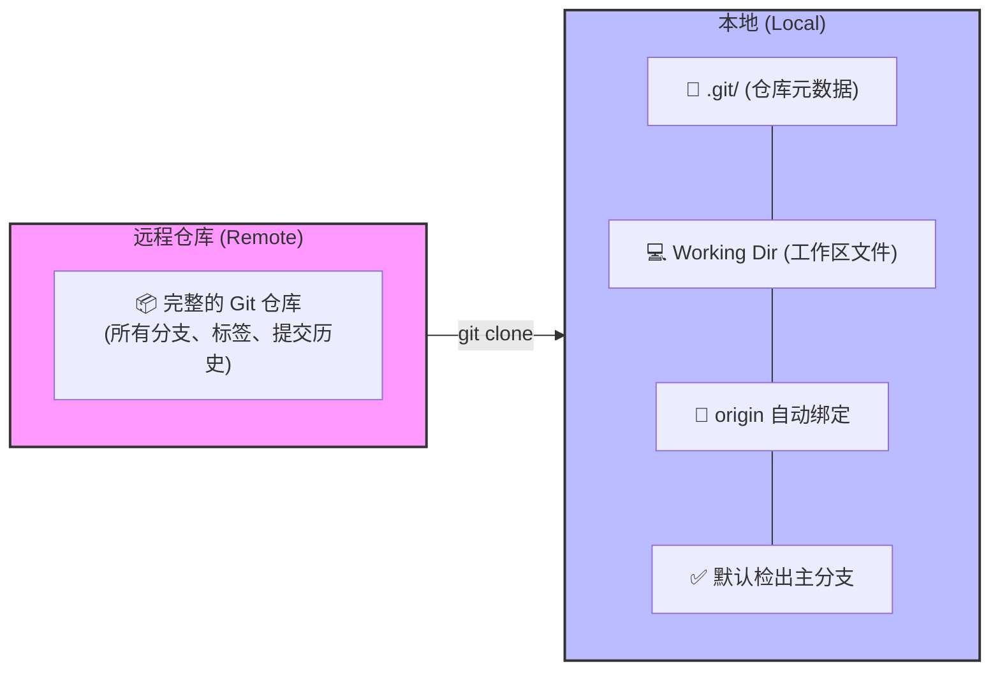

[toc]

# Git Clone 系统性介绍

## 一、基本概念

`git clone`的功能:



`git clone` 本质上等价于以下一系列操作：

```bash
mkdir repo && cd repo
git init
git remote add origin <URL>
git fetch origin
git checkout main     # 检出默认分支
```

---

## 二、基本语法

```bash
git clone [选项] <仓库URL> [目标目录]
```

```bash
# 最简用法（目录名 = 仓库名）
git clone https://github.com/user/repo.git

# 指定目录名
git clone https://github.com/user/repo.git my-project

# 克隆到当前目录（当前目录必须为空）
git clone https://github.com/user/repo.git .
```

---

## 三、支持的协议

| **协议**     | **示例**                                  | **特点**                                                     |
| ------------ | ----------------------------------------- | ------------------------------------------------------------ |
| **HTTPS**    | `https://github.com/user/repo.git`        | **最通用**：受防火墙限制少，支持账号密码/Token 验证。        |
| **SSH**      | `git@github.com:user/repo.git`            | **安全免密**：需提前配置 SSH Key，适合频繁提交代码。         |
| **Git**      | `git://github.com/user/repo.git`          | **速度快但只读**：由于缺乏加密验证，通常仅用于开源项目分发。 |
| **本地路径** | `/path/to/repo` 或 `file:///path/to/repo` | **局域内/本地**：在同一个文件系统下的仓库之间进行克隆。      |

```bash
# HTTPS（最常用）
git clone https://github.com/user/repo.git

# SSH（推荐，免密推送）
git clone git@github.com:user/repo.git

# 本地路径
git clone /home/user/projects/repo
git clone file:///home/user/projects/repo   # 使用 file 协议（更规范）

# 带用户名的 HTTPS
git clone https://username@github.com/user/repo.git
```

---

## 四、核心选项详解

### 1. 分支相关

```bash
# 克隆并检出指定分支（而非默认分支）
git clone -b develop https://github.com/user/repo.git

# 等价于
git clone --branch develop https://github.com/user/repo.git

# 也可以检出指定标签
git clone -b v2.0.0 https://github.com/user/repo.git
```

```bash
# 只克隆单个分支（不下载其他分支的引用）
git clone --single-branch -b develop https://github.com/user/repo.git
```

---

### 2. 深度控制（浅克隆）

```bash
# 只克隆最近 N 次提交（浅克隆）
git clone --depth 1 https://github.com/user/repo.git
git clone --depth 10 https://github.com/user/repo.git
```

```
完整克隆:                    浅克隆 (--depth 1):
  A ← B ← C ← D ← E         E (仅最新一次提交)
  (全部历史)                   (体积小，速度快)
```

```bash
# 浅克隆后需要完整历史时，可以补全
git fetch --unshallow

# 浅克隆 + 指定分支（CI/CD 最常用组合）
git clone --depth 1 --single-branch -b main https://github.com/user/repo.git
```

```bash
# 克隆指定时间之后的提交
git clone --shallow-since="2024-01-01" https://github.com/user/repo.git

# 克隆到某个提交为止（不包含更早的）
git clone --shallow-exclude=v1.0 https://github.com/user/repo.git
```

---

### 3. 子模块处理

```bash
# 克隆时自动初始化并更新所有子模块
git clone --recurse-submodules https://github.com/user/repo.git

# 等价写法
git clone --recursive https://github.com/user/repo.git

# 如果克隆时忘了加，事后补救
git submodule update --init --recursive
```

```bash
# 指定子模块并行下载数量
git clone --recurse-submodules -j4 https://github.com/user/repo.git
```

---

### 4. 裸仓库与镜像

```bash
# 裸仓库克隆（没有工作区，仅 .git 内容，用于服务器端）
git clone --bare https://github.com/user/repo.git
```

```
普通克隆:                    裸仓库:
repo/                        repo.git/
├── .git/                    ├── HEAD
│   ├── HEAD                 ├── config
│   ├── objects/             ├── objects/
│   └── refs/                └── refs/
├── src/     ← 有工作区
└── README.md
```

```bash
# 镜像克隆（完整复制，包括所有引用、hooks 等）
git clone --mirror https://github.com/user/repo.git

# mirror 与 bare 的区别:
# --bare   : 复制分支引用
# --mirror : 复制所有引用（含 notes, stash, pull requests 等）+ 自动设置 remote
```

---

### 5. 性能优化选项

```bash
# 指定并发连接数（加速大仓库）
git clone -j8 --recurse-submodules https://github.com/user/repo.git

# 使用稀疏检出（只下载部分目录）→ Git 2.25+
git clone --filter=blob:none --sparse https://github.com/user/repo.git
cd repo
git sparse-checkout set src/core docs    # 只检出需要的目录
```

```bash
# 部分克隆：不下载文件内容，按需获取（Git 2.22+）
git clone --filter=blob:none https://github.com/user/repo.git     # 无 blob
git clone --filter=tree:0 https://github.com/user/repo.git        # 无 tree
git clone --filter=blob:limit=1m https://github.com/user/repo.git # 跳过 >1MB 的文件
```

---

### 6. 其他实用选项

```bash
# 克隆时自定义远程仓库名称（默认是 origin）
git clone -o github https://github.com/user/repo.git
# 远程名变为 github 而非 origin

# 静默模式（不输出进度信息）
git clone --quiet https://github.com/user/repo.git

# 显示详细进度
git clone --progress --verbose https://github.com/user/repo.git

# 使用指定的模板目录
git clone --template=/path/to/template https://github.com/user/repo.git

# 克隆时配置选项
git clone --config core.autocrlf=false https://github.com/user/repo.git
git clone -c http.proxy=socks5://127.0.0.1:1080 https://github.com/user/repo.git
```

---

## 五、完整选项速查表

```
┌────────────────────────────────┬──────────────────────────────────────────┐
│           选项                 │                 说明                     │
├────────────────────────────────┼──────────────────────────────────────────┤
│ -b / --branch <name>          │ 检出指定分支或标签                       │
│ --single-branch               │ 只克隆指定分支                           │
│ --no-single-branch            │ 取消单分支限制                           │
├────────────────────────────────┼──────────────────────────────────────────┤
│ --depth <N>                   │ 浅克隆，只取最近 N 次提交                │
│ --shallow-since=<date>        │ 浅克隆到指定日期                         │
│ --shallow-exclude=<ref>       │ 浅克隆排除指定引用之前的历史             │
│ --unshallow (fetch时)         │ 将浅克隆转为完整克隆                     │
├────────────────────────────────┼──────────────────────────────────────────┤
│ --recurse-submodules          │ 递归克隆所有子模块                       │
│ --recursive                   │ 同上（旧写法）                           │
│ -j<N> / --jobs <N>            │ 并行处理子模块数量                       │
├────────────────────────────────┼──────────────────────────────────────────┤
│ --bare                        │ 克隆为裸仓库                             │
│ --mirror                      │ 镜像克隆（含所有引用）                   │
├────────────────────────────────┼──────────────────────────────────────────┤
│ --filter=<spec>               │ 部分克隆过滤器                           │
│ --sparse                      │ 启用稀疏检出                             │
├────────────────────────────────┼──────────────────────────────────────────┤
│ -o / --origin <name>          │ 自定义远程仓库名称                       │
│ -c / --config <key=value>     │ 设置配置项                               │
│ --template=<dir>              │ 指定模板目录                             │
│ -q / --quiet                  │ 静默输出                                 │
│ -v / --verbose                │ 详细输出                                 │
│ --progress                    │ 强制显示进度                             │
│ --no-checkout / -n            │ 克隆后不检出任何分支                     │
│ --no-tags                     │ 不下载标签                               │
│ --reference <repo>            │ 使用本地已有仓库作为参考加速             │
│ --dissociate                  │ 与 --reference 配合，克隆后断开引用关系  │
└────────────────────────────────┴──────────────────────────────────────────┘
```

---

## 六、实战场景

### 场景 1：CI/CD 快速克隆

```bash
# 最快速度，最小体积
git clone --depth 1 --single-branch -b main https://github.com/user/repo.git
```

> 适用于只需构建最新代码，不需要历史记录。

---

### 场景 2：大型仓库按需克隆

```bash
# 1. 部分克隆 + 稀疏检出
git clone --filter=blob:none --sparse https://github.com/user/monorepo.git
cd monorepo

# 2. 只检出需要的目录
git sparse-checkout set services/auth libs/common

# 3. 查看检出状态
git sparse-checkout list
```

```
完整仓库 (5GB):              稀疏检出后 (200MB):
monorepo/                    monorepo/
├── services/                ├── services/
│   ├── auth/    ✓           │   └── auth/     ✓ 只有这个
│   ├── payment/             └── libs/
│   └── gateway/                 └── common/   ✓ 只有这个
├── libs/
│   ├── common/  ✓
│   └── utils/
└── docs/
```

---

### 场景 3：仓库迁移/镜像

```bash
# 完整镜像源仓库
git clone --mirror https://github.com/old-org/repo.git
cd repo.git

# 推送到新地址
git remote set-url origin https://github.com/new-org/repo.git
git push --mirror
```

---

### 场景 4：Fork 项目后的标准操作

```bash
# 1. 克隆自己 fork 的仓库
git clone git@github.com:myuser/project.git
cd project

# 2. 添加上游仓库
git remote add upstream https://github.com/original/project.git

# 3. 验证
git remote -v
# origin   git@github.com:myuser/project.git    (fetch)
# origin   git@github.com:myuser/project.git    (push)
# upstream https://github.com/original/project.git (fetch)
# upstream https://github.com/original/project.git (push)

# 4. 同步上游更新
git fetch upstream
git rebase upstream/main
```

---

### 场景 5：使用本地仓库作为参考加速

```bash
# 已有一个本地仓库，克隆同一个远程仓库的另一个副本
git clone --reference /path/to/existing-repo https://github.com/user/repo.git

# 克隆后断开引用依赖（推荐，防止误删参考仓库导致问题）
git clone --reference /path/to/existing-repo --dissociate https://github.com/user/repo.git
```

---

### 场景 6：克隆后不检出文件

```bash
# 只要 .git 仓库数据，不创建工作区文件
git clone --no-checkout https://github.com/user/repo.git
cd repo
# 手动检出
git checkout main
```

---

## 七、克隆后的仓库状态

```bash
git clone https://github.com/user/repo.git
cd repo
```

自动完成的配置：
```bash
# 远程仓库已绑定
git remote -v
# origin  https://github.com/user/repo.git (fetch)
# origin  https://github.com/user/repo.git (push)

# 本地 main 已跟踪远程 origin/main
git branch -vv
# * main  a1b2c3d [origin/main] Initial commit

# 所有远程分支可见
git branch -r
# origin/HEAD -> origin/main
# origin/main
# origin/develop
# origin/feature/login
```

---

## 八、常见问题处理

```bash
# 克隆速度慢 → 使用代理
git clone -c http.proxy=socks5://127.0.0.1:7890 https://github.com/user/repo.git

# 克隆超时 → 加大缓冲区
git clone -c http.postBuffer=524288000 https://github.com/user/repo.git

# SSL 证书问题（内网）→ 关闭验证（不推荐生产使用）
git clone -c http.sslVerify=false https://internal-git.company.com/repo.git

# 仓库太大 → 浅克隆 + 部分克隆
git clone --depth 1 --filter=blob:limit=1m https://github.com/user/huge-repo.git

# 需要输入密码太频繁 → 缓存凭据
git clone -c credential.helper=store https://github.com/user/repo.git
```