[toc]


## Git 是什么

Git 是一个**分布式版本控制系统**，用于记录文件的历史变化、协作开发、分支管理和代码发布。

它最常用于软件开发，但也可以用于管理文档、配置文件、论文、设计稿等任何需要追踪历史的文本类内容。

Git 的核心价值：

| 能力     | 说明                                               |
| -------- | -------------------------------------------------- |
| 版本记录 | 记录每一次提交，可以查看历史、对比差异、恢复旧版本 |
| 分支开发 | 多条开发线并行推进，互不干扰                       |
| 协作开发 | 多人共同维护同一项目                               |
| 离线工作 | 本地仓库保存完整历史，不依赖远程服务器             |
| 快速合并 | 支持高效合并不同分支的修改                         |
| 可追溯性 | 每次变更都有作者、时间、说明和唯一标识             |

常见的 Git 托管平台包括：

| 平台      | 说明                             |
| --------- | -------------------------------- |
| GitHub    | 全球最流行的开源与协作平台       |
| GitLab    | 常用于企业私有化部署，也有云服务 |
| Gitee     | 国内常用 Git 托管平台            |
| Bitbucket | Atlassian 生态中的 Git 平台      |

需要注意：

> Git 是版本控制工具，GitHub / GitLab / Gitee 是远程代码托管平台。
> Git 可以脱离 GitHub 独立使用。

------

## Git 的基本工作模型

Git 的核心工作区域可以理解为三个部分：

| 区域     | 英文                 | 作用                              |
| -------- | -------------------- | --------------------------------- |
| 工作区   | Working Tree         | 你实际编辑文件的地方              |
| 暂存区   | Staging Area / Index | 准备提交的变更集合                |
| 本地仓库 | Local Repository     | 已正式保存的提交历史              |
| 远程仓库 | Remote Repository    | 托管在服务器上的仓库，例如 GitHub |

典型流程如下：

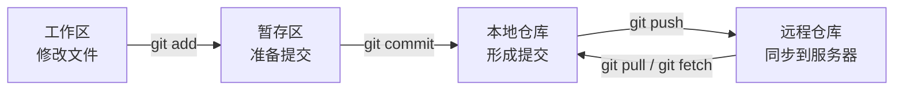

常用命令对应关系：

| 操作           | 命令                      | 含义                             |
| -------------- | ------------------------- | -------------------------------- |
| 查看状态       | `git status`              | 查看哪些文件被修改、暂存或未跟踪 |
| 添加到暂存区   | `git add <file>`          | 将变更放入暂存区                 |
| 提交到本地仓库 | `git commit -m "message"` | 创建一次本地提交                 |
| 推送到远程     | `git push`                | 把本地提交上传到远程仓库         |
| 拉取远程更新   | `git pull`                | 获取并合并远程更新               |
| 获取远程更新   | `git fetch`               | 只下载远程更新，不自动合并       |

------

## Git 的核心概念

### 仓库

仓库，即 repository，简称 repo，是 Git 管理项目历史的地方。

创建本地仓库：

```bash
git init
```

从远程克隆仓库：

```bash
git clone https://github.com/user/project.git
```

克隆后会得到：

| 内容        | 说明                                           |
| ----------- | ---------------------------------------------- |
| 项目文件    | 当前分支的工作文件                             |
| `.git` 目录 | Git 仓库的核心数据，包含提交历史、分支、配置等 |

`.git` 目录非常重要，删除它后，当前目录就不再是 Git 仓库。

------

### 提交

提交，即 commit，是 Git 中最重要的版本单位。

一次 commit 通常包含：

| 信息     | 说明                          |
| -------- | ----------------------------- |
| 提交 ID  | 唯一标识，通常是一串 SHA 哈希 |
| 作者     | 谁创建了提交                  |
| 时间     | 提交时间                      |
| 提交说明 | 描述本次变更                  |
| 文件快照 | 当前项目内容的快照            |
| 父提交   | 指向上一次提交                |

Git 并不是简单保存“文件差异”，而是以内容快照为核心组织版本历史。为了节省空间，Git 内部会复用相同内容并进行压缩。

查看提交历史：

```bash
git log
```

更简洁的历史：

```bash
git log --oneline --graph --decorate --all
```

示例：

```bash
a3c91e2 Add user login validation
b82e1fa Fix typo in README
97ad42c Initial commit
```

------

### 暂存区

暂存区是 Git 区别于很多工具的重要设计。

你修改了多个文件，但不一定要一次性全部提交。可以只选择部分变更进入本次提交。

例如：

```bash
git add README.md
git commit -m "docs: update README"
```

如果想添加所有已修改和新增文件：

```bash
git add .
```

如果只想交互式选择部分内容：

```bash
git add -p
```

`git add -p` 是很重要的最佳实践工具，适合把混杂修改拆成多个清晰提交。

------

### 分支

分支是指向某个提交的可移动指针。

它让你可以在不影响主线的情况下开发新功能、修复问题或实验方案。

创建并切换分支：

```bash
git switch -c feature/login
```

切换已有分支：

```bash
git switch main
```

查看分支：

```bash
git branch
```

现代 Git 推荐使用：

| 旧命令                     | 新推荐命令               | 用途           |
| -------------------------- | ------------------------ | -------------- |
| `git checkout <branch>`    | `git switch <branch>`    | 切换分支       |
| `git checkout -b <branch>` | `git switch -c <branch>` | 创建并切换分支 |
| `git checkout -- <file>`   | `git restore <file>`     | 恢复文件       |

虽然 `git checkout` 仍然可用，但新手更推荐学习 `switch` 和 `restore`，语义更清晰。

------

### HEAD

`HEAD` 表示当前所在位置。

通常情况下，`HEAD` 指向当前分支，而当前分支再指向最新提交。

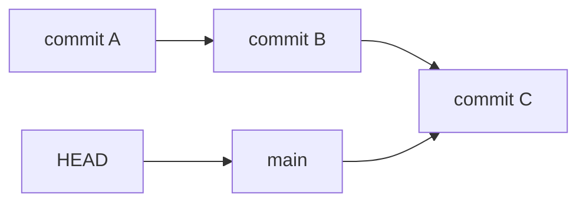

如果你切换到某个具体提交，而不是分支，就会进入 detached HEAD 状态。

例如：

```bash
git switch --detach a3c91e2
```

这适合临时查看历史版本，但不适合直接长期开发。如果要基于旧版本开发，应创建新分支：

```bash
git switch -c fix/old-version a3c91e2
```

------

### 远程仓库

远程仓库是本地仓库之外的另一个仓库地址，通常在 GitHub、GitLab、Gitee 上。

查看远程仓库：

```bash
git remote -v
```

添加远程仓库：

```bash
git remote add origin https://github.com/user/project.git
```

推送当前分支：

```bash
git push -u origin main
```

其中：

| 部分     | 含义                             |
| -------- | -------------------------------- |
| `origin` | 远程仓库默认名称                 |
| `main`   | 要推送的分支                     |
| `-u`     | 建立本地分支与远程分支的跟踪关系 |

建立跟踪关系后，以后可以直接：

```bash
git push
git pull
```

------

## 常用命令速查

### 初始化与克隆

| 目的         | 命令                              |
| ------------ | --------------------------------- |
| 初始化仓库   | `git init`                        |
| 克隆仓库     | `git clone <url>`                 |
| 查看远程地址 | `git remote -v`                   |
| 添加远程地址 | `git remote add origin <url>`     |
| 修改远程地址 | `git remote set-url origin <url>` |

------

### 查看状态与历史

| 目的           | 命令                                         |
| -------------- | -------------------------------------------- |
| 查看当前状态   | `git status`                                 |
| 查看简洁状态   | `git status -sb`                             |
| 查看提交历史   | `git log`                                    |
| 查看单行历史   | `git log --oneline`                          |
| 查看图形历史   | `git log --oneline --graph --decorate --all` |
| 查看某次提交   | `git show <commit>`                          |
| 查看某文件历史 | `git log -- <file>`                          |

------

### 修改、暂存与提交

| 目的             | 命令                      |
| ---------------- | ------------------------- |
| 添加文件到暂存区 | `git add <file>`          |
| 添加所有变更     | `git add .`               |
| 交互式添加       | `git add -p`              |
| 提交             | `git commit -m "message"` |
| 修改最近一次提交 | `git commit --amend`      |
| 查看工作区差异   | `git diff`                |
| 查看暂存区差异   | `git diff --staged`       |

------

### 分支操作

| 目的             | 命令                       |
| ---------------- | -------------------------- |
| 查看本地分支     | `git branch`               |
| 查看所有分支     | `git branch -a`            |
| 创建分支         | `git branch <name>`        |
| 创建并切换分支   | `git switch -c <name>`     |
| 切换分支         | `git switch <name>`        |
| 删除本地分支     | `git branch -d <name>`     |
| 强制删除本地分支 | `git branch -D <name>`     |
| 重命名当前分支   | `git branch -m <new-name>` |

------

### 远程同步

| 目的           | 命令                                |
| -------------- | ----------------------------------- |
| 获取远程更新   | `git fetch`                         |
| 拉取并合并     | `git pull`                          |
| 拉取并变基     | `git pull --rebase`                 |
| 推送           | `git push`                          |
| 推送并建立跟踪 | `git push -u origin <branch>`       |
| 删除远程分支   | `git push origin --delete <branch>` |

------

## 一次典型 Git 工作流程

新手可以先掌握以下流程：

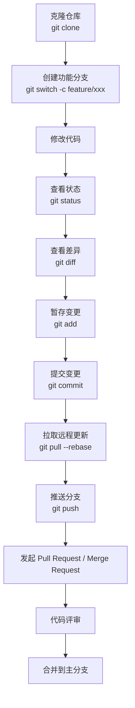

实际命令示例：

```bash
git clone https://github.com/example/project.git
cd project

git switch -c feature/login

# 修改代码后
git status
git diff

git add .
git commit -m "feat: add login page"

git pull --rebase origin main
git push -u origin feature/login
```

然后在 GitHub / GitLab 上创建 Pull Request 或 Merge Request。

------

## 分支模型

### 简单推荐模型

对大多数小团队和现代项目，推荐使用简洁的分支模型：

| 分支        | 作用                               |
| ----------- | ---------------------------------- |
| `main`      | 稳定主分支，始终保持可构建、可发布 |
| `feature/*` | 新功能开发分支                     |
| `fix/*`     | Bug 修复分支                       |
| `hotfix/*`  | 紧急线上修复分支                   |
| `release/*` | 发布准备分支，可选                 |

示意：

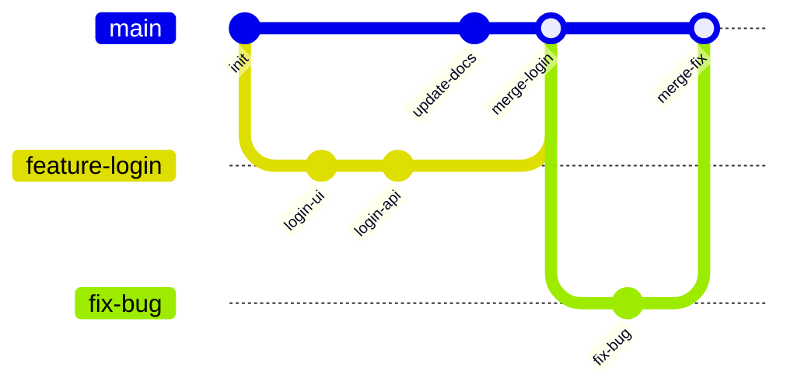

最佳实践：

| 建议                   | 说明                                       |
| ---------------------- | ------------------------------------------ |
| 不直接在 `main` 上开发 | 避免未完成代码进入主线                     |
| 每个任务一个分支       | 功能、修复、实验互相隔离                   |
| 分支命名有语义         | 如 `feature/user-login`、`fix/order-price` |
| 分支保持短生命周期     | 长期分支容易产生大量冲突                   |
| 合并前同步主分支       | 减少合并冲突                               |
| 使用 PR / MR           | 便于代码审查和自动化检查                   |

------

### Git Flow、GitHub Flow 与 Trunk-Based Development

常见分支模型对比：

| 模型                    | 特点                                                         | 适合场景                             |
| ----------------------- | ------------------------------------------------------------ | ------------------------------------ |
| Git Flow                | 有 `main`、`develop`、`feature`、`release`、`hotfix` 多类分支 | 发布周期较长、版本管理严格的传统项目 |
| GitHub Flow             | `main` + 短期功能分支 + PR                                   | Web 服务、持续交付、开源项目         |
| Trunk-Based Development | 大家频繁合入主干，配合特性开关和 CI                          | 高成熟度团队、持续集成/持续部署      |

现代团队更常用：

- 小团队：GitHub Flow
- 成熟 DevOps 团队：Trunk-Based Development
- 发布复杂的软件产品：Git Flow 或简化 Git Flow

对于新手，建议从 GitHub Flow 开始：

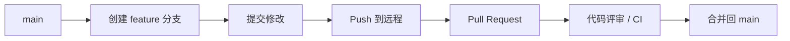

------

## 合并与变基

Git 中整合分支主要有两种方式：

| 方式   | 命令         | 特点                                 |
| ------ | ------------ | ------------------------------------ |
| merge  | `git merge`  | 保留真实分支历史，可能产生合并提交   |
| rebase | `git rebase` | 将提交“搬到”另一条基线上，历史更线性 |

------

### merge

假设你在 `main` 分支上合并 `feature/login`：

```bash
git switch main
git merge feature/login
```

示意：

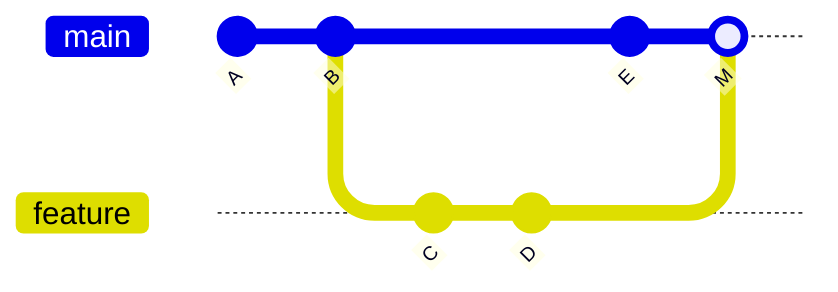

优点：

| 优点         | 说明                           |
| ------------ | ------------------------------ |
| 保留真实历史 | 能看出分支从哪里分出、何时合并 |
| 安全直观     | 不改写已有提交                 |
| 适合公共分支 | 对协作影响小                   |

缺点：

| 缺点         | 说明                           |
| ------------ | ------------------------------ |
| 历史可能复杂 | 大量 merge commit 会让日志混乱 |
| 线性较差     | 不如 rebase 清爽               |

------

### rebase

`rebase` 会把当前分支的提交重新应用到另一个基点之上。

```bash
git switch feature/login
git rebase main
```

示意：

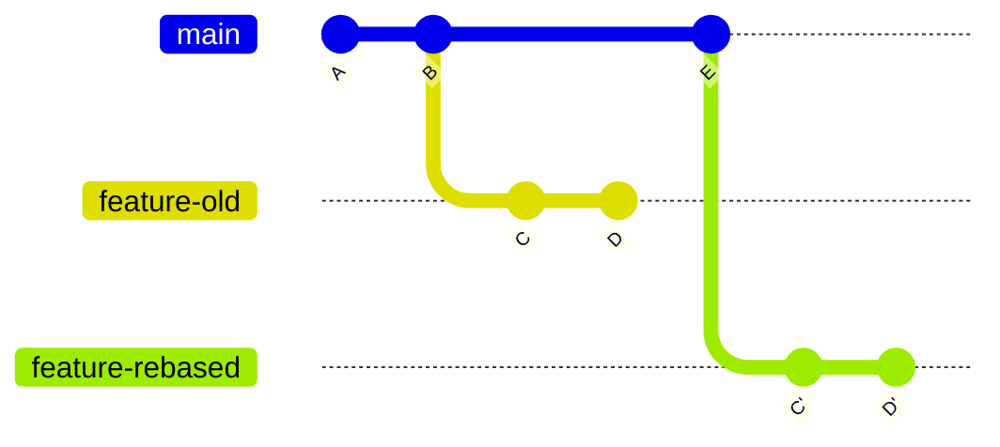

优点：

| 优点             | 说明               |
| ---------------- | ------------------ |
| 历史线性         | `git log` 更清晰   |
| 便于回溯         | 一条直线更容易理解 |
| 适合整理本地提交 | 合并前清理提交历史 |

缺点：

| 缺点               | 说明                           |
| ------------------ | ------------------------------ |
| 会改写提交历史     | 原提交 ID 会变化               |
| 使用不当会影响他人 | 共享分支上 rebase 容易造成混乱 |

重要规则：

> 不要 rebase 已经被多人共享使用的公共分支，除非团队明确知道并接受这个操作。

常见推荐：

| 场景                    | 推荐                                                       |
| ----------------------- | ---------------------------------------------------------- |
| 个人功能分支同步 `main` | 可以用 `git rebase main`                                   |
| 合并 PR 到 `main`       | 可以用 merge、squash merge 或 rebase merge，取决于团队规范 |
| 公共主分支              | 不要随意 rebase                                            |
| 本地提交混乱            | 可以用 interactive rebase 整理                             |

------

### merge、rebase、squash merge 对比

| 方式         | 历史效果         | 优点           | 注意事项         |
| ------------ | ---------------- | -------------- | ---------------- |
| Merge commit | 保留完整分支结构 | 信息完整、安全 | 历史可能较复杂   |
| Rebase merge | 线性历史         | 日志清晰       | 会改写提交       |
| Squash merge | 多个提交压成一个 | 主分支简洁     | 丢失分支内部细节 |

很多团队采用：

- 功能分支内部：允许多个小提交
- 合并到 `main`：使用 squash merge
- 主分支：保持清晰、可回滚、可发布

------

## 冲突处理

冲突发生在 Git 无法自动判断如何合并修改时。

例如，两个人都修改了同一文件的同一行。

冲突文件中通常会出现：

```text
<<<<<<< HEAD
当前分支的内容
=======
被合并分支的内容
>>>>>>> feature/login
```

处理流程：

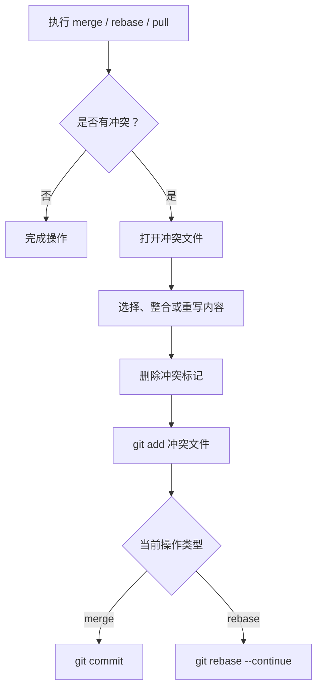

merge 冲突解决：

```bash
git status
# 编辑冲突文件
git add <file>
git commit
```

rebase 冲突解决：

```bash
git status
# 编辑冲突文件
git add <file>
git rebase --continue
```

如果想放弃：

| 场景             | 命令                      |
| ---------------- | ------------------------- |
| 放弃 merge       | `git merge --abort`       |
| 放弃 rebase      | `git rebase --abort`      |
| 放弃 cherry-pick | `git cherry-pick --abort` |

减少冲突的最佳实践：

| 建议                     | 说明                           |
| ------------------------ | ------------------------------ |
| 小步提交                 | 每次修改范围小，冲突更容易处理 |
| 经常同步主分支           | 避免分支长期落后               |
| 避免多人同时重构同一模块 | 大改动前先沟通                 |
| 格式化规则统一           | 避免因格式化造成大面积 diff    |
| 使用代码评审             | 提前发现结构性冲突             |

------

## 撤销与恢复

Git 的撤销操作很多，新手容易混淆。可以先按“改了哪里”理解。

### 撤销工作区修改

文件修改了，但还没有 `git add`：

```bash
git restore <file>
```

恢复所有未暂存修改：

```bash
git restore .
```

注意：这会丢弃工作区改动，无法轻易找回。

------

### 取消暂存

已经 `git add`，但还没 commit：

```bash
git restore --staged <file>
```

取消所有暂存：

```bash
git restore --staged .
```

这不会删除文件内容，只是把变更从暂存区移回工作区。

------

### 修改最近一次提交

如果刚提交后发现漏了文件或提交说明写错：

```bash
git add <file>
git commit --amend
```

修改提交信息：

```bash
git commit --amend -m "new message"
```

注意：

> 如果这个提交已经 push 到远程并被别人基于它继续开发，谨慎使用 `--amend`，因为它会改写提交历史。

------

### 回退提交：reset 与 revert

`reset` 和 `revert` 是 Git 中最容易混淆的命令。

| 命令         | 是否改写历史 | 适合场景                     |
| ------------ | ------------ | ---------------------------- |
| `git reset`  | 是           | 本地未共享提交的回退         |
| `git revert` | 否           | 已推送、已共享提交的安全撤销 |

------

#### reset

`reset` 会移动当前分支指针。

常见模式：

| 命令                       | 提交历史      | 暂存区         | 工作区 |
| -------------------------- | ------------- | -------------- | ------ |
| `git reset --soft HEAD~1`  | 回退 1 个提交 | 保留变更并暂存 | 保留   |
| `git reset --mixed HEAD~1` | 回退 1 个提交 | 取消暂存       | 保留   |
| `git reset --hard HEAD~1`  | 回退 1 个提交 | 丢弃           | 丢弃   |

示例：

```bash
git reset --soft HEAD~1
```

适合：刚提交后想重新整理提交。

危险命令：

```bash
git reset --hard HEAD~1
```

它会直接丢弃提交和工作区修改，新手使用前应确认没有重要内容。

------

#### revert

`revert` 会创建一个新的提交，用来抵消之前某个提交的修改。

```bash
git revert <commit>
```

适合已经推送到远程的提交，因为它不会破坏公共历史。

例如：

```bash
git revert a3c91e2
git push
```

最佳实践：

| 场景                          | 推荐             |
| ----------------------------- | ---------------- |
| 本地提交还没 push             | 可以用 `reset`   |
| 提交已经 push，且别人可能拉取 | 用 `revert`      |
| 不确定是否安全                | 优先用 `revert`  |
| 要丢弃未提交修改              | 用 `git restore` |

------

## 标签

标签，即 tag，通常用于标记版本发布点。

查看标签：

```bash
git tag
```

创建轻量标签：

```bash
git tag v1.0.0
```

创建带说明的标签：

```bash
git tag -a v1.0.0 -m "Release v1.0.0"
```

推送标签：

```bash
git push origin v1.0.0
```

推送所有标签：

```bash
git push origin --tags
```

推荐使用语义化版本：

| 版本     | 含义                   |
| -------- | ---------------------- |
| `v1.0.0` | 主版本.次版本.修订版本 |
| 主版本   | 不兼容变更             |
| 次版本   | 向后兼容的新功能       |
| 修订版本 | 向后兼容的问题修复     |

示例：

| 版本变化            | 场景         |
| ------------------- | ------------ |
| `v1.2.3` → `v1.2.4` | 修复 bug     |
| `v1.2.3` → `v1.3.0` | 新增兼容功能 |
| `v1.2.3` → `v2.0.0` | 破坏性变更   |

------

## 忽略文件

`.gitignore` 用于告诉 Git 哪些文件不需要纳入版本管理。

常见忽略内容：

| 类型     | 示例                         |
| -------- | ---------------------------- |
| 依赖目录 | `node_modules/`              |
| 构建产物 | `dist/`、`build/`、`target/` |
| 日志文件 | `*.log`                      |
| 环境变量 | `.env`                       |
| IDE 配置 | `.idea/`、`.vscode/`         |
| 系统文件 | `.DS_Store`                  |

示例 `.gitignore`：

```gitignore
node_modules/
dist/
build/
*.log
.env
.DS_Store
```

注意：

> `.gitignore` 只对未被 Git 跟踪的文件生效。
> 如果文件已经被提交过，后面再写入 `.gitignore` 不会自动取消跟踪。

取消跟踪但保留本地文件：

```bash
git rm --cached <file>
```

例如：

```bash
git rm --cached .env
git commit -m "chore: stop tracking env file"
```

最佳实践：

| 建议             | 说明                               |
| ---------------- | ---------------------------------- |
| 不提交密钥       | API Key、Token、密码不要进入 Git   |
| 提供模板文件     | 用 `.env.example` 说明需要哪些配置 |
| 忽略构建产物     | 可由源码生成的文件通常不提交       |
| 团队共享必要配置 | 例如格式化规则、lint 规则可以提交  |

------

## 提交信息规范

良好的提交信息能让历史更容易阅读、搜索和回滚。

推荐使用 Conventional Commits 风格：

```text
<type>(optional scope): <description>
```

示例：

```text
feat(auth): add login by email
fix(order): correct total price calculation
docs: update installation guide
refactor(user): simplify profile service
test: add unit tests for payment
chore: update dependencies
```

常见类型：

| 类型       | 含义                         |
| ---------- | ---------------------------- |
| `feat`     | 新功能                       |
| `fix`      | Bug 修复                     |
| `docs`     | 文档变更                     |
| `style`    | 格式调整，不影响逻辑         |
| `refactor` | 重构，不新增功能、不修复 bug |
| `test`     | 测试相关                     |
| `chore`    | 构建、依赖、工具等杂项       |
| `perf`     | 性能优化                     |
| `ci`       | CI 配置变更                  |
| `build`    | 构建系统或外部依赖变更       |

好的提交信息：

| 好                                      | 不好           |
| --------------------------------------- | -------------- |
| `fix(cart): handle empty cart checkout` | `fix bug`      |
| `feat(user): add password reset flow`   | `update`       |
| `docs: add deployment guide`            | `change files` |

建议：

- 使用英文或团队统一语言
- 第一行简洁明确
- 一个提交只做一件事
- 不要写无意义信息，如 `update`、`修复`、`修改一下`

------

## Git 与代码评审

现代团队通常不直接向主分支 push，而是通过 Pull Request / Merge Request 协作。

基本流程：

| 步骤         | 说明                           |
| ------------ | ------------------------------ |
| 创建分支     | 每个功能或修复创建独立分支     |
| 提交代码     | 本地 commit 后 push            |
| 创建 PR / MR | 请求合并到主分支               |
| 自动检查     | 运行测试、构建、lint、安全扫描 |
| 人工评审     | 团队成员查看代码并提出建议     |
| 修改完善     | 根据反馈继续提交               |
| 合并         | 通过后合并到主分支             |

PR 描述建议包含：

| 内容       | 示例                       |
| ---------- | -------------------------- |
| 背景       | 为什么需要这个变更         |
| 修改内容   | 改了哪些模块               |
| 测试说明   | 如何验证                   |
| 影响范围   | 是否影响接口、数据库、配置 |
| 截图或日志 | UI 变更、性能结果等        |

PR 最佳实践：

| 建议           | 说明                         |
| -------------- | ---------------------------- |
| PR 尽量小      | 小 PR 更容易审查             |
| 标题清晰       | 能快速理解变更目的           |
| 提交前自测     | 不把明显错误交给评审者       |
| 保持 CI 通过   | 合并前自动检查必须通过       |
| 及时响应评论   | 避免协作阻塞                 |
| 不混杂无关改动 | 格式化、重构、功能应尽量分开 |

------

## Git 配置

首次使用 Git，需要配置用户名和邮箱。

```bash
git config --global user.name "Your Name"
git config --global user.email "you@example.com"
```

查看配置：

```bash
git config --list
```

查看配置来源：

```bash
git config --list --show-origin
```

推荐配置：

```bash
git config --global init.defaultBranch main
git config --global pull.rebase false
git config --global core.autocrlf input
```

含义：

| 配置                      | 说明                                        |
| ------------------------- | ------------------------------------------- |
| `init.defaultBranch main` | 新仓库默认分支使用 `main`                   |
| `pull.rebase false`       | `git pull` 默认使用 merge，可按团队需要调整 |
| `core.autocrlf input`     | macOS/Linux 常用换行处理方式                |

Windows 用户常见配置：

```bash
git config --global core.autocrlf true
```

换行符配置要结合团队情况。更推荐在项目中使用 `.gitattributes` 统一规则。

示例 `.gitattributes`：

```gitattributes
* text=auto
*.sh text eol=lf
*.bat text eol=crlf
```

------

## HTTPS 与 SSH 认证

连接远程仓库常见两种方式：

| 方式  | 示例                               | 特点                           |
| ----- | ---------------------------------- | ------------------------------ |
| HTTPS | `https://github.com/user/repo.git` | 配置简单，通常配合 Token       |
| SSH   | `git@github.com:user/repo.git`     | 适合长期开发，不必频繁输入凭据 |

生成 SSH Key：

```bash
ssh-keygen -t ed25519 -C "you@example.com"
```

查看公钥：

```bash
cat ~/.ssh/id_ed25519.pub
```

然后将公钥添加到 GitHub / GitLab / Gitee 的 SSH Keys 设置中。

测试连接：

```bash
ssh -T git@github.com
```

现代平台通常不再支持用账号密码直接进行 Git HTTPS 推送，而是使用 Personal Access Token 或 Credential Manager。

------

## 储藏临时修改

`git stash` 用于临时保存当前未提交修改，适合切换分支前暂存现场。

保存修改：

```bash
git stash push -m "work in progress"
```

查看 stash：

```bash
git stash list
```

恢复最近一次 stash：

```bash
git stash pop
```

只应用不删除：

```bash
git stash apply
```

删除 stash：

```bash
git stash drop stash@{0}
```

注意：

| 建议                 | 说明                      |
| -------------------- | ------------------------- |
| stash 不适合长期保存 | 时间久了容易忘记内容      |
| stash 前写说明       | 使用 `-m` 便于识别        |
| 重要工作优先 commit  | 提交到分支比 stash 更安全 |
| 切换任务可建临时分支 | 比 stash 更可追踪         |

------

## Cherry-pick

`cherry-pick` 用于把某个提交复制到当前分支。

```bash
git cherry-pick <commit>
```

适合场景：

| 场景                       | 示例                                     |
| -------------------------- | ---------------------------------------- |
| 把修复补丁应用到发布分支   | 从 `main` 拿一个 bugfix 到 `release/1.0` |
| 只需要某个分支的一部分提交 | 不合并整个功能分支                       |
| 紧急修复多个版本           | 同一个 fix 应用到多个维护分支            |

示例：

```bash
git switch release/1.0
git cherry-pick a3c91e2
```

注意：

- cherry-pick 会创建新的提交
- 新提交内容相同，但提交 ID 不同
- 如果依赖上下文不同，可能产生冲突

------

## Bisect：定位引入问题的提交

`git bisect` 用二分查找定位哪个提交引入了 bug。

基本流程：

```bash
git bisect start
git bisect bad
git bisect good <known-good-commit>
```

然后 Git 会切换到中间提交，你测试后标记：

```bash
git bisect good
# 或
git bisect bad
```

找到问题提交后结束：

```bash
git bisect reset
```

适合场景：

| 场景                  | 说明                 |
| --------------------- | -------------------- |
| 不知道 bug 从哪里开始 | 用历史二分查找       |
| 提交历史较长          | 比人工一个个试快很多 |
| 有自动化测试          | 可以自动运行脚本定位 |

自动 bisect 示例：

```bash
git bisect start
git bisect bad
git bisect good v1.0.0
git bisect run npm test
git bisect reset
```

------

## Reflog：Git 的后悔药

`git reflog` 记录本地 HEAD 和分支指针移动历史。

即使你误用了 `reset --hard`，很多情况下也能通过 reflog 找回。

查看：

```bash
git reflog
```

示例：

```text
a3c91e2 HEAD@{0}: reset: moving to HEAD~1
b82e1fa HEAD@{1}: commit: add payment page
97ad42c HEAD@{2}: commit: initial commit
```

找回误删提交：

```bash
git switch -c recover b82e1fa
```

或重置回去：

```bash
git reset --hard b82e1fa
```

注意：

| 要点               | 说明                   |
| ------------------ | ---------------------- |
| reflog 是本地的    | 不会同步到远程         |
| 有保存期限         | Git 会定期清理过期记录 |
| 适合救急           | 不是备份系统           |
| 危险操作前可建分支 | 比事后恢复更稳         |

------

## Git 内部原理简述

Git 的对象模型主要包括：

| 对象   | 说明                         |
| ------ | ---------------------------- |
| blob   | 文件内容                     |
| tree   | 目录结构                     |
| commit | 提交对象，指向 tree 和父提交 |
| tag    | 标签对象，指向某个提交或对象 |

简化关系：

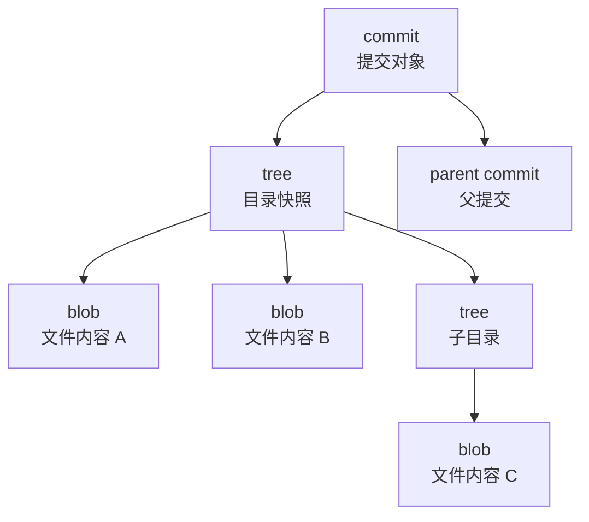

分支本质上只是一个指向 commit 的引用。

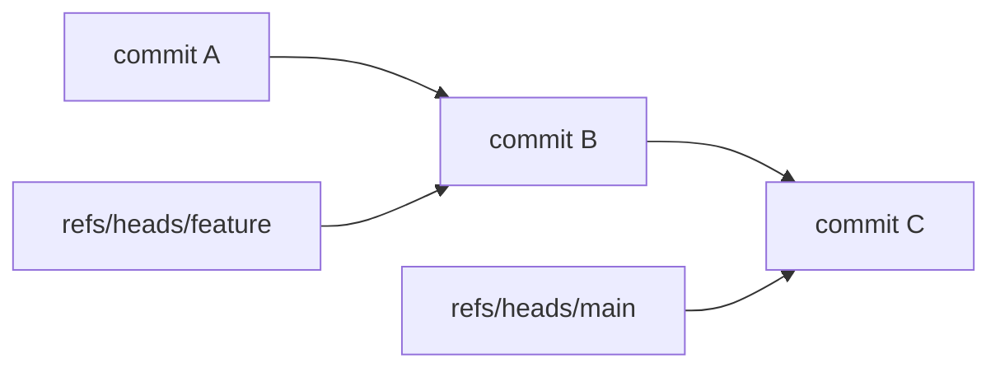

这也是为什么 Git 创建分支非常快：它并不是复制整个项目，而是创建一个新的指针。

------

## 常见误区

| 误区                             | 正确认识                               |
| -------------------------------- | -------------------------------------- |
| GitHub 就是 Git                  | Git 是工具，GitHub 是托管平台          |
| commit 后代码就上传了            | commit 只保存到本地，push 才上传       |
| pull 总是安全的                  | pull 可能产生 merge、冲突或复杂历史    |
| `.gitignore` 能忽略已提交文件    | 不能，需要 `git rm --cached`           |
| rebase 比 merge 高级，所以总该用 | rebase 和 merge 适用场景不同           |
| reset 可以随便用                 | reset 会改写历史，公共分支慎用         |
| commit 越少越好                  | 关键是提交清晰、有意义                 |
| 分支越多越专业                   | 分支应服务协作，不应制造复杂度         |
| stash 可以长期保存工作           | stash 容易遗忘，长期工作应建分支或提交 |
| 强推只是普通 push                | `push --force` 可能覆盖他人提交        |

------

## 团队最佳实践

### 仓库层面

| 建议             | 说明                               |
| ---------------- | ---------------------------------- |
| 保护主分支       | 禁止直接 push 到 `main`            |
| 使用 PR / MR     | 所有变更通过评审合并               |
| 开启 CI          | 自动运行测试、构建、代码检查       |
| 要求状态检查通过 | CI 失败不允许合并                  |
| 设置 CODEOWNERS  | 关键模块自动请求负责人评审         |
| 使用模板         | PR 模板、Issue 模板提高沟通质量    |
| 管理敏感信息     | 启用 secret scanning，禁止提交密钥 |

------

### 提交层面

| 建议                  | 说明                            |
| --------------------- | ------------------------------- |
| 小步提交              | 每次提交解决一个明确问题        |
| 提交前检查 diff       | 用 `git diff --staged` 确认内容 |
| 写清楚 commit message | 让历史可读                      |
| 不提交无关格式化      | 避免干扰评审                    |
| 不提交本地配置        | 如个人 IDE、临时文件            |
| 提交可构建状态        | 尽量每个提交都不破坏项目        |

------

### 分支层面

| 建议                 | 说明                          |
| -------------------- | ----------------------------- |
| 使用短期分支         | 尽快合并，减少冲突            |
| 命名统一             | `feature/`、`fix/`、`hotfix/` |
| 定期同步主分支       | 避免长期落后                  |
| 删除已合并分支       | 保持仓库整洁                  |
| 不在公共分支乱改历史 | 避免影响他人                  |

------

### 安全层面

| 建议                 | 说明                             |
| -------------------- | -------------------------------- |
| 不提交密码和 Token   | 使用环境变量或密钥管理系统       |
| 发现泄露立即轮换密钥 | 删除提交不等于密钥安全           |
| 使用 `.env.example`  | 提供配置模板，不包含真实值       |
| 启用签名提交         | 对关键项目可使用 GPG 或 SSH 签名 |
| 限制仓库权限         | 最小权限原则                     |
| 定期审计依赖         | 配合 Dependabot、Renovate 等工具 |

------

## 新手学习路线

推荐按以下顺序学习：

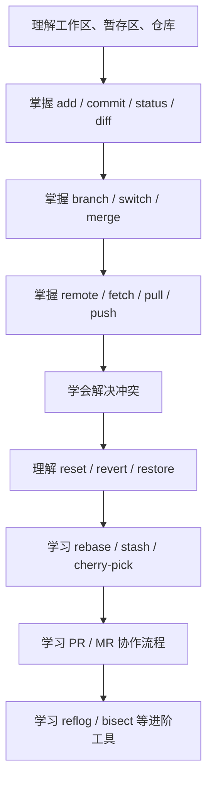

建议练习顺序：

| 阶段 | 练习内容                                |
| ---- | --------------------------------------- |
| 入门 | 本地创建仓库，修改文件，提交历史        |
| 分支 | 创建多个分支，分别修改并合并            |
| 远程 | 推送到 GitHub / GitLab                  |
| 协作 | 模拟两个人修改同一文件并解决冲突        |
| 撤销 | 练习 restore、reset、revert 的差异      |
| 进阶 | 练习 rebase、stash、cherry-pick、reflog |

------

## 常用工作流示例

### 新项目首次上传到远程

```bash
git init
git add .
git commit -m "chore: initial commit"

git branch -M main
git remote add origin https://github.com/user/project.git
git push -u origin main
```

------

### 日常开发新功能

```bash
git switch main
git pull

git switch -c feature/profile-page

# 修改代码
git add .
git commit -m "feat(profile): add profile page"

git push -u origin feature/profile-page
```

然后创建 PR / MR。

------

### 合并前同步主分支

方式一：merge，同步历史完整：

```bash
git switch feature/profile-page
git fetch origin
git merge origin/main
```

方式二：rebase，历史线性：

```bash
git switch feature/profile-page
git fetch origin
git rebase origin/main
```

如果团队允许，功能分支常用 rebase，公共分支避免 rebase。

------

### 撤销未提交修改

```bash
git restore <file>
```

撤销所有未提交修改：

```bash
git restore .
```

------

### 撤销已暂存文件

```bash
git restore --staged <file>
```

------

### 安全撤销已推送提交

```bash
git revert <commit>
git push
```

------

### 删除已合并分支

删除本地分支：

```bash
git branch -d feature/profile-page
```

删除远程分支：

```bash
git push origin --delete feature/profile-page
```

------

## 推荐记住的核心命令

新手先记住这些就可以完成大部分工作：

| 命令                                         | 用途               |
| -------------------------------------------- | ------------------ |
| `git status`                                 | 查看状态           |
| `git diff`                                   | 查看未暂存差异     |
| `git diff --staged`                          | 查看已暂存差异     |
| `git add`                                    | 添加到暂存区       |
| `git commit`                                 | 提交               |
| `git log --oneline --graph --decorate --all` | 查看历史           |
| `git switch`                                 | 切换分支           |
| `git switch -c`                              | 创建并切换分支     |
| `git merge`                                  | 合并分支           |
| `git fetch`                                  | 获取远程更新       |
| `git pull`                                   | 拉取远程更新并合并 |
| `git push`                                   | 推送               |
| `git restore`                                | 恢复文件           |
| `git revert`                                 | 安全撤销提交       |
| `git stash`                                  | 临时保存修改       |
| `git reflog`                                 | 查看本地操作记录   |

------

## 最小心智模型

如果只记住一套模型，可以记住下面这几句话：

| 规则                            | 解释                         |
| ------------------------------- | ---------------------------- |
| 修改在工作区                    | 你编辑文件，只是改变了工作区 |
| `git add` 放入暂存区            | 表示“这部分我要提交”         |
| `git commit` 保存到本地仓库     | 形成一个可追溯版本           |
| `git push` 上传到远程仓库       | 其他人才能看到你的提交       |
| 分支只是指针                    | 创建分支很轻量               |
| merge 保留历史，rebase 改写历史 | 根据协作场景选择             |
| 公共历史不要随意改写            | 已共享的提交优先用 revert    |
| 提交前先看 diff                 | 避免误提交、漏提交           |
| 不确定先建分支                  | 分支是 Git 中最便宜的保险    |
| 出事先看 reflog                 | 很多误操作可以找回           |

Git 的学习重点不是背所有命令，而是理解：**变更在哪里、历史如何移动、哪些操作会改写历史、哪些操作适合团队协作**。掌握这些后，Git 会从“容易出错的命令集合”变成可靠的开发工具。