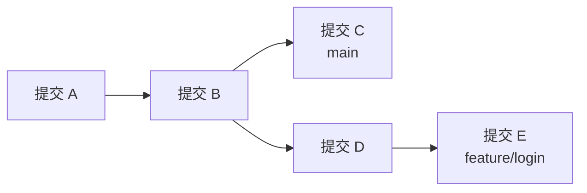
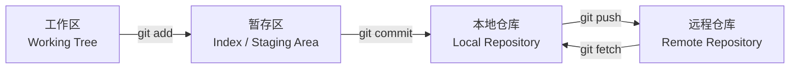
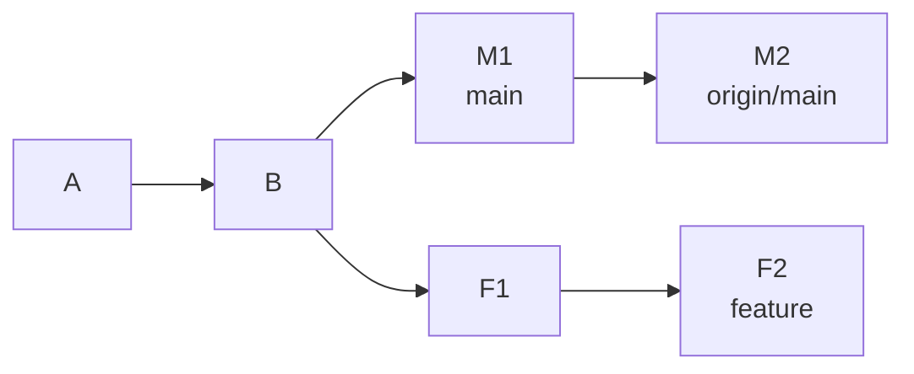
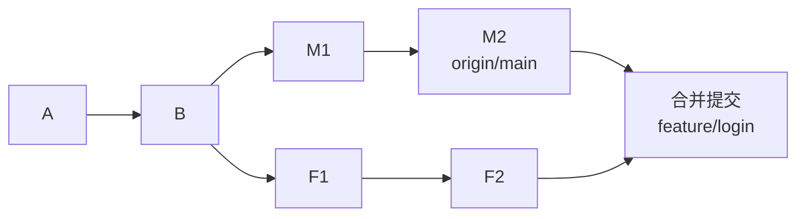
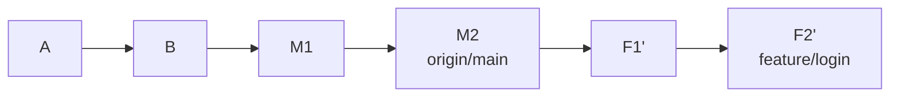
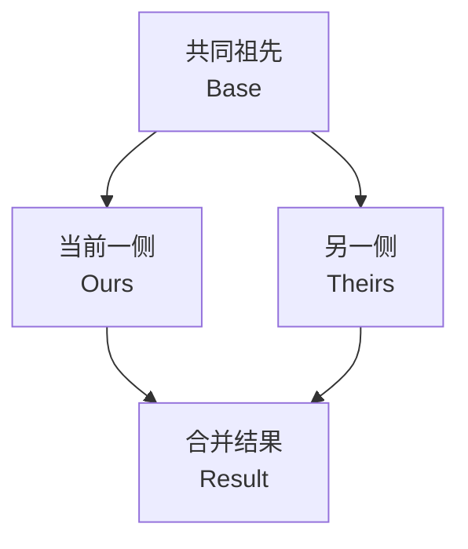

[toc]


## Git 分支管理与冲突处理系统指南

### 内容设计与取舍反馈

本文不按“背命令”的方式讲 Git，而是采用以下顺序：

- 先建立 Git 的底层心智模型，理解提交、分支、`HEAD`、暂存区和远程跟踪分支。
- 再学习分支的创建、同步、整合和删除。
- 将 `merge`、`rebase`、`squash` 放在同一套提交图中比较。
- 从三方合并（Three-way Merge）解释冲突产生的原因。
- 给出可以直接照做的冲突处理标准流程。
- 最后补充团队分支规范、分支保护、历史恢复和进阶工具。

现代命令方面，新手优先使用：

- `git switch`：切换或创建分支。
- `git restore`：恢复文件、取消暂存。
- `git checkout`：仍然有效，但同时承担切换分支和恢复文件两类职责，初学时更容易混淆。 ([Git](https://git-scm.com/docs/git-switch?utm_source=chatgpt.com))

------

### 学习大纲

| 模块         | 核心问题                             | 学习成果                                |
| ------------ | ------------------------------------ | --------------------------------------- |
| Git 心智模型 | Git 究竟保存了什么                   | 理解提交图、快照、引用和 `HEAD`         |
| 本地状态管理 | 工作区和暂存区有什么区别             | 能准确使用 `add`、`restore`、`commit`   |
| 分支基础     | 分支是否复制了整个项目               | 理解分支只是可移动引用                  |
| 远程分支     | `main` 和 `origin/main` 有何区别     | 理解远程跟踪分支和上游分支              |
| 分支生命周期 | 如何创建、发布、同步、合并和删除分支 | 掌握完整功能开发流程                    |
| 分支策略     | 团队应该有多少种长期分支             | 能选择适合项目的工作流                  |
| 合并方法     | `merge`、`rebase`、`squash` 如何选择 | 能控制提交历史形态                      |
| 冲突原理     | 为什么不同文件有时也会冲突           | 理解三方合并和索引阶段                  |
| 冲突处理     | 发生冲突后按什么顺序处理             | 掌握可验证、可撤销的流程                |
| 历史恢复     | 错删分支、错误重置如何恢复           | 掌握 `reflog`、`revert`、`reset`        |
| 团队治理     | 如何降低冲突和误操作                 | 建立分支保护、评审和 CI 规则            |
| 进阶效率     | 如何处理多分支和重复冲突             | 使用 `worktree`、`rerere`、`range-diff` |

------

## Git 的核心心智模型

> 清楚"提交"和"分支"的概念

### Git 保存的是快照和提交关系

可以把**一次提交**（Commit）理解为：

- 项目文件在某个时刻的快照。
- 指向一个或多个父提交的关系。
- 作者、提交者、时间和提交说明等元数据。

**多个提交**通过父子关系构成一个**有向无环图**（Directed Acyclic Graph，DAG）。

**分支**（Branch）不是项目文件的副本，而是一个**指向某个提交的可移动"引用"**（Movable Reference）。

在分支上产生**新提交**后，分支**引用向前移动**。 ([Git](https://git-scm.com/docs/gitglossary?utm_source=chatgpt.com))



图中：

- `main` (分支引用)指向提交 C。
- `feature/login` 指向提交 E。
- 两条分支共同拥有 A、B 的历史。
- 创建分支并不会复制 A、B 或项目目录。

### 工作区、暂存区和仓库



| 区域     | 英文术语             | 保存的内容               | 常用命令                          |
| -------- | -------------------- | ------------------------ | --------------------------------- |
| 工作区   | Working Tree         | 当前实际文件             | `git restore`、编辑器             |
| 暂存区   | Index / Staging Area | 下一次提交准备包含的内容 | `git add`、`git restore --staged` |
| 本地仓库 | Local Repository     | 提交、分支、标签等对象   | `git commit`、`git branch`        |
| 远程仓库 | Remote Repository    | 用于团队交换数据的仓库   | `git fetch`、`git push`           |

一个文件可能同时存在三个版本：

- `HEAD` 中已经提交的版本。
- 暂存区中的版本。
- 工作区中的版本。

因此下面三个命令查看的是不同差异：

```bash
# 工作区与暂存区之间的差异
git diff

# 暂存区与 HEAD 之间的差异
git diff --staged

# 工作区与 HEAD 的整体差异
git diff HEAD
```

`git status` 会同时报告暂存区相对 `HEAD` 的变化、工作区相对暂存区的变化，以及未跟踪文件。 ([Git](https://git-scm.com/docs/git-status?utm_source=chatgpt.com))

### HEAD 是什么

`HEAD` 表示当前操作位置。

通常情况下，`HEAD` 间接指向当前分支：

```text
HEAD -> feature/login -> 提交 E
```

提交一次后：

```text
HEAD -> feature/login -> 提交 F
```

在分离头指针状态（Detached HEAD）中，`HEAD` 直接指向提交，而不是分支：

```text
HEAD -> 提交 C
```

可以在分离状态中查看代码和做实验，但新提交不会自动受到普通分支名保护。需要保留时，应立即创建分支：

```bash
git switch -c experiment/save-work
```

`git switch --detach <commit>` 可以显式进入分离状态。 ([Git](https://git-scm.com/docs/user-manual?utm_source=chatgpt.com))

------

## 建议的新手配置

先确认版本和身份：

```bash
git --version

git config --global user.name "Your Name"
git config --global user.email "you@example.com"
```

以下配置适合作为学习起点：

```bash
# 新仓库默认主分支名
git config --global init.defaultBranch main

# 获取远程更新时清理已经失效的远程跟踪分支
git config --global fetch.prune true

# 冲突中显示共同祖先版本
git config --global merge.conflictStyle zdiff3

# 记录并复用曾经人工解决过的冲突
git config --global rerere.enabled true

# 首次推送新分支时自动建立上游关系
git config --global push.autoSetupRemote true

# git pull 只接受快进，分叉时要求显式选择处理方式
git config --global pull.ff only
```

`fetch.prune` 清理的是已经不存在于远程的远程跟踪引用，例如失效的 `origin/feature-x`，不是自动删除你的本地分支。`zdiff3` 会在冲突块中显示共同祖先，同时省略部分重复上下文，通常比默认格式更容易判断两边修改意图。`rerere` 会记录人工解决结果，以便未来遇到相同冲突时复用，但复用后的结果仍然需要测试和检查。 ([Git](https://git-scm.com/docs/git-fetch.html?utm_source=chatgpt.com))

`pull.ff only` 是一种偏保守的选择：远程与本地发生分叉时，`git pull` 不会偷偷制造合并提交，而是停止并要求开发者明确执行 `merge` 或 `rebase`。团队也可以统一采用 `pull.rebase true`，但不应让每个人使用不一致的默认行为。 ([Git](https://git-scm.com/docs/git-pull/2.47.1?utm_source=chatgpt.com))

查看配置来源：

```bash
git config --list --show-origin
```

------

## 分支的核心概念

### 本地分支、远程分支和远程跟踪分支

假设远程仓库名为 `origin`。

| 名称                   | 类型         | 实际含义                                       |
| ---------------------- | ------------ | ---------------------------------------------- |
| `main`                 | 本地分支     | 本地可以直接提交和移动的分支                   |
| `feature/login`        | 本地分支     | 本地功能开发分支                               |
| `origin/main`          | 远程跟踪分支 | 上次获取远程数据后，本地记录的远程 `main` 位置 |
| `origin/feature/login` | 远程跟踪分支 | 本地记录的远程功能分支位置                     |
| `origin`               | Remote       | 一个远程仓库配置名称                           |
| `HEAD`                 | 当前引用     | 当前所在分支或提交                             |

必须注意：

> `origin/main` 不是一个需要联网才能读取的“实时远程分支”。

它是本地仓库中的只读式跟踪引用。只有执行 `git fetch` 等操作后，它才会更新为远程仓库的最新状态。 ([Git](https://git-scm.com/docs/git-fetch/2.43.0?utm_source=chatgpt.com))

查看远程配置：

```bash
git remote -v
git remote show origin
```

获取远程更新：

```bash
git fetch origin
```

获取并清理失效跟踪分支：

```bash
git fetch --prune origin
```

### 上游分支

上游分支（Upstream Branch）是当前本地分支默认关联的远程跟踪分支。

例如：

```text
本地 feature/login
    跟踪 origin/feature/login
```

建立关系：

```bash
git push -u origin feature/login
```

或者后续设置：

```bash
git branch --set-upstream-to=origin/feature/login
```

查看关系：

```bash
git branch -vv
```

设置上游后，通常可以直接使用：

```bash
git push
git fetch
```

`git pull` 也会根据上游配置决定获取和整合哪个分支；不过在需要精确控制历史时，更建议将“获取”和“整合”拆开执行。上游关系由分支对应的 remote 和 merge 配置共同定义。 ([Git](https://git-scm.com/docs/git-branch?utm_source=chatgpt.com))

------

## 分支的日常操作

### 查看分支

```bash
# 本地分支
git branch

# 远程跟踪分支
git branch -r

# 全部
git branch -a

# 查看当前分支
git branch --show-current

# 查看上游关系和领先、落后信息
git branch -vv
```

查看提交图：

```bash
git log --graph --oneline --decorate --all
```

### 创建和切换分支

从当前位置创建：

```bash
git switch -c feature/login
```

从最新远程主分支创建：

```bash
git fetch origin
git switch -c feature/login origin/main
```

切换已有分支：

```bash
git switch feature/login
```

只创建、不切换：

```bash
git branch feature/login
```

现代 Git 中，`git switch -c` 同时完成创建和切换；`git branch` 只创建引用，不改变当前工作区。 ([Git](https://git-scm.com/docs/git-switch?utm_source=chatgpt.com))

### 发布分支

```bash
git push -u origin feature/login
```

推荐第一次显式写出远程和分支名，便于确认推送目标。

之后可以使用：

```bash
git push
```

### 重命名分支

重命名当前分支：

```bash
git branch -m feature/auth-login
```

远程已经存在旧分支时：

```bash
git push -u origin feature/auth-login
git push origin --delete feature/login
```

确认新的 Pull Request、CI 规则或文档引用已经更新，再删除旧分支。

### 删除分支

删除已经合并的本地分支：

```bash
git branch -d feature/login
```

强制删除尚未合并的本地分支：

```bash
git branch -D feature/login
```

删除远程分支：

```bash
git push origin --delete feature/login
```

推荐顺序：

```bash
git switch main
git fetch origin
git merge --ff-only origin/main
git branch -d feature/login
git push origin --delete feature/login
```

`-d` 会进行是否已合并的安全检查；`-D` 跳过检查。不要把 `-D` 当作日常默认操作。

------

## 分支命名规范

Git 不强制下面的格式，它们是团队约定示例：

| 类型     | 示例                     | 用途                     |
| -------- | ------------------------ | ------------------------ |
| 功能     | `feat/login-oauth`       | 新功能                   |
| 缺陷修复 | `fix/payment-timeout`    | 普通缺陷                 |
| 紧急修复 | `hotfix/token-leak`      | 生产紧急问题             |
| 重构     | `refactor/order-service` | 不改变外部行为的结构调整 |
| 文档     | `docs/api-auth`          | 文档修改                 |
| 测试     | `test/cart-checkout`     | 测试相关                 |
| 工程工作 | `chore/update-build`     | 依赖、构建或工具调整     |
| 发布     | `release/2.4`            | 特定发布线               |

建议规则：

- 使用小写字母和连字符。
- 名称表达工作目标，而不是开发者名字。
- 可以带工单编号，例如 `fix/PROJ-142-payment-timeout`。
- 一个分支只处理一个主要目标。
- 合并后及时删除短期分支。
- 避免长期存在的个人综合分支，如 `alice-work`。
- 不要使用容易和标签混淆的纯版本号分支名。

------

## 分支生命周期

一个短期功能分支的推荐流程：

```bash
# 更新远程状态
git fetch --prune origin

# 从远程主分支创建功能分支
git switch -c feature/login origin/main

# 开发并分批提交
git add src/login.js
git commit -m "Add login form validation"

git add tests/login.test.js
git commit -m "Add login validation tests"

# 发布并建立上游关系
git push -u origin feature/login
```

之后：

- 创建草稿 Pull Request（Draft Pull Request）。
- 尽早接受设计和实现反馈。
- 持续让分支跟上 `main`。
- 通过测试和代码评审后合并。
- 删除远程与本地功能分支。

GitHub Flow 的核心也是从主分支创建分支、提交、创建 Pull Request、评审、合并和删除分支。Pull Request 可以在工作未完成时作为草稿提前开放。 ([GitHub Docs](https://docs.github.com/en/get-started/using-github/github-flow?utm_source=chatgpt.com))

------

## 如何让功能分支跟上主分支

假设当前历史：



功能分支和主分支已经分叉。常见处理方式有两种。

### 方法：把主分支合并到功能分支

```bash
git fetch origin
git switch feature/login
git merge origin/main
```

结果大致为：



优点：

- 不改写已有提交。
- 对共享分支更加安全。
- 保留真实分叉与整合关系。
- 一次合并通常集中解决冲突。

缺点：

- 经常同步时可能产生许多合并提交。
- 提交图更复杂。

### 方法：把功能提交变基到主分支

```bash
git fetch origin
git switch feature/login
git rebase origin/main
```

结果大致为：



`F1'` 和 `F2'` 是重新生成的提交，不是原来的 `F1` 和 `F2`。即使文件内容相同，父提交发生变化后，提交标识也会变化。`rebase` 的本质是把一系列提交的修改重新应用到新的起点。 ([Git](https://git-scm.com/docs/git-rebase?utm_source=chatgpt.com))

优点：

- 历史线性、便于阅读。
- 功能提交看起来像直接基于最新主分支开发。
- 合并时可能直接快进。

缺点：

- 会改写提交历史。
- 冲突可能在重放多个提交时反复出现。
- 已发布并被他人依赖的分支不应随意变基。

### 选择表

| 情况                       | 更适合 Merge | 更适合 Rebase  |
| -------------------------- | ------------ | -------------- |
| 分支只有自己使用           | 可以         | 推荐考虑       |
| 多人共同提交到同一功能分支 | 推荐         | 需要协调       |
| 分支历史已被下游依赖       | 推荐         | 通常避免       |
| 团队要求线性历史           | 不一定       | 推荐           |
| 需要保留真实合并节点       | 推荐         | 不适合         |
| 提交需要按顺序清理         | 不适合       | 推荐交互式变基 |
| 不确定是否能改写历史       | 推荐         | 暂不使用       |

简单原则：

> 可以整理尚未共享的历史；不要擅自改写他人可能已经基于其工作的历史。

------

## Merge、Rebase 和 Squash

### 快进合并

如果当前分支是目标提交的祖先，只需要移动分支指针，不需要新建合并提交，这称为快进（Fast-forward）。

```bash
git switch main
git merge --ff-only feature/login
```

`--ff-only` 表示只能快进，否则停止。

### 普通合并提交

```bash
git switch main
git merge --no-ff feature/login
```

`--no-ff` 即使可以快进，也创建一个合并提交。

Git 官方定义：

- `--ff`：可以快进时移动指针，否则建立合并提交。
- `--no-ff`：始终创建合并提交。
- `--ff-only`：只能快进，否则拒绝合并。 ([Git](https://git-scm.com/docs/git-merge?utm_source=chatgpt.com))

### Squash 合并

```bash
git switch main
git merge --squash feature/login
git commit -m "Add login feature"
```

它把功能分支的最终文件变化准备为一次新提交，但不保留功能分支提交作为主分支祖先。

| 方法             | 主分支结果       | 是否保留功能分支每个提交 | 是否保留合并关系 |
| ---------------- | ---------------- | ------------------------ | ---------------- |
| Merge commit     | 新建合并提交     | 是                       | 是               |
| Squash merge     | 一个新的综合提交 | 否                       | 否               |
| Rebase and merge | 逐个重放功能提交 | 是，但提交标识改变       | 否               |
| Fast-forward     | 直接移动主分支   | 是                       | 没有额外合并节点 |

Squash 更适合短期分支和“一次 Pull Request 对应一个逻辑变更”的模式。Squash 后不要继续复用同一功能分支，应删除并从新主分支重新创建，否则后续比较和冲突可能变得复杂。 ([GitHub Docs](https://docs.github.com/en/pull-requests/reference/pull-request-merges?utm_source=chatgpt.com))

### 推荐策略

对多数中小型应用团队：

- `main` 始终保持可构建、可测试。
- 使用短期功能分支。
- 通过 Pull Request 合并。
- 一个 Pull Request 对应一个逻辑改动。
- 默认使用 Squash merge。
- 需要保留完整分支历史时使用 Merge commit。
- 只有提交本身经过精心组织时才使用 Rebase and merge。

对于开源补丁系列、内核式开发或强调每个提交独立可审查的项目，保留精心设计的提交序列通常更加重要。

------

## 分支策略选择

| 策略                 | 长期分支                           | 适合场景                     | 主要风险                 |
| -------------------- | ---------------------------------- | ---------------------------- | ------------------------ |
| 主干开发             | 通常只有 `main`                    | 高频集成、自动化测试完善     | 对 CI 和小批量提交要求高 |
| 短期功能分支         | `main` 加短期分支                  | 大多数 Web、服务端和产品团队 | 分支存活过久会增加冲突   |
| 发布分支模式         | `main` 加 `release/*`              | 同时维护多个发布版本         | 修复需要在多个发布线传播 |
| Git Flow 类模式      | `main`、`develop`、release、hotfix | 发布周期固定、流程严格的产品 | 分支多、合并路径复杂     |
| Fork 加 Pull Request | 上游主分支加个人 Fork              | 开源项目、外部贡献           | 上游同步和权限管理更复杂 |

经验性建议：

- 默认从“短期功能分支”开始。
- 只有存在明确的业务需求时才增加长期分支。
- 不要因为流程图看起来完整就采用复杂分支模型。
- 分支数量不是成熟度指标；稳定的自动化检查和明确的发布规则更重要。

------

## 冲突为什么发生

### 冲突不是“两个分支修改了同一个文件”

这是不完整的说法。

Git 会寻找两个分支的最佳共同祖先，也就是合并基准（Merge Base），然后比较：

- 共同祖先到当前分支发生了什么变化。
- 共同祖先到另一分支发生了什么变化。

如果两组变化能够组合，Git 自动合并；如果无法可靠判断最终意图，Git 停止并要求人工解决。这就是三方合并（Three-way Merge）。 ([Git](https://git-scm.com/docs/git-merge-base?utm_source=chatgpt.com))



### 常见冲突类型

| 类型           | 含义                             | 常见处理思路                     |
| -------------- | -------------------------------- | -------------------------------- |
| 内容冲突       | 双方修改了重叠文本区域           | 理解两边意图后重新编写最终内容   |
| 双方新增       | 双方在同一路径新增不同文件       | 合并内容或保留其中一个           |
| 修改与删除     | 一方修改文件，另一方删除         | 判断文件是否仍应存在             |
| 双方删除       | 双方均删除                       | 通常确认删除                     |
| 重命名冲突     | 双方以不同方式重命名             | 选择最终路径并检查引用           |
| 目录与文件冲突 | 一侧创建目录，另一侧创建同名文件 | 重新设计路径                     |
| 二进制冲突     | 图片、压缩包等不能文本合并       | 选择版本或使用专用工具           |
| 子模块冲突     | 两边指向不同子模块提交           | 进入子模块确认正确提交           |
| 行尾冲突       | LF 与 CRLF 或全文件格式化        | 先统一属性和格式，再处理业务变化 |

### `git status --short` 的冲突代码

| 状态 | 含义                         |
| ---- | ---------------------------- |
| `UU` | 双方都修改                   |
| `AA` | 双方都新增                   |
| `DD` | 双方都删除                   |
| `AU` | 当前一侧新增，另一侧存在冲突 |
| `UA` | 另一侧新增，当前一侧存在冲突 |
| `UD` | 当前一侧修改，另一侧删除     |
| `DU` | 当前一侧删除，另一侧修改     |

这些路径称为未合并路径（Unmerged Paths）。Git 的状态格式也用于 rebase、cherry-pick 等依赖合并机制的操作。 ([Git](https://git-scm.com/docs/git-status.html?utm_source=chatgpt.com))

------

## 理解冲突标记

默认冲突可能显示为：

```text
<<<<<<< HEAD
const timeout = 3000;
=======
const timeout = 5000;
>>>>>>> feature/payment
```

含义：

- `<<<<<<<` 到 `=======`：一侧内容。
- `=======` 到 `>>>>>>>`：另一侧内容。
- 标记本身必须在解决后删除。

启用 `zdiff3` 后还会显示共同祖先：

```text
<<<<<<< HEAD
const timeout = 3000;
||||||| parent
const timeout = 1000;
=======
const timeout = 5000;
>>>>>>> feature/payment
```

这里可以看出：

- 原来是 `1000`。
- 一侧改为 `3000`。
- 另一侧改为 `5000`。

但正确答案不一定是二选一。最终可能需要：

```javascript
const timeout = config.paymentTimeout;
```

冲突处理的目标不是“让 Git 不再报错”，而是生成符合当前业务意图的第三个版本。

------

## 冲突处理标准流程

### 开始前保证状态可控

```bash
git status
```

如果存在未提交工作，优先选择：

- 完成并提交一个合理的阶段性提交。
- 暂时搁置。
- 使用另一个工作区处理紧急任务。

暂存所有未提交修改：

```bash
git stash push -u -m "WIP before syncing main"
```

恢复：

```bash
git stash pop
```

不要习惯性依赖自动暂存。官方文档也提示，rebase 的自动暂存在操作结束后重新应用时仍可能产生复杂冲突。 ([Git](https://git-scm.com/docs/git-rebase?utm_source=chatgpt.com))

### Merge 冲突处理流程

```bash
git fetch origin
git switch feature/login
git merge origin/main
```

若发生冲突：

```bash
# 查看总体状态
git status

# 只列出尚未解决的文件
git diff --name-only --diff-filter=U

# 查看冲突内容
git diff
```

编辑文件，形成正确结果，然后：

```bash
git add src/login.js
git add tests/login.test.js
```

确认还有没有冲突：

```bash
git diff --name-only --diff-filter=U
git status
```

运行测试：

```bash
npm test
```

继续完成合并：

```bash
git merge --continue
```

也可以直接：

```bash
git commit
```

放弃整个合并：

```bash
git merge --abort
```

官方合并流程也是：编辑冲突文件，通过 `git add` 或 `git rm` 标记解决，然后执行 `git merge --continue`；不准备继续时使用 `git merge --abort`。 ([Git](https://git-scm.com/docs/git-merge?utm_source=chatgpt.com))

### Rebase 冲突处理流程

```bash
git fetch origin
git switch feature/login
git rebase origin/main
```

发生冲突后：

```bash
git status
git diff
```

编辑并标记：

```bash
git add src/login.js
git rebase --continue
```

如果后续提交再次冲突，重复：

```text
查看 -> 理解 -> 编辑 -> 暂存 -> 测试 -> 继续
```

放弃整个变基：

```bash
git rebase --abort
```

跳过当前正在重放的提交：

```bash
git rebase --skip
```

`--skip` 会直接丢弃当前提交的修改，只应在确认该提交已经不需要，或其内容已经完整存在于新基线时使用。

查看正在重放的补丁：

```bash
git rebase --show-current-patch
```

### Cherry-pick 冲突处理流程

```bash
git cherry-pick <commit>
```

解决后：

```bash
git add <files>
git cherry-pick --continue
```

放弃：

```bash
git cherry-pick --abort
```

跳过：

```bash
git cherry-pick --skip
```

Cherry-pick 会把指定提交带来的变化应用到当前分支，并产生新的提交。它适合有选择地传播修复，但大量使用可能造成重复提交和复杂历史。 ([Git](https://git-scm.com/docs/git-cherry-pick?utm_source=chatgpt.com))

------

## `ours` 和 `theirs` 的陷阱

### 在普通 merge 中

假设：

```bash
git switch feature/login
git merge origin/main
```

通常：

- `ours`：当前分支 `feature/login`。
- `theirs`：正在合入的 `origin/main`。

选择当前一侧文件：

```bash
git restore --ours src/config.js
git add src/config.js
```

选择另一侧文件：

```bash
git restore --theirs src/config.js
git add src/config.js
```

### 在 rebase 中

rebase 的视角容易违反直觉。

执行：

```bash
git switch feature/login
git rebase origin/main
```

发生冲突时，Git 正在把功能分支提交逐个重放到 `origin/main` 上，因此：

- `ours` 通常表示新的上游基线和已经完成重放的部分。
- `theirs` 通常表示当前正在重放的功能分支工作。

官方文档明确提示，在 `rebase` 和 `pull --rebase` 中，`ours` 与 `theirs` 看起来可能是互换的。不要只凭英文名称选择版本。 ([Git](https://git-scm.com/docs/git-restore.html?utm_source=chatgpt.com))

更稳妥的方法是查看三个索引阶段：

```bash
# Stage 1：共同祖先
git show :1:src/config.js

# Stage 2：ours
git show :2:src/config.js

# Stage 3：theirs
git show :3:src/config.js
```

冲突时，索引可以为一个路径保存：

- Stage 1：共同祖先。
- Stage 2：一侧。
- Stage 3：另一侧。 ([Git](https://git-scm.com/docs/git-ls-files.html?utm_source=chatgpt.com))

------

## 不要滥用自动选择一侧

以下命令看似快捷：

```bash
git merge -Xours other-branch
git merge -Xtheirs other-branch
```

它们表示：发生冲突的块优先选某一侧，但没有冲突的另一侧变化仍然可能进入结果。

这与下面的 `ours` 合并策略完全不同：

```bash
git merge -s ours other-branch
```

`-s ours` 会忽略另一棵树的实际文件内容，只建立历史上的合并关系。它是非常特殊的工具，不应当用来普通解决冲突。官方文档特别区分了 `-Xours` 合并选项和 `-s ours` 合并策略。 ([Git](https://git-scm.com/docs/git-merge?utm_source=chatgpt.com))

原则：

- 不要为“快速消除冲突”对整个仓库使用 `ours` 或 `theirs`。
- 逐文件、逐冲突块理解意图。
- 自动选择后也必须运行测试和检查差异。

------

## 冲突解决后的验证

仅看到 `git status` 不再报告冲突并不代表结果正确。

至少执行：

```bash
# 确认没有遗留冲突文件
git diff --name-only --diff-filter=U

# 检查已经暂存的最终结果
git diff --staged

# 检查空白符问题
git diff --check

# 运行项目测试
npm test

# 查看提交图
git log --graph --oneline --decorate -15
```

还可以搜索遗留标记：

```bash
git grep -n "<<<<<<<"
git grep -n ">>>>>>>"
```

注意：某些测试数据或文档可能合法包含这些字符串，因此搜索结果需要人工判断。

最终检查重点：

- 两边功能是否同时保留。
- 删除是否是有意的。
- 函数签名和调用方是否一致。
- 配置项是否重复。
- 数据库迁移是否保持正确顺序。
- 锁文件是否由正确工具重新生成。
- 测试是否覆盖冲突发生的业务路径。

------

## 典型冲突案例

### 同一区域内容冲突

主分支：

```javascript
function calculateTotal(items) {
  return items.reduce((sum, item) => sum + item.price, 0);
}
```

功能分支：

```javascript
function calculateTotal(items) {
  return items.reduce(
    (sum, item) => sum + item.price * item.quantity,
    0
  );
}
```

另一分支可能加入折扣：

```javascript
function calculateTotal(items, discount) {
  const subtotal = items.reduce((sum, item) => sum + item.price, 0);
  return subtotal - discount;
}
```

正确解决通常不是简单选择一侧，而是组合需求：

```javascript
function calculateTotal(items, discount = 0) {
  const subtotal = items.reduce(
    (sum, item) => sum + item.price * item.quantity,
    0
  );

  return subtotal - discount;
}
```

随后应补充：

- 数量大于一的测试。
- 默认无折扣测试。
- 有折扣测试。
- 空购物车测试。

### 修改与删除冲突

`git status` 可能显示：

```text
deleted by them: src/legacy-api.js
```

需要先回答：

- 文件删除是因为功能废弃，还是移动到了新路径？
- 当前修改是否应迁移到替代文件？
- 其他模块是否仍引用旧文件？

决定保留文件：

```bash
git add src/legacy-api.js
```

决定删除文件：

```bash
git rm src/legacy-api.js
```

### 双方新增同一路径

双方都新增 `config/app.yml`，但内容不同。

处理方式：

- 合并为一个正确配置。
- 将环境相关部分拆分到不同文件。
- 选择一侧后补入另一侧必要内容。
- 检查秘密信息是否误入仓库。

### 锁文件冲突

例如：

- `package-lock.json`
- `pnpm-lock.yaml`
- `yarn.lock`
- `Cargo.lock`

通常不要手工逐行拼接复杂锁文件。

更稳妥的思路：

```bash
# 先正确合并依赖声明文件
# 例如 package.json

# 删除冲突锁文件后，用项目指定的包管理器重新生成
npm install

git add package.json package-lock.json
```

具体操作必须遵守项目固定的包管理器和版本。

### 二进制文件冲突

Git 通常无法语义合并图片、办公文档、压缩包等二进制文件。

处理策略：

- 选择其中一个版本。
- 在专用软件中重新生成合并版本。
- 将大型二进制资产移出普通源码协作流程。
- 对大型资源考虑 Git LFS，但应由团队统一配置。

### 数据库迁移冲突

两个分支可能都创建了相同序号：

```text
migration_042_add_orders.sql
migration_042_add_payments.sql
```

即使 Git 没有文本冲突，迁移系统也可能发生逻辑冲突。

处理方式：

- 调整迁移编号或时间戳。
- 检查迁移依赖顺序。
- 在空数据库上完整执行。
- 在现有版本数据库上进行升级测试。
- 不要随意修改已经在生产环境执行过的迁移。

------

## 如何减少冲突

### 缩短分支寿命

分支存在时间越长，与主分支发生语义偏离的机会越多。

推荐：

- 将大功能拆成多个可独立合并的小改动。
- 使用功能开关（Feature Flag）隐藏未开放功能。
- 尽早创建草稿 Pull Request。
- 每天或按合理频率获取主分支变化。
- 不要让功能分支连续存在数周而不集成。

### 减少无关格式化

避免在业务改动中同时进行：

- 全项目格式化。
- 大范围文件移动。
- 自动排序所有导入。
- 全局换行符转换。
- 批量重命名。

更好的做法：

- 将机械格式化放在独立提交或独立 Pull Request。
- 团队统一格式化工具和版本。
- 在 CI 中验证格式。
- 大型重构提前通知相关开发者。

### 统一行尾规则

可在仓库中提交 `.gitattributes`：

```gitattributes
* text=auto

*.sh text eol=lf
*.py text eol=lf
*.js text eol=lf
*.bat text eol=crlf
*.cmd text eol=crlf

*.png binary
*.jpg binary
*.zip binary
```

`.gitattributes` 可以对仓库中文件的文本识别和工作区行尾形式进行统一控制。首次引入时应单独提交规范化变化，避免与业务修改混在一起。 ([Git](https://git-scm.com/docs/gitattributes/2.50.0?utm_source=chatgpt.com))

### 明确代码所有权

对于高冲突区域：

- 指定主要维护者。
- 提交前沟通接口变更。
- 使用 `CODEOWNERS` 或类似机制要求相关人员评审。
- 将大型共享文件拆分成职责更单一的模块。
- 避免多人同时修改集中式配置文件。

------

## `git pull` 应该怎样使用

`git pull` 本质上先执行 `fetch`，然后将远程变化整合进当前分支。整合方式可能是 merge、rebase 或仅快进，取决于参数和配置。 ([Git](https://git-scm.com/docs/git-pull?utm_source=chatgpt.com))

新手常见问题是直接执行：

```bash
git pull
```

却不知道它将：

- 更新哪个远程。
- 获取哪个上游分支。
- 使用 merge 还是 rebase。
- 是否创建新的合并提交。

学习阶段推荐拆开：

```bash
git fetch origin
git status
git log --graph --oneline --decorate --all
```

然后明确选择：

```bash
# 让本地主分支只快进
git switch main
git merge --ff-only origin/main
```

或者：

```bash
# 将私人功能分支变基到远程主分支
git switch feature/login
git rebase origin/main
```

或者：

```bash
# 将远程主分支合并进共享功能分支
git switch feature/login
git merge origin/main
```

------

## 安全推送与历史改写

普通推送要求远程分支能够快进：

```bash
git push
```

如果本地对已经推送的提交进行了 rebase 或 amend，普通推送会被拒绝。

不要习惯性使用：

```bash
git push --force
```

更安全的是：

```bash
git push --force-with-lease
```

`--force-with-lease` 会检查远程分支是否仍处于本地预期的位置；如果别人已经推进远程分支，通常会拒绝覆盖。普通 `--force` 可能直接丢失别人的提交。 ([Git](https://git-scm.com/docs/git-push?utm_source=chatgpt.com))

但 `--force-with-lease` 仍需遵守：

- 只对自己负责的短期分支使用。
- 不对 `main`、发布分支等共享分支使用。
- 推送前执行 `git fetch origin`。
- 查看 `git status` 和提交图。
- 通知正在共同使用该分支的人。
- 远程平台应禁止对保护分支强制推送。

------

## 团队分支管理最佳实践

### 保护主分支

重要分支建议启用：

- 禁止直接推送。
- 禁止删除。
- 禁止强制推送。
- 必须通过 Pull Request。
- 必须通过至少一次批准评审。
- 必须通过 CI 状态检查。
- 必须解决全部评审意见。
- 根据项目需求要求线性历史、签名提交或代码所有者批准。

GitHub 的受保护分支和规则集能够限制删除、强制推送，并要求评审、状态检查、线性历史或签名提交。 ([GitHub Docs](https://docs.github.com/repositories/configuring-branches-and-merges-in-your-repository/managing-protected-branches/about-protected-branches?utm_source=chatgpt.com))

### 推荐团队政策模板

| 项目         | 推荐规则                       |
| ------------ | ------------------------------ |
| 默认分支     | `main`                         |
| 直接推送     | 禁止                           |
| 功能开发     | 使用短期分支                   |
| Pull Request | 必须                           |
| CI           | 构建、测试、静态检查必须通过   |
| 评审         | 至少一名非作者批准             |
| 合并方式     | 团队统一，默认可选 Squash      |
| 强制推送     | 保护分支禁止；个人分支谨慎允许 |
| 分支清理     | 合并后删除                     |
| 发布标记     | 使用带版本号的标签             |
| 紧急修复     | 从实际发布基线创建             |
| 冲突责任     | 功能分支作者负责解决并验证     |

### 合并队列

在多人高频合入的仓库中，即使每个 Pull Request 单独通过测试，多个 Pull Request 连续合入后仍可能互相不兼容。

合并队列（Merge Queue）可按顺序构建临时合并结果并运行检查，减少“评审时是绿色，真正合并后主分支变红”的问题。GitHub 官方将其定位为在繁忙分支上自动化合并并验证兼容性的机制。 ([GitHub Docs](https://docs.github.com/en/repositories/configuring-branches-and-merges-in-your-repository/configuring-pull-request-merges/managing-a-merge-queue?utm_source=chatgpt.com))

------

## 撤销与恢复

### 取消工作区修改

恢复单个文件到暂存区版本：

```bash
git restore src/app.js
```

这是破坏性操作，未提交修改会丢失。

### 取消暂存

```bash
git restore --staged src/app.js
```

文件修改仍保留在工作区。

### 修改最后一次提交

```bash
git add forgotten-file.js
git commit --amend
```

`amend` 会生成一个新的提交。若原提交已经推送，后续可能需要安全的强制推送。

### 撤销已经共享的提交

```bash
git revert <commit>
```

`revert` 生成一个反向修改的新提交，不删除原有历史，适合共享分支。

```bash
git revert <merge-commit>
```

撤销合并提交需要指定主线父提交，且会影响未来再次合并同一历史的行为，因此必须谨慎。Git 官方特别提示，撤销合并表示不再需要该合并带入的树变化，可能影响后续合并结果。 ([Git](https://git-scm.com/docs/git-revert.html?utm_source=chatgpt.com))

### Reset 的三种常见模式

| 命令                         | 移动分支 | 重置暂存区 | 重置工作区 |
| ---------------------------- | -------- | ---------- | ---------- |
| `git reset --soft <commit>`  | 是       | 否         | 否         |
| `git reset --mixed <commit>` | 是       | 是         | 否         |
| `git reset --hard <commit>`  | 是       | 是         | 是         |

`--hard` 会丢弃工作区与暂存区修改。执行前至少：

```bash
git status
git log --oneline -10
```

对已经共享的主分支，通常优先使用 `revert` 而不是 `reset`。

### 用 reflog 找回提交

错误 rebase、reset 或删除分支后，提交常常并未立即消失。

查看引用移动历史：

```bash
git reflog
```

可能看到：

```text
abc1234 HEAD@{0}: reset: moving to HEAD~3
def5678 HEAD@{1}: commit: Add payment validation
```

恢复为新分支：

```bash
git switch -c recovery/payment def5678
```

Git 的数据模型文档指出，错误“丢失”的提交通常可以通过引用日志找到其提交标识。 ([Git](https://git-scm.com/docs/gitdatamodel.html?utm_source=chatgpt.com))

------

## 交互式 Rebase

用于整理尚未共享的本地提交：

```bash
git rebase -i HEAD~5
```

常见动作：

| 动作     | 缩写 | 作用                           |
| -------- | ---- | ------------------------------ |
| `pick`   | `p`  | 保留提交                       |
| `reword` | `r`  | 修改提交说明                   |
| `edit`   | `e`  | 停止并修改提交                 |
| `squash` | `s`  | 合并进前一个提交并编辑说明     |
| `fixup`  | `f`  | 合并进前一个提交并丢弃当前说明 |
| `drop`   | `d`  | 删除提交                       |

推荐使用 fixup 提交：

```bash
git commit --fixup=<target-commit>
git rebase -i --autosquash origin/main
```

官方文档推荐通过 `git commit --fixup`、`--squash` 等方式创建自动整理标记，再由交互式 rebase 处理。 ([Git](https://git-scm.com/docs/git-rebase.html?utm_source=chatgpt.com))

整理后可以比较变基前后的补丁系列：

```bash
git range-diff origin/main...feature-before origin/main...feature-after
```

`git range-diff` 用于比较两个提交序列，而不只是比较最终文件快照。 ([Git](https://git-scm.com/docs/git-range-diff?utm_source=chatgpt.com))

------

## 重复冲突与 rerere

启用：

```bash
git config --global rerere.enabled true
```

工作方式：

- 第一次出现冲突时，Git 记录冲突形态。
- 你人工解决并暂存。
- 以后出现相同或可识别的冲突时，Git尝试复用解决结果。

查看状态：

```bash
git rerere status
git rerere diff
git rerere remaining
```

忘记某个错误解决方案：

```bash
git rerere forget path/to/file
```

适合：

- 长期维护的功能分支。
- 多次 rebase 同一补丁系列。
- 发布分支之间重复传播修复。
- 经常试合并和撤销的集成工作。

注意：

> 自动复用只意味着文本结果相似，不意味着业务语义一定正确。

每次仍需查看差异和运行测试。 ([Git](https://git-scm.com/docs/git-rerere?utm_source=chatgpt.com))

------

## 多工作区与紧急切换

开发功能时突然需要处理生产问题，不一定要 stash 或频繁切换分支。

可以使用 `git worktree`：

```bash
# 当前目录继续开发 feature/login
# 在相邻目录检出 main
git worktree add ../project-hotfix -b hotfix/payment origin/main
```

此时：

```text
project/          feature/login
project-hotfix/   hotfix/payment
```

完成后：

```bash
git worktree list
git worktree remove ../project-hotfix
```

一个仓库可以附加多个工作区，从而同时检出多个分支。 ([Git](https://git-scm.com/docs/git-worktree.html?utm_source=chatgpt.com))

适合：

- 功能开发期间处理紧急修复。
- 同时运行不同版本。
- 在一个分支执行长时间测试时修改另一分支。
- 对两个分支进行人工对照。

不要让两个工作区同时检出同一个普通分支。

------

## 经典团队用例

### 功能开发

```bash
git fetch --prune origin
git switch -c feat/order-search origin/main

# 开发
git add src/order-search.js
git commit -m "Add order search service"

git add tests/order-search.test.js
git commit -m "Test order search service"

git push -u origin feat/order-search
```

创建 Pull Request 后：

```bash
git fetch origin
git rebase origin/main
```

解决冲突并测试：

```bash
git add <resolved-files>
git rebase --continue
npm test
git push --force-with-lease
```

合并后：

```bash
git switch main
git fetch origin
git merge --ff-only origin/main
git branch -d feat/order-search
```

### 生产紧急修复

```bash
git fetch origin
git switch -c hotfix/payment-timeout origin/main
```

修复并测试：

```bash
git add src/payment.js tests/payment.test.js
git commit -m "Fix payment request timeout handling"
git push -u origin hotfix/payment-timeout
```

通过快速但完整的 Pull Request 流程合并。若项目同时维护发布分支，还需通过 `cherry-pick` 或独立 Pull Request 将修复传播到其他受支持版本。

### 错误地在 main 上提交

尚未推送：

```bash
# 在当前错误提交处创建正确分支
git branch feat/login

# 让 main 回到远程位置
git switch main
git reset --hard origin/main

# 继续在正确分支工作
git switch feat/login
```

如果已经推送到受保护主分支，不应重写历史，应考虑：

```bash
git revert <wrong-commit>
```

------

## 常见误区

| 误区                              | 正确认识                               |
| --------------------------------- | -------------------------------------- |
| 分支是项目目录副本                | 分支主要是指向提交的引用               |
| `origin/main` 是实时远程数据      | 它是最近一次 fetch 后的本地记录        |
| `git pull` 只是下载               | 它会下载并整合                         |
| 冲突是 Git 出错                   | Git 无法判断业务意图，因此请求人工决定 |
| 解决冲突就是删除标记              | 还必须保证最终业务逻辑正确             |
| `ours` 永远代表我的功能分支       | rebase 中视角可能相反                  |
| rebase 只是移动提交               | 它会重新生成提交                       |
| `--force-with-lease` 完全没有风险 | 它更安全，但仍应只用于可改写分支       |
| 合并完成就不需要测试              | 文本可合并不代表语义兼容               |
| 分支越多流程越专业                | 不必要的长期分支会增加同步成本         |
| `reset --hard` 能解决所有问题     | 它可能永久丢弃未提交工作               |
| 删除分支等于删除全部代码          | 可达提交仍可能由其他引用或 reflog 保留 |

------

## 新手决策表

| 当前目标                   | 建议操作                              |
| -------------------------- | ------------------------------------- |
| 创建功能分支               | `git switch -c feat/name origin/main` |
| 获取远程信息但暂不整合     | `git fetch origin`                    |
| 更新本地主分支             | `git merge --ff-only origin/main`     |
| 私人功能分支跟上主分支     | `git rebase origin/main`              |
| 多人共享功能分支跟上主分支 | `git merge origin/main`               |
| 合并时发生冲突             | 编辑、`git add`、运行测试、继续       |
| 不想继续 merge             | `git merge --abort`                   |
| 不想继续 rebase            | `git rebase --abort`                  |
| 改写个人远程分支后推送     | `git push --force-with-lease`         |
| 撤销共享分支上的提交       | `git revert`                          |
| 找回错误 reset 前的提交    | `git reflog`                          |
| 同时处理多个分支           | `git worktree`                        |
| 反复处理相同冲突           | 启用 `rerere`                         |
| 清理失效远程跟踪分支       | `git fetch --prune`                   |

------

## 推荐练习路线

### 基础状态练习

目标：

- 区分工作区、暂存区和提交。

练习：

```bash
mkdir git-practice
cd git-practice
git init

echo "first" > demo.txt
git status
git add demo.txt
git status
git commit -m "Add demo file"

echo "second" >> demo.txt
git diff
git add demo.txt
git diff
git diff --staged
```

### 分支图练习

目标：

- 观察分支只是引用。
- 制造真实分叉。

```bash
git switch -c feature/demo
echo "feature" >> demo.txt
git add demo.txt
git commit -m "Change demo on feature"

git switch main
echo "main" >> main.txt
git add main.txt
git commit -m "Change main"

git log --graph --oneline --decorate --all
```

### 内容冲突练习

在 `main` 和 `feature/demo` 中修改 `demo.txt` 的同一行，然后：

```bash
git switch main
git merge feature/demo
```

练习以下操作：

```bash
git status
git diff
git show :1:demo.txt
git show :2:demo.txt
git show :3:demo.txt
git merge --abort
```

再次合并并真正解决：

```bash
git merge feature/demo
# 编辑文件
git add demo.txt
git merge --continue
```

### Rebase 练习

重新制造分叉：

```bash
git switch feature/demo
git rebase main
```

重点观察：

- 提交标识是否改变。
- 冲突发生在哪个提交。
- `ours` 和 `theirs` 的视角。
- `git rebase --abort` 是否恢复原状态。

### 恢复练习

```bash
git log --oneline
git reset --hard HEAD~1
git reflog
git switch -c recovery <lost-commit>
```

只有亲自做过恢复练习，才能在真实误操作时保持冷静。

------

## 最终掌握标准

完成学习后，应能不依赖猜测回答以下问题：

- 当前修改位于工作区、暂存区还是提交中？
- 当前 `HEAD` 指向哪个分支或提交？
- `main` 与 `origin/main` 是否一致？
- 当前分支的上游是谁？
- 两条分支从哪里开始分叉？
- 这次同步应该 merge 还是 rebase？
- 当前操作是否会改写已经共享的历史？
- 冲突块的共同祖先内容是什么？
- 在当前操作中，`ours` 和 `theirs` 分别代表什么？
- 解决结果是否同时满足两边业务意图？
- 操作失败时应该 continue、skip 还是 abort？
- 误删或错误 reset 后如何从 reflog 恢复？
- 是否应该使用普通 push、`--force-with-lease`，或完全禁止强推？

最重要的原则可以概括为：

> 提交要小而完整，分支要短而专注；
>
> 先获取和观察，再明确选择整合方式；
>
> 冲突按业务意图解决，历史改写只发生在明确可改写的范围内。