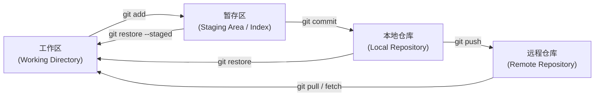
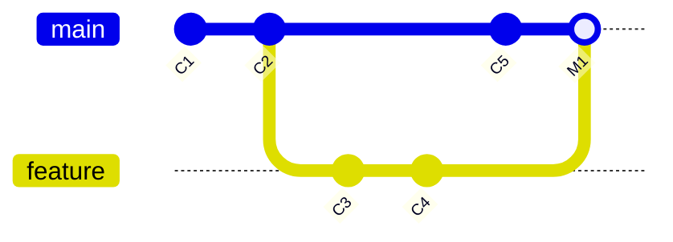
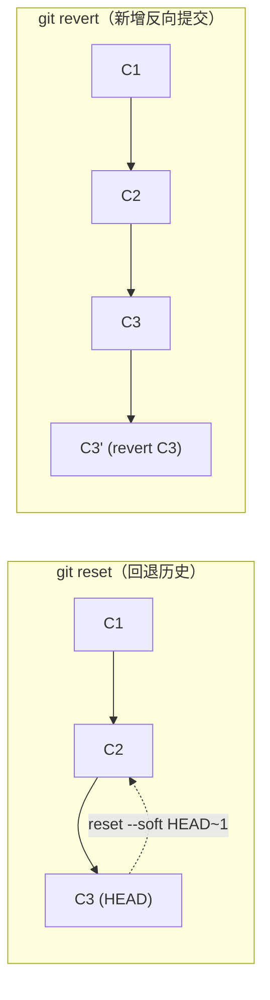
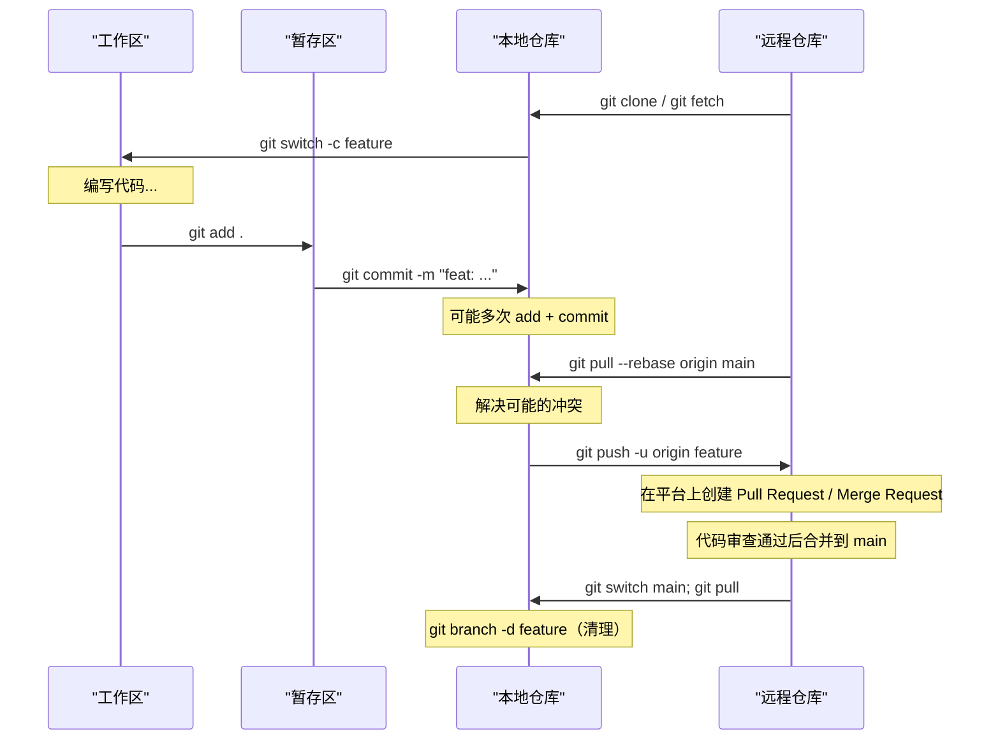

[toc]


---

## Git 版本控制速通指南

### 什么是 Git

Git 是一个**分布式版本控制系统** (Distributed Version Control System, DVCS),能够管理源代码或数据的各个版本。它由 Linus Torvalds 在 2005 年为 Linux 内核开发而创建。如今 Git 是最常用的版本控制系统,近 95% 的开发者将其作为主要版本控制工具。

**"分布式"意味着什么?** 每个开发者的本地都拥有仓库的**完整副本**（包含全部历史记录），不依赖中央服务器即可独立工作——查看历史、创建分支、提交变更全部在本地完成，只在需要协作时才与远程仓库同步。

### 核心概念——三个区域与文件状态

理解 Git 的关键在于理解它的**三个区域**和文件在这三个区域间的流转：



| 区域         | 英文                 | 说明                                                         |
| ------------ | -------------------- | ------------------------------------------------------------ |
| **工作区**   | Working Directory    | 你实际编辑文件的目录,肉眼可见的文件                          |
| **暂存区**   | Staging Area / Index | 一个临时"快照"区域,**只有被 `git add` 过的变更才会进入下一次提交** |
| **本地仓库** | Local Repository     | `git commit` 后变更被永久记录在 `.git` 目录中的历史中        |
| **远程仓库** | Remote Repository    | 托管在 GitHub / GitLab 等平台的仓库,用于团队协作与备份       |

**文件的四种状态:**

- **Untracked (未跟踪):** 新建文件,从未被 Git 管理过
- **Unmodified (未修改):** 已提交且未改动
- **Modified (已修改):** 文件有变更但还没暂存
- **Staged (已暂存):** 变更已通过 `git add` 放入暂存区,等待提交

### 安装与初始配置

#### 安装

| 系统                      | 推荐方式                                                     |
| ------------------------- | ------------------------------------------------------------ |
| **Windows**               | 下载 [Git for Windows](https://git-scm.com/download/win) 安装包,或使用 `winget install Git.Git` |
| **macOS**                 | `brew install git`（Homebrew）或安装 Xcode Command Line Tools |
| **Linux (Debian/Ubuntu)** | `sudo apt update && sudo apt install git`                    |
| **Linux (Fedora/RHEL)**   | `sudo dnf install git`                                       |

> **国内网络提示:** 如果从官方站点下载缓慢,可使用镜像。Git for Windows 也可从 [淘宝镜像 (npmmirror)](https://registry.npmmirror.com/binary.html?path=git-for-windows/) 获取。

安装后验证：

```bash
git --version
# 输出示例: git version 2.55.0
```

#### 首次配置（必做）

安装完 Git 后，**必须**设置用户名和邮箱，它们会记录在每一次提交中：

```bash
# 全局配置（对所有仓库生效）
git config --global user.name  "你的名字"
git config --global user.email "your@email.com"
```

**推荐的额外全局配置：**

```bash
# 设置默认分支名为 main（现代标准）
git config --global init.defaultBranch main

# 设置默认编辑器（按个人偏好）
git config --global core.editor "code --wait"   # VS Code
# git config --global core.editor "vim"         # Vim

# 启用有颜色的输出
git config --global color.ui auto

# 设置 pull 时的默认策略为 rebase（避免不必要的合并提交）
git config --global pull.rebase true
```

从 Git 2.28 起,可以通过 `git config --global init.defaultBranch main` 设置新仓库的默认分支名。`main` 已成为 GitHub 等主流平台的默认分支名。

查看所有配置：

```bash
git config --list --show-origin   # 显示每条配置的来源文件
```

Git 配置有三个层级,优先级从高到低：

| 层级       | 参数       | 配置文件位置                             | 作用范围         |
| ---------- | ---------- | ---------------------------------------- | ---------------- |
| **仓库级** | `--local`  | `.git/config`                            | 仅当前仓库       |
| **用户级** | `--global` | `~/.gitconfig` 或 `~/.config/git/config` | 当前用户所有仓库 |
| **系统级** | `--system` | `/etc/gitconfig`                         | 所有用户         |

#### 跨平台换行符配置（重要）

Windows 使用 `CRLF`（`\r\n`）作为换行符,而 Linux/macOS 使用 `LF`（`\n`）。如果团队有人在不同系统上工作,**不统一处理会导致大量虚假的 diff 差异甚至脚本运行失败**。

推荐使用 `.gitattributes` 文件（提交到仓库,对所有开发者生效）,并搭配 `core.autocrlf` 配置。`core.autocrlf=true` 让 Git 在提交时自动将 CRLF 转换为 LF,在检出时将 LF 转换回 CRLF。

**推荐方案分两步：**

**第一步：** 按系统设置 `core.autocrlf`

```bash
# Windows 用户
git config --global core.autocrlf true

# Linux / macOS 用户
git config --global core.autocrlf input
```

跨平台项目中,Windows 上推荐设置 `core.autocrlf` 为 `true`；Unix 上推荐设置为 `input`。

**第二步（更推荐）：** 在项目根目录创建 **`.gitattributes`** 文件,随仓库一起版本控制：

```gitattributes
# 自动检测文本文件并统一换行符
* text=auto

# 明确指定特定文件类型
*.sh     text eol=lf
*.bash   text eol=lf
*.bat    text eol=crlf
*.cmd    text eol=crlf
*.py     text eol=lf
*.js     text eol=lf
*.css    text eol=lf
*.html   text eol=lf

# 二进制文件不做转换
*.png    binary
*.jpg    binary
*.ico    binary
*.zip    binary
```

> `.gitattributes` 的优点是**跟着仓库走**,不依赖每个开发者各自配置，是团队协作的最佳实践。

### 日常工作流——最高频的命令

以下是你每天都会用到的核心命令,按工作流顺序排列：

#### 创建/获取仓库

```bash
# 方式一：在当前目录初始化新仓库
git init

# 方式二：克隆已有的远程仓库（最常用的开始方式）
git clone https://github.com/user/repo.git
# 克隆到指定目录
git clone https://github.com/user/repo.git my-project
```

> **国内加速克隆：** 如果直连 GitHub 较慢,可以使用代理或镜像：
> ```bash
> # 方法一：配置本地代理（假设 mihomo 运行在 7890 端口）
> # Linux / macOS
> git config --global http.proxy http://127.0.0.1:7890
> git config --global https.proxy http://127.0.0.1:7890
> # Windows PowerShell 同理
> 
> # 取消代理
> git config --global --unset http.proxy
> git config --global --unset https.proxy
> 
> # 方法二：使用 ghproxy 镜像加速（无需代理）
> git clone https://ghproxy.com/https://github.com/user/repo.git
> ```

#### 查看状态（随时随地）

```bash
git status            # 查看工作区和暂存区的状态
git status -s         # 简短格式输出（推荐日常使用）
```

`git status -s` 的输出格式说明：

| 标记 | 含义                       |
| ---- | -------------------------- |
| `??` | 未跟踪的新文件 (Untracked) |
| `A ` | 新文件已暂存 (Added)       |
| `M ` | 修改已暂存 (左列 M)        |
| ` M` | 修改未暂存 (右列 M)        |
| `MM` | 暂存后又做了修改           |
| `D ` | 删除已暂存                 |
| `R ` | 重命名已暂存               |

#### 暂存与提交

```bash
# 暂存指定文件
git add file.txt
git add src/             # 暂存整个目录

# 暂存所有变更（新增 + 修改 + 删除）
git add .                # 当前目录及子目录下所有变更
git add -A               # 整个仓库所有变更（效果通常相同）

# 交互式暂存（按块选择要暂存的内容，进阶但非常实用）
git add -p               # --patch 模式

# 提交（将暂存区内容记录为一个提交）
git commit -m "简明描述这次变更做了什么"

# 跳过 add，直接提交所有【已跟踪文件】的修改（不含新文件）
git commit -am "描述信息"

# 修改上一次提交（补充文件或改提交信息）
git commit --amend
```

**提交信息 (Commit Message) 最佳实践：**

- **第一行**：用祈使句简要概括变更（不超过 50 字符为佳），如 `Fix login validation bug`
- **空一行**后可以写更详细的说明（不超过 72 字符换行）
- 推荐使用 [Conventional Commits](https://www.conventionalcommits.org/) 规范：

| 前缀        | 用途                 | 示例                                  |
| ----------- | -------------------- | ------------------------------------- |
| `feat:`     | 新功能               | `feat: add user registration API`     |
| `fix:`      | 修复 Bug             | `fix: resolve null pointer in parser` |
| `docs:`     | 文档变更             | `docs: update README setup guide`     |
| `style:`    | 格式调整(不影响逻辑) | `style: format code with prettier`    |
| `refactor:` | 重构(不改行为)       | `refactor: extract auth middleware`   |
| `test:`     | 测试相关             | `test: add unit tests for utils`      |
| `chore:`    | 构建/工具/杂务       | `chore: upgrade dependencies`         |

#### 查看差异

```bash
# 工作区 vs 暂存区（还没 add 的改动）
git diff

# 暂存区 vs 最新提交（已 add 但还没 commit 的改动）
git diff --staged        # 等价于 git diff --cached

# 两次提交之间的差异
git diff commit1 commit2

# 只看哪些文件变了（不看具体内容）
git diff --stat
```

#### 查看历史

```bash
# 查看提交日志
git log

# 精简单行模式（推荐日常使用）
git log --oneline

# 图形化显示分支合并历史
git log --oneline --graph --all

# 查看某个文件的历史
git log --oneline -- path/to/file

# 搜索提交信息
git log --grep="关键词"

# 查看最近 N 次提交
git log -5
```

### 中文显示问题

如果 `git log` 中的中文文件名显示为转义形式（如 `\344\270\255`），执行：

> ```bash
> git config --global core.quotePath false
> ```

### 分支 (Branch) 操作

分支是 Git 最强大的特性之一。**创建分支几乎零成本**（只是一个指向提交的指针），鼓励频繁使用。



#### 现代分支命令：`git switch`（推荐）

从 Git 2.23 起,`git switch` 和 `git restore` 被引入用于替代 `git checkout` 的两大功能。`git checkout` 因为"既切分支又恢复文件"而让初学者困惑。使用这些专用命令符合现代 Git 最佳实践,降低了认知负担。

| 操作                         | 现代命令 (`git switch`)                      | 传统命令 (`git checkout`)          |
| ---------------------------- | -------------------------------------------- | ---------------------------------- |
| **切换到已有分支**           | **`git switch feature`**                     | `git checkout feature`             |
| **创建并切换到新分支**       | **`git switch -c feature`**                  | `git checkout -b feature`          |
| **切换回上一个分支**         | **`git switch -`**                           | `git checkout -`                   |
| **基于远程分支创建本地分支** | **`git switch -c feat --track origin/feat`** | `git checkout -b feat origin/feat` |
| **进入游离 HEAD 状态**       | `git switch -d <commit>`                     | `git checkout <commit>`            |

#### 分支管理

```bash
# 查看本地分支（* 标记当前分支）
git branch

# 查看所有分支（含远程）
git branch -a

# 查看分支详情（含最新提交和上游关联）
git branch -vv

# 删除已合并的分支
git branch -d feature

# 强制删除未合并的分支（慎用）
git branch -D feature

# 重命名当前分支
git branch -m new-name
```

#### 合并 (Merge)

```bash
# 将 feature 分支合并到当前分支
git switch main
git merge feature
```

**合并的两种情况：**

- **Fast-forward（快进合并）：** 如果当前分支没有新提交,Git 只是把指针向前移动,不产生合并提交。历史是线性的。
- **Three-way merge（三方合并）：** 两个分支都有新提交,Git 会创建一个新的**合并提交 (Merge Commit)** 来整合两边的变更。

```bash
# 强制创建合并提交（即使能快进），保留分支历史结构
git merge --no-ff feature
```

#### 处理合并冲突 (Merge Conflict)

当两个分支修改了**同一文件的同一部分**时,Git 无法自动合并,需要手动解决。

冲突标记看起来是这样的：

```
<<<<<<< HEAD
你在当前分支的修改
=======
对方分支的修改
>>>>>>> feature
```

**解决步骤：**

1. **打开冲突文件**，手动编辑,保留正确内容,删除冲突标记（`<<<<<<<`、`=======`、`>>>>>>>`）
2. **`git add <冲突文件>`** —— 标记该文件冲突已解决
3. **`git commit`** —— 完成合并提交（Git 会自动生成合并提交信息）

> 提示：VS Code 等编辑器对冲突标记有可视化辅助,可以直接点击选择 "Accept Current" / "Accept Incoming" / "Accept Both"。

#### 变基 (Rebase)

`git rebase` 是合并的另一种方式——它将当前分支的提交"重新播放"到目标分支的最新提交之上,产生**线性历史**：

```bash
git switch feature
git rebase main
# 然后切回 main 做快进合并
git switch main
git merge feature    # 此时一定是 fast-forward
```

**Merge vs Rebase 选择指南：**

| 维度         | Merge                         | Rebase                                        |
| ------------ | ----------------------------- | --------------------------------------------- |
| **历史**     | 保留真实的分支结构,有合并提交 | 线性历史,更"干净"                             |
| **适用场景** | 公共分支合入、团队协作        | 个人分支整理、保持 feature 分支最新           |
| **黄金规则** | 安全,不改变已有提交           | **永远不要对已推送到公共分支的提交做 rebase** |

### 远程仓库操作

#### 管理远程地址

```bash
# 查看远程仓库
git remote -v

# 添加远程仓库
git remote add origin https://github.com/user/repo.git

# 修改远程 URL
git remote set-url origin https://github.com/user/new-repo.git

# 删除远程
git remote remove origin
```

#### 推送与拉取

```bash
# 推送当前分支到远程（首次推送需 -u 设置上游追踪）
git push -u origin main

# 之后直接
git push

# 拉取远程变更并合并到当前分支
git pull

# 拉取但用 rebase 代替 merge（推荐,避免无意义的合并提交）
git pull --rebase

# 只获取远程变更但不合并（先看看再决定）
git fetch
git log origin/main --oneline    # 查看远程有什么新提交
git merge origin/main            # 确认后手动合并
```

**`git pull` = `git fetch` + `git merge`（或 `git rebase`，取决于配置）**

> 建议新手先用 `git fetch` + 手动合并的方式建立清晰认知。

#### 推送新分支 / 删除远程分支

```bash
# 推送本地新分支到远程
git push -u origin feature

# 删除远程分支
git push origin --delete feature
```

### 撤销操作——"后悔药"大全

撤销是初学者最容易困惑的地方。根据不同场景选择对应工具：

| 场景                                 | 推荐命令                          | 说明                                          |
| ------------------------------------ | --------------------------------- | --------------------------------------------- |
| **撤销工作区的文件修改**（还没 add） | **`git restore <file>`**          | 文件恢复到最后一次提交的状态,**改动不可恢复** |
| **撤销暂存**（add 了但没 commit）    | **`git restore --staged <file>`** | 从暂存区移出,修改保留在工作区                 |
| **修改上一次提交**（补文件或改信息） | **`git commit --amend`**          | 替换上一次提交（仅限未 push）                 |
| **回退提交但保留改动在工作区**       | **`git reset --soft HEAD~1`**     | 取消最近 1 次 commit,改动回到暂存区           |
| **回退提交且取消暂存**               | **`git reset --mixed HEAD~1`**    | 默认模式,改动回到工作区                       |
| **彻底丢弃提交和改动**               | **`git reset --hard HEAD~1`**     | **危险操作**,所有改动丢失                     |
| **安全地"撤销"已发布的提交**         | **`git revert <commit>`**         | 创建一个新提交来反转指定提交的变更            |

`git restore` 专注于恢复文件,不会影响分支操作,与分支操作有清晰的分离。

**`reset` vs `revert` 的本质区别：**

- **`reset`**: 改写历史（移动 HEAD 指针），适合**本地未推送**的提交
- **`revert`**: 不改写历史（新增一个"反向"提交），适合**已推送到远程**的提交



### Stash——临时保存工作进度

当你正在某个分支上工作,突然需要切换到另一个分支处理紧急事务,但**当前改动还不值得做一次正式提交**时：

```bash
# 保存当前工作区和暂存区的所有变更
git stash

# 带说明保存（推荐，方便识别）
git stash push -m "正在开发登录功能的半成品"

# 查看所有暂存记录
git stash list

# 恢复最近一次 stash 并从列表中删除
git stash pop

# 恢复但不删除（可重复使用）
git stash apply

# 恢复指定的 stash
git stash apply stash@{2}

# 删除某个 stash
git stash drop stash@{0}

# 清空所有 stash
git stash clear
```

### .gitignore——排除不需要追踪的文件

在项目根目录创建 **`.gitignore`** 文件,告诉 Git 哪些文件不需要纳入版本控制：

```gitignore
# 编译产物
*.o
*.class
build/
dist/

# 依赖目录
node_modules/
vendor/
__pycache__/
*.pyc

# IDE 和编辑器配置
.vscode/
.idea/
*.swp
*.swo

# 操作系统文件
.DS_Store
Thumbs.db

# 环境变量和密钥（绝对不要提交！）
.env
*.pem
*.key

# 日志文件
*.log
logs/
```

**核心语法规则：**

| 模式      | 含义             | 示例                               |
| --------- | ---------------- | ---------------------------------- |
| `文件名`  | 忽略所有同名文件 | `debug.log`                        |
| `目录名/` | 忽略整个目录     | `node_modules/`                    |
| `*`       | 通配任意字符     | `*.log`                            |
| `**`      | 跨目录通配       | `**/temp` 匹配任意层级的 temp 目录 |
| `!`       | 取反（不忽略）   | `!important.log`                   |
| `#`       | 注释             | `# 这是注释`                       |

> **已跟踪的文件不会被 .gitignore 影响。** 如果文件已经提交过了,需要先取消跟踪：
> ```bash
> git rm --cached file.txt          # 取消跟踪但保留本地文件
> git rm --cached -r node_modules/  # 对目录操作
> ```
> 然后将其加入 `.gitignore` 并提交。

**推荐工具：** [gitignore.io](https://www.toptal.com/developers/gitignore) 可以按语言/框架/IDE 自动生成 `.gitignore` 模板。GitHub 也在 [github/gitignore](https://github.com/github/gitignore) 仓库维护了一份常见语言的模板集合。

### 标签 (Tag)——给重要节点打标记

标签通常用于标记**版本发布点**（如 `v1.0.0`）：

```bash
# 创建轻量标签
git tag v1.0.0

# 创建附注标签（推荐,包含更多元信息）
git tag -a v1.0.0 -m "Release version 1.0.0"

# 给历史提交打标签
git tag -a v0.9.0 <commit-hash>

# 查看所有标签
git tag -l

# 推送标签到远程
git push origin v1.0.0
git push origin --tags    # 推送所有标签

# 删除标签
git tag -d v1.0.0                    # 删除本地
git push origin --delete v1.0.0      # 删除远程
```

### 实用进阶技巧

#### 交互式 Rebase——整理提交历史

在推送前,将多个零碎的本地提交合并成有意义的提交：

```bash
# 整理最近 3 次提交
git rebase -i HEAD~3
```

在弹出的编辑器中,可以对每个提交选择操作：

| 命令           | 作用                          |
| -------------- | ----------------------------- |
| `pick`         | 保留该提交                    |
| `squash` (`s`) | 合并到前一个提交              |
| `fixup` (`f`)  | 合并到前一个提交,丢弃提交信息 |
| `reword` (`r`) | 保留提交但修改提交信息        |
| `drop` (`d`)   | 丢弃该提交                    |
| `edit` (`e`)   | 暂停在该提交,允许修改         |

#### `git log` 高级格式

```bash
# 自定义精美日志格式
git log --oneline --graph --all --decorate

# 设置别名方便日常使用
git config --global alias.lg "log --oneline --graph --all --decorate"
# 之后直接用:
git lg
```

#### 别名 (Alias)——少打字

```bash
git config --global alias.st "status -s"
git config --global alias.co "checkout"
git config --global alias.sw "switch"
git config --global alias.br "branch"
git config --global alias.cm "commit -m"
git config --global alias.last "log -1 --oneline"
git config --global alias.unstage "restore --staged"
```

设置后 `git st` 等价于 `git status -s`，以此类推。

#### `git bisect`——二分法定位 Bug

当你知道"某个版本是好的,当前版本是坏的",但不知道哪个提交引入了 Bug：

```bash
git bisect start
git bisect bad                     # 标记当前版本有问题
git bisect good <已知正常的commit>  # 标记一个正常的历史版本

# Git 会自动检出中间版本让你测试
# 测试后告诉 Git 结果：
git bisect good    # 或 git bisect bad

# 重复直到定位到引入 Bug 的提交
# 结束并回到之前的分支
git bisect reset
```

#### Cherry-pick——摘取特定提交

将其他分支的某个（或某些）提交"摘过来"应用到当前分支：

```bash
git cherry-pick <commit-hash>

# 摘取多个提交
git cherry-pick <hash1> <hash2>

# 摘取但不自动提交（方便修改后再提交）
git cherry-pick --no-commit <hash>
```

### SSH 密钥配置（推荐）

使用 SSH 协议与 GitHub/GitLab 通信,可以免去每次输入密码：

```bash
# 生成 SSH 密钥对
ssh-keygen -t ed25519 -C "your@email.com"
# 一路回车使用默认路径（~/.ssh/id_ed25519）

# 查看公钥内容
cat ~/.ssh/id_ed25519.pub
```

将公钥内容复制到 GitHub → Settings → SSH and GPG keys → New SSH key。

验证连接：

```bash
ssh -T git@github.com
# 成功输出: Hi username! You've successfully authenticated...
```

> **Windows 用户：** Git for Windows 自带 OpenSSH。如果使用 PowerShell,可能需要启动 `ssh-agent`：
> ```powershell
> # 启动 ssh-agent 服务
> Get-Service ssh-agent | Set-Service -StartupType Automatic
> Start-Service ssh-agent
> ssh-add $env:USERPROFILE\.ssh\id_ed25519
> ```

配置 SSH 代理访问 GitHub（国内环境）：

在 `~/.ssh/config`（Windows 为 `%USERPROFILE%\.ssh\config`）中添加：

```
Host github.com
    HostName github.com
    User git
    IdentityFile ~/.ssh/id_ed25519
    # 通过本地代理连接（mihomo 等提供的 SOCKS5 代理）
    ProxyCommand connect -S 127.0.0.1:7890 %h %p    # Windows (Git Bash)
    # ProxyCommand nc -x 127.0.0.1:7890 %h %p        # Linux / macOS
```

### 典型工作流总览

下面是一个完整的日常开发流程示意：



**总结为文字版核心循环：**

1. **`git switch -c feature`** —— 从 main 创建功能分支
2. **编写代码** → **`git add .`** → **`git commit -m "..."`** （可能循环多次）
3. **`git pull --rebase origin main`** —— 在推送前同步远程最新变更
4. **`git push -u origin feature`** —— 推送到远程
5. **创建 Pull Request (PR)** —— 在 GitHub/GitLab 上请求合并
6. **代码审查、合并** —— 合入 main
7. **`git switch main && git pull && git branch -d feature`** —— 清理

### 命令速查表

| 分类       | 命令                                    | 说明               |
| ---------- | --------------------------------------- | ------------------ |
| **初始化** | `git init`                              | 新建仓库           |
|            | `git clone <url>`                       | 克隆远程仓库       |
| **配置**   | `git config --global user.name "名字"`  | 设置用户名         |
|            | `git config --global user.email "邮箱"` | 设置邮箱           |
| **日常**   | `git status -s`                         | 简洁查看状态       |
|            | `git add .`                             | 暂存所有变更       |
|            | `git commit -m "描述"`                  | 提交               |
|            | `git diff` / `git diff --staged`        | 查看差异           |
|            | `git log --oneline --graph`             | 查看历史           |
| **分支**   | `git switch -c <name>`                  | 创建并切换分支     |
|            | `git switch <name>`                     | 切换分支           |
|            | `git branch -d <name>`                  | 删除已合并分支     |
|            | `git merge <branch>`                    | 合并分支           |
|            | `git rebase <branch>`                   | 变基               |
| **远程**   | `git remote -v`                         | 查看远程信息       |
|            | `git push -u origin <branch>`           | 推送(首次加 `-u`)  |
|            | `git pull --rebase`                     | 拉取(用 rebase)    |
|            | `git fetch`                             | 仅获取不合并       |
| **撤销**   | `git restore <file>`                    | 撤销工作区修改     |
|            | `git restore --staged <file>`           | 取消暂存           |
|            | `git reset --soft HEAD~1`               | 回退提交(保留改动) |
|            | `git revert <commit>`                   | 安全反转已发布提交 |
| **暂存**   | `git stash push -m "说明"`              | 暂存工作进度       |
|            | `git stash pop`                         | 恢复暂存进度       |
| **标签**   | `git tag -a v1.0 -m "说明"`             | 打附注标签         |

### 前瞻：Git 3.0

Git 开发团队正在推进 Git 3.0,可能在 2026 年底发布,这是自 2014 年 Git 2.0 以来的首次大版本升级。Git 3.0 将带来 SHA-256 安全升级、Rust 内存安全重写部分代码,以及 reftable 性能优化。对于当前学习者来说,本文所述的命令和工作流不会有破坏性变化,可以放心学习。

---

**最后的建议：** Git 的命令虽多,但日常开发中 **80% 的工作只需要上面加粗标注的那些命令**。建议你：

1. **先建一个测试仓库反复练习**,不要怕搞坏——`git reflog` 几乎可以找回任何操作的历史
2. **养成频繁提交、小粒度提交的习惯**,每个提交只做一件事
3. **永远不要在 main/master 分支上直接开发**,用功能分支 (Feature Branch)
4. **推送前先 pull --rebase**,保持历史整洁
5. **`.gitignore` 和 `.gitattributes` 从项目第一天就配好**