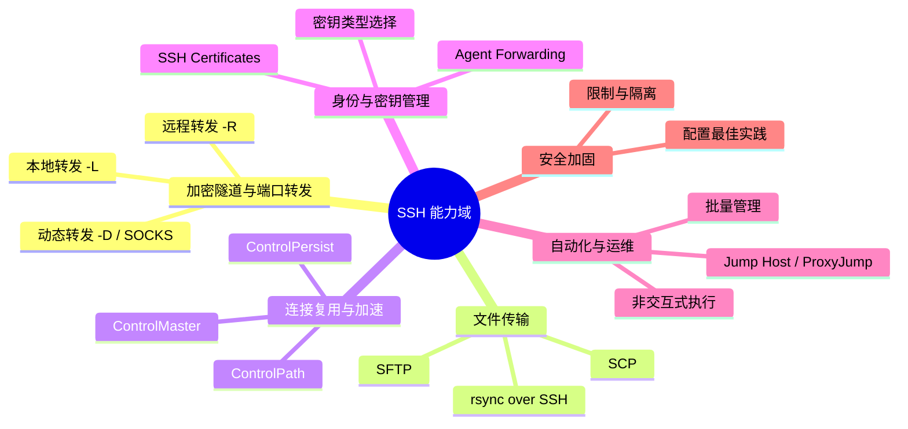

[toc]

## 典型用途全景

SSH（Secure Shell）远不止"登录远程机器敲命令"。下图概览其核心能力域：



---

## 加密隧道与端口转发（Tunneling / Port Forwarding）

这是 SSH 最强大且最常被低估的能力。本质是**利用 SSH 加密通道，将任意 TCP 流量安全地"搬运"到目标网络**。

### 本地端口转发（Local Forwarding, `-L`）

**场景**：你的本地机器无法直接访问远程内网的某个服务（如数据库、Web 管理面板），但你能 SSH 到一台跳板机。

**语法**：`ssh -L [本地绑定地址:]本地端口:目标主机:目标端口 用户@跳板机`,常见的形式为省略的`本地绑定地址`的情况:`ssh -L 本地端口:目标主机:目标端口 用户@跳板机`

**经典用例**：

- **访问远程 MySQL/PostgreSQL**：`ssh -L 3307:db.internal:3306 user@bastion`，然后本地用 `mysql -h 127.0.0.1 -P 3307` 连接。
- **访问远程 Jupyter Notebook**：`ssh -L 8888:localhost:8888 user@server`，本地浏览器打开 `http://localhost:8888`。
- **访问内网 Web 管理界面**（如路由器、NAS）：`ssh -L 8080:192.168.1.1:80 user@gateway`。

**关键参数**：
- 默认绑定 `localhost`，若需局域网其他设备访问，加 `-L 0.0.0.0:本地端口:...`（注意安全）。
- 配合 `-N`（不执行远程命令）和 `-f`（后台运行）可作纯隧道使用：`ssh -NfL 3307:db:3306 user@bastion`。

### 远程端口转发（Remote Forwarding, `-R`）

**场景**：反向操作——让远程机器能访问你本地的服务。常用于**内网穿透**。

**语法**：`ssh -R [远程绑定地址:]远程端口:本地目标:本地端口 用户@公网服务器`

**经典用例**：

- **临时暴露本地开发服务器**：`ssh -R 8080:localhost:3000 user@vps`，公网通过 `vps:8080` 访问你本地的 `localhost:3000`。
- **远程调试**：让同事通过公网服务器连到你本地的调试端口。

**注意事项**：
- 默认只绑定远程的 `localhost`。需在远程 `sshd_config` 中设置 `GatewayPorts yes` 或 `GatewayPorts clientspecified` 才能绑定到 `0.0.0.0`。
- 生产环境内网穿透更推荐 **frp**、**Tailscale** 等专用方案，SSH 反向隧道适合临时使用。

### 动态端口转发（Dynamic Forwarding, `-D`）—— SOCKS 代理

**场景**：你需要一个**全局的加密代理**，而非固定端口映射。

**语法**：`ssh -D [绑定地址:]端口 用户@服务器`

**经典用例**：

- **加密浏览**：`ssh -D 1080 user@vps`，然后在浏览器或系统中配置 SOCKS5 代理为 `127.0.0.1:1080`，所有流量经 SSH 隧道加密转发。
- **绕过网络限制**：在受限网络环境中访问被屏蔽的内部资源。

**实用技巧**：
- 配合浏览器插件（如 SwitchyOmega）可按规则分流，避免所有流量都走代理。
- 加上 `-C` 启用压缩，在低带宽链路上有改善：`ssh -CD 1080 user@vps`。

---

## 文件传输

| 工具               | 特点                         | 适用场景               |
| ------------------ | ---------------------------- | ---------------------- |
| **SCP**            | 简单直接，语法类似 `cp`      | 一次性传少量文件       |
| **SFTP**           | 交互式会话，支持断点续传     | 交互式文件管理         |
| **rsync over SSH** | 增量同步，压缩传输，功能最强 | 大文件、目录同步、备份 |

### SCP 速查

```bash
# 上传
scp local_file user@remote:/path/
# 下载
scp user@remote:/path/file ./local/
# 递归传目录
scp -r local_dir user@remote:/path/
```

> **注意**：OpenSSH 9.0+ 已将 `scp` 底层协议从传统 SCP 切换为 SFTP 协议（更安全），行为基本兼容但某些边缘情况可能不同。

### rsync over SSH（推荐）

**这是生产环境文件同步的事实标准**：

```bash
# 增量同步本地目录到远程（压缩 + 显示进度）
rsync -avz --progress /local/dir/ user@remote:/remote/dir/

# 限速传输（避免占满带宽，单位 KB/s）
rsync -avz --bwlimit=1000 /local/dir/ user@remote:/remote/dir/

# 排除特定文件
rsync -avz --exclude='*.log' --exclude='.git/' /src/ user@remote:/dst/

# 删除远程多余文件（镜像同步）
rsync -avz --delete /src/ user@remote:/dst/
```

**关键优势**：只传输差异部分，大文件断点续传，支持硬链接保留。

---

## 连接多路复用（Multiplexing）

**痛点**：每次 `ssh`、`scp`、`rsync` 都要重新握手协商，延迟高且频繁输密码。

**方案**：通过 **ControlMaster** 机制，让多个 SSH 会话共享同一个底层 TCP 连接。

### 配置方法（`~/.ssh/config`）

```
Host *
    ControlMaster auto
    ControlPath ~/.ssh/sockets/%r@%h-%p
    ControlPersist 600
```

- **`ControlMaster auto`**：自动创建或复用主连接。
- **`ControlPath`**：Unix 域套接字路径（需确保 `~/.ssh/sockets/` 目录存在且权限 `700`）。
- **`ControlPersist 600`**：主连接在所有会话关闭后仍保持 600 秒，方便快速重连。

**效果**：首次连接正常握手，后续连接几乎**瞬时建立**，无需重复认证。对频繁 `scp`/`rsync`/`git` 操作提升显著。

**管理命令**：
- 查看状态：`ssh -O check user@host`
- 关闭主连接：`ssh -O exit user@host`

---

## 跳板机与代理跳转（Jump Host / ProxyJump）

**场景**：目标服务器不直接暴露 SSH 端口，需经过堡垒机/跳板机。

### 现代写法（OpenSSH 7.3+，推荐）

```bash
# 单跳
ssh -J bastion_user@bastion target_user@target

# 多跳
ssh -J jump1,jump2 target_user@target
```

### 配置文件写法（`~/.ssh/config`）

```
Host target
    HostName 10.0.0.5
    User target_user
    ProxyJump bastion_user@bastion.example.com
```

之后直接 `ssh target` 即可，**透明穿越跳板机**。

> **旧写法** `ProxyCommand ssh -W %h:%p bastion` 仍然有效，但 `ProxyJump` 更简洁且支持链式跳转。

---

## 身份认证与密钥管理进阶

### SSH Agent 与 Agent Forwarding

**`ssh-agent`** 在内存中缓存解密后的私钥，避免反复输入 passphrase。

```bash
# 启动 agent（多数桌面环境已自动启动）
eval $(ssh-agent -s)
# 添加密钥
ssh-add ~/.ssh/id_ed25519
# 查看已加载密钥
ssh-add -l
```

**Agent Forwarding（`-A`）**：让远程主机使用你本地的 agent 进行认证，实现"跳板机不存私钥"的安全跳转。

```bash
ssh -A user@bastion
# 在 bastion 上可直接 ssh 到内网机器，无需在 bastion 上放私钥
```

> **安全警告**：Agent Forwarding 有风险——如果跳板机的 root 用户被攻破，攻击者可利用你的 agent socket 冒充你。**更安全的替代方案是 `ProxyJump`**（密钥不离开本地）。

### SSH Certificates（证书认证）

**痛点**：大规模环境中，管理 `authorized_keys` 文件是噩梦。

**方案**：使用 **SSH CA（证书颁发机构）** 签发用户/主机证书。

- **用户证书**：用户持 CA 签发的证书登录，服务器只需信任 CA 公钥，无需逐个添加用户公钥。
- **主机证书**：客户端自动验证服务器身份，消除 "Are you sure you want to continue connecting?" 的 TOFU（Trust On First Use）风险。

```bash
# CA 签发用户证书（有效期 8 小时）
ssh-keygen -s ca_key -I "user_alice" -n alice -V +8h alice_id_ed25519.pub

# 服务器端配置（sshd_config）
TrustedUserCAKeys /etc/ssh/ca.pub
```

**适用场景**：企业/团队规模 > 20 台服务器时强烈推荐。工具如 **HashiCorp Vault**、**Netflix BLESS**、**Smallstep** 可自动化证书签发。

---

## 非交互式执行与自动化

SSH 天然支持远程执行命令，是自动化运维的基石。

```bash
# 单条命令
ssh user@host "df -h && free -m"

# 本地脚本远程执行（无需上传）
ssh user@host 'bash -s' < local_script.sh

# 带参数
ssh user@host 'bash -s' -- arg1 arg2 < script.sh
```

**批量管理**：虽然可以写 `for` 循环遍历主机列表，但生产环境推荐使用 **Ansible**（底层即 SSH）、**Parallel SSH (pssh)** 等工具。

---

## 安全加固最佳实践速查

| 配置项（`sshd_config`）          | 推荐值                      | 说明                         |
| -------------------------------- | --------------------------- | ---------------------------- |
| **`PermitRootLogin`**            | `no` 或 `prohibit-password` | 禁止 root 密码登录           |
| **`PasswordAuthentication`**     | `no`                        | 仅允许密钥认证               |
| **`PubkeyAuthentication`**       | `yes`                       | 启用公钥认证                 |
| **`AllowUsers` / `AllowGroups`** | 按需设置                    | 白名单限制                   |
| **`MaxAuthTries`**               | `3`                         | 限制认证尝试次数             |
| **`ClientAliveInterval`**        | `300`                       | 空闲超时检测（秒）           |
| **`ClientAliveCountMax`**        | `2`                         | 超时断开前探测次数           |
| **`X11Forwarding`**              | `no`（除非需要）            | 减少攻击面                   |
| **`AllowTcpForwarding`**         | 按需                        | 限制端口转发权限             |
| **`KexAlgorithms`**              | 仅保留现代算法              | 如 `curve25519-sha256`       |
| **`HostKeyAlgorithms`**          | `ssh-ed25519,rsa-sha2-512`  | OpenSSH 9.x 已默认禁用 SHA-1 |

### 客户端密钥选择

| 类型               | 推荐度     | 说明                                              |
| ------------------ | ---------- | ------------------------------------------------- |
| **`ed25519`**      | **首选**   | 短密钥、高性能、抗侧信道，`ssh-keygen -t ed25519` |
| `ecdsa`            | 可用       | 兼容性较好，但实现质量依赖库                      |
| `rsa-sha2-256/512` | 兼容旧系统 | 至少 4096 位，`ssh-keygen -t rsa -b 4096 -o`      |
| `rsa-sha1`         | **避免**   | OpenSSH 8.8+ 默认禁用                             |

---

## 实用技巧补充

- **保持连接不断开**：客户端 `~/.ssh/config` 加 `ServerAliveInterval 60`，防止 NAT/防火墙超时断开空闲连接。
- **指定非标准端口**：`ssh -p 2222 user@host` 或配置文件中 `Port 2222`。
- **调试连接问题**：`ssh -vvv user@host` 输出详细协商过程，排查认证/算法不匹配问题。
- **Windows 用户**：Windows 10 1809+ 已内置 OpenSSH 客户端（`ssh` 命令可用）。服务端需手动安装 OpenSSH Server。PowerShell 中 `~/.ssh/config` 路径为 `$env:USERPROFILE\.ssh\config`。
- **中文/非 ASCII 文件名**：SFTP 和 rsync 对 UTF-8 文件名支持良好，但 SCP 在某些旧版本上可能有编码问题，建议优先用 rsync。

---

## 知识来源与截止日期

- **主要依据**：OpenBSD OpenSSH 官方 Release Notes（至 9.9）、`man ssh` / `man ssh_config` / `man sshd_config` 手册页、Arch Wiki SSH 条目、Red Hat / DigitalOcean 官方文档。
- **知识截止日期**：2025 年初。
- **一轮搜索验证**：确认 OpenSSH 9.x 安全默认值变更及 SSH certificates 趋势，核心功能无重大变化。

> **潜在可深挖方向**（本轮未展开）：SSH over WebSocket（如 Cloudflare Tunnel 的 SSH 集成）、SSH 与 Tailscale/Headscale 的协同、SSH FIDO2/WebAuthn 硬件密钥认证（OpenSSH 8.2+）。如需深入，可在下一轮指定。

