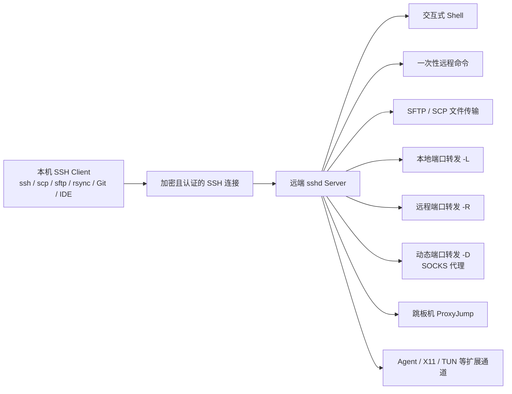

[toc]


## 一句话定位

**SSH 不只是“远程登录服务器”的工具，而是一个带有认证、加密、通道复用和端口转发能力的安全传输层**：远程 shell 只是最常见的一个“通道”，同一条 SSH 连接还可以承载**远程命令、文件传输、跳板机访问、端口转发、SOCKS 代理、反向隧道、远程开发、Git/rsync/自动化运维**等工作。OpenSSH 官方手册明确说明，`ssh` 用于远程登录和远程命令执行，并能在安全通道上转发 X11、任意 TCP 端口和 Unix-domain socket。

---

## SSH 的核心模型



理解 SSH 的关键是：**一条 SSH 连接里可以开多个 channel**。这些 channel 可以是 shell、命令执行、SFTP 子系统、端口转发、X11、agent forwarding、隧道设备等；这也是为什么 SSH 能被很多工具当成底层安全传输。OpenSSH 的官方资料也列出了端口转发、强认证、agent forwarding、SFTP、压缩等能力。

---

## 典型用途总览

| 用途                         | 解决什么问题                  | 常用命令示例                               | 初学者建议                                     |
| ---------------------------- | ----------------------------- | ------------------------------------------ | ---------------------------------------------- |
| **远程 shell**               | 登录服务器交互操作            | `ssh user@host`                            | 最基础，但不要长期用 root 直接登录             |
| **远程命令**                 | 不进入 shell，直接执行命令    | `ssh host uptime`                          | 适合脚本、巡检、批量任务                       |
| **文件复制：scp**            | 快速复制单个文件或目录        | `scp ./a.tar.gz host:/tmp/`                | 现代 OpenSSH 的 `scp` 默认走 SFTP 协议         |
| **交互式文件管理：sftp**     | 类似 FTP 的安全文件传输       | `sftp user@host`                           | 更适合手工上传、下载、批处理                   |
| **增量同步：rsync over SSH** | 备份、部署、同步大目录        | `rsync -az ./site/ host:/var/www/site/`    | 比反复 `scp -r` 更适合大目录                   |
| **本地端口转发 `-L`**        | 本机访问远端内网服务          | `ssh -L 127.0.0.1:5432:db:5432 bastion`    | 访问数据库、后台、内网 Web 很常用              |
| **远程端口转发 `-R`**        | 让远端访问本机服务            | `ssh -R 127.0.0.1:8080:localhost:3000 vps` | 临时演示本地服务、穿透内网常用                 |
| **动态端口转发 `-D`**        | 创建 SOCKS 代理               | `ssh -D 127.0.0.1:1080 bastion`            | 临时让浏览器或工具走远端出口                   |
| **跳板机 `-J` / ProxyJump**  | 通过堡垒机访问内网机器        | `ssh -J bastion target`                    | 比滥用 agent forwarding 更安全清晰             |
| **连接复用 ControlMaster**   | 多次连接复用一条 TCP/SSH 连接 | 配置 `ControlMaster auto`                  | 加速 Git、scp、ssh 多次调用                    |
| **远程开发**                 | 本地 IDE 操作远端环境         | VS Code Remote SSH                         | 适合云服务器、GPU 机器、统一 Linux 环境        |
| **移动弱网 Shell**           | 网络切换后继续交互            | `mosh user@host`                           | Mosh 适合移动网络，但不替代 SSH 隧道和文件传输 |

`scp` 当前手册说明它通过 SSH 连接上的 **SFTP 协议**传输数据，并使用与登录会话相同的认证和安全机制；`sftp` 则是通过加密 SSH transport 执行文件传输的程序。

---

## 最重要的非 shell 功能：端口转发

### 本地端口转发 `-L`

**用途：把“远端可访问的服务”映射到“本机端口”。**

典型场景：数据库、Redis、内网 Web 管理后台只允许服务器内网访问，你不想把它暴露到公网，于是通过 SSH 隧道访问。

```bash
ssh -N -L 127.0.0.1:5432:db.internal:5432 user@bastion
```

含义：

- **本机监听**：`127.0.0.1:5432`
- **经过 SSH 到达**：`user@bastion`
- **由远端一侧访问**：`db.internal:5432`
- **`-N` 表示不执行远程命令，只做转发**

OpenSSH 手册中，`-L` 表示本地客户端上的 TCP 端口或 Unix socket 会通过安全通道转发到远端侧指定主机和端口；`-N` 则适合“只做端口转发，不执行远程命令”的场景。

---

### 远程端口转发 `-R`

**用途：把“本机可访问的服务”暴露给“远端服务器”。**

典型场景：

- 本机开发了一个 Web 服务，想临时给 VPS 上的 Nginx 或同事访问；
- 家里机器没有公网 IP，但有一台公网 VPS，可以反向挂出去；
- 临时让远端机器访问你本地的调试端口。

```bash
ssh -N -R 127.0.0.1:8080:localhost:3000 user@vps
```

含义：

- **远端 vps 监听**：`127.0.0.1:8080`
- **访问时通过 SSH 回到本机**
- **最终连接本机**：`localhost:3000`

OpenSSH 手册中，`-R` 表示在远端服务器一侧监听端口或 Unix socket，并把连接转发回本地侧；默认情况下，远端 TCP 监听通常绑定在 loopback，是否允许对外监听还受服务器端 `GatewayPorts` 等配置限制。

---

### 动态端口转发 `-D`

**用途：把 SSH 连接变成一个本地 SOCKS 代理。**

```bash
ssh -N -D 127.0.0.1:1080 user@bastion
```

然后在浏览器、curl、某些开发工具中设置 SOCKS5 代理为：

- 主机：`127.0.0.1`
- 端口：`1080`

这适合**临时从远端网络出口访问资源**，例如访问只允许公司出口 IP 的测试站点。OpenSSH 手册明确说明 `-D` 会在本地分配监听 socket，SSH 客户端会充当 SOCKS4/SOCKS5 服务器。

---

### TUN/TAP 隧道：SSH 也能“像 VPN”，但不建议初学者优先用

SSH 支持 tunnel device forwarding，例如 `-w` 选项可请求 TUN 设备转发；Tailscale 文档也概括了 SSH 的本地转发、反向转发、动态 SOCKS 转发和 tunnel device forwarding 等“类 VPN”能力。

但实际建议是：

- **临时访问单个端口**：优先用 `-L`。
- **临时反向暴露本机服务**：用 `-R`。
- **临时代理**：用 `-D`。
- **长期组网**：优先考虑 WireGuard、Tailscale、Headscale、ZeroTier、传统 VPN 或企业零信任方案，而不是手搓 SSH TUN。

---

## 跳板机与内网访问

### 一次性命令

```bash
ssh -J user@bastion user@target.internal
```

### 多跳

```bash
ssh -J bastion1,bastion2 target.internal
```

OpenSSH 手册说明，`-J` 会先连接到 jump host，再从 jump host 建立到最终目标的 TCP 转发；`ProxyJump` 配置也支持多个 jump proxy，按顺序访问。

### 推荐写进 `~/.ssh/config`

```ssh_config
Host bastion
    HostName bastion.example.com
    User ops
    IdentityFile ~/.ssh/id_ed25519
    IdentitiesOnly yes

Host target
    HostName 10.0.1.23
    User app
    ProxyJump bastion
    IdentityFile ~/.ssh/id_ed25519
    IdentitiesOnly yes
```

然后直接：

```bash
ssh target
scp ./deploy.tar.gz target:/tmp/
sftp target
```

Mozilla 的 OpenSSH 指南也展示了通过 `ssh -J` 访问堡垒机后的内网主机，以及在 `~/.ssh/config` 中配置 `ProxyJump` 的做法。

---

## 文件传输：scp、sftp、rsync、sshfs 怎么选

| 工具               | 更适合                         | 不适合                           | 建议                                       |
| ------------------ | ------------------------------ | -------------------------------- | ------------------------------------------ |
| **scp**            | 快速复制少量文件               | 复杂同步、断点续传、大量小文件   | 简单粗暴，记住现代 `scp` 多数情况下走 SFTP |
| **sftp**           | 交互式上传下载、批处理文件操作 | 高效增量同步                     | 类似安全版 FTP，适合人工操作               |
| **rsync over SSH** | 备份、部署、同步大目录         | 远端没有 `rsync` 的环境          | 运维部署首选之一                           |
| **sshfs**          | 把远端目录挂成本地目录         | 大规模编译、海量文件、高性能场景 | 适合浏览和小改文件，不适合高频大量 I/O     |

VS Code 官方 Remote SSH 文档也提到：如果需要用本地工具处理远端源码，常见方式是 **SSHFS 挂载远端文件系统**或用 **rsync 同步**；其中 SSHFS 方便但性能通常低于直接远程开发，大量读写时 rsync 更合适。

常见命令：

```bash
# 复制单文件
scp ./app.tar.gz server:/tmp/

# 复制目录
scp -r ./dist/ server:/var/www/dist/

# 交互式文件传输
sftp server

# 增量同步，适合部署
rsync -az --delete ./site/ server:/var/www/site/
```

---

## 远程开发：SSH 已经是 IDE 的基础设施

典型场景：

- 本地 Windows/macOS，远端 Linux 开发；
- 远端有 GPU、大内存、特殊依赖；
- 代码在服务器或公司内网，避免本地环境不一致；
- 在云服务器上跑容器、调试服务、执行测试。

VS Code Remote SSH 的模式是：本地 VS Code 通过 SSH 连接到远端，远端运行 VS Code Server；远程调试可以像本地调试一样启动和附加，客户端与服务端之间的通信通过认证的安全 SSH 隧道完成。官方文档也提醒，Remote SSH 需要远端具备 Bash、`tar`、`curl` 或 `wget` 等依赖，且本地代理设置不会自动复用到远端。

国内网络环境下尤其要注意：

- **远端服务器是否能访问 VS Code Server 下载域名**；
- **远端环境是否需要配置 `HTTP_PROXY`、`HTTPS_PROXY`**；
- **如果远端无法联网，可考虑本地下载后传输、离线 VSIX 安装、或使用国内镜像源解决语言依赖下载问题**。

---

## Git、自动化和批量运维

SSH 也是很多开发/运维工具的默认“安全运输层”：

- **Git over SSH**：`git@github.com:org/repo.git` 这类地址就是通过 SSH key 认证。
- **rsync over SSH**：常用于备份、静态站点发布、构建产物同步。
- **Ansible 等配置管理工具**：典型模式是通过 SSH 执行远程任务。
- **CI/CD 部署**：构建完成后通过 SSH 登录远端、上传文件、重启服务。
- **一次性远程命令**：`ssh host systemctl status nginx`。

OpenSSH 手册明确支持在目标后附加命令，从而执行远程命令而不是启动登录 shell；这就是很多脚本化运维能力的基础。

适合脚本的 SSH 配置片段：

```ssh_config
Host prod-web
    HostName 203.0.113.10
    User deploy
    IdentityFile ~/.ssh/id_ed25519
    IdentitiesOnly yes
    BatchMode yes
    ConnectTimeout 10
    ServerAliveInterval 30
    ServerAliveCountMax 3
```

建议：

- **脚本中使用 `BatchMode yes`**，避免卡在密码输入。
- **设置 `ConnectTimeout`**，避免网络故障时长时间挂起。
- **部署用户只给必要权限**，不要直接使用 root。
- **能用 systemd、sudoers 精确授权，就不要给无限 sudo**。

---

## 连接复用：让多次 ssh/scp/git 更快

如果你频繁连接同一台机器，SSH 每次都要 TCP 连接、握手、认证。可以启用 **ControlMaster** 复用连接：

```ssh_config
Host *
    ControlMaster auto
    ControlPath ~/.ssh/cm-%C
    ControlPersist 10m
```

OpenSSH `ssh_config` 手册说明，`ControlMaster` 允许多个 session 共享同一条网络连接，后续 session 会尝试复用 master 连接，失败时再正常新建连接。

适用场景：

- 连续执行很多 `ssh host command`；
- 频繁 `scp`、`sftp`；
- Git 频繁 fetch/push；
- 脚本中多次访问同一目标。

注意：

- **复用连接期间，权限状态会维持一段时间**；
- 公共电脑或不可信环境不要随便长时间 `ControlPersist`；
- 如果遇到奇怪连接问题，可临时关闭复用排查。

---

## Agent forwarding：有用，但要谨慎

**ssh-agent** 可以在本机保存已解锁的私钥，减少重复输入 passphrase；agent forwarding 则允许远端机器把认证请求转回本机 agent，这样你无需把私钥复制到跳板机。OpenSSH 官方说明 agent 可作为私钥运行时存储，也可把对密钥的访问转发到远端主机而不暴露私钥本身。

但风险在于：**远端机器如果不可信，攻击者可能无法直接拿到你的私钥文件，却可能借助转发的 agent 让你的 key 做认证操作**。OpenSSH 手册明确提醒，agent forwarding 应谨慎启用；更安全的替代方式通常是使用 `ProxyJump`。

建议：

```bash
# 临时启用 agent forwarding
ssh -A bastion

# 给 agent 中的 key 设置使用确认
ssh-add -c ~/.ssh/id_ed25519

# 给 key 设置有效期
ssh-add -t 1h ~/.ssh/id_ed25519
```

实践建议：

- **默认不要在 `Host *` 中写 `ForwardAgent yes`**。
- **只对可信跳板机按 Host 单独开启**。
- **优先用 `ProxyJump` 访问内网机器**，而不是先登录跳板机再从跳板机继续 ssh。
- **需要 agent forwarding 时，配合 `ssh-add -c` 或短有效期**。

Mozilla 指南也展示了使用 `ssh-add -c` 要求每次 agent 被使用时确认，以及用 `ssh-add -t` 设置 key 可用时间的做法。

---

## X11 转发：能跑远程 GUI，但现代场景不常首选

```bash
ssh -X user@host
```

或可信 X11：

```bash
ssh -Y user@host
```

OpenSSH 支持 X11 forwarding，但官方手册明确提醒应谨慎启用；如果远端用户能绕过相关权限，可能访问本地 X11 display，甚至在可信 X11 转发下造成键盘监听等风险。

现实建议：

- 只是偶尔打开远程图形小工具，可以用 `ssh -X`。
- 长期桌面使用更建议 RDP、VNC、NoMachine、Xpra、Wayland 远程方案或云 IDE。
- 服务器环境尽量避免依赖 GUI 管理。

---

## 安全最佳实践

### 客户端侧

**优先使用现代密钥，而不是密码长期裸登。**

```bash
ssh-keygen -t ed25519 -a 64 -C "your_name@your_device-2026-09"
```

OpenSSH 当前 `ssh-keygen` 手册显示，未指定参数时默认生成 Ed25519 key；它也支持 `ed25519-sk`、`ecdsa-sk` 等安全密钥类型，适合结合 FIDO/U2F 硬件认证器。

推荐配置：

```ssh_config
Host *
    IdentitiesOnly yes
    AddKeysToAgent yes
    ServerAliveInterval 30
    ServerAliveCountMax 3

Host my-vps
    HostName 203.0.113.10
    User ops
    IdentityFile ~/.ssh/id_ed25519
    StrictHostKeyChecking accept-new
```

**不要随手使用 `StrictHostKeyChecking no`。** OpenSSH 手册说明，`StrictHostKeyChecking yes` 会拒绝主机密钥变化，`accept-new` 会自动接受新主机但拒绝已知主机密钥变化，默认 `ask` 会在新增主机时询问并拒绝变化的主机密钥。

---

### 服务端侧

生产环境常见建议：

```ssh_config
# /etc/ssh/sshd_config

PermitRootLogin no
PasswordAuthentication no
PubkeyAuthentication yes
AllowUsers ops deploy
X11Forwarding no
AllowAgentForwarding no
AllowTcpForwarding local
```

说明：

- **`PermitRootLogin no`**：禁止 root 直接登录。
- **`PasswordAuthentication no`**：只允许密钥登录，降低爆破风险。
- **`AllowUsers`**：限制可登录用户。
- **`AllowTcpForwarding local`**：如果只需要本地转发，就不要允许远程转发。
- **`X11Forwarding no`、`AllowAgentForwarding no`**：默认关闭高风险扩展能力，需要时按用户或 Match 块放开。

OpenSSH `sshd_config` 手册显示，`PermitRootLogin` 可设为 `yes`、`prohibit-password`、`forced-commands-only`、`no`，默认是 `prohibit-password`；`PasswordAuthentication` 控制是否允许密码认证；`AllowTcpForwarding` 可限制为 `yes`、`no`、`local` 或 `remote`。

---

## 国内与跨平台注意事项

### Windows

Windows 用户建议优先使用：

- **系统自带 OpenSSH Client**；
- **Windows Terminal + PowerShell**；
- **Git for Windows 自带的 `ssh`**；
- VS Code Remote SSH 场景下，**不要指望 PuTTY 直接兼容**，VS Code 官方文档明确列出 PuTTY 不受支持。

常见路径：

- Windows：`C:\Users\你的用户名\.ssh\config`
- Linux/macOS：`~/.ssh/config`

### 国内网络

国内网络下常见问题不是 SSH 协议本身，而是：

- GitHub、包管理器、VS Code Server 下载慢或失败；
- 远端服务器无法访问某些国外依赖源；
- 本地代理没有同步到远端 shell 或远端 VS Code Server。

VS Code 官方 Remote SSH 文档说明，Remote SSH 默认会尝试在远端下载 VS Code Server，失败时可回退到本地下载并传输；同时也说明本地代理设置不会自动复用到远端，需要在远端配置 `HTTP_PROXY` 或 `HTTPS_PROXY` 等环境变量。

---

## Mosh、Tailscale SSH 与 SSH 的关系

### Mosh

**Mosh 更像“弱网/移动网络下的交互式 shell 优化器”，不是 SSH 的完整替代品。** Mosh 官方文档说明，它是类似 `ssh` 的命令行程序，适合终端使用，并采用屏幕状态同步模型，而不是传统远程 shell 的字节流模型；典型用法中，Mosh 会先借助 SSH 在服务器上启动 `mosh-server`，然后转入自己的连接方式。

适合：

- 笔记本在 Wi-Fi、蜂窝网络之间切换；
- 长时间远程编辑；
- 高延迟网络下交互 shell；
- 搭配 `tmux` 使用。

不适合替代：

- `scp`、`sftp`；
- `ssh -L`、`ssh -R`、`ssh -D`；
- Git over SSH；
- 复杂跳板和自动化脚本。

### Tailscale SSH

**Tailscale SSH 是把 SSH 访问控制和身份管理放进 tailnet 的方案。** 官方文档说明，相比传统 SSH key，Tailscale SSH 会改变认证、密钥分发和用户撤销方式；连接仍创建 SSH 连接，但认证阶段由 Tailscale 根据 tailnet 身份和访问控制策略处理，并可集中管理授权与撤销。

适合：

- 个人 homelab；
- 小团队内网设备管理；
- 不想暴露公网 SSH 端口；
- 希望集中做 ACL 和用户撤销。

但它不是“SSH 协议知识”的替代：你仍然需要理解主机、用户、权限、端口转发、SFTP、审计和最小权限。

---

## 推荐学习顺序

**初学者按这个顺序学最实用：**

- **会登录**：`ssh user@host`
- **会配 config**：`~/.ssh/config`
- **会用 key**：`ssh-keygen`、`ssh-copy-id`、`ssh-agent`
- **会传文件**：`scp`、`sftp`、`rsync`
- **会本地转发**：`ssh -L`
- **会跳板机**：`ssh -J`、`ProxyJump`
- **会反向转发**：`ssh -R`
- **会 SOCKS 代理**：`ssh -D`
- **会排错**：`ssh -v`、`ssh -vv`、`ssh -G host`
- **会加固**：host key 校验、禁用密码、限制 root、谨慎 agent forwarding

---

## 一份实用 `~/.ssh/config` 模板

```ssh_config
Host *
    ServerAliveInterval 30
    ServerAliveCountMax 3
    IdentitiesOnly yes
    AddKeysToAgent yes
    ControlMaster auto
    ControlPath ~/.ssh/cm-%C
    ControlPersist 10m

Host vps
    HostName 203.0.113.10
    User ops
    Port 22
    IdentityFile ~/.ssh/id_ed25519
    StrictHostKeyChecking accept-new

Host bastion
    HostName bastion.example.com
    User ops
    IdentityFile ~/.ssh/id_ed25519

Host internal-db
    HostName 10.0.1.20
    User ops
    ProxyJump bastion
    IdentityFile ~/.ssh/id_ed25519
```

配好后：

```bash
ssh vps
ssh internal-db
scp ./backup.tar.gz vps:/tmp/
sftp internal-db
ssh -N -L 127.0.0.1:5432:db.internal:5432 bastion
```

---

## 最后给一个决策表

| 你想做什么             | 优先选择                                |
| ---------------------- | --------------------------------------- |
| 登录服务器             | `ssh user@host`                         |
| 执行一条命令           | `ssh host command`                      |
| 复制一个文件           | `scp`                                   |
| 交互式上传下载         | `sftp`                                  |
| 同步目录或部署         | `rsync over SSH`                        |
| 访问远端内网数据库     | `ssh -L`                                |
| 让远端访问本机开发服务 | `ssh -R`                                |
| 临时创建 SOCKS 代理    | `ssh -D`                                |
| 通过堡垒机访问内网     | `ssh -J` / `ProxyJump`                  |
| 弱网移动终端           | `mosh + tmux`                           |
| 远程写代码             | VS Code Remote SSH / JetBrains Gateway  |
| 小团队私有网络访问     | Tailscale / Headscale + SSH             |
| 企业统一审计和权限     | SSH CA / Teleport / 堡垒机 / 零信任访问 |

---

## 遗漏审计与下一轮建议

本轮搜索只做了一轮，核心 SSH 能力已经覆盖，但如果继续深入，建议下一轮专门检索：

- **SSH CA / SSH certificates / TrustedUserCAKeys**
- **OpenSSH FIDO2 security key ed25519-sk best practices**
- **Teleport vs OpenSSH CA vs Tailscale SSH**
- **SSH bastion audit session recording**
- **Ansible SSH ControlPersist performance**
- **OpenSSH 2026 release notes scp sftp changes**
- **Windows OpenSSH server configuration 2026**
- **国内环境 VS Code Remote SSH 离线安装和代理配置**
