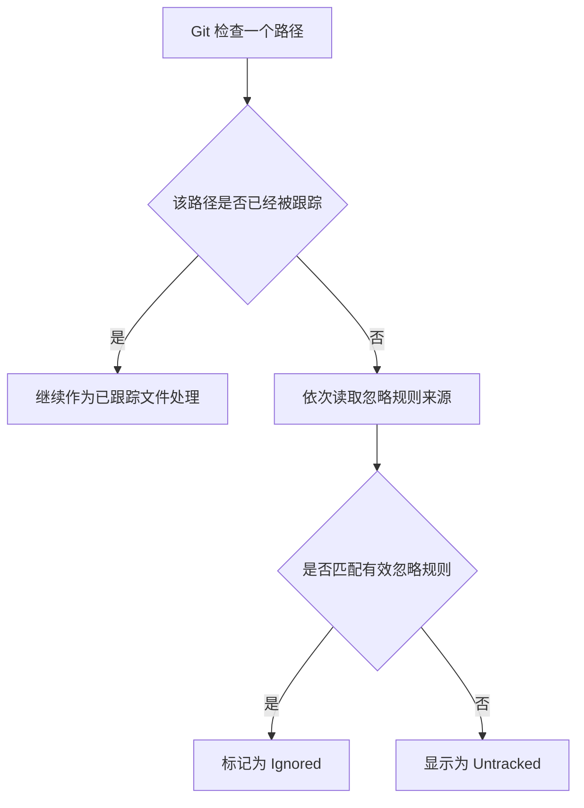
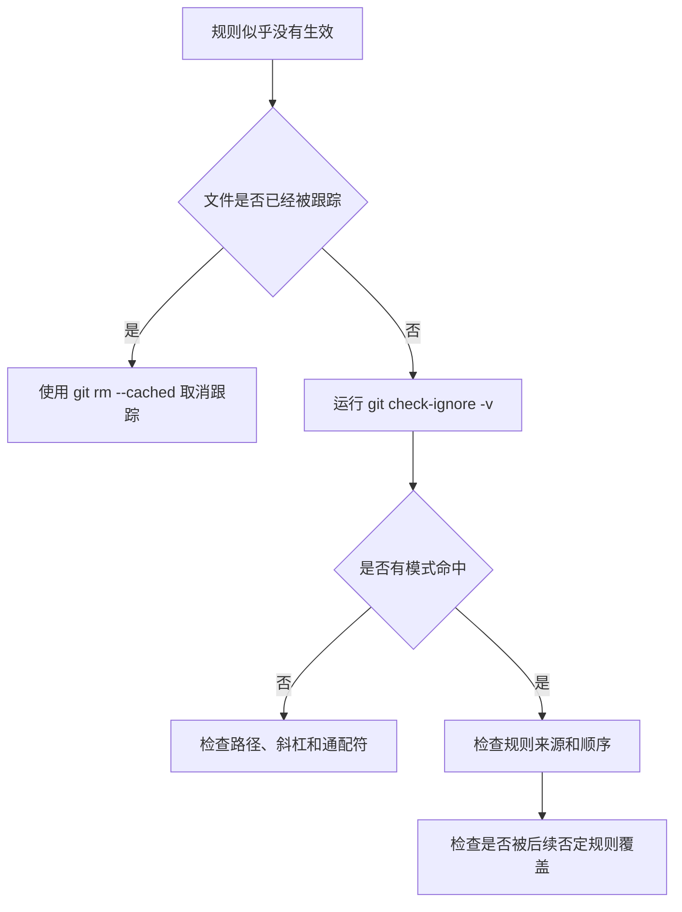

[toc]


## 主题定位与编排思路

整体学习路径如下：

1. 理解 Git 文件状态
2. 认识忽略机制
3. 掌握匹配语法
4. 理解规则优先级
5. 处理已跟踪文件
6. 调试忽略规则
7. 应用于真实项目
8. 团队规范与安全实践

这样安排的原因是：新手遇到的最大困难通常不是记不住 `*` 或 `**`，而是没有区分“未跟踪文件（Untracked File）”“已跟踪文件（Tracked File）”和“被忽略文件（Ignored File）”。只有先建立这一心理模型，后续才能理解为什么“已经写进 `.gitignore` 的文件仍然出现在提交中”。

## 目标读者

- 刚开始学习 Git 和 GitHub 的开发者
- 经常遇到“文件为什么没有被忽略”的初学者
- 需要为团队项目维护 `.gitignore` 的开发者
- 使用 Node.js、Python、Java、Go、Rust、.NET、Unity 等技术栈的工程人员
- 需要管理单体仓库（Monorepo）、构建产物和本地配置文件的团队

## 前置知识

读者只需具备以下基础：

- 知道 Git 是版本控制系统（Version Control System）
- 使用过 `git init`、`git add`、`git commit`
- 能够看懂基本的目录结构
- 了解终端或命令行的基本操作

不要求提前掌握通配符、正则表达式或 Git 内部原理。

## 学习目标

完成全文后，读者应当能够：

- 解释 `.gitignore` 的用途和边界
- 区分未跟踪、已跟踪和已忽略文件
- 正确使用 `*`、`?`、`[]`、`**`、`/` 和 `!`
- 判断规则相对于哪个目录生效
- 理解多个忽略文件之间的优先级
- 处理已经被 Git 跟踪的文件
- 使用 `git check-ignore` 定位匹配规则
- 为不同语言、框架和项目结构编写合理规则
- 避免误删配置、锁文件和必要资源
- 认识 `.gitignore` 与密钥安全之间的区别

------

## 开篇：为什么项目需要 `.gitignore`

### 从一个混乱的仓库开始

使用一个典型开发目录作为开场：

```text
my-project/
├── src/
├── node_modules/
├── dist/
├── logs/
├── .env
├── .idea/
├── package.json
└── package-lock.json
```

说明执行 `git status` 后，Git 可能同时展示：

- 项目源代码
- 下载的第三方依赖
- 自动生成的构建文件
- 编辑器配置
- 日志和缓存
- 本地环境配置
- 可能包含密钥的文件

引出问题：

- 哪些文件应该进入版本控制？
- 哪些文件能够由构建工具重新生成？
- 哪些文件只适用于当前开发者的电脑？
- 哪些内容不应出现在代码仓库中？

### `.gitignore` 解决什么问题

明确说明：

`.gitignore` 用于声明“有意保持未跟踪状态”的文件和目录。**它主要影响 Git 对未跟踪文件的处理，不会自动删除文件，也不会停止跟踪已经纳入版本控制的文件。**([Git](https://git-scm.com/docs/gitignore))

建议强调三个关键词：

| 中文概念   | 英文术语       | 含义                                                   |
| ---------- | -------------- | ------------------------------------------------------ |
| 未跟踪文件 | Untracked File | 文件存在于工作区，但尚未进入 Git 索引                  |
| 已跟踪文件 | Tracked File   | 文件已经进入 Git 版本历史或暂存区                      |
| 已忽略文件 | Ignored File   | 未跟踪文件匹配了忽略规则，通常不会出现在常规状态输出中 |

### `.gitignore` 不做什么

这一节用于纠正常见误解：

- 不会删除本地文件
- 不会从 Git 历史中移除文件
- 不会自动取消已经跟踪的文件
- 不是文件访问控制系统
- 不是加密工具
- 不是完整的密钥防泄漏方案
- 不等于 `.dockerignore`
- 不等于构建工具自己的排除配置

------

## Git 如何判断一个文件是否应该被忽略

### 判断流程

建议使用如下示意图：



### 核心结论

必须突出：

> `.gitignore` 主要控制未跟踪文件是否继续保持未跟踪状态。

Git 官方文档明确指出，已经被跟踪的文件不受普通忽略规则影响。([Git](https://git-scm.com/docs/gitignore))

### 工作区、暂存区与仓库的关系

建议简要解释：

| 区域     | 英文术语             | 作用                     |
| -------- | -------------------- | ------------------------ |
| 工作区   | Working Tree         | 当前磁盘上的项目文件     |
| 暂存区   | Staging Area / Index | 下一次提交准备包含的内容 |
| 本地仓库 | Repository           | 已经提交的 Git 历史      |

重点说明 `.gitignore` 主要影响“工作区中的未跟踪路径是否被 Git 视为待添加内容”。

------

## 忽略规则可以写在哪里

### 忽略规则来源

系统介绍四类来源：

| 规则来源              | 是否通常提交 | 适用范围           | 典型用途                 |
| --------------------- | ------------ | ------------------ | ------------------------ |
| 命令支持的排除参数    | 否           | 当前命令           | 临时过滤                 |
| 项目中的 `.gitignore` | 是           | 当前目录及其子目录 | 团队共享规则             |
| `.git/info/exclude`   | 否           | 当前本地仓库       | 个人且仅针对该仓库       |
| `core.excludesFile`   | 否           | 当前用户的所有仓库 | 操作系统、编辑器临时文件 |

Git 的规则优先级从高到低大致为：命令行规则、路径所在目录及其父目录中的 `.gitignore`、`.git/info/exclude`、全局忽略文件。

位于更深目录的 `.gitignore` 可以覆盖上级目录规则；同一优先级内，最后一个匹配规则决定结果。([Git](https://git-scm.com/docs/gitignore))

### 项目级 `.gitignore`

应说明：

- 通常放在仓库根目录
- 可以被提交到 Git
- 克隆仓库的其他成员可以共享规则
- 适合记录项目统一产生的构建目录、缓存和依赖目录

GitHub 官方建议将团队需要共享的规则写入仓库中的 `.gitignore` 并提交。([GitHub Docs](https://docs.github.com/articles/ignoring-files))

### 子目录中的 `.gitignore`

示例结构：

```text
project/
├── .gitignore
├── frontend/
│   └── .gitignore
└── backend/
    └── .gitignore
```

应解释：

- 根目录规则可以作用于整个仓库
- `frontend/.gitignore` 只影响 `frontend/` 及其子目录
- 越靠近目标文件的 `.gitignore` 通常具有更具体的控制能力
- 在大型仓库中，可以将技术栈特定规则放在相应子项目内

### `.git/info/exclude`

适合忽略：

- 个人测试脚本
- 当前仓库中的本地笔记
- 临时调试目录
- 不希望写入团队 `.gitignore` 的编辑器文件

这里的规则不会随仓库提交和共享。([GitHub Docs](https://docs.github.com/articles/ignoring-files))

### 全局忽略文件

建议讲解配置：

```bash
git config --global core.excludesFile ~/.config/git/ignore
```

查看当前配置：

```bash
git config --global --get core.excludesFile
```

典型全局规则：

```gitignore
.DS_Store
Thumbs.db
*~
*.swp
```

Git 默认会考虑 `$XDG_CONFIG_HOME/git/ignore`；未设置相关环境变量时，通常使用 `$HOME/.config/git/ignore`。([Git](https://git-scm.com/docs/gitignore))

### 如何选择规则放置位置

可以总结为：

| 问题                           | 推荐位置            |
| ------------------------------ | ------------------- |
| 所有项目成员都会生成这个文件吗 | 项目 `.gitignore`   |
| 只有我在这个仓库中会生成吗     | `.git/info/exclude` |
| 我的编辑器会在所有仓库中生成吗 | 全局忽略文件        |
| 只想在某次命令中排除吗         | 命令级排除参数      |

------

## `.gitignore` 的基本语法🎈

### 一行就是一条模式

说明每个非空行通常代表一个匹配模式（Pattern）。

基础示例：

```gitignore
node_modules/
dist/
*.log
.env
```

### 语法速查表

| 写法     | 含义                                 | 示例              |
| -------- | ------------------------------------ | ----------------- |
| 空行     | 不匹配文件，用于分组                 | 空白行            |
| `#`      | 注释行                               | `# Build output`  |
| `\#`     | 匹配以 `#` 开头的名称                | `\#notes.txt`     |
| `*`      | 匹配除目录分隔符外的任意字符         | `*.log`           |
| `?`      | 匹配一个非目录分隔符字符             | `file?.txt`       |
| `[abc]`  | 匹配集合中的一个字符                 | `file[12].txt`    |
| `[a-z]`  | 匹配字符范围                         | `[0-9].log`       |
| `/` 开头 | 相对于当前 `.gitignore` 所在目录定位 | `/dist/`          |
| `/` 结尾 | 只匹配目录                           | `cache/`          |
| `!` 开头 | 否定前面的忽略规则                   | `!important.log`  |
| `\!`     | 匹配以 `!` 开头的名称                | `\!important.txt` |
| `**`     | 跨越零层或多层目录                   | `src/**/temp/`    |
| `\`      | 转义特殊字符                         | `\*.txt`          |

Git 官方规则还规定：普通 `*` 不匹配 `/`，而 `**` 在完整路径中具有跨目录匹配能力。规则行尾随空格默认会被忽略，除非使用反斜杠转义。([Git](https://git-scm.com/docs/gitignore))

------

## 文件名匹配与路径匹配🎈

### 忽略任意位置的同名文件

```gitignore
debug.log
```

应说明该模式没有目录分隔符，因此可以匹配当前 `.gitignore` 作用范围内**不同层级**中的 `debug.log`。

示例：

```text
debug.log
logs/debug.log
src/debug.log
```

### 只忽略仓库根目录中的文件

```gitignore
/debug.log
```

匹配：

```text
debug.log
```

不匹配：

```text
logs/debug.log
```


### `/foo`、`foo` 与 `foo/` 的区别

建议使用对比表：

| 模式    | 文件 `foo` | 目录 `foo/`  | 子目录中的 `foo` |
| ------- | ---------- | ------------ | ---------------- |
| `foo`   | 匹配       | 匹配         | 匹配             |
| `/foo`  | 根层级匹配 | 根层级匹配   | 不匹配           |
| `foo/`  | 不匹配     | 匹配         | 匹配             |
| `/foo/` | 不匹配     | 仅根目录匹配 | 不匹配           |

应强调：

- 末尾 `/` 表示**只匹配目录**
- 开头 `/` 表示**相对于当前 `.gitignore` 所在目录**进行锚定
- `.gitignore` 使用 `/` 作为路径分隔符，即使开发者使用 Windows

------

## 通配符规则详解

### 星号 `*`

```gitignore
*.log
```

匹配：

```text
app.log
error.log
```

不跨越目录分隔符。

```gitignore
logs/*.log
```

匹配：

```text
logs/app.log
```

但不直接匹配：

```text
logs/archive/app.log
```

### 问号 `?`

```gitignore
file?.txt
```

匹配：

```text
file1.txt
fileA.txt
```

不匹配：

```text
file10.txt
```

### 字符集合 `[]`

```gitignore
report[0-9].pdf
```

匹配：

```text
report1.pdf
report8.pdf
```

### 双星号 `**`

应分别讲解三种典型位置。

任意层级：

```gitignore
**/logs/
```

目录下全部内容：

```gitignore
build/**
```

中间跨越零层或多层目录：

```gitignore
src/**/generated/
```

Git 官方给出的典型含义包括：开头的 `**/` 可匹配任意层级，结尾的 `/**` 可匹配目录内任意深度内容，路径中间的 `/**/` 可以跨越零层或多层目录。([Git](https://git-scm.com/docs/gitignore))

------

## 规则顺序与否定模式

### 最后匹配规则生效

示例：

```gitignore
*.log
!important.log
```

结果：

- `debug.log` 被忽略
- `important.log` 被重新包含

### 顺序不能随意交换

错误顺序：

```gitignore
!important.log
*.log
```

此时最后的 `*.log` 会再次忽略 `important.log`。

### 否定规则的限制

重点讲解：

```gitignore
build/
!build/README.md
```

这通常不能达到预期效果，因为父目录 `build/` 已经整体被排除。Git 为性能考虑，不会继续遍历被完全排除的目录，因此无法简单地重新包含其中某个文件。([Git](https://git-scm.com/docs/gitignore))

### 正确保留目录中的指定文件

可以改为：

```gitignore
build/*
!build/README.md
```

更深层目录的情况：

```gitignore
data/*
!data/examples/
data/examples/*
!data/examples/sample.json
```

这一节应强调：

> 重新包含文件时，必须保证通向该文件的父目录没有被整体排除，或者逐层重新包含父目录。

### 白名单式规则

示例：默认忽略所有内容，只保留部分路径。

```gitignore
/*
!/.gitignore
!/src/
!/src/**
!/README.md
```

说明这类配置可用于发布目录、生成仓库或特殊部署仓库，但不建议新手在普通项目中滥用，因为容易遗漏必要文件。

------

## 为什么写了 `.gitignore` 仍然没有生效

### 文件已经被 Git 跟踪

典型场景：

```bash
git add .env
git commit -m "add config"
```

随后才添加：

```gitignore
.env
```

此时 `.env` 仍会被 Git 跟踪。

### 停止跟踪单个文件

```bash
git rm --cached .env
git commit -m "stop tracking local environment file"
```

`--cached` 表示从 Git 索引中移除，而不是删除工作区中的本地文件。

Git 官方及 GitHub 官方均建议：对于已经纳入版本控制的文件，应先使用 `git rm --cached` 取消跟踪，再添加忽略规则。([Git](https://git-scm.com/docs/gitignore))

### 停止跟踪一个目录

```bash
git rm -r --cached dist/
git commit -m "stop tracking build output"
```

### 重新应用整个仓库的忽略规则

可以介绍常见做法：

```bash
git rm -r --cached .
git add .
git status
git commit -m "reapply gitignore rules"
```

必须增加风险提示：

- 先确认工作区内容已保存
- 在提交前仔细检查 `git status`
- 不要机械复制到包含复杂子模块或特殊索引配置的仓库
- 该操作会重新构建暂存区，需要确认哪些文件被重新加入

------

## 如何调试 `.gitignore`

### 使用 `git check-ignore`

这是全文最重要的实用工具之一。

检查文件是否被忽略：

```bash
git check-ignore path/to/file.log
```

显示具体是哪条规则命中的：

```bash
git check-ignore -v path/to/file.log
```

典型输出结构：

```text
.gitignore:12:*.log    path/to/file.log
```

可以解释为：

- 规则来自哪个文件
- 位于第几行
- 命中了哪条模式
- 被检查的路径是什么

`git check-ignore` 的官方用途就是调试 `.gitignore` 和其他排除文件；`-v` 会同时显示规则来源、行号、匹配模式和目标路径。([Git](https://git-scm.com/docs/git-check-ignore))

### 调试已经被跟踪的文件

```bash
git check-ignore -v --no-index path/to/file
```

`--no-index` 会在检查时忽略索引状态，可用于调查“为什么这个文件已经被加入后没有表现为忽略状态”。([Git](https://git-scm.com/docs/git-check-ignore))

### 推荐排查顺序

建议提供固定流程：



### 常见调试问题

- `.gitignore` 是否位于预期目录
- 模式是相对于哪个目录解析
- 是否误用了根目录锚定 `/`
- 目录模式是否缺少结尾 `/`
- 是否被后面的规则覆盖
- 父目录是否已经被整体忽略
- 文件是否已经被跟踪
- 是否存在子目录 `.gitignore`
- 是否存在 `.git/info/exclude`
- 是否配置了全局 `core.excludesFile`
- 文件名大小写是否与实际路径一致

------

## 应该忽略哪些内容

### 判断原则

建议使用以下判断问题：

| 判断问题                         | 通常建议                   |
| -------------------------------- | -------------------------- |
| 文件能否从源代码重新生成         | 通常忽略                   |
| 文件是否只适用于当前设备         | 通常忽略                   |
| 文件是否是编辑器缓存             | 通常忽略或放入全局规则     |
| 文件是否包含本地密钥             | 不提交，并采用额外安全措施 |
| 文件是否是项目运行所需的声明文件 | 通常提交                   |
| 文件是否用于锁定依赖版本         | 不应盲目忽略               |
| 文件是否是用户上传或业务原始数据 | 根据项目存储策略判断       |
| 文件是否是数据库迁移文件         | 通常提交                   |
| 文件是否是生成代码               | 取决于构建和发布流程       |

### 常见可忽略类别

- 编译产物（Build Artifacts）
- 下载的依赖目录
- 缓存目录
- 日志文件
- 临时文件
- 测试覆盖率输出
- 编辑器工作区配置
- 操作系统元数据
- 本地数据库
- 本地环境配置
- 本地证书和开发密钥
- IDE 索引
- 性能分析输出
- 大型中间数据文件

### 不应机械忽略的内容

建议单独提醒：

- 依赖锁文件
- 数据库迁移文件
- 基础设施配置
- CI/CD 配置
- 测试夹具
- 示例配置
- 代码生成结果
- 项目级 IDE 配置
- 小型静态资源
- 许可证和说明文件

这些内容是否提交取决于项目的可复现性、发布方式和团队协作要求。

------

## 不同技术栈的经典示例

### Node.js 与 TypeScript

```gitignore
# Dependencies
node_modules/

# Build output
dist/
build/

# Test coverage
coverage/

# Logs
*.log
npm-debug.log*
yarn-debug.log*
pnpm-debug.log*

# Local environment
.env
.env.local
.env.*.local

# TypeScript cache
*.tsbuildinfo
```

应补充讲解：

- `node_modules/` 可以通过包管理器重新安装
- `dist/` 是否忽略取决于发布方式
- 不应默认忽略 `package-lock.json`、`yarn.lock` 或 `pnpm-lock.yaml`
- 可以提交 `.env.example`，但不提交真实 `.env`

### Python

```gitignore
# Bytecode
__pycache__/
*.py[cod]

# Virtual environments
.venv/
venv/

# Build output
build/
dist/
*.egg-info/

# Test and type-check caches
.pytest_cache/
.mypy_cache/
.ruff_cache/

# Coverage
.coverage
htmlcov/

# Local environment
.env
```

建议解释虚拟环境（Virtual Environment）与缓存目录的区别。

### Java 与 Maven

```gitignore
# Compiled classes
*.class

# Maven output
target/

# IDE
.idea/
*.iml

# Logs
*.log
```

提醒不要忽略：

```text
pom.xml
mvnw
mvnw.cmd
.mvn/
```

除非团队有特殊构建策略。

### Gradle

```gitignore
.gradle/
build/
```

根据项目策略决定是否提交 Gradle Wrapper：

```text
gradlew
gradlew.bat
gradle/wrapper/
```

通常为了构建可复现性，应保留 Wrapper。

### Go

```gitignore
# Build output
/bin/
*.exe
*.test

# Coverage
coverage.out

# Local environment
.env
```

提醒不要机械忽略：

```text
go.mod
go.sum
```

### Rust

```gitignore
/target/
.env
```

说明 `Cargo.lock` 是否提交与项目类型有关：

- 应用程序通常提交
- 库项目需要按照团队和生态规范决定

### .NET

```gitignore
bin/
obj/
.vs/
*.user
*.suo
```

### Unity

可以建议读者优先参考维护中的 Unity 模板，并理解 `Library/`、`Temp/`、`Obj/` 等目录为何通常不提交。GitHub 官方模板仓库持续维护多种语言、工具和环境的 `.gitignore`，并区分常用模板、全局模板与社区模板。([GitHub](https://github.com/github/gitignore))

------

## `.env`、密钥和安全边界

### `.gitignore` 只能降低误提交概率

建议明确写出：

> 将 `.env` 写入 `.gitignore` 是必要的防误操作措施，但不能把 `.gitignore` 当作安全系统。

原因包括：

- 已经提交的密钥不会因为新增规则而消失
- Git 历史中可能仍然保存旧版本
- 开发者可能强制添加文件
- 密钥可能出现在日志、构建产物或其他配置中
- 仓库平台可能已经索引或复制相关提交

### 推荐的配置文件结构

```text
.env
.env.example
```

`.gitignore`：

```gitignore
.env
.env.*
!.env.example
```

`.env.example`：

```dotenv
DATABASE_URL=
API_KEY=
REDIS_URL=
```

说明示例文件只保留变量名称和非敏感示例，不应写入真实凭据。

### 密钥误提交后的正确处理

建议给出处理顺序：

- 立即撤销或轮换凭据
- 检查凭据是否被使用
- 从当前代码中删除敏感内容
- 根据风险评估决定是否重写 Git 历史
- 通知团队重新同步仓库
- 启用密钥扫描和推送保护
- 记录泄漏原因并增加自动检查

GitHub 官方建议，在发现凭据泄漏时优先立即轮换或撤销凭据；清理 Git 历史可能具有破坏性，不能代替凭据失效处理。GitHub 的推送保护（Push Protection）能够在检测到硬编码凭据时阻止相关推送。([GitHub Docs](https://docs.github.com/en/code-security/tutorials/remediate-leaked-secrets/remediating-a-leaked-secret?utm_source=chatgpt.com))

------

## `.gitignore` 与其他忽略文件的区别

### `.gitignore` 与 `.dockerignore`

| 文件            | 使用者          | 主要作用                             |
| --------------- | --------------- | ------------------------------------ |
| `.gitignore`    | Git             | 控制未跟踪文件是否进入版本控制       |
| `.dockerignore` | Docker 构建系统 | 控制哪些文件不进入 Docker 构建上下文 |

应说明：

- 二者语法相似但不完全等价
- 某个文件被 Git 忽略，不代表 Docker 不会读取它
- 某个文件被 Docker 忽略，也不代表 Git 不会提交它
- 密钥文件通常需要在两边分别处理

### `.gitignore` 与 `.npmignore`

| 文件         | 作用                |
| ------------ | ------------------- |
| `.gitignore` | 控制 Git 跟踪       |
| `.npmignore` | 控制 npm 包发布内容 |

### `.gitignore` 与工具级排除规则

还可以简单介绍：

- ESLint 的忽略配置
- Prettier 的 `.prettierignore`
- Docker 的 `.dockerignore`
- 测试工具的排除配置
- 搜索工具的忽略规则
- IDE 的索引排除规则

核心结论：

> 不同工具的“忽略”只对该工具自身生效。

------

## Monorepo 与大型项目中的规则设计

### 根目录与子项目分工

示例：

```text
monorepo/
├── .gitignore
├── apps/
│   ├── web/
│   │   └── .gitignore
│   └── api/
│       └── .gitignore
└── packages/
    └── shared/
```

推荐设计：

根目录负责：

- 通用日志
- 操作系统文件
- 通用缓存
- 根级构建输出
- 工作区包管理器生成内容

子项目负责：

- 框架特定缓存
- 子项目构建产物
- 局部生成文件
- 子项目专属测试输出

### 避免重复规则

不建议在每个子项目中反复复制：

```gitignore
.DS_Store
*.log
```

这类通用规则可以放在根目录或开发者全局忽略文件。

### 避免过宽规则

风险较高的规则：

```gitignore
*.json
*.yaml
config/
data/
```

这些规则可能误伤：

- 项目配置
- API 定义
- 测试数据
- 数据库迁移
- 基础设施声明
- 应提交的示例文件

建议改成更具体的路径：

```gitignore
/runtime-data/
/config/local.yaml
/test-output/*.json
```

------

## 空目录与 `.gitkeep`

### Git 为什么不记录空目录

说明 Git 跟踪的是文件内容和目录树中的文件条目，而不是独立的空目录对象。因此，一个完全空的目录不会自然出现在提交中。

### `.gitkeep` 是什么

应明确：

- `.gitkeep` 只是社区约定名称
- 它不是 Git 内置功能
- Git 并不特殊识别 `.gitkeep`
- 也可以使用 `.gitignore` 或说明文件占位

### 保留目录但忽略目录内容

经典写法：

```gitignore
uploads/*
!uploads/.gitkeep
```

或者在目录内部放置：

```gitignore
*
!.gitignore
```

适合：

- 上传目录
- 日志目录
- 临时运行目录
- 空的缓存目录
- 部署时需要预先存在的目录

------

## 官方模板的正确使用方式

### 从模板开始，而不是止于模板

GitHub 维护了一套官方 `.gitignore` 模板，覆盖常见语言、框架、工具和开发环境，并将常用模板、全局模板及社区模板分开维护。([GitHub](https://github.com/github/gitignore))

建议流程：

- 选择主要语言模板
- 合并框架相关规则
- 增加项目自有构建目录
- 删除项目并不使用的规则
- 检查锁文件和配置文件
- 使用 `git check-ignore -v` 验证
- 在代码评审中检查规则变更

### 不要直接拼接大量模板

多个模板直接拼接可能产生：

- 重复规则
- 互相覆盖
- 过时工具配置
- 误忽略有效项目文件
- 难以维护的超长文件

### 模板应当定期审查

适合在以下时间检查：

- 升级框架
- 更换包管理器
- 引入新的 IDE
- 调整构建系统
- 迁移到 Monorepo
- 新增 CI/CD 流程
- 修改部署产物结构

------

## `.gitignore` 的可维护性最佳实践

### 按类别分组

```gitignore
# Dependencies
node_modules/

# Build output
dist/
build/

# Tests
coverage/

# Local environment
.env
.env.local

# Logs
*.log
```

### 为不直观的规则添加注释

不推荐：

```gitignore
.cache-x/
```

推荐：

```gitignore
# Cache generated by the internal schema compiler
.cache-x/
```

### 优先使用明确路径

不推荐：

```gitignore
temp
```

推荐：

```gitignore
/runtime/temp/
```

### 规则尽量最小化

每条规则都应能够回答：

- 谁生成了这个文件？
- 为什么不应该提交？
- 是否能重新生成？
- 是否所有团队成员都适用？
- 是否可能误匹配其他文件？

### 个人偏好不要污染项目规则

个人编辑器、操作系统和备份文件优先放在：

- 全局忽略文件
- `.git/info/exclude`

GitHub 官方也将操作系统和编辑器相关模板划入 `Global` 分类，并建议作为全局规则使用，或在确有必要时合入项目模板。([GitHub](https://github.com/github/gitignore))

### 将 `.gitignore` 变更纳入代码评审

评审时关注：

- 是否误忽略源文件
- 是否新增过宽通配符
- 是否错误忽略锁文件
- 是否隐藏了构建所需配置
- 是否存在密钥泄漏风险
- 是否应该使用 `.git/info/exclude`
- 是否需要同步 `.dockerignore`

------

## 常见错误与反例

### 把 `.gitignore` 当作删除工具

错误认识：

> 加入 `.gitignore` 后，远程仓库里的文件就会消失。

正确理解：

需要先取消跟踪并提交变更；如果文件存在于历史提交中，还需要单独评估历史清理。

### 规则写得过于宽泛

```gitignore
config*
```

可能意外匹配：

```text
config.yaml
configuration.md
config-generator/
```

更合适：

```gitignore
/config/local.yaml
```

### 忽略整个环境文件家族，却忘记示例文件

```gitignore
.env*
```

这会连 `.env.example` 一并忽略。

改为：

```gitignore
.env*
!.env.example
```

### 忽略父目录后尝试恢复内部文件

问题规则：

```gitignore
docs/
!docs/README.md
```

应改为允许 Git 继续遍历目录：

```gitignore
docs/*
!docs/README.md
```

### 把正则表达式语法当作 `.gitignore` 语法

例如：

```gitignore
.*\.log$
```

`.gitignore` 使用的是路径匹配模式，不是普通正则表达式。

正确写法：

```gitignore
*.log
```

### 使用 Windows 反斜杠表示目录

不推荐：

```gitignore
build\temp\
```

正确：

```gitignore
build/temp/
```

### 忽略所有压缩包或二进制文件

```gitignore
*.zip
*.jar
*.dll
```

这可能误伤：

- 项目必须的测试资源
- Wrapper 文件
- 发布资产
- 第三方运行组件

应根据目录和来源精确匹配。

------

## 完整案例：为一个全栈项目设计 `.gitignore`

### 项目结构

```text
example-app/
├── frontend/
├── backend/
├── scripts/
├── uploads/
├── docs/
├── .env
├── .env.example
├── docker-compose.yml
└── README.md
```

### 推荐规则

```gitignore
# Operating system files
.DS_Store
Thumbs.db

# Editor files
.vscode/*
!.vscode/extensions.json
.idea/

# Dependencies
frontend/node_modules/
backend/.venv/

# Build output
frontend/dist/
backend/build/

# Test and coverage output
coverage/
.pytest_cache/

# Logs
*.log
logs/

# Local environment files
.env
.env.local
.env.*.local
!.env.example

# Runtime uploads
uploads/*
!uploads/.gitkeep

# Temporary files
tmp/
*.tmp
```

### 案例讲解重点

逐条分析：

- 为什么依赖目录不提交
- 为什么构建输出可能不提交
- 为什么 `.env.example` 应保留
- 为什么上传目录只保留占位文件
- 为什么 `.vscode/` 可以有选择地提交
- 为什么不忽略 `docker-compose.yml`
- 为什么不使用 `*.json` 之类的宽泛规则
- 为什么锁文件应根据项目类型决定，而不是默认忽略

------

## 团队落地检查清单

### 创建项目时

- 在第一次大规模 `git add` 前创建 `.gitignore`
- 根据技术栈选择模板
- 检查模板是否适合当前框架版本
- 添加本地配置和构建输出规则
- 创建不含真实值的示例配置文件
- 执行 `git status` 检查未跟踪文件
- 使用 `git check-ignore -v` 验证关键路径

### 提交前

- 检查是否包含 `.env`
- 检查是否包含证书、私钥或令牌
- 检查是否提交大型生成文件
- 检查依赖目录是否被加入
- 检查锁文件是否按团队策略处理
- 检查是否误忽略源代码
- 检查 `.gitignore` 与 `.dockerignore` 是否需要同步调整

### 代码评审时

- 关注新增的宽泛规则
- 检查否定规则顺序
- 检查父目录排除问题
- 确认规则应属于项目级还是个人级
- 检查是否隐藏了本应评审的生成文件
- 确认安全文件是否采用了额外保护措施

------

## 实战练习设计

### 基础练习

给出目录：

```text
project/
├── app.log
├── app.txt
├── logs/
│   ├── debug.log
│   └── keep.log
└── src/
    └── app.log
```

要求：

- 忽略所有 `.log`
- 保留 `logs/keep.log`
- 解释规则顺序

参考规则：

```gitignore
*.log
!logs/keep.log
```

### 路径锚定练习

要求：

- 只忽略根目录的 `build/`
- 不忽略 `examples/build/`

参考规则：

```gitignore
/build/
```

### 多层目录练习

要求忽略任意层级中的 `cache/`：

```gitignore
**/cache/
```

### 已跟踪文件练习

场景：

- `config.local.json` 已经提交
- 新增忽略规则后仍然出现修改

要求读者写出解决命令：

```bash
git rm --cached config.local.json
```

### 调试练习

给出命令：

```bash
git check-ignore -v frontend/dist/app.js
```

要求读者解释输出中的：

- 来源文件
- 行号
- 模式
- 目标路径

### 安全练习

场景：

- API Token 已经推送到远程仓库
- 随后才添加 `.env` 到 `.gitignore`

要求读者说明为什么仅修改 `.gitignore` 不足，并给出：

- 轮换凭据
- 删除当前代码中的密钥
- 评估历史清理
- 启用密钥扫描和推送保护

------

## 常见问题

### `.gitignore` 本身需要提交吗

通常需要。项目级 `.gitignore` 属于仓库协作规则，应与源代码一起进行版本控制。GitHub 官方也建议提交需要与克隆者共享的忽略规则。([GitHub Docs](https://docs.github.com/articles/ignoring-files))

### 可以创建多个 `.gitignore` 吗

可以。每个目录都可以拥有自己的 `.gitignore`，其规则作用于该目录和子目录。

### 为什么 `!file.txt` 没有恢复文件

常见原因：

- 后面还有其他规则再次忽略它
- 父目录已被整体忽略
- 路径相对于 `.gitignore` 的位置理解错误
- 文件已经被跟踪，观察到的不是忽略问题

### `.gitignore` 区分大小写吗

匹配行为与 Git 配置和底层文件系统有关。跨平台项目不应依赖大小写差异，应采用一致的文件命名规范。

### 能否忽略已经提交的文件但保留本地副本

可以先使用：

```bash
git rm --cached filename
```

然后提交删除记录并添加忽略规则。

### `.gitignore` 能保护密码吗

不能单独承担这一职责。它只能降低未跟踪敏感文件被意外加入的概率。真实密钥应使用密钥管理系统、环境变量、CI/CD Secrets、密钥扫描和推送保护等机制。

### `.gitkeep` 是 Git 官方文件吗

不是。它只是用于让目录中存在一个可提交文件的命名习惯。

**让 Git 追踪空文件夹。**

Git 默认只追踪文件，不追踪空文件夹。如果你需要在仓库中保留某个空目录（比如作为未来的输出目录或上传目录），就需要在该目录下放一个文件。

这只是社区习惯，Git 本身对这个名字没有特殊处理。你可以用任何名字（比如 `.keep`、`empty.txt`），但 `.gitkeep` 最通用，团队协作时大家一看就懂。

### 是否应该忽略依赖锁文件

不能一概而论。应用项目通常需要锁文件保证依赖可复现；具体应遵循所用语言、包管理器和团队发布策略。

------

## 术语表

| 术语         | 英文                 | 说明                                 |
| ------------ | -------------------- | ------------------------------------ |
| 忽略规则     | Ignore Rule          | 用于匹配不希望 Git 跟踪的路径模式    |
| 模式         | Pattern              | `.gitignore` 中的一条匹配表达式      |
| 工作区       | Working Tree         | 当前检出的项目文件                   |
| 暂存区       | Staging Area         | 下一次提交的候选内容                 |
| 索引         | Index                | Git 对暂存区的内部称呼               |
| 已跟踪       | Tracked              | 已存在于 Git 索引或历史中的文件      |
| 未跟踪       | Untracked            | 尚未进入 Git 索引的文件              |
| 已忽略       | Ignored              | 匹配排除规则的未跟踪文件             |
| 否定模式     | Negation Pattern     | 以 `!` 开头、用于重新包含路径的规则  |
| 通配符       | Wildcard             | 例如 `*`、`?`、`**` 的匹配符号       |
| 路径锚定     | Path Anchoring       | 使用开头 `/` 限制匹配起点            |
| 全局忽略文件 | Global Excludes File | 对当前用户所有仓库生效的规则文件     |
| 构建产物     | Build Artifact       | 由编译、打包或生成过程产生的文件     |
| 密钥扫描     | Secret Scanning      | 检测仓库中令牌、密码或密钥的安全能力 |
| 推送保护     | Push Protection      | 在敏感凭据被推送前进行检测和阻止     |

------

## 文末速查表

```gitignore
# Comment
# This is a comment

# Ignore one file anywhere
debug.log

# Ignore all files with an extension
*.log

# Ignore a directory anywhere
cache/

# Ignore only a root-level directory
/build/

# Ignore at any directory depth
**/logs/

# Ignore everything below a directory
output/**

# Match across multiple directory levels
src/**/generated/

# Re-include a file
*.log
!important.log

# Keep a placeholder in an otherwise ignored directory
uploads/*
!uploads/.gitkeep

# Ignore environment files but keep the example
.env*
!.env.example
```

推荐将全文最后的核心原则凝练为：

> `.gitignore` 的重点不是“尽可能多地忽略”，而是准确区分源代码、可再生成内容、本地状态和敏感信息，并把每一类内容放到正确的版本控制边界中。