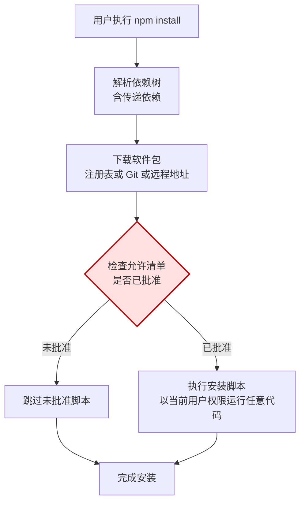

[toc]

## Node.js 捆绑 npm 版本介绍指南

**npm**（Node Package Manager，包管理器）是随 **Node.js**（Node.js 运行时）预装的默认包管理器。理解“哪个 Node 版本带哪个 npm 版本”以及 npm 大版本演进带来的行为变化，是排查安装异常与锁定团队环境的前提。本文依据以 [Node.js 历史版本页](https://nodejs.org/en/about/previous-releases) 与 [npm v12 Changelog](https://docs.npmjs.com/cli/v12/using-npm/changelog) 为主、第三方分析为辅整理；模型知识截止 2026 年 1 月，联网核验日期为 2026 年 9 月 28 日。

### 结论先行

- 安装 Node.js 的机器上一定有 npm，但 npm 的具体版本取决于 Node 版本，且同一 Node 大版本的不同小版本捆绑的 npm 也可能不同；精确对照以 [nodejs.org 全版本索引](https://nodejs.org/dist/index.json) 为准。
- 当前仍受支持的组合是 **Node 22 配 npm 10** 与 **Node 24 配 npm 11**；Node 20 已结束生命周期，应当升级。
- **npm 12**（2026 年 7 月发布）是一次以安全为主题的大版本：依赖安装脚本默认不再执行，Git 依赖与远程压缩包依赖默认不再解析；升级前须先建立允许清单。

### Node.js 与 npm 捆绑对照

下表给出各 Node 版本线的捆绑 npm 大版本与支持状态；同一版本线内捆绑的 npm 会随小版本升级，因此表中为大版本对照，精确到小版本的对应关系请查版本归档页的明细表（如 [Node.js 22 版本归档](https://nodejs.org/en/download/archive/v22) 中每个小版本均标注了 npm 版本）。

| Node.js 版本线 | 捆绑 npm 大版本 | 版本状态（截至 2026 年 9 月） | 说明 |
| -------------- | --------------- | ----------------------------- | ---- |
| Node 14 | npm 6 | 已结束生命周期（2023 年 4 月） | 经典组合，大量老项目仍停留于此 |
| Node 16 | npm 8 | 已结束生命周期（2023 年 9 月） | 随 Node 16 全程提供 npm 8 |
| Node 18 | npm 8 起步，后期为 npm 10 | 已结束生命周期（2025 年 4 月） | 同一版本线内捆绑 npm 随小版本升级 |
| Node 20 | npm 9 起步，后期为 npm 10 | 已结束生命周期（2026 年 4 月） | 同上，末期小版本已带 npm 10 |
| Node 22 | npm 10 | 维护期长期支持（至 2027 年 4 月） | 当前求稳的选择，如 `v22.22.2` 配 `npm 10.9.7` |
| Node 24 | npm 11 | 活跃长期支持（至 2028 年 4 月） | 当前推荐的升级目标，首发即带 npm 11，官方下载页示例为 `v24.21.0` 配 `npm 11.19.0` |

**长期支持**（Long Term Support，简称 LTS）决定了能否持续收到安全更新，**当前版**（Current）更新快但支持期短，生产环境应优先选择 LTS 版本线。版本状态与起止日期完整时间线见 [Node.js 生命周期时间线](https://www.herodevs.com/blog-posts/node-js-end-of-life-dates-you-should-be-aware-of)。Node 版本状态决定安全更新，npm 大版本决定安装行为与锁文件格式，两者须放在一起看，单独升级其中一个都可能破坏另一个的假设。

### npm 大版本演进

下表按时间顺序列出各 npm 大版本的标志性变化；阅读时重点关注标为加粗的机制名，它们是排查历史项目问题的关键词。

| npm 大版本 | 登场时期与搭配 | 标志性变化 | 对今天的影响 |
| ---------- | -------------- | ---------- | ------------ |
| npm 5 | 2017 年，随 Node 8 | 引入 **锁文件**（`package-lock.json`），`--save` 成为默认 | 锁文件机制的起点，此前依赖版本不可复现 |
| npm 6 | 2018 年，随 Node 10、12、14 | **漏洞审计**（`npm audit`）、**干净安装**（`npm ci`） | 长期最稳定的经典版本，老项目教程多基于此 |
| npm 7 | 2020 年，随 Node 15 | 原生**工作区**（Workspaces，多包仓库支持）、锁文件格式升级到第二版、**对等依赖**（peerDependencies）自动安装 | 现代 npm 行为的起点；自动安装对等依赖曾导致一批旧项目安装冲突 |
| npm 8 | 2021 年，随 Node 16 | 延续 npm 7 行为，重在性能与稳定性 | 过渡版本，无破坏性记忆点 |
| npm 9 | 2022 年，随 Node 18 | 锁文件格式升级到第三版，对等依赖处理更严格 | 第三版锁文件体积更小，但部分旧工具链解析失败 |
| npm 10 | 2023 年，随 Node 20、22 | 起手即稳，供应链能力增强（**来源证明**（Provenance）、**软件物料清单**（Software Bill of Materials，简称 SBOM）） | 当前存量项目的主力版本，要求 Node 满足 `^18.17.0` 或 `>=20.5.0` |
| npm 11 | 2025 年，随 Node 24 | 延续 npm 10 行为，并为 npm 12 做铺垫：陆续加入脚本与来源开关，高版本对 npm 12 破坏性行为给出预警 | 从 npm 11 升级到 npm 12 前，先升到 `11.16.0` 以上读完预警是最省力的方式 |
| npm 12 | 2026 年 7 月，要求 Node 满足 `^22.22.2`、`^24.15.0`、`>=26.0.0` 三者之一 | 安全默认（见下一节），并移除一批老旧命令 | 新项目的默认选择；存量项目须按清单评估后升级 |

### npm 12 的变化与升级

npm 12 把原来的默认信任模型改为显式许可模型，下表为三项默认值变化；应对命令中的 `npm approve-scripts`（批准脚本）与 `npm deny-scripts`（拒绝脚本）文档见 [npm 批准脚本命令文档](https://docs.npmjs.com/cli/v11/commands/npm-approve-scripts)，变更预告见 [npm 12 破坏性变更预告](https://github.blog/changelog/2026-06-09-upcoming-breaking-changes-for-npm-v12/)。

| 变化 | npm 11 及之前 | npm 12 | 应对 |
| ---- | ------------- | ------ | ---- |
| 依赖安装脚本 | 自动执行（`preinstall`、`install`、`postinstall`） | 默认阻止，仅执行根包**允许清单**（`allowScripts`）中的脚本；含隐式**原生模块构建**（`node-gyp rebuild`，即便没有显式安装脚本，只要带 `binding.gyp` 即被拦截） | 用 `npm approve-scripts --allow-scripts-pending` 查看待定项并批准，用 `npm deny-scripts` 拒绝，结果写入 `package.json` 后提交 |
| Git 依赖 | 自动解析（含传递依赖） | 默认不解析 | 确有用 Git 依赖时显式传入 `--allow-git` |
| 远程压缩包依赖 | 自动解析（直接或传递依赖） | 默认不解析 | 确有需要时显式传入 `--allow-remote` |

其他破坏性变更还包括：移除 `npm shrinkwrap`（项目根的 `npm-shrinkwrap.json` 改名为 `package-lock.json`，发布锁定改用 `bundleDependencies`），移除 `star` 系列命令与 `npm adduser`（改用网站建账号加 `npm login`），`npm init` 默认许可证从 `ISC` 改为空（不填则省略该字段），未知命令行参数由警告改为报错，`npm view --json` 恒返回数组，不再注册系统手册页（`npm help install` 可用）。建议按以下顺序升级：

1. 先把 npm 升到 `11.16.0` 以上，跑一次正常安装并读完预警。
2. 整理出脚本与特殊依赖的允许清单，提交更新后的 `package.json`。
3. 在受控窗口内升级到 npm 12，批准后用 `npm rebuild` 执行新批准的脚本。

### 读懂安装输出的警告与提示

一次真实的全局安装输出通常同时包含三类信息，性质各不相同，不宜一概忽略，也不宜一概当成错误，态度应为分级看待。

| 提示 | 含义 | 态度与处理 |
| ---- | ---- | ---------- |
| `npm warn deprecated ...` | **弃用警告**（deprecation warning）：依赖链中某包已被作者标记弃用，一般来自**传递依赖**（transitive dependencies） | 安装不受影响；仅当它是你的直接依赖时才考虑替换；其余归档备查 |
| `npm warn install-scripts ... not yet covered by allowScripts` | **脚本待审批警告**（unreviewed install scripts）：npm 11.16.0 及之后对 npm 12 行为的提前预警；当前仅警告，脚本仍会执行 | 逐项判断是否信任后批准；升级 npm 12 后未批准者将被阻止，须在本阶段把允许清单定下来 |
| `npm notice New major version ... available` | **大版本升级提示**：仅为通知，不代表必须立即升级 | 择机在受控窗口按**上一节**的顺序执行，不在排查问题当场盲目升级 |

以下为实际输出（npm 11.19.0，全局安装终端工具，`added 518 packages` 证明安装成功，三类提示均未阻断安装）：

```bash
npm install -g @deepseek-ai/dsh
npm warn deprecated node-domexception@1.0.0: Use your platform's native DOMException instead
added 518 packages in 24s
npm warn install-scripts 5 packages have install scripts not yet covered by allowScripts:
npm warn install-scripts   @deepseek-ai/dsh-subprocess-local@0.1.5-rc.2 (postinstall: node scripts/ensure-spawn-helper.mjs)
npm warn install-scripts   koffi@3.2.1 (install: node ./cnoke.cjs -P . -D src/koffi --prebuild --release)
npm warn install-scripts   node-pty@1.2.0-beta.15 (install: node scripts/prebuild.js || node-gyp rebuild; postinstall: node scripts/post-install.js)
npm warn install-scripts   @google/genai@1.52.0 (preinstall: echo 'preinstall: no-op')
npm warn install-scripts   protobufjs@7.6.6 (postinstall: node scripts/postinstall)
npm warn install-scripts Run `npm install -g --allow-scripts=@deepseek-ai/dsh-subprocess-local,koffi,node-pty,@google/genai,protobufjs` to allow these scripts once, or `npm config set allow-scripts=@deepseek-ai/dsh-subprocess-local,koffi,node-pty,@google/genai,protobufjs --location=user` to allow them for all global installs.
npm notice New major version of npm available! 11.19.0 -> 12.0.2
npm notice To update run: npm install -g npm@12.0.2
```

逐项核查思路如下，以下判断以包名无仿冒、发布者为官方或知名维护者为前提，结论仅适用于个人试验环境；高安全环境应改用本地安装并逐个审查。全局安装权限较高，批准前至少确认包名无拼写仿冒、发布者可信，最终是否批准由你决定：

- `node-domexception@1.0.0`：提示改用平台原生 `DOMException`（DOM 异常接口，Node 18 及之后内置）；属于传递依赖的次要提示，无需处理。
- `@deepseek-ai/dsh-subprocess-local`（`postinstall`）：与所装工具同源，功能必需，信任等级等同于工具本身，可批准。
- `koffi`（`install`）：**外部函数接口**（Foreign Function Interface，简称 FFI）包，需获取原生绑定；终端类工具的常见依赖，可批准。
- `node-pty`（`install`、`postinstall`）：**伪终端**（pseudo-terminal）支持，终端仿真必需；含原生构建回退，缺构建工具链时可能失败，可批准。
- `@google/genai`（`preinstall`，仅打印一句无动作回显）：无实际动作，批准无风险。
- `protobufjs`（`postinstall`）：**协议缓冲**（Protocol Buffers）库的常规收尾脚本，可批准。

批准命令二选一，**作用域**（scope）不同：

```bash
npm install -g --allow-scripts=@deepseek-ai/dsh-subprocess-local,koffi,node-pty,@google/genai,protobufjs @deepseek-ai/dsh
npm config set allow-scripts=@deepseek-ai/dsh-subprocess-local,koffi,node-pty,@google/genai,protobufjs --location=user
```

- 前者仅对本次安装有效，作用域最小，优先采用。
- 后者写入用户级配置，对以后所有全局安装有效，作用域更大，须更谨慎；`--location=user` 表示写入用户级配置文件而非项目级。

会影响使用吗，当前 npm 11 下三类提示均不影响使用；真正的风险在将来，升到 npm 12 后若未批准，原生包功能会残缺，且报错位置远离安装环节，届时再排查成本更高。另有一条长期提醒：弃用警告若出现在直接依赖中，意味着上游已停止维护，应排期替换，而非长期忽视。

### 为什么安装脚本是安全薄弱环节

这些警告并非多余，而是安装即执行代码这一工作方式决定的。下图为 `npm install` 流程与信任边界，npm 12 新增的检查点为途中的允许清单判断。



读图把握三个重点。结论是：标红的是否已批准菱形框为 npm 12 新增的信任边界，在此之前安装脚本一步长期缺失检查。重点框是执行安装脚本框：框内文字点明脚本以当前用户权限运行任意代码，且执行时机早于你第一次调用该包，是否恶意在执行前无法从包名判断。现象到框的定位用法是：**读懂安装输出的警告与提示**一节的脚本待审批警告正是该菱形框的输出，警告中列出的 5 个包就是走未批准分支、被跳过的对象；逐项批准后才会改走已批准分支执行，定到框后按前文两条批准命令执行。

各环节的薄弱点展开如下：

- **安装期自动执行**：**生命周期脚本**（lifecycle scripts）在安装期运行，早于首次调用；包名与描述不保证行为，执行前无法区分正常构建与恶意代码。
- **传递依赖同样执行**：你只审查了直接依赖，但依赖树深处任何一个包的脚本都会执行；攻击者倾向藏身深层传递依赖，2018 年 event-stream 事件即为典型：该包维护权转移后，新维护者在 3.3.6 版中加入恶意依赖 `flatmap-stream`，针对比特币钱包构建过程窃取资产，同年 11 月由 npm 官方披露下架。
- **原生构建放大暴露面**：原生模块构建需要编译器工具链，并常从网络拉取头文件与预构建二进制，任一环节被劫持即导致恶意代码执行。
- **非注册表来源绕过检查**：Git 依赖的 `.npmrc` 可覆盖 Git 可执行文件路径，即便加 `--ignore-scripts` 仍会被执行；远程压缩包绕过注册表的签名与扫描。
- **全局安装权限更高**：`*nix` 下全局安装常需 `sudo`，脚本同样以 root 权限执行；Windows 下全局目录默认用户可写，一般不提权，但在提权终端下同样高权限执行；总体影响范围大于本地安装。批准前至少确认包名无**拼写仿冒**（typosquatting）、发布者可信。

下表为三项安全默认各自封堵的路径；三者共同构成 npm 12 的显式许可模型，缺一即留一条自动代码执行通道。

| 默认关闭项 | 封堵的代码执行路径 |
| ---------- | ------------------ |
| 依赖安装脚本 | 安装期任意代码执行，含隐式原生模块构建 |
| Git 依赖解析 | 经由 Git 依赖配置文件覆盖可执行文件、拉取恶意代码 |
| 远程压缩包依赖 | 绕过注册表签名与扫描的代码引入 |

### 版本查看、切换与锁定实操

按以下步骤查看、切换与锁定版本；全程以命令输出为事实来源。

1. 查看当前版本：
   ```bash
   node -v
   npm -v
   ```
2. 升级或降级 npm 到指定版本（需管理员或 `sudo` 权限，Windows 用提权终端）：
   ```bash
   npm install -g npm@latest
   npm install -g npm@11
   npm install -g npm@10.9.7
   ```
   上式中 `npm@` 后接的部分称为版本指定，取值含义如下表。
   | 写法 | 含义 |
   | ---- | ---- |
   | `latest` | 最新稳定版标签 |
   | `11` | 大版本线 11 的最新版 |
   | `10.9.7` | 精确版本号 |
3. 切换 Node 版本推荐使用**版本管理器**（`*nix` 用 `nvm-sh`，Windows 用 `nvm-windows` 等对应实现），而不是手工覆盖安装；切换 Node 的同时即切换其捆绑的 npm：
   ```bash
   nvm install 24
   nvm use 24
   nvm ls
   ```
4. 团队锁定版本有三处可写：在 `package.json` 的 `engines` 字段声明最低版本要求，配合 **引擎严格模式**（`engine-strict`）让不满足时直接失败而非警告；`packageManager` 字段配合**包管理器版本管理工具**（Corepack）锁定包管理器版本；仓库根放置 `.nvmrc` 约定默认 Node 版本。版本不匹配时 npm 会报**引擎不匹配**（`EBADENGINE`）警告，例如在 Node 22 上安装要求 Node 24 的包，此时应升级 Node 而不是忽略警告。

### 锁文件与引擎速查

下表为锁文件格式版本速查，读写兼容性文档见 [npm 锁文件文档](https://docs.npmjs.com/cli/v8/configuring-npm/package-lock-json)；实践含义是锁文件可以向前兼容读取，但用旧 npm 写入会降级锁文件格式，团队内混用 npm 6 与 npm 10 时每次提交都可能改写锁文件，根治办法是统一 Node 与 npm 版本。

| 锁文件版本 | 写入它的 npm | 读取兼容性 |
| ---------- | ------------ | ---------- |
| 1 | npm 5、6 | 所有现代 npm 均可读 |
| 2 | npm 7 及之后 | npm 7 及之后可读，npm 6 会忽略多余字段后照常工作 |
| 3 | npm 9 及之后 | 仅 npm 9 及之后完整支持，部分旧工具链解析失败 |

### 跨系统与网络环境说明

- **跨系统平台**：版本管理器的实现按系统区分（`*nix` 用 `nvm-sh`，Windows 用对应实现），全局安装路径与 `PATH` 配置方式也不同，照抄对方系统的配置命令通常不可运行；`npm script` 在不同系统默认调用的 Shell 不同，涉系统命令的脚本须分别验证。
- **网络环境**：试验环境默认位于国内，默认注册表访问较慢时可切换国内镜像（引用前须核验该镜像当前可用），安装 Node 与 npm 的细节见本目录 `npm_linux_installation.md`；需要访问外网时应给出代理方案（含 Mihomo 本地代理，`*nix` 与 Windows 分别说明），生产部署默认面向国外服务器。
- **非英文字符提醒**：项目路径或全局安装路径含中文、空格时，原生模块构建与部分安装脚本可能失败，建议使用全英文无空格路径；包管理器选型与镜像配置的完整分析见本目录 `nodejs@包管理器选择指南.md`。

### 常见问题

**为什么全局安装命令行工具都用 npm 而不用其他包管理器？** 因为 npm 随 Node.js 预装，是唯一可以假设用户已有的包管理器；项目内依赖管理与全局工具安装可以采用不同工具，两者并不矛盾。

**升级 npm 后旧项目装不上怎么办？** 先看报错类型：引擎不匹配警告应升级 Node；对等依赖冲突是 npm 7 之后自动安装对等依赖所致，可临时用 `--legacy-peer-deps` 恢复旧行为并排期修复；遇到 npm 12 脚本被拦截，则按“npm 12 的变化与升级”一节建立允许清单。

### 内容依据与核验日期

- [Node.js 历史版本页](https://nodejs.org/en/about/previous-releases)：版本线状态与发布时间。
- [Node.js 24.0.0 发布说明](https://nodejs.org/en/blog/release/v24.0.0)：Node 24 首发即带 npm 11。
- [Node.js 22 版本归档](https://nodejs.org/en/download/archive/v22)：各小版本捆绑的 npm 版本明细。
- [npm v12 Changelog](https://docs.npmjs.com/cli/v12/using-npm/changelog)：npm 12 全部破坏性变更与 Node 引擎要求。
- [npm 12 破坏性变更预告](https://github.blog/changelog/2026-06-09-upcoming-breaking-changes-for-npm-v12/)：三项安全默认的含义与准备步骤。
- [Node.js 生命周期时间线](https://www.herodevs.com/blog-posts/node-js-end-of-life-dates-you-should-be-aware-of)：各版本线起止日期。
- [npm 锁文件文档](https://docs.npmjs.com/cli/v8/configuring-npm/package-lock-json)：锁文件版本含义与兼容性。
- [event-stream 事件详情](https://blog.npmjs.org/post/180565383195/details-about-the-event-stream-incident)：恶意依赖注入时间线与处置。
