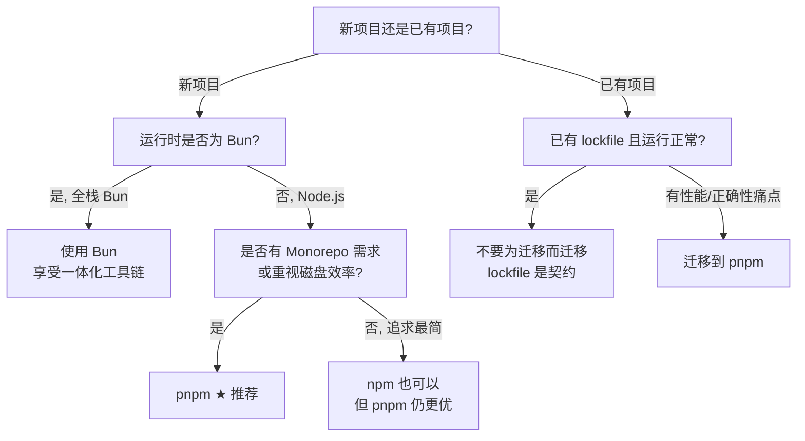

[toc]


## Node.js 包管理器选型指南（2025–2026）

### 背景与演进

**Yarn** 于 2016 年由 Facebook 发布，针对 npm 早期的性能和可靠性问题，引入了 **lockfile**、离线缓存和确定性安装等特性，推动了 npm 自身的改进。

**pnpm** 于 2017–2020 年间引入了**内容寻址存储**（Content-Addressable Storage）和基于符号链接的 `node_modules`，大幅减少磁盘占用并强制严格的依赖解析。

**Bun** 于 2022–2023 年出现，使用 Zig 编写，作为全功能运行时（Runtime），将安装、执行和测试整合为一体。

到 2025 年，四者均已可用：npm 完成了现代化升级；Yarn 分裂为 Classic（v1）和 Modern（v2+/Berry）两条线；pnpm 已成熟为事实上的效率之选（de facto choice for efficiency）；Bun 虽然年轻但势头强劲。

Bun 于 2023 年 9 月发布 1.0，它同时是运行时、打包器、测试运行器和包管理器——原本使用 Zig 编写，2026 年正在进行 Rust 重写。 值得关注的是：2025 年 12 月，Bun 加入了 Anthropic。

### 当前格局总览

| 维度               | **npm**                | **Yarn Berry**（v2+）                     | **pnpm**                  | **Bun**                       |
| ------------------ | ---------------------- | ----------------------------------------- | ------------------------- | ----------------------------- |
| **定位**           | Node.js 内置默认       | 确定性安装先驱                            | 效率与正确性              | 全栈工具链（运行时+包管理器） |
| **周下载量**（约） | 100M+                  | ~6M                                       | ~12M                      | 快速增长中                    |
| **依赖存储方式**   | 扁平化提升（Hoisting） | **Plug'n'Play**（PnP，无 `node_modules`） | **内容寻址存储 + 硬链接** | 兼容 npm 的优化重建           |
| **Monorepo 支持**  | Workspaces（v7+）      | Workspaces                                | **Workspaces**（最佳）    | Workspaces                    |
| **最新大版本**     | v12                    | v4                                        | v12                       | v1.2+                         |
| **安装方式**       | 随 Node.js 附带        | 需独立安装                                | 需独立安装                | 需独立安装                    |

> 下载量数据来源：PkgPulse 2026 指南显示 npm 约 100M+ 周下载量，pnpm 约 12M，Yarn Berry 约 6M。

### 四大包管理器详解

#### npm — 安全默认之选

npm 是随 Node.js 安装的默认包管理器，其**无处不在是最大优势**——它是大多数开发者最先学习的工具，拥有**最大的社区和最全面的包注册表**。

npm 通过多次**重大更新解决了早期许多问题**。例如 npm v7 及后续版本引入了原生 **Workspaces** 支持和改进的 lockfile 以确保依赖一致性。

**优势**：
- **零安装成本**——随 Node.js 捆绑，开箱即用
- 生态兼容性最高，几乎不存在工具不支持的情况
- 对初学者和简单项目友好

**劣势**：
- 安装速度相对较慢；跨项目会大量重复依赖；**磁盘空间利用效率低**；
- Monorepo 支持有限（需借助 Lerna 等外部工具）。

**适用场景**：
- 简单项目或团队已在使用的项目；兼容性和稳定性优先于性能的场景。

#### pnpm — 当前综合最优之选

pnpm（Performant npm）对依赖管理采取了独特策略，强调**效率**、**磁盘空间优化**和**安装速度**。

**核心设计理念**：

pnpm 围绕一个核心思想构建：磁盘上维护一个**内容寻址存储**（Content-Addressable Store），通过硬链接映射到每个项目的 `node_modules`——同一个包、同一个版本，无论多少项目使用，整台机器上只存储一份。它还强制执行**严格的依赖解析**：代码只能导入你显式声明过的包。

pnpm 的安装流程分为三个阶段：解析依赖、计算目录结构、链接依赖，比传统方式更快。它使用符号链接创建独特的 `node_modules` 目录——仅链接直接依赖，避免对间接依赖的非法访问。同时通过 `node-linker` 设置提供传统的扁平结构选项，兼容偏好传统方式的开发者。

**核心优势**：

1. **磁盘效率**：相比 npm 减少约 70% 的磁盘占用。
2. **安装速度**：pnpm 安装速度约为 npm 的 3 倍。
3. **杜绝幽灵依赖**（Phantom Dependencies）：严格的依赖隔离确保项目只能访问 `package.json` 中显式声明的包
4. **Monorepo 最佳支持**：pnpm workspaces 是目前可用的最佳 Monorepo 方案。

**劣势**：
- 不是默认安装的，需要手动安装；部分较老的工具可能尚未完全支持。

**适用场景**：
- 对大多数专业开发环境来说，pnpm 拥有最好的综合表现——特别是涉及 Monorepo 或 CI 性能优化的场景。

#### Yarn Berry（v2+）— 激进创新但生态位收窄

我们记忆中 2017 年的 Yarn（`yarn.lock`、快速安装、npm 的直替）现在被称为 **Yarn Classic**，已进入维护模式。当前任何认真使用 Yarn 的人用的是 **Berry**，它已经不是同一个工具了。

**Plug'n'Play（PnP）模式**是 Berry 的核心创新——Yarn 2+（Berry）引入了创新的 PnP 特性，直接**消除 `node_modules` 目录**。

**现实挑战**：
- PnP 模式可能导致部分依赖 `node_modules` 结构的旧包不兼容。
- Yarn Berry 默认确实使用 PnP，但很多团队仍然切换回 `nodeLinker: node-modules` 以确保工具兼容性。

**市场定位**：
- Yarn Classic 正在老化；Yarn Berry 技术上强大但属于小众（niche）。
- Yarn Berry（约 6M 周下载量）的 PnP 模式完全消除 `node_modules`，但存在生态兼容性问题。

#### Bun — 面向未来的激进选择

Bun 的包管理器部分本质上是对 `npm install` 的从零重建，为极致速度优化。

Bun 作为运行时仍存在与 Node.js 行为不一致的边缘情况。如果仅使用 Bun 作为包管理器（运行时仍用 Node.js），这个问题可以规避——但这意味着安装了一个庞大的工具却只用其中一小部分功能。

Bun 生态在 2024 年大幅成熟，到 2025 年已是一个真实、严肃的选项。但由于风险/收益比在复杂部署中尚未闭合，不少资深开发者还未将生产项目迁移至 Bun——pnpm 带缓存的速度已经足够，Bun 的"全家桶"模型在复杂部署中仍带来不确定性。

**适用场景**：
- Bun 最适合你完全掌控运行时的新项目，是最令人兴奋的选择。
- 采用 Bun 作为运行时的团队可以免费获得包管理器；使用 Node.js 的团队应考虑 pnpm。

### 性能基准

pnpm 官方维护了持续更新的 benchmark 页面（pnpm.io/benchmarks）：

数据于 2026 年 9 月 10 日从 pnpm/benchmarks 仓库获取，每次部署时重建。针对两个项目各测试六种安装场景——从全新克隆到热缓存重跑，涵盖实际开发中会遇到的各种缓存和 lockfile 状态。

测试覆盖了 14 种现代工具链——Angular、Nest、Vite、webpack、Storybook——总计约 1GB 依赖。

所有安装通过同一个注册表、相同的模拟网络链路（50ms 延迟、200Mbps 带宽）完成，因此时间包含了真实安装会产生的网络往返开销。

值得注意的是：pnpm 自己的 benchmark 实际上显示 Yarn PnP 在某些冷安装场景中略快——因为它跳过了创建 `node_modules` 树的过程。但在实际使用中（缓存安装、CI/CD 或大型 Monorepo），pnpm 凭借硬链接和存储复用仍然领先。

### Corepack 的命运 — 重要变动

**Corepack** 是 Node.js 内置的包管理器版本管理工具，它的变动直接影响你如何安装和管理 pnpm / Yarn。

Corepack 是自 Node.js v16.9.0 起内置的实验性功能，用于解决跨团队和环境的包管理器版本统一问题。 它无需手动全局安装 Yarn 或 pnpm，而是在后台自动管理——读取 `package.json` 中的 `packageManager` 字段，确保所有人使用完全相同的版本。

**重大变动**：2025 年 3 月 19 日，Node.js TSC 投票决定在 Node.js v25+ 中停止分发 Corepack。

Corepack 已从 Node.js 25+ 发行版中移除，但仍捆绑在 Node.js 24 LTS 及更早版本中。在较新的 Node.js 版本中，可通过 `npm install -g corepack` 独立安装。

**对实际工作流的影响**：

Corepack 随 Node.js v14.19.0 到 v25.0.0（不含）一起分发。 这意味着：

- **Node.js 24 LTS**（当前 LTS）：Corepack 仍然内置，`corepack enable` 即可使用
- **Node.js 25+**：需要先执行 `npm install -g corepack`，然后才能使用
- Yarn 和 pnpm 的文档已经推荐**从 npm 全局安装 Corepack**。

### 选型决策树



### 选型推荐总结

**2025 年的新项目？选 pnpm，零犹豫。** 学习曲线极低（界面几乎与 npm 相同），收益立竿见影且实实在在，生态支持出色。

**想体验未来？选 Bun。** 但要做好在某些场景下充当 beta 测试者的准备。

**已有项目带着 `yarn.lock` 或 `package-lock.json`？不要为迁移而迁移。** lockfile 是契约——如果没有真实的性能或正确性理由，保持原样。

**2025 年无特殊理由还用原生 npm？不推荐了。** 这就像在新项目中使用 jQuery——能用，但有更好的选择。

### 安装与快速上手

#### pnpm 安装

```bash
# 方式一：通过 npm 全局安装（最通用）
npm install -g pnpm

# 方式二：通过 Corepack（Node.js 24 LTS 内置）
corepack enable
corepack prepare pnpm@latest --activate

# 方式三：独立安装脚本
# Linux / macOS
curl -fsSL https://get.pnpm.io/install.sh | sh -
# Windows（PowerShell）
iwr https://get.pnpm.io/install.ps1 -useb | iex
```

**常用命令对照**（从 npm 迁移几乎无学习成本）：

| 操作         | npm                    | pnpm                                   |
| ------------ | ---------------------- | -------------------------------------- |
| 安装所有依赖 | `npm install`          | `pnpm install`                         |
| 添加依赖     | `npm install <pkg>`    | `pnpm add <pkg>`                       |
| 添加开发依赖 | `npm install -D <pkg>` | `pnpm add -D <pkg>`                    |
| 运行脚本     | `npm run <script>`     | `pnpm <script>` 或 `pnpm run <script>` |
| 全局安装     | `npm install -g <pkg>` | `pnpm add -g <pkg>`                    |
| 移除依赖     | `npm uninstall <pkg>`  | `pnpm remove <pkg>`                    |

#### 网络环境注意事项（国内用户）

npm 默认注册表为 `https://registry.npmjs.org`，国内访问可能较慢。配置镜像：

```bash
# npm
npm config set registry https://registry.npmmirror.com

# pnpm（同理）
pnpm config set registry https://registry.npmmirror.com

# yarn
yarn config set npmRegistryServer https://registry.npmmirror.com
```

如果需要通过代理访问 GitHub 资源（例如安装脚本）：

```bash
# Linux / macOS（使用本地代理如 mihomo）
export https_proxy=http://127.0.0.1:7890
export http_proxy=http://127.0.0.1:7890

# Windows PowerShell
$env:https_proxy = "http://127.0.0.1:7890"
$env:http_proxy = "http://127.0.0.1:7890"
```

或使用 GitHub 加速镜像（如 `https://ghproxy.com`）包裹原始链接。

#### 在 `package.json` 中锁定包管理器版本

通过 `packageManager` 字段（配合 Corepack）确保团队成员使用统一的包管理器和版本：

```json
{
  "name": "my-project",
  "packageManager": "pnpm@12.4.0"
}
```

Corepack 代理会找到当前目录层级中最近的 `package.json` 文件，提取其 `packageManager` 属性。如果该值对应受支持的包管理器，Corepack 将确保所有相关二进制调用都使用请求的版本——按需下载，无法获取时中止。

### 主流工具/框架的包管理器采用情况

> 此部分基于已有搜索结果中的间接信息和我的既有知识，部分内容未经本轮搜索充分验证，标注 `[待验证]` 供参考。

| 工具/框架                | 默认或推荐的包管理器          | 备注                             |
| ------------------------ | ----------------------------- | -------------------------------- |
| **Next.js**              | npm（`create-next-app` 默认） | 完整支持 pnpm / yarn / bun       |
| **Vite**                 | npm（`create vite` 默认）     | 社区普遍搭配 pnpm                |
| **Nuxt 3**               | npm / pnpm 均可               | 官方文档示例多用 pnpm `[待验证]` |
| **Turborepo**            | pnpm 为事实标准               | Workspaces 支持最成熟            |
| **Angular CLI**          | npm（默认）                   | 支持 pnpm / yarn                 |
| **Astro**                | npm（`create astro` 默认）    | 支持 pnpm `[待验证]`             |
| **SvelteKit**            | npm（默认）                   | 支持 pnpm / yarn                 |
| **Vue CLI → create-vue** | npm（默认）                   | 支持 pnpm                        |

## 常见现象

为什么 CLI 工具的官方安装示例几乎都用 npm?

这是一个很好的观察，问题本质不是"谁更好"，而是**分发策略和用户触达**。下面系统解答。

---

### 根本原因：npm 是唯一"预装"的包管理器

这个问题的答案其实在上一轮讨论中已经埋下了伏笔——

安装 CLI 工具的前提是 Node.js（v14 或更高版本）和 npm（v6 或更高版本）。 在 Arm Linux 上你可以使用 npm 来安装 Codex CLI，这个方式适用于所有主流 Arm Linux 发行版，包括 Ubuntu、Debian、CentOS 等。

核心逻辑是：

> **安装了 Node.js 的机器上一定有 npm，但不一定有 pnpm / yarn / bun。**

工具作者在写 README 时面对的是**最大公约数用户**——他们唯一可以确定用户已拥有的 Node.js 包管理器就是 npm。

### 不是"推荐 npm"，而是"假设用户有 npm"

仔细看这些工具的文档，你会发现它们并不是在"推荐 npm"，而是在**列出所有可用的安装方式，把 npm 放在第一个**——因为它是用户最可能已有的。

以 OpenCode 为例，它的官方文档同时列出了 npm、Bun、pnpm、Yarn 以及 curl 脚本五种安装方式。OpenCode v2 的文档甚至专门标注了 Bun 和 pnpm 需要额外参数来允许 postinstall 脚本运行。[简介 | OpenCode](https://opencode.ai/docs/)

Codex CLI 同样如此——除了 `npm install -g @openai/codex`，还支持 Homebrew 安装以及从 GitHub Releases 下载二进制文件。

### pnpm/bun 全局安装 CLI 工具存在额外摩擦

npm 之所以成为**全局 CLI 工具**安装的事实标准，还有一个技术原因——**pnpm 和 bun 在全局安装场景中需要额外的配置或参数**：

| 包管理器 | 全局安装命令            | 额外注意事项                                                 |
| -------- | ----------------------- | ------------------------------------------------------------ |
| **npm**  | `npm install -g <pkg>`  | 无额外步骤（`PATH` 通常已配好）                              |
| **pnpm** | `pnpm add -g <pkg>`     | 需要确保 `PNPM_HOME` 在 `PATH` 中；pnpm 将全局包保存在当前用户的 home 目录中，且使用 sudo 运行修改类命令会直接报错 `ERR_PNPM_SUDO_NOT_SUPPORTED` |
| **bun**  | `bun install -g <pkg>`  | 需确保 Bun 的全局 bin 目录在 `PATH` 中                       |
| **yarn** | `yarn global add <pkg>` | 需确保 Yarn 的全局 bin 目录在 `PATH` 中                      |

此外，如果 npm 包使用了 **postinstall 脚本**（很多原生二进制分发的 CLI 工具都这么做，用来根据平台下载对应的二进制文件），pnpm 和 Bun 默认不信任/不执行这些脚本，需要显式声明参数（如 `--allow-build` 或 `--trust`）。

更典型的例子是 pnpm 12 改变了全局目录的 CLI 参数方式（从 `--global-dir` 迁移到环境变量），导致依赖旧调用方式的工具（如 mise）直接报错。这类兼容性变动对 npm 来说基本不存在，因为它作为 Node.js 的内置组件，API 变动极为保守。

### 其实越来越多工具已经"去 npm 化"

值得注意的趋势是——越来越多现代 CLI 工具开始提供**独立于 Node.js 生态的安装方式**，不再把 `npm install -g` 作为唯一或首选路径：

Codex CLI 提供了独立安装脚本：Mac/Linux 通过 `curl -fsSL https://chatgpt.com/codex/install.sh | sh`，Windows 通过 PowerShell 脚本，安装程序默认从 `https://releases.openai.com/codex` 下载。

Codex CLI 实际上是一个独立的 Rust 二进制文件，**通过多种渠道分发**。 npm 只是其中一个分发渠道——它本质上不是一个 Node.js 库，而是一个**编译好的原生可执行文件**，npm 包只是一个"包装器"（wrapper），npm wrapper 脚本会检查环境变量，然后调用对应平台的原生二进制。

### 总结：这是一个**分发策略**问题，不是技术优劣问题

| 因素                 | 说明                                                   |
| -------------------- | ------------------------------------------------------ |
| **用户触达**         | npm 随 Node.js 预装，是最大公约数                      |
| **文档简洁性**       | 写 `npm install -g` 无需解释前置步骤                   |
| **postinstall 兼容** | npm 默认执行 postinstall 脚本；pnpm/bun 需显式允许     |
| **全局 PATH 配置**   | npm 的全局 bin 通常已在 `PATH` 中；pnpm/bun 需额外配置 |
| **不是推荐**         | 大多数工具同时支持多种安装方式，npm 只是放在第一个     |

**所以你在项目内管理依赖时完全应该用 pnpm**，但**安装全局 CLI 工具时用 npm 是完全合理的**——这两者并不矛盾。事实上很多 pnpm 深度用户的工作流就是：

- 全局 CLI 工具：`npm install -g`（或 Homebrew / 独立安装脚本）
- 项目依赖管理：`pnpm install`
