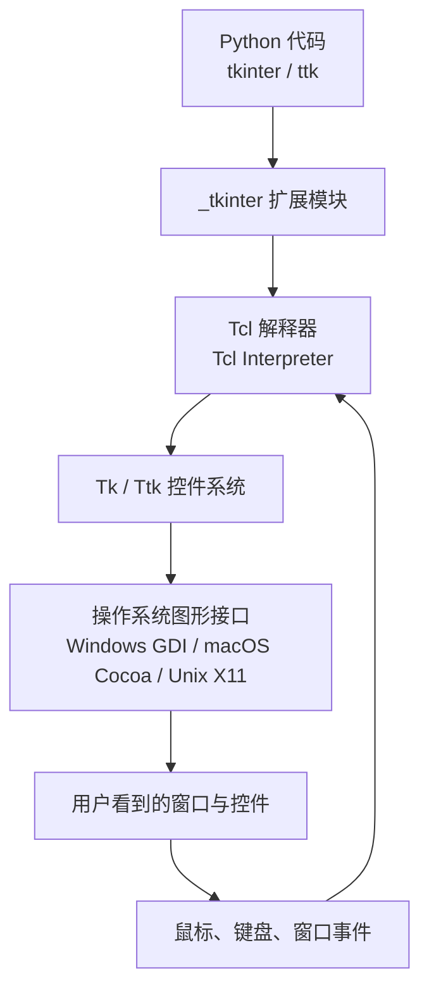
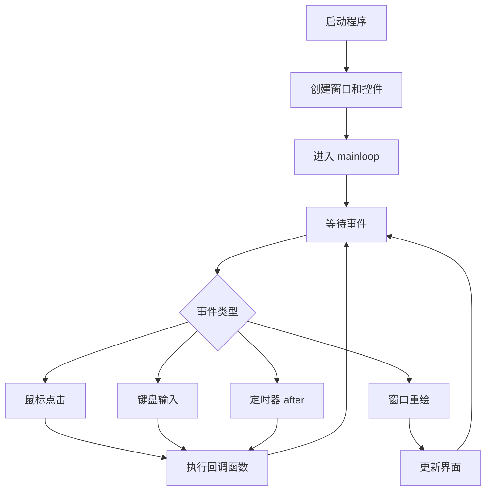
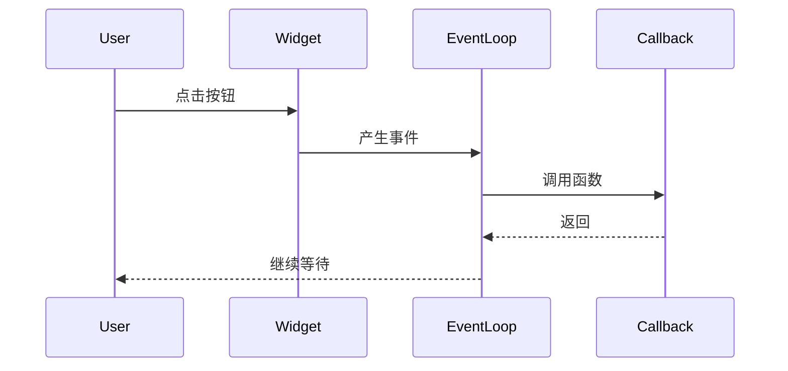

[toc]


## abstract

`tkinter` 是 Python 标准库中的桌面 GUI（Graphical User Interface，图形用户界面）方案，本质上是 Python 对 Tcl/Tk GUI 工具包的接口。官方文档说明，`tkinter` 是 Python 标准的 Tcl/Tk 接口，通常可在 Unix/macOS/Windows 平台使用；([Python documentation](https://docs.python.org/3/library/tkinter.html))

对新手而言，Tkinter 的核心价值不是“做最炫的现代 App”，而是用较低门槛掌握 GUI 编程的基本思想：窗口、控件、布局、事件、状态、回调、主循环、线程边界、打包发布。

现代学习 Tkinter 时，应优先掌握 `ttk`（Themed Tk，主题化 Tk 控件）和良好的工程组织，而不是只照搬早期教程里的老式 `Button`、`Label`、`pack()` 堆叠写法；

> Python 官方文档也提醒，Tk 8.5 引入了现代主题控件，很多网上资料仍使用旧 API，可能显得过时。([Python documentation](https://docs.python.org/3/library/tkinter.html))

------

## 详细大纲

| 学习模块       | 要解决的问题                                    | 关键术语                               |
| -------------- | ----------------------------------------------- | -------------------------------------- |
| Tkinter 的定位 | 它适合做什么，不适合做什么                      | GUI、Desktop App、Tcl/Tk               |
| 运行模型       | 为什么 GUI 程序不像脚本那样从上到下执行完就结束 | Event Loop、Callback、Mainloop         |
| 窗口与控件     | 如何创建窗口、按钮、输入框、标签、表格、菜单    | Widget、Root Window、Toplevel          |
| 布局系统       | 控件如何排列，为什么不能乱用 `pack` 和 `grid`   | Geometry Manager、Grid、Pack、Place    |
| 事件处理       | 用户点击、输入、选择时如何触发代码              | Command、Event Binding、Callback       |
| 状态管理       | 输入值、选项值、界面状态如何同步                | StringVar、IntVar、State               |
| 主题与样式     | 如何避免界面看起来过于陈旧                      | `ttk`、Style、Theme                    |
| 复杂界面       | 如何组织多区域、多页面、多窗口应用              | Frame、Notebook、PanedWindow、Treeview |
| 耗时任务       | 为什么界面会卡死，如何正确处理任务              | Thread、Queue、`after()`               |
| 工程化         | 如何写出可维护的 GUI 项目                       | MVC、MVVM、Separation of Concerns      |
| 打包发布       | 如何把脚本变成用户可运行程序                    | PyInstaller、Briefcase                 |
| 现代 GUI 方案  | 什么时候该换 PySide6、Flet、NiceGUI、Kivy 等    | Qt、Web UI、Native UI、TUI             |

------

## 参考文档

- [使用 Tk 创建图形用户界面 — Python 文档](https://docs.python.org/zh-cn/3/library/tk.html)
- 其他基于python的GUI框架:[GUI 编程 --- GuiProgramming](https://wiki.python.org/moin/GuiProgramming)

## Tkinter 适合什么

Tkinter 适合：

| 场景                     | 适配程度 | 说明                                                 |
| ------------------------ | -------- | ---------------------------------------------------- |
| Python 入门 GUI 学习     | 很高     | 标准库方案，概念完整，安装成本低                     |
| 小型桌面工具             | 很高     | 如文件整理器、批处理工具、配置面板、数据录入小工具   |
| 内部工具                 | 高       | 对视觉设计要求不极端，但要求快速可用                 |
| 教学演示                 | 高       | 能清楚展示事件驱动、布局、回调等 GUI 核心概念        |
| 轻量数据处理界面         | 中高     | 可结合 `csv`、`sqlite3`、`pandas`、`matplotlib`      |
| 商业级复杂桌面软件       | 中       | 可做，但大型复杂交互通常更推荐 Qt/PySide6            |
| 移动 App                 | 低       | Tkinter 不是现代移动端方案                           |
| 高度现代化 UI 或动画界面 | 中低     | 可通过 `ttk`、主题库、CustomTkinter 改善，但上限有限 |

Tkinter 的优势是“稳定、内置、轻量、适合教学和实用工具”；劣势是“视觉现代化能力有限、复杂界面工程化成本较高、生态不如 Qt 完整”。

Python 官方文档也指出，`tkinter` 的主要优点包括速度快、通常随 Python 捆绑，但传统外观曾显陈旧，Tk 8.5 之后有明显改善。([Python documentation](https://docs.python.org/3/library/tk.html))

------

## Tkinter 的技术结构

Tkinter 不是一个孤立的 Python 绘图库，而是一个 Python 到 Tcl/Tk 的桥接层。你写的是 Python 对象和方法，底层会转换为 Tcl/Tk 命令，再由 Tk 调用操作系统图形能力完成窗口和控件绘制。Python 官方文档说明，`Tk` 是用 C 实现的 Tcl 包，`Tk` 对象内部嵌入 Tcl 解释器，Tk 使用 Tcl 的事件队列处理 GUI 事件。([Python documentation](https://docs.python.org/3/library/tkinter.html))



这张图背后的关键点是：Tkinter 程序不是你主动“刷新界面”，而是创建界面结构后进入事件循环，由事件循环等待用户操作、系统消息、定时任务和重绘请求。

------

## 最小程序与基本写法

推荐新手从这个结构开始，而不是使用 `from tkinter import *`：

```python
import tkinter as tk
from tkinter import ttk


def on_click():
    label.config(text="你好，Tkinter！")


root = tk.Tk()
root.title("Tkinter 示例")
root.geometry("320x180")

main = ttk.Frame(root, padding=20)
main.grid(row=0, column=0, sticky="nsew")

label = ttk.Label(main, text="点击按钮开始")
label.grid(row=0, column=0, pady=10)

button = ttk.Button(main, text="点击我", command=on_click)
button.grid(row=1, column=0, pady=10)

root.mainloop()
```

这段代码体现了 Tkinter 的最小骨架：

| 代码                           | 含义                                  |
| ------------------------------ | ------------------------------------- |
| `tk.Tk()`                      | 创建主窗口，也叫根窗口（Root Window） |
| `ttk.Frame(...)`               | 创建容器控件，用来组织内部布局        |
| `ttk.Label(...)`               | 创建文本标签                          |
| `ttk.Button(..., command=...)` | 创建按钮，并绑定点击回调              |
| `.grid(...)`                   | 使用网格布局管理器放置控件            |
| `root.mainloop()`              | 进入事件循环，开始响应用户操作        |

官方示例同样展示了 `Tk()`、`ttk.Frame`、`ttk.Label`、`ttk.Button`、`grid()` 和 `mainloop()` 组成的 Hello World 结构，并解释 `mainloop()` 会显示界面并响应用户输入直到程序终止。([Python documentation](https://docs.python.org/3/library/tkinter.html))

------

## 核心概念

### 窗口

Tkinter 中常见窗口对象有两类：

| 类型     | 英文术语        | 用途                                 |
| -------- | --------------- | ------------------------------------ |
| 主窗口   | Root Window     | 应用的主入口，一般只创建一个         |
| 顶层窗口 | Toplevel Window | 弹出的独立窗口，如设置窗口、详情窗口 |

最佳实践是：一个应用通常只创建一个 `tk.Tk()`；额外窗口使用 `tk.Toplevel()`。Python 官方文档也明确建议实践中不要同时创建多个 `Tk` 实例，因为同一线程内多个解释器共享事件队列会让事情变复杂。([Python documentation](https://docs.python.org/3/library/tkinter.html))

```python
def open_settings():
    win = tk.Toplevel(root)
    win.title("设置")
    ttk.Label(win, text="这里是设置窗口").pack(padx=20, pady=20)
```

------

### 控件

控件（Widget）是 GUI 的基本构件。按钮、标签、输入框、复选框、下拉框、表格、菜单都属于控件。官方文档也将 Tkinter 界面描述为由单个 widget 组成，每个 widget 都是一个 Python 对象。([Python documentation](https://docs.python.org/3/library/tkinter.html))

常见控件如下：

| 控件       | 英文术语    | 常用类            | 用途                 |
| ---------- | ----------- | ----------------- | -------------------- |
| 标签       | Label       | `ttk.Label`       | 显示文本             |
| 按钮       | Button      | `ttk.Button`      | 触发操作             |
| 单行输入框 | Entry       | `ttk.Entry`       | 输入短文本           |
| 多行文本框 | Text        | `tk.Text`         | 输入或显示长文本     |
| 复选框     | Checkbutton | `ttk.Checkbutton` | 多选开关             |
| 单选按钮   | Radiobutton | `ttk.Radiobutton` | 单选项               |
| 下拉框     | Combobox    | `ttk.Combobox`    | 从列表选择           |
| 表格树     | Treeview    | `ttk.Treeview`    | 表格、树形数据       |
| 进度条     | Progressbar | `ttk.Progressbar` | 显示任务进度         |
| 选项卡     | Notebook    | `ttk.Notebook`    | 多页面界面           |
| 画布       | Canvas      | `tk.Canvas`       | 自定义绘图、图形对象 |
| 菜单       | Menu        | `tk.Menu`         | 顶部菜单、右键菜单   |

现代 Tkinter 开发优先使用 `ttk` 控件，因为 `ttk` 是 Themed Tk，外观在不同平台上通常比经典 Tk 控件更自然。Python 文档说明，Ttk 是较新的主题化控件族，从 Tk 8.5 开始随 Tk 分发，Python 通过 `tkinter.ttk` 提供绑定。([Python documentation](https://docs.python.org/3/library/tkinter.html))

------

### 父子层级

Tkinter 控件有父子关系，也叫控件层级（Widget Hierarchy）。创建控件时，第一个参数通常是父容器：

```python
main = ttk.Frame(root)
name_label = ttk.Label(main, text="姓名")
name_entry = ttk.Entry(main)
```

这里：

| 对象         | 角色            |
| ------------ | --------------- |
| `root`       | 主窗口          |
| `main`       | `root` 的子控件 |
| `name_label` | `main` 的子控件 |
| `name_entry` | `main` 的子控件 |

父子层级的重要性在于：布局管理器只管理“同一个父容器下的子控件”。如果界面变复杂，应多使用 `Frame` 分区，而不是把所有控件都直接塞进 `root`。

------

## 布局系统

Tkinter 的布局不是通过绝对坐标手工摆放为主，而是通过布局管理器（Geometry Manager）控制。官方文档说明，控件创建后不会自动出现在界面中，必须由 `grid` 等几何管理器控制它们在界面中的位置。([Python documentation](https://docs.python.org/3/library/tkinter.html))

Tkinter 有三种主要布局方式：

| 布局管理器 | 英文术语               | 特点                              | 推荐程度           |
| ---------- | ---------------------- | --------------------------------- | ------------------ |
| `grid()`   | Grid Geometry Manager  | 行列网格，适合表单、复杂界面      | 强烈推荐           |
| `pack()`   | Pack Geometry Manager  | 按方向堆叠，适合简单上下/左右布局 | 推荐用于简单区域   |
| `place()`  | Place Geometry Manager | 绝对或相对坐标定位                | 少用，适合特殊场景 |

### `grid()` 的核心思想

`grid()` 把父容器看成表格：

```python
ttk.Label(main, text="用户名").grid(row=0, column=0, sticky="w")
username = ttk.Entry(main)
username.grid(row=0, column=1, sticky="ew")

ttk.Label(main, text="密码").grid(row=1, column=0, sticky="w")
password = ttk.Entry(main, show="*")
password.grid(row=1, column=1, sticky="ew")

main.columnconfigure(1, weight=1)
```

常用参数：

| 参数              | 含义                                      |
| ----------------- | ----------------------------------------- |
| `row`             | 行号                                      |
| `column`          | 列号                                      |
| `rowspan`         | 跨多行                                    |
| `columnspan`      | 跨多列                                    |
| `padx` / `pady`   | 外边距                                    |
| `ipadx` / `ipady` | 内边距                                    |
| `sticky`          | 对齐与拉伸方向，如 `"w"`、`"e"`、`"nsew"` |
| `weight`          | 窗口缩放时该行/列如何分配额外空间         |

### 布局最佳实践

| 做法                                                    | 原因                                     |
| ------------------------------------------------------- | ---------------------------------------- |
| 同一个父容器内不要混用 `pack()` 和 `grid()`             | 容易产生布局冲突                         |
| 复杂界面使用多个 `Frame` 分区                           | 降低布局复杂度                           |
| 表单优先用 `grid()`                                     | 行列结构清晰                             |
| 主区域设置 `sticky="nsew"`                              | 支持窗口缩放                             |
| 对需要伸缩的行列设置 `rowconfigure` / `columnconfigure` | 否则控件不会随窗口自然拉伸               |
| 避免大量使用 `place()`                                  | 绝对坐标对不同 DPI、字体、系统缩放不友好 |

------

## 事件循环

Tkinter 的运行核心是事件循环（Event Loop）。程序创建好控件后调用 `mainloop()`，随后应用进入“等待事件、处理事件、更新界面”的循环。官方文档说明，Tkinter 只有在事件循环运行时才会响应用户输入、程序变化和刷新显示；如果事件循环没有运行，界面不会更新。([Python documentation](https://docs.python.org/3/library/tkinter.html))



这也是为什么 GUI 程序中不能随便写：

```python
time.sleep(5)
```

因为它会阻塞事件循环，导致窗口假死。正确做法通常是用 `after()`、线程、队列或异步任务拆分耗时逻辑。

------

### 事件流(时序图)




## 回调与事件绑定

Tkinter 中有两种常见事件处理方式。

### `command`

`command` 适合按钮点击、菜单点击这类简单动作：

```python
def save():
    print("保存数据")

ttk.Button(root, text="保存", command=save).pack()
```

注意：传给 `command` 的是函数对象，不是函数调用结果。

正确：

```python
command=save
```

错误：

```python
command=save()
```

### `bind`

`bind()` 用于绑定更具体的事件，例如回车、鼠标移动、双击：

```python
def on_enter(event):
    print("用户按下回车")

entry.bind("<Return>", on_enter)
```

常见事件：

| 事件                | 含义               |
| ------------------- | ------------------ |
| `<Button-1>`        | 鼠标左键点击       |
| `<Double-Button-1>` | 鼠标左键双击       |
| `<Return>`          | 回车键             |
| `<KeyRelease>`      | 键盘按键释放       |
| `<FocusIn>`         | 控件获得焦点       |
| `<FocusOut>`        | 控件失去焦点       |
| `<Configure>`       | 窗口大小或位置变化 |

`command` 更简单，`bind` 更底层。新手可以先掌握 `command`，再逐步学习 `bind`。

------

## 变量绑定

Tkinter 提供了一组变量类，用于在 Python 变量和控件状态之间建立联系：

| 类              | 英文术语            | 适用数据 |
| --------------- | ------------------- | -------- |
| `tk.StringVar`  | Tk String Variable  | 字符串   |
| `tk.IntVar`     | Tk Integer Variable | 整数     |
| `tk.DoubleVar`  | Tk Double Variable  | 浮点数   |
| `tk.BooleanVar` | Tk Boolean Variable | 布尔值   |

示例：

```python
name_var = tk.StringVar()

entry = ttk.Entry(root, textvariable=name_var)
entry.pack()

def show_name():
    print(name_var.get())

ttk.Button(root, text="读取姓名", command=show_name).pack()
```

变量绑定适合：

| 场景         | 示例                     |
| ------------ | ------------------------ |
| 表单输入     | 用户名、路径、配置值     |
| 单选按钮     | 当前选择的模式           |
| 复选框       | 是否启用某选项           |
| 标签动态更新 | 状态栏、计数器、进度文本 |

------

## `ttk` 与现代外观

`ttk` 是现代 Tkinter 开发必须掌握的部分。它的主要作用是提供主题化控件，让控件外观更接近当前平台风格。Python 文档明确建议大多数应用需要 `tkinter` 主模块以及 `tkinter.ttk`，后者提供现代主题控件集和 API。([Python documentation](https://docs.python.org/3/library/tkinter.html))

推荐导入方式：

```python
import tkinter as tk
from tkinter import ttk
```

推荐使用：

```python
ttk.Button(...)
ttk.Label(...)
ttk.Entry(...)
ttk.Frame(...)
ttk.Combobox(...)
ttk.Treeview(...)
ttk.Notebook(...)
```

仍常用 `tk` 的场景：

| `tk` 控件/模块    | 用途     |
| ----------------- | -------- |
| `tk.Tk`           | 主窗口   |
| `tk.Toplevel`     | 独立窗口 |
| `tk.Text`         | 多行文本 |
| `tk.Canvas`       | 绘图     |
| `tk.Menu`         | 菜单     |
| `tk.PhotoImage`   | 图片     |
| `tk.StringVar` 等 | 变量绑定 |

### 样式示例

```python
style = ttk.Style()
style.theme_use("clam")

style.configure(
    "Primary.TButton",
    padding=8,
    font=("Arial", 11)
)

ttk.Button(root, text="确定", style="Primary.TButton").pack()
```

实践建议：不要给每个控件单独硬编码颜色、字体、边框；更好的方式是集中使用 `ttk.Style()` 管理视觉风格。

------

## 常用界面结构

### 表单界面

适合配置、登录、数据录入：

```python
class UserForm(ttk.Frame):
    def __init__(self, master):
        super().__init__(master, padding=20)

        self.name = tk.StringVar()
        self.email = tk.StringVar()

        ttk.Label(self, text="姓名").grid(row=0, column=0, sticky="w")
        ttk.Entry(self, textvariable=self.name).grid(row=0, column=1, sticky="ew")

        ttk.Label(self, text="邮箱").grid(row=1, column=0, sticky="w")
        ttk.Entry(self, textvariable=self.email).grid(row=1, column=1, sticky="ew")

        ttk.Button(self, text="提交", command=self.submit).grid(
            row=2, column=0, columnspan=2, pady=10
        )

        self.columnconfigure(1, weight=1)

    def submit(self):
        print(self.name.get(), self.email.get())
```

### 多页面界面

适合设置页、管理后台、工具集合：

```python
notebook = ttk.Notebook(root)

page_general = ttk.Frame(notebook, padding=20)
page_advanced = ttk.Frame(notebook, padding=20)

notebook.add(page_general, text="常规")
notebook.add(page_advanced, text="高级")
notebook.pack(fill="both", expand=True)
```

### 表格界面

`ttk.Treeview` 常用于展示表格数据：

```python
columns = ("name", "age", "role")
tree = ttk.Treeview(root, columns=columns, show="headings")

tree.heading("name", text="姓名")
tree.heading("age", text="年龄")
tree.heading("role", text="角色")

tree.insert("", "end", values=("Alice", 28, "工程师"))
tree.insert("", "end", values=("Bob", 31, "设计师"))

tree.pack(fill="both", expand=True)
```

------

## 对话框、文件选择与消息提示

Tkinter 标准库提供了常见对话框：

| 模块                   | 英文术语      | 用途                         |
| ---------------------- | ------------- | ---------------------------- |
| `tkinter.messagebox`   | Message Box   | 信息、警告、错误、确认       |
| `tkinter.filedialog`   | File Dialog   | 打开文件、保存文件、选择目录 |
| `tkinter.colorchooser` | Color Chooser | 颜色选择                     |
| `tkinter.simpledialog` | Simple Dialog | 简单输入对话框               |

示例：

```python
from tkinter import filedialog, messagebox

path = filedialog.askopenfilename(
    title="选择文件",
    filetypes=[("文本文件", "*.txt"), ("所有文件", "*.*")]
)

if path:
    messagebox.showinfo("已选择", path)
```

这类标准对话框适合快速构建实用工具，避免自己重复造“选择文件”“确认删除”这类界面。

------

## 耗时任务与界面卡死

Tkinter 程序最常见的新手问题是：点击按钮后窗口卡死。

原因是：Tkinter 的事件处理通常运行在单线程事件循环中。Python 官方文档说明，Tcl/Tk 应用是事件驱动的，事件处理函数必须快速返回；长时间计算不应放在事件处理函数里，而应拆分成定时器任务或放到其他线程中。([Python documentation](https://docs.python.org/3/library/tkinter.html))

错误示例：

```python
def download():
    time.sleep(10)
    status_var.set("下载完成")
```

这会让界面在 10 秒内无法响应。

### 推荐方案：线程加队列

```python
import queue
import threading
import time
import tkinter as tk
from tkinter import ttk


def worker(result_queue):
    time.sleep(3)
    result_queue.put("任务完成")


def start_task():
    status_var.set("正在处理...")
    threading.Thread(target=worker, args=(result_queue,), daemon=True).start()
    root.after(100, check_result)


def check_result():
    try:
        result = result_queue.get_nowait()
    except queue.Empty:
        root.after(100, check_result)
    else:
        status_var.set(result)


root = tk.Tk()
root.title("耗时任务示例")

result_queue = queue.Queue()
status_var = tk.StringVar(value="等待开始")

ttk.Label(root, textvariable=status_var).pack(padx=20, pady=20)
ttk.Button(root, text="开始任务", command=start_task).pack(padx=20, pady=20)

root.mainloop()
```

关键原则：

| 原则                         | 说明                       |
| ---------------------------- | -------------------------- |
| 耗时任务放到后台线程         | 避免阻塞 GUI 主循环        |
| UI 更新尽量回到主线程        | 不要在后台线程里直接改控件 |
| 使用 `queue.Queue` 传递结果  | 线程间通信更安全           |
| 使用 `root.after()` 轮询结果 | 让事件循环定时检查任务状态 |
| 不要滥用 `update()`          | 容易引入重入和难排查的问题 |

------

## 面向对象组织

小示例可以直接写脚本；稍复杂的 GUI 项目建议使用类组织。

```python
import tkinter as tk
from tkinter import ttk


class App(tk.Tk):
    def __init__(self):
        super().__init__()
        self.title("面向对象 Tkinter")
        self.geometry("360x220")

        self.counter = tk.IntVar(value=0)

        self.create_widgets()

    def create_widgets(self):
        main = ttk.Frame(self, padding=20)
        main.pack(fill="both", expand=True)

        ttk.Label(main, textvariable=self.counter).pack(pady=10)
        ttk.Button(main, text="增加", command=self.increment).pack(pady=10)

    def increment(self):
        self.counter.set(self.counter.get() + 1)


if __name__ == "__main__":
    app = App()
    app.mainloop()
```

这类结构的优点：

| 优点     | 说明                         |
| -------- | ---------------------------- |
| 状态集中 | `self.xxx` 保存界面状态      |
| 回调清晰 | 方法天然适合作为按钮回调     |
| 易于扩展 | 可以拆成多个 Frame 类        |
| 易于测试 | 业务逻辑可以逐步从 UI 中分离 |

------

## 推荐工程结构

中小型 Tkinter 项目可以这样组织：

```text
my_app/
  main.py
  app.py
  views/
    main_view.py
    settings_view.py
  services/
    file_service.py
    database_service.py
  models/
    config.py
  assets/
    logo.png
  requirements.txt
```

对应职责：

| 层         | 英文术语    | 职责                           |
| ---------- | ----------- | ------------------------------ |
| `views`    | View        | 界面控件、布局、事件绑定       |
| `services` | Service     | 文件处理、网络请求、数据库访问 |
| `models`   | Model       | 数据结构、配置对象、业务实体   |
| `app.py`   | Application | 应用初始化、窗口管理           |
| `main.py`  | Entry Point | 程序入口                       |

Tkinter 本身不强制 MVC（Model-View-Controller）或 MVVM（Model-View-ViewModel），但新手要尽早养成一个习惯：不要把所有业务逻辑都写进按钮回调里。

------

## 常见错误与修正

| 常见错误                        | 问题                           | 推荐做法                                          |
| ------------------------------- | ------------------------------ | ------------------------------------------------- |
| `from tkinter import *`         | 命名污染，难区分 `tk` 和 `ttk` | `import tkinter as tk`，`from tkinter import ttk` |
| 创建多个 `tk.Tk()`              | 多事件队列复杂，容易出怪问题   | 只创建一个 `Tk`，其他窗口用 `Toplevel`            |
| 同一父容器混用 `pack` 和 `grid` | 布局冲突                       | 每个父容器只用一种布局方式                        |
| 回调中执行耗时任务              | 窗口卡死                       | 线程、队列、`after()`                             |
| 在后台线程直接更新控件          | 线程安全风险                   | 后台线程传结果，主线程更新 UI                     |
| 到处硬编码颜色字体              | 难维护，不适配主题             | 使用 `ttk.Style()` 集中管理                       |
| 所有控件都放在 `root`           | 界面混乱                       | 使用多个 `Frame` 分区                             |
| 业务逻辑和 UI 混在一起          | 难测试、难扩展                 | 拆分 `views`、`services`、`models`                |
| 图片对象被垃圾回收              | 图片不显示                     | 保存引用，如 `self.image = tk.PhotoImage(...)`    |
| 滥用 `update()`                 | 容易造成嵌套事件循环问题       | 优先用 `after()`                                  |

------

## Tkinter 学习路线

### 入门阶段

目标：能写出简单窗口程序。

掌握内容：

| 内容                                      | 重点           |
| ----------------------------------------- | -------------- |
| `Tk`、`Frame`、`Label`、`Button`、`Entry` | 基础控件       |
| `grid()`、`pack()`                        | 基础布局       |
| `command`                                 | 按钮回调       |
| `StringVar`                               | 输入和状态绑定 |
| `messagebox`、`filedialog`                | 常用对话框     |

经典练习：

| 项目           | 练习点                   |
| -------------- | ------------------------ |
| BMI 计算器     | 输入、按钮、结果显示     |
| 简单记事本     | `Text`、菜单、文件读写   |
| 批量重命名工具 | 文件选择、列表、异常处理 |
| 单位换算器     | 表单、变量绑定、布局     |

### 进阶阶段

目标：能写出结构清晰的实用工具。

掌握内容：

| 内容                  | 重点       |
| --------------------- | ---------- |
| `ttk.Notebook`        | 多页面界面 |
| `ttk.Treeview`        | 表格数据   |
| `ttk.Progressbar`     | 进度展示   |
| `after()`             | 定时任务   |
| `threading` + `queue` | 后台任务   |
| `ttk.Style`           | 样式管理   |
| 类封装                | 工程组织   |

经典练习：

| 项目              | 练习点                       |
| ----------------- | ---------------------------- |
| CSV 查看器        | 表格、文件读取、滚动条       |
| 图片压缩工具      | 文件选择、后台处理、进度条   |
| SQLite 数据管理器 | 表单、表格、数据库           |
| 日志查看器        | 文本框、搜索、高亮、自动刷新 |

### 工程阶段

目标：能交付别人可使用的桌面程序。

掌握内容：

| 内容     | 重点                       |
| -------- | -------------------------- |
| 配置文件 | `json`、`toml`、用户设置   |
| 日志系统 | `logging`                  |
| 异常提示 | 错误弹窗、日志记录         |
| 打包     | PyInstaller、Briefcase     |
| 资源路径 | 图片、图标、配置文件       |
| 用户体验 | 状态栏、禁用按钮、进度反馈 |

PyInstaller 可将 Python 应用及依赖打包成可分发程序，用户运行时不必自行安装 Python 解释器或模块；官方文档说明它会分析脚本依赖并收集所需文件。([PyInstaller](https://www.pyinstaller.org/?utm_source=chatgpt.com)) BeeWare Briefcase 则面向将 Python 项目转换为原生独立应用，官方文档列出可生成 macOS `.app`、Windows MSI、Linux 包、iOS、Android、Web 等目标。([briefcase.beeware.org](https://briefcase.beeware.org/?utm_source=chatgpt.com))

------

## 现代推荐 GUI 方案对比

Tkinter 值得学，但不一定是所有 Python GUI 项目的最终选择。现代 Python GUI 选型应看目标平台、视觉要求、交互复杂度、部署方式和团队经验。

| 方案                    | 类型                  | 适合场景                               | 优点                               | 局限                         |
| ----------------------- | --------------------- | -------------------------------------- | ---------------------------------- | ---------------------------- |
| Tkinter + ttk           | 标准库桌面 GUI        | 入门、内部工具、小型桌面软件           | 内置、轻量、稳定                   | 视觉现代化上限有限           |
| CustomTkinter           | Tkinter 现代皮肤库    | 想继续用 Tkinter，但要更现代外观       | 基于 Tkinter，控件更现代，可定制   | 第三方库，生态小于 Qt        |
| PySide6 / Qt for Python | 专业桌面 GUI          | 复杂桌面软件、商业工具、多窗口应用     | 控件丰富、架构成熟、设计器与生态强 | 学习曲线更陡，包体更大       |
| Kivy                    | 跨平台自绘 UI         | 触摸屏、多媒体、自定义交互、移动端尝试 | 支持桌面和移动，适合自定义 UI      | 非原生控件风格               |
| BeeWare / Toga          | 原生跨平台 GUI        | 希望用 Python 写平台原生应用           | 使用 OS 原生控件，目标平台广       | 成熟度和控件覆盖需按项目核查 |
| Flet                    | Python 跨平台应用框架 | 快速做 Web、桌面、移动多端界面         | 纯 Python，偏现代应用体验          | 依赖其运行模型和生态         |
| NiceGUI                 | Python Web UI         | 仪表盘、机器人控制、内部 Web 工具      | 浏览器作为前端，写法简单           | 本质更接近 Web 应用          |
| Textual                 | TUI / Terminal UI     | 命令行工具、远程服务器、开发者工具     | 终端运行，也可面向浏览器           | 不是传统桌面 GUI             |

CustomTkinter 官方介绍其为基于 Tkinter 的现代、可自定义 Python 桌面 UI 库，提供更现代的控件并追求跨 Windows、macOS、Linux 的一致外观。([customtkinter.tomschimansky.com](https://customtkinter.tomschimansky.com/)) Qt for Python 官方说明 PySide6 是 Qt6 API 的官方 Python 绑定，适合使用 Python 编写 Qt 应用。([Qt文档](https://doc.qt.io/qtforpython-6/)) Kivy 官方称其可运行于 Android、iOS、Linux、macOS 和 Windows，适合跨平台 GUI 应用。([kivy.org](https://kivy.org/?utm_source=chatgpt.com)) Toga 官方定位为 Python native、OS native、cross-platform GUI toolkit，可用于 macOS、Windows、Linux、Android、iOS、Web 和控制台应用。([toga.beeware.org](https://toga.beeware.org/?utm_source=chatgpt.com)) Flet 官方定位为用 Python 构建 Web、桌面和移动应用的框架。([flet.dev](https://flet.dev/docs/?utm_source=chatgpt.com)) NiceGUI 官方将其描述为基于 Python、显示在浏览器中的 UI 框架。([nicegui.io](https://nicegui.io/?utm_source=chatgpt.com)) Textual 官方定位为 Python 快速应用开发框架，可在终端或浏览器中运行 UI。([Textual Documentation](https://textual.textualize.io/))

------

## 如何选择 GUI 技术

| 你的目标                               | 推荐优先级                                      |
| -------------------------------------- | ----------------------------------------------- |
| 我是新手，想理解 GUI 编程              | Tkinter + ttk                                   |
| 我要做一个简单桌面小工具               | Tkinter + ttk 或 CustomTkinter                  |
| 我要做一个外观更现代的小工具           | CustomTkinter                                   |
| 我要做专业复杂桌面软件                 | PySide6 / Qt for Python                         |
| 我要做内部管理界面或数据仪表盘         | NiceGUI、Streamlit、Flet                        |
| 我要做移动端或触摸交互                 | Kivy、BeeWare/Toga、Flet                        |
| 我要做服务器终端里的交互工具           | Textual                                         |
| 我要做跨平台原生应用并关注系统原生控件 | BeeWare/Toga                                    |
| 我要长期维护商业级 GUI 产品            | 优先评估 PySide6/Qt、Web 前端方案或平台原生技术 |

我的建议是：学习路径可以从 Tkinter 开始，因为它能让你低成本掌握 GUI 的核心模型；但项目选型不要被 Tkinter 绑定。小工具用 Tkinter 很合理，复杂桌面软件优先看 PySide6/Qt，浏览器型内部工具优先看 NiceGUI/Flet/Streamlit，终端型交互工具优先看 Textual。

------

## 新手最佳实践清单

| 主题     | 建议                                                     |
| -------- | -------------------------------------------------------- |
| 导入方式 | 使用 `import tkinter as tk` 和 `from tkinter import ttk` |
| 控件选择 | 优先用 `ttk` 控件                                        |
| 主窗口   | 只创建一个 `tk.Tk()`                                     |
| 多窗口   | 使用 `tk.Toplevel()`                                     |
| 布局     | 表单和复杂界面优先 `grid()`                              |
| 分区     | 多用 `ttk.Frame` 拆分界面                                |
| 回调     | 保持短小，不在回调中写耗时任务                           |
| 耗时任务 | 使用线程、队列、`after()`                                |
| 状态     | 使用 `StringVar`、`IntVar` 等管理控件状态                |
| 样式     | 使用 `ttk.Style()` 集中管理                              |
| 工程结构 | UI、业务逻辑、数据访问分层                               |
| 错误处理 | 用户看弹窗，开发者看日志                                 |
| 打包     | 小工具优先 PyInstaller，跨平台原生分发可评估 Briefcase   |

------

## 一个实用项目模板

下面是一个适合新手进阶的 Tkinter 应用骨架：

```python
import queue
import threading
import time
import tkinter as tk
from tkinter import ttk, messagebox


class App(tk.Tk):
    def __init__(self):
        super().__init__()

        self.title("Tkinter 实用工具模板")
        self.geometry("480x320")

        self.result_queue = queue.Queue()
        self.status = tk.StringVar(value="就绪")
        self.input_text = tk.StringVar()

        self.create_widgets()

    def create_widgets(self):
        main = ttk.Frame(self, padding=20)
        main.pack(fill="both", expand=True)

        form = ttk.Frame(main)
        form.pack(fill="x")

        ttk.Label(form, text="输入内容").grid(row=0, column=0, sticky="w")
        ttk.Entry(form, textvariable=self.input_text).grid(row=0, column=1, sticky="ew")
        form.columnconfigure(1, weight=1)

        actions = ttk.Frame(main)
        actions.pack(fill="x", pady=12)

        self.start_button = ttk.Button(actions, text="开始处理", command=self.start_task)
        self.start_button.pack(side="left")

        ttk.Label(main, textvariable=self.status).pack(anchor="w", pady=8)

        self.output = tk.Text(main, height=8)
        self.output.pack(fill="both", expand=True)

    def start_task(self):
        text = self.input_text.get().strip()
        if not text:
            messagebox.showwarning("提示", "请输入内容")
            return

        self.start_button.config(state="disabled")
        self.status.set("处理中...")

        thread = threading.Thread(target=self.long_task, args=(text,), daemon=True)
        thread.start()

        self.after(100, self.check_result)

    def long_task(self, text):
        time.sleep(2)
        result = f"处理完成：{text.upper()}"
        self.result_queue.put(result)

    def check_result(self):
        try:
            result = self.result_queue.get_nowait()
        except queue.Empty:
            self.after(100, self.check_result)
            return

        self.output.insert("end", result + "\n")
        self.status.set("完成")
        self.start_button.config(state="normal")


if __name__ == "__main__":
    app = App()
    app.mainloop()
```

这个模板包含了实用 Tkinter 项目中非常关键的要素：面向对象结构、输入验证、状态提示、后台线程、队列通信、主线程更新 UI。新手可以在此基础上扩展文件处理、网络请求、数据库操作、日志记录和打包发布。

------

## 学习建议

学 Tkinter 不要只记控件名称，而要围绕这几条主线学习：

| 主线     | 要掌握的问题                   |
| -------- | ------------------------------ |
| 界面结构 | 窗口、容器、控件如何组成树     |
| 布局     | 控件如何被 `grid`、`pack` 安排 |
| 事件     | 用户操作如何触发回调           |
| 状态     | 数据如何和界面同步             |
| 主循环   | 为什么 GUI 需要 `mainloop()`   |
| 并发     | 为什么耗时任务会卡界面         |
| 工程化   | 如何让 GUI 项目可维护          |

掌握这些之后，换到 PySide6、NiceGUI、Flet、Kivy 或 Textual 时，很多思想仍然通用：界面组件、布局、事件、状态、生命周期、线程边界、打包发布，都是 GUI 开发的底层共性。