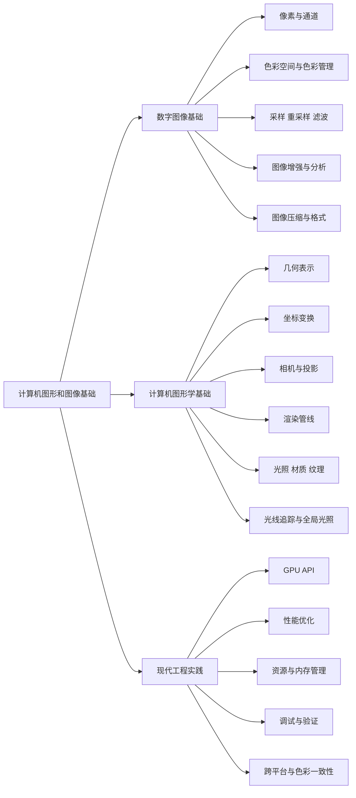
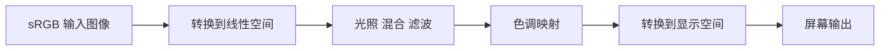
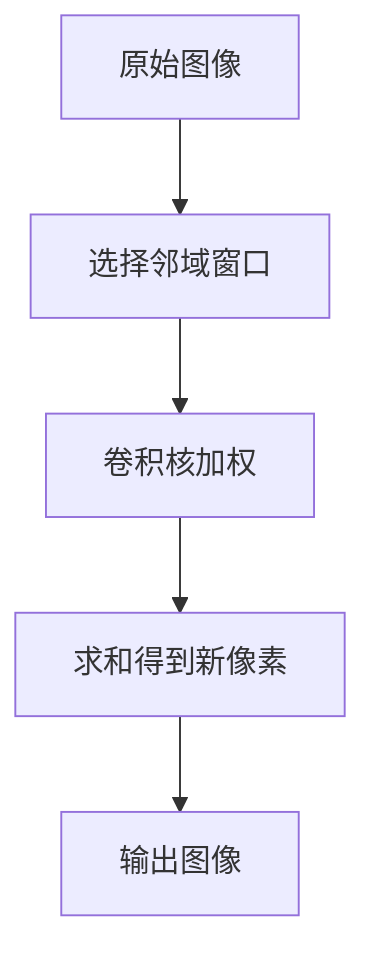
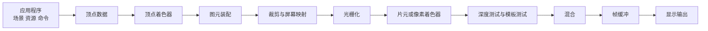
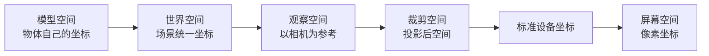
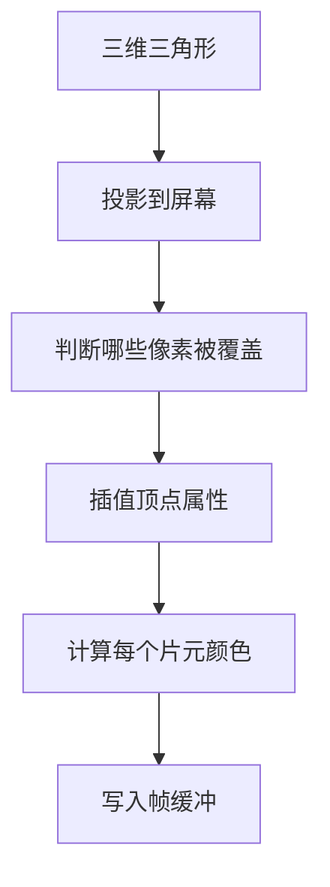
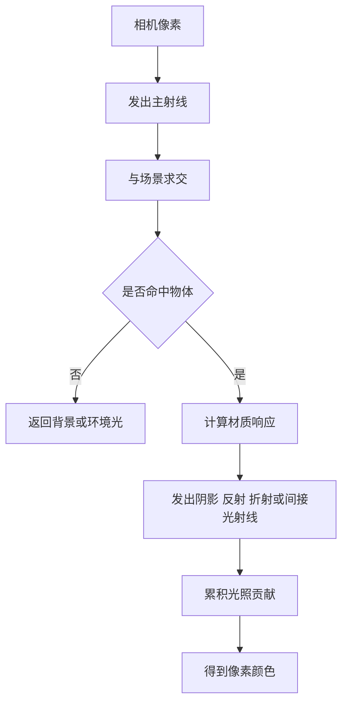
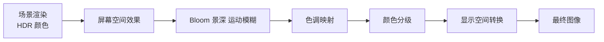
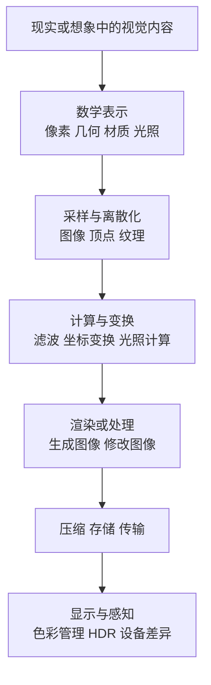

[toc]


## abstract

“计算机图形和图像基础”可以理解为两个相邻但方向不同的领域：

| 领域         | 主要问题                       | 输入                               | 输出                           | 典型任务                                   |
| ------------ | ------------------------------ | ---------------------------------- | ------------------------------ | ------------------------------------------ |
| 计算机图形学 | 如何从数据、模型、规则生成图像 | 几何、材质、灯光、相机、动画       | 新生成的图像或视频帧           | 游戏渲染、三维建模、可视化、动画、虚拟现实 |
| 数字图像处理 | 如何分析、增强、变换已有图像   | 相机拍摄、扫描、渲染结果、医学影像 | 处理后的图像或图像特征         | 去噪、锐化、压缩、边缘检测、分割、颜色校正 |
| 计算机视觉   | 如何让机器理解图像内容         | 图像或视频                         | 语义、检测框、分割图、三维重建 | 人脸识别、目标检测、自动驾驶、OCR          |
| 可视化       | 如何把抽象数据变成图形         | 数值、表格、网络、空间数据         | 图表或交互式视图               | 科学可视化、商业图表、信息图               |

可以用一句话区分：**图形学偏“造图”，图像处理偏“改图”，计算机视觉偏“读图”，可视化偏“讲数据”。**

------

## 学习大纲

下面是一份适合新手循序渐进的学习大纲。

| 模块           | 学习目标                              | 核心知识                                           | 典型练习                              |
| -------------- | ------------------------------------- | -------------------------------------------------- | ------------------------------------- |
| 图像与像素基础 | 理解数字图像如何被表示                | 像素、分辨率、位深、通道、Alpha、图像坐标          | 读取图片，查看 RGB 值，修改单个像素   |
| 色彩基础       | 理解颜色不是简单的 RGB 三个数         | RGB、HSV、HSL、YUV、线性空间、Gamma、色域、HDR     | 实现灰度化、亮度调整、Gamma 校正      |
| 采样与滤波     | 理解图像为什么会模糊、锯齿、摩尔纹    | 采样定理、重采样、插值、卷积、抗锯齿               | 最近邻、双线性、双三次缩放对比        |
| 图像处理基础   | 学会常见图像增强与分析方法            | 直方图、卷积核、模糊、锐化、边缘检测、形态学       | 实现高斯模糊、Sobel 边缘、直方图均衡  |
| 几何与坐标     | 理解三维对象如何被数学描述            | 点、向量、矩阵、坐标系、变换、投影                 | 手写二维旋转、三维相机投影            |
| 三维模型基础   | 理解模型数据的组成                    | 顶点、边、面、三角形网格、法线、UV、拓扑           | 加载 OBJ，显示顶点和三角面            |
| 渲染管线       | 理解 GPU 如何把三维模型画到屏幕       | 顶点着色器、光栅化、片元着色器、深度测试、混合     | 用 WebGL、OpenGL 或 WebGPU 画三角形   |
| 光照与材质     | 理解物体为什么看起来有质感            | 漫反射、镜面反射、法线、纹理、PBR、BRDF            | 实现 Lambert、Phong、Blinn-Phong 光照 |
| 纹理与贴图     | 理解图片如何贴到三维模型上            | UV、采样、MipMap、法线贴图、环境贴图               | 给立方体贴图，实现纹理过滤            |
| 光线追踪       | 理解现代高质量渲染的核心思想          | 射线、交点、反射、折射、阴影、路径追踪             | 写一个简单 CPU 光线追踪器             |
| 图像格式与压缩 | 知道何时用 PNG、JPEG、WebP、AVIF、EXR | 有损压缩、无损压缩、色彩深度、Alpha、HDR           | 比较不同格式的体积和质量              |
| 工程实践       | 形成现代图形图像开发习惯              | 资源管理、性能分析、色彩管理、GPU 调试、跨平台 API | 做一个小型实时渲染器或图像处理工具    |

------

## 整体知识结构



------

## 图像的本质

数字图像是对连续视觉信号的离散采样。现实世界中的光强、颜色和空间位置是连续变化的，而计算机只能存储有限数量的数字。

一张常见 RGB 图像可以看作一个三维数组：

| 维度 | 含义                         |
| ---- | ---------------------------- |
| 宽度 | 水平方向像素数量             |
| 高度 | 垂直方向像素数量             |
| 通道 | 每个像素携带的颜色或其他信息 |

例如一张 1920 × 1080 的 RGB 图像，本质上是：

```text
height × width × channels = 1080 × 1920 × 3
```

每个像素通常包含红、绿、蓝三个通道。如果还有透明度，则是 RGBA 四个通道。

| 图像类型 | 常见通道             | 用途                                   |
| -------- | -------------------- | -------------------------------------- |
| 灰度图   | 1 个通道             | 文档、医学影像、边缘检测、中间处理结果 |
| RGB 图   | 3 个通道             | 普通照片、网页图片、渲染结果           |
| RGBA 图  | 4 个通道             | 带透明度的图标、贴图、合成素材         |
| 深度图   | 1 个通道             | 三维渲染、视觉测距、遮挡判断           |
| 法线图   | 3 个通道             | 三维材质细节、凹凸感模拟               |
| HDR 图   | 3 个或更多高精度通道 | 影视、游戏、真实光照环境贴图           |

------

## 像素、分辨率与位深

像素是图像中最小的采样单位，但它不是一个真实的小方块，而是某个位置上的采样值。屏幕显示时，像素才表现为一个有面积的显示单元。

| 概念     | 含义                     | 常见误区                                 |
| -------- | ------------------------ | ---------------------------------------- |
| 分辨率   | 图像包含多少像素         | 分辨率高不等于画质一定好                 |
| 像素密度 | 单位物理长度内有多少像素 | 同一张图在不同屏幕上大小可能不同         |
| 位深     | 每个通道使用多少位表示   | 8 位图像不适合大量后期调色               |
| 动态范围 | 能表示的最暗到最亮范围   | HDR 不只是“更亮”，还包含更宽亮度信息     |
| Alpha    | 透明度或覆盖率           | Alpha 不一定表示“玻璃透明”，也常用于遮罩 |

常见位深如下：

| 位深           | 每通道取值数量 | 常见场景                               |
| -------------- | -------------- | -------------------------------------- |
| 8 bit          | 256            | 网页图片、普通照片、UI 贴图            |
| 10 bit         | 1024           | HDR 视频、专业显示                     |
| 16 bit integer | 65536          | 高质量图像编辑、医学图像               |
| 16 bit float   | 浮点半精度     | HDR 渲染、影视制作、OpenEXR            |
| 32 bit float   | 浮点单精度     | 科学计算、渲染中间缓存、深度或法线数据 |

新手要特别注意：**不要把“看起来一样”当成“数据一样”。** 8 bit 图像在屏幕上可能看起来足够好，但如果反复调色、混合、模糊、锐化，很容易出现色带、断层和精度损失。

------

## 色彩基础

颜色不是绝对值，而是和设备、观察条件、色彩空间有关。RGB 只是颜色编码方式之一，不是颜色本身。

| 色彩模型或空间 | 主要用途                       | 特点                                   |
| -------------- | ------------------------------ | -------------------------------------- |
| RGB            | 显示器、图像存储、渲染         | 符合加色混合，适合屏幕                 |
| HSV / HSL      | 颜色选择器、简单调色           | 更接近人对色相、饱和度、明度的操作习惯 |
| YCbCr / YUV    | 视频编码、压缩                 | 把亮度和色度分开，便于压缩             |
| CIE XYZ / Lab  | 色彩科学、设备无关转换         | 更适合描述人眼感知与色差               |
| sRGB           | 普通网页和消费级图像           | 最常见的标准显示色彩空间               |
| Display P3     | 广色域屏幕、移动设备、影视内容 | 比 sRGB 能表示更鲜艳的部分颜色         |
| ACES           | 影视、VFX、动画生产            | 适合跨设备、跨软件的高质量色彩工作流   |

色彩管理的核心任务是：**让同一份图像数据在不同设备、软件和输出介质上尽量保持可预测的颜色。** ICC 提供了跨平台设备配置文件机制，ICC 官方说明其目标是支持开放、中立、跨平台的色彩管理；在影视和动画生产中，OpenColorIO 是面向 VFX 和动画的色彩管理方案，ACES 则是电影电视制作生命周期中常用的标准化色彩管理系统。([color.org](https://www.color.org/?utm_source=chatgpt.com))

------

## Gamma 与线性空间

这是新手最容易忽略、但非常关键的概念。

屏幕上的 sRGB 值通常不是线性光强。也就是说，RGB 数值从 0.2 增加到 0.4，并不代表物理亮度简单翻倍。很多图像处理和渲染运算应该在线性空间完成。

| 操作             | 推荐空间            | 原因                     |
| ---------------- | ------------------- | ------------------------ |
| 光照计算         | 线性空间            | 光的叠加在物理上近似线性 |
| 模糊、缩放、混合 | 通常应在线性空间    | 避免暗部或亮部错误       |
| UI 颜色选择      | sRGB 或感知友好空间 | 更符合设计师直觉         |
| 最终显示         | 显示色彩空间        | 需要转换到目标设备       |

错误示例：直接在 sRGB 空间中把红色和绿色平均，可能得到感知上不正确的中间色。

正确思路是：



实用建议：只要涉及真实光照、透明混合、HDR、后期处理，就要认真检查是否在线性空间中运算。

------

## 采样与混叠

采样是把连续信号变成离散数据的过程。图像是空间采样，音频是时间采样。采样不足时会出现混叠，例如锯齿、摩尔纹、闪烁。

| 现象         | 原因                     | 解决方法                   |
| ------------ | ------------------------ | -------------------------- |
| 边缘锯齿     | 斜线或曲线被低分辨率采样 | 抗锯齿、超采样、多重采样   |
| 纹理远处闪烁 | 高频纹理被过小像素采样   | MipMap、各向异性过滤       |
| 摩尔纹       | 规则纹理与采样网格干涉   | 低通滤波、提高采样率       |
| 缩放后模糊   | 插值或滤波选择不合适     | 根据场景选择合适重采样方法 |

常见插值方法：

| 方法         | 速度         | 质量         | 适用场景                 |
| ------------ | ------------ | ------------ | ------------------------ |
| 最近邻       | 很快         | 低，但边缘硬 | 像素风、标签图、掩码图   |
| 双线性       | 快           | 中等         | 实时纹理采样、普通缩放   |
| 双三次       | 较慢         | 较好         | 图像编辑、离线缩放       |
| Lanczos      | 更慢         | 较高         | 高质量重采样             |
| 超分辨率模型 | 慢或依赖 GPU | 视模型而定   | 图片放大、修复、视频增强 |

最佳实践：**普通彩色图像可以用双线性、双三次或 Lanczos；语义标签、ID 图、像素艺术不要用会产生中间值的插值方法。**

------

## 卷积与滤波

卷积是图像处理中最经典的操作之一。它用一个小矩阵，也叫卷积核，在图像上滑动，把周围像素加权组合成新像素。

| 卷积核类型   | 效果               | 典型用途             |
| ------------ | ------------------ | -------------------- |
| 均值核       | 平均模糊           | 简单降噪             |
| 高斯核       | 平滑模糊           | 更自然的降噪、预处理 |
| 锐化核       | 增强局部差异       | 提高清晰感           |
| Sobel 核     | 检测水平或垂直边缘 | 边缘检测             |
| Laplacian 核 | 检测二阶变化       | 边缘增强、特征提取   |

卷积的核心直觉是：**新像素不是孤立决定的，而是由周围邻域共同决定。**



实用建议：

| 场景       | 推荐做法                                                   |
| ---------- | ---------------------------------------------------------- |
| 降噪       | 先尝试高斯模糊，再考虑双边滤波或非局部均值                 |
| 边缘检测   | 先平滑再检测，避免噪声被误认为边缘                         |
| 锐化       | 控制强度，避免边缘光晕                                     |
| 实时处理   | 优先使用可分离卷积，例如二维高斯拆成水平和垂直两次一维卷积 |
| 大半径模糊 | 考虑多次小核、积分图、FFT 或 GPU 实现                      |

------

## 图像直方图

直方图统计像素值的分布。它不关心像素在哪里，只关心不同亮度或颜色出现了多少次。

| 直方图现象       | 可能含义                 |
| ---------------- | ------------------------ |
| 大量像素堆在左侧 | 图像偏暗                 |
| 大量像素堆在右侧 | 图像偏亮                 |
| 两端被截断       | 黑位或白位丢失，出现剪切 |
| 分布很窄         | 对比度低                 |
| 分布断层         | 可能有色带或过度处理     |

直方图常用于曝光分析、对比度增强、阈值分割和色彩校正。

经典方法包括：

| 方法       | 作用                           |
| ---------- | ------------------------------ |
| 线性拉伸   | 把亮度范围扩展到更宽区间       |
| 直方图均衡 | 增强整体对比度                 |
| CLAHE      | 局部自适应增强，常用于医学影像 |
| 阈值化     | 将图像分成前景和背景           |

注意：直方图均衡不一定让图片“更好看”。它可能破坏自然光照关系，让照片显得假、脏或过度处理。

------

## 图像格式与压缩

图像格式不仅决定文件大小，也影响透明度、动画、色彩深度、HDR、浏览器支持和后期处理能力。

| 格式    | 压缩类型       | 透明度 | 动画             | 适合场景                             | 不适合场景                       |
| ------- | -------------- | ------ | ---------------- | ------------------------------------ | -------------------------------- |
| JPEG    | 有损           | 否     | 否               | 照片、自然图像                       | 图标、文字、透明图               |
| PNG     | 无损           | 是     | APNG 支持动画    | 图标、截图、透明素材、需要无损的图像 | 大量照片的网页传输               |
| WebP    | 有损或无损     | 是     | 是               | 网页图片、兼顾体积和质量             | 某些老旧环境兼容性要求极高的场景 |
| AVIF    | 有损或无损     | 是     | 支持情况依赖环境 | 高压缩率网页图片、HDR 倾向内容       | 编码速度敏感、老旧兼容环境       |
| GIF     | 通常低色彩精度 | 伪透明 | 是               | 简单兼容动画                         | 高质量动画、照片                 |
| TIFF    | 可无损         | 可支持 | 不常用           | 印刷、扫描、档案                     | 网页                             |
| OpenEXR | 高动态范围     | 可支持 | 不主打           | 影视、VFX、渲染中间结果              | 普通网页                         |
| SVG     | 矢量           | 是     | 可脚本化         | 图标、图表、可缩放图形               | 复杂照片                         |

MDN 的图像格式指南将 AVIF、WebP、PNG、JPEG 等列为现代 Web 常见格式，并指出 AVIF 和 WebP 通常有更好的性能特征但需要考虑支持情况；W3C 在 2025 年发布的 PNG 第三版规范继续将 PNG 定义为无损、可移植、压缩良好的光栅图像格式，并支持灰度、索引色、真彩色和可选 Alpha 通道。([MDN Web Docs](https://developer.mozilla.org/en-US/docs/Web/Media/Guides/Formats/Image_types?utm_source=chatgpt.com))

实用选择建议：

| 需求           | 推荐                                                |
| -------------- | --------------------------------------------------- |
| 普通网页照片   | AVIF 或 WebP，必要时提供 JPEG 回退                  |
| 透明图标       | SVG 或 PNG，复杂透明位图可用 WebP                   |
| UI 小图标      | SVG 优先，必要时 PNG                                |
| 截图           | PNG 或 WebP lossless                                |
| 摄影归档       | 原始 RAW、TIFF、JPEG XL 或高质量 JPEG，视工作流而定 |
| 游戏纹理       | GPU 压缩格式，如 BC、ASTC、ETC，视平台而定          |
| HDR 渲染中间图 | OpenEXR                                             |
| 机器学习标签图 | PNG 或无损格式，避免 JPEG                           |

------

## 图形学的基本目标

计算机图形学的核心问题是：**如何用数学和算法把模型变成图像。**

最典型的输入包括：

| 输入     | 说明                                   |
| -------- | -------------------------------------- |
| 几何     | 点、线、三角形、曲面、体数据           |
| 材质     | 颜色、粗糙度、金属度、透明度、折射率   |
| 纹理     | 贴在模型表面的图像或数据               |
| 灯光     | 点光、方向光、面积光、环境光、HDR 环境 |
| 相机     | 位置、朝向、焦距、视野、曝光           |
| 动画     | 骨骼、关键帧、物理模拟、变形           |
| 渲染算法 | 光栅化、光线追踪、路径追踪、体渲染     |

输出通常是一帧图像。实时图形学关注每秒生成许多帧，例如 60 FPS、120 FPS；离线图形学关注更高质量，例如电影级全局光照和复杂材质。

------

## 图形渲染管线

现代实时渲染通常围绕 GPU 管线工作。虽然不同 API 的细节不同，但核心流程相似。



| 阶段     | 做什么                                   | 新手要理解的重点               |
| -------- | ---------------------------------------- | ------------------------------ |
| 应用阶段 | CPU 准备模型、材质、纹理、相机和绘制命令 | 不要频繁上传重复资源           |
| 顶点处理 | 对每个顶点做坐标变换和属性计算           | 模型空间到裁剪空间的变换       |
| 图元装配 | 把顶点组成点、线、三角形                 | GPU 最擅长处理三角形           |
| 裁剪     | 去掉视野外或无效部分                     | 超出相机视锥的部分不会显示     |
| 光栅化   | 把三角形变成像素候选片元                 | 三维几何转为二维像素的关键     |
| 片元处理 | 计算颜色、法线、纹理、光照               | 材质和光照主要在这里体现       |
| 深度测试 | 判断前后遮挡                             | z-buffer 是三维可见性的核心    |
| 混合     | 处理透明、半透明、叠加                   | 透明物体通常需要排序           |
| 输出     | 写入颜色缓冲并显示                       | 最终还可能有后期处理和色调映射 |

------

## 几何基础

三维图形通常不直接存储“完整物体”，而是存储物体表面的离散近似。最常见的是三角形网格。

| 概念   | 含义                                           |
| ------ | ---------------------------------------------- |
| 顶点   | 空间中的点，通常带有位置、法线、UV、颜色等属性 |
| 边     | 两个顶点之间的连接                             |
| 面     | 由多个顶点围成的表面，实时渲染中通常拆成三角形 |
| 三角形 | GPU 最常用的基本绘制图元                       |
| 网格   | 由大量三角形组成的模型                         |
| 法线   | 表面朝向，用于光照计算                         |
| UV     | 把二维纹理映射到三维表面的坐标                 |
| 拓扑   | 顶点、边、面之间的连接关系                     |

为什么三角形这么重要？

| 原因           | 说明                           |
| -------------- | ------------------------------ |
| 总是共面       | 三个点确定一个平面             |
| 易于插值       | 顶点属性可在三角形内部平滑插值 |
| 硬件友好       | GPU 对三角形管线高度优化       |
| 可近似复杂曲面 | 足够多三角形能表示复杂形状     |

------

## 坐标系与变换

图形学里最重要的数学工具之一是矩阵变换。一个物体从模型到屏幕，通常经历多个坐标空间。



| 空间         | 作用                                         |
| ------------ | -------------------------------------------- |
| 模型空间     | 描述模型自身，例如一个立方体以自身中心为原点 |
| 世界空间     | 把多个物体放入同一个场景                     |
| 观察空间     | 从相机角度描述场景                           |
| 裁剪空间     | 投影变换后的空间，用于裁剪                   |
| 标准设备坐标 | 归一化坐标，通常在固定范围内                 |
| 屏幕空间     | 实际像素坐标                                 |

常见变换：

| 变换     | 作用               | 注意事项                             |
| -------- | ------------------ | ------------------------------------ |
| 平移     | 改变位置           | 通常用齐次坐标表示                   |
| 旋转     | 改变方向           | 欧拉角容易万向节锁，工程中常用四元数 |
| 缩放     | 改变大小           | 非均匀缩放会影响法线                 |
| 投影     | 从三维变二维       | 透视投影会产生近大远小               |
| 视图变换 | 把世界变到相机坐标 | 本质是相机变换的逆                   |

新手常见错误是矩阵乘法顺序弄反。因为矩阵乘法不满足交换律，`A × B` 和 `B × A` 通常不是同一件事。

------

## 相机与投影

相机决定“从哪里看”和“怎么看”。

| 相机参数 | 含义                 |
| -------- | -------------------- |
| 位置     | 相机在世界空间的位置 |
| 朝向     | 相机看向哪里         |
| 视野角   | 画面范围大小         |
| 宽高比   | 图像宽高比例         |
| 近裁剪面 | 太近的物体被裁掉     |
| 远裁剪面 | 太远的物体被裁掉     |

两种常见投影：

| 投影     | 特点                         | 用途                           |
| -------- | ---------------------------- | ------------------------------ |
| 透视投影 | 近大远小，符合人眼和相机直觉 | 游戏、影视、VR、三维场景       |
| 正交投影 | 大小不随距离变化             | CAD、工程图、2D 游戏、UI、地图 |

透视投影的重要后果是：深度不是线性分布的。近处深度精度更高，远处更容易出现 z-fighting，也就是两个表面深度太接近导致闪烁。

最佳实践：

| 问题               | 建议                                            |
| ------------------ | ----------------------------------------------- |
| 深度闪烁           | 不要把 near 设得过小，合理收紧 near 和 far 范围 |
| 画面变形           | 保持投影矩阵宽高比与窗口一致                    |
| 第一人称相机不舒服 | 控制视野角，避免过大 FOV                        |
| 大世界精度问题     | 使用浮动原点、分区坐标或双精度辅助              |

------

## 光栅化

光栅化是实时渲染的核心。它把连续的三角形覆盖区域转换成离散像素片元。

直观理解：



三角形内部的属性，例如颜色、法线、UV，会从三个顶点插值得到。纹理采样就是根据插值后的 UV 坐标，从图片中读取颜色。

光栅化的优势是快，非常适合实时渲染。缺点是全局光照、反射、折射、软阴影等效果需要额外技巧近似。

------

## 着色器

着色器是运行在 GPU 上的小程序，用来控制渲染过程。

| 着色器类型       | 作用                                         |
| ---------------- | -------------------------------------------- |
| 顶点着色器       | 处理顶点位置和顶点属性                       |
| 片元或像素着色器 | 计算每个像素候选片元的颜色                   |
| 几何着色器       | 可生成或修改图元，现代实时渲染中不一定常用   |
| 细分着色器       | 动态细分几何表面                             |
| 计算着色器       | 通用 GPU 并行计算                            |
| 网格着色器       | 更现代的几何处理方式，适合复杂场景和高级引擎 |

新手可以先掌握顶点着色器和片元着色器。大多数入门渲染知识都可以由这两个阶段解释。

------

## 深度测试与遮挡

三维场景中，多个物体可能投影到同一个像素。深度缓冲记录当前像素处最靠近相机的深度值。

| 概念       | 含义                             |
| ---------- | -------------------------------- |
| 深度缓冲   | 存储每个像素的深度               |
| 深度测试   | 比较新片元和已有片元谁更靠前     |
| 深度写入   | 将通过测试的深度写入缓冲         |
| z-fighting | 两个面深度太接近，显示结果不稳定 |

透明物体更复杂。因为透明混合依赖绘制顺序，通常需要从远到近绘制透明物体，而不透明物体通常可以先用深度测试解决遮挡。

------

## 光照模型

光照模型用于回答：某个表面在灯光和相机下应该是什么颜色。

经典局部光照模型：

| 模型        | 特点                             | 学习价值                   |
| ----------- | -------------------------------- | -------------------------- |
| Lambert     | 漫反射，亮度与法线和光线夹角有关 | 理解法线和点积             |
| Phong       | 漫反射加镜面高光                 | 理解观察方向与高光         |
| Blinn-Phong | Phong 的常用改进                 | 实时渲染经典模型           |
| PBR         | 基于物理的材质模型               | 现代游戏和影视资产通用思路 |

Lambert 漫反射的核心直觉是：表面越正对光源越亮，越斜越暗。常用形式是：

```
diffuse = max(dot(N, L), 0)
```

其中 `N` 是表面法线，`L` 是指向光源的方向。点积越大，说明夹角越小，光照越强。

------

## PBR 材质

PBR，即 Physically Based Rendering，强调材质参数尽量符合物理直觉，使资产在不同光照环境下保持稳定。

常见 PBR 参数：

| 参数              | 含义         | 直觉                 |
| ----------------- | ------------ | -------------------- |
| Base Color        | 基础颜色     | 物体本身的颜色       |
| Metallic          | 金属度       | 0 是非金属，1 是金属 |
| Roughness         | 粗糙度       | 越高反射越模糊       |
| Normal            | 法线扰动     | 模拟小尺度凹凸       |
| Ambient Occlusion | 环境遮蔽     | 缝隙和接触区域更暗   |
| Emissive          | 自发光       | 霓虹灯、屏幕、火焰等 |
| Alpha             | 透明度或遮罩 | 玻璃、树叶、贴花等   |

PBR 的核心不是“更真实”四个字，而是：**材质参数更可迁移、更一致、更适合统一光照工作流。**

最佳实践：

| 材质制作问题     | 建议                                 |
| ---------------- | ------------------------------------ |
| 金属看起来像塑料 | 检查 metallic、roughness 和环境反射  |
| 物体过曝或发灰   | 检查色彩空间和贴图是否被错误解释     |
| 法线贴图效果怪异 | 检查切线空间、绿色通道方向、模型切线 |
| 高光不自然       | 不要随意把 roughness 调到极端        |
| 贴图在远处闪烁   | 使用 MipMap 和各向异性过滤           |

------

## 纹理与贴图

纹理本质上是给渲染提供空间变化的数据。它不一定是颜色图片，也可以是法线、粗糙度、金属度、深度、噪声等。

| 纹理类型            | 存储内容   | 用途                 |
| ------------------- | ---------- | -------------------- |
| Albedo / Base Color | 基础颜色   | 决定物体表面颜色     |
| Normal Map          | 法线扰动   | 增加凹凸细节         |
| Roughness Map       | 粗糙度     | 控制反射清晰程度     |
| Metallic Map        | 金属度     | 区分金属和非金属     |
| AO Map              | 环境遮蔽   | 增强缝隙暗部         |
| Height Map          | 高度       | 视差映射、位移       |
| Emissive Map        | 自发光颜色 | 灯带、屏幕、魔法效果 |
| Cubemap             | 六面环境图 | 天空盒、环境反射     |

纹理采样关键点：

| 概念         | 解释                               |
| ------------ | ---------------------------------- |
| UV 坐标      | 二维纹理坐标，通常范围是 0 到 1    |
| Wrap 模式    | 超出范围时重复、夹取或镜像         |
| Filter 模式  | 纹理放大或缩小时如何取样           |
| MipMap       | 预先生成不同尺寸纹理，减少远处闪烁 |
| 各向异性过滤 | 改善斜视角下的纹理清晰度           |

------

## 光线追踪与路径追踪

光线追踪从相机发出射线，寻找与场景的交点，再根据光照、反射、折射计算颜色。路径追踪是更接近物理真实的随机采样方法，可模拟全局光照。



| 方法     | 优点                   | 缺点               | 常见场景               |
| -------- | ---------------------- | ------------------ | ---------------------- |
| 光栅化   | 极快，适合实时         | 全局效果需要近似   | 游戏、交互应用         |
| 光线追踪 | 反射、折射、阴影更自然 | 成本高             | 高端游戏、可视化       |
| 路径追踪 | 全局光照真实感强       | 噪声大、采样成本高 | 影视、离线渲染、产品图 |
| 混合渲染 | 兼顾速度与质量         | 工程复杂           | 现代实时渲染引擎       |

新手建议：先学光栅化，再学基础光线追踪。光栅化让你理解 GPU 管线，光线追踪让你理解光的物理传播。

------

## 图像后期处理

渲染结果通常不会直接显示，而会经过一系列后期处理。

| 后期效果       | 作用                              |
| -------------- | --------------------------------- |
| Tone Mapping   | 把 HDR 亮度压缩到显示器可显示范围 |
| Bloom          | 模拟强光溢出                      |
| SSAO           | 屏幕空间环境遮蔽                  |
| Motion Blur    | 运动模糊                          |
| Depth of Field | 景深                              |
| Color Grading  | 风格化调色                        |
| TAA            | 时间抗锯齿                        |
| Sharpening     | 锐化输出                          |

现代渲染常用 HDR 中间缓冲，然后最后做色调映射和显示转换。



最佳实践：不要在低动态范围图像上硬做强烈 Bloom 或调色；最好保留 HDR 中间结果。

------

## 现代图形 API 与工具链

现代图形 API 大致可以分为“传统易上手”和“现代显式控制”两类。

| API         | 定位                                 | 适合人群                    |
| ----------- | ------------------------------------ | --------------------------- |
| OpenGL      | 经典跨平台图形 API，资料丰富         | 入门、教学、小型项目        |
| OpenGL ES   | 移动和嵌入式 2D/3D 图形              | 移动端、嵌入式              |
| WebGL       | 浏览器中的图形 API                   | Web 交互图形                |
| WebGPU      | 面向现代 GPU 的 Web 图形与计算 API   | 新 Web 图形项目、GPU 计算   |
| Vulkan      | 低开销、显式控制、跨平台现代 GPU API | 引擎、性能敏感项目          |
| Direct3D 12 | Windows 和 Xbox 生态中的现代图形 API | Windows 游戏和引擎          |
| Metal       | Apple 生态中的现代图形 API           | macOS、iOS、iPadOS 图形应用 |

Khronos 将 Vulkan 定位为面向现代 GPU 的高效率、跨平台图形与计算 API；OpenGL 仍是广泛采用的 2D 和 3D 图形 API。WebGPU 则由 W3C GPU for the Web 工作推进，目标是在 Web 平台暴露现代 GPU 能力；MDN 也指出 WebGPU 是 WebGL 的后继方向之一，但其 Baseline 支持状态仍需按目标浏览器检查。([Vulkan](https://www.vulkan.org/?utm_source=chatgpt.com))

学习建议：

| 目标         | 推荐路线                                                    |
| ------------ | ----------------------------------------------------------- |
| 学图形学原理 | OpenGL、WebGL 或软件光栅化                                  |
| 做 Web 图形  | Three.js 入门，再理解 WebGL 或 WebGPU                       |
| 做游戏开发   | Unity、Unreal 或 Godot，同时补图形学基础                    |
| 做引擎开发   | C++、Vulkan、Direct3D 12、Metal、渲染架构                   |
| 做离线渲染   | 光线追踪、路径追踪、PBRT、OpenEXR、ACES                     |
| 做图像处理   | Python、OpenCV、NumPy、scikit-image、CUDA 或 compute shader |

------

## 图形和图像中的数学基础

不需要一开始就精通所有数学，但下面这些概念非常重要。

| 数学主题   | 用在何处                     | 学习重点                   |
| ---------- | ---------------------------- | -------------------------- |
| 向量       | 位置、方向、速度、法线、光线 | 点积、叉积、归一化         |
| 矩阵       | 坐标变换、投影、相机         | 乘法顺序、逆矩阵、齐次坐标 |
| 三角函数   | 旋转、周期运动、波动         | sin、cos、角度和弧度       |
| 线性代数   | 几何、变换、光照             | 基向量、空间变换           |
| 微积分     | 光照积分、物理模拟、曲线曲面 | 导数、积分、连续变化       |
| 概率统计   | 路径追踪、降噪、采样         | 随机采样、方差、蒙特卡洛   |
| 傅里叶分析 | 滤波、压缩、频域处理         | 高频、低频、卷积定理       |
| 数值方法   | 模拟、优化、重建             | 误差、稳定性、迭代         |

新手最优先掌握：**向量、矩阵、点积、叉积、坐标变换、插值。**

------

## 常见核心公式与直觉

| 公式或概念                        | 直觉解释                 | 用途                     |
| --------------------------------- | ------------------------ | ------------------------ |
| `dot(a, b)`                       | 两个方向有多一致         | 光照、夹角、投影         |
| `cross(a, b)`                     | 得到垂直于两个向量的方向 | 法线、旋转方向、面积     |
| `normalize(v)`                    | 只保留方向，不保留长度   | 光线方向、法线           |
| `lerp(a, b, t)`                   | 在 a 和 b 之间插值       | 动画、颜色渐变、纹理采样 |
| `MVP = Projection × View × Model` | 模型到屏幕的组合变换     | 顶点着色器               |
| `N · L`                           | 表面朝向光源的程度       | 漫反射                   |
| `1 / distance²`                   | 光强随距离平方衰减       | 点光源                   |
| 卷积                              | 用邻域加权得到新值       | 模糊、锐化、边缘         |
| 傅里叶变换                        | 把图像看成不同频率的组合 | 压缩、滤波、频域分析     |

------

## 图像处理经典任务

| 任务     | 输入       | 输出           | 常用方法                         |
| -------- | ---------- | -------------- | -------------------------------- |
| 灰度化   | 彩色图像   | 灰度图         | 加权 RGB、亮度模型               |
| 二值化   | 灰度图     | 黑白图         | 固定阈值、Otsu                   |
| 去噪     | 含噪图像   | 更平滑图像     | 高斯、双边、非局部均值、深度学习 |
| 锐化     | 模糊图像   | 边缘更清晰     | Unsharp Mask、Laplacian          |
| 边缘检测 | 灰度图     | 边缘图         | Sobel、Canny                     |
| 分割     | 图像       | 区域或掩码     | 阈值、区域生长、深度学习         |
| 配准     | 多张图像   | 对齐图像       | 特征匹配、单应性、光流           |
| 修复     | 缺损图像   | 补全图像       | Inpainting、扩散模型             |
| 超分辨率 | 低分辨率图 | 高分辨率图     | 插值、学习型超分                 |
| 颜色校正 | 偏色图像   | 色彩更准确图像 | 白平衡、曲线、LUT、ICC           |

------

## 图形学经典任务

| 任务         | 核心问题                   | 常用方法                         |
| ------------ | -------------------------- | -------------------------------- |
| 绘制三角形   | 如何让 GPU 显示最基本图元  | 顶点缓冲、着色器、绘制命令       |
| 三维模型显示 | 如何把模型从文件显示出来   | OBJ、glTF、网格、材质、相机      |
| 纹理映射     | 如何把图片贴到模型上       | UV、采样、过滤、MipMap           |
| 阴影         | 如何判断某点是否被光源照到 | Shadow Map、Ray Tracing          |
| 反射         | 如何显示镜面或金属反射     | 环境贴图、屏幕空间反射、光线追踪 |
| 骨骼动画     | 如何让角色动起来           | 骨骼矩阵、蒙皮权重               |
| 粒子系统     | 如何表示火、烟、雨、魔法   | 粒子、生命周期、Billboard        |
| 后期处理     | 如何增强最终画面           | HDR、Bloom、TAA、Tone Mapping    |
| 地形渲染     | 如何显示大规模地表         | LOD、法线贴图、高度图            |
| 体渲染       | 如何显示云、烟、医学体数据 | Ray Marching、体采样             |

------

## 最佳实践

| 主题     | 推荐做法                                          | 避免做法                      |
| -------- | ------------------------------------------------- | ----------------------------- |
| 色彩     | 明确每张纹理和缓冲的色彩空间                      | 把所有 RGB 数据都当成线性数据 |
| 纹理     | 使用 MipMap，合理选择压缩格式                     | 远距离纹理不做过滤            |
| 几何     | 使用合理三角形数量和 LOD                          | 所有模型都用最高精度          |
| 性能     | 减少状态切换和 draw call，批处理资源              | 每帧重复创建纹理和缓冲        |
| 透明     | 分清 Alpha Blend、Alpha Test、Premultiplied Alpha | 混用透明模式                  |
| 深度     | 合理设置 near 和 far                              | near 极小、far 极大           |
| 图像处理 | 保留原始图，处理流程可复现                        | 反复覆盖保存有损图            |
| 压缩     | 根据内容选择格式                                  | 用 JPEG 存透明图或标签图      |
| 调试     | 使用 GPU 调试器和中间缓冲可视化                   | 只靠肉眼猜问题                |
| 学习     | 先做小实验再上大引擎                              | 一开始就堆复杂框架            |

------

## 新手常见误区

| 误区                     | 为什么错                           | 正确理解                       |
| ------------------------ | ---------------------------------- | ------------------------------ |
| RGB 数值就是颜色本身     | 颜色依赖色彩空间和设备             | RGB 是编码，不是绝对颜色       |
| 分辨率越高画质越好       | 噪声、压缩、镜头、采样都会影响质量 | 画质是多因素结果               |
| PNG 一定比 JPEG 好       | PNG 无损但照片体积大               | 格式要按内容选择               |
| 光栅化不真实，光追才真实 | 光栅化可用很多近似获得高质量       | 方法选择取决于质量、速度、成本 |
| 法线贴图能改变模型轮廓   | 法线贴图主要改变光照感             | 轮廓需要几何或位移             |
| 透明只要调 Alpha 就行    | 透明涉及排序、深度写入、混合模式   | 透明是实时渲染难点             |
| 后期越多越高级           | 过度 Bloom、锐化、调色会破坏画面   | 后期应服务于视觉目标           |
| 会用引擎就懂图形学       | 引擎隐藏了很多细节                 | 原理能帮助排查和优化           |

------

## 推荐学习路径

| 阶段       | 重点                           | 产出                 |
| ---------- | ------------------------------ | -------------------- |
| 入门图像   | 像素、通道、色彩、卷积         | 写一个图像滤镜工具   |
| 入门图形   | 向量、矩阵、三角形、投影       | 画出旋转立方体       |
| 实时渲染   | 着色器、纹理、光照、深度       | 做一个小型模型查看器 |
| 材质与光照 | PBR、环境光、阴影、后期        | 做一个简单 PBR 场景  |
| 高质量渲染 | 光线追踪、路径追踪、降噪       | 写一个 CPU 小光追    |
| 工程进阶   | 资源管理、性能分析、跨平台 API | 做一个可扩展渲染框架 |
| 专业方向   | 游戏、影视、视觉、图像算法任选 | 完成领域项目作品集   |

非常适合新手的项目顺序：

| 项目                   | 能学到什么               |
| ---------------------- | ------------------------ |
| 图片灰度化和滤镜       | 像素、通道、卷积         |
| 缩放器                 | 插值、采样、混叠         |
| 简单画图板             | 2D 坐标、颜色、Alpha     |
| 软件光栅化三角形       | 光栅化、插值、深度       |
| OpenGL 或 WebGL 三角形 | GPU 管线、着色器         |
| 旋转立方体             | 矩阵、投影、深度测试     |
| 纹理立方体             | UV、纹理采样             |
| Blinn-Phong 光照       | 法线、光照、高光         |
| 简单 PBR 材质球        | 金属度、粗糙度、环境贴图 |
| 小型光线追踪器         | 射线、求交、反射、阴影   |

------

## 实用工具推荐

| 方向           | 工具                                                |
| -------------- | --------------------------------------------------- |
| 图像处理学习   | Python、NumPy、OpenCV、Pillow、scikit-image         |
| 图形学入门     | WebGL、Three.js、OpenGL、Processing、p5.js          |
| 现代 Web 图形  | WebGPU、wgpu、Babylon.js、Three.js WebGPU 后端      |
| 游戏引擎       | Unity、Unreal Engine、Godot                         |
| 离线渲染       | Blender、Cycles、PBRT、Mitsuba                      |
| 资产格式       | glTF、USD、OBJ、FBX                                 |
| 调试           | RenderDoc、PIX、Xcode GPU Tools、Nsight Graphics    |
| 色彩管理       | OpenColorIO、ACES、ICC Profile 工具                 |
| 图像查看与分析 | ImageMagick、Krita、Photoshop、DaVinci Resolve、DJV |

------

## 学习时最应该抓住的主线

整个主题虽然庞大，但可以用一条主线串起来：



最核心的理解是：

**图像是采样后的视觉数据，图形学是生成这些视觉数据的方法；图像处理修改已有像素，渲染管线把几何、材质、灯光和相机转换成像素；现代实践则要求你同时关注色彩、性能、格式、设备差异和可维护性。**