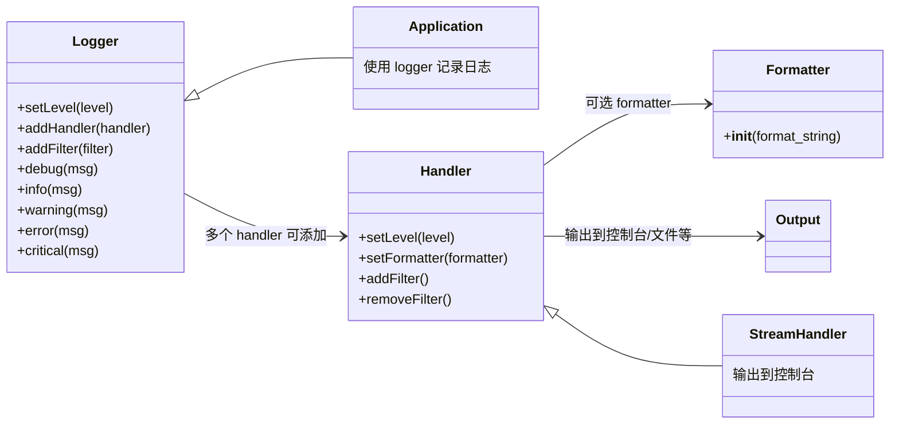

[toc]

## 日志

- howto 系列

  - [日志指南(logging advanced tutorial) — Python 文档](https://docs.python.org/zh-cn/3.13/howto/logging.html#logging-advanced-tutorial)
  - [日志常用指引(howto/logging) — Python 文档](https://docs.python.org/zh-cn/3/howto/logging.html)

- [日志专题手册(cookbook) — Python  文档](https://docs.python.org/zh-cn/3/howto/logging-cookbook.html#logging-cookbook)

- api参考

  - [logging --- Python 的日志记录工具(library/module-logging) — Python  文档](https://docs.python.org/zh-cn/3.13/library/logging.html#module-logging)

    - Important

      此页面仅包含 API 参考信息。教程信息和更多高级用法的讨论，请参阅

      - [基础教程](https://docs.python.org/zh-cn/3.13/howto/logging.html#logging-basic-tutorial)
      - [进阶教程](https://docs.python.org/zh-cn/3.13/howto/logging.html#logging-advanced-tutorial)
      - [日志记录操作手册](https://docs.python.org/zh-cn/3.13/howto/logging-cookbook.html#logging-cookbook)


相比于自己实现一个简易版本的日志系统或模块,使用标准库提供的 logging API 最主要的好处是，所有的 Python 模块都可能参与日志输出，包括你自己的日志消息和第三方模块的日志消息。

对于有此模块使用经验但是有段时间没有接触的,可以跳转到[**代码例子**]和[**日志示意图**]章节快速回顾用法,对于多个模块之间的名称空间层次结构,另见它文

## logging模块概述

The basic classes defined by the module, together with their attributes and methods, are listed in the sections below.
模块定义的基本类及其属性和方法在下面的部分中列出。

日志库采用模块化方法，并提供几类**组件**：记录器、处理器、过滤器和格式器。

1. **Loggers** expose the interface that application code directly uses.
   记录器公开应用程序代码直接使用的接口。
2. **Handlers** send the log records (created by loggers) to the appropriate destination.
   处理程序将日志记录（由记录器创建）发送到适当的目的地。
3. **Filters** provide a finer grained facility for determining which log records to output.
   过滤器提供了**更细粒度的功能**来确定要输出哪些日志记录。
4. **Formatters** specify the layout of log records in the final output.
   格式化程序指定最终输出中日志记录的布局。

### 恰当的使用日志模块

恰当的使用日志模块,通常包括两方面

- 根据需要构造恰当的logger对象(根据需要可能要定义多个对象),具体来说(例如一个图片下载脚本)
  - 比如,要将核心日志输出到控制台,而详细信息输出到日志文件中保存,需要定义合适的Handlers,在定义handler时,可以考虑并设置日志的记录格式,要包含哪些字段,比如记录时间,消息内容,日志来自哪个模块或函数,需要定义合适的Formatters
  - 控制日志输出的详细程度一般通过设置logger对象到级别(setlevel)实现的
  - 细粒度的日志输出可控制可以使用Filters
- 在合适的地方调用合适的logger的方法(比如debug,info,warning,error,...)

Log event information is passed between loggers, handlers, filters and formatters in a [`LogRecord`](https://docs.python.org/3.13/library/logging.html#logging.LogRecord) instance.
日志事件信息在 [`LogRecord`](https://docs.python.org/3.13/library/logging.html#logging.LogRecord) 实例中的记录器、处理程序、过滤器和格式化程序之间传递。

> [`LogRecord`](https://docs.python.org/zh-cn/3.14/library/logging.html#logging.LogRecord) 实例是每当有日志被记录时由 [`Logger`](https://docs.python.org/zh-cn/3.14/library/logging.html#logging.Logger) **自动创建**的，并且可通过 [`makeLogRecord()`](https://docs.python.org/zh-cn/3.14/library/logging.html#logging.makeLogRecord) 手动创建（例如根据从网络接收的已封存事件创建）。
>
> LogRecord包含与被**记录的事件相关的所有信息**。

Logging is performed by calling methods on instances of the [`Logger`](https://docs.python.org/3.13/library/logging.html#logging.Logger) class (hereafter called *loggers*). Each instance has a name, and they are conceptually arranged in a namespace hierarchy using dots (periods) as separators. For example, a logger named ‘scan’ is the parent of loggers ‘scan.text’, ‘scan.html’ and ‘scan.pdf’. Logger names can be anything you want, and indicate the area of an application in which a logged message originates.
日志记录是通过调用 [`Logger`](https://docs.python.org/3.13/library/logging.html#logging.Logger) 实例上的方法来执行的 类（以下称为***记录器*** ）。每个实例都有一个名称，它们在概念上使用点（句点）作为**分隔符**排列在**名称空间层次结构**中。

例如，名为“scan”的记录器(**logger**)是记录器“scan. text”、“scan.html”和“scan.pdf”的**父记录器**。

记录器名称可以是您想要的任何名称，并**指示记录的消息所源自的应用程序区域**(模块)。

---


### 常用的参考

- LogRecord属性[logrecord-attributes@ logging --- Python 的日志记录工具 — Python  文档](https://docs.python.org/zh-cn/3.13/library/logging.html#logrecord-attributes)

## 模块中的类和对象

### 记录器对象和名称空间层次结构

记录器有以下的属性和方法。注意 *永远* **不要直接实例化记录器**，应当通过**模块级别的函数** `logging.getLogger(name)` 。

> 多次使用相同的名字调用 [`getLogger()`](https://docs.python.org/zh-cn/3.13/library/logging.html#logging.getLogger) 会一直**返回相同的 Logger 对象的引用**。

```python
# logging.py 源码片段
...
def getLogger(name=None):
    """
    Return a logger with the specified name, creating it if necessary.

    If no name is specified, return the root logger.
    """
    if not name or isinstance(name, str) and name == root.name:
        return root
    return Logger.manager.getLogger(name)
```

logging模块中暴露在最外层的`getLogging()`函数,实际上是对`Logger.manager.getLogger`的简单包装

`name` 一般是以**句点分割的层级值**，如 `foo.bar.baz` (尽管也可以是简单形式，例如 `foo`)。 

层级结构列表中位于下方(靠右)的日志记录器是列表中较高位置(靠左)的日志记录器的**子级**。 例如，假定有一个名叫 `foo` 的日志记录器，则名字为 `foo.bar`, `foo.bar.baz` 和 `foo.bam` 的日志记录器都是 `foo` 的子级。 

#### 日志记录器名称和模块名

而且，**所有日志记录器都是根日志记录器的子级**。

**日志记录器名称**的层级结构类似于 Python **包的层级结构**，如果你使用建议的构造 `logging.getLogger(__name__)` 以每个模块为基础来组织你的日志记录器则将与后者完全一致。

 这是因为在一个模块中，`__name__` 是该模块在 Python **包命名空间中的名字**。]

下面附上日志模块中`getLogger`函数的源码片段

```python
    def getLogger(self, name):
        """
        Get a logger with the specified name (channel name), creating it
        if it doesn't yet exist. This name is a dot-separated hierarchical
        name, such as "a", "a.b", "a.b.c" or similar.

        If a PlaceHolder existed for the specified name [i.e. the logger
        didn't exist but a child of it did], replace it with the created
        logger and fix up the parent/child references which pointed to the
        placeholder to now point to the logger.
        """
        rv = None
        if not isinstance(name, str):
            raise TypeError('A logger name must be a string')
        _acquireLock()
        try:
            if name in self.loggerDict:
                rv = self.loggerDict[name]
                if isinstance(rv, PlaceHolder):
                    ph = rv
                    rv = (self.loggerClass or _loggerClass)(name)
                    rv.manager = self
                    self.loggerDict[name] = rv
                    self._fixupChildren(ph, rv)
                    self._fixupParents(rv)
            else:
                rv = (self.loggerClass or _loggerClass)(name)
                rv.manager = self
                self.loggerDict[name] = rv
                self._fixupParents(rv)
        finally:
            _releaseLock()
        return rv
```


| 功能              | 描述                                                   |
| ----------------- | ------------------------------------------------------ |
| 获取或创建 logger | 如果已有，直接返回；如果没有，就创建一个新的           |
| 层级支持          | 使用**点号分隔的名称**构建树状结构，实现**配置继承**   |
| 占位符处理        | 当某个 logger 的子 logger 先于它创建时，为其创建占位符 |
| 线程安全          | 使用锁机制保护共享数据                                 |
| 自动修复父子关系  | 创建 logger 后自动修复原先指向占位符的子节点引用       |

### 模块顶层的日志记录函数

| 特性         | `logging.info()`         | `logger.info()`               |
| ------------ | ------------------------ | ----------------------------- |
| 使用对象     | 全局的 root logger       | 指定的 logger 实例            |
| 灵活性       | 差，只能配置 root logger | 好，可单独配置每个模块        |
| 可控性       | 所有日志都走 root logger | 可控制某个模块的日志级别/输出 |
| 推荐程度     | 不推荐在模块中使用       | ✅ 强烈推荐在模块中使用        |
| 日志来源识别 | 无法知道日志来自哪个模块 | 可通过`%(name)s`显示模块名    |


## Logging Flow 日志记录流程

The flow of log event information in loggers and handlers is illustrated in the following diagram.
下图说明了日志记录器和处理程序中的日志事件信息流。

> 初学者可以先跳过图片,查看说明后回头来看


这张流程图(是文档中的一个插图:[logging-flow@日志 HOWTO - Python 文档 --- Logging HOWTO — Python  documentation](https://docs.python.org/3.13/howto/logging.html#logging-flow) )

展示了 Python `logging` 模块的核心工作流程，分为两个部分：

### Logger flow & Handler flow🎈

1. **Logger flow 流程**（左侧）：描述了从用户代码调用日志记录器（如 `logger.info()`）到最终处理日志记录的整个过程。
2. **Handler flow 流程**（右侧）：**描述了日志记录如何被传递给处理器（Handler），以及处理器如何决定是否输出日志**。

两个flow的关系:Handler flow是Logger flow中的**Pass record to handlers of current logger**这一个**处理**环节的展开描述,采用虚线标记了该流程,是Logger flow的子流程

从流程图中可以看到,将日志输出(Emit)的动作落在了Handler flow这个流程中(控制日志输出到控制台,文件,等)

同时,各个handler控制自己路线的日志输出行为,这包括日志格式,从而在代码组织上,需要将日志格式器(Formatter指派给Handler),如有必要,不同的handler可以指派不同的formatter对象作为参数

---

###  Logger 流程

#### 步骤 1：Logging 调用

- 用户在代码中调用日志记录器的方法，例如：
  ```python
  logger.info("This is an info message")
  ```
- 这里的 `logger` 是一个 `logging.Logger` 实例，`info` 是其方法之一。

#### 步骤 2：检查 Logger 是否启用

- 检查当前 Logger 的级别是否允许记录该级别的日志。
  - 每个 Logger 都有一个 `level` 属性，表示它允许记录的日志级别(最低日志级别)（如 `DEBUG`, `INFO`, `WARNING`, `ERROR`, `CRITICAL`）。
  - 如果 Logger 的级别高于**当前日志级别**(logger对象上调用的日志记录级别)，则停止流程。例如：
    - 如果 Logger 的级别是 `WARNING`，而调用的是 `logger.info()`，则不会记录这条日志。这允许我们通过调整Logger的级别(`setLevel`)来控制哪些日志调用不执行(不输出日志),而哪些需要执行并输出日志
    - 这就比print这种打印语句输出信息的方式要灵活,能够在不需要(或仅改动某个参数),就可以控制日志的输出详细程度,且不需要显式设置判断语句.
    - 甚至可以设置filter(filter通常是一个函数,比如判断日志中是否包含特定单词的函数)让日志输出得到更灵活的控制(尽管设置Logger的级别已经能够大多数日志输出控制的需要了)

#### 步骤 3：创建 LogRecord对象

- 如果 Logger 允许记录该级别的日志，则创建一个 `LogRecord` 对象(日志记录条目对象,对日志信息的打包),这个类型的对象由日志模块管理,而不需要用户干预。
  - `LogRecord` 包含日志的相关信息，如日志级别、消息内容、时间戳、文件名、行号等。

#### 步骤 4：检查 Logger 的过滤器(filters)

- Logger 可以附加过滤器（Filter），用于**进一步筛选日志记录**。
  - 如果过滤器拒绝该记录，则停止流程。
  - 如果过滤器允许该记录，则继续下一步。

#### 步骤 5：将记录传递给当前 Logger 的 Handler

- 将创建 `LogRecord` 传递给当前 Logger 的**所有 Handler**。
  - Handler 是负责实际输出日志的对象，例如将日志对象捕获的日志写入文件、控制台输出等。
  - 不同的日志输出路线由不同的handler控制,日志记录器将构造好的消息日志传送给所有handler检查,各个handler根据自己的判断来决定是否将日志进一步处理或传递到对应的路线

#### 步骤 6：检查是否向上级 Logger 传播

- 如果当前 Logger 的 `propagate` 属性为 `True`，则将**记录**传递给上级 Logger。这对于复杂功能模块(尤其是带有层级的模块)比较重要
  - 如果有父 Logger，则重复上述流程（从步骤 2 开始）。
  - 如果没有父 Logger，则停止流程。
- 情况1最终会变成情况2,从而结束流程

---

### Handler流程

#### 步骤 1：检查 Handler 是否启用

- 检查当前 Handler 的级别是否允许记录该级别的日志。
  - 每个 Handler 也有一个 `level` 属性，表示它允许记录的日志级别。
  - 如果 Handler 的级别高于当前日志级别，则停止流程。
- 如果当前 Logger 没有配置任何 Handler，则使用默认的 `lastResort` Handler。
  - 默认情况下，`lastResort` Handler 会将日志打印到**标准错误流**（stderr）。

#### 步骤 2：检查 Handler 的过滤器

- Handler 可以附加过滤器（Filter），用于进一步筛选日志记录。
  - 如果过滤器拒绝该记录，则停止流程。
  - 如果过滤器允许该记录，则继续下一步。

#### 步骤 3：输出日志

- 如果 Handler 允许记录该日志，则执行输出操作（`emit`）。
  - 输出时会根据 Formatter 对日志进行格式化。
  - 例如，将日志写入文件或打印到控制台。


---

## 代码例子🎈

以下是一个相对完整的代码示例，演示了如何使用 Python `logging` 模块，并结合流程图中的逻辑：

其中涉及到:logger对象,handler对象,formatter对象,filter对象(可调用的函数对象)以及绑定与日志级别配置操作

> 本例中除了主日志记录器(main)这里还包含了一个能够反应名称空间层次结构的子记录器(main.child),其父记录器是名为main的记录器;父子记录器的关系由子记录器的名称体现的,`main.child`中的`main.`指示了这一点,这个设计符合直觉,但是也意味着,要创建一对具有父子关系的日志记录器,子记录器的名字不能随便取(开头必须是父记录器名+'.'),只有根记录器是例外

日志行为配置中最关键的是handler,定义的formatter绑定到handler中,对应handler的`setFormatter()`

定义的filter绑定到了日志记录器对象,使用于`addFilter()`方法配置或添加

不仅仅logger可以设置日志级别,也可以对handler设置日志级别(对应`setLevel()`方法)

```python
import logging

# 创建一个顶级 Logger
logger = logging.getLogger("main")

# 配置 Logger 的级别
logger.setLevel(logging.DEBUG)

# 创建 Handler(这里创建两个独立的handler)
# console handler 将日志输出到控制台
console_handler = logging.StreamHandler()
console_handler.setLevel(logging.INFO)  # Handler 的级别设置为 INFO
# file handler 用户将日志输出到文件中
file_handler = logging.FileHandler("main_comprehensive_demo.log")  # 创建一个 FileHandler，将日志输出到文件
file_handler.setLevel(logging.DEBUG)  # Handler 的级别设置为 DEBUG

# 创建一个 Formatter，定义日志格式
formatter = logging.Formatter('%(asctime)s - %(name)s - %(levelname)s - %(message)s')
# 为两个handler指定formatter(也可以创建不同的formatter,不同handler可以绑定不同formatter.)
console_handler.setFormatter(formatter)
file_handler.setFormatter(formatter)

# 将定义好的各个 Handler 添加到 Logger(handler不能单独使用,只有被正确添加到logger对象的handler才会生效)
logger.addHandler(console_handler)
logger.addHandler(file_handler)

# ============================

# 创建一个子 Logger (注意父级logger的名字是"main",其子级的logger名字以main.<subname>的格式构造)
child_logger = logging.getLogger("main.child")
child_logger.setLevel(logging.DEBUG)

# 配置子 Logger 的过滤器(条件测试函数,返回bool值)
def filter_record(record):
    # 例如只允许包含 "important" 的日志通过,通过判断logger中的msg属性返回布尔值(也可能是根据record的name属性来过滤,即)
    return "important" in record.msg  
# 将过滤器添加到logger对象,例如为子级logger配置定义好的过滤器(函数对象)
child_logger.addFilter(filter_record)

#======== 测试日志记录 ===========
logger.debug("This is a debug message from main logger")  # 此debug级别的日志不会被控制台console_handler记录，因为 console_handler 级别是 INFO;但是会被file_handler记录,因为file_handler级别是DEBUG
logger.info("This is an info message from main logger")   # 会被记录,console_hander,file_handler都输出此日志

child_logger.debug("This is a debug message from child logger")  # 不会被记录，因为本例的过滤器filter_record要求日志有'important'才被传递,这里的消息中没有,所以被拒绝
child_logger.info("This is an important info message from child logger")  # 会被记录,通过过滤器的要求
```

---

### 运行结果分析

由于配置两个handler(分被输出到控制台和日志文件中),内容分别如下

控制台

```bash
2025-07-13 18:11:25,231 - main - INFO - This is an info message from main logger
2025-07-13 18:11:25,235 - main.child - INFO - This is an important info message from child logger
```

日志文件

```ini
2025-07-13 18:11:25,231 - main - DEBUG - This is a debug message from main logger
2025-07-13 18:11:25,231 - main - INFO - This is an info message from main logger
2025-07-13 18:11:25,235 - main.child - INFO - This is an important info message from child logger

```


#### Logger 流程

1. 调用 `logger.debug("This is a debug message from main logger")`：
   - Logger 的级别是 `DEBUG`，允许记录 `DEBUG` 级别的日志。
   - 创建 `LogRecord`。
   - 没有附加过滤器，直接传递给 Handler。
   - Handler 的级别是 `INFO`，不记录 `DEBUG` 级别的日志，因此停止。

2. 调用 `logger.info("This is an info message from main logger")`：
   - Logger 的级别是 `DEBUG`，允许记录 `INFO` 级别的日志。
   - 创建 `LogRecord`。
   - 没有附加过滤器，直接传递给 Handler。
   - Handler 的级别是 `INFO`，记录该日志。

#### Handler 流程

1. 处理 `logger.info("This is an info message from main logger")`：
   - Handler 的级别是 `INFO`，允许记录 `INFO` 级别的日志。
   - 没有附加过滤器，直接输出日志。
   - 格式化后输出：
     ```
     2023-10-01 12:00:00,000 - main - INFO - This is an info message from main logger
     ```

2. 调用 `child_logger.debug("This is a debug message from child logger")`：
   - 子 Logger 的级别是 `DEBUG`，允许记录 `DEBUG` 级别的日志。
   - 创建 `LogRecord`。
   - 过滤器拒绝该记录（因为消息中不包含 "important"），因此停止。

3. 调用 `child_logger.info("This is an important info message from child logger")`：
   - 子 Logger 的级别是 `DEBUG`，允许记录 `INFO` 级别的日志。
   - 创建 `LogRecord`。
   - 过滤器允许该记录（因为消息中包含 "important"）。
   - 传递给 Handler。
   - Handler 的级别是 `INFO`，记录该日志。
   - 格式化后输出：
     ```
     2023-10-01 12:00:00,001 - main.child - INFO - This is an important info message from child logger
     ```

---

### 总结

- **Logger 流程**：负责判断是否需要记录日志，并将日志传递给 Handler。
- **Handler 流程**：负责决定是否输出日志，并对日志进行格式化。

通过配置 Logger 和 Handler 的级别、过滤器等，可以灵活控制日志的行为。


## Loggers 记录器

[`Logger`](https://docs.python.org/3.13/library/logging.html#logging.Logger) objects have a threefold job. First, they expose several methods to application code so that applications can log messages at runtime. Second, logger objects determine which log messages to act upon based upon severity (the default filtering facility) or filter objects. Third, logger objects pass along relevant log messages to all interested log handlers.
[`Logger`](https://docs.python.org/3.13/library/logging.html#logging.Logger) 对象有三重任务。

1. 首先，它们向**应用程序**代码公开几个方法，以便应用程序可以在运行时记录消息。
2. 其次，记录器对象根据**严重性（默认的过滤工具）或过滤器**对象**确定要对哪些日志消息进行操作**。
3. 第三，记录器对象将沿着相关的日志消息**传递给所有感兴趣的日志处理程序**。

The most widely used methods on logger objects fall into two categories: configuration and message sending.
日志记录器对象上**最广泛使用的"方法"分为两类：配置和消息发送**。

### 常用的日志配置方法

配置日志记录的方法有三类,这里介绍第一类

> [configuring-logging@日志指南 — Python 文档](https://docs.python.org/zh-cn/3.13/howto/logging.html#configuring-logging)
>
> 其他两类:创建日志配置文件并使用 fileConfig() 函数读取它。创建配置信息字典并将其传递给 dictConfig() 函数。
>

 最常用的方法

- [`Logger.setLevel()`](https://docs.python.org/zh-cn/3.13/library/logging.html#logging.Logger.setLevel) 指定记录器将处理的最低严重性日志消息，其中 debug 是最低内置严重性级别， critical 是最高内置严重性级别。 例如，如果严重性级别为 INFO ，则记录器将仅处理 INFO 、 WARNING 、 ERROR 和 CRITICAL 消息，并将忽略 DEBUG 消息。

其他:

- [`Logger.addHandler()`](https://docs.python.org/zh-cn/3.13/library/logging.html#logging.Logger.addHandler) 和 [`Logger.removeHandler()`](https://docs.python.org/zh-cn/3.13/library/logging.html#logging.Logger.removeHandler) 从记录器对象中添加和删除处理器对象。处理器在以下内容中有更详细的介绍 [处理器](https://docs.python.org/zh-cn/3.13/howto/logging.html#handler-basic) 。
- [`Logger.addFilter()`](https://docs.python.org/zh-cn/3.13/library/logging.html#logging.Logger.addFilter) 和 [`Logger.removeFilter()`](https://docs.python.org/zh-cn/3.13/library/logging.html#logging.Logger.removeFilter) 可以添加或移除记录器对象中的过滤器。 [过滤器对象](https://docs.python.org/zh-cn/3.13/library/logging.html#filter) 包含更多的过滤器细节。

**你不需要总是在你创建的每个记录器上都调用这些方法**。 

### 常用的消息发送方法

配置记录器对象后，以下方法将创建日志消息：

- [`Logger.debug()`](https://docs.python.org/zh-cn/3.13/library/logging.html#logging.Logger.debug) 、 [`Logger.info()`](https://docs.python.org/zh-cn/3.13/library/logging.html#logging.Logger.info) 、 [`Logger.warning()`](https://docs.python.org/zh-cn/3.13/library/logging.html#logging.Logger.warning) 、 [`Logger.error()`](https://docs.python.org/zh-cn/3.13/library/logging.html#logging.Logger.error) 和 [`Logger.critical()`](https://docs.python.org/zh-cn/3.13/library/logging.html#logging.Logger.critical) 都创建日志记录，包含消息和与其各自方法名称对应的级别。该消息**实际上是一个格式化字符串**，它可能包含标题字符串替换语法 `%s` 、 `%d` 、 `%f` 等等。

  其余参数是与消息中的替换字段对应的对象列表。关于 `**kwargs` ，日志记录方法只关注 `exc_info` 的关键字，并用它来确定是否记录异常信息。

其他

- [`Logger.exception()`](https://docs.python.org/zh-cn/3.13/library/logging.html#logging.Logger.exception) 创建与 [`Logger.error()`](https://docs.python.org/zh-cn/3.13/library/logging.html#logging.Logger.error) 相似的日志信息。 不同之处是， [`Logger.exception()`](https://docs.python.org/zh-cn/3.13/library/logging.html#logging.Logger.exception) 同时还记录当前的堆栈追踪。仅从异常处理程序调用此方法。
- [`Logger.log()`](https://docs.python.org/zh-cn/3.13/library/logging.html#logging.Logger.log) 将日志级别作为显式参数。对于记录消息而言，这比使用上面列出的日志级别便利方法更加冗长，但这是使用自定义日志级别的方法。

### 日志等级的层级

[`getLogger()`](https://docs.python.org/zh-cn/3.13/library/logging.html#logging.getLogger) 返回对具有指定名称的记录器实例的引用（如果已提供），或者如果没有则返回 `root` 。名称是以句点分隔的层次结构。多次调用 [`getLogger()`](https://docs.python.org/zh-cn/3.13/library/logging.html#logging.getLogger) 具有相同的名称将返回对同一记录器对象的引用。在分层列表中较低的记录器是列表中较高的记录器的子项。例如，给定一个名为 `foo` 的记录器，名称为 `foo.bar` 、 `foo.bar.baz` 和 `foo.bam` 的记录器都是 `foo` 子项。

### 日志等级的传播|有效等级

记录器具有 *有效等级*(*effective level*) 的概念。如果未在记录器上显式设置级别，则**使用其父记录器的级别作为其有效级别**。

如果父记录器没有明确的级别设置，则检查 *其* 父级。依此类推，搜索所有上级元素，直到找到明确设置的级别。

**根记录器**始终具有明确的级别配置（默认情况下为 `WARNING` ）。

在决定是否处理事件时，**记录器的有效级别用于确定事件是否传递给记录器相关的处理器**。

#### propagate

**logger.propagate**

- 如果这个属性为真，记录到这个记录器的**事件**除了会发送到**此记录器的所有处理程序**外，还会**传递给更高级别（祖先）记录器的处理器**，此外任何关联到这个记录器的处理器。
  - 消息会直接传递给祖先记录器的处理器 —— 不考虑祖先记录器的级别和过滤器。
- 如果这个属性值为假，记录消息将不会传递给当前记录器的祖先记录器的处理器。
- 举例说明：如果名为 `A.B.C` 的记录器的传播属性(propagate)求值为真，则任何通过调用诸如 `logging.getLogger('A.B.C').error(...)` 之类的方法记录到 `A.B.C` 的事件，在第一次被传递到 `A.B.C` 上附加的处理器后，将[取决于传递该记录器的级别和过滤器设置]依次传递给附加到名为 `A.B`，`A` 的记录器和根记录器的**所有处理器**。如果 `A.B.C`、`A.B`、`A` 组成的链中，任一记录器的 `propagate` 属性设置为假，那么**这将是最后一个其处理器会收到事件的记录器，此后传播在该点停止**。
- 构造器将这个属性初始化为 `True`。

备注 如果你将一个处理器附加到一个记录器 *和* 其一个或多个祖先记录器，它可能**发出多次相同的记录**。

通常，您不需要将一个处理器附加到一个以上的记录器上 —— 如果您将它附加到记录器层次结构中**最高的适当记录器**上，则它(比如根记录器)将看到所有后代记录器记录的所有事件，**前提是它们的传播设置保留为 `True`**。

一种常见的方案是**仅将处理器附加到根记录器，通过传播来处理其余部分**。

### 日志处理器handler的配置🎈

子记录器将消息传播(propagate )到**与其父级记录器关联的[处理器(handlers )]**。因此，不必为**应用程序**使用的所有记录器定义和配置**处理器**。

一般为**顶级记录器**配置处理器，再根据需要**创建子记录器**就足够了。（但是，你可以通过将记录器的 *propagate* 属性设置为 `False` 来**关闭传播**。）

### 管理logger上的handler

- **handlers**

  直接连接到此记录器的处理程序列表实例。备注 该属性应被视为只读 ；

  通常通过 [`addHandler()`](https://docs.python.org/zh-cn/3.14/library/logging.html#logging.Logger.addHandler) 和 [`removeHandler()`](https://docs.python.org/zh-cn/3.14/library/logging.html#logging.Logger.removeHandler) 方法进行更改，**它们使用锁来确保线程安全的操作**。

## Handler处理器

[`Handler`](https://docs.python.org/zh-cn/3.13/library/logging.html#logging.Handler) 对象负责将适当的日志消息（基于日志消息的严重性）分派给处理器的指定目标。 [`Logger`](https://docs.python.org/zh-cn/3.13/library/logging.html#logging.Logger) 对象可以使用 [`addHandler()`](https://docs.python.org/zh-cn/3.13/library/logging.html#logging.Logger.addHandler) 方法向自己添加零个或多个处理器对象。

作为示例场景，应用程序可能希望将**所有日志消息发送到日志文件**，将**错误或更高的所有日志消息发送到标准输出**，以及**将所有关键消息发送至一个邮件地址**。 

此方案需要**三个单独的处理器**，其中每个处理器负责**将特定严重性的消息发送到特定位置**。

标准库包含很多处理器类型（参见 [有用的处理器](https://docs.python.org/zh-cn/3.13/howto/logging.html#useful-handlers) ）；教程主要使用 [`StreamHandler`](https://docs.python.org/zh-cn/3.13/library/logging.handlers.html#logging.StreamHandler) 和 [`FileHandler`](https://docs.python.org/zh-cn/3.13/library/logging.handlers.html#logging.FileHandler) 。

处理器中很少有方法可供应用程序开发人员使用。

使用内置处理器对象（即不创建自定义处理器）的应用程序开发人员能用到的仅有以下配置方法：

- [`setLevel()`](https://docs.python.org/zh-cn/3.13/library/logging.html#logging.Handler.setLevel) 方法，就像在日志记录器对象中一样，指定将被**分派到适当目标的最低严重性**。 
- > logging模块为什么有两个不同级别的 [`setLevel()`](https://docs.python.org/zh-cn/3.13/library/logging.html#logging.Handler.setLevel) 方法？ 

  - 在**日志记录器**(logger)中设置的级别**确定要传递给其处理器的消息的严重性**。
  - 而每个**处理器**(handler)中设置的级别则**确定该处理器将发送哪些消息**。提供更高的灵活性

- [`setFormatter()`](https://docs.python.org/zh-cn/3.13/library/logging.html#logging.Handler.setFormatter) 选择一个该处理器使用的 Formatter 对象。
- [`addFilter()`](https://docs.python.org/zh-cn/3.13/library/logging.html#logging.Handler.addFilter) 和 [`removeFilter()`](https://docs.python.org/zh-cn/3.13/library/logging.html#logging.Handler.removeFilter) 分别在处理器上配置和取消配置过滤器对象。

> 应用程序代码**不应直接实例化**并使用 [`Handler`](https://docs.python.org/zh-cn/3.13/library/logging.html#logging.Handler) 的实例。 相反， [`Handler`](https://docs.python.org/zh-cn/3.13/library/logging.html#logging.Handler) 类是一个**基类**，它定义了所有处理器应该具有的接口，并建立了子类可以使用（或覆盖）的一些默认行为。

### 添加重复的handler是无效的

为了避免重复输出完全一模一样的日志消息,logging模块阻止用户重复添加handler,这是合理的.

logging模块中添加handler的相关的源码如下

```python
    def addHandler(self, hdlr):
        """
        Add the specified handler to this logger.
        """
        with _lock:
            if not (hdlr in self.handlers):
                self.handlers.append(hdlr)
```

这表明,重复添加同一个handler的操作只有第一次添加有效

```python
import logging
import sys

logger = logging.getLogger("test_identity")
logger.setLevel(logging.INFO)

# 创建一个 handler 实例
console_handler = logging.StreamHandler(sys.stdout)

# 尝试重复添加同一个实例
logger.addHandler(console_handler)
logger.addHandler(console_handler)

print(f"当前日志处理器列表: {logger.handlers}")
logger.info("这是一条测试日志")

```


## Formatter格式器

格式化器对象配置日志消息的**最终顺序、结构和内容**。

 与 [`logging.Handler`](https://docs.python.org/zh-cn/3.13/library/logging.html#logging.Handler) 类不同，应用程序代码**可以实例化格式器类**，但如果应用程序需要特殊行为，则可能会对格式化器进行**子类化定制**。

构造函数有三个可选参数 —— **消息格式字符串、日期格式字符串和样式指示符**。

- logging.Formatter.**__init__**(*fmt=None*, *datefmt=None*, *style='%'*)

  

如果没有消息格式字符串，则默认使用**原始消息**。如果没有日期格式字符串，则**默认日期格式**为：

```
%Y-%m-%d %H:%M:%S
```

并且会在末尾加上**毫秒数**。

 The `style` is one of `'%'`, `'{'`, or `'$'`. If one of these is not specified, then `'%'` will be used.

>  `style` 是 `'%'`, `'{'` 或 `'$'` 之一。 如果未指定其中之一，则将使用 `'%'`。

1. 如果 `style` 为 `'%'`，则消息格式字符串将使用 `%(<dictionary key>)s` 样式的字符串替换；可用的键值记录在 [LogRecord 属性](https://docs.python.org/zh-cn/3.13/library/logging.html#logrecord-attributes) 中。
2. 如果样式为 `'{'`，则将假定消息格式字符串与 [`str.format()`](https://docs.python.org/zh-cn/3.13/library/stdtypes.html#str.format) 兼容（使用关键字参数），
3. 而如果样式为 `'$'` 则消息格式字符串应当符合 [`string.Template.substitute()`](https://docs.python.org/zh-cn/3.13/library/string.html#string.Template.substitute) 的预期。

> *在 3.2 版本发生变更:* 添加 `style` 形参。

以下消息格式字符串将以人类可读的格式记录时间、消息的严重性以及消息的内容，按此顺序:

```
'%(asctime)s - %(levelname)s - %(message)s'
```

格式器通过**用户可配置的函数**将**记录的创建时间转换为元组**。 默认情况下，使用 [`time.localtime()`](https://docs.python.org/zh-cn/3.13/library/time.html#time.localtime) ；

要为特定格式器实例更改此项，请将实例的 `converter` 属性设置为与 [`time.localtime()`](https://docs.python.org/zh-cn/3.13/library/time.html#time.localtime) 或 [`time.gmtime()`](https://docs.python.org/zh-cn/3.13/library/time.html#time.gmtime) 具有**相同签名的函数**。 

要为所有格式器更改它，例如，如果你希望所有记录时间都以 GMT 显示，请在**格式器类**中设置 `converter` 属性（对于 GMT 显示，设置为 `time.gmtime` ）。


### Formatter的描述|日志格式化器可用预定义变量参考|LogRecord🎈

[logrecord-attributes @logging -用于 Python 的日志记录工具- Python 文档 --- logging — Logging facility for Python — Python documentation](https://docs.python.org/3.13/library/logging.html#logrecord-attributes)

```py

class Formatter(object):
    """
    Formatter instances are used to convert a LogRecord to text.

    Formatters need to know how a LogRecord is constructed. They are
    responsible for converting a LogRecord to (usually) a string which can
    be interpreted by either a human or an external system. The base Formatter
    allows a formatting string to be specified. If none is supplied, the
    style-dependent default value, "%(message)s", "{message}", or
    "${message}", is used.

    The Formatter can be initialized with a format string which makes use of
    knowledge of the LogRecord attributes - e.g. the default value mentioned
    above makes use of the fact that the user's message and arguments are pre-
    formatted into a LogRecord's message attribute. Currently, the useful
    attributes in a LogRecord are described by:

    %(name)s            Name of the logger (logging channel)
    %(levelno)s         Numeric logging level for the message (DEBUG, INFO,
                        WARNING, ERROR, CRITICAL)
    %(levelname)s       Text logging level for the message ("DEBUG", "INFO",
                        "WARNING", "ERROR", "CRITICAL")
    %(pathname)s        Full pathname of the source file where the logging
                        call was issued (if available)
    %(filename)s        Filename portion of pathname
    %(module)s          Module (name portion of filename)
    %(lineno)d          Source line number where the logging call was issued
                        (if available)
    %(funcName)s        Function name
    %(created)f         Time when the LogRecord was created (time.time()
                        return value)
    %(asctime)s         Textual time when the LogRecord was created
    %(msecs)d           Millisecond portion of the creation time
    %(relativeCreated)d Time in milliseconds when the LogRecord was created,
                        relative to the time the logging module was loaded
                        (typically at application startup time)
    %(thread)d          Thread ID (if available)
    %(threadName)s      Thread name (if available)
    %(taskName)s        Task name (if available)
    %(process)d         Process ID (if available)
    %(message)s         The result of record.getMessage(), computed just as
                        the record is emitted
    """
```


### 配置日志记录

开发者可以通过三种方式配置日志记录：

1. 使用调用上面列出的配置方法的 Python 代码显式创建记录器、处理器和格式器。
2. 创建日志配置文件并使用 [`fileConfig()`](https://docs.python.org/zh-cn/3.13/library/logging.config.html#logging.config.fileConfig) 函数读取它。
3. 创建配置信息字典并将其传递给 [`dictConfig()`](https://docs.python.org/zh-cn/3.13/library/logging.config.html#logging.config.dictConfig) 函数。

有关最后两个选项的参考文档，请参阅 [配置函数](https://docs.python.org/zh-cn/3.13/library/logging.config.html#logging-config-api) 。 

### 记录变量数据

要记录变量数据，请使用**格式字符串**作为**事件描述消息**，并附加**传入变量数据作为参数**。 例如:

```python
import logging
logging.warning('%s before you %s', 'Look', 'leap!')
```

将显示：

```
WARNING:root:Look before you leap!
```

如你所见，将**可变数据合并到事件描述消息中使用旧的 `%-s`形式的字符串格式化**。 这是为了**向后兼容**：logging 包的出现时间早于较新的格式化选项例如 [`str.format()`](https://docs.python.org/zh-cn/3.14/library/stdtypes.html#str.format) 和 [`string.Template`](https://docs.python.org/zh-cn/3.14/library/string.html#string.Template)。 (有些代码检查器会警告`%-s`方法之外的方式传递日志消息)

> ```
> Use lazy % formatting in logging functions
> ```
>
> [日志记录-fstring-插值 / W1203 - Pylint 文档 ](https://pylint.readthedocs.io/en/latest/user_guide/messages/warning/logging-fstring-interpolation.html)
>
> 当日志语句具有“logging”调用形式时使用。`logging.<logging method>(f"...")"`.
>
> 请改用其他字符串格式化方式。您可以使用 % 格式化，但**将插值操作留给日志记录函数**，方法是将参数作为实参传递。
>
> 如果禁用了 logging-format-interpolation，则可以使用 str.format。
>
> 如果禁用了 logging-not-lazy，则可以使用 % 格式化。
>
> ```python
> #Problematic code:  问题代码：
> 
> import logging
> import sys
> 
> logging.error(f"Python version: {sys.version}")  # [logging-fstring-interpolation]
> #Correct code:  正确代码：
> 
> import logging
> import sys
> 
> logging.error("Python version: %s", sys.version)
> ```
>
> 

> 尽管这些较新格式化选项 *是* 受支持的，但探索它们超出了本教程的范围：有关详细信息，请参阅 [生效于整个应用程序的格式化样式](https://docs.python.org/zh-cn/3.14/howto/logging-cookbook.html#formatting-styles)。

### 日志示意图🎈

以下示例使用 Python 代码配置一个非常简单的记录器、一个控制台处理器和一个简单的格式器:




```python
"""
simple_logging_module.py

一个简单的 Python 日志记录模块的例子。
"""

import logging

# 创建日志记录器 logger
logger = logging.getLogger("simple_example")
logger.setLevel(logging.DEBUG)

# 创建控制台处理器 ch (console_handler)并将等级设为 debug
ch = logging.StreamHandler()
ch.setLevel(logging.DEBUG)

# 创建格式化器 formatter
formatter = logging.Formatter("%(asctime)s - %(name)s - %(levelname)s - %(message)s")

# 将 formatter 添加到 ch
ch.setFormatter(formatter)

# 将 ch 添加到 logger
logger.addHandler(ch)

# '应用程序' 代码
logger.debug("debug message")
logger.info("info message")
logger.warning("warn message")
logger.error("error message")
logger.critical("critical message")

```

从命令行运行此模块将生成以下输出：

```bash
$ python simple_logging_module.py
2005-03-19 15:10:26,618 - simple_example - DEBUG - debug message
2005-03-19 15:10:26,620 - simple_example - INFO - info message
2005-03-19 15:10:26,695 - simple_example - WARNING - warn message
2005-03-19 15:10:26,697 - simple_example - ERROR - error message
2005-03-19 15:10:26,773 - simple_example - CRITICAL - critical message
```


## 命令行中配置程序日志级别

如果你想从命令行设置日志级别，例如：

```bash
--log=INFO
```

并且你将 `--log` 命令的参数存进了变量 *loglevel*，你可以用：`getatter()`方法将给定的日志级别字符串转换为`logging`模块中的对应常量

> 注意,"INFO"和logging.INFO是不同的,前者是一个字符串,后者是一个定义在logging中的常量(并且是个整数),应该设置一段转换逻辑

```python
getattr(logging, loglevel.upper())
```

获取要通过 `level` 参数传给 [`basicConfig()`](https://docs.python.org/zh-cn/3.13/library/logging.html#logging.basicConfig) 的值。

可如下对用户输入值进行错误检查(标准写法)：

```python
# 假定 loglevel 绑定到从命令行参数获取的字符串值。
# 转换为大写形式以允许用户指定 --log=DEBUG 或 --log=debug
numeric_level = getattr(logging, loglevel.upper(), None)
if not isinstance(numeric_level, int):
    raise ValueError('Invalid log level: %s' % loglevel)
    
logging.basicConfig(level=numeric_level, ...)
```

