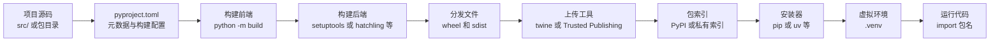
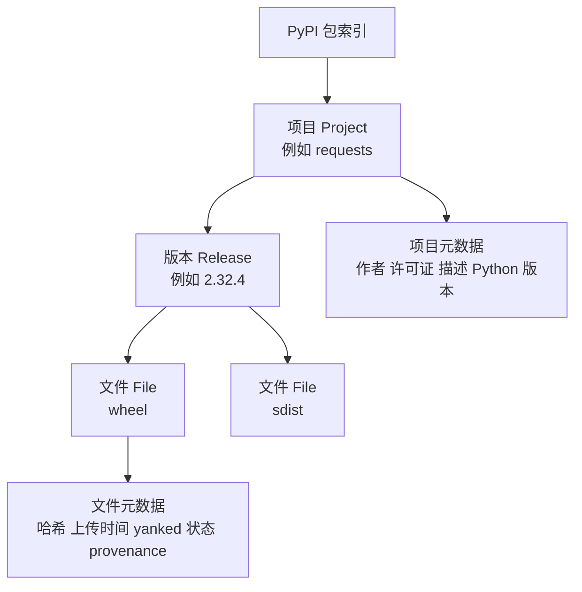
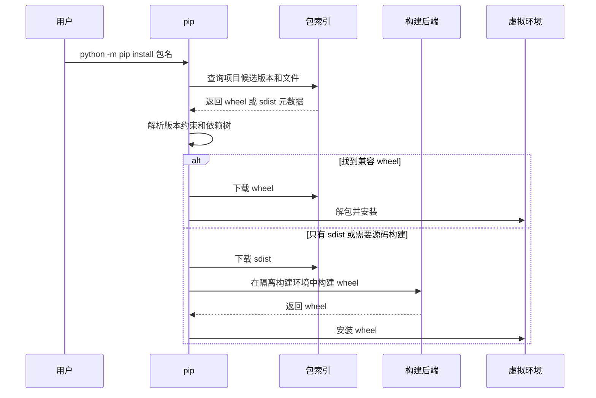
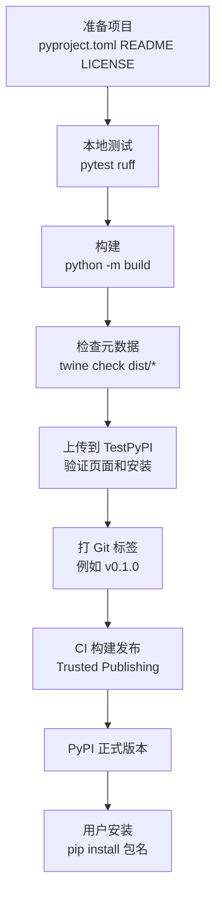
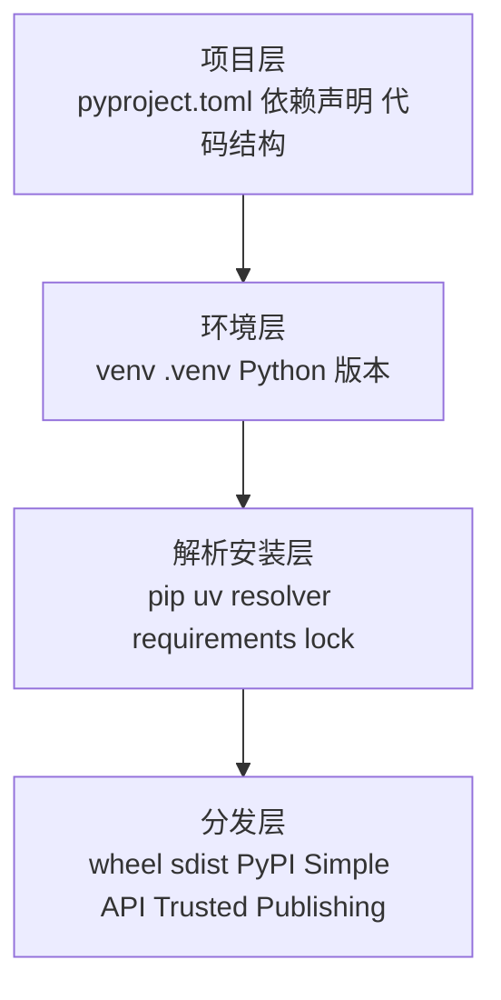

[toc]


## 总览

Python 包管理可以按一条主线理解：

**写代码** → **声明元数据和依赖** → **构建分发文件** → **上传到包索引** → **用户用安装器解析依赖并安装**。

这里的核心角色是：

| 角色                | 英文术语                   | 作用                                                         | 新手最容易误解的点                                           |
| ------------------- | -------------------------- | ------------------------------------------------------------ | ------------------------------------------------------------ |
| pip                 | package installer          | 从 PyPI 或其他索引下载并安装包，也能从本地目录、Git、归档文件安装 | pip 主要是“安装器”，不是完整项目管理器，也不是传统意义上的锁文件管理器 |
| PyPI                | Python Package Index       | 官方公共 Python 包索引和分发平台                             | PyPI 收录包不等于官方推荐、代码审计或质量背书                |
| pyproject.toml      | project configuration file | 现代 Python 项目的统一配置入口，包含构建系统、项目元数据和工具配置 | 不再推荐把新项目的核心配置分散在 `setup.py`、`setup.cfg`、`requirements.txt` 里 |
| build backend       | 构建后端                   | 真正把源码打包成 wheel、sdist 的工具，如 setuptools、hatchling、flit-core、poetry-core | pip 或 build 通常是“前端”，后端才执行具体构建                |
| wheel               | built distribution         | 已构建好的可安装分发文件，通常安装更快                       | wheel 不是源码包，而是面向安装的构建产物                     |
| sdist               | source distribution        | 源码分发包，通常是 `.tar.gz`                                 | sdist 安装时还需要构建步骤                                   |
| dependency resolver | 依赖解析器                 | 根据版本约束、Python 版本、平台条件等选择一组兼容版本        | 依赖解析可能回溯，复杂依赖树会变慢                           |

`pyproject.toml` 是当前 Python 打包生态的核心配置文件；PyPA 规范明确它用于包装相关工具和其他工具的配置，并规定了 `[build-system]`、`[project]`、`[tool]` 等表。pip 默认从 Python Package Index 安装包，而 `venv` 是标准库提供的虚拟环境工具，默认会在虚拟环境中引导安装 pip。([Python 包装指南](https://packaging.python.org/en/latest/specifications/pyproject-toml/?utm_source=chatgpt.com))

------

## 学习大纲

| 模块           | 要学什么                                                     | 学到什么程度算过关                                           |
| -------------- | ------------------------------------------------------------ | ------------------------------------------------------------ |
| 基础术语       | 模块、包、发行包、项目、版本、依赖、索引                     | 能解释 `pip install requests` 安装的“包”和 `import requests` 导入的“包”为什么相关但不完全等价 |
| pip 基础       | `install`、`uninstall`、`show`、`list`、`freeze`、`check`    | 能在虚拟环境中安装、升级、卸载、查看依赖冲突                 |
| 虚拟环境       | `venv`、`.venv`、激活、解释器隔离                            | 不再把项目依赖安装到系统 Python 里                           |
| 依赖声明       | `dependencies`、`optional-dependencies`、`dependency-groups`、`requirements.txt`、约束文件 | 能区分“库的依赖声明”和“应用部署的锁定依赖”                   |
| 依赖解析       | 版本约束、环境标记、extras、回溯解析                         | 能看懂 pip 为什么尝试多个版本，知道如何减少冲突              |
| 构建机制       | build frontend、build backend、PEP 517、PEP 518、wheel、sdist | 能用 `python -m build` 构建 `dist/` 产物                     |
| PyPI 发布      | TestPyPI、twine、Trusted Publishing、API Token、版本不可覆盖 | 能把一个小包安全发布到 TestPyPI，再发布到 PyPI               |
| 在线收录机制   | Simple Repository API、项目页、发行版、文件、yank、删除、名称保留 | 能理解 pip 是如何从索引发现候选文件的                        |
| 现代工具       | uv、Poetry、PDM、Hatch、pipx、pip-tools                      | 能根据项目类型选择合适方案                                   |
| 安全与最佳实践 | 供应链安全、哈希、锁文件、CI 发布、最小权限                  | 能设计一个较安全、可复现的发布和安装流程                     |

------

## 整体工作流示意



PyPA 的打包流程文档把这个过程分成源码树、配置文件、构建产物、上传到包分发服务、下载并安装等阶段；`build` 默认可构建 sdist 和 wheel，`twine` 可把构建产物上传到 PyPI，终端用户通常通过 `pip install package-name` 安装。([Python 包装指南](https://packaging.python.org/en/latest/flow/?utm_source=chatgpt.com))

------

## 基础概念

### 模块、导入包、发行包、项目

Python 里“包”这个词有多个层次：

| 中文说法 | 英文术语             | 例子                               | 说明                                           |
| -------- | -------------------- | ---------------------------------- | ---------------------------------------------- |
| 模块     | module               | `json.py`、`requests/api.py`       | 一个可导入的 Python 文件                       |
| 导入包   | import package       | `requests/`、`django/`             | 含多个模块的可导入目录                         |
| 发行包   | distribution package | `requests-2.32.0-py3-none-any.whl` | pip 安装的对象                                 |
| 项目     | project              | PyPI 上的 `requests` 项目          | 一个项目可以有多个版本，每个版本有多个分发文件 |

Python Packaging User Guide 特别提醒：在安装上下文中，“package”通常指可安装的软件包，也就是 distribution，而不是源码中 `import` 的那个包；社区中常把 distribution 简称为 package。([Python 包装指南](https://packaging.python.org/tutorials/installing-packages/?utm_source=chatgpt.com))

典型例子：

```bash
python -m pip install Pillow
```

安装的 PyPI 项目名是 `Pillow`，但代码里常写：

```python
from PIL import Image
```

所以不要机械认为“安装名”和“导入名”一定相同。

------

## pip 是什么

pip 是 Python 的主要包安装器。它能从 PyPI、私有索引、本地目录、源码归档、VCS 地址等来源安装包，并会根据依赖元数据做依赖解析。Python 官方文档把 pip 称为首选安装程序，`venv` 则是标准虚拟环境工具。([Python documentation](https://docs.python.org/3/installing/index.html?utm_source=chatgpt.com))

常用命令：

| 命令       | 作用                   | 示例                                |
| ---------- | ---------------------- | ----------------------------------- |
| 安装       | 安装一个包             | `python -m pip install requests`    |
| 升级       | 升级一个包             | `python -m pip install -U requests` |
| 卸载       | 删除包                 | `python -m pip uninstall requests`  |
| 查看       | 查看包信息             | `python -m pip show requests`       |
| 列表       | 查看已安装包           | `python -m pip list`                |
| 冻结       | 输出当前环境已安装版本 | `python -m pip freeze`              |
| 检查       | 检查依赖冲突           | `python -m pip check`               |
| 本地安装   | 安装当前项目           | `python -m pip install .`           |
| 可编辑安装 | 开发模式安装当前项目   | `python -m pip install -e .`        |

推荐写成：

```bash
python -m pip install requests
```

而不是直接写：

```bash
pip install requests
```

原因是 `python -m pip` 明确使用当前这个 Python 解释器对应的 pip，能减少多 Python 版本、多虚拟环境下“装到另一个环境里”的问题。

------

## pip 不是什么

pip 很重要，但不要把它想成“包管理的一切”。

| pip 能做                   | pip 不擅长或不负责                          |
| -------------------------- | ------------------------------------------- |
| 安装包                     | 初始化完整项目结构                          |
| 解析依赖                   | 替你设计依赖策略                            |
| 从 PyPI 或私有索引下载文件 | 审计包是否安全可信                          |
| 从本地项目构建并安装       | 管理 Python 解释器版本                      |
| 读取 `requirements.txt`    | 自动维护现代项目依赖分组                    |
| 实验性生成 `pylock.toml`   | 稳定替代 Poetry、uv、PDM 的完整锁文件工作流 |

尤其要注意：`pip freeze` 是“报告当前环境装了什么”，不是依赖求解器，也不等价于现代锁文件。pip 文档明确说 `pip freeze` reports what is installed，不会计算 lockfile 或 solver result。([pip.pypa.io](https://pip.pypa.io/en/stable/cli/pip_freeze/?utm_source=chatgpt.com))

------

## 虚拟环境是第一道边界

新手最应该养成的习惯是：**每个项目一个虚拟环境**。

```bash
python -m venv .venv
source .venv/bin/activate
python -m pip install -U pip
python -m pip install requests
```

Windows PowerShell：

```powershell
py -m venv .venv
.\.venv\Scripts\Activate.ps1
py -m pip install -U pip
py -m pip install requests
```

虚拟环境是半隔离的 Python 环境，让包安装在某个应用自己的环境里，而不是系统全局环境；`venv` 默认会在创建的虚拟环境中安装 pip。([Python documentation](https://docs.python.org/3/installing/index.html?utm_source=chatgpt.com))

现代 Linux 发行版还可能把系统 Python 标记为 **externally managed environment**，即由系统包管理器管理。PEP 668 相关规范要求这类环境中的 pip 默认不要修改解释器的全局安装位置，而应引导用户使用虚拟环境；这就是很多人看到 “externally-managed-environment” 报错的原因。([Python 包装指南](https://packaging.python.org/en/latest/specifications/externally-managed-environments/?utm_source=chatgpt.com))

------

## PyPI 和在线包收录机制

PyPI 是 Python 官方公共包索引。它保存项目、版本、分发文件和元数据，并通过网页、JSON API、Simple Repository API 等方式让人和工具访问。

pip 默认的包索引地址是 PyPI 的 Simple API，pip 文档中 `--index-url` 的默认值就是 `https://pypi.org/simple`，并要求索引符合 Simple Repository API。([pip.pypa.io](https://pip.pypa.io/en/stable/cli/pip_lock/))

PyPI 里的层级可以这样理解：



Simple Repository API 规定：仓库根页面列出项目；每个项目详情页面列出该项目的分发文件；文件链接可以包含哈希，项目详情 URL 使用规范化项目名；JSON 形式还可以暴露版本、文件大小、上传时间、yanked、provenance 等信息。([Python 包装指南](https://packaging.python.org/specifications/simple-repository-api/?utm_source=chatgpt.com))

### 收录不等于审核

PyPI 是社区包索引，不是“官方精选应用商店”。PyPI 的名称保留政策说明，用户在遵守使用条款的前提下可以上传内容，并且 Package Index 并不是备份服务；无效项目、恶意软件、垃圾项目、违法内容、名称抢占等可以被处理。文档也明确说 PSF 和 Package Index 维护者不会预先筛查上传包是否侵犯知识产权。([docs.pypi.org](https://docs.pypi.org/project-management/name-retention/?utm_source=chatgpt.com))

因此，安装包前要看：

| 检查点                                  | 为什么重要               |
| --------------------------------------- | ------------------------ |
| 项目名是否正确                          | 防止拼写抢注或仿冒包     |
| 最近发布时间                            | 判断项目是否活跃         |
| 维护者和仓库链接                        | 判断来源是否可信         |
| 下载量不能单独作为信任依据              | 热门不等于安全           |
| issue、release notes、CI 状态           | 判断维护质量             |
| 许可证                                  | 判断能否在你的项目中使用 |
| 是否有 wheel                            | 影响安装速度和跨平台体验 |
| 是否有 provenance 或 Trusted Publishing | 提升发布来源可验证性     |

------

## pip 安装时发生了什么



pip 的依赖解析会确定每个依赖应安装哪个版本；从 pip 20.3 起，其解析器支持 backtracking，也就是当先前选择导致冲突时回退并尝试其他版本。pip 文档也说明，解析开始时 pip 并不拥有所有依赖信息，可能需要下载候选分发文件来读取依赖。([pip.pypa.io](https://pip.pypa.io/en/stable/topics/dependency-resolution/?utm_source=chatgpt.com))

复杂依赖解析可能很慢并不是 pip “卡住了”，而是依赖解析本质上可能很难；pip 文档指出依赖解析问题是 NP-hard，依赖规模增大时最坏情况会变得非常慢。([pip.pypa.io](https://pip.pypa.io/en/stable/topics/more-dependency-resolution/?utm_source=chatgpt.com))

------

## pyproject.toml 是现代打包核心

一个最小但实用的现代项目可以这样写：

```toml
[build-system]
requires = ["hatchling"]
build-backend = "hatchling.build"

[project]
name = "example-awesome"
version = "0.1.0"
description = "A small example Python package"
readme = "README.md"
requires-python = ">=3.10"
license = "MIT"
authors = [
  { name = "Your Name", email = "you@example.com" }
]
dependencies = [
  "requests>=2.32",
]

[project.optional-dependencies]
cli = [
  "typer>=0.12",
  "rich>=13",
]
dev = [
  "pytest>=8",
  "ruff>=0.5",
]

[project.scripts]
example-awesome = "example_awesome.cli:main"
```

`[build-system]` 声明构建系统运行所需依赖和构建后端；`[project]` 存放项目核心元数据；`[tool]` 用于工具自己的配置。PyPA 规范说明 `pyproject.toml` 是包装相关工具和其他工具的配置文件，当前明确指定了 `[build-system]`、`[project]`、`[tool]` 三类表。([Python 包装指南](https://packaging.python.org/en/latest/specifications/pyproject-toml/?utm_source=chatgpt.com))

### src 布局

推荐新项目使用 `src` 布局：

```text
example-awesome/
  pyproject.toml
  README.md
  LICENSE
  src/
    example_awesome/
      __init__.py
      cli.py
  tests/
    test_basic.py
```

优点是：测试时更容易发现“本地源码路径污染”问题，避免你以为测试的是已安装包，实际上测试的是当前目录下的源码。

------

## 构建前端和构建后端

现代 Python 打包把“调用构建”和“执行构建”拆开。

| 角色     | 英文术语         | 例子                                          | 作用                   |
| -------- | ---------------- | --------------------------------------------- | ---------------------- |
| 构建前端 | build frontend   | `python -m build`、pip                        | 读取项目配置，调用后端 |
| 构建后端 | build backend    | hatchling、setuptools、flit-core、poetry-core | 生成 wheel 和 sdist    |
| 安装前端 | install frontend | pip、uv                                       | 安装构建产物及依赖     |

PEP 517 定义了安装工具和构建后端之间的接口，使 pip 等工具不再硬绑定某个构建系统；PEP 621 则定义了如何把项目核心元数据写在 `pyproject.toml` 中。([Python Enhancement Proposals (PEPs)](https://peps.python.org/pep-0517/?utm_source=chatgpt.com))

常用构建命令：

```bash
python -m pip install -U build
python -m build
```

构建后通常得到：

```text
dist/
  example_awesome-0.1.0.tar.gz
  example_awesome-0.1.0-py3-none-any.whl
```

PyPA 工具建议文档明确说，构建上传到 PyPI 的 sdist 和 wheel 的标准工具是 `build`，它会调用你在 `pyproject.toml` 中声明的构建后端；同时不应再直接使用 `python setup.py sdist` 和 `python setup.py bdist_wheel`，直接调用 `setup.py` 已被弃用。([Python 包装指南](https://packaging.python.org/guides/tool-recommendations/?utm_source=chatgpt.com))

------

## wheel 和 sdist

| 类型  | 扩展名    | 英文术语            | 面向谁                           | 特点                                             |
| ----- | --------- | ------------------- | -------------------------------- | ------------------------------------------------ |
| wheel | `.whl`    | built distribution  | 安装器和最终用户                 | 已构建，安装快，通常不需要本机编译               |
| sdist | `.tar.gz` | source distribution | 构建工具、下游打包者、源码审查者 | 包含源码和构建所需文件，安装时可能要先构建 wheel |

PyPA 文档建议项目同时发布 sdist 和 wheel；wheel 是可直接安装的构建包，安装速度通常比从 sdist 构建更快。对于含编译扩展的项目，不同操作系统、CPU 架构、Python 解释器版本可能需要不同 wheel。([Python 包装指南](https://packaging.python.org/en/latest/discussions/setup-py-deprecated/?utm_source=chatgpt.com))

纯 Python 项目通常只需要一个通用 wheel：

```text
example_awesome-0.1.0-py3-none-any.whl
```

含 C、Rust、Cython 扩展的项目可能需要多个平台 wheel：

```text
example_fast-0.1.0-cp312-cp312-manylinux_x86_64.whl
example_fast-0.1.0-cp312-cp312-macosx_arm64.whl
example_fast-0.1.0-cp312-cp312-win_amd64.whl
```

------

## 依赖声明的几种形式

### 项目运行依赖

写在 `[project].dependencies` 中：

```toml
[project]
dependencies = [
  "httpx>=0.27",
  "django>=4.2; python_version >= '3.10'",
]
```

依赖字符串遵循 dependency specifier 规范，即一套紧凑的、基于行的依赖描述语言；它源自 pip requirements 文件格式。([Python 包装指南](https://packaging.python.org/specifications/dependency-specifiers/?utm_source=chatgpt.com))

### 可选功能依赖

写在 `[project.optional-dependencies]` 中，安装时通过 extras 请求：

```toml
[project.optional-dependencies]
postgres = ["psycopg[binary]>=3"]
redis = ["redis>=5"]
all = [
  "psycopg[binary]>=3",
  "redis>=5",
]
```

使用：

```bash
python -m pip install "your-project[postgres]"
```

PyPA 指南说明，`optional-dependencies` 的每个键定义一个 packaging extra，用户可以通过 `pip install your-project-name[gui]` 一类形式安装额外依赖。([Python 包装指南](https://packaging.python.org/en/latest/guides/writing-pyproject-toml/?utm_source=chatgpt.com))

### 开发依赖组

现代标准化写法是 `[dependency-groups]`：

```toml
[dependency-groups]
test = [
  "pytest>=8",
  "coverage[toml]>=7",
]
lint = [
  "ruff>=0.6",
]
docs = [
  "mkdocs>=1.6",
]
dev = [
  { include-group = "test" },
  { include-group = "lint" },
  { include-group = "docs" },
]
```

pip 从 25.1 起支持 dependency groups，可用 `pip install --group dev` 安装；依赖组存放在 `pyproject.toml` 中，适合测试、lint、文档等内部开发用途，并且不会进入构建后的项目元数据。([pip.pypa.io](https://pip.pypa.io/en/stable/user_guide/?utm_source=chatgpt.com))

使用：

```bash
python -m pip install --group dev
```

### requirements.txt

`requirements.txt` 是 pip 的需求文件格式，常用于记录要安装的一组项目：

```text
requests>=2.32
rich>=13
pytest>=8
```

安装：

```bash
python -m pip install -r requirements.txt
```

pip 文档说明 requirements files 是 pip install 要安装项目的列表，常被命名为 `requirements.txt`，但这个名称不是硬性要求。([pip.pypa.io](https://pip.pypa.io/en/stable/reference/requirements-file-format/?utm_source=chatgpt.com))

### constraints.txt

约束文件不是“我要安装什么”，而是“如果安装到这些包，请限制它们的版本范围”。

```text
urllib3<3
cryptography>=43
```

使用：

```bash
python -m pip install -r requirements.txt -c constraints.txt
```

适合组织级统一约束、临时避开坏版本、CI 中限制子依赖范围。

### lock file

锁文件记录解析后的精确版本和文件信息，目的是复现环境。Python 生态正在向标准化 `pylock.toml` 演进；PyPA 规范说明 `pylock.toml` 用于指定依赖以实现可复现安装，pip 也已有实验性的 `pip lock`，默认输出文件名是 `pylock.toml`，但 pip 文档明确标注该命令为 EXPERIMENTAL，生成的锁文件只保证对当前 Python 版本和平台有效。([Python 包装指南](https://packaging.python.org/en/latest/specifications/pylock-toml/?utm_source=chatgpt.com))

------

## 依赖形式选择表

| 场景                               | 推荐形式                          | 原因                                       |
| ---------------------------------- | --------------------------------- | ------------------------------------------ |
| 发布给别人用的库                   | `[project].dependencies`          | 这是包元数据的一部分，安装你的库时会被读取 |
| 可选功能，如 `mysql`、`pdf`、`cli` | `[project.optional-dependencies]` | 用户按需安装 extras                        |
| 测试、lint、docs、本地开发         | `[dependency-groups]`             | 标准化、不会污染发布元数据                 |
| 简单脚本或传统项目                 | `requirements.txt`                | pip 原生支持，简单直接                     |
| 生产应用部署                       | 锁文件或带哈希的固定 requirements | 追求可复现                                 |
| 公司内部统一版本上限               | `constraints.txt`                 | 不改变安装目标，只限制可选版本             |
| 命令行工具全局安装                 | pipx 或 uv tool                   | 每个工具独立环境，避免污染项目依赖         |

------

## 版本约束规则

常见写法：

| 写法                                    | 含义       | 常见用途                     |
| --------------------------------------- | ---------- | ---------------------------- |
| `requests`                              | 不限制版本 | 临时实验可以，正式项目不推荐 |
| `requests>=2.32`                        | 至少某版本 | 库的常见写法                 |
| `requests>=2.32,<3`                     | 兼容范围   | 避免未来大版本破坏           |
| `requests==2.32.4`                      | 精确固定   | 应用锁定或复现实验           |
| `requests~=2.32`                        | 兼容发布   | 允许兼容版本升级             |
| `django>=4.2; python_version >= "3.10"` | 环境标记   | 按 Python 版本或平台选择依赖 |
| `requests[socks]>=2.32`                 | extras     | 安装可选功能依赖             |
| `pkg @ git+https://...`                 | 直接引用   | 临时使用 VCS 版本            |

Python packaging 的版本规范定义了软件分发版本的识别方案和依赖版本声明方式；依赖规范则定义了依赖字符串语法。([Python 包装指南](https://packaging.python.org/specifications/version-specifiers/?utm_source=chatgpt.com))

------

## 库和应用的依赖策略不同

| 项目类型     | 依赖策略                                       | 不推荐做法                                   |
| ------------ | ---------------------------------------------- | -------------------------------------------- |
| 库           | 给出合理范围，如 `httpx>=0.27,<1`              | 把所有依赖都 `==` 固定，导致用户环境难以解析 |
| 应用         | 用锁文件或固定版本部署                         | 只写宽松范围，导致部署环境每天解析出不同结果 |
| CLI 工具     | 项目元数据声明运行依赖，发布 wheel             | 让用户手工装一堆依赖                         |
| 数据科学项目 | 项目文件加锁文件，必要时记录 Python 版本和平台 | 只提交 notebook，不提交依赖说明              |
| 内部服务     | 锁定运行环境，CI 中构建镜像                    | 在生产服务器上直接 `pip install -U`          |

简单口诀：

**库要兼容，应用要可复现。**

------

## 安全安装和可复现安装

pip 支持 `--require-hashes`，要求 requirements 中每个需求都带哈希；pip 文档说明，一旦某个包使用哈希，所有 requirements 和依赖都必须有哈希，且需求必须固定到 URL、文件路径或 `==` 版本，以防新版本发布后出现意外哈希不匹配或被替换。([pip.pypa.io](https://pip.pypa.io/en/stable/topics/secure-installs/?utm_source=chatgpt.com))

示意：

```text
requests==2.32.4 \
    --hash=sha256:...
urllib3==2.5.0 \
    --hash=sha256:...
```

安装：

```bash
python -m pip install --require-hashes -r requirements.txt
```

适合高安全要求的生产环境，但维护成本较高。实际项目中常用 `pip-tools`、uv、Poetry、PDM 等工具生成或维护锁定结果。

------

## 发布到 PyPI 的基本流程



PyPA 教程会引导创建项目结构、构建包并上传到 Python Package Index；TestPyPI 适合测试和实验，但不是永久存储，正式发布要上传到 PyPI。([Python 包装指南](https://packaging.python.org/tutorials/packaging-projects/?utm_source=chatgpt.com))

### 本地构建和检查

```bash
python -m pip install -U build twine
python -m build
twine check dist/*
```

PyPA README 指南建议上传前运行 `twine check dist/*` 来检查 README 等元数据渲染问题。([Python 包装指南](https://packaging.python.org/guides/making-a-pypi-friendly-readme/?utm_source=chatgpt.com))

### 使用 Token 手动上传

```bash
twine upload dist/*
```

传统方式需要 PyPI API token。`.pypirc` 规范中，使用 PyPI token 时用户名写 `__token__`，密码写 PyPI token。([Python 包装指南](https://packaging.python.org/specifications/pypirc/?utm_source=chatgpt.com))

### 更推荐：Trusted Publishing

现代 CI/CD 发布推荐使用 PyPI **Trusted Publishing**。它基于 OpenID Connect，也就是 OIDC，让受信任的 CI 服务向 PyPI 证明“我是某个仓库的某个发布工作流”，PyPI 再签发短期 API token，避免把长期 PyPI token 存进 CI secrets。PyPI 文档说明该短期 API token 有效期为 15 分钟。([docs.pypi.org](https://docs.pypi.org/trusted-publishers/?utm_source=chatgpt.com))

GitHub Actions 示例：

```yaml
name: Publish

on:
  push:
    tags:
      - "v*"

jobs:
  build:
    runs-on: ubuntu-latest
    steps:
      - uses: actions/checkout@v4
      - uses: actions/setup-python@v5
        with:
          python-version: "3.12"
      - run: python -m pip install -U build
      - run: python -m build
      - uses: actions/upload-artifact@v4
        with:
          name: python-package-distributions
          path: dist/

  publish:
    needs: build
    runs-on: ubuntu-latest
    environment: pypi
    permissions:
      id-token: write
    steps:
      - uses: actions/download-artifact@v4
        with:
          name: python-package-distributions
          path: dist/
      - uses: pypa/gh-action-pypi-publish@release/v1
```

PyPA 的 GitHub Actions 发布指南要求发布 job 使用 `id-token: write`，并使用 `pypa/gh-action-pypi-publish@release/v1` 上传 `dist/` 目录内容；从该 action v1.11.0 起，它默认会为每个 distribution 生成并上传 PEP 740 兼容的 attestation。([Python 包装指南](https://packaging.python.org/guides/publishing-package-distribution-releases-using-github-actions-ci-cd-workflows/?utm_source=chatgpt.com))

------

## 发布后的版本、删除和 yanking

发布到 PyPI 后要特别谨慎：

| 操作                   | 含义             | 建议                                       |
| ---------------------- | ---------------- | ------------------------------------------ |
| 发布新版本             | 上传新的 version | 正常修复问题应发布新版本                   |
| yank release           | 非破坏性撤回     | 适合坏版本、安全漏洞、不兼容错误           |
| delete file 或 release | 永久删除文件     | 非常谨慎，可能破坏下游固定版本安装         |
| 复用版本号             | 通常不可取       | 发布错了就发 `0.1.1`，不要试图覆盖 `0.1.0` |

PyPI 支持 yanking，作为删除的非破坏性替代；被 yank 的 release 默认会被安装器忽略，除非它是精确版本约束唯一匹配项。PyPI 还提醒删除 release 或文件是永久操作，可能破坏下游依赖，删除和 yanking 是不同动作。([docs.pypi.org](https://docs.pypi.org/project-management/yanking/?utm_source=chatgpt.com))

------

## 现代python包管理工具选择🎈

| 工具                       | 适合谁                                     | 核心能力                                                     | 注意点                                       |
| -------------------------- | ------------------------------------------ | ------------------------------------------------------------ | -------------------------------------------- |
| pip + venv + build + twine | 想理解标准底层流程的新手、库作者           | 标准、透明、生态基础                                         | 功能分散，需要自己组合                       |
| uv                         | 想要高速、一体化体验的项目                 | 管理项目、依赖、锁文件、Python 版本、工具运行，提供 pip 兼容接口 | 发展很快，团队要统一版本和流程               |
| Poetry                     | 应用和库都常用，偏一体化                   | 依赖管理、锁文件、构建、发布                                 | 有自己的工作流和配置习惯                     |
| PDM                        | 喜欢标准 `pyproject.toml` 和灵活后端的用户 | 现代依赖管理、锁文件、PEP 标准支持                           | PEP 582 已被拒绝，PDM 现在也建议使用虚拟环境 |
| Hatch                      | 包作者、需要多环境测试和发布流程的人       | 项目管理、环境、构建、发布、版本管理                         | 依赖锁定体验和 uv、Poetry 不完全相同         |
| pipx                       | 安装 CLI 应用                              | 每个命令行工具独立虚拟环境                                   | 不适合管理项目依赖                           |
| pip-tools                  | 想保留 pip 工作流但需要锁定依赖            | 从输入依赖生成固定 requirements                              | 不是完整项目管理器                           |

uv 官方文档称其提供项目管理、通用 lockfile、脚本运行、Python 版本安装与管理、工具安装运行，以及 pip 兼容接口；Poetry 文档强调其锁定机制会保证项目在声明支持的 Python 版本范围内可安装；PDM 官方介绍称它是支持最新 PEP 标准的现代 Python 包和依赖管理器；PyPA 工具建议中也提到 pipx 会把每个通过 PyPI 分发的命令行应用安装到独立虚拟环境中，避免依赖冲突。([docs.astral.sh](https://docs.astral.sh/uv/?utm_source=chatgpt.com))

------

## 新手推荐路线

### 学习标准底层流程

适合第一阶段：

```bash
python -m venv .venv
source .venv/bin/activate
python -m pip install -U pip
python -m pip install requests
python -m pip freeze
```

然后学习：

```bash
python -m pip install -U build twine
python -m build
twine check dist/*
```

目标是理解：虚拟环境、pip、依赖、wheel、sdist、PyPI 是如何协作的。

### 实际新项目

如果希望体验现代化、一体化工具，可以选 uv：

```bash
uv init my-app
cd my-app
uv add requests
uv run python main.py
uv sync
```

uv 的项目指南展示了通过 `uv sync` 创建和同步 `.venv`，再运行项目命令；uv 也支持用 `uv add`、`uv remove` 修改项目依赖，同时也可以直接编辑 `pyproject.toml`。([docs.astral.sh](https://docs.astral.sh/uv/guides/projects/?utm_source=chatgpt.com))

### 发布库

建议路线：

```bash
python -m pip install -U build twine
python -m build
twine check dist/*
```

发布时优先设置 Trusted Publishing；如果暂时手动上传，用项目级 API token，不要用全账号长期 token。

------

## 常见误区

| 误区                                             | 正确认识                                     |
| ------------------------------------------------ | -------------------------------------------- |
| `pip install` 后所有项目都能用                   | 只在当前 Python 环境中可用                   |
| `pip freeze > requirements.txt` 就是最佳依赖管理 | 它只是当前环境快照，不是求解后的标准锁文件   |
| 发布库应该把依赖都固定为 `==`                    | 库通常应给兼容范围，应用部署才更强调精确锁定 |
| `setup.py` 是现代项目必须有的                    | 新项目优先使用 `pyproject.toml`              |
| 只发布 sdist 就够了                              | 大多数项目应同时发布 sdist 和 wheel          |
| PyPI 上有就是安全的                              | PyPI 是索引，不是安全审计机构                |
| 删除坏版本就好了                                 | 优先考虑 yank，删除可能破坏下游安装          |
| 全局安装开发依赖最省事                           | 用虚拟环境隔离，CLI 工具用 pipx 或 uv tool   |
| 包名和导入名一定一样                             | 不一定，例如 `Pillow` 和 `PIL`               |
| 私有索引加到 `--extra-index-url` 总是安全        | 可能引入依赖混淆风险，应明确源策略和包名控制 |

------

## 实用模板

### 库项目 pyproject.toml

```toml
[build-system]
requires = ["hatchling"]
build-backend = "hatchling.build"

[project]
name = "your-package-name"
version = "0.1.0"
description = "Short description"
readme = "README.md"
requires-python = ">=3.10"
license = "MIT"
authors = [
  { name = "Your Name", email = "you@example.com" }
]
dependencies = [
  "httpx>=0.27,<1",
]

[project.optional-dependencies]
cli = [
  "typer>=0.12",
  "rich>=13",
]

[dependency-groups]
test = [
  "pytest>=8",
]
lint = [
  "ruff>=0.6",
]
dev = [
  { include-group = "test" },
  { include-group = "lint" },
]

[project.urls]
Homepage = "https://github.com/your-name/your-package-name"
Repository = "https://github.com/your-name/your-package-name"
Issues = "https://github.com/your-name/your-package-name/issues"

[project.scripts]
your-command = "your_package.cli:main"
```

### 应用项目依赖思路

```toml
[project]
name = "your-app"
version = "0.1.0"
requires-python = ">=3.12"
dependencies = [
  "fastapi>=0.115,<1",
  "uvicorn[standard]>=0.30,<1",
  "pydantic>=2.8,<3",
]

[dependency-groups]
dev = [
  "pytest>=8",
  "ruff>=0.6",
  "mypy>=1.10",
]
```

应用部署时再配合工具生成锁文件，例如 uv 的 `uv.lock`、Poetry 的 `poetry.lock`、PDM 的 `pdm.lock`，或逐步采用标准化 `pylock.toml`。

### README 发布检查清单

| 项目               | 检查                       |
| ------------------ | -------------------------- |
| 包名               | PyPI 上未被占用，拼写清晰  |
| 版本               | 符合 Python 版本规范       |
| README             | PyPI 能正确渲染            |
| LICENSE            | 文件存在，元数据声明清楚   |
| Python 版本        | `requires-python` 明确     |
| 依赖               | 不过度固定，不遗漏运行依赖 |
| wheel              | 已生成                     |
| sdist              | 已生成                     |
| twine check        | 通过                       |
| TestPyPI           | 可安装验证                 |
| Trusted Publishing | 已配置                     |
| Git tag            | 与版本号对应               |
| changelog          | 说明变更                   |

------

## 管理模型

把 Python 包管理分成四层，不要混在一起：



学习顺序建议：

| 阶段   | 重点                                | 工具                                             |
| ------ | ----------------------------------- | ------------------------------------------------ |
| 入门   | 会创建虚拟环境，会安装包            | `venv`、`pip`                                    |
| 进阶   | 会声明项目依赖和构建包              | `pyproject.toml`、`build`                        |
| 发布   | 会上传到 TestPyPI 和 PyPI           | `twine`、Trusted Publishing                      |
| 工程化 | 会锁定依赖、CI 测试、自动发布       | uv、Poetry、PDM、Hatch、GitHub Actions           |
| 安全   | 会控制来源、哈希、权限、yank 坏版本 | 私有索引、`--require-hashes`、Trusted Publishing |

最重要的实践原则是：

**项目用虚拟环境隔离，元数据写进 `pyproject.toml`，库发布 wheel 和 sdist，应用使用锁文件复现环境，PyPI 发布优先用 Trusted Publishing。**