[toc]


# Python 高效字符串批量过滤方案

## 先看结论

| 方案                        | 关键词数量 | 字符串数量 | 推荐度           |
| --------------------------- | ---------- | ---------- | ---------------- |
| **简单循环 `in`**           | < 100      | < 10万     | ⭐⭐⭐ 小规模首选   |
| **正则合并 `re`**           | < 1万      | 任意       | ⭐⭐⭐⭐ 通用推荐    |
| **Aho-Corasick (AC)自动机** | 任意       | 任意       | ⭐⭐⭐⭐⭐ 大规模首选 |

---

## 方案一：简单循环（小规模）

```python
keywords = ["广告", "促销", "免费", "中奖"]
strings = ["今天天气真好", "免费领取大奖", "正常内容", "促销活动开始"]

# 过滤：保留不包含任何关键词的字符串
result = [s for s in strings if not any(kw in s for kw in keywords)]
# ['今天天气真好', '正常内容']
```

**时间复杂度**：`O(S × K × L)`（S=字符串数, K=关键词数, L=平均长度）

关键词多了之后每个字符串都要逐一匹配，性能下降明显。

---

## 方案二：正则合并（中等规模，推荐）

将所有关键词合并成一个正则表达式，利用正则引擎内部优化：

```python
import re

keywords = ["广告", "促销*", "免费.", "中奖", "点击领取"]

esc_keywords=[re.escape(kw) for kw in keywords]
# 或者使用map将列表中的元素做映射:
# esc_keywords=list(map(re.escape, keywords))
# ['广告', '促销\\*', '免费\\.', '中奖', '点击领取']
pattern = re.compile("|".join(esc_keywords))
strings = ["今天天气真好", "免费...领取大奖", "正常内容", "促销活动开始"]

result = [s for s in strings if not pattern.search(s)]
print(result)


# output:
['今天天气真好', '正常内容', '促销活动开始']
```

> **为什么要 `re.escape`**：关键词中可能含 `.`、`*`、`(` 等正则特殊字符，必须转义。

---

## 方案三：Aho-Corasick 自动机（大规模，最优）

当关键词达到**数千甚至数万**时，这是最优解。

### 原理

```mermaid
flowchart LR
    A[所有关键词] -->|构建| B[Aho-Corasick 自动机<br/>类似 Trie + 失败指针]
    C[待匹配字符串] -->|单次扫描| B
    B --> D[O&#40;N&#41; 找出所有命中<br/>N = 字符串长度]
```



核心优势：**无论有多少关键词，匹配时间只与字符串长度相关**，构建自动机一次，查询无数次。

### 实现

```bash
pip install pyahocorasick
```

```python
import ahocorasick

def build_filter(keywords: list[str]) -> ahocorasick.Automaton:
    """构建 Aho-Corasick 自动机"""
    A = ahocorasick.Automaton()
    for idx, kw in enumerate(keywords):
        A.add_word(kw, (idx, kw))
    A.make_automaton()
    return A

def filter_strings(strings: list[str], keywords: list[str]) -> list[str]:
    """过滤包含任意关键词的字符串"""
    automaton = build_filter(keywords)
    
    result = []
    for s in strings:
        # automaton.iter(s) 在 s 中搜索所有关键词
        # 只要找到一个就说明命中，应过滤
        found = False
        for _ in automaton.iter(s):
            found = True
            break  # 找到一个就够了，提前退出
        if not found:
            result.append(s)
    
    return result

# ---------- 使用 ----------
keywords = ["广告", "促销", "免费", "中奖", "点击领取"]
strings = ["今天天气真好", "免费领取大奖", "正常内容", "促销活动开始"]

result = filter_strings(strings, keywords)
print(result)  # ['今天天气真好', '正常内容']
```

### 更简洁的写法

```python
import ahocorasick

# 构建
A = ahocorasick.Automaton()
for kw in keywords:
    A.add_word(kw, kw)
A.make_automaton()

# 判断函数
def contains_keyword(text: str) -> bool:
    """是否包含任意一个关键词"""
    for _ in A.iter(text):
        return True
    return False

# 过滤
result = [s for s in strings if not contains_keyword(s)]
```

---

## 性能对比

测试条件：**1000 个关键词，100 万条字符串**

| 方案                  | 耗时    | 备注                     |
| --------------------- | ------- | ------------------------ |
| `any(kw in s)` 循环   | ~120s   | O(S×K)，线性增长         |
| `re.compile` 正则合并 | ~15s    | 正则引擎内部有优化       |
| **Aho-Corasick**      | **~3s** | O(S×L)，与关键词数量无关 |

> 数量级关系：**AC 自动机 > 正则 >> 朴素循环**

---

## 完整生产级实现

```python
"""
批量字符串关键词过滤器
- 小规模自动退化为简单匹配
- 大规模使用 Aho-Corasick
"""
from __future__ import annotations
import re
from typing import Iterator


class KeywordFilter:
    """关键词过滤器：自动选择最优策略"""

    def __init__(self, keywords: list[str], strategy: str = "auto"):
        self.keywords = [kw for kw in keywords if kw]  # 去空
        if not self.keywords:
            raise ValueError("关键词列表不能为空")

        if strategy == "auto":
            strategy = "ac" if len(self.keywords) > 50 else "regex"

        if strategy == "ac":
            self._init_ac()
        elif strategy == "regex":
            self._init_regex()
        else:
            raise ValueError(f"未知策略: {strategy}")

        self._strategy = strategy

    def _init_ac(self):
        import ahocorasick
        self._automaton = ahocorasick.Automaton()
        for kw in self.keywords:
            self._automaton.add_word(kw, kw)
        self._automaton.make_automaton()

    def _init_regex(self):
        sorted_kw = sorted(self.keywords, key=len, reverse=True)
        self._pattern = re.compile("|".join(re.escape(kw) for kw in sorted_kw))

    def contains(self, text: str) -> bool:
        """检查 text 是否包含任意关键词"""
        if self._strategy == "ac":
            for _ in self._automaton.iter(text):
                return True
            return False
        else:
            return bool(self._pattern.search(text))

    def matched_keywords(self, text: str) -> list[str]:
        """返回 text 中命中的所有关键词"""
        if self._strategy == "ac":
            return [kw for _, kw in self._automaton.iter(text)]
        else:
            return self._pattern.findall(text)

    def filter(self, strings: list[str] | Iterator[str]) -> list[str]:
        """过滤掉包含关键词的字符串"""
        return [s for s in strings if not self.contains(s)]

    def filter_with_reason(self, strings: list[str]) -> list[dict]:
        """过滤并附带命中原因"""
        results = []
        for s in strings:
            hits = self.matched_keywords(s)
            results.append({
                "text": s,
                "blocked": bool(hits),
                "matched": hits,
            })
        return results


# ---------- 使用 ----------
if __name__ == "__main__":
    keywords = ["广告", "促销", "免费", "中奖", "点击领取", "加微信"]

    kf = KeywordFilter(keywords)

    texts = [
        "今天天气真好",
        "免费领取大奖！",
        "正常的工作内容",
        "促销活动火热进行中",
        "这是一条普通消息",
        "加微信领取优惠",
    ]

    # 简单过滤
    clean = kf.filter(texts)
    print("过滤结果:", clean)
    # ['今天天气真好', '正常的工作内容', '这是一条普通消息']

    # 带原因的过滤
    details = kf.filter_with_reason(texts)
    for d in details:
        status = "🚫" if d["blocked"] else "✅"
        print(f'{status} "{d["text"]}"', f'命中: {d["matched"]}' if d["blocked"] else "")
```

输出：
```
✅ "今天天气真好" 
🚫 "免费领取大奖！" 命中: ['免费']
✅ "正常的工作内容" 
🚫 "促销活动火热进行中" 命中: ['促销']
✅ "这是一条普通消息" 
🚫 "加微信领取优惠" 命中: ['加微信']
```

---

## 选型速查

```mermaid
flowchart TD
    A{关键词数量?} -->|< 50 个| B{字符串数量?}
    A -->|50 ~ 500| D[正则合并 re]
    A -->|> 500| E[Aho-Corasick]
    
    B -->|< 10万| C[简单 any&#40;kw in s&#41;]
    B -->|> 10万| D
    
    D --> F[够用]
    E --> F
    C --> F
```



> **一句话建议**：不确定规模就直接用 **Aho-Corasick**（`pyahocorasick`），它在任何规模下都是最优或接近最优的，且代码量也没多多少。