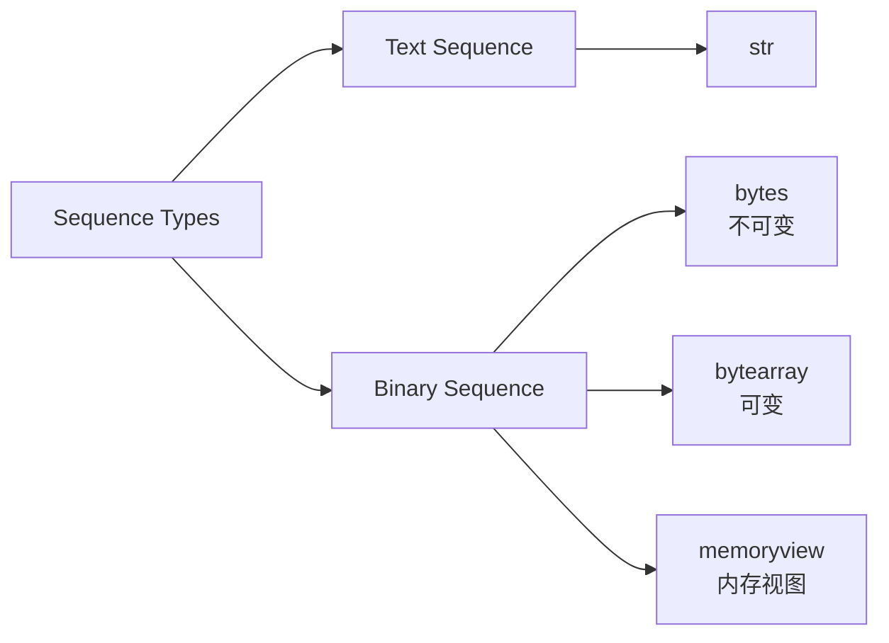
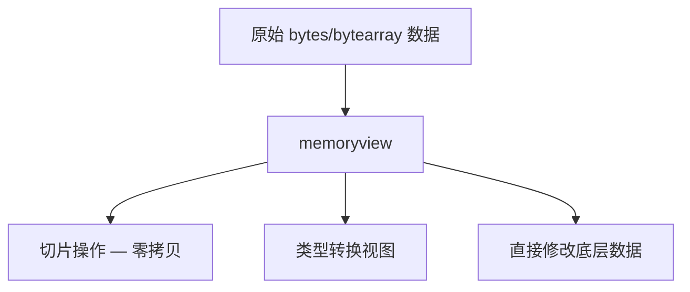
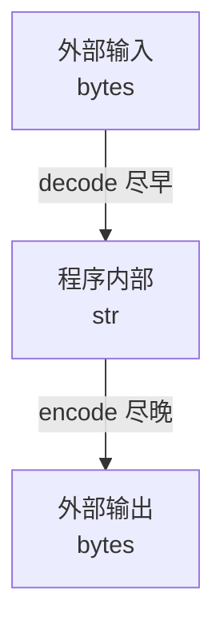
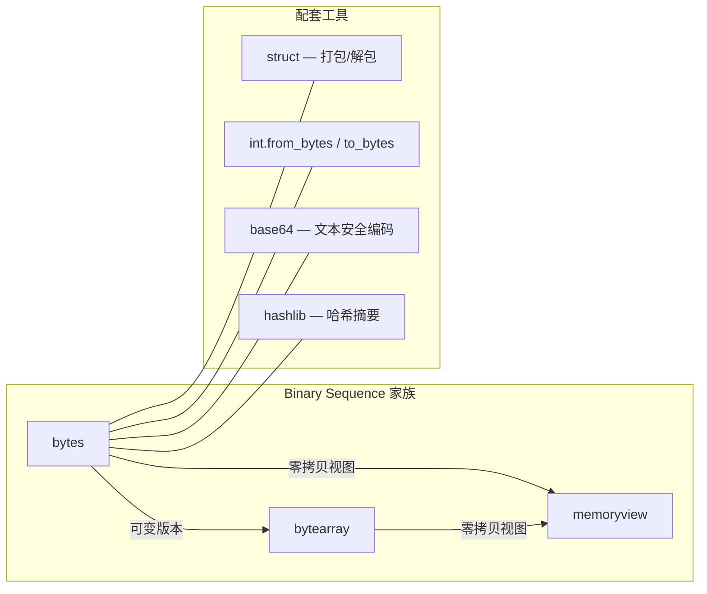

# Python 序列类型：Text and Binary Sequences

## 概览

Python 中的序列类型分为两大类：

| 类别            | 核心类型     | 存储内容                 | 可变性         |
| --------------- | ------------ | ------------------------ | -------------- |
| Text Sequence   | `str`        | Unicode 码点             | 不可变         |
| Binary Sequence | `bytes`      | 0-255 的整数             | 不可变         |
| Binary Sequence | `bytearray`  | 0-255 的整数             | 可变           |
| Binary Sequence | `memoryview` | 其他二进制数据的内存视图 | 取决于底层对象 |

两者的根本区别在于：`str` 处理的是人类可读的文本（字符），而 **binary sequence 处理的是机器层面的原始字节数据**。



------

## Text Sequence：str

`str` 是 Unicode 字符串，Python 3 中所有字符串默认都是 Unicode。这里简要提及，重点放在后面的 Binary Sequence。

```python
text = "你好世界"       # str，存储的是 Unicode 码点
type(text)             # <class 'str'>
```

------

## Binary Sequence 详解

### 为什么需要 Binary Sequence

文本是人类的抽象，但计算机网络传输、文件 I/O、加密、图像处理等场景处理的都是**原始字节**。

Binary sequence 就是 Python 中**操作原始字节的工具**。

一个核心心智模型：


------

```python
text = "Hello 世界"
raw = text.encode("utf-8")   # str → bytes
print(raw)                    # b'Hello \xe4\xb8\x96\xe7\x95\x8c'
print(raw.decode("utf-8"))   # bytes → str: "Hello 世界"
```

### bytes 字面量与显示的 ASCII 规则


`bytes` 字面量语法 `b'...'` 是从 Python 源代码（文本文件）到字节对象的一种便捷记法。

Python 解析器需要一种无歧义的方式将你写的字符映射到具体的字节值。ASCII 字符天然满足这个条件——每个字符恰好对应一个确定的字节值（0-127），不存在编码歧义。

而非 ASCII 字符（如 `é`、`中`）在不同编码下对应不同的字节序列，Python 无法替你决定用哪种编码，所以直接禁止在 `b'...'` 中使用它们。

```python
b'A'        # 合法 — 'A' 的 ASCII 码是 65，无歧义
b'é'        # SyntaxError — 'é' 在 UTF-8 是 0xC3A9，在 Latin-1 是 0xE9，有歧义
b'\xc3\xa9' # 合法 — 直接指定字节值，无歧义
```

#### 输入：b'...' 字面量的规则

`b'...'` 中允许出现的内容：

| 允许的形式        | 示例                | 说明                                    |
| ----------------- | ------------------- | --------------------------------------- |
| ASCII 可打印字符  | `b'Hello'`          | 码点 32-126，一对一映射到字节值         |
| `\x` 十六进制转义 | `b'\xff\x00'`       | 任意字节值 0-255                        |
| `\` 转义序列      | `b'\n' b'\t' b'\\'` | 与 str 相同的转义                       |
| 八进制转义        | `b'\101'`           | 等同于 `b'A'`（八进制 101 = 十进制 65） |

本质上，`b'...'` 是一种**语法糖**，让你不必写 `bytes([72, 101, 108, 108, 111])` 来表示 `b'Hello'`。

#### 输出：bytes 的 repr 显示规则

`bytes` 对象打印时遵循对称的规则——尽可能用人类可读的 ASCII 字符显示，其余用 `\x` 转义：

```python
data = bytes([72, 101, 108, 108, 111, 0, 255, 10, 9])
print(data)  # b'Hello\x00\xff\n\t'
```

显示策略：

| 字节值范围                             | 显示方式        | 示例                                 |
| -------------------------------------- | --------------- | ------------------------------------ |
| 32-126（ASCII 可打印）且非特殊字符     | 直接显示字符    | `65` → `A`                           |
| 有对应转义名的控制字符                 | 用命名转义      | `10` → `\n`，`9` → `\t`，`13` → `\r` |
| 其余所有值（0-31 中无名称的、128-255） | `\xHH` 十六进制 | `255` → `\xff`，`0` → `\x00`         |
| 反斜杠本身                             | `\\`            | `92` → `\\`                          |
| 单引号（当用单引号包裹时）             | `\'`            | `39` → `\'`                          |

```python
ord('\\') # 92
'\\'.encode() # b'\\'
```


```python
# 验证这个规则
>>> bytes(range(60, 70))
b'<=>?@ABCDE'          # 全部是 ASCII 可打印，直接显示

>>> bytes(range(0, 10))
b'\x00\x01\x02\x03\x04\x05\x06\x07\x08\t'  # 最后一个是 \t (9)

>>> bytes(range(250, 256))
b'\xfa\xfb\xfc\xfd\xfe\xff'   # 全部超出 ASCII，用 \x 转义
```

一句话总结

ASCII 是 bytes 字面量和显示的"通用语言"——因为 ASCII 字符与字节值之间存在唯一确定的映射，所以 Python 在输入和输出两端都用它作为人类友好的表示方式，非 ASCII 范围则退回到无歧义的十六进制转义。

### bytes — 不可变字节序列

#### 创建方式

```python
# 字面量（仅限 ASCII 范围字符）
b1 = b"hello"
b2 = b'\x00\x01\x02\xff'

# 从字符串编码(前3个字符caf是ascii范围内的字符,分别指需要一个字节,而第4个字符在utf-8编码下需要2个字节,且这2字节的十六进制表示将分别是c3,a9)
b3 = "café".encode("utf-8")       # b'caf\xc3\xa9'

# 从整数可迭代对象
b4 = bytes([72, 101, 108, 108, 111])  # b'Hello'

# 指定长度的零填充
b5 = bytes(10)                     # b'\x00\x00\x00\x00\x00\x00\x00\x00\x00\x00'

# 从十六进制字符串(每个十六进制数占4bit,2个十六进制数对应一个字节)
b6 = bytes.fromhex("deadbeef")     # b'\xde\xad\xbe\xef'
```

```python
"你".encode() # b'\xe4\xbd\xa0' #分别对应十进制数:228 189 160

b'\xe4\xbd\xa0'.decode() # '你'

bytes([0xe4,0xbd,0xa0]).decode() # '你'
```


#### 索引与切片的行为差异

这是新手常见的困惑点：

```python
# 如果包含非ascii字符的bytes做索引和切片访问
data = b"ABC"

data[0]      # 65 — 索引返回 int
data[0:1]    # b'A' — 切片返回 bytes

# 如果包含非ascii字符的bytes做索引和切片访问
data = "你好hello".encode()

print(data[0])      # 228
print(data[0:1])    # b'\xe4'
```

| 操作          | 返回类型      | 示例          | 结果   |
| ------------- | ------------- | ------------- | ------ |
| 索引 `b[i]`   | `int` (0-255) | `b"ABC"[0]`   | `65`   |
| 切片 `b[i:j]` | `bytes`       | `b"ABC"[0:1]` | `b'A'` |

这与 `str` 不同——`"ABC"[0]` 返回的仍然是 `str`。

#### 常用方法

`bytes` 支持大部分 `str` 的方法（不涉及 Unicode 特性的那些）：

```python
data = b"Hello, World!"

data.split(b", ")        # [b'Hello', b'World!']
data.upper()             # b'HELLO, WORLD!'
data.replace(b"World", b"Python")  # b'Hello, Python!'
data.startswith(b"Hello")          # True
data.find(b"World")                # 7
data.count(b"l")                   # 3
data.strip()                       # 去除首尾空白字节
data.hex()                         # '48656c6c6f2c20576f726c6421'
```

------

### bytearray — 可变字节序列

`bytearray` 是 `bytes` 的可变版本，关系类似于 `list` 与 `tuple`。

#### 创建方式

```python
ba = bytearray(b"hello")
ba = bytearray(10)                  # 10 个零字节
ba = bytearray([72, 101, 108])      # 从整数列表
ba = bytearray.fromhex("cafebabe")
```

#### 原地修改

```python
ba = bytearray(b"hello")

# 单字节赋值（必须是 0-255 的整数）
ba[0] = 72          # bytearray(b'Hello') — 72 是 'H' 的 ASCII 码

# 切片赋值
ba[1:3] = b"EL"     # bytearray(b'HELlo')

# 类似 list 的方法
ba.append(33)       # bytearray(b'HELlo!')
ba.extend(b"!!")    # bytearray(b'HELlo!!!')
ba.pop()            # 33, ba = bytearray(b'HELlo!!')
ba.insert(0, 79)    # bytearray(b'OHELlo!!')
ba.remove(72)       # 移除第一个值为 72 的字节
ba.reverse()        # 原地反转
```

#### bytes vs bytearray 选择指南

| 场景                  | 推荐类型    | 原因                 |
| --------------------- | ----------- | -------------------- |
| 网络协议解析（只读）  | `bytes`     | 不可变，安全，可哈希 |
| 逐步构建数据包        | `bytearray` | 需要追加、修改       |
| 作为字典键或集合元素  | `bytes`     | 不可变才可哈希       |
| 高性能缓冲区          | `bytearray` | 避免反复创建新对象   |
| 从文件/网络读取的数据 | `bytes`     | 标准库默认返回 bytes |

------

### memoryview — 零拷贝的内存视图

`memoryview` 允许你在不复制数据的情况下访问对象的内部缓冲区。这在处理大型二进制数据时至关重要。

#### 核心思想



普通切片会复制数据，而 `memoryview` 切片只是创建一个指向同一块内存的新视图：

```python
data = bytearray(b"Hello, World! This is a large buffer.")

# 普通切片 — 复制数据
chunk = data[7:12]        # 新建了一个 bytearray 副本

# memoryview 切片 — 零拷贝
mv = memoryview(data)
chunk_view = mv[7:12]     # 没有复制，指向同一块内存

# 通过 view 修改会直接影响原始数据
chunk_view[0] = ord('w')
print(data)               # bytearray(b'Hello, world! This is a large buffer.')
```

#### 类型转换（cast）

`memoryview` 可以将字节重新解释为不同的数据类型：

```python
import array

# 4 个 32 位有符号整数
numbers = array.array('i', [1, 2, 3, 4])  # 'i' = signed int (4 bytes each)
mv = memoryview(numbers)

print(mv.format)     # 'i'
print(mv.itemsize)   # 4
print(len(mv))       # 4
print(mv[0])         # 1

# 转换为字节视图
mv_bytes = mv.cast('B')   # 'B' = unsigned char (1 byte each)
print(len(mv_bytes))      # 16 — 4个int × 4字节
print(list(mv_bytes[:4])) # [1, 0, 0, 0] — 小端序下整数 1 的字节表示
```

#### 实际应用场景

```python
# 场景：高效处理大文件的一部分
with open("large_file.bin", "rb") as f:
    data = bytearray(f.read())

mv = memoryview(data)
header = mv[:128]       # 读取文件头，零拷贝
payload = mv[128:]      # 读取负载，零拷贝

# 场景：网络编程中拼接/解析协议帧
def parse_frame(frame: bytes):
    mv = memoryview(frame)
    msg_type = mv[0]
    length = int.from_bytes(mv[1:5], 'big')
    body = mv[5:5+length]
    return msg_type, bytes(body)
```

#### 何时使用 memoryview

| 场景                        | 是否推荐 | 说明                       |
| --------------------------- | -------- | -------------------------- |
| 处理 MB/GB 级别的二进制数据 | 强烈推荐 | 避免大量内存拷贝           |
| 小数据（几十字节）          | 不必要   | 创建 memoryview 本身有开销 |
| 需要将数据传给 C 扩展       | 推荐     | buffer protocol 兼容       |
| 图像/音频处理               | 推荐     | 配合 numpy 等库使用        |

------

## 编码与解码：str ↔ bytes 的桥梁

### 常见编码

| 编码                 | 特点                       | 适用场景                |
| -------------------- | -------------------------- | ----------------------- |
| UTF-8                | 变长 1-4 字节，ASCII 兼容  | Web、现代系统的默认选择 |
| UTF-16               | 变长 2 或 4 字节           | Windows 内部            |
| ASCII                | 固定 1 字节，仅 128 个字符 | 纯英文、协议头          |
| Latin-1 (ISO-8859-1) | 固定 1 字节，256 个字符    | 西欧语言、HTTP 默认     |
| GBK / GB2312         | 变长 1-2 字节              | 中文（遗留系统）        |

### 编码/解码时错误处理

```python
text = "café ☕"

# 默认 strict — 无法编码时抛出异常
# text.encode("ascii")  # UnicodeEncodeError

# 忽略无法编码的字符
text.encode("ascii", errors="ignore")       # b'caf '

# 用 ? 替代
text.encode("ascii", errors="replace")      # b'caf? ?'

# 用 XML 字符引用替代
text.encode("ascii", errors="xmlcharrefreplace")  # b'caf&#233; &#9749;'


```


```python
# 解码时的错误处理
bad_bytes = b'\xff\xfe'
bad_bytes.decode("utf-8", errors="replace")  # '��'
bad_bytes.decode("utf-8", errors="ignore")   # ''
```


### 最佳实践：Unicode 三明治



原则：在程序边界处进行编解码，内部始终使用 `str`。这被称为"Unicode 三明治"模式。

```python
# 读取时解码
with open("data.txt", "r", encoding="utf-8") as f:
    text = f.read()  # 得到 str

# 内部处理全部用 str
processed = text.upper().strip()

# 输出时编码
with open("output.txt", "w", encoding="utf-8") as f:
    f.write(processed)

# 网络场景
response_bytes = socket.recv(4096)          # bytes
message = response_bytes.decode("utf-8")    # str — 尽早解码
# ... 处理 ...
socket.send(reply.encode("utf-8"))          # 尽晚编码
```

------

## struct 模块：解析二进制结构

处理二进制协议或文件格式时，`struct` 模块是核心工具：

```python
import struct

# 打包：Python 值 → bytes
# '>' = 大端序, 'H' = unsigned short, 'I' = unsigned int
packet = struct.pack('>HI', 8080, 1024)
print(packet)       # b'\x1f\x90\x00\x00\x04\x00'
print(len(packet))  # 6 字节 (2 + 4)

# 解包：bytes → Python 值
port, size = struct.unpack('>HI', packet)
print(port, size)   # 8080 1024
```

常用格式字符：

| 格式      | C 类型                    | Python 类型 | 字节数         |
| --------- | ------------------------- | ----------- | -------------- |
| `b` / `B` | signed/unsigned char      | int         | 1              |
| `h` / `H` | signed/unsigned short     | int         | 2              |
| `i` / `I` | signed/unsigned int       | int         | 4              |
| `q` / `Q` | signed/unsigned long long | int         | 8              |
| `f`       | float                     | float       | 4              |
| `d`       | double                    | float       | 8              |
| `s`       | char[]                    | bytes       | 由前缀数字决定 |

字节序前缀：

| 前缀 | 含义                  |
| ---- | --------------------- |
| `>`  | 大端序（网络字节序）  |
| `<`  | 小端序                |
| `!`  | 网络字节序（同 `>`）  |
| `=`  | 本机字节序            |
| `@`  | 本机字节序 + 本机对齐 |

实际示例——解析 BMP 文件头：

```python
import struct

with open("image.bmp", "rb") as f:
    # BMP 文件头：2字节签名 + 4字节文件大小 + 4字节保留 + 4字节偏移
    header = f.read(14)

signature = header[:2]                          # b'BM'
file_size, _, _, offset = struct.unpack('<IHHI', header[2:])
print(f"文件大小: {file_size} 字节, 像素数据偏移: {offset}")
```

------

## int 与 bytes 的互转

Python 3.2+ 提供了 `int.from_bytes()` 和 `int.to_bytes()`：

```python
# bytes → int
value = int.from_bytes(b'\x00\x01\x00\x00', byteorder='big')
print(value)  # 65536

# int → bytes (较老版本python需要指定字节数)
data = (1024).to_bytes(4, byteorder='big')
print(data)   # b'\x00\x00\x04\x00'

# int -> bytes 自动计算所需字节数（Python 3.11+）
n = 255
n.to_bytes(length=(n.bit_length() + 7) // 8)  # b'\xff'
```

------

## 实战模式与最佳实践

### 构建网络协议数据包

```python
import struct

def build_packet(msg_type: int, payload: bytes) -> bytes:
    """简单的 TLV (Type-Length-Value) 协议"""
    length = len(payload)
    header = struct.pack('!BH', msg_type, length)  # 1字节类型 + 2字节长度
    return header + payload

def parse_packet(data: bytes) -> tuple[int, bytes]:
    mv = memoryview(data)
    msg_type = mv[0]
    length = struct.unpack('!H', mv[1:3])[0]
    payload = bytes(mv[3:3+length])
    return msg_type, payload

# 使用
packet = build_packet(0x01, b"Hello")
print(packet.hex())  # 0100054...
msg_type, payload = parse_packet(packet)
```

### 高效拼接字节数据

```python
# 不推荐：反复拼接 bytes（每次创建新对象）
result = b""
for chunk in chunks:
    result += chunk  # O(n²) 行为

# 推荐方式一：用 bytearray
buffer = bytearray()
for chunk in chunks:
    buffer.extend(chunk)
result = bytes(buffer)

# 推荐方式二：用 join
result = b"".join(chunks)
```

### 文件哈希计算

```python
import hashlib

def file_sha256(filepath: str) -> str:
    h = hashlib.sha256()
    with open(filepath, "rb") as f:
        while chunk := f.read(8192):  # 分块读取，内存友好
            h.update(chunk)
    return h.hexdigest()
```

### Base64 编解码

```python
import base64

original = b"binary data \x00\x01\x02"
encoded = base64.b64encode(original)    # b'YmluYXJ5IGRhdGEgAAEC'
decoded = base64.b64decode(encoded)     # 还原为原始 bytes
assert decoded == original
```

------

## 常见陷阱

| 陷阱                    | 错误示例                     | 正确做法                               |
| ----------------------- | ---------------------------- | -------------------------------------- |
| 混淆 str 和 bytes       | `b"hello" + " world"`        | `b"hello" + b" world"`                 |
| 索引 bytes 期望得到字符 | `b"A"[0] == "A"`             | `b"A"[0] == 65` 或 `b"A"[0:1] == b"A"` |
| 忘记指定编码            | `open("f.txt")` 依赖系统默认 | `open("f.txt", encoding="utf-8")`      |
| bytearray 赋值用字符    | `ba[0] = 'A'`                | `ba[0] = 65` 或 `ba[0] = ord('A')`     |
| 大数据反复拼接 bytes    | `result += chunk`            | `bytearray` 或 `b"".join()`            |

------

## 总结



核心要点：

- `bytes` 是不可变的字节序列，是 Python 中处理二进制数据的基础类型
- `bytearray` 是其可变版本，适合需要原地修改的场景
- `memoryview` 提供零拷贝访问，处理大数据时避免不必要的内存分配
- 始终遵循"Unicode 三明治"原则：边界处编解码，内部用 str
- 打开文件时显式指定 `encoding="utf-8"`，不要依赖系统默认值