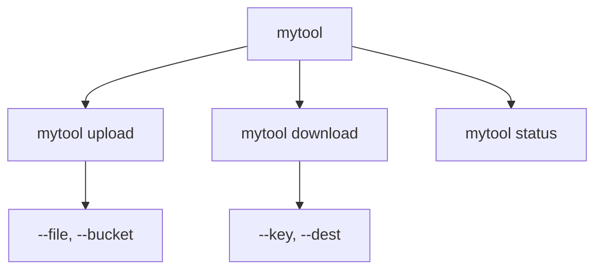

[toc]


## Python 命令行与参数解析

- [argparse 教程 — Python 文档](https://docs.python.org/zh-cn/3/howto/argparse.html)
- [sys.argv --- 系统相关的形参和函数 — Python  文档](https://docs.python.org/zh-cn/3/library/sys.html#sys.argv)

### 为什么需要参数解析

命令行程序是 Python 最常见的应用形式之一。一个"可配置"的脚本，不需要用户去修改源代码，只需通过命令行传入参数就能改变行为——这是工程实践中非常重要的能力。

例如:

```
python backup.py --source /data --dest /backup --compress --level 9
```

Python 提供了三个层次的工具来处理命令行参数：


---

## sys.argv：最底层的参数访问

`sys.argv` 是一个字符串列表，**保存了命令行传入的所有内容**，其中 `sys.argv[0]` 始终是脚本名称本身。

```python
# demo.py
import sys

print(sys.argv)
print("命令行参数个数为:", len(sys.argv), "个")
print("脚本(程序)名为:", sys.argv[0])
```

执行 `python demo.py hello 42 --verbose` 时输出：

```
['demo.py', 'hello', '42', '--verbose']
命令行参数个数为: 4 个
脚本(程序)名为: demo.py
```

**核心规则：**

- 所有元素都是**字符串类型**，数字需要手动转换
- 没有任何验证、帮助信息、错误处理
- 适合非常简单的脚本，生产环境不推荐直接使用

---

## argparse：标准库的正确选择

`argparse` 是 Python 标准库中推荐的参数解析方案，无需安装，功能完整。

### 基本结构

一个 `argparse` 程序的骨架非常固定，分三步：


```python
import argparse

# 第一步：创建解析器
parser = argparse.ArgumentParser(
    description="一个文件处理工具",
    epilog="示例: python tool.py input.txt --output result.txt"
)

# 第二步：添加参数
parser.add_argument("filename", help="要处理的文件名")
parser.add_argument("--output", "-o", help="输出文件路径")
parser.add_argument("--verbose", "-v", action="store_true", help="显示详细信息")

# 第三步：解析
args = parser.parse_args()

# 第四步：使用
print(f"处理文件: {args.filename}")
if args.verbose:
    print(f"输出到: {args.output}")
```

---

### 位置参数 vs 可选参数

这是 argparse 最核心的概念区分：

| 类型                   | 写法示例                         | 特点                          | 用途                     |
| ---------------------- | -------------------------------- | ----------------------------- | ------------------------ |
| **位置参数**           | `add_argument("name")`           | 不带 `--`，顺序固定，通常必填 | 核心输入，如文件名、命令 |
| **可选参数（长格式）** | `add_argument("--output")`       | 以 `--` 开头，顺序任意        | 配置项、开关             |
| **可选参数（短格式）** | `add_argument("-o")`             | 以 `-` 开头，单字母           | 长格式的便捷别名         |
| **同时定义长短**       | `add_argument("-o", "--output")` | 两种写法均可使用              | 推荐做法                 |

**命名规则：** 带 `--` 的参数名中的 `-` 在 `args` 对象中会自动转换为 `_`，例如 `--output-dir` → `args.output_dir`。

---

### add_argument 参数详解

`add_argument()` 是整个 argparse 的核心方法，其参数控制了每个命令行参数的行为：

| 参数       | 类型/示例                      | 说明                            |
| ---------- | ------------------------------ | ------------------------------- |
| `type`     | `int`, `float`, `pathlib.Path` | 自动类型转换，转换失败会报错    |
| `default`  | 任意值                         | 未提供时的默认值，默认为 `None` |
| `required` | `True` / `False`               | 可选参数是否必须提供            |
| `help`     | 字符串                         | 在 `--help` 中显示的说明        |
| `choices`  | `['a', 'b', 'c']`              | 限制输入必须在列表内            |
| `nargs`    | 见下表                         | 控制参数接收几个值              |
| `action`   | 见下表                         | 参数出现时执行的动作            |
| `dest`     | 字符串                         | 自定义属性名（覆盖默认命名）    |
| `metavar`  | 字符串                         | 在帮助信息中显示的占位符名      |

#### nargs 取值说明

| nargs 值             | 含义            | 结果类型         |
| -------------------- | --------------- | ---------------- |
| `N`（正整数）        | 恰好接收 N 个值 | 列表             |
| `'?'`                | 0 或 1 个值     | 单个值或 `const` |
| `'*'`                | 0 或多个值      | 列表（可为空）   |
| `'+'`                | 1 或多个值      | 列表（至少一个） |
| `argparse.REMAINDER` | 剩余所有参数    | 列表             |

#### action 取值说明

| action 值       | 含义                        | 典型用法            |
| --------------- | --------------------------- | ------------------- |
| `'store'`       | 存储值（默认行为）          | `--name Alice`      |
| `'store_true'`  | 出现则设为 `True`           | `--verbose` 开关    |
| `'store_false'` | 出现则设为 `False`          | `--no-cache`        |
| `'store_const'` | 出现则存储 `const` 指定的值 | 枚举模式选择        |
| `'append'`      | 每次出现追加到列表          | `--tag a --tag b`   |
| `'count'`       | 统计出现次数                | `-vvv` 表示 level 3 |
| `'version'`     | 打印版本后退出              | `--version`         |

---

### 典型用法示例集

#### 类型转换与默认值

```python
parser.add_argument("--port", type=int, default=8080, help="监听端口")
parser.add_argument("--threshold", type=float, default=0.5)
parser.add_argument("--path", type=pathlib.Path, help="目录路径")
```

#### 限制合法选项

```python
parser.add_argument(
    "--log-level",
    choices=["DEBUG", "INFO", "WARNING", "ERROR"],
    default="INFO",
    help="日志级别"
)
```

#### 布尔开关（推荐现代写法）

```python
# 旧写法（Python < 3.9 常见）
parser.add_argument("--verbose", action="store_true")

# 现代写法（Python 3.9+，BooleanOptionalAction）
parser.add_argument("--verbose", action=argparse.BooleanOptionalAction)
# 用户可以用 --verbose 或 --no-verbose
```

#### 接收多个值

```python
parser.add_argument("--files", nargs="+", help="一个或多个文件")
parser.add_argument("--tags", nargs="*", help="零个或多个标签")
parser.add_argument("--size", nargs=2, type=int, metavar=("WIDTH", "HEIGHT"))
```

#### 重复追加

```python
parser.add_argument("--include", action="append", help="可多次使用")
# python script.py --include a --include b  →  args.include = ['a', 'b']
```

#### 计数（verbosity 经典模式）

```python
parser.add_argument("-v", "--verbose", action="count", default=0)
# -v → 1，-vv → 2，-vvv → 3
```

#### 版本信息

```python
parser.add_argument("--version", action="version", version="%(prog)s 1.0.0")
```

---

### 子命令（subcommands）

子命令是现代 CLI 工具的标配，类似 `git commit`、`docker run` 这样的模式。



```python
import argparse

parser = argparse.ArgumentParser(description="文件同步工具")
subparsers = parser.add_subparsers(dest="command", help="可用命令")

# 子命令：upload
upload_parser = subparsers.add_parser("upload", help="上传文件")
upload_parser.add_argument("file", help="本地文件路径")
upload_parser.add_argument("--bucket", required=True, help="目标存储桶")

# 子命令：download
download_parser = subparsers.add_parser("download", help="下载文件")
download_parser.add_argument("--key", required=True, help="远程文件键")
download_parser.add_argument("--dest", default=".", help="本地保存路径")

args = parser.parse_args()

# 根据子命令分发逻辑
if args.command == "upload":
    print(f"上传 {args.file} 到 {args.bucket}")
elif args.command == "download":
    print(f"下载 {args.key} 到 {args.dest}")
else:
    parser.print_help()
```

使用：

```
python tool.py upload myfile.txt --bucket my-bucket
python tool.py download --key data/file.txt --dest ./local
```

---

### 参数分组（Argument Groups）

用于在帮助信息中将相关参数分组显示，提升可读性：

```python
parser = argparse.ArgumentParser(description="数据库备份工具")

# 连接参数组
conn_group = parser.add_argument_group("数据库连接")
conn_group.add_argument("--host", default="localhost")
conn_group.add_argument("--port", type=int, default=5432)
conn_group.add_argument("--user", required=True)

# 备份选项组
backup_group = parser.add_argument_group("备份选项")
backup_group.add_argument("--compress", action="store_true")
backup_group.add_argument("--output-dir", default="./backups")

args = parser.parse_args()
```

`--help` 输出会按分组展示，极大改善用户体验。

---

### 互斥参数组

当两个参数不能同时使用时：

```python
output_group = parser.add_mutually_exclusive_group()
output_group.add_argument("--json", action="store_true", help="JSON格式输出")
output_group.add_argument("--csv", action="store_true", help="CSV格式输出")
output_group.add_argument("--plain", action="store_true", help="纯文本输出")
# 三者只能选其一，同时使用会自动报错
```

---

### 自定义类型（type 函数）

`type` 参数可以接受任何可调用对象，用于复杂的输入验证：

```python
import argparse

def positive_int(value):
    """自定义类型：正整数"""
    ivalue = int(value)
    if ivalue <= 0:
        raise argparse.ArgumentTypeError(f"{value} 不是正整数")
    return ivalue

def valid_ratio(value):
    """自定义类型：0~1 之间的浮点数"""
    fvalue = float(value)
    if not 0.0 <= fvalue <= 1.0:
        raise argparse.ArgumentTypeError("比例必须在 0 到 1 之间")
    return fvalue

parser = argparse.ArgumentParser()
parser.add_argument("--workers", type=positive_int, default=4)
parser.add_argument("--ratio", type=valid_ratio, default=0.8)
```

---

### 从文件读取参数

当参数很多时，可以将参数写入文件，用 `@` 前缀引用：

```python
parser = argparse.ArgumentParser(fromfile_prefix_chars="@")
# 使用：python script.py @params.txt
```

`params.txt` 内容（每行一个参数）：

```
--host
localhost
--port
5432
--user
admin
```

---

### 错误处理与自定义

```python
# 方式一：parse_known_args 忽略未知参数
args, unknown = parser.parse_known_args()

# 方式二：自定义错误行为（子类化）
class MyParser(argparse.ArgumentParser):
    def error(self, message):
        print(f"❌ 参数错误: {message}")
        self.print_help()
        sys.exit(2)

parser = MyParser()
```

---

## 完整实战示例

一个真实的数据处理脚本，综合运用上述特性：

```python
#!/usr/bin/env python3
"""
数据处理工具 - 演示 argparse 最佳实践
"""
import argparse
import pathlib
import sys


def positive_int(value):
    v = int(value)
    if v <= 0:
        raise argparse.ArgumentTypeError(f"期望正整数，得到 {value!r}")
    return v


def build_parser():
    parser = argparse.ArgumentParser(
        prog="dataproc",
        description="通用数据处理工具",
        epilog="示例: dataproc process data.csv --output result.csv --workers 4",
        formatter_class=argparse.RawDescriptionHelpFormatter,
    )
    parser.add_argument("--version", action="version", version="%(prog)s 2.1.0")

    subparsers = parser.add_subparsers(dest="command", metavar="COMMAND")
    subparsers.required = True

    # --- 子命令: process ---
    proc = subparsers.add_parser("process", help="处理数据文件")
    proc.add_argument("input", type=pathlib.Path, help="输入文件路径")

    io_group = proc.add_argument_group("输入输出")
    io_group.add_argument("-o", "--output", type=pathlib.Path, help="输出文件（默认打印到终端）")
    io_group.add_argument("--encoding", default="utf-8", help="文件编码（默认 utf-8）")

    perf_group = proc.add_argument_group("性能选项")
    perf_group.add_argument("--workers", type=positive_int, default=1, metavar="N")
    perf_group.add_argument("--batch-size", type=positive_int, default=1000)

    fmt_group = proc.add_mutually_exclusive_group()
    fmt_group.add_argument("--json", action="store_true", help="JSON 格式输出")
    fmt_group.add_argument("--csv", action="store_true", help="CSV 格式输出")

    proc.add_argument("-v", "--verbose", action="count", default=0, help="增加详细程度（可重复）")

    # --- 子命令: validate ---
    val = subparsers.add_parser("validate", help="验证数据文件格式")
    val.add_argument("files", nargs="+", type=pathlib.Path, help="一个或多个文件")
    val.add_argument("--strict", action="store_true", help="严格模式")

    return parser


def main():
    parser = build_parser()
    args = parser.parse_args()

    if args.command == "process":
        if not args.input.exists():
            parser.error(f"文件不存在: {args.input}")

        print(f"处理: {args.input}")
        print(f"并发: {args.workers} 个工作进程")
        print(f"批次: {args.batch_size} 条/批")
        if args.verbose >= 2:
            print(f"编码: {args.encoding}")
        if args.output:
            print(f"输出: {args.output}")

    elif args.command == "validate":
        for f in args.files:
            status = "✓" if f.exists() else "✗"
            print(f"  {status} {f}")


if __name__ == "__main__":
    main()
```

---

## 现代替代方案：click 与 typer

标准库 `argparse` 功能完备但写法较繁琐。现代项目中也常用以下第三方库：

| 特性         | argparse            | click              | typer              |
| ------------ | ------------------- | ------------------ | ------------------ |
| 是否需要安装 | 否（标准库）        | 是                 | 是                 |
| 语法风格     | 命令式（显式添加）  | 装饰器             | 类型注解（最现代） |
| 学习曲线     | 中                  | 低                 | 极低               |
| 测试友好性   | 一般                | 好（有 CliRunner） | 好                 |
| 自动补全支持 | 无                  | 有                 | 有                 |
| 适合场景     | 标准库场景/简单脚本 | 通用 CLI 工具      | 现代 Python 项目   |

**typer 示例**（对比感受差异）：

```python
import typer

app = typer.Typer()

@app.command()
def process(
    input: str,
    output: str = typer.Option(None, "--output", "-o"),
    workers: int = typer.Option(1, help="并发数"),
    verbose: bool = False,
):
    """处理数据文件"""
    typer.echo(f"处理 {input}，并发 {workers}")

if __name__ == "__main__":
    app()
```

类型注解即文档，即验证，即参数定义——三合一。

---

## 最佳实践总结

| 实践                                          | 说明                         |
| --------------------------------------------- | ---------------------------- |
| 将解析逻辑封装进 `build_parser()` 函数        | 便于测试，与业务逻辑解耦     |
| 始终为每个参数写 `help` 文本                  | 是最基本的用户友好要求       |
| 使用 `type=` 做类型转换，不在业务代码中手动转 | 错误在入口就被捕获           |
| 用 `argparse.ArgumentTypeError` 抛出验证错误  | 格式统一，用户体验一致       |
| 用 `parser.error()` 报告业务层错误            | 自动打印 usage 并退出        |
| 子命令多时每个子命令用独立函数处理            | 保持 `main()` 简洁           |
| 生产项目考虑 click 或 typer                   | 减少样板代码，功能更丰富     |
| 将 `parse_args()` 只在 `__main__` 块调用      | 避免模块被 import 时触发解析 |