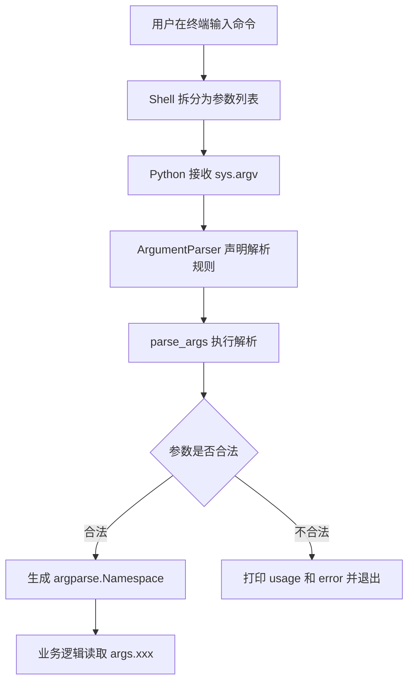

[toc]


下面是一份适合新手系统学习、也能作为后续项目参考的 `argparse` 学习笔记。内容以 Python 标准库 `argparse` 为主，并对比 `sys.argv`、`getopt`、`optparse`、Click、Typer、docopt 等方案。

## 详细大纲

- `argparse` 的定位
  - CLI、参数、选项、标志位的基本概念
  - 为什么不用直接解析 `sys.argv`
  - `argparse` 适合解决什么问题
- 命令行参数解析的整体机制
  - Shell 如何传递参数
  - `ArgumentParser` 如何声明规则
  - `parse_args()` 如何生成 `Namespace`
- `argparse` 核心对象
  - `ArgumentParser`
  - `add_argument()`
  - `parse_args()`
  - `Namespace`
  - `Action`
- 参数分类
  - 位置参数，也就是 positional argument
  - 可选参数，也就是 optional argument / option
  - 标志位，也就是 flag
  - 子命令，也就是 subcommand
- `add_argument()` 的关键参数
  - `name or flags`
  - `action`
  - `nargs`
  - `type`
  - `choices`
  - `default`
  - `required`
  - `help`
  - `metavar`
  - `dest`
  - `deprecated`
- 常见参数模式
  - 布尔开关
  - 枚举选项
  - 多值参数
  - 重复参数
  - 文件路径参数
  - 互斥参数
  - 子命令架构
- 现代特性与版本注意点
  - Python 3.14 的 `suggest_on_error`
  - Python 3.14 的彩色帮助输出 `color`
  - Python 3.13+ 的废弃参数和废弃子命令
  - Python 3.14 中 `FileType` 的废弃状态
- 最佳实践
  - CLI 设计原则
  - 命名规范
  - 错误处理
  - 测试方式
  - 项目结构
  - 与配置文件、环境变量结合
- 与其他方案对比
  - `sys.argv`
  - `getopt`
  - `optparse`
  - Click
  - Typer
  - docopt
- 实战模板
  - 单命令脚本模板
  - 多子命令应用模板
  - 可测试的 `main(argv=None)` 模板
- 常见坑
  - `type=bool`
  - `required=True` 滥用
  - `nargs` 返回类型混乱
  - `allow_abbrev=True` 的前缀匹配
  - 负数、`--`、未知参数
  - 文件打开时机

## `argparse` 是什么

`argparse` 是 Python 标准库中的命令行参数解析模块。它的核心目标是：你先声明程序需要哪些命令行参数，`argparse` 负责从 `sys.argv` 中解析参数、做类型转换、生成帮助信息、处理非法输入，并把结果放进一个 `argparse.Namespace` 对象中。Python 官方文档将 `argparse` 描述为用于编写用户友好的命令行接口的模块，它会自动生成 help/usage 信息，并在用户传入无效参数时给出错误。([Python documentation](https://docs.python.org/3/library/argparse.html))

一个最小例子：

```python
import argparse

parser = argparse.ArgumentParser(description="统计文本文件的行数")
parser.add_argument("file", help="要统计的文本文件")
parser.add_argument("-v", "--verbose", action="store_true", help="显示详细信息")

args = parser.parse_args()

print(args.file)
print(args.verbose)
```

运行方式：

```bash
python count_lines.py README.md --verbose
```

解析结果大致等价于：

```python
Namespace(file="README.md", verbose=True)
```

## 为什么需要 `argparse`

没有 `argparse` 时，你可以直接使用 `sys.argv`：

```python
import sys

filename = sys.argv[1]
verbose = "--verbose" in sys.argv
```

这种写法适合极小脚本，但很快会遇到问题：

| 问题     | 手写 `sys.argv` 的麻烦         | `argparse` 的能力                  |
| -------- | ------------------------------ | ---------------------------------- |
| 参数缺失 | 自己判断长度                   | 自动报错                           |
| 类型转换 | 自己 `int()` / `float()`       | `type=int` / `type=float`          |
| 帮助信息 | 自己写 `--help`                | 自动生成                           |
| 默认值   | 自己判断                       | `default=`                         |
| 枚举限制 | 自己校验                       | `choices=`                         |
| 多值参数 | 自己拆分                       | `nargs` / `append`                 |
| 子命令   | 需要大量判断                   | `add_subparsers()`                 |
| 测试     | 参数解析和业务逻辑容易混在一起 | 可传入列表测试 `parse_args([...])` |

`argparse` 的本质不是“读取字符串”，而是“声明 CLI 协议”。

## 命令行参数的基本术语

| 中文术语   | 英文术语                    | 示例                       | 含义                       |
| ---------- | --------------------------- | -------------------------- | -------------------------- |
| 命令行接口 | Command Line Interface, CLI | `git commit -m "msg"`      | 通过终端调用程序的接口     |
| 参数       | argument                    | `README.md`、`--verbose`   | 命令行传入的一个字符串单元 |
| 位置参数   | positional argument         | `input.txt`                | 由位置决定含义，通常必填   |
| 选项       | option / optional argument  | `--output out.txt`         | 由名称决定含义，通常可选   |
| 短选项     | short option                | `-o`                       | 单横线形式                 |
| 长选项     | long option                 | `--output`                 | 双横线形式                 |
| 标志位     | flag                        | `--verbose`                | 出现即表示开关状态         |
| 子命令     | subcommand                  | `git commit` 中的 `commit` | 同一个程序下的不同功能入口 |
| 命名空间   | Namespace                   | `args.output`              | 保存解析结果的对象         |
| 动作       | action                      | `store_true`               | 参数出现时如何处理         |

## 整体工作机制



例如：

```bash
python train.py data.csv --epochs 10 --model resnet
```

Shell 传给 Python 的大致是：

```python
[
    "train.py",
    "data.csv",
    "--epochs",
    "10",
    "--model",
    "resnet",
]
```

`argparse` 通常解析的是 `sys.argv[1:]`，也就是除脚本名之外的部分。

## 最小可用结构

推荐把参数解析封装成函数，业务逻辑放到 `main()` 中：

```python
import argparse


def build_parser() -> argparse.ArgumentParser:
    parser = argparse.ArgumentParser(
        prog="wordcount",
        description="统计文本文件中的单词数量",
    )
    parser.add_argument("file", help="输入文件路径")
    parser.add_argument(
        "-i",
        "--ignore-case",
        action="store_true",
        help="忽略大小写",
    )
    return parser


def main(argv: list[str] | None = None) -> int:
    parser = build_parser()
    args = parser.parse_args(argv)

    print(f"file={args.file}")
    print(f"ignore_case={args.ignore_case}")
    return 0


if __name__ == "__main__":
    raise SystemExit(main())
```

这个结构有几个好处：

| 写法                       | 好处                         |
| -------------------------- | ---------------------------- |
| `build_parser()`           | 参数定义集中，便于测试和维护 |
| `main(argv=None)`          | 测试时可以传入假参数列表     |
| `return 0`                 | 明确退出码                   |
| `raise SystemExit(main())` | 符合命令行程序习惯           |

测试时可以这样写：

```python
def test_parse_ignore_case():
    parser = build_parser()
    args = parser.parse_args(["README.md", "--ignore-case"])

    assert args.file == "README.md"
    assert args.ignore_case is True
```

## `ArgumentParser`

`ArgumentParser` 是 `argparse` 的核心对象，它保存整个 CLI 的规则。

构造参数包括 `prog`、`usage`、`description`、`epilog`、`formatter_class`、`allow_abbrev`、`exit_on_error`、`suggest_on_error`、`color` 等；

> 其中 `suggest_on_error` 和 `color` 是 Python 3.14 新增参数。([Python documentation](https://docs.python.org/3/library/argparse.html))

常用构造参数：

| 参数               | 作用                   | 常见建议                             |
| ------------------ | ---------------------- | ------------------------------------ |
| `prog`             | 帮助信息中显示的程序名 | 包发布后可显式设置                   |
| `description`      | `--help` 开头说明      | 简洁说明程序做什么                   |
| `epilog`           | `--help` 底部补充说明  | 放示例命令很合适                     |
| `formatter_class`  | 控制帮助文本格式       | 常用 `ArgumentDefaultsHelpFormatter` |
| `allow_abbrev`     | 是否允许长选项缩写     | 严肃 CLI 建议设为 `False`            |
| `exit_on_error`    | 解析错误时是否直接退出 | 嵌入式/测试场景可考虑                |
| `suggest_on_error` | 拼写错误时给建议       | Python 3.14+ 可启用                  |
| `color`            | 帮助信息是否使用颜色   | Python 3.14+ 默认 `True`             |

示例：

```python
import argparse

parser = argparse.ArgumentParser(
    prog="backup",
    description="备份指定目录到目标位置",
    epilog="示例: backup ./src ./backup --compress",
    formatter_class=argparse.ArgumentDefaultsHelpFormatter,
    allow_abbrev=False,
)
```

### `allow_abbrev=False` 的意义

默认情况下，`argparse` 允许长选项前缀缩写，只要没有歧义。例如 `--foon` 可能匹配 `--foonley`。官方文档说明可以通过 `allow_abbrev=False` 禁用这种行为。([Python documentation](https://docs.python.org/3/library/argparse.html))

推荐禁用的原因：

```python
parser = argparse.ArgumentParser(allow_abbrev=False)
```

这样可以避免未来新增参数后，旧的缩写突然变得有歧义，或者用户输入错误却被“猜对”。

## `add_argument()`

`add_argument()` 用来声明单个参数如何解析。官方文档列出的关键参数包括 `action`、`nargs`、`const`、`default`、`type`、`choices`、`required`、`help`、`metavar`、`dest`、`deprecated` 等。([Python documentation](https://docs.python.org/3/library/argparse.html))

基本形式：

```python
parser.add_argument("input")
parser.add_argument("-o", "--output")
parser.add_argument("-v", "--verbose", action="store_true")
```

对应三类常见参数：

| 写法                                                         | 类型     | 调用示例     | 解析结果                   |
| ------------------------------------------------------------ | -------- | ------------ | -------------------------- |
| `parser.add_argument("input")`                               | 位置参数 | `data.csv`   | `args.input == "data.csv"` |
| `parser.add_argument("-o", "--output")`                      | 带值选项 | `-o out.txt` | `args.output == "out.txt"` |
| `parser.add_argument("-v", "--verbose", action="store_true")` | 标志位   | `--verbose`  | `args.verbose is True`     |

## 位置参数

位置参数没有 `-` 或 `--` 前缀，含义由位置决定：

```python
parser.add_argument("source", help="源文件")
parser.add_argument("destination", help="目标文件")
```

调用：

```bash
python copy.py a.txt b.txt
```

结果：

```python
args.source == "a.txt"
args.destination == "b.txt"
```

位置参数适合表达程序运行所必需的核心对象，例如：

| 程序         | 合适的位置参数     |
| ------------ | ------------------ |
| `cp`         | 源路径、目标路径   |
| `grep`       | 模式、文件         |
| `train.py`   | 数据集路径         |
| `convert.py` | 输入文件、输出文件 |

位置参数通常比“必填选项”更自然。比如下面这个设计：

```bash
tool --input in.txt --output out.txt
```

如果 `input` 和 `output` 永远必填，可以考虑设计成：

```bash
tool in.txt out.txt
```

## 可选参数

可选参数，也叫 optional argument 或 option，通常以 `-` 或 `--` 开头：

```python
parser.add_argument("-o", "--output", help="输出文件")
```

支持多种调用方式：

```bash
python app.py -o result.txt
python app.py --output result.txt
python app.py --output=result.txt
```

长选项建议使用 kebab-case：

```bash
--dry-run
--ignore-case
--max-workers
```

解析后属性名会自动把 `-` 转成 `_`。例如 `--max-workers` 对应 `args.max_workers`。官方文档也说明，选项的 `dest` 默认由参数名推导，并把连字符替换为下划线。([Python documentation](https://docs.python.org/3/library/argparse.html))

## 标志位

标志位是“出现即改变状态”的参数。

```python
parser.add_argument(
    "-v",
    "--verbose",
    action="store_true",
    help="显示详细日志",
)
```

调用：

```bash
python app.py --verbose
```

结果：

```python
args.verbose is True
```

不传时：

```python
args.verbose is False
```

常用布尔模式：

| 需求                       | 推荐写法                                |
| -------------------------- | --------------------------------------- |
| 出现则为 `True`            | `action="store_true"`                   |
| 出现则为 `False`           | `action="store_false"`                  |
| 支持 `--foo` 和 `--no-foo` | `action=argparse.BooleanOptionalAction` |
| 多级详细程度 `-v -vv -vvv` | `action="count"`                        |

### 不要用 `type=bool`

这是 `argparse` 新手最常见的坑：

```python
parser.add_argument("--debug", type=bool)
```

调用：

```bash
python app.py --debug False
```

结果不是 `False`，而是 `True`，因为 `bool("False")` 在 Python 中为 `True`。官方文档明确不推荐把 `bool()` 用作 `type` 转换器，并建议使用 `BooleanOptionalAction` 或 `store_true`。([Python documentation](https://docs.python.org/3/library/argparse.html))

推荐：

```python
parser.add_argument("--debug", action="store_true")
```

或者：

```python
parser.add_argument(
    "--cache",
    action=argparse.BooleanOptionalAction,
    default=True,
    help="是否启用缓存",
)
```

这样可以同时支持：

```bash
python app.py --cache
python app.py --no-cache
```

`BooleanOptionalAction` 会为一个选项自动生成正向和反向两个形式，例如 `--foo` 和 `--no-foo`。([Python documentation](https://docs.python.org/3/library/argparse.html))

## `action`

`action` 决定参数出现时如何处理。官方文档中常见 action 包括 `store`、`store_const`、`store_true`、`store_false`、`append`、`append_const`、`count`、`help`、`version`、`extend` 等。([Python documentation](https://docs.python.org/3/library/argparse.html))

| action        | 用途                             | 示例                          |
| ------------- | -------------------------------- | ----------------------------- |
| `store`       | 保存值，默认行为                 | `--output out.txt`            |
| `store_true`  | 出现则保存 `True`                | `--verbose`                   |
| `store_false` | 出现则保存 `False`               | `--no-cache`                  |
| `count`       | 统计出现次数                     | `-vvv`                        |
| `append`      | 多次出现，追加到列表             | `--tag a --tag b`             |
| `extend`      | 多次出现，每次可接收多个值并展开 | `--include a b --include c d` |
| `store_const` | 出现则保存固定值                 | `--json` 对应 `format="json"` |
| `version`     | 输出版本并退出                   | `--version`                   |

### `count`

```python
parser.add_argument(
    "-v",
    "--verbose",
    action="count",
    default=0,
    help="增加日志详细程度，可重复使用",
)
```

调用：

```bash
python app.py -vvv
```

结果：

```python
args.verbose == 3
```

注意要设置 `default=0`，否则不传时默认是 `None`。官方示例也提醒 `count` 的默认值需要显式设为 0。([Python documentation](https://docs.python.org/3/library/argparse.html))

### `append`

```python
parser.add_argument(
    "--tag",
    action="append",
    default=[],
    help="标签，可重复指定",
)
```

调用：

```bash
python app.py --tag urgent --tag backend
```

结果：

```python
args.tag == ["urgent", "backend"]
```

### `extend`

```python
parser.add_argument(
    "--include",
    action="extend",
    nargs="+",
    default=[],
    help="要包含的项目",
)
```

调用：

```bash
python app.py --include a b --include c d
```

结果：

```python
args.include == ["a", "b", "c", "d"]
```

## `nargs`

`nargs` 控制一个参数一次消耗多少个命令行值。

| `nargs` | 含义             | 结果类型       | 示例           |
| ------- | ---------------- | -------------- | -------------- |
| 省略    | 消耗一个值       | 单个值         | `--name Alice` |
| `N`     | 消耗固定 N 个值  | list           | `--point 1 2`  |
| `"?"`   | 消耗 0 或 1 个值 | 单个值或默认值 | 可选输入文件   |
| `"*"`   | 消耗 0 到多个值  | list           | 任意数量文件   |
| `"+"`   | 消耗 1 到多个值  | list           | 至少一个文件   |

示例：

```python
parser.add_argument("files", nargs="+", help="至少一个输入文件")
```

调用：

```bash
python app.py a.txt b.txt c.txt
```

结果：

```python
args.files == ["a.txt", "b.txt", "c.txt"]
```

### `nargs=1` 的坑

```python
parser.add_argument("--name", nargs=1)
```

调用：

```bash
python app.py --name Alice
```

结果是：

```python
args.name == ["Alice"]
```

不是：

```python
args.name == "Alice"
```

所以除非你确实需要列表，否则不要写 `nargs=1`。

## `type`

`type` 用来把命令行字符串转换成其他类型。默认情况下，命令行参数都是字符串。官方文档说明，`type` 可以接收内置类型、函数或自定义可调用对象。([Python documentation](https://docs.python.org/3/library/argparse.html))

```python
parser.add_argument("--epochs", type=int, default=10)
parser.add_argument("--lr", type=float, default=0.001)
parser.add_argument("--data-dir", type=pathlib.Path)
```

调用：

```bash
python train.py --epochs 20 --lr 0.01 --data-dir ./data
```

结果：

```python
args.epochs == 20
args.lr == 0.01
args.data_dir == pathlib.Path("data")
```

### 自定义类型转换

```python
def positive_int(value: str) -> int:
    number = int(value)
    if number <= 0:
        raise argparse.ArgumentTypeError("必须是正整数")
    return number


parser.add_argument("--workers", type=positive_int, default=4)
```

如果用户传入非法值：

```bash
python app.py --workers -1
```

会得到较友好的错误信息。

### `type` 不适合做复杂业务校验

适合放进 `type` 的逻辑：

| 适合             | 不适合               |
| ---------------- | -------------------- |
| 字符串转整数     | 打开数据库连接       |
| 字符串转路径对象 | 检查远程服务是否可用 |
| 简单范围检查     | 读取大文件           |
| 简单格式校验     | 修改文件系统         |

复杂校验建议放在 `parse_args()` 之后：

```python
args = parser.parse_args()

if args.min_size > args.max_size:
    parser.error("--min-size 不能大于 --max-size")
```

## `choices`

`choices` 限制参数只能取某些值：

```python
parser.add_argument(
    "--format",
    choices=["json", "yaml", "toml"],
    default="json",
    help="输出格式",
)
```

合法：

```bash
python app.py --format yaml
```

非法：

```bash
python app.py --format xml
```

`argparse` 会自动报错，并在 help 中显示可选值。

对于枚举参数，`choices` 比自己写 `if args.format not in ...` 更清晰。

## `default`

`default` 指定参数缺省值：

```python
parser.add_argument("--timeout", type=float, default=3.0)
```

不传时：

```python
args.timeout == 3.0
```

注意：默认值不一定经过 `type` 转换。官方文档说明，如果 `type` 和 `default` 同时使用，类型转换只会在默认值是字符串时应用。([Python documentation](https://docs.python.org/3/library/argparse.html))

推荐写法：

```python
parser.add_argument("--timeout", type=float, default=3.0)
```

避免：

```python
parser.add_argument("--timeout", type=float, default="3.0")
```

## `required`

`required=True` 只能用于可选参数：

```python
parser.add_argument("--token", required=True)
```

虽然可用，但应谨慎。因为“required optional argument” 本身容易让 CLI 设计变得别扭。

通常：

| 场景                   | 建议                       |
| ---------------------- | -------------------------- |
| 程序运行必须有这个值   | 考虑位置参数               |
| 密钥、Token、密码      | 优先支持环境变量或配置文件 |
| 用户偶尔需要覆盖默认值 | 用普通 option              |
| 确实必须显式指定       | 才用 `required=True`       |

例如：

```bash
deploy --env prod
```

可以接受。

但如果输入文件必填，更自然的是：

```bash
deploy config.yaml
```

而不是：

```bash
deploy --config config.yaml
```

## `help`、`metavar`、`dest`

### `help`

`help` 是显示在 `--help` 中的说明：

```python
parser.add_argument("--limit", type=int, default=100, help="最多处理多少条记录")
```

好的 help 文案应该说明“含义”，而不是重复参数名。

不太好：

```python
parser.add_argument("--limit", help="limit")
```

更好：

```python
parser.add_argument("--limit", help="最多处理多少条记录")
```

### `metavar`

`metavar` 只影响帮助信息中的占位符：

```python
parser.add_argument("--output", metavar="FILE", help="输出文件")
```

帮助信息显示：

```text
--output FILE
```

但解析结果仍然是：

```python
args.output
```

### `dest`

`dest` 控制解析结果中的属性名：

```python
parser.add_argument("--dry-run", dest="dry_run", action="store_true")
```

通常不需要手动写，因为 `argparse` 会自动把 `--dry-run` 转成 `args.dry_run`。

适合使用 `dest` 的场景：

```python
parser.add_argument("-q", "--quiet", dest="verbose", action="store_false")
parser.add_argument("-v", "--verbose", dest="verbose", action="store_true")
```

这样 `--quiet` 和 `--verbose` 可以共同控制同一个属性。

## 参数废弃：`deprecated`

Python 3.13+ 支持在 `add_argument()` 中使用 `deprecated=True`。当用户使用该参数时，`argparse` 会向 `stderr` 打印警告。官方文档说明该功能用于项目生命周期中准备移除某些命令行参数之前提醒用户。([Python documentation](https://docs.python.org/3/library/argparse.html))

```python
parser.add_argument(
    "--old-mode",
    action="store_true",
    deprecated=True,
    help="旧模式，未来版本将移除",
)
```

这适合 CLI 兼容性演进：

| 阶段       | 做法                         |
| ---------- | ---------------------------- |
| 当前版本   | 同时支持旧参数和新参数       |
| 过渡版本   | 给旧参数加 `deprecated=True` |
| 后续主版本 | 移除旧参数                   |

## 互斥参数

互斥参数用于表达“只能选一个”。

```python
group = parser.add_mutually_exclusive_group()
group.add_argument("--json", action="store_true", help="输出 JSON")
group.add_argument("--yaml", action="store_true", help="输出 YAML")
```

用户不能同时传：

```bash
python app.py --json --yaml
```

如果至少要选一个：

```python
group = parser.add_mutually_exclusive_group(required=True)
group.add_argument("--json", action="store_true")
group.add_argument("--yaml", action="store_true")
```

官方文档说明，`add_mutually_exclusive_group()` 会确保互斥组中最多只有一个参数出现，也可以通过 `required=True` 要求至少出现一个。([Python documentation](https://docs.python.org/3/library/argparse.html))

更实用的设计通常是用 `choices`：

```python
parser.add_argument(
    "--format",
    choices=["json", "yaml"],
    default="json",
)
```

这样比 `--json` / `--yaml` 更容易扩展到 `toml`、`csv` 等格式。

## 参数分组

参数多了以后，`--help` 会变长。可以用 `add_argument_group()` 分组：

```python
network = parser.add_argument_group("网络选项")
network.add_argument("--host", default="127.0.0.1")
network.add_argument("--port", type=int, default=8000)

logging = parser.add_argument_group("日志选项")
logging.add_argument("-v", "--verbose", action="count", default=0)
logging.add_argument("--log-file")
```

分组只影响帮助信息，不影响解析逻辑。官方文档说明，参数组中的参数仍然按普通参数处理，只是在帮助输出中单独显示。([Python documentation](https://docs.python.org/3/library/argparse.html))

## 子命令

当一个 CLI 有多个功能时，应该使用子命令。

典型例子：

```bash
git clone ...
git commit ...
git push ...
```

在 `argparse` 中使用 `add_subparsers()`。官方文档说明，很多程序会把功能拆成多个子命令，特别适合不同功能需要不同参数集合的情况。([Python documentation](https://docs.python.org/3/library/argparse.html))

示例：

```python
import argparse


def cmd_add(args: argparse.Namespace) -> int:
    print(f"添加任务: {args.title}")
    return 0


def cmd_done(args: argparse.Namespace) -> int:
    print(f"完成任务: {args.id}")
    return 0


def build_parser() -> argparse.ArgumentParser:
    parser = argparse.ArgumentParser(prog="todo", description="任务管理工具")
    subparsers = parser.add_subparsers(dest="command", required=True)

    add_parser = subparsers.add_parser("add", help="添加任务")
    add_parser.add_argument("title", help="任务标题")
    add_parser.set_defaults(func=cmd_add)

    done_parser = subparsers.add_parser("done", help="完成任务")
    done_parser.add_argument("id", type=int, help="任务 ID")
    done_parser.set_defaults(func=cmd_done)

    return parser


def main(argv: list[str] | None = None) -> int:
    parser = build_parser()
    args = parser.parse_args(argv)
    return args.func(args)


if __name__ == "__main__":
    raise SystemExit(main())
```

调用：

```bash
todo add "写周报"
todo done 3
```

这种 `set_defaults(func=...)` 的模式是官方文档也推荐的子命令处理方式：每个子解析器绑定自己的处理函数，解析完成后调用对应函数。([Python documentation](https://docs.python.org/3/library/argparse.html))

## 子命令别名和废弃

### 别名

```python
checkout = subparsers.add_parser("checkout", aliases=["co"])
```

这样下面两种写法等价：

```bash
tool checkout
tool co
```

### 废弃子命令

Python 3.13+ 支持对子命令使用 `deprecated=True`。用户调用废弃子命令时会看到警告。([Python documentation](https://docs.python.org/3/library/argparse.html))

```python
old = subparsers.add_parser("old-run", deprecated=True)
```

## 现代化特性

### `suggest_on_error`

Python 3.14 新增 `suggest_on_error`，用于在用户输错 `choices` 或子命令名称时给出建议。官方文档说明，该参数可以为拼错的 argument choices 和 subparser names 启用建议。([Python documentation](https://docs.python.org/3/library/argparse.html))

```python
parser = argparse.ArgumentParser(
    prog="deploy",
    suggest_on_error=True,
)

parser.add_argument("--env", choices=["dev", "staging", "prod"])
```

如果用户输入：

```bash
deploy --env pod
```

`argparse` 可以给出更友好的提示。

为了兼容旧 Python，可以这样封装：

```python
import argparse
import sys


def make_parser(**kwargs) -> argparse.ArgumentParser:
    if sys.version_info >= (3, 14):
        kwargs.setdefault("suggest_on_error", True)
        kwargs.setdefault("color", True)

    return argparse.ArgumentParser(**kwargs)
```

### 彩色帮助输出 `color`

Python 3.14 新增 `color` 参数，并默认允许彩色帮助输出。官方 “What’s New in Python 3.14” 也说明，`argparse` 帮助文本启用了颜色，并可以通过 `color` 参数禁用，也可受环境变量控制。([Python documentation](https://docs.python.org/3/whatsnew/3.14.html))

```python
parser = argparse.ArgumentParser(color=False)
```

适合禁用颜色的场景：

| 场景                 | 原因                   |
| -------------------- | ---------------------- |
| 日志系统捕获帮助文本 | 避免 ANSI 控制符       |
| 文档生成             | 输出更干净             |
| 测试快照             | 避免颜色导致断言不稳定 |

### `FileType` 的状态

`argparse.FileType` 曾常用于直接在解析阶段打开文件，但 Python 3.14 文档中已经标记为 deprecated。官方文档还提醒，如果一个参数使用 `FileType` 打开文件，而后续参数解析失败，文件不会自动关闭，也可能破坏输出文件；更好的方式是在解析完成后用 `with` 管理文件。([Python documentation](https://docs.python.org/3/library/argparse.html))

不推荐：

```python
parser.add_argument("output", type=argparse.FileType("w"))
```

推荐：

```python
from pathlib import Path

parser.add_argument("output", type=Path)

args = parser.parse_args()

with args.output.open("w", encoding="utf-8") as f:
    f.write("hello\n")
```

## 文件路径参数

现代 Python 中，推荐用 `pathlib.Path`：

```python
from pathlib import Path

parser.add_argument("input", type=Path)
parser.add_argument("-o", "--output", type=Path, default=Path("out.txt"))
```

解析后：

```python
args.input.read_text(encoding="utf-8")
```

路径校验可以放在解析之后：

```python
args = parser.parse_args()

if not args.input.exists():
    parser.error(f"输入文件不存在: {args.input}")

if args.input.is_dir():
    parser.error(f"输入路径不能是目录: {args.input}")
```

为什么不把所有校验都放进 `type`？

因为路径是否存在、是否可读、是否会覆盖已有文件，往往涉及业务策略，放在 `parse_args()` 后更清楚。

## 支持从文件读取参数

`fromfile_prefix_chars` 可以让参数来自文件。例如：

```python
parser = argparse.ArgumentParser(fromfile_prefix_chars="@")
```

调用：

```bash
python app.py @args.txt
```

默认情况下，参数文件一行一个参数。官方文档说明，`fromfile_prefix_chars` 会把以指定字符开头的参数视为文件，并用文件内容替换该参数；从 Python 3.12 起，读取参数文件时使用文件系统编码和错误处理方式。([Python documentation](https://docs.python.org/3/library/argparse.html))

示例 `args.txt`：

```text
--host
127.0.0.1
--port
8000
```

## 解析未知参数

有时你的程序只处理一部分参数，剩余参数转交给另一个程序。例如包装 `pytest`、`ffmpeg`、`docker`。

使用 `parse_known_args()`：

```python
args, rest = parser.parse_known_args()
```

示例：

```python
parser.add_argument("--dry-run", action="store_true")

args, rest = parser.parse_known_args([
    "--dry-run",
    "--unknown",
    "value",
])

print(args)
print(rest)
```

官方文档说明，`parse_known_args()` 不会因为额外未知参数报错，而是返回 `(namespace, unknown_args)` 二元组。([Python documentation](https://docs.python.org/3/library/argparse.html))

注意：前缀匹配规则仍然会影响 `parse_known_args()`，因此更建议搭配：

```python
argparse.ArgumentParser(allow_abbrev=False)
```

## 交错解析：`parse_intermixed_args()`

某些 Unix 风格命令允许选项和位置参数交错出现：

```bash
tool file1 --verbose file2 file3
```

可以考虑 `parse_intermixed_args()`：

```python
args = parser.parse_intermixed_args()
```

官方文档说明，`parse_intermixed_args()` 支持选项和位置参数交错，但不支持所有 `argparse` 功能，尤其不支持 subparsers，以及同时包含 optionals 和 positionals 的互斥组。([Python documentation](https://docs.python.org/3/library/argparse.html))

所以它适合简单命令，不适合复杂子命令 CLI。

## `--` 的作用

如果位置参数本身以 `-` 开头，`argparse` 可能会把它误认为选项。

例如要处理名为 `-foo.txt` 的文件：

```bash
python app.py -- -foo.txt
```

`--` 表示：后面的内容全部当作位置参数，不再解析为选项。官方文档也说明，当位置参数必须以 `-` 开头且不像负数时，可以插入伪参数 `--`。([Python documentation](https://docs.python.org/3/library/argparse.html))

## 版本参数

```python
parser.add_argument(
    "--version",
    action="version",
    version="mytool 1.2.0",
)
```

调用：

```bash
mytool --version
```

输出：

```text
mytool 1.2.0
```

如果程序打包成 Python package，可以用 `importlib.metadata` 获取版本：

```python
from importlib.metadata import version, PackageNotFoundError


def get_version() -> str:
    try:
        return version("mytool")
    except PackageNotFoundError:
        return "unknown"


parser.add_argument(
    "--version",
    action="version",
    version=f"%(prog)s {get_version()}",
)
```

## 帮助信息设计

优秀的 CLI 很大程度上取决于 `--help`。

```python
parser = argparse.ArgumentParser(
    prog="imgtool",
    description="批量处理图片",
    epilog="""
示例:
  imgtool resize ./images --width 800
  imgtool convert ./images --format webp
""",
    formatter_class=argparse.RawDescriptionHelpFormatter,
)
```

如果你想自动显示默认值：

```python
parser = argparse.ArgumentParser(
    formatter_class=argparse.ArgumentDefaultsHelpFormatter,
)
```

官方文档列出了 4 种帮助格式化类，包括 `RawDescriptionHelpFormatter`、`RawTextHelpFormatter`、`ArgumentDefaultsHelpFormatter`、`MetavarTypeHelpFormatter`。([Python documentation](https://docs.python.org/3/library/argparse.html))

常见选择：

| formatter                       | 适合场景                           |
| ------------------------------- | ---------------------------------- |
| `HelpFormatter`                 | 默认格式                           |
| `ArgumentDefaultsHelpFormatter` | 想在 help 中显示默认值             |
| `RawDescriptionHelpFormatter`   | 想保留 description / epilog 的换行 |
| `RawTextHelpFormatter`          | 想保留更多 help 文本格式           |
| `MetavarTypeHelpFormatter`      | 想用类型名作为占位符               |

## 实战示例：单命令工具

目标：

```bash
logfilter app.log --level warning --limit 100 --ignore-case
```

代码：

```python
from __future__ import annotations

import argparse
from pathlib import Path


def build_parser() -> argparse.ArgumentParser:
    parser = argparse.ArgumentParser(
        prog="logfilter",
        description="按日志级别过滤日志文件",
        formatter_class=argparse.ArgumentDefaultsHelpFormatter,
        allow_abbrev=False,
    )

    parser.add_argument("file", type=Path, help="日志文件路径")
    parser.add_argument(
        "--level",
        choices=["debug", "info", "warning", "error"],
        default="error",
        help="最低日志级别",
    )
    parser.add_argument(
        "--limit",
        type=int,
        default=100,
        help="最多输出多少行",
    )
    parser.add_argument(
        "--ignore-case",
        action="store_true",
        help="匹配日志级别时忽略大小写",
    )

    return parser


def run(args: argparse.Namespace) -> int:
    if not args.file.exists():
        raise FileNotFoundError(f"文件不存在: {args.file}")

    count = 0
    target = args.level.lower() if args.ignore_case else args.level

    with args.file.open("r", encoding="utf-8") as f:
        for line in f:
            haystack = line.lower() if args.ignore_case else line
            if target in haystack:
                print(line, end="")
                count += 1

                if count >= args.limit:
                    break

    return 0


def main(argv: list[str] | None = None) -> int:
    parser = build_parser()
    args = parser.parse_args(argv)

    try:
        return run(args)
    except FileNotFoundError as exc:
        parser.error(str(exc))

    return 1


if __name__ == "__main__":
    raise SystemExit(main())
```

这个例子体现了几个实践：

| 实践                      | 说明                           |
| ------------------------- | ------------------------------ |
| `Path` 只负责路径对象转换 | 文件存在性在业务阶段检查       |
| `choices` 限制日志级别    | 错误信息由 `argparse` 自动生成 |
| `allow_abbrev=False`      | 避免缩写带来歧义               |
| `main(argv=None)`         | 方便测试                       |
| `parser.error()`          | 用统一 CLI 风格报错            |

## 实战示例：多子命令工具

目标：

```bash
notes add "学习 argparse"
notes list --limit 10
notes remove 3
```

代码：

```python
from __future__ import annotations

import argparse


def cmd_add(args: argparse.Namespace) -> int:
    print(f"添加笔记: {args.text}")
    return 0


def cmd_list(args: argparse.Namespace) -> int:
    print(f"列出最近 {args.limit} 条笔记")
    return 0


def cmd_remove(args: argparse.Namespace) -> int:
    print(f"删除笔记 ID: {args.id}")
    return 0


def build_parser() -> argparse.ArgumentParser:
    parser = argparse.ArgumentParser(
        prog="notes",
        description="命令行笔记工具",
        formatter_class=argparse.ArgumentDefaultsHelpFormatter,
        allow_abbrev=False,
    )

    subparsers = parser.add_subparsers(
        title="子命令",
        dest="command",
        required=True,
    )

    add_parser = subparsers.add_parser("add", help="添加笔记")
    add_parser.add_argument("text", help="笔记内容")
    add_parser.set_defaults(func=cmd_add)

    list_parser = subparsers.add_parser("list", help="列出笔记")
    list_parser.add_argument("--limit", type=int, default=20, help="最多显示数量")
    list_parser.set_defaults(func=cmd_list)

    remove_parser = subparsers.add_parser("remove", aliases=["rm"], help="删除笔记")
    remove_parser.add_argument("id", type=int, help="笔记 ID")
    remove_parser.set_defaults(func=cmd_remove)

    return parser


def main(argv: list[str] | None = None) -> int:
    parser = build_parser()
    args = parser.parse_args(argv)
    return args.func(args)


if __name__ == "__main__":
    raise SystemExit(main())
```

推荐模式是：

```python
subparser.set_defaults(func=handler)
```

而不是：

```python
if args.command == "add":
    ...
elif args.command == "list":
    ...
```

前者更容易扩展，也更适合把每个子命令拆到独立模块。

## 与配置文件和环境变量结合

`argparse` 本身主要处理命令行参数，不是完整配置系统。但实际项目中常见优先级是：


一般约定：

| 优先级 | 来源       | 示例            |
| ------ | ---------- | --------------- |
| 低     | 默认值     | `default=8000`  |
| 中     | 配置文件   | `config.toml`   |
| 中高   | 环境变量   | `APP_PORT=9000` |
| 高     | 命令行参数 | `--port 7000`   |

简单示例：

```python
import argparse
import os


parser = argparse.ArgumentParser()
parser.add_argument(
    "--port",
    type=int,
    default=int(os.getenv("APP_PORT", "8000")),
)

args = parser.parse_args()
```

如果配置很多，建议：

- `argparse` 负责接收配置文件路径和少量覆盖项；
- `tomllib` / `pydantic-settings` / `dynaconf` 等负责完整配置管理；
- 不要把所有配置复杂度都塞进 `argparse`。

## 错误处理

### 参数语法错误

让 `argparse` 自己处理：

```python
args = parser.parse_args()
```

非法输入时，它会打印 usage 和错误，然后以状态码 2 退出。官方文档说明 `ArgumentParser.error()` 会打印 usage 和错误消息到 `stderr`，并以状态码 2 终止程序。([Python documentation](https://docs.python.org/3/library/argparse.html))

### 业务规则错误

用 `parser.error()` 保持风格一致：

```python
args = parser.parse_args()

if args.start > args.end:
    parser.error("--start 不能大于 --end")
```

### 程序内部错误

不要吞掉所有异常。CLI 程序中常见做法：

```python
def main(argv=None) -> int:
    parser = build_parser()
    args = parser.parse_args(argv)

    try:
        return run(args)
    except ConfigError as exc:
        parser.error(str(exc))

    return 1
```

## 测试 `argparse`

### 测试参数解析

```python
def test_parser():
    parser = build_parser()
    args = parser.parse_args(["--limit", "10", "input.txt"])

    assert args.limit == 10
    assert args.file == "input.txt"
```

官方文档也说明，可以把字符串列表传给 `parse_args()`，用于解析非 `sys.argv` 的参数，这对交互式测试很有用。([Python documentation](https://docs.python.org/3/library/argparse.html))

### 测试非法参数

```python
import pytest


def test_invalid_limit():
    parser = build_parser()

    with pytest.raises(SystemExit) as exc:
        parser.parse_args(["--limit", "abc", "input.txt"])

    assert exc.value.code == 2
```

### 测试业务逻辑

不要让业务逻辑依赖真实命令行：

```python
def test_run(tmp_path):
    file = tmp_path / "app.log"
    file.write_text("ERROR failed\nINFO ok\n", encoding="utf-8")

    args = argparse.Namespace(
        file=file,
        level="ERROR",
        limit=10,
        ignore_case=False,
    )

    assert run(args) == 0
```

## 与其他方案对比

Python 官方文档指出，标准库中包括 `getopt`、`optparse`、`argparse` 三个参数解析库；在没有特殊设计限制时，`argparse` 是实现命令行程序的推荐选择，因为它用较少应用代码提供了最高的基础功能。([Python documentation](https://docs.python.org/3/library/optparse.html))

| 方案       | 是否标准库 | 风格        | 优点                                          | 缺点                                      | 适合场景                         |
| ---------- | ---------- | ----------- | --------------------------------------------- | ----------------------------------------- | -------------------------------- |
| `sys.argv` | 是         | 手写解析    | 零抽象、最直接                                | 易错、无 help、无类型系统                 | 一次性极小脚本                   |
| `getopt`   | 是         | 类 C API    | 接近底层、可控                                | 样板代码多                                | 兼容 C `getopt` 风格             |
| `optparse` | 是         | 声明 option | 比 `getopt` 易用                              | 功能不如 `argparse`，位置参数处理不如现代 | 维护旧项目或需要特定解析行为     |
| `argparse` | 是         | 声明 parser | 无第三方依赖、功能完整、自动 help、支持子命令 | API 偏啰嗦，复杂 CLI 代码较长             | 标准库优先、工具脚本、可维护 CLI |
| Click      | 否         | 装饰器      | 代码优雅，生态成熟，适合多命令                | 增加依赖，对类型注解利用不如 Typer        | 中大型 CLI、需要良好开发体验     |
| Typer      | 否         | 类型注解    | 基于类型提示，代码少，自动补全友好            | 增加依赖，复杂场景仍需理解 Click          | 现代 Python CLI、团队项目        |
| docopt     | 否         | 文档驱动    | 先写 usage，再生成解析器                      | 维护活跃度和类型集成弱于现代方案          | 喜欢“文档即规范”的小工具         |

Click 的官方文档展示了装饰器式的 option 和 argument 声明方式，并支持多值选项、重复选项、短选项组合等能力。([click.palletsprojects.com](https://click.palletsprojects.com/en/stable/options/)) Typer 官方文档强调它基于 Python type hints 构建 CLI，并支持自动 help、自动补全、多层命令结构。([typer.tiangolo.com](https://typer.tiangolo.com/)) docopt 的核心思路则是从你写好的 usage/help 文本生成解析器。([docopt.readthedocs.io](https://docopt.readthedocs.io/?utm_source=chatgpt.com))

## 什么时候选择 `argparse`

优先选择 `argparse`：

| 场景                   | 原因                              |
| ---------------------- | --------------------------------- |
| 不想增加第三方依赖     | 标准库内置                        |
| 脚本需要分发到多台机器 | 不需要安装 Click/Typer            |
| CLI 复杂度中等         | 子命令、类型、默认值、help 都够用 |
| 项目偏底层或工具链     | 标准库更稳                        |
| 需要长期兼容           | `argparse` 是 Python 官方维护     |

可以考虑 Click / Typer：

| 场景                           | 更适合                 |
| ------------------------------ | ---------------------- |
| 很多子命令                     | Click / Typer          |
| 想用装饰器组织命令             | Click                  |
| 想基于类型注解减少重复         | Typer                  |
| 需要 shell completion 开箱体验 | Typer / Click          |
| CLI 是产品级交互入口           | Click / Typer 体验更好 |

## 设计命令行接口的原则

### 位置参数表达核心对象

推荐：

```bash
convert input.png output.webp
```

不如：

```bash
convert --input input.png --output output.webp
```

当输入和输出是程序的核心对象时，位置参数更自然。

### 选项表达修饰行为

```bash
convert input.png output.webp --quality 85 --overwrite
```

`--quality` 和 `--overwrite` 是对转换行为的修饰，适合 option。

### 布尔参数用正向命名

优先：

```bash
--verbose
--dry-run
--overwrite
--cache / --no-cache
```

避免：

```bash
--not-quiet
--disable-no-cache
```

### 长选项用清晰名称

推荐：

```bash
--max-workers
--ignore-case
--output-format
```

避免：

```bash
--mw
--ic
--fmt2
```

短选项只给高频参数：

```bash
-v, --verbose
-o, --output
-h, --help
```

### 默认值要安全

例如删除操作：

```bash
delete-files ./tmp
```

应默认谨慎，可以提供：

```bash
--dry-run
--force
--yes
```

破坏性操作不要只靠默认值静默执行。

## 常见坑总结

| 坑                     | 错误示例                      | 正确做法                                |
| ---------------------- | ----------------------------- | --------------------------------------- |
| 用 `type=bool`         | `--debug False` 结果为 `True` | `store_true` 或 `BooleanOptionalAction` |
| 滥用 `required=True`   | `--input` 永远必填            | 考虑位置参数                            |
| 忘记 `count` 默认值    | `args.verbose is None`        | `default=0`                             |
| `nargs=1` 返回 list    | `["Alice"]`                   | 不需要就别写 `nargs=1`                  |
| 选项缩写导致歧义       | `--fo` 被自动匹配             | `allow_abbrev=False`                    |
| 在解析阶段打开文件     | `FileType("w")`               | 解析后用 `Path.open()`                  |
| 子命令用大量 `if/elif` | 难维护                        | `set_defaults(func=...)`                |
| 复杂校验塞进 `type`    | 难处理错误                    | 解析后业务校验                          |
| help 文案过短          | `help="foo"`                  | 写清参数作用                            |
| 默认值不可见           | 用户不知道默认行为            | `ArgumentDefaultsHelpFormatter`         |

## 推荐项目结构

小脚本：

```text
script.py
```

中等 CLI：

```text
mytool/
  __init__.py
  __main__.py
  cli.py
  commands.py
  core.py
tests/
  test_cli.py
  test_core.py
```

`__main__.py`：

```python
from .cli import main

raise SystemExit(main())
```

`cli.py`：

```python
def build_parser():
    ...

def main(argv=None):
    ...
```

`core.py`：

```python
def do_work(...):
    ...
```

原则：

| 模块          | 责任                         |
| ------------- | ---------------------------- |
| `cli.py`      | 参数解析、错误展示、调用业务 |
| `core.py`     | 纯业务逻辑                   |
| `commands.py` | 子命令处理函数               |
| `__main__.py` | 支持 `python -m mytool`      |

## 学习路径

| 阶段     | 重点                                                       |
| -------- | ---------------------------------------------------------- |
| 入门     | `ArgumentParser`、`add_argument()`、`parse_args()`         |
| 基础     | 位置参数、选项、flag、`type`、`default`、`choices`         |
| 进阶     | `nargs`、`append`、`count`、互斥组、参数组                 |
| 工程化   | `main(argv=None)`、测试、错误处理、项目结构                |
| 复杂 CLI | `add_subparsers()`、`set_defaults(func=...)`               |
| 现代化   | `suggest_on_error`、`color`、`deprecated`、弃用 `FileType` |
| 方案选择 | 与 Click、Typer、docopt 对比                               |

## 总结

`argparse` 的核心思想是：用代码声明命令行接口的规则，让标准库帮你完成解析、校验、帮助信息和错误处理。

新手可以先掌握这几个最重要的点：

- 用 `ArgumentParser` 创建解析器。
- 用 `add_argument()` 声明参数。
- 用 `parse_args()` 得到 `Namespace`。
- 位置参数表达必需对象，选项表达可选行为。
- 布尔开关使用 `store_true`、`store_false` 或 `BooleanOptionalAction`，不要用 `type=bool`。
- 多功能 CLI 使用 `add_subparsers()` 和 `set_defaults(func=...)`。
- 文件参数推荐解析为 `pathlib.Path`，解析成功后再打开文件。
- 现代 Python 中可关注 `suggest_on_error`、`color`、`deprecated` 等新特性。

对于大多数不想引入第三方依赖的 Python CLI，`argparse` 仍然是默认且稳妥的选择；当 CLI 规模变大、交互体验要求更高，或者你希望用类型注解和装饰器减少样板代码时，再考虑 Click 或 Typer。