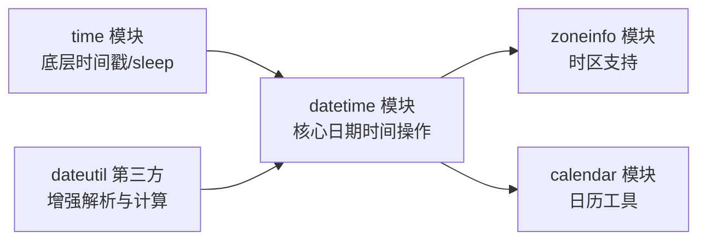
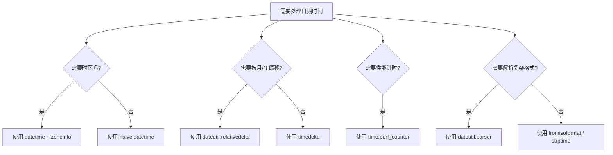

[toc]


# Python 日期和时间模块

## 概览

Python 处理日期时间主要依赖标准库中的几个模块，它们各有分工：

| 模块                 | 定位                             | 典型用途                |
| -------------------- | -------------------------------- | ----------------------- |
| `datetime`           | 核心模块，面向对象的日期时间操作 | 日期计算、格式化、比较  |
| `time`               | 底层时间访问（基于 C 库）        | 时间戳、sleep、性能计时 |
| `calendar`           | 日历相关工具                     | 生成日历、判断闰年      |
| `zoneinfo`           | 时区支持（Python 3.9+）          | 时区转换、夏令时处理    |
| `dateutil`（第三方） | datetime 的强力补充              | 模糊解析、复杂相对时间  |



------

## datetime 模块

这是**日常开发中使用频率最高的模块**，提供了几个核心类：

| 类          | 说明                 | 示例值                |
| ----------- | -------------------- | --------------------- |
| `date`      | 仅日期（年月日）     | `2024-03-15`          |
| `time`      | 仅时间（时分秒微秒） | `14:30:00`            |
| `datetime`  | 日期 + 时间          | `2024-03-15 14:30:00` |
| `timedelta` | 时间差/持续时间      | `7 days, 3:00:00`     |
| `timezone`  | 固定偏移时区         | `UTC+08:00`           |

### 创建日期时间对象

```python
from datetime import date, time, datetime, timedelta

# 获取当前时间
now = datetime.now()          # 本地时间（naive）
utc_now = datetime.now(tz=datetime.UTC)  # UTC 时间（aware）— Python 3.11+

# 手动构造
d = date(2024, 3, 15)
t = time(14, 30, 0)
dt = datetime(2024, 3, 15, 14, 30, 0)

# 从时间戳创建
dt_from_ts = datetime.fromtimestamp(1710489000)

# 从字符串解析（ISO 格式）
dt_from_str = datetime.fromisoformat("2024-03-15T14:30:00+08:00")
```

> 核心概念：naive vs aware
>
> - naive 对象：不携带时区信息，`tzinfo` 为 `None`。适合不涉及跨时区的简单场景。
> - aware 对象：携带时区信息。涉及跨时区、存储、API 交互时必须使用 aware 对象。
>
> 最佳实践：内部统一使用 UTC aware 时间，仅在展示给用户时转换为本地时区。

### 日期时间运算

```python
from datetime import datetime, timedelta

now = datetime.now()

# 加减时间
tomorrow = now + timedelta(days=1)
last_week = now - timedelta(weeks=1)
two_hours_later = now + timedelta(hours=2, minutes=30)

# 两个日期时间相减得到 timedelta
dt1 = datetime(2024, 12, 31)
dt2 = datetime(2024, 1, 1)
diff = dt1 - dt2  # 365 days, 0:00:00
print(diff.days)          # 365
print(diff.total_seconds())  # 31536000.0
```

`timedelta` 支持的参数：

| 参数           | 说明 |
| -------------- | ---- |
| `weeks`        | 周   |
| `days`         | 天   |
| `hours`        | 小时 |
| `minutes`      | 分钟 |
| `seconds`      | 秒   |
| `milliseconds` | 毫秒 |
| `microseconds` | 微秒 |

注意：`timedelta` 没有 `months` 或 `years` 参数，因为月和年的天数不固定。需要按月/年偏移时，使用 `dateutil.relativedelta`。

### 格式化与解析

```python
from datetime import datetime

now = datetime.now()

# 格式化为字符串
print(now.strftime("%Y-%m-%d %H:%M:%S"))   # 2024-03-15 14:30:00
print(now.strftime("%Y年%m月%d日"))          # 2024年03月15日

# 从字符串解析
dt = datetime.strptime("2024-03-15 14:30", "%Y-%m-%d %H:%M")

# ISO 格式（推荐用于数据交换）
print(now.isoformat())  # 2024-03-15T14:30:00.123456
```

#### 常用格式化代码：🎈

| 代码 | 含义         | 示例   |
| ---- | ------------ | ------ |
| `%Y` | 四位年份     | 2024   |
| `%m` | 两位月份     | 03     |
| `%d` | 两位日期     | 15     |
| `%H` | 24小时制小时 | 14     |
| `%I` | 12小时制小时 | 02     |
| `%M` | 分钟         | 30     |
| `%S` | 秒           | 00     |
| `%f` | 微秒         | 123456 |
| `%p` | AM/PM        | PM     |
| `%A` | 星期全名     | Friday |
| `%a` | 星期缩写     | Fri    |
| `%B` | 月份全名     | March  |
| `%z` | UTC 偏移     | +0800  |
| `%Z` | 时区名       | CST    |

最佳实践：优先使用 `.isoformat()` 和 `.fromisoformat()` 进行序列化/反序列化，避免手写格式字符串出错。

------

## zoneinfo 模块（Python 3.9+）

`zoneinfo` 提供了对 IANA 时区数据库的访问，是现代 Python 处理时区的标准方式。

```python
from datetime import datetime
from zoneinfo import ZoneInfo

# 创建带时区的时间
shanghai = ZoneInfo("Asia/Shanghai")
new_york = ZoneInfo("America/New_York")

dt_shanghai = datetime(2024, 3, 15, 14, 0, tzinfo=shanghai)
print(dt_shanghai)  # 2024-03-15 14:00:00+08:00

# 时区转换
dt_ny = dt_shanghai.astimezone(new_york)
print(dt_ny)  # 2024-03-15 02:00:00-04:00

# 获取当前时间（带时区）
now_utc = datetime.now(ZoneInfo("UTC"))
now_local = now_utc.astimezone(ZoneInfo("Asia/Shanghai"))
flowchart LR
    A["UTC 时间<br>2024-03-15 06:00+00:00"] -->|astimezone| B["上海时间<br>2024-03-15 14:00+08:00"]
    A -->|astimezone| C["纽约时间<br>2024-03-15 02:00-04:00"]
    A -->|astimezone| D["伦敦时间<br>2024-03-15 06:00+00:00"]
```

> 在 Windows 上如果缺少时区数据，安装 `pip install tzdata` 即可。

------

## time 模块

`time` 模块提供更底层的时间操作，主要面向时间戳和系统时钟。

```python
import time

# 当前时间戳（浮点数，自 1970-01-01 UTC 起的秒数）
ts = time.time()  # 1710489000.123

# 暂停执行
time.sleep(1.5)  # 暂停 1.5 秒

# 高精度计时（用于性能测量）
start = time.perf_counter()
# ... 执行某些操作 ...
elapsed = time.perf_counter() - start
print(f"耗时: {elapsed:.4f} 秒")

# 单调时钟（不受系统时间调整影响）
t = time.monotonic()
```

各时钟函数对比：

| 函数                  | 用途           | 特点                       |
| --------------------- | -------------- | -------------------------- |
| `time.time()`         | 获取当前时间戳 | 受系统时间调整影响         |
| `time.perf_counter()` | 性能计时       | 最高精度，包含 sleep 时间  |
| `time.process_time()` | CPU 计时       | 不包含 sleep 时间          |
| `time.monotonic()`    | 超时/调度      | 单调递增，不受时钟回拨影响 |

最佳实践：测量代码性能用 `perf_counter()`，实现超时逻辑用 `monotonic()`，获取真实世界时间用 `time.time()` 或 `datetime`。

------

## calendar 模块

```python
import calendar

# 判断闰年
print(calendar.isleap(2024))  # True

# 某月有多少天
print(calendar.monthrange(2024, 2))  # (3, 29) → 第一天是周四，共29天

# 生成月历文本
print(calendar.month(2024, 3))

# 某年有多少天
print(366 if calendar.isleap(2024) else 365)
```

------

## 实用模式与最佳实践

### 计算年龄

```python
from datetime import date

def calculate_age(birth_date: date) -> int:
    today = date.today()
    age = today.year - birth_date.year
    # 如果今年的生日还没到，减一岁
    if (today.month, today.day) < (birth_date.month, birth_date.day):
        age -= 1
    return age

age = calculate_age(date(1990, 6, 15))
```

### 按月偏移（使用 dateutil）

```python
# pip install python-dateutil
from datetime import datetime
from dateutil.relativedelta import relativedelta

now = datetime.now()
three_months_later = now + relativedelta(months=3)
one_year_ago = now - relativedelta(years=1)

# relativedelta 正确处理月末边界
# 例如 1月31日 + 1个月 = 2月28日（或29日）
jan_31 = datetime(2024, 1, 31)
print(jan_31 + relativedelta(months=1))  # 2024-02-29
```

### 日期范围生成

```python
from datetime import date, timedelta

def date_range(start: date, end: date, step_days: int = 1):
    """生成从 start 到 end（不含）的日期序列"""
    current = start
    while current < end:
        yield current
        current += timedelta(days=step_days)

for d in date_range(date(2024, 3, 1), date(2024, 3, 8)):
    print(d)
```

### 解析模糊日期字符串

```python
from dateutil import parser

# dateutil 能识别多种格式
dt1 = parser.parse("March 15, 2024 2:30 PM")
dt2 = parser.parse("15/03/2024")
dt3 = parser.parse("2024-03-15T14:30:00+08:00")
```

### 数据库与 API 交互模式

```python
from datetime import datetime, timezone

# 存储：始终使用 UTC
created_at = datetime.now(timezone.utc)

# 存入数据库时转为 ISO 字符串或时间戳
db_value = created_at.isoformat()  # "2024-03-15T06:30:00+00:00"

# 从数据库读取后转为本地时间展示
from zoneinfo import ZoneInfo
local_time = created_at.astimezone(ZoneInfo("Asia/Shanghai"))
display = local_time.strftime("%Y年%m月%d日 %H:%M")
```

------

## 常见陷阱

| 陷阱                            | 说明                                                   | 正确做法                                  |
| ------------------------------- | ------------------------------------------------------ | ----------------------------------------- |
| naive 与 aware 混用             | 两者不能直接比较或相减，会抛出 `TypeError`             | 统一使用 aware 对象                       |
| 用 `datetime.utcnow()`          | 返回 naive 对象，已在 3.12 中标记为 deprecated         | 用 `datetime.now(timezone.utc)`           |
| `strptime` 解析不带时区的字符串 | 得到 naive 对象，可能被误当作本地时间                  | 解析后立即附加时区 `.replace(tzinfo=...)` |
| 用 `==` 比较不同时区的时间      | 同一时刻不同时区表示，`==` 正确返回 True（aware 对象） | 这其实是正确行为，但要确保都是 aware      |
| `timedelta` 做月份计算          | `timedelta(days=30)` 不等于"一个月"                    | 使用 `relativedelta(months=1)`            |

------

## 版本演进速查

| Python 版本 | 新增特性                                                   |
| ----------- | ---------------------------------------------------------- |
| 3.9         | `zoneinfo` 模块加入标准库                                  |
| 3.11        | `datetime.UTC` 常量（`datetime.timezone.utc` 的简写）      |
| 3.12        | `datetime.utcnow()` / `utcfromtimestamp()` 标记 deprecated |
| 3.13        | `datetime` 对象的 `__format__` 性能优化                    |

------

## 总结决策树



记住核心原则：内部用 UTC，展示用本地时间，存储用 ISO 8601 格式，月年计算用 `relativedelta`。