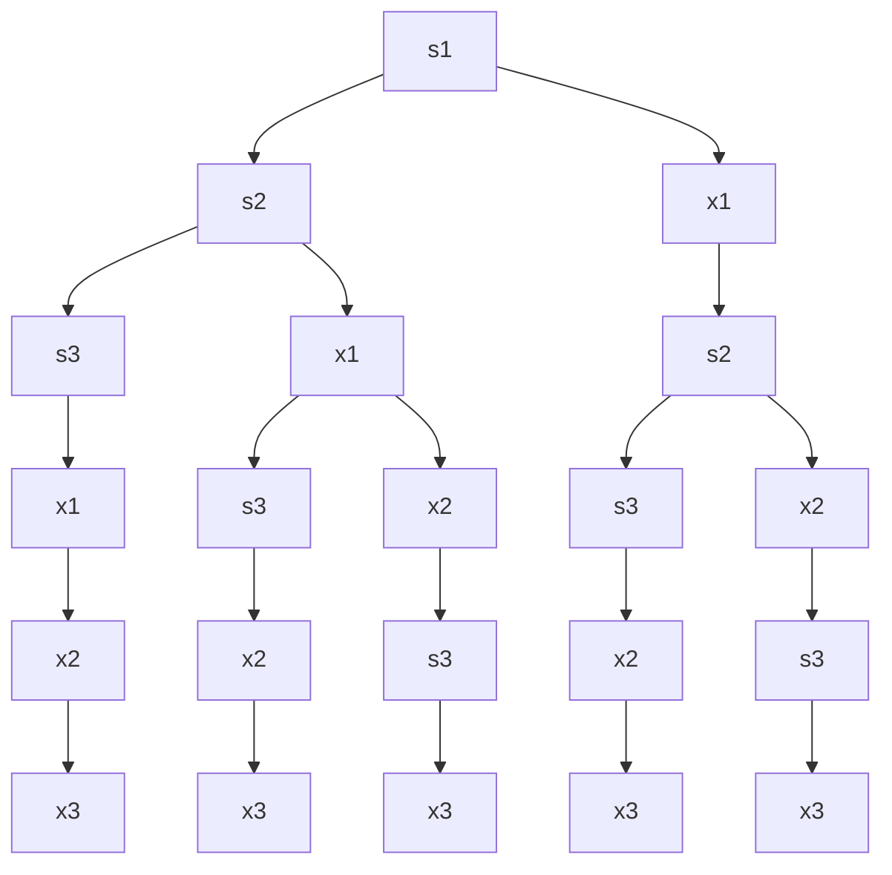
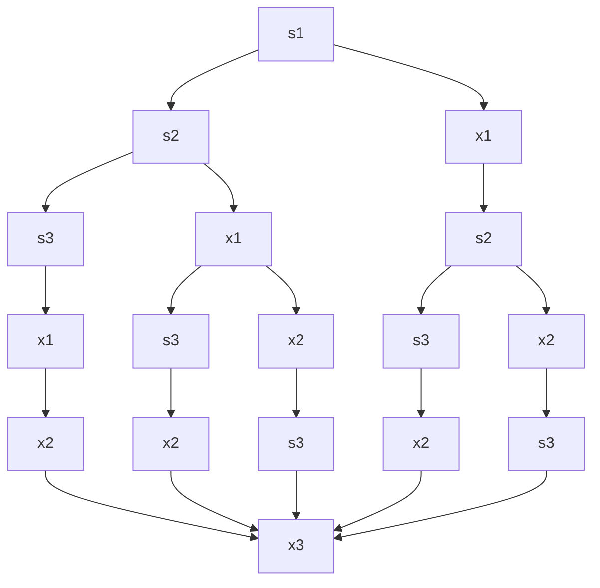

[toc]


## 卡特蓝数

- [卡塔兰数 wikipedia](https://zh.m.wikipedia.org/zh-hans/卡塔兰数)

```py
def factorial(n):

    if(n<0):
        # 对于非法输入(负数,我们抛出异常)
        raise ValueError(f"{n} must be a positive number!!")
    f=1
    while(n):
       f*=n
       n-=1
    return f

# print(factorial(5))
def catalan(n):
    # c=1/(n+1)*(factorial(2*n))/(factorial(n)**2)
    c=factorial(2*n)/(factorial(n+1)*factorial(n))
    return int(c)
# print(catalan(4))

# 打印前n个catalan数
def get_catalan_seq_tops(n):
    # l=[catalan(i) for i in range(1,n+1)]#如果从n=1开始计数
    print("n:catalan(n)")
    for i in range(0,n+1):#从n=0开始
        c=catalan(i)
        print(f"{i}:{c}")    
if __name__=="__main__":
    get_catalan_seq_tops(10)
#前十个: [1, 2, 5, 14, 42, 132, 429, 1430, 4862, 16796]
# PS D:\repos\PythonLearn>  py catalan.py
# n:catalan(n)
# 0:1
# 1:1
# 2:2
# 3:5
# 4:14
# 5:42
# 6:132
# 7:429
# 8:1430
# 9:4862
# 10:16796
```

### 通项

$$
C_n=\frac{1}{n+1}\binom{2n}{n} =\frac{2n!}{(n+1)!n!}
$$

### 递推

$$
C_0=1
\\
C_{n+1}=\sum\limits_{i=0}^{n}C_iC_{n-i}
=\frac{2(2n+1)}{n+2}C_n
$$

## 栈和catalan数

- 如果$n$个不同元素{$a_1,a_2,a_3,\cdots$}进栈,出栈序列的个数为$C_{n}=\frac{1}{n+1}\binom{2n}{n}$
  - 若$i<j$,则$a_{i}$必须比$a_{j}$先入栈
  - 第$i$次入栈的元素只能是$a_{i}$
  - 然而不像入栈那么严格,虽然位序大的元素相对于位序小的元素后入栈,但是位序小的元素可以在位序大的元素入栈之前就出栈,这种条件下可以让先入栈的元素比后入栈的元素更早被弹出栈
- 简单讲,就是元素进栈后可以停留,也可以出栈,直到所有元素都出栈,求出栈的所有不同序列的数量或者枚举出具体的出栈序列
- 例如两个元素$a_{1},a_{2}$
  - 操作序列:push(a1),pop(a1),push(a2),pop(a2),只要先入栈的元素在新元素入栈之前弹出,就会出现先入栈的元素比后入栈的元素更早弹出
  - 这看似和栈的**后进先出**的特点不符,后进先出针对连续入栈和连续出栈的情况而言;
  -  所以出栈的时候,位序大的元素一定比位序小的元素先出栈
- (允许栈非空的时候出栈,即使还有元素未进栈)
- 那么出栈的序列数(不同的排列数)为catalan(n)种

### 问题模型

- 用s表示push(入栈)
- 用x表示pop(出栈)
- 对n个元素的序列中的元素从左往右的顺序先后进栈,不要求连续入栈,栈非空时总是允许出栈,最终共执行n次入栈,n次出栈操作
- 如果设置2个操作计数器,分别统计push操作和pop操作执行的次数,那么push的数量始终大等于pop(或者说pop的次数始终不超过push的次数,否则出现空栈无元素可弹出的情况)
- 在上述条件下,找出所有的操作序列,显然序列开头是push操作,结尾是pop操作,push,pop都各有n次,序列长度为2n;

  - 当序列中出现了$n$次push,那么剩下的只有pop操作;

  - 如果pop操作出现的次数达到push次数,并且还有元素没有入栈,那么下一步只能是push
- 显然,任何入栈/出栈序列的第一个操作一定是把第一个元素入栈,但是后续的操作可能就多了;这是由于出栈操作可能发生在任何非空栈的情况下

## 使用树状图来枚举所有出栈可能

- 在上述问题模型的讨论中,我们可以借助树状图来枚举出所有可能
- 当序列长度不是很大的情况下,这是一个有效的手算方法
- 如果序列含有$n$个元素的序列为,我们可以画出$\frac{1}{n+1}\binom{2n}{n}$条分支,每条分支包含了$2n$个结点,分别对应于入栈和出栈操作
- $n$元素的序列对应的树有$2n$层,每层是一个入栈或者出栈操作,分别用`s,x`表示
- 树的分叉时,左侧为入栈,右侧为出栈;
  - 结点右边的数字表示该操作是第几次($s_{i}$表示第$i$次入栈,$x_{i}$表示第$i$次出栈)
  - 设树中任意结点为$M$,则$M$分支时要考察2个方面,
    - 左分支入栈,如果入栈操作次数达到序列长度$n$时,则之后无法在入栈,全部是出栈;否则可以入栈,并且观察该分支路径上最后一个入栈数字是几,新分支数字加1
    - 有分支出栈,出栈前考察该路径上已入栈次数和已出栈次数是否相等,如果相等，则无法出栈(此时右分支缺失);若该路径上入栈次数多于出栈次数,那么可以继续出栈,并对出栈数字加1



可以发现,各条路径的重点都是$x_3$;



根据树状图将出栈序列写出来:举个例子,比如路径序列:$s_{1}\to{s_{2}}\to{x_{1}}\to{s_{3}}\to{x_{2}}\to{x_{3}}$

其中由于第$i$次入栈的元素一定是$a_{i}$,我们可以依次观察出栈操作$x_{1},x_{2},\cdots$,

$x_{1}$前面离$x_{1}$最近的$s$型结点的下标就是第一个出栈元素,本例中是$s_{2}$,因此该路径第一个出栈的是$a_{2}$,将用掉的$s,x$划掉,$x_{2}$前面最近的$s$结点是$s_{3}$,说明第二个出栈的是$a_{3}$,最后序列剩下$s_{1}\to{x_{3}}$,最后一次弹出的是$a_{1}$;

所以该例子中出栈序列为$a_{2}a_{3}a_{1}$

### 唯一性

可以发现,上述枚举方法所有路径对应的序列都是互不相同的,每条路径对应唯一的出栈序列;反之,给定一个合法的出栈序列,可以找到对应的路径

### 枚举指定元素开头的出栈序列

上述的树状图枚举不仅仅可以用于全部枚举,还可以针对某一路径枚举

比如入栈序列$abcde$,长度达到5个,全部枚举出来会达到$\frac{1}{5+1}\binom{10}{5}$=$42$种

如果我只想知道$d$开头的所有出栈序列,可以怎么做?

如果是$d$开头的序列,说明$d$出栈前$a,b,c,d$连续入栈,然后出栈$d$;对应的操作序列为ssssx

按照这个操作序列:将树状图补全,可以得到4条路径,将他们转换为出栈序列:

- decba
- dceba
- dcbea
- dcbae

### 判断非法出栈序列

比起枚举出所有可能的出栈序列,判断一个给定的序列是否合法相对容易

非法(不可能出现的)出栈序列原因可能是想要将非栈顶元素出栈

例如入栈顺序$a,b,c,d,e,f$

那么出栈顺序$c,a,b,d,e,f$是非法的

分析:第一个出栈的是$c$,则说明$a,b,c$最开始依次入栈,然后弹出c,接着试图弹出a,然而a不是栈顶元素,因此该操作非法

有时给定的出栈信息不一定是整个序列完整给出,可能给出部分信息,比如第2,4个出栈元素,其余两出栈信息不给出,这种情况下直接判断不方便,考虑将出栈信息通过枚举所有可能性补全序列,然后逐个判断是否存在合法序列,如果所有序列都非法,那么原不完整序列也是不可能的;这种做法对于短序列比较有效,如果给出的序列中有较多不定数,枚举量就比较大了

### 不可能序列

- 弹出非栈顶元素是不可能序列的一个基本特征,但是直接拿来判断并不够方便
- 可以验证,当$a_{n}$比$a_{n-1}$先出栈,那么$a_{n}$和$a_{n-1}$在出栈序列中一定是相邻的,否则就是非法的
  - 因为$a_{n}$出栈后可以断定$a_{n-1}$此前已经入栈;而$a_{n-1}$若要在$a_{n}$后出栈,那么只能是$a_{n}$出栈后,$a_{n-1}$立即出栈,因为$a_{n-1},a_{n}$之间没有别的元素可以直接出栈,也没有更大位序的元素可以入栈后出栈,如果要隔一个元素出栈,那么就得将$a_{n-1}$之前的元素出栈,这些都是非栈顶元素,是非法的
  - 因此,若入栈序列为$1,2,3,4$,那么出栈序列中,若3在4之后出栈,那么4,3在序列中紧邻
    - 然而,若1在2之后出栈,那么2,1不一定是紧邻的,因为2,1不是最后两个入栈的元素

### 根据出栈序列判断栈的最小容量

- 根据出栈序列还原出入栈/出栈操作序列

- 设置一个计数器,入栈+1,出栈-1;将计数器在整个过程中出现的最大值作为栈的最小容量

- 例如入栈序列为$abcdefg$的某个出栈序列为$bdcfeag$,那么

  - 还原出进栈(s)/出栈(x)操作序列,并且在每个操作下记录当前栈中元素数量

    | s    | s    | x    | s    | s    | x    | x    | s    | s    | x    | x    | x    | s    | x    |
    | ---- | ---- | ---- | ---- | ---- | ---- | ---- | ---- | ---- | ---- | ---- | ---- | ---- | ---- |
    | 1    | 2    | 1    | 2    | 3    | 2    | 1    | 2    | 3    | 2    | 1    | 0    | 1    | 0    |

  可见,过程中最大最大元素数量为3,所以栈的最小容量为3

### 根据出栈序列换源入栈出栈操作序列

该操作也相对简单,从第一个出栈元素开始,如果是入栈序列中的第$i$个元素,说明前$i$个元素已经入栈,类似地可将整个入栈/出栈序列的操作还原出来

### 段序列的出栈可能枚举

- 1个元素({1}),显然只有一种出栈序列

- 2个元素({1,2}),则出栈序列可能有如下2种
  - 12
    - 出入栈操作序列:(sxsx)
  - 21
    - 出入栈操作序列(ssxx)

- 3个元素({1,2,3})先后进栈(中途允许出栈),则出栈序列可能有如下5种

  - 123 sxsxsx
  - 132 sxssxx
  - 213 ssxxsx
  - 231 ssxsxx
  - 321 sssxxx

- 4个元素({1,2,3,4})先后进栈(中途允许出栈),则出栈序列可能有如下14种

  - 1234
  - 1243
  - 1324
  - 1342
  - 1432

  

  - 2134

  - 2143

  - 2314

  - 2341

  - 2431

    

  - 3214

  - 3241

  - 3421

    

  - 4321

### 综合应用

已知第$i$出栈元素,求第$i+1$个出栈元素可能是多少

例如,入栈序列为$1,2,\cdots,n$,出栈序列记为$P_{1},P_{2},\cdots,P_{n}$;若$P_{2}$,则$P_{3}$可能取值有多少中情况?

这个问题不向具体序列那样直白,根据经验和栈的特点判定

若$P_{3}=1$,让$P_{1}=2$即可,所以$P_{3}=1$有可能

若$P_{3}=2$,令$P_{1}=1$即可,所以$P_{3}=2$有可能

而3已经被$P_{2}$占领(早就弹出了),因此$P_{3}\neq{3}$

$P_3$显然可以取$4,5,\cdots,n$(共$n-3$个取值);只要在3出栈后,每次入栈序列$4,5,\cdots,n$的元素后立刻出栈即可做到$P_{3}\in\set{3,4,\cdots,n}$;

综上$P_{3}$有$n-1$中取值(只有3不可能取到)

方法2:

使用树状图判断(入栈为`s`,出栈为`x`)

第2个出栈元素是$3$,那么`s3->x2`,在`s3`及其上面部分`s1->s2->s3`,其中有一个位置是`x1`,可能是`s1->x1->s2->s3`或`s1->s2->x1->x3`分别对应于$(P_{1}=1,P_2=3,P_{3}=2)$和$(P_{1}=2,P_{2}=3,P_{3}=1)$的情况

最后,`x2`结点下开始分支,左侧可以从$s_{4}$一直到$s_{n}$,这些结点右侧分支都是`x3`分别对应于$P_{3}=4,5,\cdots,n$的情况

综上$P_{3}=1,2,4,\cdots{n}$共$n-1$个可能
