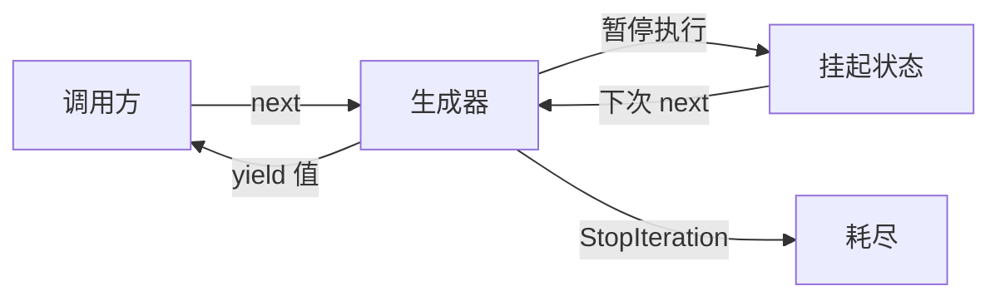
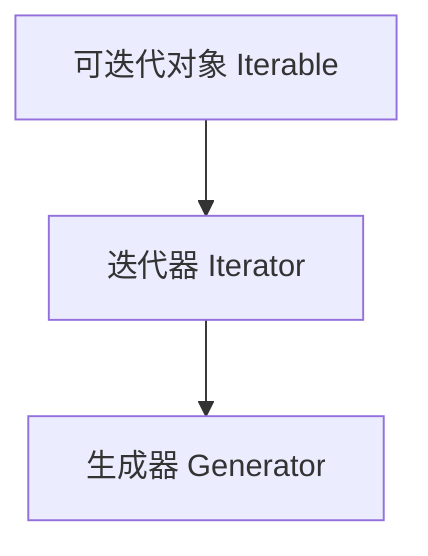
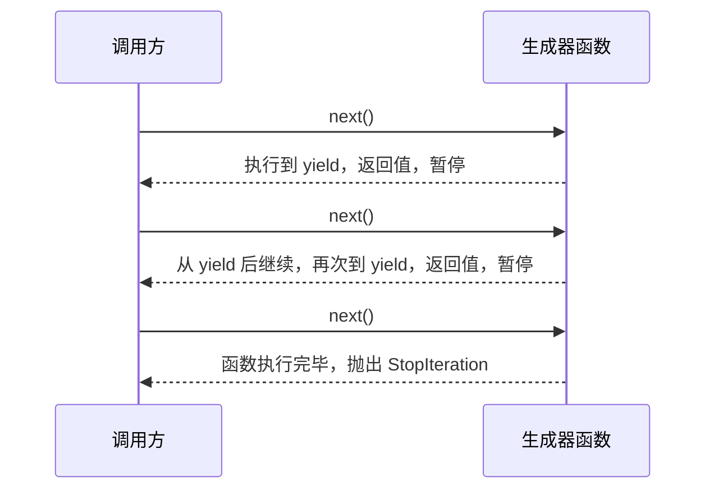
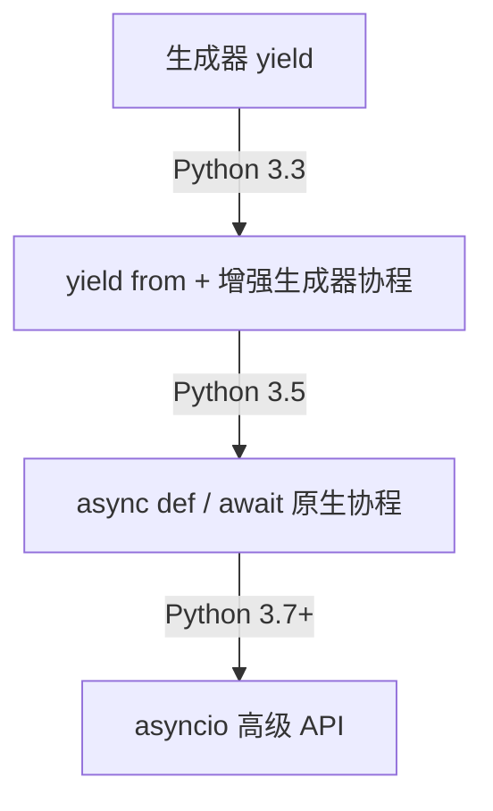

[toc]


# Python 生成器 (Generator) 完全指南

- [ generators|类 — Python 文档](https://docs.python.org/zh-cn/3/tutorial/classes.html#generators)
- [ yield-expressions|表达式 — Python  文档](https://docs.python.org/zh-cn/3.14/reference/expressions.html#yield-expressions)

yield 表达式在定义 [generator](https://docs.python.org/zh-cn/3.14/glossary.html#term-generator) 函数或 [asynchronous generator](https://docs.python.org/zh-cn/3.14/glossary.html#term-asynchronous-generator) 函数时才会用到，因此**只能在函数定义的内部使用**。

-  在一个函数体内使用 yield 表达式会使这个函数变成一个生成器函数，
- 而在一个 [`async def`](https://docs.python.org/zh-cn/3.14/reference/compound_stmts.html#async-def) 函数的内部使用它则会让这个协程函数变成一个异步生成器函数。 例如:

```python
def gen():  # 定义一个生成器函数
    yield 123

async def agen(): # 定义一个异步生成器函数
    yield 123
```

由于它们会对外层作用域造成附带影响，`yield` 表达式不被允许作为用于实现推导式和生成器表达式的隐式定义作用域的一部分。

当一个生成器函数被调用时，它将返回一个**名为生成器的迭代器**。 然后**这个生成器将控制"生成器函数"的执行**。 

- 执行过程会在这个**生成器的某个方法**被调用时开始。 这时，函数会**执行到第一个 yield 表达式，在那里它将再次被挂起**，向生成器的调用方**返回 `yield_list` 的值**，或者如果 `yield_list` 被省略则返回 `None`。 
- 所谓的**挂起**，就是说**所有局部状态都会被保留，包括局部变量的当前绑定、指令指针、内部求值栈及任何异常处理等等**。
- 当通过调用生成器的某个方法恢复执行时，这个函数的运行就与 yield 表达式只是一个外部调用的情况完全一样。 在恢复执行后 **yield 表达式的值取**决于恢复执行所调用的方法(后面会展开介绍)。 
  - 如果是用 [`__next__()`](https://docs.python.org/zh-cn/3.14/reference/expressions.html#generator.__next__) (一般是通过 [`for`](https://docs.python.org/zh-cn/3.14/reference/compound_stmts.html#for) 或者 [`next()`](https://docs.python.org/zh-cn/3.14/library/functions.html#next) 内置函数) 则结果为 [`None`](https://docs.python.org/zh-cn/3.14/library/constants.html#None)。 
  - 在其他情况下，如果是用 [`send()`](https://docs.python.org/zh-cn/3.14/reference/expressions.html#generator.send)，则结果将为传给该方法的值。

所有这些使**生成器函数与协程非常相似**；它们 yield 多次，它们具有多个入口点，并且它们的执行可以被挂起。

> 唯一的区别是**生成器函数不能控制在它在 yield 后交给哪里继续执行**；控制权总是转移到**生成器的调用者**。

> 在 [`try`](https://docs.python.org/zh-cn/3.14/reference/compound_stmts.html#try) 结构中的任何位置都允许 yield 表达式。如果生成器在（因为引用计数到零或是因为被垃圾回收）销毁之前没有恢复执行，将调用生成器-迭代器的 [`close()`](https://docs.python.org/zh-cn/3.14/reference/expressions.html#generator.close) 方法，从而允许任何挂起的 [`finally`](https://docs.python.org/zh-cn/3.14/reference/compound_stmts.html#finally) 子句执行。

当使用 `yield from <expr>` 时，所提供的**表达式必须是一个可迭代对象**。迭代该可迭代对象所产生的值**会被直接传递给当前生成器方法的调用者**。 

> 任何通过 [`send()`](https://docs.python.org/zh-cn/3.14/reference/expressions.html#generator.send) 传入的值以及任何通过 [`throw()`](https://docs.python.org/zh-cn/3.14/reference/expressions.html#generator.throw) 传入的异常如果有适当的方法则会被传给下层迭代器。 如果不是这种情况，那么 `send()` 将引发 [`AttributeError`](https://docs.python.org/zh-cn/3.14/library/exceptions.html#AttributeError) 或 [`TypeError`](https://docs.python.org/zh-cn/3.14/library/exceptions.html#TypeError)，而 `throw()` 将立即引发所转入的异常。
>
> 当下层迭代器完成时，被引发的 [`StopIteration`](https://docs.python.org/zh-cn/3.14/library/exceptions.html#StopIteration) 实例的 [`value`](https://docs.python.org/zh-cn/3.14/library/exceptions.html#StopIteration.value) 属性会成为 yield 表达式的值。 它可以在引发 `StopIteration` 时被显式地设置，也可以在子迭代器是一个生成器时自动地设置（通过从子生成器返回一个值）。
>
> *在 3.3 版本发生变更:* 添加 `yield from <expr>` 以委托控制流给一个子迭代器。

当yield表达式是赋值语句右侧的唯一表达式时，括号可以省略。

## 什么是生成器

生成器是 Python 中一种**特殊的迭代器**，它的核心价值在于**惰性求值（Lazy Evaluation）**：不预先计算并存储所有结果，而是在需要时才逐个产出值。

用一个生活类比来理解：

- **普通列表** 像一本已经印刷好的书，所有内容在你阅读前已经全部存在于内存中
- **生成器** 像一位说书人，只在你问"然后呢？"的时候才讲出下一段故事



---

## 核心概念：迭代协议

理解生成器之前，需要先了解 Python 的迭代协议：

| 概念                      | 说明                                     | 必要方法                                |
| ------------------------- | ---------------------------------------- | --------------------------------------- |
| **可迭代对象** (Iterable) | 能被 `for` 循环遍历的对象                | `__iter__()`                            |
| **迭代器** (Iterator)     | **记住当前位置**、能逐个产出值的对象     | `__iter__()` + `__next__()`             |
| **生成器** (Generator)    | 特殊的迭代器，由 Python 自动实现上述方法 | 使用 `yield` 关键字**自动获得**上述方法 |

生成器是迭代器的子集，迭代器是可迭代对象的子集：



---

## 两种创建方式

### 生成器函数

在函数体中使用 `yield` 关键字，该**函数就变成了生成器函数**。调用它不会立即执行函数体，而是**返回一个生成器对象**。

```python
# 从start 到 end 的数字生成器函数
def count_up(start, end):
    current = start
    while current <= end:
        yield current        # 产出值并暂停(yield语句(返回值后)导致函数暂停执行)
        current += 1         # 下次 next() 时从这里继续
# 获取生成器对象,然后消费生成器
gen = count_up(1, 5)         # 函数体此刻一行都没执行,但是得到一个生成器对象gen
print("手动用next()消费迭代器:")
print(next(gen))             # 输出: 1
print(next(gen))             # 输出: 2
print("使用for 循环消费:")
# 用 for 循环消费（最常见的方式）
for num in count_up(1, 5):
    print(num)
```

**yield 的执行流程：**



### 生成器表达式

语法与列表推导式几乎相同，区别只是将方括号 `[]` 换成圆括号 `()`：

```python
# 列表推导式：立即计算，全部存入内存
squares_list = [x ** 2 for x in range(1000000)]

# 生成器表达式：惰性求值，几乎不占内存
squares_gen = (x ** 2 for x in range(1000000))

# 内存对比
import sys
print(sys.getsizeof(squares_list))   # 约 8MB
print(sys.getsizeof(squares_gen))    # 约 200 字节
```

---

## yield 关键字深度解析

### yield 与 return 的对比

| 特性           | `return`       | `yield`                    |
| -------------- | -------------- | -------------------------- |
| 执行后函数状态 | 终止，栈帧销毁 | 暂停，栈帧保留             |
| 可出现次数     | 一次（逻辑上） | 多次                       |
| 函数类型影响   | 普通函数       | 变为生成器函数             |
| 值传递方向     | 函数 → 调用方  | 双向（`yield` 也可接收值） |

### yield from（委托子生成器）

[yield from|delegating-to-a-subgenerator|Python  Python 文档](https://docs.python.org/zh-cn/3.14/whatsnew/3.3.html#pep-380-syntax-for-delegating-to-a-subgenerator)

> 异步生成器函数中,`yield from`不可用,仅在普通的生成器函数中可用.

`yield from` 是 Python 3.3 引入的语法，用于将生成器的控制**权委托给另一个可迭代对象**：

```python
# 普通写法:不使用 yield from 
def chain_v1(*iterables):
    for it in iterables:
        for item in it:
            yield item
```

> `*iterables`表示函数接收可变位置参数,即数量可变的可迭代对象作为参数;
>
> 例如`chain_v1([1,2],[3,4])`

```python
# 使用 yield from,少写一层循环
def chain_v2(*iterables):
    for it in iterables:
        yield from it

result = list(chain_v2([1, 2], [3, 4], [5, 6]))
print(result)   # [1, 2, 3, 4, 5, 6]
```

`yield from` 不只是语法糖，它还正确地处理了子生成器的 `send()`、`throw()`、`close()` 调用，在**协程**中至关重要。

---

## 生成器的高级接口

生成器对象除了支持 `next()`，还提供了三个重要方法：

| 方法          | 作用                                       | 使用场景           |
| ------------- | ------------------------------------------ | ------------------ |
| `send(value)` | (外部)向**生成器内部**发送值，同时推进执行 | **双向通信**、协程 |
| `throw(type)` | 向生成器内部抛出异常                       | 错误注入、取消操作 |
| `close()`     | 终止生成器（在内部抛出 `GeneratorExit`）   | 资源清理           |

生成器（Generator）不仅仅是一个“产生数据的管道”，它实际上是一个协程（Coroutine）的雏形。

`next()` 和 `send()` 方法的存在，意味着生成器与调用者之间建立了一种**双向通信**的机制。

1. `next()`：请求数据（单向）

当你调用 `next(g)` 时，你在告诉生成器：“请继续执行，直到遇到下一个 `yield`，然后把值给我。”

- **数据流向：** 生成器 $\rightarrow$ 调用者。

- **本质：** 它是 `send(None)` 的一种**特殊形式**,`next()`是更加语义化的调用方式。

  > 注意:`next()` 等同于 `send(None)`.

2. `send(value)`：注入数据（双向）

这是理解生成器进阶用法的高级特性。`send()` 允许你在生成器**挂起**的地方，将一个值“推”回给它。

- **数据流向：** 调用者 $\leftrightarrow$ 生成器。
- **语法表现：** 在生成器内部，`yield` 表达式不仅能产出值，还能**接收值**。

> `res = yield 100`

### 异步生成器方法文档

详情见文档手册,这里仅介绍最常用的两个:

- generator.**__next__**()

  开始一个生成器函数的执行或是从上次执行 yield 表达式的位置恢复执行。 当一个生成器函数通过 [`__next__()`](https://docs.python.org/zh-cn/3.14/reference/expressions.html#generator.__next__) 方法恢复执行时，当前的 yield 表达式总是取值为 [`None`](https://docs.python.org/zh-cn/3.14/library/constants.html#None)。 随后会继续执行到下一个 yield 表达式，这时生成器将再次挂起，而 [`yield_list`](https://docs.python.org/zh-cn/3.14/reference/expressions.html#grammar-token-python-grammar-yield_list) 的值会被返回给 [`__next__()`](https://docs.python.org/zh-cn/3.14/reference/expressions.html#generator.__next__) 的调用方。 如果生成器没有产生下一个值就退出，则将引发 [`StopIteration`](https://docs.python.org/zh-cn/3.14/library/exceptions.html#StopIteration) 异常。

  此方法通常是隐式地调用，例如通过 [`for`](https://docs.python.org/zh-cn/3.14/reference/compound_stmts.html#for) 循环或是内置的 [`next()`](https://docs.python.org/zh-cn/3.14/library/functions.html#next) 函数。

- generator.**send**(*value*)

  **恢复执行并向生成器函数“发送”一个值**。

   *value* 参数将**成为当前 yield 表达式的结果**。(`res = yield output`)

  [`send()`](https://docs.python.org/zh-cn/3.14/reference/expressions.html#generator.send) 方法会**返回生成器所产生的下一个值**，或者如果生成器没有产生下一个值就退出则会引发 [`StopIteration`](https://docs.python.org/zh-cn/3.14/library/exceptions.html#StopIteration)。

   当调用 `send()` 来**启动生成器**时，它必须以 [`None`](https://docs.python.org/zh-cn/3.14/library/constants.html#None) 作为**调用参数**，因为这时**没有可以接收值的 yield 表达式**。

表达式语法拆解：`res = yield output`

这行代码在执行时其实分成了**两个阶段**，中间被“暂停”隔开了：

- **阶段 A（产出）：** 执行 `yield output`。生成器把 `output` 丢给外界，代码在这里**停住**。此时 `res =` 还没有执行。
- **阶段 B（接收）：** 当外界调用 `send(input_val)` 时，生成器醒来。**整个 `yield output` 表达式在这一瞬间变成了 `input_val`**(但是`output`本身不受影响。
- **阶段 C（继续）：** 接着执行赋值操作 `res = input_val`，然后代码继续往下走。

### 官方示例

```python
# 定义典型的生成器函数(打印指定内容),能够处理next,send和throw,以及close调用
def echo(value=None):
    print("Execution starts when 'next()' is called for the first time.")
    # 将循环放在try-finally中
    try:
        while True: 
            # 循环内部逻辑也放置异常处理try-except结构中.
            try:
                value = (yield value) # value=yield ... 接收send传入的value
            except Exception as e:
                value = e
    finally:
        print("Don't forget to clean up when 'close()' is called.")

generator = echo(1)
print(next(generator))


print(next(generator))

print(generator.send(2))

generator.throw(TypeError, "spam")

generator.close()
```

### 对send()传入的值做处理

对于最基础的生成器函数定义:

```python
# 从start 到 end 的数字生成器函数
def count_up(start, end):
    current = start
    while current <= end:
        yield current         
        current += 1          

```

**该生成器可以接收 `.send()` 调用，但它不会对接收到的值做任何处理。**

在 Python 中，所有的生成器对象都拥有 `.send()` 方法，但要**让这个方法产生实质性的作用，代码逻辑需要适配**。

------

1. 为什么它目前“无效”？

在你的代码中，`yield current` 仅仅是将值“发送”出去。如果你调用 `gen.send("hello")`，这个字符串确实会被送回生成器内部，但由于你没有**赋值语句**来捕捉这个值，它随即便被丢弃了。

2. 如何让它接收并利用数据？

如果你希望生成器能够根据外界输入的信息改变行为（例如：手动重置当前的数字），你需要将 `yield` 的结果赋值给一个变量：

```python
def count_up(start, end):
    current = start
    while current <= end:
        # 这里的 val 将接收通过 .send() 传入的值
        val = yield current 
        
        if val is not None:
            current = val  # 如果外部 send 了新值，则跳转到新值
        else:
            current += 1   # 否则正常递增
```

这里`val=yield current`的含义是:

>  调用者通过生成器`gen`的`next()`或`.send()`调用时(例如`res=gen.send(value)`,生成器`gen`先返回`current`给调用者(`res`会被赋值为`current`),`send(value)`把`yield current`这个表达式的值替换为`value`再赋值给`val`

3. 使用时的注意事项

在使用 `.send()` 时，有两个关键点需要注意：

- **启动（Priming）：** 你不能在生成器刚创建时就直接调用 `.send(value)`（除非发送 `None`）。必须先调用一次 `next()` 或 `gen.send(None)`，让生成器运行到第一个 `yield` 语句处停下。
- **双向通道：** `yield` 此时既是“出口”也是“入口”。
  - **出口：** 将 `current` 传给外部。
  - **入口：** 将外部传入的值赋给 `val`。

### send() 双向通信示例

```python
# 累加器
def accumulator():
    total = 0
    while True:
        print(f' Total will be yield (return):{total}')
        value = yield total  # yield 左边接收 send() 传入的值
        print(f'\n Continue from last yield. Get value from send:{value}')
        # 判断value 是否为 None
        if value is None:
            break
        total += value


gen = accumulator()
# 必须先用 next() 或 send(None) 启动
init = next(gen)
print(init)  # 输出: 0
print(gen.send(10))  # 输出: 10
print(gen.send(20))  # 输出: 30
print(gen.send(5))  # 输出: 35

```

> **注意**：第一次必须调用 `next(gen)` 或 `gen.send(None)` 来启动生成器，直接 `send(非None值)` 会抛出 `TypeError`，因为生成器还未到达第一个 `yield` 处。

```text
 python .\gen_send.py 
 Total will be yield (return):0
0

 Continue from last yield. Get value from send:10
 Total will be yield (return):10
10

 Continue from last yield. Get value from send:20
 Total will be yield (return):30
30

 Continue from last yield. Get value from send:5
 Total will be yield (return):35
35
```


```python

# 可变步长的累加器
def accumulator_step():
    cnt = 0
    STEP = 1
    while cnt <= 9:
        val = yield cnt
        print(' val:', val)
        # 错误用法:将yield表达式左侧变量直接使用
        # 标准做法是添加一个判断(是否为None),按需设置分支
        if val is not None:
            # break
            STEP = val
        print(' +STEP:', STEP)
        cnt += STEP


gen = accumulator_step()
print(next(gen))  # 0
print(next(gen))  # 1
print(next(gen))  # 2
print(gen.send(2))# 4
print(next(gen))  # 6
print(next(gen))  # 8

```

```text
 python .\gen_send_cnt.py 
0
 val: None
 +STEP: 1
1
 val: None
 +STEP: 1
2
 val: 2
 +STEP: 2
4
 val: None
 +STEP: 2
6
 val: None
 +STEP: 2
8
```


---

## 经典应用场景

### 处理大文件

```python
def read_large_file(filepath, chunk_size=1024):
    """逐块读取大文件，内存始终只保留一个块"""
    with open(filepath, 'r', encoding='utf-8') as f:
        while chunk := f.read(chunk_size):
            yield chunk

# 处理 GB 级别的日志文件，内存毫无压力
for chunk in read_large_file('/var/log/huge.log'):
    process(chunk)
```

### 无限序列

```python
def fibonacci():
    """无限斐波那契数列，永远不会 StopIteration"""
    a, b = 0, 1
    while True:
        yield a
        a, b = b, a + b

# 配合 itertools.islice 取前 10 个
from itertools import islice
print(list(islice(fibonacci(), 10)))
# [0, 1, 1, 2, 3, 5, 8, 13, 21, 34]
```

### 数据管道（Pipeline）

这是生成器最优雅的使用模式之一：将多个生成器串联，构建高效的数据处理流水线。

```python
def read_lines(filepath):
    with open(filepath) as f:
        yield from f

def filter_empty(lines):
    for line in lines:
        if line.strip():
            yield line.strip()

def parse_numbers(lines):
    for line in lines:
        try:
            yield float(line)
        except ValueError:
            pass

def above_threshold(numbers, threshold):
    for n in numbers:
        if n > threshold:
            yield n

# 构建管道，整个过程数据流是惰性的
lines     = read_lines('data.txt')
cleaned   = filter_empty(lines)
numbers   = parse_numbers(cleaned)
filtered  = above_threshold(numbers, 100.0)

for value in filtered:
    print(value)
```


### 上下文感知的资源生成器

```python
def managed_connections(urls):
    """自动管理连接生命周期"""
    import urllib.request
    for url in urls:
        try:
            conn = urllib.request.urlopen(url)
            yield conn
        finally:
            conn.close()   # 即使外部出现异常也能清理
```

---

## itertools：生成器的最佳搭档

Python 标准库中的 `itertools` 模块提供了大量基于生成器的工具函数：

| 函数                  | 功能                   | 示例                                |
| --------------------- | ---------------------- | ----------------------------------- |
| `islice(it, n)`       | 取前 n 个元素          | `islice(fibonacci(), 10)`           |
| `chain(*its)`         | 串联多个可迭代对象     | `chain([1,2], [3,4])`               |
| `takewhile(pred, it)` | 条件为真时持续取值     | `takewhile(lambda x: x<5, count())` |
| `dropwhile(pred, it)` | 跳过开头满足条件的元素 | —                                   |
| `count(start, step)`  | 无限计数器             | `count(0, 2)` → 0,2,4,6...          |
| `cycle(it)`           | 无限循环               | `cycle([1,2,3])` → 1,2,3,1,2,3...   |
| `groupby(it, key)`    | 按 key 分组            | 类似 SQL GROUP BY                   |
| `batched(it, n)`      | 分批（Python 3.12+）   | `batched(range(10), 3)`             |

```python
from itertools import takewhile, count, chain

# 取所有小于 100 的斐波那契数
small_fibs = list(takewhile(lambda x: x < 100, fibonacci()))
print(small_fibs)  # [0, 1, 1, 2, 3, 5, 8, 13, 21, 34, 55, 89]
```

---

## 异步生成器函数

在一个使用 [`async def`](https://docs.python.org/zh-cn/3.14/reference/compound_stmts.html#async-def) 定义的函数或方法中出现的 yield 表达式会进一步将该函数定义为一个 [asynchronous generator](https://docs.python.org/zh-cn/3.14/glossary.html#term-asynchronous-generator) 函数。

当一个异步生成器函数被调用时，它会返回一个名为**异步生成器对象**的**异步迭代器**。 此对象将在之后控制该生成器函数的执行。 异步生成器对象通常被用在协程函数的 [`async for`](https://docs.python.org/zh-cn/3.14/reference/compound_stmts.html#async-for) 语句中，类似于在 [`for`](https://docs.python.org/zh-cn/3.14/reference/compound_stmts.html#for) 语句中使用生成器对象。

调用某个**异步生成器的方法**将返回一个 [awaitable](https://docs.python.org/zh-cn/3.14/glossary.html#term-awaitable) 对象，执行会在此对象**被等待时启动**。 

> 到那时，将**执行至第一个 `yield `表达式**，在那里它会**再次挂起**，将 [`yield_list`](https://docs.python.org/zh-cn/3.14/reference/expressions.html#grammar-token-python-grammar-yield_list) 的值返回给等待中的协程。 
>
> 与生成器一样，**挂起**意味着所有局部状态会被保留，包括局部变量的当前绑定、指令指针、内部求值栈以及任何异常处理的状态。 

> 当**执行**[在等待异步生成器的方法返回下一个对象后]**恢复时**，该函数可以从原状态继续执行，就仿佛 yield 表达式只是另一个外部调用那样。 

恢复执行后 **yield 表达式的值**取决于恢复执行所用的方法。 

- 如果是使用 [`__anext__()`](https://docs.python.org/zh-cn/3.14/reference/expressions.html#agen.__anext__) 则结果为 [`None`](https://docs.python.org/zh-cn/3.14/library/constants.html#None)。 
- 否则的话，如果是使用 [`asend()`](https://docs.python.org/zh-cn/3.14/reference/expressions.html#agen.asend)，则结果将是传递给该方法的值。

> 如果一个异步生成器恰好因 [`break`](https://docs.python.org/zh-cn/3.14/reference/simple_stmts.html#break)、调用方任务被取消，或是其他异常而提前退出，生成器的异步清理代码将会运行并可能引发异常或访问意外上下文中的上下文变量 -- 也许是在它所依赖的任务的生命周期之后，或是在异步生成器垃圾回收钩子被调用时的**事件循环**关闭期间。 
>
> 为了防止这种情况，调用方必须通过调用 [`aclose()`](https://docs.python.org/zh-cn/3.14/reference/expressions.html#agen.aclose) 方法来**显式地关闭异步生成器以终结生成器**并最终**从事件循环中将其分离**。

在异步生成器函数中，yield 表达式允许出现在 [`try`](https://docs.python.org/zh-cn/3.14/reference/compound_stmts.html#try) 结构的任何位置。

> 但是，如果一个异步生成器在其被终结（由于引用计数达到零或被作为垃圾回收）之前未被恢复，则 `try` 结构中的 yield 表达式可能导致挂起的 [`finally`](https://docs.python.org/zh-cn/3.14/reference/compound_stmts.html#finally) 子句执行失败。在此情况下，应由运行该异步生成器的事件循环或任务调度器来负责调用异步生成器-迭代器的 [`aclose()`](https://docs.python.org/zh-cn/3.14/reference/expressions.html#agen.aclose) 方法并运行所返回的协程对象，从而允许任何挂起的 `finally` 子句得以执行。

为了能在事件循环终结时执行最终化处理，事件循环应当定义一个 *终结器* 函数，它接受一个异步生成器迭代器并将调用 [`aclose()`](https://docs.python.org/zh-cn/3.14/reference/expressions.html#agen.aclose) 且执行该协程。 

> 这个 *终结器* 可以通过调用 [`sys.set_asyncgen_hooks()`](https://docs.python.org/zh-cn/3.14/library/sys.html#sys.set_asyncgen_hooks) 来注册。 当首次迭代时，异步生成器迭代器将保存已注册的 *终结器* 以便在最终化时调用。 有关 *终结器* 方法的参考示例请查看在 [Lib/asyncio/base_events.py](https://github.com/python/cpython/tree/3.14/Lib/asyncio/base_events.py) 中的 `asyncio.Loop.shutdown_asyncgens` 实现。

`yield from <expr>` 表达式如果在异步生成器函数中使用会**引发语法错误**。

## 生成器与协程

从 Python 3.5 开始，`async def` / `await` 语法在生成器机制的基础上构建了原生协程。理解这个演化路径有助于深入理解 asyncio：



虽然现代 Python 推荐使用 `async/await` 编写协程，但生成器仍是其底层基础。

---

## 常见陷阱与最佳实践

### 陷阱一：生成器只能遍历一次

```python
gen = (x for x in range(5))
print(list(gen))  # [0, 1, 2, 3, 4]
print(list(gen))  # []  ← 已耗尽！

# 最佳实践：如需多次遍历，封装为函数
def make_gen():
    return (x for x in range(5))

print(list(make_gen()))  # [0, 1, 2, 3, 4]
print(list(make_gen()))  # [0, 1, 2, 3, 4]
```

### 陷阱二：生成器内部的变量捕获

```python
# 危险：生成器表达式中的变量是惰性求值的
funcs = [lambda: x for x in range(3)]   # 这是列表推导，不是生成器的问题
                                          # 但生成器同样存在此类问题

# 正确做法：使用默认参数固定变量
gen = (x * x for x in range(5))  # 推荐：x 在表达式定义时已确定迭代来源
```

### 陷阱三：忘记启动就 send()

```python
def my_gen():
    value = yield
    print(f"收到: {value}")

gen = my_gen()
# gen.send(42)   # ❌ TypeError
next(gen)         # ✅ 先启动
gen.send(42)      # ✅ 输出: 收到: 42
```

### 最佳实践汇总

| 场景               | 推荐做法                                     |
| ------------------ | -------------------------------------------- |
| 大数据集处理       | 优先用生成器，避免一次性加载                 |
| 仅遍历一次的结果   | 用生成器表达式替代列表推导                   |
| 传入函数的迭代参数 | 函数内部直接消费，不保存引用                 |
| 需要多次遍历       | 封装为工厂函数或使用 `itertools.tee`（慎用） |
| 生成器函数中的清理 | 用 `try/finally` 确保 `close()` 时资源释放   |
| 组合多个生成器     | 优先使用 `yield from` 和 `itertools`         |

---

## 性能对比总结

```python
import sys, time

N = 10_000_000

# 列表推导
t0 = time.perf_counter()
result = sum([x * x for x in range(N)])
t1 = time.perf_counter()
print(f"列表: {t1-t0:.2f}s, 内存峰值较大")

# 生成器表达式
t0 = time.perf_counter()
result = sum(x * x for x in range(N))
t1 = time.perf_counter()
print(f"生成器: {t1-t0:.2f}s, 内存恒定极小")
```

| 维度         | 列表推导             | 生成器表达式       |
| ------------ | -------------------- | ------------------ |
| 内存占用     | O(n)，与数据量成正比 | O(1)，始终极小     |
| 首次可用时间 | 全部计算完才能用     | 立即可用           |
| 多次遍历     | ✅ 支持               | ❌ 只能一次         |
| 随机访问     | ✅ 支持索引           | ❌ 不支持           |
| 适用场景     | 数据量小、需多次访问 | 数据量大、流式处理 |

---

## 快速参考

```python
# 1. 生成器函数
def gen_func():
    yield 1
    yield 2

# 2. 生成器表达式
gen_expr = (x for x in range(10))

# 3. yield from 委托
def delegating():
    yield from range(5)

# 4. 双向通信
def echo():
    while True:
        received = yield
        print(f"Echo: {received}")

e = echo(); next(e); e.send("hello")

# 5. 带清理的生成器
def safe_gen():
    try:
        yield 1
        yield 2
    finally:
        print("清理资源")   # close() 或迭代完成时执行
```

## 总结

Python 生成器（Generator）是 Python 中非常强大且优雅的特性。如果用一句话概括它的核心，那就是：**“按需取值，延时计算。”**

以下是 Python 生成器的核心特性标签：

------

### 1. 惰性求值 (Lazy Evaluation)

这是生成器最重要的标签。不同于列表（List）一次性将所有元素加载到内存中，生成器只有在被迭代（调用 `next()` 或在 `for` 循环中）时，才会计算并返回下一个值。

- **优势：** 节省 CPU 资源，只有在需要时才工作。

### 2. 内存增量极低 (Memory Efficiency)

无论生成器将要产生 10 个还是 10 亿个数据，它在内存中占用的空间始终是恒定的（非常小）。

- **对比：**
  - `[i for i in range(1000000)]` 会创建一个包含百万元素的列表，占用大量内存。
  - `(i for i in range(1000000))` 只是一个生成器对象，几乎不占内存。

### 3. 状态挂起 (State Retention)

当生成器函数遇到 `yield` 关键字时，它会暂停执行，保存当前的局部变量、指令指针和异常处理状态，并将值返回给调用者。

- **恢复：** 下次调用时，它会从上次离开的地方**原封不动地**继续执行，就像“断点续传”一样。

------

### 4. 单向迭代 (One-way Traversal)

生成器是“一次性”的。你只能向前迭代，不能后退、不能切片、也不能重置。

- **特性：** 一旦遍历结束，再次调用会抛出 `StopIteration` 异常。如果想再次使用，必须重新创建一个生成器对象。

### 5. 协同程序的基础 (Coroutine Foundation)

生成器不仅能“产出”数据（`yield`），还可以通过 `.send()` 方法“接收”外部传入的数据。这使得生成器成为了 Python 实现异步编程（asyncio 的前身）和协程的基础。

------

### 总结对比表

| **特性**     | **列表 (List)**                | **生成器 (Generator)**           |
| ------------ | ------------------------------ | -------------------------------- |
| **存储方式** | 存储所有值                     | 存储生成值的**算法/逻辑**        |
| **内存占用** | 随数据量线性增长               | 始终保持极低且恒定               |
| **读取速度** | 索引访问极快                   | 只能顺序访问，计算耗时           |
| **适用场景** | 需要频繁随机访问、重复使用数据 | 处理海量数据、流式数据、节省内存 |

 