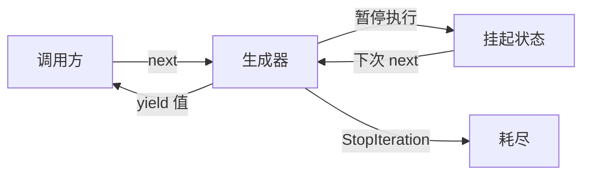
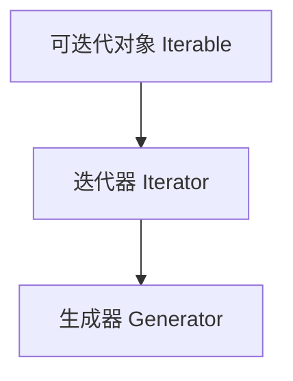
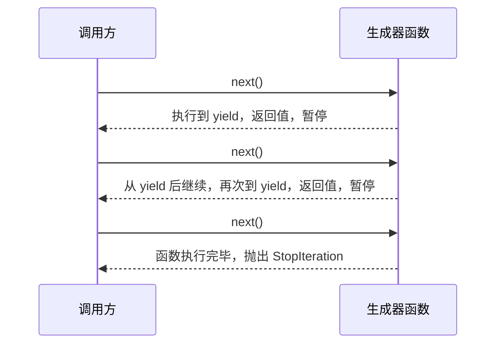
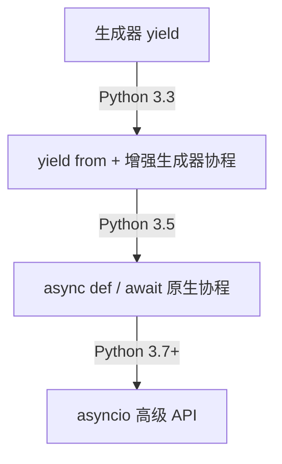

[toc]


# Python 生成器 (Generator) 完全指南

[ 类 — Python 文档](https://docs.python.org/zh-cn/3/tutorial/classes.html#generators)

## 什么是生成器

生成器是 Python 中一种**特殊的迭代器**，它的核心价值在于**惰性求值（Lazy Evaluation）**：不预先计算并存储所有结果，而是在需要时才逐个产出值。

用一个生活类比来理解：

- **普通列表** 像一本已经印刷好的书，所有内容在你阅读前已经全部存在于内存中
- **生成器** 像一位说书人，只在你问"然后呢？"的时候才讲出下一段故事



---

## 核心概念：迭代协议

理解生成器之前，需要先了解 Python 的迭代协议：

| 概念                      | 说明                                     | 必要方法                                |
| ------------------------- | ---------------------------------------- | --------------------------------------- |
| **可迭代对象** (Iterable) | 能被 `for` 循环遍历的对象                | `__iter__()`                            |
| **迭代器** (Iterator)     | **记住当前位置**、能逐个产出值的对象     | `__iter__()` + `__next__()`             |
| **生成器** (Generator)    | 特殊的迭代器，由 Python 自动实现上述方法 | 使用 `yield` 关键字**自动获得**上述方法 |

生成器是迭代器的子集，迭代器是可迭代对象的子集：



---

## 两种创建方式

### 生成器函数

在函数体中使用 `yield` 关键字，该**函数就变成了生成器函数**。调用它不会立即执行函数体，而是**返回一个生成器对象**。

```python
# 从start 到 end 的数字生成器函数
def count_up(start, end):
    current = start
    while current <= end:
        yield current        # 产出值并暂停(yield语句(返回值后)导致函数暂停执行)
        current += 1         # 下次 next() 时从这里继续
# 获取生成器对象,然后消费生成器
gen = count_up(1, 5)         # 函数体此刻一行都没执行,但是得到一个生成器对象gen
print("手动用next()消费迭代器:")
print(next(gen))             # 输出: 1
print(next(gen))             # 输出: 2
print("使用for 循环消费:")
# 用 for 循环消费（最常见的方式）
for num in count_up(1, 5):
    print(num)
```

**yield 的执行流程：**



### 生成器表达式

语法与列表推导式几乎相同，区别只是将方括号 `[]` 换成圆括号 `()`：

```python
# 列表推导式：立即计算，全部存入内存
squares_list = [x ** 2 for x in range(1000000)]

# 生成器表达式：惰性求值，几乎不占内存
squares_gen = (x ** 2 for x in range(1000000))

# 内存对比
import sys
print(sys.getsizeof(squares_list))   # 约 8MB
print(sys.getsizeof(squares_gen))    # 约 200 字节
```

---

## yield 关键字深度解析

### yield 与 return 的对比

| 特性           | `return`       | `yield`                    |
| -------------- | -------------- | -------------------------- |
| 执行后函数状态 | 终止，栈帧销毁 | 暂停，栈帧保留             |
| 可出现次数     | 一次（逻辑上） | 多次                       |
| 函数类型影响   | 普通函数       | 变为生成器函数             |
| 值传递方向     | 函数 → 调用方  | 双向（`yield` 也可接收值） |

### yield from（委托子生成器）

`yield from` 是 Python 3.3 引入的语法，用于将生成器的控制**权委托给另一个可迭代对象**：

```python
# 不使用 yield from（繁琐）
def chain_v1(*iterables):
    for it in iterables:
        for item in it:
            yield item
```


```python


# 使用 yield from（简洁）
def chain_v2(*iterables):
    for it in iterables:
        yield from it

result = list(chain_v2([1, 2], [3, 4], [5, 6]))
print(result)   # [1, 2, 3, 4, 5, 6]
```

`yield from` 不只是语法糖，它还正确地处理了子生成器的 `send()`、`throw()`、`close()` 调用，在**协程**中至关重要。

---

## 生成器的高级接口

生成器对象除了支持 `next()`，还提供了三个重要方法：

| 方法          | 作用                                     | 使用场景           |
| ------------- | ---------------------------------------- | ------------------ |
| `send(value)` | 向生成器内部发送值，同时推进执行         | 双向通信、协程     |
| `throw(type)` | 向生成器内部抛出异常                     | 错误注入、取消操作 |
| `close()`     | 终止生成器（在内部抛出 `GeneratorExit`） | 资源清理           |

### send() 双向通信示例

```python
def accumulator():
    total = 0
    while True:
        value = yield total    # yield 左边接收 send() 传入的值
        if value is None:
            break
        total += value

gen = accumulator()
next(gen)           # 必须先用 next() 或 send(None) 启动，输出: 0
print(gen.send(10)) # 输出: 10
print(gen.send(20)) # 输出: 30
print(gen.send(5))  # 输出: 35
```

> **注意**：第一次必须调用 `next(gen)` 或 `gen.send(None)` 来启动生成器，直接 `send(非None值)` 会抛出 `TypeError`，因为生成器还未到达第一个 `yield` 处。

---

## 经典应用场景

### 处理大文件

```python
def read_large_file(filepath, chunk_size=1024):
    """逐块读取大文件，内存始终只保留一个块"""
    with open(filepath, 'r', encoding='utf-8') as f:
        while chunk := f.read(chunk_size):
            yield chunk

# 处理 GB 级别的日志文件，内存毫无压力
for chunk in read_large_file('/var/log/huge.log'):
    process(chunk)
```

### 无限序列

```python
def fibonacci():
    """无限斐波那契数列，永远不会 StopIteration"""
    a, b = 0, 1
    while True:
        yield a
        a, b = b, a + b

# 配合 itertools.islice 取前 10 个
from itertools import islice
print(list(islice(fibonacci(), 10)))
# [0, 1, 1, 2, 3, 5, 8, 13, 21, 34]
```

### 数据管道（Pipeline）

这是生成器最优雅的使用模式之一：将多个生成器串联，构建高效的数据处理流水线。

```python
def read_lines(filepath):
    with open(filepath) as f:
        yield from f

def filter_empty(lines):
    for line in lines:
        if line.strip():
            yield line.strip()

def parse_numbers(lines):
    for line in lines:
        try:
            yield float(line)
        except ValueError:
            pass

def above_threshold(numbers, threshold):
    for n in numbers:
        if n > threshold:
            yield n

# 构建管道，整个过程数据流是惰性的
lines     = read_lines('data.txt')
cleaned   = filter_empty(lines)
numbers   = parse_numbers(cleaned)
filtered  = above_threshold(numbers, 100.0)

for value in filtered:
    print(value)
```


### 上下文感知的资源生成器

```python
def managed_connections(urls):
    """自动管理连接生命周期"""
    import urllib.request
    for url in urls:
        try:
            conn = urllib.request.urlopen(url)
            yield conn
        finally:
            conn.close()   # 即使外部出现异常也能清理
```

---

## itertools：生成器的最佳搭档

Python 标准库中的 `itertools` 模块提供了大量基于生成器的工具函数：

| 函数                  | 功能                   | 示例                                |
| --------------------- | ---------------------- | ----------------------------------- |
| `islice(it, n)`       | 取前 n 个元素          | `islice(fibonacci(), 10)`           |
| `chain(*its)`         | 串联多个可迭代对象     | `chain([1,2], [3,4])`               |
| `takewhile(pred, it)` | 条件为真时持续取值     | `takewhile(lambda x: x<5, count())` |
| `dropwhile(pred, it)` | 跳过开头满足条件的元素 | —                                   |
| `count(start, step)`  | 无限计数器             | `count(0, 2)` → 0,2,4,6...          |
| `cycle(it)`           | 无限循环               | `cycle([1,2,3])` → 1,2,3,1,2,3...   |
| `groupby(it, key)`    | 按 key 分组            | 类似 SQL GROUP BY                   |
| `batched(it, n)`      | 分批（Python 3.12+）   | `batched(range(10), 3)`             |

```python
from itertools import takewhile, count, chain

# 取所有小于 100 的斐波那契数
small_fibs = list(takewhile(lambda x: x < 100, fibonacci()))
print(small_fibs)  # [0, 1, 1, 2, 3, 5, 8, 13, 21, 34, 55, 89]
```

---

## 生成器与协程

从 Python 3.5 开始，`async def` / `await` 语法在生成器机制的基础上构建了原生协程。理解这个演化路径有助于深入理解 asyncio：



虽然现代 Python 推荐使用 `async/await` 编写协程，但生成器仍是其底层基础。

---

## 常见陷阱与最佳实践

### 陷阱一：生成器只能遍历一次

```python
gen = (x for x in range(5))
print(list(gen))  # [0, 1, 2, 3, 4]
print(list(gen))  # []  ← 已耗尽！

# 最佳实践：如需多次遍历，封装为函数
def make_gen():
    return (x for x in range(5))

print(list(make_gen()))  # [0, 1, 2, 3, 4]
print(list(make_gen()))  # [0, 1, 2, 3, 4]
```

### 陷阱二：生成器内部的变量捕获

```python
# 危险：生成器表达式中的变量是惰性求值的
funcs = [lambda: x for x in range(3)]   # 这是列表推导，不是生成器的问题
                                          # 但生成器同样存在此类问题

# 正确做法：使用默认参数固定变量
gen = (x * x for x in range(5))  # 推荐：x 在表达式定义时已确定迭代来源
```

### 陷阱三：忘记启动就 send()

```python
def my_gen():
    value = yield
    print(f"收到: {value}")

gen = my_gen()
# gen.send(42)   # ❌ TypeError
next(gen)         # ✅ 先启动
gen.send(42)      # ✅ 输出: 收到: 42
```

### 最佳实践汇总

| 场景               | 推荐做法                                     |
| ------------------ | -------------------------------------------- |
| 大数据集处理       | 优先用生成器，避免一次性加载                 |
| 仅遍历一次的结果   | 用生成器表达式替代列表推导                   |
| 传入函数的迭代参数 | 函数内部直接消费，不保存引用                 |
| 需要多次遍历       | 封装为工厂函数或使用 `itertools.tee`（慎用） |
| 生成器函数中的清理 | 用 `try/finally` 确保 `close()` 时资源释放   |
| 组合多个生成器     | 优先使用 `yield from` 和 `itertools`         |

---

## 性能对比总结

```python
import sys, time

N = 10_000_000

# 列表推导
t0 = time.perf_counter()
result = sum([x * x for x in range(N)])
t1 = time.perf_counter()
print(f"列表: {t1-t0:.2f}s, 内存峰值较大")

# 生成器表达式
t0 = time.perf_counter()
result = sum(x * x for x in range(N))
t1 = time.perf_counter()
print(f"生成器: {t1-t0:.2f}s, 内存恒定极小")
```

| 维度         | 列表推导             | 生成器表达式       |
| ------------ | -------------------- | ------------------ |
| 内存占用     | O(n)，与数据量成正比 | O(1)，始终极小     |
| 首次可用时间 | 全部计算完才能用     | 立即可用           |
| 多次遍历     | ✅ 支持               | ❌ 只能一次         |
| 随机访问     | ✅ 支持索引           | ❌ 不支持           |
| 适用场景     | 数据量小、需多次访问 | 数据量大、流式处理 |

---

## 快速参考

```python
# 1. 生成器函数
def gen_func():
    yield 1
    yield 2

# 2. 生成器表达式
gen_expr = (x for x in range(10))

# 3. yield from 委托
def delegating():
    yield from range(5)

# 4. 双向通信
def echo():
    while True:
        received = yield
        print(f"Echo: {received}")

e = echo(); next(e); e.send("hello")

# 5. 带清理的生成器
def safe_gen():
    try:
        yield 1
        yield 2
    finally:
        print("清理资源")   # close() 或迭代完成时执行
```

生成器是 Python 中"用时间换空间"哲学的完美体现，掌握它，你就掌握了处理大规模数据流的核心武器。