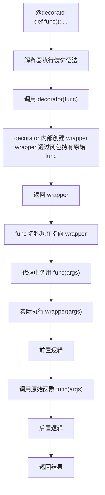
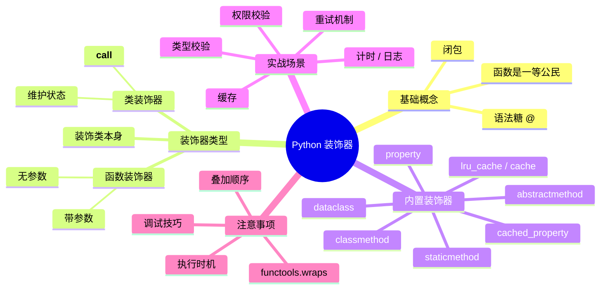

[toc]

# Python 装饰器

## 前置基础：函数是一等公民

Python 中函数是**一等公民**（first-class citizen），可以像普通对象一样被传递和返回。这是装饰器得以存在的根基。

```python
def greet(name):
    return f"Hello, {name}"

# 赋值给变量
say_hello = greet
print(say_hello("Alice"))  # Hello, Alice

# 作为参数传入另一个函数
def apply(func, value):
    return func(value)

print(apply(greet, "Bob"))  # Hello, Bob

# 作为返回值
def get_greeter():
    return greet

fn = get_greeter()
print(fn("Carol"))  # Hello, Carol
```

## 前置基础：闭包

闭包是装饰器的核心机制。内部函数"记住"了外部函数作用域中的变量，即使外部函数已经执行完毕。

```python
def make_multiplier(factor):
    def multiply(x):
        return x * factor  # factor 来自外部作用域，被"捕获"
    return multiply

double = make_multiplier(2)
triple = make_multiplier(3)

print(double(5))  # 10
print(triple(5))  # 15
```

## 装饰器的本质

装饰器是一个**接受函数作为参数、返回新函数的可调用对象**。`@decorator` 是语法糖，完全等价于手动赋值：

```python
@decorator
def func():
    pass

# 与上面完全等价：
def func():
    pass
func = decorator(func)
```

## 工作原理



## 最简装饰器

```python
def my_decorator(func):
    def wrapper(*args, **kwargs):
        print("── 执行前 ──")
        result = func(*args, **kwargs)
        print("── 执行后 ──")
        return result
    return wrapper

@my_decorator
def say_hello(name):
    print(f"Hello, {name}")

say_hello("Alice")
# ── 执行前 ──
# Hello, Alice
# ── 执行后 ──
```

`*args, **kwargs` 让 wrapper 能适配任意函数签名，是标准写法。

## functools.wraps —— 不可忽视的细节

不加 `@wraps` 时，被装饰函数的元信息会丢失：

```python
print(say_hello.__name__)  # wrapper  ← 错误，应该是 say_hello
print(say_hello.__doc__)   # None     ← 文档字符串也丢了
```

**始终使用 `functools.wraps`**，它会将原函数的 `__name__`、`__doc__`、`__annotations__`、`__module__` 等属性复制到 wrapper 上，同时设置 `__wrapped__` 指向原始函数：

```python
from functools import wraps

def my_decorator(func):
    @wraps(func)  # 加上这一行
    def wrapper(*args, **kwargs):
        result = func(*args, **kwargs)
        return result
    return wrapper

@my_decorator
def say_hello(name):
    """向某人打招呼"""
    print(f"Hello, {name}")

print(say_hello.__name__)     # say_hello  ✓
print(say_hello.__doc__)      # 向某人打招呼  ✓
print(say_hello.__wrapped__)  # <function say_hello ...>  ← 原始函数
```

`__wrapped__` 在测试时非常有用，可以绕过装饰器直接测试原始逻辑：

```python
say_hello.__wrapped__("Bob")  # 直接调用原始函数，跳过装饰器
```

## 实用示例：计时装饰器

```python
import time
from functools import wraps

def timer(func):
    @wraps(func)
    def wrapper(*args, **kwargs):
        start = time.perf_counter()
        result = func(*args, **kwargs)
        elapsed = time.perf_counter() - start
        print(f"{func.__name__} 耗时 {elapsed:.4f}s")
        return result
    return wrapper

@timer
def slow_task():
    time.sleep(1)

slow_task()  # slow_task 耗时 1.0013s
```

## 带参数的装饰器

需要三层嵌套：最外层接收装饰器参数，中间层接收函数，最内层是 wrapper。

```mermaid
flowchart LR
    A["repeat(n=3)"] -->|"返回"| B["decorator(func)"]
    B -->|"返回"| C["wrapper(*args, **kwargs)"]
    C -->|"执行"| D["原始函数 × n 次"]
from functools import wraps

def repeat(n):
    """让函数重复执行 n 次"""
    def decorator(func):
        @wraps(func)
        def wrapper(*args, **kwargs):
            result = None
            for _ in range(n):
                result = func(*args, **kwargs)
            return result
        return wrapper
    return decorator

@repeat(3)
def greet(name):
    print(f"Hello, {name}")

greet("Alice")
# Hello, Alice
# Hello, Alice
# Hello, Alice
```

`@repeat(3)` 先执行 `repeat(3)` 得到 `decorator`，再由 `decorator` 包裹 `greet`。

## 装饰器叠加

多个装饰器叠加时，**从下到上依次包裹，从上到下依次执行**。

```python
@decorator_A
@decorator_B
@decorator_C
def func():
    pass

# 等价于：
func = decorator_A(decorator_B(decorator_C(func)))
flowchart TB
    subgraph 调用 func 时的执行顺序
        direction TB
        A["decorator_A 前置逻辑"] --> B["decorator_B 前置逻辑"]
        B --> C["decorator_C 前置逻辑"]
        C --> D["原始函数执行"]
        D --> E["decorator_C 后置逻辑"]
        E --> F["decorator_B 后置逻辑"]
        F --> G["decorator_A 后置逻辑"]
    end
from functools import wraps

def bold(func):
    @wraps(func)
    def wrapper(*args, **kwargs):
        return "<b>" + func(*args, **kwargs) + "</b>"
    return wrapper

def italic(func):
    @wraps(func)
    def wrapper(*args, **kwargs):
        return "<i>" + func(*args, **kwargs) + "</i>"
    return wrapper

@bold
@italic
def text():
    return "Hello"

print(text())  # <b><i>Hello</i></b>
```

## 类作为装饰器

通过实现 `__init__` 和 `__call__`，类也可以作为装饰器。适合需要维护内部状态的场景，比闭包中的 `nonlocal` 更清晰。

```python
from functools import wraps, update_wrapper

class CallCounter:
    """统计函数被调用的次数"""
    def __init__(self, func):
        update_wrapper(self, func)  # 等效于 @wraps，用于类装饰器
        self.func = func
        self.count = 0

    def __call__(self, *args, **kwargs):
        self.count += 1
        print(f"{self.func.__name__} 第 {self.count} 次被调用")
        return self.func(*args, **kwargs)

@CallCounter
def process(data):
    return data * 2

process(10)  # process 第 1 次被调用
process(20)  # process 第 2 次被调用
print(process.count)  # 2
```

## 装饰类

装饰器也可以作用于类本身，用于修改类的行为。经典用例是单例模式：

```python
from functools import wraps

def singleton(cls):
    """确保一个类只有一个实例"""
    instances = {}
    @wraps(cls)
    def get_instance(*args, **kwargs):
        if cls not in instances:
            instances[cls] = cls(*args, **kwargs)
        return instances[cls]
    return get_instance

@singleton
class DatabaseConnection:
    def __init__(self):
        print("建立数据库连接...")

db1 = DatabaseConnection()  # 建立数据库连接...
db2 = DatabaseConnection()  # 不再打印，直接返回已有实例
print(db1 is db2)           # True
```

## 内置装饰器

| 装饰器                       | 来源             | 作用                                               | 典型用途                           |
| ---------------------------- | ---------------- | -------------------------------------------------- | ---------------------------------- |
| `@property`                  | 内置             | 将方法变为属性访问，支持 getter/setter/deleter     | 封装类属性，控制读写逻辑           |
| `@staticmethod`              | 内置             | 定义静态方法，不接收 self 或 cls                   | 工具函数，与类逻辑相关但不依赖实例 |
| `@classmethod`               | 内置             | 第一个参数为类本身 cls                             | 工厂方法、操作类级别状态           |
| `@functools.wraps`           | functools        | 保留被装饰函数的元信息                             | 编写装饰器时必用                   |
| `@functools.lru_cache`       | functools        | 缓存函数调用结果（LRU 策略）                       | 递归、重复计算的性能优化           |
| `@functools.cache`           | functools (3.9+) | 无大小限制的缓存，`lru_cache(maxsize=None)` 的简写 | 纯函数结果缓存                     |
| `@functools.cached_property` | functools (3.8+) | 计算一次后缓存为实例属性                           | 开销大的属性计算                   |
| `@dataclasses.dataclass`     | dataclasses      | 自动生成 `__init__`、`__repr__`、`__eq__` 等       | 数据类定义                         |
| `@abstractmethod`            | abc              | 声明抽象方法，子类必须实现                         | 定义接口/抽象基类                  |
| `@contextmanager`            | contextlib       | 将生成器函数变为上下文管理器                       | 简化 `with` 语句的实现             |
| `@override`                  | typing (3.12+)   | 标记方法覆盖父类，供类型检查器验证                 | 防止拼写错误导致的静默 bug         |

### @property

```python
class Circle:
    def __init__(self, radius):
        self._radius = radius

    @property
    def radius(self):
        return self._radius

    @radius.setter
    def radius(self, value):
        if value < 0:
            raise ValueError("半径不能为负数")
        self._radius = value

    @property
    def area(self):
        import math
        return math.pi * self._radius ** 2

c = Circle(5)
print(c.area)    # 78.539...  像属性一样访问，无需 c.area()
c.radius = 10    # 触发 setter，带验证
c.radius = -1    # ValueError: 半径不能为负数
```

### @classmethod 与 @staticmethod

```python
class Date:
    def __init__(self, year, month, day):
        self.year, self.month, self.day = year, month, day

    @classmethod
    def from_string(cls, date_str):
        """工厂方法：从字符串创建实例"""
        year, month, day = map(int, date_str.split("-"))
        return cls(year, month, day)  # 用 cls 而非 Date，子类继承时更安全

    @staticmethod
    def is_valid(date_str):
        """工具方法：验证格式，不依赖实例或类"""
        parts = date_str.split("-")
        return len(parts) == 3 and all(p.isdigit() for p in parts)

d = Date.from_string("2024-06-15")
print(d.year)                      # 2024
print(Date.is_valid("2024-06-15")) # True
```

### @functools.lru_cache

```python
from functools import lru_cache

@lru_cache(maxsize=128)
def fibonacci(n):
    if n < 2:
        return n
    return fibonacci(n - 1) + fibonacci(n - 2)

print(fibonacci(50))          # 瞬间完成，无缓存时指数级递归
print(fibonacci.cache_info()) # CacheInfo(hits=48, misses=51, maxsize=128, currsize=51)
fibonacci.cache_clear()       # 手动清空缓存
```

`lru_cache` 要求函数参数**可哈希**（hashable），不能传入列表、字典等可变对象。

### @functools.cached_property

```python
from functools import cached_property

class DataSet:
    def __init__(self, data):
        self.data = data

    @cached_property
    def statistics(self):
        print("计算中...")  # 只会打印一次
        return {
            "mean": sum(self.data) / len(self.data),
            "max": max(self.data),
            "min": min(self.data),
        }

ds = DataSet([1, 2, 3, 4, 5])
print(ds.statistics)  # 计算中... {'mean': 3.0, ...}
print(ds.statistics)  # 直接返回缓存，不再计算
```

与 `@property` 的区别：`cached_property` 计算一次后将结果存入实例的 `__dict__`，后续访问直接读字典，不再调用方法。

------

## 实战场景示例

### 权限校验

```python
from functools import wraps

def require_role(*roles):
    """检查当前用户是否具有所需角色"""
    def decorator(func):
        @wraps(func)
        def wrapper(*args, **kwargs):
            # 实际项目中从 session/token 获取
            current_user_role = get_current_user_role()
            if current_user_role not in roles:
                raise PermissionError(
                    f"需要角色 {roles}，当前角色为 {current_user_role!r}"
                )
            return func(*args, **kwargs)
        return wrapper
    return decorator

@require_role("admin", "superuser")
def delete_user(user_id):
    print(f"删除用户 {user_id}")
```

### 重试机制

```python
import time
from functools import wraps

def retry(max_attempts=3, delay=1.0, exceptions=(Exception,)):
    """失败后自动重试"""
    def decorator(func):
        @wraps(func)
        def wrapper(*args, **kwargs):
            last_error = None
            for attempt in range(1, max_attempts + 1):
                try:
                    return func(*args, **kwargs)
                except exceptions as e:
                    last_error = e
                    print(f"第 {attempt} 次失败: {e}，{'重试中...' if attempt < max_attempts else '放弃'}")
                    if attempt < max_attempts:
                        time.sleep(delay)
            raise last_error
        return wrapper
    return decorator

@retry(max_attempts=3, delay=0.5, exceptions=(ConnectionError,))
def fetch_data(url):
    # 模拟不稳定的网络请求
    import random
    if random.random() < 0.7:
        raise ConnectionError("网络超时")
    return f"来自 {url} 的数据"
```

### 缓存（带过期时间）

```python
import time
from functools import wraps

def timed_cache(ttl_seconds=60):
    """带过期时间的缓存装饰器"""
    def decorator(func):
        cache = {}

        @wraps(func)
        def wrapper(*args, **kwargs):
            key = (args, tuple(sorted(kwargs.items())))
            now = time.monotonic()
            if key in cache:
                result, timestamp = cache[key]
                if now - timestamp < ttl_seconds:
                    return result
            result = func(*args, **kwargs)
            cache[key] = (result, now)
            return result

        wrapper.cache_clear = lambda: cache.clear()
        return wrapper
    return decorator

@timed_cache(ttl_seconds=30)
def get_exchange_rate(currency):
    print(f"请求 {currency} 汇率...")
    return 7.25  # 模拟 API 调用
```

### 类型校验（现代写法，配合类型注解）

```python
import inspect
from functools import wraps

def validate_types(func):
    """根据函数的类型注解自动校验参数类型"""
    hints = func.__annotations__

    @wraps(func)
    def wrapper(*args, **kwargs):
        bound = inspect.signature(func).bind(*args, **kwargs)
        bound.apply_defaults()
        for param, value in bound.arguments.items():
            if param in hints and param != "return":
                expected = hints[param]
                if not isinstance(value, expected):
                    raise TypeError(
                        f"参数 {param!r} 期望 {expected.__name__}，"
                        f"实际传入 {type(value).__name__}"
                    )
        return func(*args, **kwargs)
    return wrapper

@validate_types
def add(x: int, y: int) -> int:
    return x + y

add(1, 2)      # 正常
add(1, "2")    # TypeError: 参数 'y' 期望 int，实际传入 str
```

------

## 装饰器的执行时机

这是新手常见的困惑点：装饰器在**模块加载时**就执行，而不是在函数被调用时。

```python
print("模块开始加载")

def decorator(func):
    print(f"  → 装饰 {func.__name__}")  # 模块加载时执行
    def wrapper(*args, **kwargs):
        print(f"  → 调用 {func.__name__}")  # 函数调用时执行
        return func(*args, **kwargs)
    return wrapper

@decorator
def foo():
    pass

@decorator
def bar():
    pass

print("模块加载完毕，开始调用")
foo()
bar()
```

输出：

```
模块开始加载
  → 装饰 foo
  → 装饰 bar
模块加载完毕，开始调用
  → 调用 foo
  → 调用 bar
```

这一特性在 Flask/FastAPI 的路由注册中被广泛利用：`@app.route("/")` 在模块导入时就完成了路由注册。

------

## 常见陷阱与最佳实践

| 问题                        | 错误做法                          | 正确做法                                     |
| --------------------------- | --------------------------------- | -------------------------------------------- |
| 元信息丢失                  | wrapper 不加任何处理              | 始终使用 `@functools.wraps`                  |
| 忘记返回值                  | wrapper 内不写 `return result`    | 明确 `return func(*args, **kwargs)`          |
| 装饰器顺序混乱              | 随意叠加，不考虑执行顺序          | 从下到上包裹，从上到下执行，画图确认         |
| 可变默认参数                | 用列表/字典作为缓存 key           | 确保 key 可哈希，或用 `json.dumps` 序列化    |
| 类装饰器忘记 update_wrapper | 直接 `self.func = func`           | 调用 `update_wrapper(self, func)`            |
| 带参数装饰器层数写错        | 只写两层                          | 带参数必须三层：参数层 → 装饰层 → wrapper 层 |
| 装饰有状态的方法            | 在类方法上用普通装饰器，忽略 self | 确保 wrapper 正确透传 self，或用类装饰器     |

------

## 调试技巧

`__wrapped__` 属性（由 `@wraps` 自动设置）可以逐层剥开装饰器，方便测试原始逻辑：

```python
@timer
@retry(max_attempts=3)
def my_func():
    pass

# 剥开最外层 timer
inner = my_func.__wrapped__
# 再剥一层 retry
original = inner.__wrapped__
```

`inspect.unwrap()` 可以一次性剥到底：

```python
import inspect
original = inspect.unwrap(my_func)
```

------

## 知识结构总览



------

装饰器的核心思想是**关注点分离**：把日志、缓存、权限、重试这些横切逻辑从业务代码中剥离出来，让每个函数只做一件事。掌握装饰器之后，阅读 Flask、FastAPI、Django、pytest 等框架的源码会顺畅很多，因为它们大量依赖这一机制。