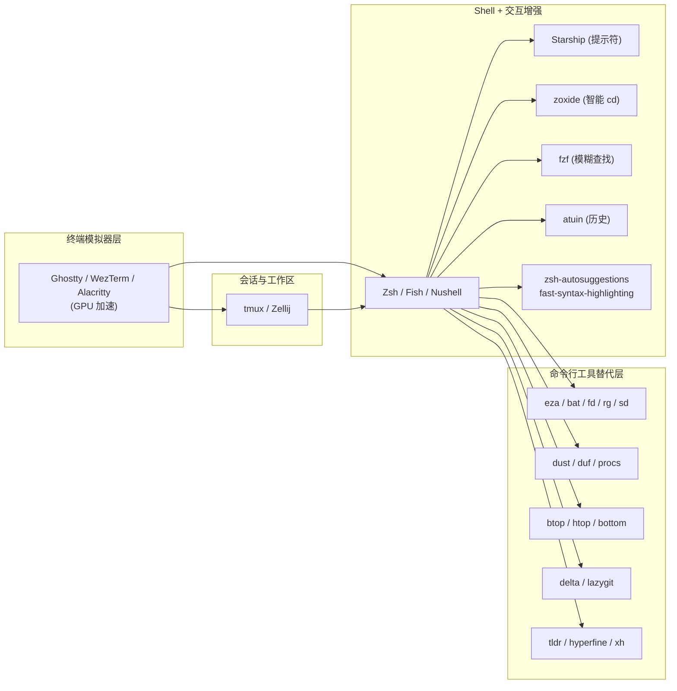
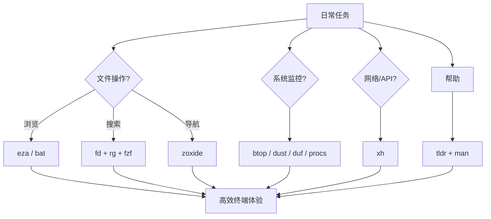

[toc]


## 现代化命令行工具

传统 Unix 工具(`ls`、`cat`、`grep`、`find`、`du`、`ps`、`top`……)诞生于 1970–1990 年代,当时终端只有 80 列黑白字符、没有 Unicode、没有 Git、也没有 24-bit 真彩色。

今天的运维环境已完全不同:终端普遍支持颜色、Unicode 图标、实时预览等旧工具原本没被设计支持的特性,而 Rust 生态则悄悄重塑了命令行的格局,涌现出一批不只是复刻传统工具、而是对其进行现代化的替代品。

这些"现代化"工具通常具备以下共同特征:

- **合理的默认值**:开箱即用就有颜色、人类可读的单位、Git 感知,不必再堆一串参数。
- **性能优势**:多数用 Rust 或 Go 重写,大量利用并行 I/O。
- **交互友好**:模糊搜索、实时预览、可交互 TUI。
- **跨平台**:单个静态二进制,Linux / macOS / Windows 通吃。
- **对脚本仍然安全**:大多数工具在检测到管道或非 TTY 输出时会自动关闭颜色/图标,不破坏管道语义。

不过要先说一个**重要的注意事项**:在生产服务器、脚本、Ansible/CI 中,**依然应优先使用系统自带的 POSIX 工具**。在你自己控制的终端里日常使用时,现代化工具在可读性上确实占优;但如果脚本要跑在别处,还是要针对 ls 或对应的标准工具来写。

现代工具主要用于**交互式**场景。

---

## 全景一览:传统工具 → 现代化替代品

下表按用途归类,是全文的地图。后面会挑重点逐个展开。

| 用途分类       | 传统工具        | 现代化替代                   | 语言          | 一句话卖点                      |
| -------------- | --------------- | ---------------------------- | ------------- | ------------------------------- |
| 目录列表       | `ls`            | **eza**(exa 的维护派生)      | Rust          | 颜色 + 图标 + Git 状态 + 树视图 |
| 文件查看       | `cat`           | **bat**                      | Rust          | 语法高亮 + 行号 + 分页          |
| 递归搜索       | `grep`          | **ripgrep** (`rg`)           | Rust          | 极快,默认遵守 `.gitignore`      |
| 文件查找       | `find`          | **fd**                       | Rust          | 短语法、智能大小写、并行遍历    |
| 目录跳转       | `cd`            | **zoxide** (`z`)             | Rust          | "frecency" 算法记忆常用目录     |
| 磁盘占用       | `du`            | **dust**                     | Rust          | 树形可视化,按大小排序           |
| 磁盘空间       | `df`            | **duf**                      | Go            | 彩色分组表格                    |
| 进程列表       | `ps`            | **procs**                    | Rust          | 彩色输出,附带端口/Docker 信息   |
| 系统监控       | `top`/`htop`    | **btop**、**bottom** (`btm`) | C++ / Rust    | 图形化,含磁盘/网络/GPU          |
| 文件替换       | `sed`           | **sd**                       | Rust          | 直观的 `find/replace` 语法      |
| 差异查看       | `diff`          | **delta**                    | Rust          | Git diff 高亮、并排视图         |
| HTTP 客户端    | `curl`/`wget`   | **HTTPie**、**xh**           | Python / Rust | 人类可读的 JSON 输出            |
| 帮助文档       | `man`           | **tldr / tealdeer** (`tldr`) | Rust          | 简明示例式速查                  |
| 命令基准测试   | `time`          | **hyperfine**                | Rust          | 多次采样、统计对比              |
| Shell 历史     | `Ctrl-R`        | **atuin**                    | Rust          | 全文搜索、跨机同步              |
| 模糊查找器     | (无)            | **fzf**                      | Go            | 通用交互式模糊选择              |
| Shell 提示符   | 各家自定义      | **Starship**                 | Rust          | 跨 Shell、模块化、快            |
| 多路复用器     | `tmux`/`screen` | **Zellij**                   | Rust          | 内建布局与插件市场              |
| Git TUI        | `git` CLI       | **lazygit**、**gitui**       | Go / Rust     | 键盘驱动的 Git 面板             |
| 文件管理器 TUI | `mc`            | **yazi**、**broot**          | Rust          | 图像/PDF 预览、模糊导航         |

---

## 文件与目录:eza、bat、fd

### eza:`ls` 的现代替代

先说一个基础事实:eza 是原始 exa 项目的活跃维护继任者(exa 已停止积极开发);eza 包含了 exa 的全部功能并加入了大量改进和 bug 修复。exa 于 2023 年停止收到更新,eza 拥有 exa 的全部特性外加持续开发、bug 修复和新功能。所以现在**请安装 eza,不要再装 exa**。

eza 通过颜色区分文件类型与元数据;它了解符号链接、扩展属性和 Git;并且体积小、速度快、只有一个二进制。相比 `ls`,eza 增加了:按文件类型着色、Git 状态指示(修改/新建/忽略)、`--icons` 提供的文件图标、`--tree` 树视图、列头,以及更好的默认值——速度相同但信息量大得多。

**常用命令映射**:

| 需求                 | 传统 `ls` | eza                             |
| -------------------- | --------- | ------------------------------- |
| 长列表               | `ls -l`   | `eza -l`                        |
| 长列表 + 隐藏文件    | `ls -la`  | `eza -la`                       |
| 按大小排序           | `ls -lS`  | `eza -l --sort=size`            |
| 按修改时间(最新在前) | `ls -lt`  | `eza -l --sort=modified`        |
| 树视图               | `tree`    | `eza --tree --level=2`          |
| Git 状态列           | (无)      | `eza -l --git`                  |
| 目录优先             | (无)      | `eza --group-directories-first` |

**一个"肌肉记忆陷阱"**:在 eza 中 `-h` 不是"人类可读大小"(那些默认就已经开启);`-h` 意为 `--header`,即打印列头行——大小默认就是人类可读,几乎不用操心。

**推荐别名**(添加到 `~/.zshrc` 或 `~/.bashrc`):

```bash
alias ls='eza --group-directories-first --icons'
alias ll='eza -l --git --group-directories-first --icons'
alias la='eza -la --git --group-directories-first --icons'
alias lt='eza --tree --level=2 --icons'
```

图标需要 Nerd Font 字体才能正常显示。默认情况下,当输出被管道或重定向到其他工具时,图标会被禁用以防止特殊字符干扰其他工具;如果需要在管道中强制显示图标,使用 `--icons=always`。

### bat:`cat` 的现代替代

bat 通过语法高亮、Git 集成、行号和自动分页解决了 cat 阅读长文件累的问题,同时不丢失与 cat 的兼容性。bat 是自带语法高亮的分页器,对非交互场景会回退到纯文本,可以安全地别名替代 cat。

- **Debian/Ubuntu 提醒**:官方仓库中该命令名可能是 `batcat` 而非 `bat`,可自行加别名 `alias bat=batcat`。
- 与 `less` 集成:`export MANPAGER="sh -c 'col -bx | bat -l man -p'"` 可以给 `man` 页面加语法高亮。
- 与 `fzf` 集成做预览:`fzf --preview 'bat --color=always --style=numbers --line-range=:500 {}'`。

### fd:`find` 的现代替代

fd 使用短语法(`fd PATTERN` 而不是 `find -iname '*PATTERN*'`),用颜色高亮不同文件类型;智能大小写:默认不区分大小写,若模式含大写字母则切换为区分大小写;由于并行目录遍历因此非常快。**提醒**:在 Ubuntu 上要使用 `fdfind` 才能调用该命令(仓库名冲突所致,一般会自行 `alias fd=fdfind`)。

常用对照:

| 需求               | `find`                                    | `fd`                         |
| ------------------ | ----------------------------------------- | ---------------------------- |
| 按名称查找         | `find . -iname '*.log'`                   | `fd log`                     |
| 按扩展名           | `find . -name '*.rs'`                     | `fd -e rs`                   |
| 只找目录           | `find . -type d -name build`              | `fd -t d build`              |
| 排除某目录         | `find . -path ./node_modules -prune -o …` | `fd -E node_modules pattern` |
| 对每个结果执行命令 | `find . -name '*.tmp' -exec rm {} \;`     | `fd -e tmp -x rm`            |

---

## 搜索与替换:ripgrep、sd

### ripgrep (`rg`)

ripgrep 是快速的 grep 替代品,带有智能默认值和 gitignore 集成。它是当前**事实标准**的代码搜索工具,VS Code 的全局搜索底层用的就是它。

关键差异:

- **默认递归**:直接 `rg pattern` 就是递归搜索,不需要 `-r`。
- **默认遵守 `.gitignore`**:不会搜到 `node_modules/` 之类。想搜隐藏或被忽略文件用 `rg -uu`。
- **默认 UTF-8**,支持二进制检测。
- 语法比 grep 现代:`rg -t py 'def foo'` 只搜 Python 文件。

### sd

sd 是直观的 find & replace CLI,作为 sed 的替代品。对比 `sed`:

- `sed -i 's/foo/bar/g' file.txt`
- `sd 'foo' 'bar' file.txt`

不再需要为反斜杠转义头痛,正则语法就是标准 PCRE 风格。

---

## 目录跳转:zoxide

zoxide 消除了反复 `cd` 深入目录的痛苦——它是一个学习你习惯的更智能 cd 命令;用过一段时间后,`z myproject` 可以直接把你带到 `~/projects/github.com/username/myproject`,即使你现在深在别处;它使用 "frecency"(frequency + recency)算法给目录打分,常去的地方最容易到达。

Shell 集成提供了 `zi` 用于交互式目录选择,并会记录你访问过的每一个目录。

**安装与启用**(Bash / Zsh):

```bash
# 1. 安装(以 macOS 为例)
brew install zoxide fzf

# 2. 在 ~/.zshrc 末尾添加(必须在 shell 配置最后)
eval "$(zoxide init zsh --cmd cd)"   # 用 cd 直接替换掉原始 cd
```

fzf 是命令行模糊查找器,被 zoxide 用于补全/交互选择;zoxide 支持的最低 fzf 版本为 v0.51.0。

---

## 磁盘用量:dust、duf

dust 提供更好的 du 体验,以树形显示目录大小并按大小排序;想知道什么在吞噬磁盘空间? dust 可视化地展示,一眼看出该从哪里清理。

**duf** 则是 `df` 的替代,把挂载点/文件系统类型/使用率分组显示为彩色表格,能自动区分本地设备、网络挂载、特殊文件系统。

---

## 进程与系统监控:htop、btop、bottom、procs

这是运维场景的**核心工具组**,值得单独讨论。

### 三者定位

- htop 是 Hisham Muhammad 用 ncurses 写的重写版,现在由 htop 社区维护(版本 3.3.0);它增加了可滚动的进程列表、顶部可视的 CPU/内存表条、鼠标支持和屏幕底部显示的 F 键快捷键;可以直接在界面里 kill、renice 和 strace 进程。
- btop++ 是原 Python 版 bpytop 的 C++ 重写,由 aristocratos 维护,当前版本 1.4.0;它渲染完整的终端 UI,带盒线字符、响应式布局、单视图内的 CPU/内存/磁盘/网络图表,并可通过 NVIDIA NVML 可选监控 GPU。
- **bottom (`btm`)**:Rust 编写,最大特色是可通过 TOML 完全自定义布局。如果你是键盘党想要自定义监控布局,选 bottom;TOML 布局系统是真正独一无二的;一旦配置好,它就是你想要的一切,没有多余。bottom 的调用命令是 `btm`,不是 `bottom`,也不是 `bot`——是 `btm`(容易踩坑)。

### 选型建议

| 场景                                   | 推荐       | 理由                                                         |
| -------------------------------------- | ---------- | ------------------------------------------------------------ |
| 资源受限(树莓派、廉价 VPS、256 MB LXC) | `htop`     | 在资源受限的机器上首选 htop;它在任何地方都能跑,在每个发行版基础仓库中都有,几乎不占资源 |
| 开发工作站、家庭实验室                 | `btop`     | 在开发机或家庭实验室服务器上定期检查时选 btop;视觉质量提升了可用性;CPU 突发时,滚动的时间序列图讲的故事是单个条形图无法表达的;磁盘和网络视图意味着你很少需要打开另一个工具 |
| 生产服务器 SSH                         | `htop`     | SSH 到客户服务器时会本能地打 htop;系统监控工具给已经吃紧的服务器增加显著负载的风险不能忽视;最终建议:本地机器用 btop 追求"惊艳"和详细分析,但专业服务器管理保留 htop 在工具箱里 |
| 需要脚本化机器可读输出                 | 原始 `top` | top 有批处理模式,是 htop 和 btop 都不能有效支持的;`top -b -n 1` 产生适合管道到脚本、cron 或日志聚合器的机器可读输出 |
| 历史回溯性能问题(次日排查)             | `atop`     | 以守护进程记录快照,可以像录像回放一样查看过去某时段的资源消耗 |
| 自定义布局爱好者                       | `bottom`   | TOML 布局最强                                                |

### 一个重要澄清

btop 不能替代真正的监控系统:它是本地终端工具,没有数据持久化、没有告警、没有指标远程访问;它是实时检查器,不是监控系统;应与 Prometheus/node_exporter 搭配使用以获得历史数据和告警。生产环境的可观测性还是要靠 Prometheus + Grafana + Loki 这类栈,现代 TUI 只是**排查现场**的利器。

### procs:`ps` 的现代替代

procs 是 ps 的现代替代,用 Rust 写就;它提供彩色的、人类可读的输出,根据终端背景自动检测主题;并提供 ps 不支持的额外信息:TCP/UDP 端口、读/写吞吐、Docker 容器名和更多内存信息。对定位"哪个进程在占用某端口"特别有用。

---

## Git 相关:delta、lazygit

**delta**:git diff / diff 的语法高亮查看器。delta 是 git 和 diff 输出的查看器,允许你对 diff 的布局和样式做大量修改,同时可以任意保持接近默认的 git/diff 输出。

配置(`~/.gitconfig`):

```ini
[core]
    pager = delta
[interactive]
    diffFilter = delta --color-only
[delta]
    navigate = true
    line-numbers = true
    side-by-side = true
```

**lazygit / gitui**:全键盘 Git TUI,处理 stage、commit、rebase、cherry-pick 特别快;lazygit 用 Go 写,`gitui` 用 Rust 写、更轻量。GitUI 是 Git 的快速终端 UI,适合小操作,类似 lazygit。

---

## HTTP、文档、基准测试

| 场景         | 传统                                                         | 现代化                   | 典型用法                           |
| ------------ | ------------------------------------------------------------ | ------------------------ | ---------------------------------- |
| HTTP 请求    | `curl -X POST -H 'Content-Type: application/json' -d '{"a":1}' …` | `xh` / `HTTPie`          | `xh POST api.example.com a=1`      |
| 命令速查     | `man ls`(几千行)                                             | `tldr ls`(常用示例 5 条) | `tldr tar`                         |
| 命令基准测试 | `time cmd`                                                   | `hyperfine`              | `hyperfine 'rg foo' 'grep -r foo'` |

- xh 是用户友好、快速的 HTTP 客户端,带漂亮打印输出,是 Python HTTP 工具的 Rust 重写。
- tealdeer 是 tldr 的极速实现——tldr 是显示简化的、基于示例的、社区驱动的手册页的命令行程序。适合"记不清 `tar` 到底哪个参数是压缩"的场景。

---

## Shell 层增强:Starship、fzf、atuin

这些不是替代某个具体命令,而是**让整个 Shell 体验现代化**。

### Starship — 跨 Shell 提示符

- 单个二进制,支持 Bash / Zsh / Fish / PowerShell / Nushell。
- 自动检测 Git 分支、语言运行时(Node/Rust/Go/Python)、Kubernetes context、AWS profile、云环境。
- 启用只需在 shell rc 最后加一行:`eval "$(starship init zsh)"`。
- 配置在 `~/.config/starship.toml`,支持大量预设。

### fzf — 万能模糊查找器

fzf 真正的威力来自它与其他工具的集成:可以预览文件(用 bat 语法高亮)、搜索 Git 提交,甚至为复杂命令创建交互式菜单;和 zoxide 的 `zi` 命令搭配可以交互式模糊搜索目录跳转;开始用后你会想不起以前是怎么工作的。

配套的常见集成:

- `Ctrl-R`:模糊搜索历史命令
- `Ctrl-T`:在当前目录选择文件路径插入命令行
- `Alt-C`:模糊选择并切换目录
- 与 `git`、`kubectl`、`docker` 等 CLI 结合做交互式选择

### atuin — 智能历史

- 把 shell 历史存进 SQLite,`Ctrl-R` 变成全文模糊搜索并按上下文(目录、退出码、时间)过滤。
- 可选端到端加密同步到自建/托管服务器,多机共享历史。
- 对经常在多台服务器间跳转的运维尤其有价值。

---

## 终端多路复用:tmux vs Zellij

`tmux` 依然是稳如泰山的默认选择;Zellij 是有良好默认值、UI 和插件社区的终端工作区和多路复用器,可替代 tmux 或 screen。**要点差异**:

- **Zellij**:开箱即用有底部状态栏与快捷键提示,新手友好;插件生态用 WASM。
- **tmux**:极度稳定、生态成熟、脚本化最强;学习曲线更陡但天花板高。
- **建议**:服务器远程会话用 tmux(几乎所有发行版都有);本地日常用 Zellij 也很好。

---

## 一张典型的"现代化终端"架构图

下面这张图展示一个 2026 年比较常见的组合,以及各组件的角色:



---

## 安装与部署最佳实践

### 优先级建议(按投资回报排序)

对**服务器管理员**而言,如果只装 5 个工具,建议这个顺序:

1. **ripgrep** — 日志/代码搜索,收益立竿见影。
2. **fzf** — 一次学习,处处受益。
3. **bat** — 看配置文件、日志片段舒服 10 倍。
4. **htop 或 btop** — 排查现场必备。
5. **zoxide** — 用一周就再也回不去。

### 包管理器一览

| 系统                     | 命令                                                         |
| ------------------------ | ------------------------------------------------------------ |
| macOS                    | `brew install eza bat fd ripgrep zoxide fzf starship dust duf btop procs tealdeer delta lazygit hyperfine` |
| Arch Linux               | `sudo pacman -S eza bat fd ripgrep zoxide fzf starship btop hyperfine` |
| Debian/Ubuntu (较新版本) | `sudo apt install bat fd-find ripgrep fzf zoxide` (eza 需通过第三方仓库) |
| RHEL/Rocky               | `sudo dnf install bat fd-find ripgrep fzf`                   |
| 通用/无 root             | `cargo install <tool>` 或从 GitHub releases 下二进制         |

`Debian/Ubuntu` 的两个常见坑:命令名可能是 `batcat` 和 `fdfind`,加别名即可。

### 服务器上的部署策略

- **只装到自己的 `~/.local/bin`**:不影响其他用户,不需要 root。
- **保留原命令不被别名遮盖**:脚本仍然要能 `\ls`、`\cat` 直接调原始版本。写别名时用 `alias ls='eza …'`,脚本里出现 `\ls` 就绕过别名。
- **别在共享账号或 root 上启用花哨的提示符**:排障时要的是可预测的行为。
- **不要在 CI/CD、Ansible playbook 里依赖 `bat`/`eza`**:目标机器上不一定有,而且这些工具的输出格式**不承诺 POSIX 兼容**。

### 一份可以直接用的 `.zshrc` 片段

```bash
# 只有在工具存在时才启用别名,避免在裸机上出错
command -v eza    >/dev/null && alias ls='eza --group-directories-first --icons' \
                              && alias ll='eza -l --git --icons' \
                              && alias la='eza -la --git --icons'
command -v bat    >/dev/null && alias cat='bat --paging=never'
command -v batcat >/dev/null && alias bat='batcat' && alias cat='batcat --paging=never'
command -v fdfind >/dev/null && alias fd='fdfind'
command -v rg     >/dev/null && alias grep='rg'   # 谨慎:破坏脚本兼容性,酌情
command -v dust   >/dev/null && alias du='dust'

# Shell 集成
command -v zoxide   >/dev/null && eval "$(zoxide init zsh --cmd cd)"
command -v starship >/dev/null && eval "$(starship init zsh)"
command -v atuin    >/dev/null && eval "$(atuin init zsh)"
[ -f ~/.fzf.zsh ] && source ~/.fzf.zsh
```

---

## 常见陷阱与建议

- **不要把现代工具的输出喂给依赖 POSIX 格式的脚本**。例如 `eza -l` 的列顺序、宽度、颜色转义并不与 `ls -l` 一致;`awk '{print $NF}'` 之类脚本会翻车。
- **别名要"防御式"编写**:上面例子里的 `command -v ... && alias` 模式能让配置在裸机也能加载成功。
- **在生产 SSH 会话里避免图标 / Nerd Font 依赖**:对方终端没装字体会显示成方块 `□`。
- **注意 `.gitignore` 语义**:`rg` 默认跳过被 gitignore 的文件,排查生产日志时可能"看不到" `logs/`;此时用 `rg -uu`。
- **性能不是万灵药**:`fd` / `rg` 通过并行 I/O 提速,在 NFS、SMB、机械盘上并没有想象中那么大的差距,还可能让磁盘队列爆掉。
- **谨慎完全替换 `cd`**:`zoxide init --cmd cd` 会覆盖内建 `cd`,极少数情况下(比如某些 shell 函数)会有微妙差异,遇到问题可以退回 `z` 作为独立命令。
- **文档与手册**:现代工具的 man page 一般较薄;首选 `tool --help` 或访问 GitHub README。

---

## 最佳实践与实用指导

1. **渐进采用**：先装 bat、rg、fd、eza、zoxide、fzf、btop。体验提升最明显。
2. **组合工作流**：
   - 找文件并预览：`fd | fzf --preview 'bat -n --color=always {}'`
   - 搜索代码：`rg pattern | fzf`
   - 磁盘清理：`dust` 定位 → `ncdu` 交互删除。
3. **Shell 增强**：zsh + oh-my-zsh/powerlevel10k 或 starship + fish/nushell。nushell 本身是现代化 shell（结构化数据）。
4. **服务器注意**：保持经典工具可用；用 SSH 配置或跳板机装现代工具；脚本用 `#!/usr/bin/env bash` 并检测。
5. **配置管理**：dotfiles 仓库（Git）管理别名与配置；用 chezmoi 或 stow。
6. **性能与安全**：Rust 工具通常安全；注意权限（如 dust 大目录）。JSON 输出利于管道到 jq 或 AI 工具。
7. **学习路径**：用 tldr 快速上手新工具；`tool --help`；实践替换日常命令。
8. **故障排除**：别名冲突时用 `\ls` 或 `command ls`；字体图标缺失检查 Nerd Font。

**示意图：典型现代化工作流**



## 参考与知识时效说明

- **本回答的时效性内容来源**:来自 2025 年下半年至 2026 年初的公开资料,包括 itsfoss、Better Stack、LinuxLinks、GitHub 官方仓库、Terminal Trove 等([eza GitHub](https://github.com/eza-community/eza)、[zoxide GitHub](https://github.com/ajeetdsouza/zoxide)、Better Stack 的 eza 指南、blackMORE Ops 的监控工具对比、SumGuy 的 btop/htop/bottom 对比等)。
- **版本信息**:文中提到的 htop 3.3.0、btop++ 1.4.x 来自 2026 年前后的对比文章,写作时是当时最新的稳定分支;实际安装时以你的发行版仓库为准。
- **我自己的知识截止**:约 2025 年初。工具**是否仍在维护**、**最新版本号**、**exa vs eza 的现状**等对时效敏感的判断,以本次搜索到的资料为准。若你要做正式采购/部署决策,建议再核对一下对应工具 GitHub 仓库的最近提交日期。