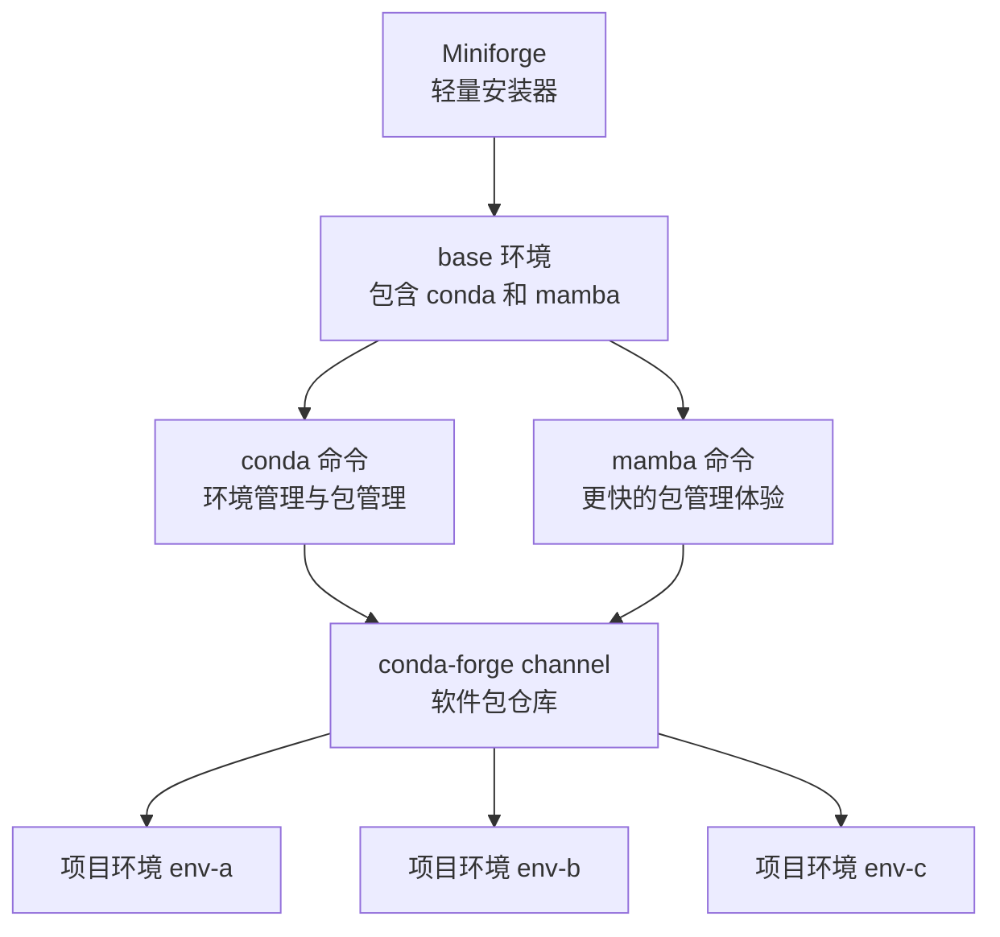
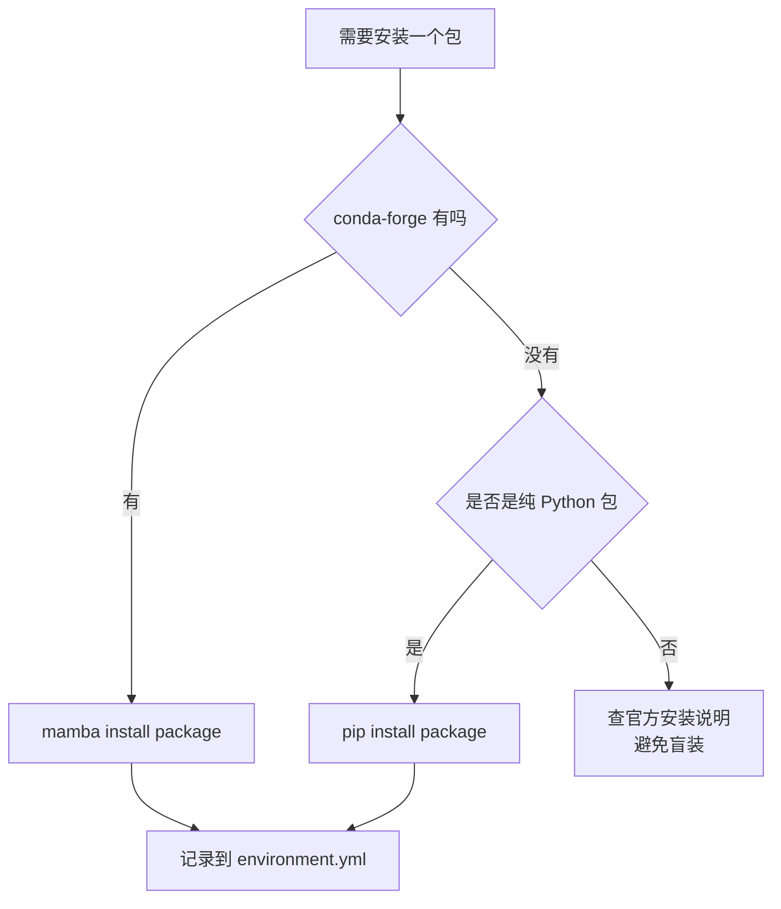

[toc]


## 学习大纲

| 模块       | 你需要掌握什么                                         | 学完后能做什么                                               |
| ---------- | ------------------------------------------------------ | ------------------------------------------------------------ |
| 定位       | Miniforge、Conda、Mamba、conda-forge 的关系            | 明白为什么很多 Python、数据科学、科学计算用户会优先选择 Miniforge |
| 安装       | Windows、macOS、Linux、WSL 的安装方式                  | 正确安装并避免 PATH、base 环境、架构选择等新手坑             |
| 环境管理   | 创建、激活、更新、删除环境                             | 为每个项目创建独立环境，而不是污染全局 Python                |
| 包管理     | `conda install`、`mamba install`、`pip install` 的边界 | 知道什么时候用 conda/mamba，什么时候再用 pip                 |
| 渠道规则   | channel、channel priority、strict priority             | 避免混用 `defaults` 与 `conda-forge` 导致依赖冲突            |
| 可复现性   | `environment.yml`、`conda export`、lockfile            | 把环境交给别人、CI、服务器或未来的自己复现                   |
| 现代化选择 | Miniforge、Micromamba、Pixi、uv、conda-lock            | 根据项目类型选择更合适的工具链                               |
| 最佳实践   | 项目结构、版本约束、清理、迁移、Jupyter 配置           | 建立长期稳定、可维护的 Python 环境管理习惯                   |

------

## Miniforge 是什么

**Miniforge** 是一个由 **conda-forge** 社区维护的轻量级 Conda 发行版。它本质上是一个安装器，用来给你安装一套最小化的 Conda/Mamba 工具链，并默认配置为使用 **conda-forge channel**。官方 Miniforge 仓库说明，它提供面向 conda-forge 的 Conda 和 Mamba 最小安装器，并且 `base` 环境中的包来自 `conda-forge`，`conda-forge` 被设置为默认且唯一的 channel。([GitHub](https://github.com/conda-forge/miniforge))

你可以把它理解成：

| 名称                  | 英文术语                              | 作用                                                         | 是否推荐给新手             |
| --------------------- | ------------------------------------- | ------------------------------------------------------------ | -------------------------- |
| Miniforge             | Miniforge distribution                | 安装 Conda、Mamba，并默认使用 conda-forge                    | 推荐                       |
| Conda                 | Conda package and environment manager | 管理环境和二进制包                                           | 推荐掌握                   |
| Mamba                 | Mamba package manager                 | Conda 的高性能替代命令，语法高度相似                         | 推荐日常使用               |
| conda-forge           | conda-forge channel/community         | 社区驱动的软件包仓库                                         | 推荐作为主 channel         |
| Miniconda             | Miniconda distribution                | Anaconda 官方的轻量 Conda 安装器，默认偏向 `defaults` channel | 可用，但新手容易混 channel |
| Anaconda Distribution | Anaconda Distribution                 | 大而全的科学计算发行版                                       | 不适合作为现代轻量起点     |
| Mambaforge            | Mambaforge distribution               | 曾经的 Mamba 版安装器                                        | 已不推荐                   |

conda-forge 官方下载页也明确称 Miniforge 是首选的 conda-forge 安装器，并且包含 `conda`、`mamba` 及其依赖。([Conda-Forge](https://conda-forge.org/download/))

------

## 为什么现在推荐 Miniforge

Miniforge 的核心价值不是“它能安装 Python”，而是它帮你从一开始就选择了更现代、更一致的生态入口：

| 优势                 | 解释                                                         |
| -------------------- | ------------------------------------------------------------ |
| 轻量                 | 不像 Anaconda Distribution 一次性安装大量包，而是按项目需要安装 |
| 默认 conda-forge     | 省去手动配置 channel 的步骤                                  |
| 自带 Mamba           | 可以用更快的求解器安装复杂依赖                               |
| 跨平台               | 支持 Windows、macOS、Linux、WSL，并支持 Apple Silicon 等架构 |
| 更适合项目隔离       | 鼓励每个项目一个环境                                         |
| 更适合科研与工程复现 | 配合 `environment.yml`、lockfile、CI 更自然                  |

conda-forge 文档也建议使用 Miniforge 而不是 Anaconda Distribution，理由包括减少冲突、下载更小，并建议始终在新环境中安装包而不是污染 `base` 环境。([Conda-Forge](https://conda-forge.org/docs/user/introduction/))

------

## Miniforge、Conda、Mamba、conda-forge 的关系

可以用下面的图理解：



这张图里的关键点是：**Miniforge 只是入口，真正日常使用的是 Conda/Mamba；包主要来自 conda-forge；你的项目应该运行在独立环境里，而不是 base 环境里。**

------

## 核心概念

### 环境

**环境**，英文是 **environment**，是一个隔离的软件运行空间。一个环境可以有自己的 Python 版本、NumPy 版本、PyTorch 版本、R 包、C/C++ 依赖、命令行工具等。

Conda 官方文档说明，Conda 可以创建、导出、列出、删除、更新包含不同 Python 或包版本的环境；在不同环境之间切换叫做激活环境。([Conda 文档](https://docs.conda.io/docs/user-guide/tasks/manage-environments.html))

例如：

```bash
mamba create -n ds python=3.12 numpy pandas jupyterlab
conda activate ds
```

这里：

| 片段                      | 含义             |
| ------------------------- | ---------------- |
| `mamba create`            | 创建环境         |
| `-n ds`                   | 环境名叫 `ds`    |
| `python=3.12`             | 指定 Python 版本 |
| `numpy pandas jupyterlab` | 要安装的包       |
| `conda activate ds`       | 激活环境         |

新手要记住一句话：**不要把所有包都装在一个全局 Python 里，要为每个项目创建一个环境。**

------

### base 环境

`base` 是 Miniforge 安装后自带的基础环境。它的主要作用是承载 `conda`、`mamba` 这些管理工具。

最佳实践是：**不要在 base 里做项目开发，不要随便往 base 里装大量项目依赖。**

Mamba 官方安装文档也提醒，不要把东西安装进 `base` 环境，因为这可能破坏安装本身。([mamba.readthedocs.io](https://mamba.readthedocs.io/en/latest/installation/mamba-installation.html))

推荐做法：

```bash
conda config --set auto_activate_base false
```

Miniforge README 也给出了关闭自动激活 `base` 的命令，并建议创建、激活其他项目环境来工作。([GitHub](https://github.com/conda-forge/miniforge))

------

### channel

**channel** 可以理解为 Conda 包仓库。`conda-forge` 就是一个非常大的社区包仓库。

在 Miniforge 中，`conda-forge` 默认已经配置好。官方 Miniforge 仓库说明，Miniforge 会将 `conda-forge` 设为默认且唯一的 channel。([GitHub](https://github.com/conda-forge/miniforge))

查看当前配置：

```bash
conda config --show channels
conda config --show channel_priority
```

查看某个环境里的包来自哪里：

```bash
conda list --show-channel-urls
```

------

### channel priority

**channel priority** 是“当多个 channel 都有同名包时，优先从哪个 channel 选择”的规则。

Conda 官方文档说明，严格 channel 优先级，英文是 **strict channel priority**，可以显著加快 Conda 操作并减少包不兼容问题，并推荐在可行时设置为 `strict`。([Conda 文档](https://docs.conda.io/projects/conda/en/stable/user-guide/tasks/manage-channels.html))

推荐配置：

```bash
conda config --set channel_priority strict
```

不过使用 Miniforge 时，通常已经是围绕 `conda-forge` 工作，不需要像 Miniconda 那样额外做很多 channel 调整。

------

### dependency solver

**依赖求解器**，英文是 **dependency solver**，负责计算“为了安装 A 包，还需要安装哪些版本的 B、C、D 包，并且它们之间不能冲突”。

例如你安装：

```bash
mamba install scipy matplotlib
```

求解器要处理的问题包括：

| 问题                | 示例                                   |
| ------------------- | -------------------------------------- |
| Python 版本是否兼容 | SciPy 是否支持 Python 3.13             |
| 二进制 ABI 是否兼容 | NumPy、SciPy、OpenBLAS 是否匹配        |
| 操作系统是否支持    | Windows、macOS、Linux 包是否存在       |
| CPU 架构是否支持    | x86_64、arm64、aarch64                 |
| channel 是否一致    | 是否混用了 `defaults` 和 `conda-forge` |

`mamba` 的主要优势就是依赖求解通常比传统 `conda` 更快。Mamba 官方文档建议新安装从 Miniforge 开始，并说明 Miniforge 预配置了 conda-forge channel。([mamba.readthedocs.io](https://mamba.readthedocs.io/en/latest/installation/mamba-installation.html))

------

## Miniforge 与其他工具的区别

| 工具                  | 定位                     | 默认包源       | 体积 | 适合谁                                 |
| --------------------- | ------------------------ | -------------- | ---- | -------------------------------------- |
| Miniforge             | 轻量 conda-forge 发行版  | conda-forge    | 小   | 大多数新手、数据科学、科研、跨平台项目 |
| Miniconda             | 轻量 Conda 发行版        | defaults       | 小   | 熟悉 channel 配置的人                  |
| Anaconda Distribution | 大而全发行版             | defaults       | 大   | 教学、离线课程、传统 Anaconda 工作流   |
| Mambaforge            | 曾经的 Mamba 发行版      | conda-forge    | 小   | 不再推荐                               |
| Micromamba            | 单文件轻量包管理器       | 可配置         | 极小 | CI、容器、服务器、高级用户             |
| Pixi                  | 项目级包管理和工作流工具 | conda-forge 等 | 小   | 现代项目、团队协作、锁文件优先         |
| uv                    | Python 包和项目管理器    | PyPI           | 小   | 纯 Python、PyPI 项目、应用开发         |

Mambaforge 现在不应作为新项目入口。conda-forge 在 2024 年宣布 sunset Mambaforge，并说明从 Miniforge 23.3.1 开始 Miniforge 和 Mambaforge 安装器基本相同，维护两者会制造混淆；官方鼓励用户切换到 Miniforge，并计划在 2025 年 1 月停止构建和分发 Mambaforge 安装器。([Conda-Forge](https://conda-forge.org/news/2024/07/29/sunsetting-mambaforge/))

------

## 安装方式

### Windows

推荐下载并运行 Windows 安装器。安装后优先使用开始菜单里的 **Miniforge Prompt**。

安装完成后检查：

```bash
conda --version
mamba --version
conda info
```

如果你想在 PowerShell、Windows Terminal 或其他终端里使用，需要初始化 shell：

```bash
conda init
```

Miniforge README 说明，Windows 默认安装时，`conda` 和 `mamba` 通常只在 Miniforge Prompt 中可用；要在其他终端中使用，需要运行 `conda init`，或手动把 `condabin` 加入 PATH。([GitHub](https://github.com/conda-forge/miniforge))

------

### macOS

Apple Silicon 用户要选 `arm64` 安装器，Intel Mac 用户要选 `x86_64` 安装器。

常见命令：

```bash
curl -L -O "https://github.com/conda-forge/miniforge/releases/latest/download/Miniforge3-$(uname)-$(uname -m).sh"
bash Miniforge3-$(uname)-$(uname -m).sh
```

Miniforge README 给出了类 Unix 平台使用 `curl` 或 `wget` 下载并执行安装脚本的方式。([GitHub](https://github.com/conda-forge/miniforge))

Apple Silicon 上尤其要注意：

| 场景                    | 建议                                 |
| ----------------------- | ------------------------------------ |
| 原生 Apple Silicon 项目 | 使用 `osx-arm64`                     |
| 必须运行老旧 Intel 包   | 可以创建 `osx-64` 环境并配合 Rosetta |
| 新手不确定              | 优先安装 arm64 版 Miniforge          |

Conda 文档也说明，可以在创建环境时指定目标平台，例如 Apple Silicon 上创建 `osx-64` 环境，但不建议随意创建跨 OS 环境。([Conda 文档](https://docs.conda.io/docs/user-guide/tasks/manage-environments.html))

------

### Linux

典型安装：

```bash
wget -O Miniforge3.sh "https://github.com/conda-forge/miniforge/releases/latest/download/Miniforge3-$(uname)-$(uname -m).sh"
bash Miniforge3.sh
```

服务器或 CI 中常用静默安装：

```bash
bash Miniforge3.sh -b -p "$HOME/miniforge3"
source "$HOME/miniforge3/etc/profile.d/conda.sh"
source "$HOME/miniforge3/etc/profile.d/mamba.sh"
```

Miniforge README 也给出了 CI 场景中使用 `-b` 批处理安装和 `-p` 指定安装路径的方式。([GitHub](https://github.com/conda-forge/miniforge))

------

### WSL

如果你在 Windows 上使用 WSL，应该在 WSL 的 Linux 终端里安装 Linux 版 Miniforge，而不是在 Windows PowerShell 里安装 Windows 版再拿给 WSL 用。

Miniforge README 明确提醒，WSL 用户应在 Linux 终端窗口中使用适合当前架构的 Linux 安装器。([GitHub](https://github.com/conda-forge/miniforge))

------

## 安装后的基础配置

建议安装后执行：

```bash
conda config --set auto_activate_base false
conda config --set channel_priority strict
conda info
```

含义如下：

| 命令                       | 作用                                  |
| -------------------------- | ------------------------------------- |
| `auto_activate_base false` | 打开终端时不自动进入 base             |
| `channel_priority strict`  | 避免 channel 混用导致依赖混乱         |
| `conda info`               | 检查安装路径、平台、channel、环境目录 |

如果你使用的是 Miniforge，通常 `channels` 已经只包含 `conda-forge`；如果发现还有 `defaults`，需要谨慎处理，尤其不要在已有环境里随意混装。

conda-forge 迁移文档指出，2024 年起 conda-forge 与 Anaconda `defaults` 包在实际工作流中已经不再兼容，conda-forge 社区唯一支持的工作流是让 conda-forge 优先于其他 channel。([Conda-Forge](https://conda-forge.org/docs/user/transitioning_from_defaults/))

------

## 日常工作流

### 创建环境

推荐用 `mamba` 创建，速度通常更好：

```bash
mamba create -n project-a python=3.12
conda activate project-a
```

安装常用数据科学包：

```bash
mamba install numpy pandas matplotlib scipy scikit-learn jupyterlab
```

或者一步创建：

```bash
mamba create -n ds python=3.12 numpy pandas matplotlib scipy scikit-learn jupyterlab
```

Conda 官方文档也提醒，最好一次性安装这个环境需要的程序；逐个安装可能导致依赖冲突。([Conda 文档](https://docs.conda.io/docs/user-guide/tasks/manage-environments.html))

------

### 激活和退出环境

```bash
conda activate project-a
conda deactivate
```

查看当前环境：

```bash
conda info --envs
```

或者：

```bash
conda env list
```

------

### 安装包

优先使用：

```bash
mamba install package-name
```

也可以用：

```bash
conda install package-name
```

如果包只在 PyPI 上有，再使用：

```bash
pip install package-name
```

推荐顺序是：



核心原则：**能用 conda-forge 装的，优先用 conda-forge；不得不用 pip 时，尽量在 Conda 环境创建完成后再 pip install。**

------

### 更新包

更新某个包：

```bash
mamba update numpy
```

更新当前环境所有包：

```bash
mamba update --all
```

但在真实项目中，不建议频繁无脑 `update --all`。更稳妥的方式是维护 `environment.yml`，让环境文件成为项目依赖的来源。

------

### 删除包和环境

删除包：

```bash
mamba remove package-name
```

删除整个环境：

```bash
conda remove -n project-a --all
```

Conda 官方文档也说明，可以使用 `conda remove --name myenv --all` 或 `conda env remove --name myenv` 删除环境。([Conda 文档](https://docs.conda.io/docs/user-guide/tasks/manage-environments.html))

------

## environment.yml

`environment.yml` 是 Conda 环境的声明文件，适合提交到 Git 仓库。

一个推荐模板：

```yaml
name: my-project
channels:
  - conda-forge
  - nodefaults
dependencies:
  - python=3.12
  - numpy
  - pandas
  - matplotlib
  - jupyterlab
  - pip
  - pip:
      - some-pypi-only-package
```

这里的关键点：

| 字段           | 含义                   |
| -------------- | ---------------------- |
| `name`         | 环境名称               |
| `channels`     | 包来源                 |
| `conda-forge`  | 优先使用 conda-forge   |
| `nodefaults`   | 不隐式使用默认 channel |
| `dependencies` | Conda 依赖             |
| `pip:`         | PyPI 依赖              |

Conda 文档展示了 `environment.yml` 的基本结构，也说明可以在文件中写 `channels` 和 `dependencies`。([Conda 文档](https://docs.conda.io/docs/user-guide/tasks/manage-environments.html))

创建环境：

```bash
conda create --file environment.yml
```

现代 Conda 文档中，`conda create --file environment.yml` 是从 YAML 文件创建环境的推荐写法；传统的 `conda env create --file <file>` 仍然兼容，但不再是文档里的首选调用方式。([Conda 文档](https://docs.conda.io/docs/user-guide/tasks/manage-environments.html))

更新环境：

```bash
conda env update -f environment.yml --prune
```

`conda env update` 文档说明，`--prune` 会移除 `environment.yml` 中未定义的已安装包。([Conda 文档](https://docs.conda.io/projects/conda/en/latest/commands/env/update.html))

------

## 版本约束怎么写

新手最常犯的错误是两极化：要么完全不限制版本，要么把所有依赖都锁死到精确 patch 版本。

推荐分层：

| 场景           | 推荐写法               | 示例                             |
| -------------- | ---------------------- | -------------------------------- |
| Python 主版本  | 明确指定               | `python=3.12`                    |
| 关键框架       | 指定主次版本或兼容范围 | `pytorch=2.5.*`                  |
| 普通库         | 不必过度锁死           | `pandas`                         |
| 已知兼容性要求 | 明确限制               | `numpy<2`                        |
| 生产复现       | 使用 lockfile          | `conda-lock.yaml` 或 `pixi.lock` |

Conda 文档也说明，在环境文件中使用 `*` 通配符，可以固定主版本和次版本，同时允许 patch 更新，以获得 bug fix 并保持一致性。([Conda 文档](https://docs.conda.io/docs/user-guide/tasks/manage-environments.html))

------

## 导出与复现

### 跨平台分享环境

如果你想让环境文件尽量能在不同机器上重建，推荐导出“你主动安装过的依赖”：

```bash
conda export --from-history --format=environment-yaml > environment.yml
```

Conda 文档说明，跨平台环境文件可以使用 `--from-history`，它只导出用户明确选择安装的包，而不是所有平台相关的底层依赖。([Conda 文档](https://docs.conda.io/docs/user-guide/tasks/manage-environments.html))

这适合：

| 场景                         | 是否适合                   |
| ---------------------------- | -------------------------- |
| 同事在不同系统上重建开发环境 | 适合                       |
| Git 仓库里的项目依赖声明     | 适合                       |
| 精确复现实验结果             | 不够，需要 lockfile        |
| 生产环境部署                 | 不够，建议 lockfile 或容器 |

------

### 精确复现环境

如果你需要“尽可能一模一样”，应该使用 lockfile。

Conda 26.5 起支持 lockfile；官方文档说明，lockfile 会包含精确的包、版本、构建和 channel，Conda 可以跳过求解步骤直接安装，并且原生支持 `conda-lock.yaml` 和 `pixi.lock`。([Conda 文档](https://docs.conda.io/docs/user-guide/tasks/manage-environments.html))

创建 lockfile：

```bash
conda export --name my-env --file conda-lock.yaml
```

从 lockfile 创建环境：

```bash
conda create --name my-env --file conda-lock.yaml
```

多平台 lockfile：

```bash
conda export --name my-env --file conda-lock.yaml \
  --platform linux-64 \
  --platform osx-64 \
  --platform win-64
```

适合用 lockfile 的场景：

| 场景         | 原因                       |
| ------------ | -------------------------- |
| 科研结果复现 | 避免未来依赖版本变化       |
| CI/CD        | 加速安装，减少求解不确定性 |
| 生产部署     | 环境一致性更强             |
| 团队协作     | 降低“我这里能跑”的问题     |

------

## Conda 和 pip 如何配合

Conda 与 pip 不是互斥关系，但要有顺序。

推荐规则：

| 规则                                        | 说明                                          |
| ------------------------------------------- | --------------------------------------------- |
| 先 Conda，后 pip                            | 先解决二进制依赖，再安装 PyPI-only 包         |
| pip 包写进 `environment.yml` 的 `pip:` 区块 | 方便复现                                      |
| 不要在 base 里 pip install                  | 会污染基础管理环境                            |
| 不要混用多个 Python                         | 确认 `which python`、`which pip` 指向当前环境 |
| 安装大型科学计算包优先 conda-forge          | 如 NumPy、SciPy、PyTorch、GDAL、R、OpenCV     |

检查当前 pip 属于哪个环境：

```bash
which python
which pip
python -m pip --version
```

更稳妥的 pip 用法：

```bash
python -m pip install package-name
```

这样能确保 pip 对应当前激活环境的 Python。

------

## Jupyter 与 Miniforge

很多新手安装 Jupyter 后会遇到“Notebook 里用的不是我刚创建的环境”的问题。推荐做法是在项目环境中安装 `ipykernel` 并注册 kernel：

```bash
mamba create -n ml python=3.12 numpy pandas scikit-learn jupyterlab ipykernel
conda activate ml
python -m ipykernel install --user --name ml --display-name "Python (ml)"
jupyter lab
```

理解方式：

| 组件                           | 作用                            |
| ------------------------------ | ------------------------------- |
| `jupyterlab`                   | 启动 Notebook/Lab 界面          |
| `ipykernel`                    | 让当前环境能作为 Jupyter Kernel |
| `--name ml`                    | 内部 kernel 名                  |
| `--display-name "Python (ml)"` | Jupyter 界面中看到的名字        |

------

## GPU、PyTorch 与 CUDA

Miniforge 很适合机器学习，但 GPU 包安装要特别谨慎。

推荐原则：

| 场景          | 建议                                                         |
| ------------- | ------------------------------------------------------------ |
| PyTorch       | 优先看 PyTorch 官方安装命令，再结合 conda-forge 或官方 channel |
| TensorFlow    | 优先看官方平台支持说明                                       |
| CUDA 运行时   | 不要手动乱装系统级 CUDA，先确认框架是否自带运行时依赖        |
| Linux 服务器  | 注意 NVIDIA driver 与 CUDA runtime 的兼容                    |
| Apple Silicon | 优先使用支持 Metal/MPS 的包和官方说明                        |

不要凭感觉安装：

```bash
mamba install cudatoolkit
```

而应该先确认你的框架、驱动、平台、Python 版本是否匹配。

------

## 常用命令速查

| 任务                         | 命令                                                         |
| ---------------------------- | ------------------------------------------------------------ |
| 查看 Conda 信息              | `conda info`                                                 |
| 查看环境列表                 | `conda env list`                                             |
| 创建环境                     | `mamba create -n myenv python=3.12`                          |
| 激活环境                     | `conda activate myenv`                                       |
| 退出环境                     | `conda deactivate`                                           |
| 安装包                       | `mamba install numpy pandas`                                 |
| 更新包                       | `mamba update numpy`                                         |
| 删除包                       | `mamba remove numpy`                                         |
| 删除环境                     | `conda remove -n myenv --all`                                |
| 查看包来源                   | `conda list --show-channel-urls`                             |
| 清理缓存                     | `conda clean --all`                                          |
| 关闭 base 自动激活           | `conda config --set auto_activate_base false`                |
| 设置 strict channel priority | `conda config --set channel_priority strict`                 |
| 从 YAML 创建环境             | `conda create --file environment.yml`                        |
| 更新 YAML 环境               | `conda env update -f environment.yml --prune`                |
| 导出跨平台环境               | `conda export --from-history --format=environment-yaml > environment.yml` |
| 导出 lockfile                | `conda export --name my-env --file conda-lock.yaml`          |

------

## 推荐项目结构

一个清晰的 Python 项目可以这样组织：

```text
my-project/
  environment.yml
  README.md
  src/
    my_project/
  notebooks/
  scripts/
  tests/
  data/
```

`environment.yml` 示例：

```yaml
name: my-project
channels:
  - conda-forge
  - nodefaults
dependencies:
  - python=3.12
  - numpy
  - pandas
  - matplotlib
  - scikit-learn
  - jupyterlab
  - ipykernel
  - pip
  - pip:
      - rich
```

新机器上复现：

```bash
conda create --file environment.yml
conda activate my-project
python -m ipykernel install --user --name my-project --display-name "Python (my-project)"
```

------

## Miniforge 适合哪些场景

| 场景               | 是否适合   | 说明                                         |
| ------------------ | ---------- | -------------------------------------------- |
| Python 数据分析    | 很适合     | NumPy、Pandas、SciPy 等二进制依赖处理好      |
| 科学计算           | 很适合     | Fortran、C/C++、BLAS、MPI 等依赖更容易管理   |
| 机器学习           | 适合       | 但 GPU 栈要按官方说明谨慎安装                |
| 地理空间 GIS       | 很适合     | GDAL、PROJ、GEOS 这类依赖 conda-forge 体验好 |
| R 与 Python 混合   | 适合       | Conda 可管理多语言环境                       |
| 纯 Web 后端 Python | 可用       | 但 uv 可能更轻便                             |
| 生产容器           | 可用       | 但可考虑 Micromamba、Pixi 或 lockfile        |
| 前端 Node 项目     | 不作为首选 | 除非需要 Conda 统一多语言依赖                |

------

## 现代化选择补充

### 继续用 Miniforge 的情况

选择 Miniforge，如果你：

| 条件                                  | 原因                                       |
| ------------------------------------- | ------------------------------------------ |
| 是新手                                | 安装简单，默认 conda-forge                 |
| 做数据科学或科研                      | 二进制依赖更稳                             |
| 经常装 NumPy、SciPy、GDAL、PyTorch、R | Conda 生态更合适                           |
| 想保留传统 Conda 工作流               | `conda activate`、`environment.yml` 很成熟 |
| 需要和已有 Conda 教程兼容             | 学习成本低                                 |

------

### 选择 Micromamba 的情况

Micromamba 更适合高级用户、CI 和容器。它比完整 Miniforge 更轻，但新手心智负担更高。

适合：

| 场景        | 原因               |
| ----------- | ------------------ |
| Docker 镜像 | 体积小             |
| CI/CD       | 安装快、脚本化强   |
| 临时环境    | 不需要完整 base    |
| 集群环境    | 更容易做无交互部署 |

不建议完全新手一开始就用 Micromamba，因为 Miniforge 的体验更接近主流教程。

------

### 选择 Pixi 的情况

**Pixi** 是一个建立在 Conda 生态基础上的跨平台、多语言包管理和工作流工具。官方介绍称，Pixi 是基于 Conda 生态的跨平台、多语言包管理器和 workflow 工具，体验类似 Cargo 或 npm，但面向多语言。([prefix-dev-pixi.mintlify.app](https://prefix-dev-pixi.mintlify.app/introduction?utm_source=chatgpt.com))

Pixi 更偏“项目优先”，而不是“先创建一个全局命名环境”。

| Miniforge/Conda   | Pixi                |
| ----------------- | ------------------- |
| 以环境为中心      | 以项目为中心        |
| `environment.yml` | `pixi.toml`         |
| 可选 lockfile     | 默认更重视 lockfile |
| 命令式安装        | 声明式项目管理      |
| 更传统            | 更现代              |

适合 Pixi 的人：

| 场景                                   | 是否适合     |
| -------------------------------------- | ------------ |
| 团队项目                               | 适合         |
| 需要自动 lockfile                      | 适合         |
| 多语言项目，如 Python + C++ + R + Node | 很适合       |
| 科研复现                               | 很适合       |
| 完全新手学习 Conda 基础                | 可以稍后再学 |

------

### 选择 uv 的情况

**uv** 是 Astral 开发的 Python 包和项目管理器，官方文档称它是用 Rust 编写的极快 Python 包和项目管理器。([docs.astral.sh](https://docs.astral.sh/uv/?utm_source=chatgpt.com))

uv 更适合纯 Python/PyPI 工作流：

| 场景                        | uv 是否更合适             |
| --------------------------- | ------------------------- |
| 纯 Python 应用              | 可能更合适                |
| Web 后端                    | 可能更合适                |
| CLI 工具开发                | 可能更合适                |
| 只依赖 PyPI 包              | 可能更合适                |
| 重度科学计算二进制依赖      | Miniforge/Conda 通常更稳  |
| GDAL、CUDA、R、C++ 混合依赖 | Miniforge/Pixi 通常更合适 |

一个现实建议：

| 你的项目           | 推荐工具                                 |
| ------------------ | ---------------------------------------- |
| 数据科学入门       | Miniforge + Mamba                        |
| 科研项目           | Miniforge + `environment.yml` + lockfile |
| 团队可复现项目     | Pixi 或 Miniforge + lockfile             |
| 纯 Python 应用     | uv                                       |
| Docker/CI 极简环境 | Micromamba 或 Pixi                       |
| 旧教程兼容         | Miniforge                                |

------

## 常见错误与修正

| 错误                             | 后果                         | 修正                                          |
| -------------------------------- | ---------------------------- | --------------------------------------------- |
| 在 base 里装所有包               | base 损坏，Conda/Mamba 异常  | 每个项目单独建环境                            |
| 混用 `defaults` 和 `conda-forge` | 求解慢、冲突、ABI 不一致     | 使用 Miniforge，保持 conda-forge 优先         |
| 打开终端总是进 base              | 容易误装包                   | `conda config --set auto_activate_base false` |
| 忘记激活环境                     | 包装到错误位置               | 安装前看提示符或 `conda info --envs`          |
| 用系统 pip 安装                  | 污染系统 Python              | 用 `python -m pip`                            |
| 只导出完整环境                   | 跨平台失败                   | 分享用 `--from-history`，复现用 lockfile      |
| 版本锁太死                       | 新机器难安装                 | 普通开发锁主次版本，生产用 lockfile           |
| 盲目 `update --all`              | 项目突然坏掉                 | 通过环境文件管理依赖                          |
| 复制别人的老教程                 | 使用 Mambaforge 或旧 channel | 改用 Miniforge                                |

------

## 推荐学习路径

### 入门阶段

先掌握这些：

```bash
conda info
mamba create -n demo python=3.12
conda activate demo
mamba install numpy pandas jupyterlab
conda deactivate
conda remove -n demo --all
```

目标是理解：

| 概念    | 你要能说清               |
| ------- | ------------------------ |
| 环境    | 为什么每个项目要独立环境 |
| 包      | 为什么安装包会牵涉依赖   |
| channel | 包从哪里来               |
| base    | 为什么不要污染 base      |

------

### 项目阶段

开始使用 `environment.yml`：

```yaml
name: demo
channels:
  - conda-forge
  - nodefaults
dependencies:
  - python=3.12
  - numpy
  - pandas
  - jupyterlab
```

创建：

```bash
conda create --file environment.yml
conda activate demo
```

更新：

```bash
conda env update -f environment.yml --prune
```

------

### 协作阶段

学会导出：

```bash
conda export --from-history --format=environment-yaml > environment.yml
```

学会检查来源：

```bash
conda list --show-channel-urls
```

学会清理：

```bash
conda clean --all
```

------

### 复现阶段

学会 lockfile：

```bash
conda export --name demo --file conda-lock.yaml
conda create --name demo-rebuilt --file conda-lock.yaml
```

当你进入团队协作、CI、论文复现实验或生产部署时，就应该认真使用 lockfile。

------

## 一套新手推荐配置

安装 Miniforge 后：

```bash
conda config --set auto_activate_base false
conda config --set channel_priority strict
```

创建项目：

```bash
mamba create -n my-project python=3.12
conda activate my-project
mamba install numpy pandas matplotlib jupyterlab ipykernel
```

注册 Jupyter kernel：

```bash
python -m ipykernel install --user --name my-project --display-name "Python (my-project)"
```

导出环境：

```bash
conda export --from-history --format=environment-yaml > environment.yml
```

日常进入项目：

```bash
conda activate my-project
```

退出项目：

```bash
conda deactivate
```

------

## 总结

Miniforge 是现在非常推荐的新手 Conda 入口。它的核心优势是：轻量、默认 conda-forge、自带 Conda 和 Mamba、跨平台、适合科学计算与数据项目。你真正需要建立的习惯是：

| 原则                              | 说明                           |
| --------------------------------- | ------------------------------ |
| 每个项目一个环境                  | 不污染 base，不污染系统 Python |
| 优先使用 conda-forge              | 减少 channel 混用问题          |
| 优先用 mamba 安装                 | 体验更快                       |
| pip 作为补充                      | 只在 conda-forge 没有时使用    |
| 用 `environment.yml` 管理项目依赖 | 让环境可分享                   |
| 用 lockfile 管理精确复现          | 让环境可重复                   |
| 了解 Pixi 和 uv                   | 根据项目类型选择更现代工具     |

对于大多数新手，最佳起点是：

```bash
Miniforge + Mamba + conda-forge + 每项目独立环境 + environment.yml
```

当你进入更现代的团队项目或强复现场景，可以进一步学习：

```bash
Pixi / conda-lock / uv / Micromamba
```