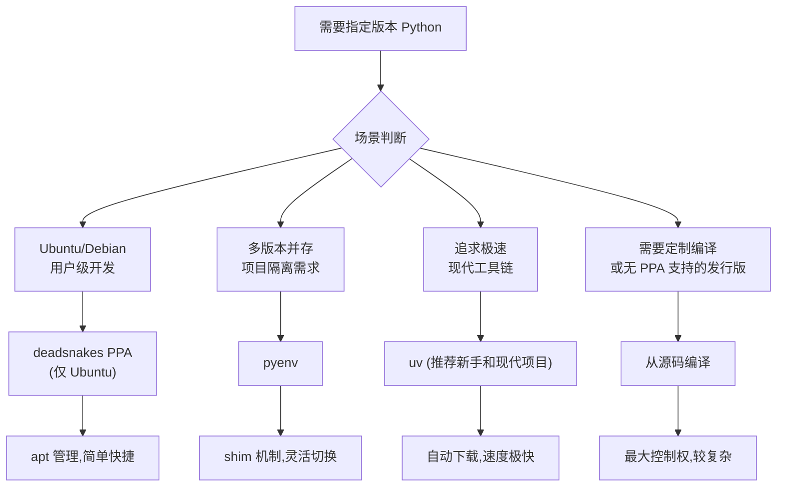
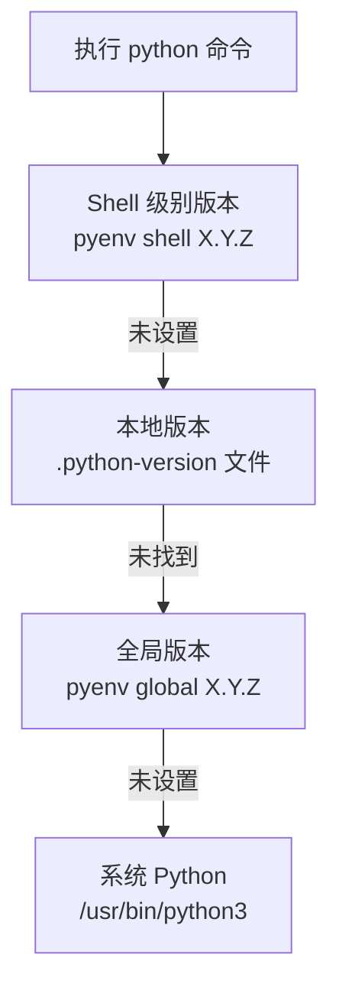
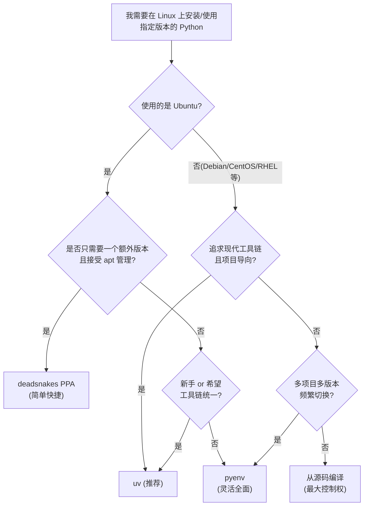

[toc]


## Linux 上的 Python 版本管理

Linux 发行版都内置了系统 Python(System Python),它深度绑定于系统工具链. 例如 apt、dnf 等包管理器的脚本依赖它运行. Ubuntu 26.04 LTS 使用 Python 3.14 作为系统解释器,Ubuntu 24.04 LTS 使用 Python 3.12,Ubuntu 22.04 LTS 使用 Python 3.10. 而开发者常常需要使用比系统预装版本更新、或与系统版本不同的特定 Python 版本.

核心矛盾在于:随意修改系统 Python 可能破坏系统工具的运行,而不同项目又对 Python 版本有各自的要求. 管理 Linux 上的多个 Python 版本是一个常见挑战,无论是需要 Python 2.7 的历史应用、运行 Python 3.11 的现代 Web 服务,还是基于 Python 3.9 构建的数据管道,让不同版本共存而不产生冲突至关重要.

---

## Python 版本生命周期速查 (Version Lifecycle)

在安装之前,先了解各版本的当前状态. Python 每年发布一个新的次要版本(minor release),每个版本拥有约 5 年的支持周期.

每个 Python 发布版本在到达生命周期终止(EOL, End of Life)之前经历两个主要阶段:bug 修复阶段(约 2 年,接受完整 bug 修复、安全补丁和二进制发布)和安全修复阶段.

**当前各主要版本状态(截至 2026 年 9 月):**

截至 2026 年 9 月,仍在接受安全更新的 Python 版本为: 3.14、3.13、3.12、3.11、3.10,最新发布版本为 3.14.7.

| 版本 | 状态                  | Bug 修复截止      | EOL 日期            | 备注                      |
| ---- | --------------------- | ----------------- | ------------------- | ------------------------- |
| 3.14 | 活跃维护              | 2027 年 10 月     | 2030 年 10 月 31 日 | 当前最新稳定版            |
| 3.13 | 活跃维护 → 进入安全期 | 2026 年 10 月     | 2029 年 10 月 31 日 | 引入实验性无 GIL 模式     |
| 3.12 | 安全修复              | 2025 年 4 月 2 日 | 2028 年 10 月 31 日 | 生产环境主流选择之一      |
| 3.11 | 安全修复              | —                 | 2027 年 10 月 31 日 |                           |
| 3.10 | 安全修复              | —                 | 2026 年 10 月 31 日 | **即将 EOL,建议尽快迁移** |
| 3.9  | **EOL**               | —                 | 2025 年 10 月 31 日 | 已终止支持                |
| 3.8  | **EOL**               | —                 | 2024 年 10 月 7 日  | 已终止支持                |

> Python 3.10 的支持将于 2026 年 10 月 31 日结束,请在此之前规划好升级.

Python 3.13 引入了实验性的无 GIL(全局解释器锁,Global Interpreter Lock)自由线程模式和新的交互式 REPL. Python 3.14 于 2025 年 10 月 7 日发布,是目前最新版本,完整支持持续至 2027 年 10 月,EOL 为 2030 年 10 月 31 日.

**选版本原则(最佳实践):**

- 新项目优先选 3.13 或 3.14,兼顾生态兼容性和支持周期.
- 生产环境若求稳定,3.12 是可靠选择,支持至 2028 年.
- 绝对不要在新项目中使用 EOL 版本(3.9 及以下).

---

## 安装方法全景概览



下表对四种主流方式做横向对比:

| 维度             | deadsnakes PPA | pyenv        | uv         | 源码编译    |
| ---------------- | -------------- | ------------ | ---------- | ----------- |
| 适用发行版       | 仅 Ubuntu      | 所有 Linux   | 所有 Linux | 所有 Linux  |
| 安装难度         | 低             | 中           | 低         | 高          |
| 多版本并存       | 支持           | 支持         | 支持       | 手动管理    |
| 无 root 权限安装 | 否             | 是           | 是         | 视情况      |
| 自动下载解释器   | 否(用 apt)     | 否(自行构建) | 是         | 否          |
| 虚拟环境支持     | 需配合 venv    | 需配合插件   | 内置       | 需配合 venv |
| 生产环境推荐     | 一般           | 中等         | 视成熟度   | 视需求      |
| 安全更新及时性   | 不保证         | 取决于上游   | 取决于上游 | 自行维护    |

---

## 方法一: deadsnakes PPA (仅适用 Ubuntu)

### 什么是 PPA (Personal Package Archive)

PPA 是 Ubuntu/Launchpad 平台上由个人或团队维护的软件仓库. deadsnakes 是一个个人软件包存档(Personal Package Archive),收录了新旧多个 Python 版本,这些版本是从源码编译而来,可以通过包管理器直接安装.

### 安装步骤

第一步: 安装 `software-properties-common` 并添加 PPA:

```bash
sudo apt update
sudo apt install software-properties-common
sudo add-apt-repository ppa:deadsnakes/ppa
sudo apt update
```

第二步: 安装指定 Python 版本(以 3.13 为例):

```bash
sudo apt install python3.13
sudo apt install python3.13-venv   # 强烈建议同时安装
sudo apt install python3.13-dev   # 若需要编译 C 扩展
```

第三步: 验证安装:

```bash
python3.13 --version
```

### 重要注意事项

deadsnakes PPA 对各 Ubuntu 版本的支持范围:Ubuntu 22.04(jammy)提供 Python 3.7+ (但不含 3.10),Ubuntu 24.04(noble)提供 Python 3.7+ (但不含 3.12),Ubuntu 26.04(resolute)提供 Python 3.7+ (但不含 3.14). 原因是这些被排除的版本由上游 Ubuntu 官方仓库已提供.

deadsnakes 是一个社区 PPA,而非 Ubuntu 官方安全仓库. 其维护者声明不保证安全更新的及时性,因此在安全敏感或生产环境中使用时应评估信任边界.

Ubuntu 官方仓库中的 Python 模块是针对官方仓库中的 Python 解释器打包的,因此通常无法与此 PPA 中的解释器配合使用. 例外情况是纯 Python 模块可以工作,但任何已编译的扩展模块均不可用.

- **核心原则**: 不要试图移除或修改系统默认 Python 版本,把它留在那里,它运行得很好.
- 不要通过修改 `/usr/bin/python3` 来切换版本,而是使用带版本号的二进制文件如 `python3.13`,配合虚拟环境和服务路径使用.

---

## 方法二: pyenv

### 核心机制: Shim (垫片) 层

pyenv 是一个简洁轻量的工具,通过覆盖系统默认 Python 版本的方式工作,并提供按项目或全局维度切换不同版本的能力.

pyenv 的版本选择机制是其核心设计:

pyenv 使用 shim(垫片)来拦截 Python 命令. 当你运行一条 Python 命令时,pyenv 的 shim 层根据当前设置(全局、本地或 Shell 级别)决定使用哪个 Python 版本.

版本优先级从高到低如下:



通过 pyenv,可以为整个系统设置全局版本、为特定项目目录设置本地版本,甚至为特定 Shell 会话设置版本.

### 安装 pyenv

**前置依赖(以 Ubuntu/Debian 为例):**

```bash
sudo apt update
sudo apt install -y make build-essential libssl-dev zlib1g-dev \
  libbz2-dev libreadline-dev libsqlite3-dev wget curl llvm \
  libncurses5-dev xz-utils tk-dev libxml2-dev libxmlsec1-dev \
  libffi-dev liblzma-dev
```

**使用官方安装脚本(推荐):**

推荐使用 `pyenv-installer` 脚本安装 pyenv. 运行安装脚本: `curl https://pyenv.run | bash`,然后需要将 pyenv 添加到 Shell 配置文件中.

**配置 Shell(以 bash 为例,写入 `~/.bashrc`):**

```bash
export PYENV_ROOT="$HOME/.pyenv"
[[ -d $PYENV_ROOT/bin ]] && export PATH="$PYENV_ROOT/bin:$PATH"
eval "$(pyenv init -)"
```

然后重新载入配置:

```bash
source ~/.bashrc
```

### 安装和管理 Python 版本

列出所有可安装版本:

```bash
pyenv install --list
pyenv install --list | grep "3\.13"   # 过滤特定版本
```

安装指定版本:

```bash
pyenv install 3.13.0
```

安装过程可能需要较长时间,因为它会从源码下载并编译 Python.

查看已安装版本:

```bash
pyenv versions
```

### 切换版本

| 命令                  | 作用域          | 说明                         |
| --------------------- | --------------- | ---------------------------- |
| `pyenv global 3.13.0` | 全局            | 修改 `~/.pyenv/version` 文件 |
| `pyenv local 3.12.0`  | 当前目录        | 创建 `.python-version` 文件  |
| `pyenv shell 3.11.9`  | 当前 Shell 会话 | 设置环境变量 `PYENV_VERSION` |
| `pyenv version`       | —               | 查看当前生效的版本           |
| `pyenv versions`      | —               | 查看所有已安装版本           |

执行 `pyenv local` 命令会在目录中创建一个 `.python-version` 文件,当进入该目录时,pyenv 会根据此文件确定使用的 Python 版本.

在项目中工作时,设置本地 Python 版本是良好实践. 这样任何克隆此项目的人都可以使用相同的 Python 版本,而不影响其全局设置.

### pyenv-virtualenv 插件

可以使用 `pyenv-virtualenv` 插件来扩展 pyenv 的虚拟环境管理能力.

```bash
# 安装 pyenv-virtualenv
git clone https://github.com/pyenv/pyenv-virtualenv.git \
  $(pyenv root)/plugins/pyenv-virtualenv

# 添加到 ~/.bashrc
eval "$(pyenv virtualenv-init -)"
```

常用操作:

```bash
# 创建虚拟环境
pyenv virtualenv 3.13.0 my-project-env

# 激活
pyenv activate my-project-env

# 为项目目录自动绑定
cd my-project
pyenv local my-project-env

# 列出所有虚拟环境
pyenv virtualenvs
```

### pyenv 的不足之处

pyenv 的运行时开销极小,因为它使用简单的 Shell 脚本和符号链接来管理 Python 版本. 但初始编译过程意味着在生产服务器上构建 Python 版本时需要较长的部署时间.

在安装新版本之前,确保所有必需的系统依赖都已安装,否则编译会失败.

---

## 方法三: uv (现代推荐方式)

### uv 是什么

uv 是由 Astral 团队(Ruff 的开发团队)使用 Rust 编写的 Python 包管理器,它是 pip、pip-tools、virtualenv、pyenv 和 pipenv 的一站式替代品,从单一二进制文件处理 Python 环境管理的所有方面.

uv 定位为替代 pip、pip-tools、pipx、poetry、pyenv、twine、virtualenv 等多个工具的单一解决方案.

uv 之所以值得重点关注,在于它重新定义了 Python 环境管理的工作方式:

在 uv 出现之前,同等能力需要组合使用 pyenv(解释器管理)、virtualenv(环境隔离)、pip-tools(依赖锁定)和 pipx(CLI 工具管理).

### 速度优势

其主要吸引力在于速度:pip 需要数分钟完成的依赖解析和包安装,uv 在数秒内完成. Astral 的基准测试显示,uv 在依赖解析方面通常比 pip 快 10-100 倍,这主要得益于 Rust 实现和更优秀的解析器设计.

### 安装 uv

```bash
# 官方推荐方式(Linux/macOS)
curl -LsSf https://astral.sh/uv/install.sh | sh

# 验证安装
uv --version
```

### 使用 uv 管理 Python 版本

这是 uv 区别于传统包管理器的关键能力. uv 可以直接下载和管理 Python 解释器,无需系统预先安装.

**安装指定 Python 版本:**

```bash
uv python install 3.13
uv python install 3.12 3.13 3.14   # 同时安装多个版本
```

uv 将 Python 下载到其用户专属的数据目录(例如 Linux 和 macOS 上的 `~/.local/share/uv/python`),因此安装时永远不需要 `sudo` 或提权 Shell.

**查看已安装和可用版本:**

```bash
uv python list
```

**安装目录行为:**

uv 默认将 Python 可执行文件安装到 PATH 中,例如在 Unix 上 `uv python install 3.12` 会将 Python 可执行文件安装到 `~/.local/bin`,例如命名为 `python3.12`.

uv 管理的解释器位于独立目录中,PATH 上现有的 `python` 命令保持正常工作,直到你主动使用 `--default` 选项并将 uv 的 bin 目录添加到 PATH 后才会生效.

### 日常项目使用

**创建使用指定版本的虚拟环境:**

```bash
cd my-project
uv venv --python 3.13
source .venv/bin/activate
```

**直接运行指定版本而不创建环境:**

使用 `uv run` 命令可以启动带有正确虚拟环境配置的 Python 解释器,例如 `uv run --python 3.13 python -c "import sys; print(sys.version)"`. 首次调用时,如果 3.13 尚未安装,会自动下载.

**初始化新项目:**

```bash
uv init my-project --python 3.13
cd my-project
uv run python main.py
```

**`.python-version` 文件支持:**

如果存在 `.python-version` 文件,uv 会安装该文件中列出的 Python 版本. 如果项目需要多个 Python 版本,可以定义 `.python-versions` 文件,uv 会安装其中列出的所有版本.

### uv 的版本更新注意事项

uv 的每个版本中冻结了可用的 Python 版本列表. 若要安装新的 Python 版本,可能需要先升级 uv.

```bash
uv self update
```

---

## 方法四: 从源码编译安装 (Build from Source)

适用场景: 无 PPA 支持的发行版(如 Debian、CentOS、RHEL)、需要定制编译选项、或者需要无 GIL 构建等特殊需求.

从源码编译可以获得对安装更多的控制权,例如自定义编译选项.

### 准备编译依赖

**Ubuntu/Debian:**

```bash
sudo apt update
sudo apt install -y wget build-essential zlib1g-dev libssl-dev \
  libncurses5-dev libnss3-dev libreadline-dev libffi-dev \
  libsqlite3-dev libbz2-dev liblzma-dev
```

**CentOS/RHEL:**

```bash
sudo dnf groupinstall "Development Tools"
sudo dnf install openssl-devel bzip2-devel libffi-devel \
  zlib-devel readline-devel sqlite-devel
```

### 下载、编译与安装

```bash
# 下载源码(以 3.13.0 为例)
wget https://www.python.org/ftp/python/3.13.0/Python-3.13.0.tar.xz
tar -xf Python-3.13.0.tar.xz
cd Python-3.13.0

# 配置(安装到 /usr/local/python3.13 以避免覆盖系统 Python)
./configure --prefix=/usr/local/python3.13 \
            --enable-optimizations \
            --with-lto

# 编译(使用多核加速)
make -j$(nproc)

# 安装
sudo make altinstall   # 注意: 使用 altinstall 而非 install
```

> **`altinstall` vs `install` 的关键区别:** `make install` 会覆盖 `/usr/local/bin/python3` 的符号链接,可能破坏系统工具; `make altinstall` 只创建带版本号的二进制(如 `python3.13`),不影响系统默认 Python.

**`--enable-optimizations`** 会启用 PGO(Profile-Guided Optimization,配置文件引导优化),编译时间更长但运行时性能可提升约 10-20%.

### 验证与使用

```bash
/usr/local/python3.13/bin/python3.13 --version

# 可选: 添加到 PATH(按需)
echo 'export PATH="/usr/local/python3.13/bin:$PATH"' >> ~/.bashrc
source ~/.bashrc
```

---

## 虚拟环境 (Virtual Environment) 管理

无论使用哪种方式安装 Python,**在项目中使用虚拟环境是不可妥协的最佳实践**. 始终使用虚拟环境来隔离项目,这样可以确保一个项目的依赖不会干扰另一个项目.

### 标准 venv 模块

```bash
# 使用指定版本 Python 创建虚拟环境
python3.13 -m venv .venv

# 激活
source .venv/bin/activate

# 确认当前 Python 版本
python --version
which python

# 退出虚拟环境
deactivate
```

### 使用 uv 创建虚拟环境(更快)

```bash
uv venv --python 3.13 .venv
source .venv/bin/activate
```

### update-alternatives 的使用与误区

`update-alternatives` 是 Debian/Ubuntu 系统中管理同名命令的多版本指向的工具. 但对于开发用途,**不推荐将其作为日常版本切换工具**.

不要使用 `update-alternatives` 或自定义符号链接作为普通的 Python 版本切换器;应使用带版本号的二进制文件(如 `python3.13`)、虚拟环境和明确的服务路径代替.

`update-alternatives` 更适用于系统管理场景,而非项目级开发场景.

---

## 各发行版的系统 Python 版本参考

不同发行版有各自的版本策略,开发者需要了解自己的起始点:

| 发行版                      | 版本 | 默认 Python |
| --------------------------- | ---- | ----------- |
| Ubuntu 22.04 LTS (Jammy)    | —    | Python 3.10 |
| Ubuntu 24.04 LTS (Noble)    | —    | Python 3.12 |
| Ubuntu 26.04 LTS (Resolute) | —    | Python 3.14 |
| Debian 12 (Bookworm)        | —    | Python 3.11 |
| RHEL 9 / CentOS Stream 9    | —    | Python 3.9  |

RHEL 9 以 Python 3.9 作为其默认系统解释器,Red Hat 承诺在 RHEL 9 的整个生命周期内支持 Python 3.9,这将延续至约 2032 年 5 月. 这意味着即使上游 Python 3.9 已经 EOL,RHEL 9 用户仍可获得红帽提供的安全补丁,但若需要新版本 Python 特性,仍需通过上述方式额外安装.

---

## 方法选择决策指南



**综合推荐:**

- **现代新项目/新手入门:** uv 是目前最值得推荐的选择,安装简单,自动管理 Python 版本,无需 root 权限,速度快.
- **多项目多版本管理/需要精细控制:** pyenv 经过时间检验,生态成熟.
- **Ubuntu 用户快速安装单个额外版本:** deadsnakes PPA 最简单.
- **Debian/RHEL/自定义需求:** 源码编译或 uv.

---

## 最佳实践汇总

- **永远不要修改系统 Python.** `/usr/bin/python3` 是系统工具的依赖,动它可能造成系统故障.
- **每个项目使用独立虚拟环境.** 不要在全局环境中用 `pip install` 安装项目依赖.
- **在项目根目录保留 `.python-version` 文件.** 无论使用 pyenv 还是 uv,这个文件让团队协作时版本一致.
- **使用带版本号的命令调用解释器.** 如 `python3.13` 而非 `python`,避免歧义.
- 定期更新 pyenv 以获取最新功能和 bug 修复.
- 注意安全考量,及时关注 Python 各版本的安全更新动态,保持 pyenv 本身处于最新状态.
- **生产环境谨慎引入第三方 PPA.** 在进行重大变更(如添加第三方仓库)之前,建议先创建系统备份.
- **锁定项目依赖版本.** 配合 `pip freeze > requirements.txt`、`uv lock` 等工具确保可复现的环境.