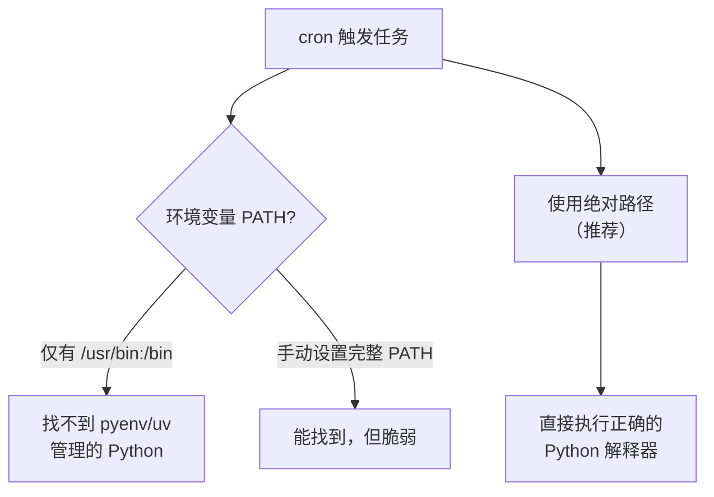
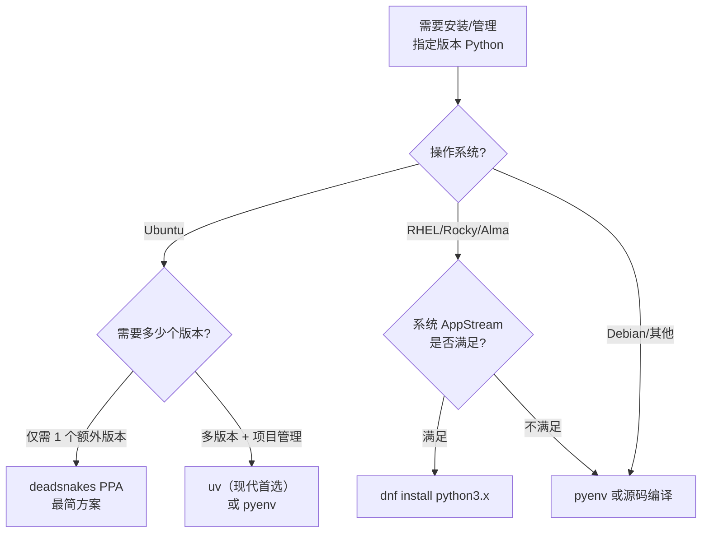

[toc]


## Linux 上安装与管理指定版本 Python 

### 前置认知：为什么不能直接动系统 Python

Linux 发行版内置的 Python（System Python）被**包管理器、系统工具（如 `apt`、`yum`、`dnf`、`cloud-init`、`firewalld`）深度依赖**。绝对不要修改系统自带的 Python（例如 `/usr/bin/python3`），否则可能破坏操作系统功能。

应保持 `/usr/bin/python3` 指向系统解释器。不要使用 `update-alternatives` 或自定义符号链接作为 Python 版本切换手段；应使用带版本号的二进制文件（如 `python3.13`）、虚拟环境和显式路径。

### 当前 Python 版本状态速览（截至 2026-09）

主分支（main）当前是未来的 Python 3.16，且是唯一接受新特性的分支。

Python 3.14 和 3.13 均在活跃维护中，最新分别为 3.14.7 和 3.13.15（2026 年 8 月 5 日发布）。

Python 3.9 已于 2025 年 10 月 31 日到达 EOL（End of Life），3.9.25 是最终安全发布。

| 版本       | 状态                   | 说明                         |
| ---------- | ---------------------- | ---------------------------- |
| **3.14**   | **bugfix（活跃维护）** | 2025-10 发布，推荐用于新项目 |
| **3.13**   | **bugfix（活跃维护）** | 2024-10 发布，生态兼容性最好 |
| 3.12       | security-only          | 仅源码安全补丁               |
| 3.11       | security-only          | 仅源码安全补丁               |
| 3.10       | security-only          | 仅源码安全补丁               |
| 3.9 及以下 | **EOL**                | 不再维护，存在安全风险       |

> **推荐：** 新项目选 **Python 3.13**（生态成熟度与稳定性最佳平衡），追求最新特性选 3.14。

### 各主流发行版系统自带 Python 版本

Ubuntu 26.04 LTS 使用 Python 3.14 作为系统解释器，Ubuntu 24.04 LTS 使用 Python 3.12，Ubuntu 22.04 LTS 使用 Python 3.10。

| 发行版                         | 系统 Python                                 |
| ------------------------------ | ------------------------------------------- |
| Ubuntu 26.04 LTS               | 3.14                                        |
| Ubuntu 24.04 LTS               | 3.12                                        |
| Ubuntu 22.04 LTS               | 3.10                                        |
| Debian 12 (bookworm)           | 3.11                                        |
| RHEL 9 / Rocky 9 / AlmaLinux 9 | 3.9（Application Streams 可获取 3.11/3.12） |
| Fedora 40/41                   | 3.12/3.13                                   |

---

### 安装方案总览与决策

以下是 5 种主流方案，按照**推荐优先级**排列：

| 方案               | 适用场景              | 优点                    | 缺点                           | 是否需要编译     |
| ------------------ | --------------------- | ----------------------- | ------------------------------ | ---------------- |
| **uv（推荐）**     | 开发 + 项目管理一体化 | 极速、一站式、无需 sudo | 生态较新、自动化场景需注意路径 | 否（预编译分发） |
| **pyenv**          | 需要精细管理多版本    | 成熟稳定、社区广泛      | 需编译、依赖构建工具链         | **是**           |
| **deadsnakes PPA** | Ubuntu 服务器快速部署 | apt 体系、免编译        | 仅 Ubuntu、非官方源            | 否               |
| **发行版包管理器** | 对版本要求不高        | 最简单、系统集成好      | 版本偏旧                       | 否               |
| **源码编译**       | 需要定制构建选项      | 完全可控                | 耗时、需自行维护更新           | **是**           |

> **推荐方案决策：**
> - **开发环境（个人/团队）：** 优先用 **uv**（现代化、一站式），其次 **pyenv**（更传统成熟）
> - **服务器部署（Ubuntu）：** **deadsnakes PPA**（apt 管理、简单可靠）或 **uv**
> - **服务器部署（非 Ubuntu）：** **pyenv** 或 **源码编译**
> - **有定时任务 / 自动化需求：** 重点关注路径问题，推荐使用**绝对路径**调用解释器

---

### 方案一：uv — 现代化一站式方案（推荐）

uv 是由 Astral 团队（Ruff 的创建者）用 Rust 编写的 Python 包和项目管理器。自 2024 年 2 月发布以来，它已获得约 88,800 个 GitHub stars，用单个二进制替代了五六个工具，速度比 pip 快 10-100 倍。

uv 会自动安装缺失的 Python 版本——你甚至不需要预先安装 Python 就可以开始使用。

#### 安装 uv

```bash
# 官方推荐安装方式（国内环境如遇网络问题，可配合代理）
curl -LsSf https://astral.sh/uv/install.sh | sh
```

安装完成后 uv 二进制位于 `~/.local/bin/uv`，确保该目录在 `PATH` 中。

#### 安装和管理 Python 版本

```bash
# 查看可安装的 Python 版本
uv python list

# 仅查看已安装的版本
uv python list --only-installed

# 安装指定版本
uv python install 3.13
# uv python install 3.12

# 安装最新版本
uv python install
```

uv 的 Python 安装存储在用户级目录（如 Linux 上的 `~/.local/share/uv/python`），因此安装时永远不需要 sudo。

默认情况下，`uv python install` 会写入带版本号的可执行文件如 `python3.13` 到 uv 的 bin 目录。传入 `--default` 参数可同时写入 `python` 和 `python3` 可执行文件。

#### 项目级版本绑定

```bash
# 初始化项目（会自动创建 .python-version 和 pyproject.toml）
uv init my-project
cd my-project

# 指定项目使用的 Python 版本
uv python pin 3.13

# 添加依赖
uv add requests

# 运行脚本（自动使用项目绑定的版本和虚拟环境）
uv run python my_script.py

# 临时指定版本运行
uv run --python 3.12 python my_script.py
```

如果存在 `.python-version` 文件，uv 将安装该文件中列出的 Python 版本。

#### uv 在定时任务中使用

uv 管理的 Python 路径是确定性的，可以直接用绝对路径：

```bash
# 查看 uv 安装的 Python 的实际路径
uv python find 3.13
# 输出类似: /home/user/.local/share/uv/python/cpython-3.13.15-linux-x86_64-gnu/bin/python3.13

# 方式一：crontab 中直接使用绝对路径
# crontab -e
0 3 * * * /home/user/.local/share/uv/python/cpython-3.13.15-linux-x86_64-gnu/bin/python3.13 /opt/app/task.py >> /var/log/task.log 2>&1

# 方式二（推荐）：如果项目使用 uv 管理，用 uv run
0 3 * * * /home/user/.local/bin/uv run --project /opt/app python task.py >> /var/log/task.log 2>&1
```

---

### 方案二：pyenv — 经典多版本管理工具

pyenv 是一个 Python 版本管理工具，让你可以轻松在多个 Python 版本之间切换。它允许你独立于系统 Python 管理你的 Python 安装，这对于在需要不同 Python 版本的各种项目上工作的开发者特别有用。

#### 安装构建依赖

pyenv 从源码编译 Python，需要先安装构建工具链：

**Ubuntu / Debian：**

```bash
sudo apt update
sudo apt install -y make build-essential libssl-dev zlib1g-dev \
  libbz2-dev libreadline-dev libsqlite3-dev wget curl llvm \
  libncursesw5-dev xz-utils tk-dev libxml2-dev libxmlsec1-dev \
  libffi-dev liblzma-dev
```

**RHEL / CentOS / Rocky / AlmaLinux：**

```bash
sudo dnf groupinstall -y "Development Tools"
sudo dnf install -y openssl-devel bzip2-devel libffi-devel \
  zlib-devel readline-devel sqlite-devel xz-devel tk-devel
```

**Fedora：**

```bash
sudo dnf install -y make gcc zlib-devel bzip2 bzip2-devel \
  readline-devel sqlite sqlite-devel openssl-devel tk-devel \
  libffi-devel xz-devel
```

#### 安装 pyenv

```bash
# 使用官方安装脚本（推荐）
curl https://pyenv.run | bash
```

> 国内网络如果访问 GitHub 困难，可通过代理或使用 GitHub 镜像站：
> ```bash
> # 通过代理（假设本地 mihomo 在 7890 端口）
> https_proxy=http://127.0.0.1:7890 curl https://pyenv.run | bash
> ```

安装后，将以下内容添加到 shell 配置文件（`~/.bashrc` 或 `~/.zshrc`）：

```bash
export PYENV_ROOT="$HOME/.pyenv"
export PATH="$PYENV_ROOT/bin:$PATH"
eval "$(pyenv init -)"
# 如果安装了 pyenv-virtualenv 插件，还需加入：
# eval "$(pyenv virtualenv-init -)"
```

重新加载配置：

```bash
source ~/.bashrc   # 或 source ~/.zshrc
```

#### 安装与切换 Python 版本

```bash
# 查看所有可安装版本
pyenv install --list

# 过滤出 CPython 稳定版
pyenv install --list | grep -E '^\s*3\.\d+\.\d+$'

# 安装指定版本（从源码编译，耗时约 5-10 分钟）
pyenv install 3.13.15
pyenv install 3.12.12

# 查看已安装版本
pyenv versions

# 设置全局默认版本
pyenv global 3.13.15

# 设置当前目录（项目级别）版本（会生成 .python-version 文件）
cd /opt/my-project
pyenv local 3.12.12

# 设置当前 shell 会话版本（临时）
pyenv shell 3.14.7
```

pyenv 将版本存储在 `~/.pyenv/versions/` 中，避免系统级修改。

pyenv 不移动 Python 二进制文件——它创建 shims 来将命令导向适当的 Python 安装。

**版本解析优先级：** `shell` > `local`（`.python-version` 文件）> `global`（`~/.pyenv/version`）> `system`

#### pyenv 国内加速技巧

pyenv 安装 Python 时会从 python.org 下载源码包，国内可能较慢。可以手动下载源码包后放到缓存目录：

```bash
# 创建缓存目录
mkdir -p ~/.pyenv/cache

# 手动下载（使用镜像或代理）
# 淘宝 NPM 镜像 / 华为云镜像等提供 Python 源码包
wget -P ~/.pyenv/cache https://registry.npmmirror.com/-/binary/python/3.13.15/Python-3.13.15.tar.xz

# 然后正常安装，pyenv 会优先使用缓存
pyenv install 3.13.15
```

也可全局配置代理环境变量后再安装：

```bash
export https_proxy=http://127.0.0.1:7890
pyenv install 3.13.15
```

#### pyenv + 虚拟环境

```bash
# 推荐：使用标准库 venv 创建虚拟环境
cd /opt/my-project
pyenv local 3.13.15
python -m venv .venv
source .venv/bin/activate

# 或使用 pyenv-virtualenv 插件（可选）
pyenv virtualenv 3.13.15 my-project-env
pyenv activate my-project-env
```

---

### 方案三：deadsnakes PPA（Ubuntu 专属）

deadsnakes PPA 包含为 Ubuntu 打包的更新 Python 版本。对大多数用户来说，使用 deadsnakes PPA 是因为它可以让 Python 更新保持在正常的 `apt upgrade` 周期内。

Ubuntu 22.04 (jammy) 可获取 Python 3.7+（不含 3.10），Ubuntu 24.04 (noble) 可获取 Python 3.7+（不含 3.12），Ubuntu 26.04 (resolute) 可获取 Python 3.7+（不含 3.14），因为对应版本已由上游 Ubuntu 提供。

#### 安装步骤

```bash
# 添加 PPA
sudo add-apt-repository ppa:deadsnakes/ppa
sudo apt update

# 安装目标版本（以 3.13 为例）
sudo apt install python3.13

# 安装配套模块（推荐）
sudo apt install python3.13-venv python3.13-dev python3.13-distutils

# 完整元包（包含 pip, venv 等全部组件）
sudo apt install python3.13-full

# 验证
python3.13 --version
```

#### 使用带版本号的命令

安装后通过 **`python3.13`** 调用，**不要**去修改 `python3` 的指向：

```bash
# 创建虚拟环境
python3.13 -m venv /opt/my-project/.venv

# 激活
source /opt/my-project/.venv/bin/activate

# 安装依赖
pip install -r requirements.txt
```

#### 重要注意事项

deadsnakes 不保证在出现安全问题或其他问题时及时更新。如果用于安全敏感的生产环境，需评估此风险。

- 适用范围：**仅限 Ubuntu**（Debian 不支持 deadsnakes PPA，必须从源码构建 Python。）
- 不要修改 `/usr/bin/python3` 的指向

---

### 方案四：从源码编译安装

适用于所有发行版，当你需要**自定义编译选项**（如 `--enable-optimizations`、`--with-lto`、no-GIL 构建）或发行版无法通过其他方式获取目标版本时使用。

#### 完整步骤

```bash
# 1. 安装构建依赖（以 Ubuntu/Debian 为例）
sudo apt update
sudo apt install -y build-essential zlib1g-dev libssl-dev \
  libncurses5-dev libnss3-dev libreadline-dev libffi-dev \
  libsqlite3-dev libbz2-dev liblzma-dev wget

# 2. 下载源码
PYTHON_VERSION=3.13.15
cd /tmp
wget https://www.python.org/ftp/python/${PYTHON_VERSION}/Python-${PYTHON_VERSION}.tar.xz
tar -xf Python-${PYTHON_VERSION}.tar.xz
cd Python-${PYTHON_VERSION}

# 3. 配置（--enable-optimizations 会运行测试套件优化性能，耗时更长）
./configure --prefix=/opt/python/${PYTHON_VERSION} \
  --enable-optimizations \
  --with-lto \
  --enable-shared \
  LDFLAGS="-Wl,-rpath,/opt/python/${PYTHON_VERSION}/lib"

# 4. 编译安装（使用 altinstall 避免覆盖系统 python3）
make -j$(nproc)
sudo make altinstall

# 5. 验证
/opt/python/${PYTHON_VERSION}/bin/python3.13 --version
```

> **`make altinstall` 与 `make install` 的区别：**
> - `altinstall`：只安装带版本号的二进制（`python3.13`），**推荐**
> - `install`：还会创建 `python3` 符号链接，**可能覆盖系统 Python，危险**

#### 可选：添加到 PATH

```bash
# 在 ~/.bashrc 中追加
export PATH="/opt/python/3.13.15/bin:$PATH"
```

---

### 方案五：发行版包管理器

最简单的方式，但版本受发行版限制：

**Ubuntu / Debian：**

```bash
sudo apt update
sudo apt install python3 python3-pip python3-venv python3-dev
```

**RHEL 9 / Rocky 9（Application Streams）：**

```bash
# 查看可用版本
sudo dnf module list python3*

# 安装特定版本
sudo dnf install python3.11
# 或
sudo dnf install python3.12
```

**Fedora：**

```bash
sudo dnf install python3
# 安装额外版本
sudo dnf install python3.12
```

---

### 定时任务 / 自动化场景下的 Python（重点）

这是很多人踩的坑。cron 任务失败最常见的原因之一是环境变量问题。当你从终端运行脚本时，shell 会加载完整的环境：你的 `.bashrc`、`.profile`、自定义 PATH 条目等。Cron 不会加载这些，它运行时只有最小限度的环境。

pyenv 等版本管理器通过在 shell profile 中向 PATH 插入 shims 目录来工作，而 cron 不读取 profile，因此 `python` 会解析到系统解释器或根本找不到。

#### 核心原则：**在 cron 中始终使用绝对路径**



#### 方式一：直接使用虚拟环境中的 Python 绝对路径（最推荐）

你永远不需要在 crontab 中激活虚拟环境。直接指向 `venv/bin/python`，环境就会随之而来。

```bash
# 先确认路径
/opt/app/.venv/bin/python --version

# crontab -e
0 3 * * * /opt/app/.venv/bin/python /opt/app/task.py >> /var/log/task.log 2>&1
```

这是**最简单、最可靠**的方式。虚拟环境内的 `python` 二进制已经绑定了正确的 `site-packages`，无需先激活环境，因为虚拟环境内的解释器已经会从正确的 site-packages 导入。

#### 方式二：pyenv 场景下获取真实路径

使用 `pyenv which python` 获取真实路径后硬编码到 crontab 中。

```bash
# 获取真实路径
pyenv which python
# 输出: /home/deploy/.pyenv/versions/3.13.15/bin/python3.13

# crontab -e
0 3 * * * /home/deploy/.pyenv/versions/3.13.15/bin/python3.13 /opt/app/task.py >> /var/log/task.log 2>&1
```

#### 方式三：使用包装脚本（复杂环境变量需求时）

当脚本需要加载环境变量（如 `.env` 文件、数据库连接字符串等）时：

```bash
#!/bin/bash
# /opt/app/run_task.sh

# 加载环境变量
source /opt/app/.env

# 使用虚拟环境中的 Python
/opt/app/.venv/bin/python /opt/app/task.py
```

```bash
# crontab -e
0 3 * * * /opt/app/run_task.sh >> /var/log/task.log 2>&1
```

#### 方式四：systemd timer（替代 cron，更现代）

对于复杂的定时任务，systemd timer 相比 cron 有更好的日志、依赖管理和环境配置能力：

```ini
# /etc/systemd/system/my-task.service
[Unit]
Description=My Python Task

[Service]
Type=oneshot
User=deploy
WorkingDirectory=/opt/app
ExecStart=/opt/app/.venv/bin/python /opt/app/task.py
# 直接在这里定义环境变量
Environment="DATABASE_URL=postgres://..."
# 或从文件加载
EnvironmentFile=/opt/app/.env
```

```ini
# /etc/systemd/system/my-task.timer
[Unit]
Description=Run My Python Task Daily

[Timer]
OnCalendar=*-*-* 03:00:00
Persistent=true

[Install]
WantedBy=timers.target
```

```bash
sudo systemctl daemon-reload
sudo systemctl enable --now my-task.timer

# 查看状态
systemctl status my-task.timer
systemctl list-timers

# 查看日志
journalctl -u my-task.service
```

#### 定时任务调试技巧

Python 在输出到文件而非终端时会缓冲输出，因此在缓冲区刷新或进程退出前日志中什么都不会出现。添加 `-u` 标志或设置 `PYTHONUNBUFFERED=1` 可以即时刷新输出。

```bash
# crontab 中使用 -u 禁用输出缓冲
0 3 * * * /opt/app/.venv/bin/python -u /opt/app/task.py >> /var/log/task.log 2>&1

# 或在包装脚本中设置环境变量
export PYTHONUNBUFFERED=1
```

调试 cron 环境时，可临时添加一条任务查看 cron 实际拥有的环境变量：

```bash
# crontab -e（临时添加，调试完删除）
* * * * * env > /tmp/cron-env.txt 2>&1
```

---

### 虚拟环境最佳实践

无论使用哪种方式安装 Python，项目都应使用**虚拟环境**（Virtual Environment）隔离依赖：

```bash
# 创建（推荐放在项目目录下）
python3.13 -m venv .venv

# 激活
source .venv/bin/activate

# 安装依赖
pip install -r requirements.txt

# 退出
deactivate
```

**关键要点：**
- **每个项目一个虚拟环境**，避免全局安装 pip 包
- `.venv` 目录应加入 `.gitignore`
- `requirements.txt`（或 `pyproject.toml`）应纳入版本控制
- 定时任务中**不需要** `activate`，直接用 `.venv/bin/python` 绝对路径即可

---

### 方案对比与选型决策树



### 各方案在自动化 / 定时任务中的可靠性对比

| 方案                | cron 兼容性 | 推荐调用方式                                   | 注意事项                  |
| ------------------- | ----------- | ---------------------------------------------- | ------------------------- |
| **venv + 绝对路径** | 最佳        | `/path/to/.venv/bin/python script.py`          | 最简单可靠                |
| **deadsnakes**      | 优秀        | `/usr/bin/python3.13 script.py`                | 路径固定，系统级安装      |
| **pyenv**           | 需处理      | `~/.pyenv/versions/x.x.x/bin/python script.py` | 不要依赖 shim，用真实路径 |
| **uv**              | 需处理      | `uv run` 或真实路径                            | 确保 uv 二进制在 PATH 中  |
| **源码编译**        | 优秀        | `/opt/python/x.x.x/bin/python3.x script.py`    | 路径固定可控              |
| **systemd timer**   | 最佳        | `ExecStart=` 指定绝对路径                      | 比 cron 更现代，日志更好  |

---

### 常见问题与排错

**Q：安装 pyenv 后 `python` 命令仍指向系统版本？**

确认 shell 配置文件中 `eval "$(pyenv init -)"` 已生效，且新开了终端或执行了 `source ~/.bashrc`。pyenv 的 shim 目录必须在 PATH 最前面。

**Q：pyenv install 报错缺少模块（如 `_ssl`、`_sqlite3`）？**

这是构建依赖不全。确保安装了上文列出的全部 `-dev` 包后重新编译。

**Q：deadsnakes 安装后 `pip` 不可用？**

需要单独安装：`sudo apt install python3.13-venv`，然后用 `python3.13 -m pip` 调用。或安装 `python3.13-full` 元包。

**Q：cron 任务中脚本 `import` 报 `ModuleNotFoundError`？**

如果在 cron 中只写 `python3 script.py`，cron 会使用系统 Python——它没有安装你项目的依赖。脚本导入 `requests` 或 `django` 后会立即因 `ModuleNotFoundError` 崩溃。解决：使用虚拟环境中的 Python 绝对路径。

**Q：如何在国内加速 pyenv / uv 的 Python 下载？**

- **pyenv**：手动下载源码包到 `~/.pyenv/cache/`，或设置 `https_proxy`
- **uv**：设置 `https_proxy` 环境变量，或配置 `UV_PYTHON_INSTALL_MIRROR` 指向镜像

---

### 总结：推荐实践清单

1. **绝不修改系统 Python**（`/usr/bin/python3`）
3. **安装工具推荐 uv**（现代化一站式），传统方案选 pyenv（Ubuntu 可选 deadsnakes）
4. **始终使用虚拟环境**隔离项目依赖
5. **定时任务中使用绝对路径**调用 Python 解释器（不依赖 shim 或 `activate`）
6. **定时任务推荐 `python -u`** 或 `PYTHONUNBUFFERED=1` 避免输出缓冲导致日志丢失
7. **复杂定时任务考虑 systemd timer** 替代 cron，获得更好的日志和环境管理
8. 将 `.python-version`、`requirements.txt`（或 `pyproject.toml` / `uv.lock`）纳入**版本控制**
