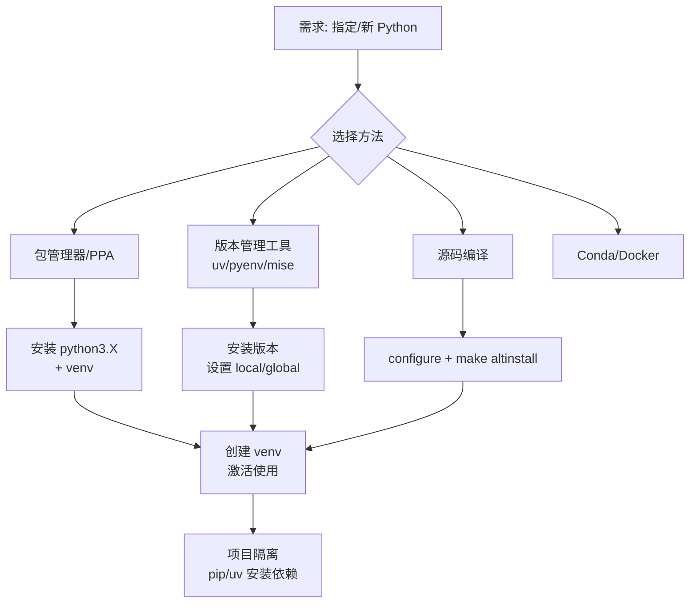

[toc]

### 管理多个或指定 Python 版本
Linux 发行版（如 Ubuntu、Fedora、Debian）通常自带**系统 Python**（system Python），用于系统工具和脚本。直接修改它风险极高，可能导致 `apt`/`dnf` 等工具失效。

常见需求：
- 项目依赖特定版本（如旧项目需 3.10，新项目需 3.14+）。
- 获取比发行版默认更新的版本（Ubuntu LTS 常滞后 1-2 个 minor 版本）。
- 隔离环境，避免依赖冲突。
- 测试跨版本兼容性。

**核心原则（规则）**：
- **永远不要覆盖系统 Python**（`/usr/bin/python3`）。使用 `make altinstall`、用户级工具或并行安装。
- 遵循 **PEP 668**：现代发行版标记系统 Python 为 `EXTERNALLY-MANAGED`，阻止直接 `pip install` 到系统 site-packages，强制使用虚拟环境。
- 优先**虚拟环境**（virtual environment, venv）：每个项目独立依赖。
- 版本管理工具通过 **shims**（拦截命令）或 **PATH 修改** 实现切换，支持全局（global）、本地（local/per-project，常通过 `.python-version` 文件）和 shell 级别。

**Python 版本生命周期简要**（基于官方 status）：
- 每年一个新 major.minor（如 3.14 于 2025-10 发布）。
- 约 2 年 bugfix + 3 年 security，总计约 5 年支持。
- 检查 [endoflife.date/python](https://endoflife.date/python) 或 python.org。当前活跃：3.14（最新）、3.13、3.12 等；3.10 即将 EOL。

### 核心概念解释
- **系统 Python vs 用户/管理 Python**：系统版由包管理器维护，稳定但旧；用户版安装在 `~/.local`、`~/.pyenv` 等，灵活。
- **CPython**：标准实现（最常用）。也有 PyPy 等。
- **venv / virtualenv**：标准库 `python -m venv` 创建隔离环境（自 3.3+）。激活后 `python`/`pip` 指向环境内。
- **pyproject.toml / .python-version**：现代项目声明 `requires-python` 和 pin 版本。
- **预构建 vs 源码编译**：预构建（uv、部分 PPA）快；源码可自定义优化（PGO/LTO）。
- **Shim 机制**（pyenv 等）：在 PATH 前插入 shims，动态选择版本。

工作流示意（mermaid）：



### 主要方法比较
优先表格展示（适合对比）：

| 方法                     | 优点                                    | 缺点                      | 适用场景                  | 推荐度（2026） | 是否需编译   |
| ------------------------ | --------------------------------------- | ------------------------- | ------------------------- | -------------- | ------------ |
| 发行版包管理器 (apt/dnf) | 简单、安全更新                          | 版本有限、滞后            | 仅需默认或少量版本        | 中             | 否           |
| deadsnakes PPA (Ubuntu)  | 多版本、易安装                          | 仅 Ubuntu/衍生、第三方    | Ubuntu 需特定/新版本      | 高（Ubuntu）   | 否           |
| 源码编译 (altinstall)    | 最新、可优化                            | 耗时、需依赖、手动维护    | 自定义/最新 bleeding-edge | 中             | 是           |
| **uv** (Astral)          | 极快、管理 Python+包+venv、预构建、现代 | 相对新                    | **新项目首选**、全栈      | **最高**       | 否（预构建） |
| pyenv                    | 成熟、灵活、多实现                      | 较慢（常编译）、shim 开销 | 多版本切换老手            | 高             | 常是         |
| mise / asdf              | 多语言统一                              | 多语言 overhead           | 同时管 Node/Go 等         | 高（polyglot） | 可选预构建   |
| Conda/Miniforge/Mamba    | 二进制依赖强（科学计算）                | 重、独立生态              | 数据科学/ML               | 高（特定）     | 否           |
| Docker                   | 完全隔离                                | overhead、学习曲线        | 生产/CI 一致性            | 高（容器）     | N/A          |

**最佳实践指导**：新 setup 优先 **uv**（2026 共识，替代 pyenv + pip 大部分场景）。已有 pyenv 可继续。数据科学用 Conda。始终配合 venv。生产用 Docker 或固定版本。

### 详细方法介绍（突出常用/重要）

#### 1. 使用发行版包管理器（基础，适合初学者）
Ubuntu/Debian 示例（其他发行版类似，`dnf`/`pacman`）：
- 检查默认：`python3 --version`（Ubuntu 24.04 常 3.12，26.04 可能 3.14）。
- 安装：`sudo apt update && sudo apt install python3 python3-venv python3-pip python3-full`
- 特定版本（若仓库有）：`sudo apt install python3.12 python3.12-venv python3.12-dev`
- 注意：`python3` 是 symlink 到默认。可用 `update-alternatives` 切换，但**谨慎**，避免破坏系统。
- 最佳：安装后立即 `python3.X -m venv myenv`，激活使用。不要 `sudo pip`。

Fedora 等更跟进上游，常有较新版本。

#### 2. deadsnakes PPA（Ubuntu 获取多版本的经典方式）
deadsnakes 提供新旧 Python（不覆盖系统默认）。

```bash
sudo apt install software-properties-common
sudo add-apt-repository ppa:deadsnakes/ppa
sudo apt update
sudo apt install python3.13 python3.13-venv python3.13-dev  # 示例，检查可用版本
# 不要使用默认的python或python3,而是用带版本号的python命令,例如 python3.13 (具体版本号自己控制)
python3.13 --version

```

- 验证：`python3.13 --version`。
- 创建 venv：`python3.13 -m venv .venv`。  
- 注意：PPA 是第三方，虽流行可靠，但非官方；安全更新可能滞后。不提供发行版已有的默认版本。

#### 3. 从源码编译（获取精确/最新/优化版）
适合需要最新或自定义 flags。**必须用 `altinstall`**！

依赖（Ubuntu）：
```bash
sudo apt update
sudo apt install build-essential libssl-dev zlib1g-dev libbz2-dev libreadline-dev libsqlite3-dev curl libncursesw5-dev xz-utils tk-dev libxml2-dev libxmlsec1-dev libffi-dev liblzma-dev
```

步骤：
1. 下载：访问 python.org/downloads 或 `wget https://www.python.org/ftp/python/3.14.7/Python-3.14.7.tgz`（替换版本）。
2. 解压、配置：`tar -xzf Python-*.tgz && cd Python-* && ./configure --enable-optimizations --prefix=/usr/local`（PGO 提升性能 10-20%）。
3. 编译：`make -j$(nproc)`
4. 安装：`sudo make altinstall`（安装为 `python3.14`，不覆盖 `python3`）。
5. 验证：`/usr/local/bin/python3.14 --version`。可选加到 PATH。

维护：手动更新。生产慎用。

#### 4. uv（2026 强烈推荐，现代全能工具）
Astral 出品，极快（Rust），管理 Python 版本 + 包 + 项目 + venv，预构建二进制（基于 python-build-standalone），无需编译，不碰系统 Python。自动处理 `.python-version`。

安装 uv：
```bash
curl -LsSf https://astral.sh/uv/install.sh | sh
# 或 wget 等效。重启 shell 或 source 配置。
```

管理 Python：
```bash
uv python list          # 查看已装/可用
uv python install 3.14  # 或 3.14.7、3.13、pypy 等。多版本一次装
uv python install 3.12 3.13 3.14
uv python pin 3.14      # 项目目录写 .python-version
```

项目使用：
```bash
uv init myproject
cd myproject
uv add requests         # 自动 venv + lock
uv run python script.py # 或 uv venv --python 3.14
```

优势：秒级安装、`uv pip` 兼容、工具管理（类似 pipx）、自更新。新 setup 首选，可替代 pyenv + poetry/pipenv 大部分功能。

#### 5. pyenv（经典多版本管理）
用户级，安装到 `~/.pyenv`，通过 shims 切换。支持 CPython、PyPy、Anaconda 等。

安装（推荐官方 installer）：
```bash
curl https://pyenv.run | bash
# 然后添加到 ~/.bashrc 或 ~/.zshrc：
export PYENV_ROOT="$HOME/.pyenv"
[[ -d $PYENV_ROOT/bin ]] && export PATH="$PYENV_ROOT/bin:$PATH"
eval "$(pyenv init -)"
# 可选 virtualenv 插件
```

依赖同源码编译。使用：
```bash
pyenv install --list
pyenv install 3.14.7
pyenv global 3.14.7     # 全局
pyenv local 3.12.0      # 项目（写 .python-version）
pyenv versions
python --version        # 自动切换
```

配合 `pyenv-virtualenv` 或直接 `python -m venv`。成熟稳定，但安装常需编译（慢于 uv）。

#### 6. mise 或 asdf（多语言版本管理）
如果同时管理 Node、Go、Ruby 等，用 **mise**（Rust，快，asdf 精神继承者，推荐）或 asdf。

mise 安装：`curl https://mise.run | sh`，然后 `mise use -g python@3.14` 或项目 `mise use python@3.14`（支持 `.python-version`、`.tool-versions`）。可 sync 与 uv/pyenv。

#### 7. Conda 生态（科学计算）
Miniforge/Mamba（推荐开源）或 Miniconda。每个 env 自带 Python 版本。
```bash
# 安装 Miniforge 后
conda create -n myenv python=3.14
conda activate myenv
```
强于二进制依赖（NumPy 等），但生态独立于 pip/PyPI。数据科学首选。

#### 8. 其他：Docker 与 update-alternatives
- Docker：`FROM python:3.14-slim`，完美隔离，适合部署/CI。
- `update-alternatives`：可管理多个系统级，但**不推荐**改默认 `python3`。

### 使用指定版本的实用工作流（最佳实践）
1. **安装工具/版本**（优先 uv 或 pyenv）。
2. **项目 pin**：`.python-version` 或 `pyproject.toml` 的 `requires-python = ">=3.12,<3.15"`。
3. **创建 venv**：
   - 标准：`python3.14 -m venv .venv && source .venv/bin/activate`
   - uv：自动或 `uv venv --python 3.14`
4. **依赖管理**：`pip install`（或更好 uv/poetry/pdm），生成 lockfile。升级 pip：`python -m pip install -U pip`。
5. **切换验证**：`which python`、`python --version`、`sys.executable`。
6. **全局工具**：用 `uv tool install` 或 pipx，避免污染。
7. **CI/生产**：固定精确版本（major.minor.patch），用 Docker 或 uv 的 `--python`。
8. **清理**：`uv python uninstall`、`pyenv uninstall`。定期检查 EOL。
9. **安全**：不 `sudo pip`；用虚拟环境；关注安全更新。
10. **性能**：源码用 `--enable-optimizations`；uv 默认高效。

**常见陷阱**：
- 忘记激活 venv → 装到错误位置。
- PATH 顺序问题 → 工具初始化放 shell 配置末尾。
- WSL/旧系统缺依赖 → 安装 build deps。
- 混用 conda 与 pip → 优先 conda。

### 针对较新版本的特别提示
- 检查 python.org 最新。
- uv/pyenv/deadsnakes 通常最快跟上。
- 预发布（alpha/beta/RC）：uv 或源码，测试用。
- 免费线程（free-threaded，3.13+ 实验）：特定构建。

### 总结与推荐路径（初学者）
1. 安装 **uv**。
2. `uv python install 3.14`（或你需版本）。
3. 新项目 `uv init` + `uv add`，自动处理。
4. 旧项目：加 `.python-version`，`uv sync`。
5. 需要多语言 → mise；科学计算 → Miniforge；Ubuntu 简单多版本 → deadsnakes + venv。

这套方法实用、现代、安全。内容已尽可能全面（用例经典如项目 pin、优化编译），同时突出 uv/pyenv/venv 主线。若需特定发行版细节或故障排查，可进一步细化。始终验证命令与当前系统匹配，并备份重要数据。