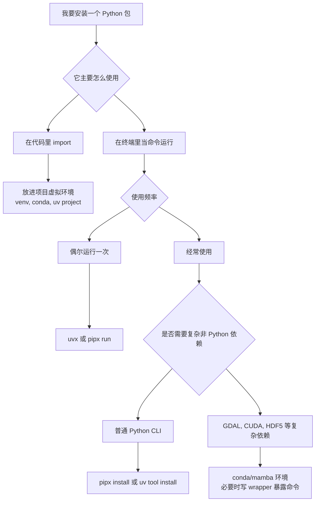

[toc]


## 核心问题

你想解决的是：

> 在 Linux 上安装一些基于 Python 的命令行工具，并且希望在任意目录都能直接使用，例如 `black`、`ruff`、`httpie`、`poetry`、`ansible-lint`、`yt-dlp`、`pre-commit` 等。

现代最佳实践不是把这些工具装进系统 Python，也不是随便 `sudo pip install xxx`，而是：

> **把“全局可用的命令”和“项目里的 Python 依赖”分开管理。**

对新手来说，可以先记住这个结论：

| 场景                                | 推荐方案                    | 典型命令                                       | 推荐程度     |
| ----------------------------------- | --------------------------- | ---------------------------------------------- | ------------ |
| 经常使用的 Python 命令行工具        | `pipx` 或 `uv tool install` | `pipx install black` 或 `uv tool install ruff` | 强烈推荐     |
| 临时运行一次工具                    | `uvx` 或 `pipx run`         | `uvx ruff check .`                             | 强烈推荐     |
| 项目代码里要 `import` 的库          | 项目虚拟环境                | `uv add requests` 或 `pip install requests`    | 强烈推荐     |
| 系统组件或发行版维护的工具          | 系统包管理器                | `apt install xxx`、`dnf install xxx`           | 推荐         |
| 复杂科学计算或带大量非 Python 依赖  | `conda` / `mamba` 环境      | `conda create -n tools ...`                    | 适合特定场景 |
| 直接改系统 Python                   | `sudo pip install xxx`      | 不建议使用                                     | 避免         |
| `pip install --user xxx` 装一堆 CLI | 用户级 site-packages        | 不再作为首选                                   | 谨慎         |

------

## 为什么现在不推荐随便用系统 Python

Linux 系统自带的 Python 往往不仅给你运行脚本用，还被系统工具、包管理器、桌面环境、发行版脚本使用。直接向系统 Python 里安装、升级、删除包，可能破坏发行版原本管理的 Python 依赖。

现代 Linux 发行版越来越强调这一点。Python Packaging 规范里有一个机制叫 **Externally Managed Environment**，也就是“外部管理环境”。它通过 `EXTERNALLY-MANAGED` 标记告诉 `pip`：这个 Python 环境由系统包管理器维护，不应该直接往解释器的全局环境里装包，而应该引导用户使用虚拟环境。([Python 包装用户指南](https://packaging.python.org/en/latest/specifications/externally-managed-environments/))

这就是很多人在 Ubuntu、Debian、Fedora 等新版本系统上遇到的错误：

```text
error: externally-managed-environment
```

它不是坏事，而是系统在保护自己。

------

## 先区分两类东西：库和工具

很多新手容易把这两件事混在一起：

| 类型       | 英文术语                            | 例子                                | 应该装在哪里                       |
| ---------- | ----------------------------------- | ----------------------------------- | ---------------------------------- |
| Python 库  | library                             | `requests`、`numpy`、`pandas`       | 项目的虚拟环境                     |
| 命令行工具 | command-line tool / CLI application | `black`、`ruff`、`httpie`、`poetry` | `pipx` 或 `uv tool` 管理的独立环境 |

判断标准很简单：

如果你在 Python 代码里这样用：

```python
import requests
import pandas as pd
```

那它是项目依赖，应该放进项目环境。

如果你在终端里这样用：

```bash
black .
ruff check .
http GET https://example.com
```

那它是命令行工具，适合用 `pipx` 或 `uv tool install` 全局暴露命令。

------

## “全局使用”真正是什么意思

在 Linux 下，所谓“全局使用”通常有两种含义。

| 含义               | 说明                                  | 推荐程度                   |
| ------------------ | ------------------------------------- | -------------------------- |
| 当前用户全局可用   | 你的 shell 在任何目录都能找到这个命令 | 最推荐                     |
| 所有用户系统级可用 | 所有系统用户都能运行这个命令          | 只有服务器统一管理时才需要 |

大多数个人开发、学习、服务器脚本场景，其实只需要“当前用户全局可用”。

例如安装后的命令可能放在：

```bash
~/.local/bin
```

只要这个目录在 `PATH` 环境变量中，你就可以在任意目录运行对应命令。

------

## PATH 是什么

`PATH` 是 Linux shell 用来查找命令的环境变量。

例如你输入：

```bash
ruff check .
```

shell 会在 `PATH` 指定的一系列目录里寻找名为 `ruff` 的可执行文件。

可以查看当前 `PATH`：

```bash
echo "$PATH"
```

可以查看某个命令实际来自哪里：

```bash
which ruff
```

或者：

```bash
command -v ruff
```

如果你安装了工具但提示：

```text
command not found
```

大概率不是工具没装好，而是工具所在目录没有加入 `PATH`。

------

## Python CLI 工具的工作机制

很多 Python 命令行工具本质上不是一个单独的二进制程序，而是一个 Python 包安装后生成的命令入口。

Python Packaging 规范里有一个概念叫 **entry point**，常见的是 `console_scripts`。包安装后，安装工具会根据这个入口生成一个可以在 shell 中运行的命令。比如包里声明 `foo = foomod:main`，安装后就可能生成一个 `foo` 命令，运行时调用 Python 函数 `foomod.main()`。([Python 包装用户指南](https://packaging.python.org/specifications/entry-points/?utm_source=chatgpt.com))

可以这样理解：


因此，“安装 Python 命令行工具”的关键不是只把包装上，而是要解决三个问题：

| 问题               | 说明                             |
| ------------------ | -------------------------------- |
| 命令在哪里         | 生成的可执行命令是否在 `PATH` 中 |
| 依赖是否隔离       | 不同工具的依赖会不会互相冲突     |
| 后续能否升级和卸载 | 是否能干净管理生命周期           |

这就是 `pipx` 和 `uv tool` 这类工具存在的原因。

------

## 推荐方案：pipx

`pipx` 是专门用来安装和运行 Python 终端应用的工具。它会为每个应用创建独立虚拟环境，然后把应用命令暴露到你的 `PATH` 上。这样既能像全局工具一样使用，又不会污染系统 Python 或项目环境。([Pipx](https://pipx.pypa.io/))

Python Packaging 官方指南也推荐用 `pipx` 安装独立命令行工具，因为它会为每个包创建虚拟环境，并把应用命令放到 `PATH` 可访问的目录里，从而避免包之间冲突，也方便升级和卸载。([Python 包装用户指南](https://packaging.python.org/guides/installing-stand-alone-command-line-tools/))

### 安装 pipx

Ubuntu 23.04 或更高版本：

```bash
sudo apt update
sudo apt install pipx
pipx ensurepath
```

Fedora：

```bash
sudo dnf install pipx
pipx ensurepath
```

在采用 PEP 668 的发行版上，例如 Ubuntu 23.04+、Debian 12+、Fedora 38+，直接使用 `pip install --user pipx` 可能遇到 `externally-managed-environment`，因此更推荐先用发行版包管理器安装 `pipx`。([Pipx](https://pipx.pypa.io/stable/how-to/install-pipx/?utm_source=chatgpt.com))

### 使用 pipx 安装工具

例如安装 `black`：

```bash
pipx install black
```

安装后可以直接运行：

```bash
black --version
```

查看 pipx 管理的工具：

```bash
pipx list
```

升级工具：

```bash
pipx upgrade black
```

升级所有工具：

```bash
pipx upgrade-all
```

卸载工具：

```bash
pipx uninstall black
```

临时运行工具：

```bash
pipx run cowsay -t hello
```

Python Packaging 官方指南也展示了 `pipx install PACKAGE` 后可以从任意位置运行该包提供的应用命令，并可以用 `pipx list`、`pipx upgrade PACKAGE`、`pipx uninstall PACKAGE` 管理工具。([Python 包装用户指南](https://packaging.python.org/guides/installing-stand-alone-command-line-tools/))

### pipx 的适用场景

| 场景                     | 是否适合 pipx | 例子                          |
| ------------------------ | ------------- | ----------------------------- |
| 代码格式化工具           | 适合          | `black`、`isort`              |
| Lint 工具                | 适合          | `ruff`、`flake8`              |
| HTTP 命令行工具          | 适合          | `httpie`                      |
| Python 项目管理器        | 适合          | `poetry`、`hatch`             |
| Git hooks 工具           | 适合          | `pre-commit`                  |
| 需要被代码 `import` 的库 | 不适合        | `requests`、`numpy`           |
| 项目测试工具             | 视情况        | `pytest` 通常更适合放项目环境 |

------

## 推荐方案：uv tool

`uv` 是近几年非常流行的现代 Python 工具链。它不仅能管理项目依赖、虚拟环境、Python 版本，也能安装和运行 Python 命令行工具。

`uv` 官方文档明确说明：`uv` 可以执行和安装 Python 包提供的命令行工具，类似 `pipx`。其中 `uvx` 是 `uv tool run` 的别名，用于在临时隔离环境中运行工具。([Astral Docs](https://docs.astral.sh/uv/))

### 安装 uv

Linux 上可以使用官方独立安装器：

```bash
curl -LsSf https://astral.sh/uv/install.sh | sh
```

没有 `curl` 时可以用：

```bash
wget -qO- https://astral.sh/uv/install.sh | sh
```

`uv` 官方文档说明，它支持通过独立安装器或包管理器安装，也支持请求安装特定版本。([Astral Docs](https://docs.astral.sh/uv/getting-started/installation/?utm_source=chatgpt.com))

### 临时运行工具：uvx

例如临时运行 `ruff`：

```bash
uvx ruff check .
```

指定版本运行：

```bash
uvx ruff@latest check .
```

或：

```bash
uvx --from 'ruff==0.6.9' ruff check .
```

`uv` 文档说明，`uvx` 会在临时、隔离的环境中安装并运行工具，还支持指定工具版本、extras、不同来源和插件依赖。([Astral Docs](https://docs.astral.sh/uv/guides/tools/))

### 持久安装工具：uv tool install

如果一个工具经常使用，可以持久安装：

```bash
uv tool install ruff
```

然后直接运行：

```bash
ruff --version
```

`uv` 文档说明，`uv tool install` 会把工具的可执行文件放到 `PATH` 中的 `bin` 目录，使工具可以不通过 `uv` 直接运行；如果目录不在 `PATH` 中，可以使用 `uv tool update-shell` 更新 shell 配置。([Astral Docs](https://docs.astral.sh/uv/guides/tools/))

### 管理 uv 安装的工具

查看已安装工具：

```bash
uv tool list
```

升级工具：

```bash
uv tool upgrade ruff
```

卸载工具：

```bash
uv tool uninstall ruff
```

为工具附加额外依赖：

```bash
uv tool install mkdocs --with mkdocs-material
```

`uv` 文档中也说明，安装工具时可以带额外依赖，例如给 `mkdocs` 搭配 `mkdocs-material`。([Astral Docs](https://docs.astral.sh/uv/guides/tools/))

------

## pipx 和 uv tool 怎么选

两者都很好，选择标准可以这样定：

| 对比项          | pipx                             | uv tool                          |
| --------------- | -------------------------------- | -------------------------------- |
| 定位            | 专注安装 Python CLI 应用         | 现代 Python 全能工具链的一部分   |
| 成熟度          | 长期作为 Python CLI 安装推荐方案 | 新生态中增长很快                 |
| 学习成本        | 低，概念单一                     | 略高，但能力更完整               |
| 临时运行        | `pipx run`                       | `uvx`                            |
| 持久安装        | `pipx install`                   | `uv tool install`                |
| 项目依赖管理    | 不负责                           | 可以负责                         |
| Python 版本管理 | 不负责                           | 可以安装和切换 Python 版本       |
| 新手推荐        | 非常适合                         | 如果愿意采用新工具链，也非常适合 |
| 团队统一工具链  | 可以                             | 更适合统一 Python 开发流程       |

我的建议是：

| 你的情况                           | 推荐                     |
| ---------------------------------- | ------------------------ |
| 只想解决“全局安装 Python CLI 工具” | 用 `pipx`                |
| 想顺便学习现代 Python 项目管理     | 用 `uv`                  |
| 已经在用 `uv` 管项目               | 直接用 `uv tool install` |
| 想要最稳、最少概念                 | 用 `pipx`                |
| 想要速度快、工具链统一             | 用 `uv`                  |

------

## 最佳实践决策树



------

## 不推荐方案：sudo pip install

不要这样做：

```bash
sudo pip install black
```

或者：

```bash
sudo pip3 install httpie
```

原因有三个：

| 问题             | 说明                                 |
| ---------------- | ------------------------------------ |
| 破坏系统 Python  | 可能覆盖发行版维护的 Python 包       |
| 难以卸载干净     | `pip` 和系统包管理器维护两套数据库   |
| 容易造成依赖冲突 | 一个工具升级依赖，另一个工具可能坏掉 |

Python Packaging 的外部管理环境规范明确指出，如果一个包是由发行版包管理器安装的，用 Python 包管理器升级或删除它，可能会让发行版包管理器处于不一致状态。([Python 包装用户指南](https://packaging.python.org/en/latest/specifications/externally-managed-environments/))

------

## 谨慎方案：pip install --user

过去常见做法是：

```bash
python3 -m pip install --user black
```

这样会把包安装到当前用户目录，通常命令会放到：

```bash
~/.local/bin
```

它比 `sudo pip install` 安全一些，但现在不再是安装 Python CLI 工具的首选。

主要问题是：

| 问题                      | 说明                                        |
| ------------------------- | ------------------------------------------- |
| 工具之间不隔离            | 多个 CLI 工具共享同一套用户级 site-packages |
| 依赖容易冲突              | A 工具要新版库，B 工具要旧版库              |
| 新系统可能受 PEP 668 影响 | 部分发行版会阻止这种操作                    |
| 升级不够干净              | 长期使用容易堆积依赖                        |

相比之下，`pipx` 和 `uv tool` 都会为工具创建隔离环境，避免不同 CLI 工具之间互相污染。`pipx` 官方文档说明它与 `pip` 的区别在于：`pip` 会把库和应用装入当前环境而不隔离，`pipx` 则只安装应用，并为每个应用创建独立虚拟环境，然后把命令暴露到 `PATH`。([Pipx](https://pipx.pypa.io/))

------

## conda 场景下怎么做

`conda` 更适合管理项目环境、科学计算环境、复杂二进制依赖环境；
不一定是安装“全局 CLI 工具”的首选。

但是有些工具确实适合用 `conda` 或 `mamba`，尤其是依赖复杂 C/C++ 库、地理信息库、科学计算库、GPU 库时。

例如：

| 工具类型      | 例子                            | 适合 conda 吗       |
| ------------- | ------------------------------- | ------------------- |
| 地理信息      | `gdal`、`rasterio`、`geopandas` | 适合                |
| 科学计算      | `netcdf4`、`hdf5`、`scipy`      | 适合                |
| 深度学习      | `pytorch`、`cuda` 相关          | 适合                |
| 普通 CLI 工具 | `black`、`ruff`、`httpie`       | 通常 pipx/uv 更合适 |

Python Packaging 规范也特别提到，`conda` 有些特殊，因为它能安装的不只是 Python 包，更像一个包管理器；且 `conda` 通常只操作由 Conda 创建的环境，所以许多系统 Python 的外部管理问题不适用于 conda 环境。([Python 包装用户指南](https://packaging.python.org/en/latest/specifications/externally-managed-environments/))

### conda 工具想“全局使用”怎么办

假设你创建了一个工具环境：

```bash
conda create -n geo-tools -c conda-forge gdal rasterio
```

如果你想在任何地方使用 `gdalinfo`，有几种方式。

### 方式一：需要时激活环境

```bash
conda activate geo-tools
gdalinfo --version
```

优点是简单，缺点是每次要激活。

### 方式二：直接调用环境中的命令

```bash
~/miniconda3/envs/geo-tools/bin/gdalinfo --version
```

优点是明确，缺点是命令太长。

### 方式三：写 wrapper 脚本

在 `~/.local/bin/gdalinfo-geo` 创建脚本：

```bash
#!/usr/bin/env bash
exec "$HOME/miniconda3/envs/geo-tools/bin/gdalinfo" "$@"
```

赋予执行权限：

```bash
chmod +x ~/.local/bin/gdalinfo-geo
```

然后就可以运行：

```bash
gdalinfo-geo --version
```

这个方式适合你想暴露少数几个 conda 工具命令，但不想长期污染 shell 环境。

### 方式四：软链接，不总是推荐

```bash
ln -s "$HOME/miniconda3/envs/geo-tools/bin/gdalinfo" "$HOME/.local/bin/gdalinfo"
```

这个方式简单，但有时不如 wrapper 稳定。因为某些 conda 工具依赖激活时设置的环境变量，比如动态库路径、`GDAL_DATA`、`PROJ_LIB` 等。如果运行时报动态库或数据目录错误，应该改用激活环境或 wrapper 脚本。

------

## 工具安装位置应该怎么规划

建议把个人级可执行命令统一放在：

```bash
~/.local/bin
```

确认它在 `PATH` 中：

```bash
echo "$PATH"
```

如果没有，可以在 `~/.bashrc` 或 `~/.zshrc` 中加入：

```bash
export PATH="$HOME/.local/bin:$PATH"
```

然后重新加载：

```bash
source ~/.bashrc
```

或者重新打开终端。

`pipx ensurepath` 的作用就是确保应用目录在 `$PATH` 中。Python Packaging 官方指南也提醒，执行 `ensurepath` 后可能需要重启终端才会生效。([Python 包装用户指南](https://packaging.python.org/guides/installing-stand-alone-command-line-tools/))

`uv tool install` 也有类似机制：如果工具可执行目录不在 `PATH` 中，`uv` 会提示你，并可用 `uv tool update-shell` 添加。([Astral Docs](https://docs.astral.sh/uv/concepts/tools/?utm_source=chatgpt.com))

------

## 推荐安装清单示例

下面是一组比较现代的 Python CLI 工具示例。

### 使用 pipx

```bash
pipx install black
pipx install ruff
pipx install httpie
pipx install poetry
pipx install pre-commit
```

### 使用 uv tool

```bash
uv tool install black
uv tool install ruff
uv tool install httpie
uv tool install poetry
uv tool install pre-commit
```

### 临时运行，不安装

```bash
uvx ruff check .
uvx black --check .
uvx httpie --help
```

或者：

```bash
pipx run black --check .
pipx run httpie --help
```

------

## 项目工具要不要全局安装

这里要分情况。

像 `black`、`ruff` 这类工具，全局安装一份很方便。但是在严肃项目中，最好还是在项目里固定版本。

例如：

```bash
uv add --dev ruff black
```

然后在项目中运行：

```bash
uv run ruff check .
uv run black .
```

原因是团队项目需要可复现。你本机全局的 `ruff` 版本可能是最新版，团队 CI 里可能是旧版，格式化或检查结果就可能不一致。

可以这样理解：

| 用法                                    | 适合场景                 |
| --------------------------------------- | ------------------------ |
| 全局 `ruff check .`                     | 个人临时检查             |
| 项目内 `uv run ruff check .`            | 团队项目、CI、可复现开发 |
| `uvx ruff@latest check .`               | 临时试用最新版           |
| `uvx --from 'ruff==0.6.9' ruff check .` | 临时运行指定版本         |

`uv` 文档也提醒，如果工具需要项目被安装或需要项目环境，例如 `pytest`、`mypy` 一类场景，通常应该用 `uv run` 而不是 `uvx`，因为 `uvx` 会在与项目隔离的虚拟环境里运行工具。([Astral Docs](https://docs.astral.sh/uv/guides/tools/))

------

## 常见误区

### 误区：全局安装了就能 import

例如：

```bash
pipx install black
```

然后你运行：

```bash
python -c "import black"
```

可能失败。

这是正常的。

`pipx` 和 `uv tool install` 的目标是暴露命令，不是给当前 Python 环境安装可导入库。`uv` 文档也明确说明，`uv tool install` 安装工具不会让它的模块在当前环境中可导入，这种隔离正是为了减少工具、脚本和项目之间的依赖冲突。([Astral Docs](https://docs.astral.sh/uv/guides/tools/))

### 误区：所有 Python 包都应该用 pipx

不对。

`pipx` 适合“带命令的应用”，不适合普通库。

适合：

```bash
pipx install httpie
```

不适合：

```bash
pipx install requests
```

因为你通常不会在终端里直接运行 `requests` 命令。

### 误区：conda activate 后 pip install 就一定安全

不完全对。

在 conda 环境里使用 `pip install` 比改系统 Python 安全，但仍然可能造成 conda 和 pip 混装依赖的问题。一般建议：

先用 conda/mamba 安装能从 conda-forge 获得的复杂依赖，再用 pip 安装 conda 没有的纯 Python 包。并且尽量不要在同一个环境里反复混合升级。

### 误区：工具越全局越好

不是。

全局工具适合个人常用命令；项目构建、测试、格式化、类型检查等和项目质量直接相关的工具，最好在项目里固定版本。

------

## 推荐的个人 Linux 配置

对于新手，我建议这样配置。

### 基础目录

确保：

```bash
mkdir -p ~/.local/bin
```

确保 `~/.local/bin` 在 `PATH`：

```bash
echo "$PATH"
```

如果没有，把下面这行加入 `~/.bashrc` 或 `~/.zshrc`：

```bash
export PATH="$HOME/.local/bin:$PATH"
```

### 安装 pipx

Ubuntu 23.04+：

```bash
sudo apt update
sudo apt install pipx
pipx ensurepath
```

Fedora：

```bash
sudo dnf install pipx
pipx ensurepath
```

### 安装 uv

```bash
curl -LsSf https://astral.sh/uv/install.sh | sh
```

### 工具安装策略

| 工具         | 推荐安装方式                                      |
| ------------ | ------------------------------------------------- |
| `ruff`       | `uv tool install ruff` 或 `pipx install ruff`     |
| `black`      | `uv tool install black` 或 `pipx install black`   |
| `httpie`     | `uv tool install httpie` 或 `pipx install httpie` |
| `poetry`     | `pipx install poetry` 或 `uv tool install poetry` |
| `pre-commit` | 项目内安装优先，也可全局安装                      |
| `pytest`     | 项目环境中安装                                    |
| `mypy`       | 项目环境中安装优先                                |
| `jupyter`    | 视情况，通常项目环境或 conda 环境                 |
| `gdal`       | conda/mamba 或系统包管理器                        |

------

## 服务器或团队环境的建议

如果是自己的开发机：

> 当前用户级全局安装即可，优先 `pipx` 或 `uv tool`。

如果是服务器多用户共享：

> 不建议每个人乱改系统 Python。管理员应通过系统包管理器、统一 conda 环境、模块系统或容器管理工具。

如果是生产环境：

> 不建议依赖“某个用户全局装了什么”。应该使用项目虚拟环境、锁文件、容器镜像或部署脚本明确声明依赖。

如果是 CI/CD：

> 尽量使用项目级依赖和锁定版本，例如 `uv run`、`pip install -r requirements.txt`、`pip-tools`、`pyproject.toml`、`uv.lock` 等，而不是依赖全局工具。

------

## 一套清晰的规则

### 规则：系统工具交给系统包管理器

例如：

```bash
sudo apt install python3-venv
sudo apt install pipx
```

适合系统层面的基础工具。

### 规则：Python CLI 工具交给 pipx 或 uv tool

例如：

```bash
pipx install httpie
```

或者：

```bash
uv tool install httpie
```

适合你希望随时在终端运行的工具。

### 规则：项目依赖交给项目环境

例如：

```bash
python -m venv .venv
source .venv/bin/activate
pip install requests
```

或者：

```bash
uv add requests
```

适合代码里要 `import` 的库。

### 规则：临时工具用 uvx 或 pipx run

例如：

```bash
uvx ruff@latest check .
```

适合试用、不想污染环境的场景。

### 规则：复杂二进制依赖优先 conda/mamba

例如：

```bash
conda create -n geo -c conda-forge gdal geopandas rasterio
```

适合科学计算、地理信息、GPU、复杂 C/C++ 依赖。

### 规则：不要用 sudo pip 改系统 Python

这条是现代 Linux Python 环境管理中非常重要的底线。

------

## 推荐工作流

### 个人开发机

```bash
sudo apt install pipx
pipx ensurepath
curl -LsSf https://astral.sh/uv/install.sh | sh
```

常用 CLI：

```bash
uv tool install ruff
uv tool install black
uv tool install httpie
```

项目依赖：

```bash
uv init
uv add requests
uv add --dev pytest ruff
uv run pytest
```

临时工具：

```bash
uvx pycowsay hello
```

### 偏保守的工作流

```bash
sudo apt install pipx
pipx ensurepath
pipx install black
pipx install ruff
pipx install httpie
```

项目仍使用传统 venv：

```bash
python3 -m venv .venv
source .venv/bin/activate
python -m pip install -U pip
python -m pip install requests
```

### conda 用户工作流

普通 CLI 工具：

```bash
pipx install ruff
pipx install black
```

科学计算项目：

```bash
conda create -n project -c conda-forge python=3.12 numpy pandas scipy
conda activate project
```

复杂 CLI 工具：

```bash
conda create -n geo-tools -c conda-forge gdal
```

然后通过 wrapper 暴露少数命令到 `~/.local/bin`。

------

## 最终建议

对于你这种“Linux 下安装一些基于 Python 的命令行工具，希望全局使用”的需求，我建议优先采用下面这套策略：

| 优先级   | 方案                          | 用法                             |
| -------- | ----------------------------- | -------------------------------- |
| 首选     | `pipx`                        | 最适合单纯安装 Python CLI 工具   |
| 首选     | `uv tool install`             | 适合想使用现代 Python 工具链的人 |
| 临时运行 | `uvx`                         | 不安装、隔离运行一次             |
| 项目依赖 | `venv`、`conda`、`uv project` | 不要和全局 CLI 混在一起          |
| 复杂依赖 | `conda` / `mamba`             | 适合科学计算、GDAL、CUDA 等      |
| 避免     | `sudo pip install`            | 容易破坏系统 Python              |
| 谨慎     | `pip install --user`          | 不如 pipx/uv tool 隔离清晰       |

最简洁的现代实践可以概括为：

```bash
# 经常用的命令行工具
pipx install some-cli-tool
# 或
uv tool install some-cli-tool

# 偶尔运行一次
uvx some-cli-tool

# 项目里要 import 的库
uv add some-library
# 或在 venv/conda 中 pip install
```

核心原则是：

> **系统 Python 不乱动，项目依赖进项目环境，命令行工具用 pipx 或 uv tool 隔离安装。**