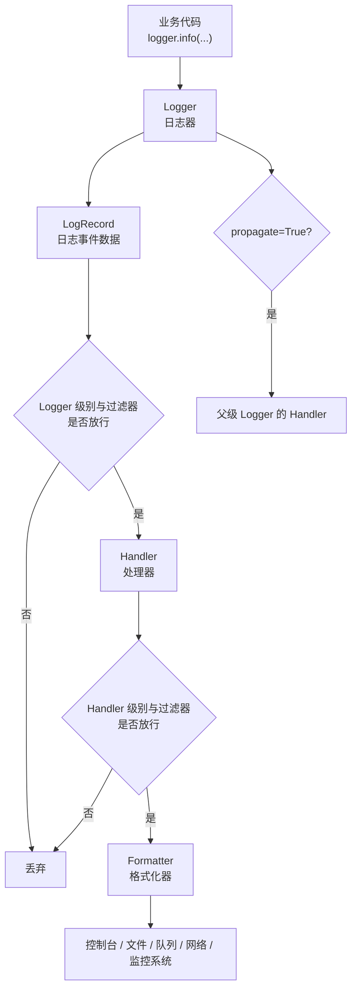
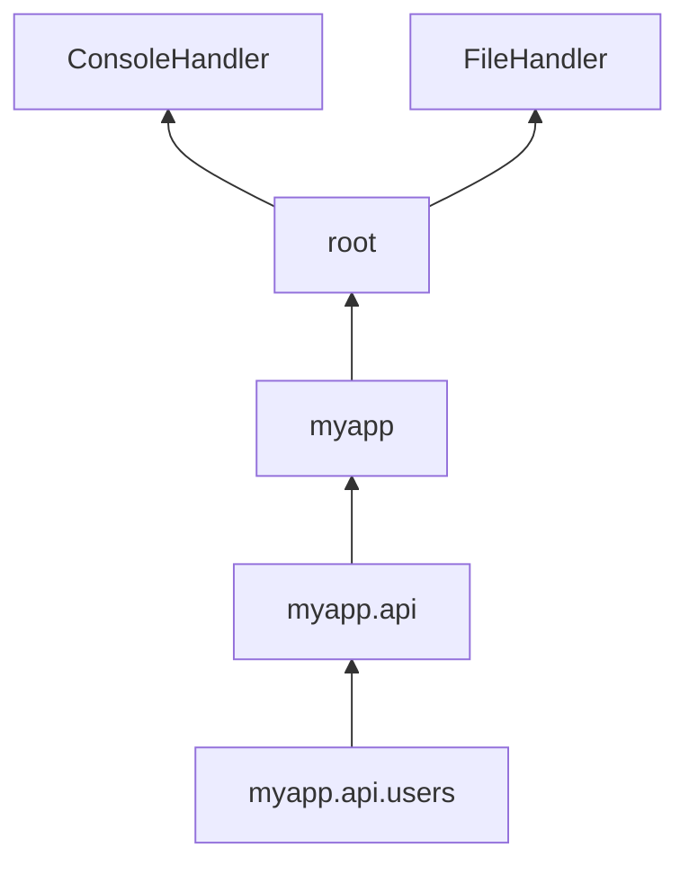
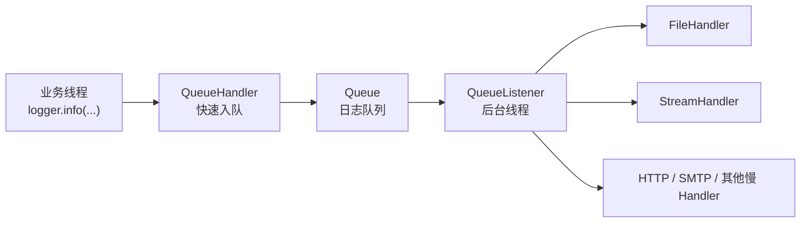

[toc]


## 学习路线大纲

| 主题           | 你要理解的问题                                               | 学完应达到的能力                                        |
| -------------- | ------------------------------------------------------------ | ------------------------------------------------------- |
| 日志的定位     | `logging` 和 `print()`、异常、告警有什么区别                 | 知道什么时候该写日志，什么时候该抛异常或使用 `warnings` |
| 核心对象模型   | `Logger`、`Handler`、`Formatter`、`Filter`、`LogRecord` 分别负责什么 | 能看懂任意 `logging` 配置                               |
| 日志级别       | `DEBUG`、`INFO`、`WARNING`、`ERROR`、`CRITICAL` 如何选择     | 能写出有诊断价值、不过度噪声的日志                      |
| Logger 层级    | `__name__`、根日志器、传播机制是什么                         | 能避免重复日志、日志丢失和配置混乱                      |
| 配置方式       | `basicConfig()`、代码配置、`dictConfig()` 如何取舍           | 能搭建脚本、应用、服务的日志配置                        |
| 格式化与上下文 | 时间、模块名、行号、请求 ID、用户 ID 怎么加                  | 能让日志支持排查问题和链路追踪                          |
| 异常日志       | `logger.exception()`、`exc_info=True` 怎么用                 | 能保留堆栈信息而不是只记录错误字符串                    |
| 文件与轮转     | 文件日志、按大小轮转、按时间轮转怎么做                       | 能避免日志无限增长                                      |
| 并发与性能     | 多线程、多进程、异步服务中怎么写日志                         | 能使用队列日志降低阻塞风险                              |
| 生产最佳实践   | 应用和库分别该怎么配置日志                                   | 能写出可维护、可观测、安全的日志系统                    |

其中一些较新的细节包括：`basicConfig(force=...)` 是 Python 3.8 后的能力，`encoding` / `errors` 是 Python 3.9 后的能力，`taskName` 日志属性是 Python 3.12 后的能力，`LoggerAdapter(merge_extra=...)` 是 Python 3.13 后的能力，`QueueListener` 在 Python 3.14 起可作为上下文管理器使用。([Python documentation](https://docs.python.org/3/library/logging.html))

------

## `logging` 是什么

`logging` 是 Python 标准库提供的日志系统，用于记录程序运行过程中发生的事件。一个日志事件通常包含：发生了什么、严重程度、发生时间、来自哪个模块或函数，以及可选的变量数据。官方文档把日志事件的严重程度称为 level 或 severity。([Python documentation](https://docs.python.org/3/howto/logging.html))

它的核心价值不是“替代 `print()`”，而是提供一套可配置、可过滤、可路由、可格式化、可集成到生产监控系统的事件记录机制。

| 场景                       | 推荐工具                                | 说明                                 |
| -------------------------- | --------------------------------------- | ------------------------------------ |
| 命令行程序正常输出给用户   | `print()`                               | 例如 CLI 的最终结果、帮助信息        |
| 记录程序正常运行状态       | `logger.info()`                         | 例如服务启动、任务完成、连接成功     |
| 记录调试细节               | `logger.debug()`                        | 例如变量值、分支路径、SQL 参数       |
| 告诉调用方代码应调整       | `warnings.warn()`                       | 适合库代码中的可避免问题             |
| 记录不可恢复或已处理的异常 | `logger.error()` / `logger.exception()` | 适合长期运行服务中不能直接中断的错误 |
| 表示函数无法完成任务       | `raise Exception`                       | 不要只写日志后悄悄失败               |

Python 官方文档也明确区分了这些场景：普通控制台输出用 `print()`，正常运行事件用 `info()` 或 `debug()`，需要调用方修改代码的运行时问题用 `warnings.warn()`，无法完成某项功能的问题则应抛异常或记录错误日志。([Python documentation](https://docs.python.org/3/howto/logging.html))

------

## 核心心智模型

`logging` 的设计是“生产日志事件”和“输出日志事件”分离。

业务代码只负责说：“这里发生了一件事。”
日志配置负责决定：“这件事要不要记录、写到哪里、长什么样。”



Python 官方文档将 logging 的主要组件分为 `Loggers`、`Handlers`、`Filters`、`Formatters`，并说明日志事件信息会通过 `LogRecord` 在这些对象之间传递。([Python documentation](https://docs.python.org/3/howto/logging.html))

------

## 核心对象

| 对象     | 英文术语        | 作用                                       | 新手理解                             |
| -------- | --------------- | ------------------------------------------ | ------------------------------------ |
| 日志器   | `Logger`        | 应用代码直接调用的对象                     | “我要记录一条日志”                   |
| 处理器   | `Handler`       | 决定日志输出到哪里                         | 控制台、文件、队列、邮件、HTTP 等    |
| 格式化器 | `Formatter`     | 决定日志最终长什么样                       | 文本格式、时间格式、JSON 格式        |
| 过滤器   | `Filter`        | 更细粒度地决定日志是否通过，也可补充上下文 | 只记录某用户、某请求、某模块         |
| 日志记录 | `LogRecord`     | 一次日志事件的数据包                       | 里面有时间、级别、模块、行号、消息等 |
| 根日志器 | root logger     | 顶层日志器                                 | 没有显式名字时默认使用它             |
| 传播     | propagation     | 子 logger 的日志向父 logger 传递           | 可能导致重复日志，也能统一配置       |
| 有效级别 | effective level | logger 未显式设置级别时，从父级继承的级别  | `myapp.api` 可继承 `myapp` 的级别    |

------

## 最小可用示例

新手不要一开始就写复杂配置。先掌握这个模式：

```python
import logging

logging.basicConfig(
    level=logging.INFO,
    format="%(asctime)s %(levelname)s [%(name)s] %(message)s",
    datefmt="%Y-%m-%d %H:%M:%S",
)

logger = logging.getLogger(__name__)

logger.debug("调试信息")
logger.info("程序启动成功")
logger.warning("配置项缺失，将使用默认值")
logger.error("任务执行失败")
```

推荐在每个模块顶部使用：

```python
logger = logging.getLogger(__name__)
```

官方文档也推荐用 `logging.getLogger(__name__)` 创建模块级 logger，因为这样 logger 名称会跟随包和模块层级，排查时能直观看出日志来自哪里。([Python documentation](https://docs.python.org/3/howto/logging.html))

------

## 日志级别

| 级别 | 英文       | 数值 | 典型含义                         | 示例                             |
| ---- | ---------- | ---- | -------------------------------- | -------------------------------- |
| 调试 | `DEBUG`    | 10   | 诊断问题时才需要的详细信息       | 请求参数、循环中间状态、SQL 细节 |
| 信息 | `INFO`     | 20   | 程序按预期运行的重要节点         | 服务启动、任务完成、用户登录成功 |
| 警告 | `WARNING`  | 30   | 出现异常迹象，但程序仍能继续     | 使用默认配置、重试、资源接近上限 |
| 错误 | `ERROR`    | 40   | 某个功能失败，但程序整体可能继续 | 订单同步失败、文件读取失败       |
| 严重 | `CRITICAL` | 50   | 程序可能无法继续运行             | 数据库不可用、关键依赖全部失败   |

Python 默认日志级别是 `WARNING`，因此如果没有配置，`INFO` 和 `DEBUG` 通常不会显示。([Python documentation](https://docs.python.org/3/howto/logging.html))

### 选择级别的实用规则

| 问题                                       | 推荐级别   |
| ------------------------------------------ | ---------- |
| 这条日志只给开发者调试用吗？               | `DEBUG`    |
| 这是系统正常生命周期中的关键事件吗？       | `INFO`     |
| 这件事不理想，但系统还能自动恢复或继续吗？ | `WARNING`  |
| 这次操作已经失败了吗？                     | `ERROR`    |
| 这个问题会导致服务不可用或数据严重风险吗？ | `CRITICAL` |

不要把所有异常都写成 `ERROR`。例如“调用外部接口失败但马上重试成功”，最终可能只需要 `WARNING` 或 `INFO`。反过来，如果静默吞掉异常，只写一条 `DEBUG`，生产排障会非常痛苦。

------

## Logger 层级与传播机制

Logger 名称使用点号形成层级。例如：

```text
myapp
myapp.api
myapp.api.users
myapp.worker
```

`myapp.api.users` 是 `myapp.api` 的子 logger，`myapp.api` 又是 `myapp` 的子 logger。官方文档说明，logger 名称是按点号组织的层级结构；同名 `getLogger()` 多次调用会返回同一个 logger 对象。([Python documentation](https://docs.python.org/3/howto/logging.html))

常见结构：

```python
# myapp/api/users.py
import logging

logger = logging.getLogger(__name__)
```

如果模块路径是 `myapp.api.users`，那么 logger 名称就是：

```text
myapp.api.users
```

### 传播机制

默认情况下，子 logger 的日志会向父 logger 传播，最终可能到达 root logger。这样你通常只需要在应用入口配置一次 handler，而不是每个模块都加 handler。官方文档也指出，因为子 logger 会把消息传播到祖先 logger 的 handler，所以通常不需要为应用中的所有 logger 都配置 handler。([Python documentation](https://docs.python.org/3/howto/logging.html))



### 重复日志的根源

重复日志常见原因：

| 原因                                                       | 示例                                         | 解决                                             |
| ---------------------------------------------------------- | -------------------------------------------- | ------------------------------------------------ |
| 同一个 logger 多次添加 handler                             | 每次调用 `setup_logging()` 都 `addHandler()` | 配置只执行一次，或用 `basicConfig(force=True)`   |
| 子 logger 和 root logger 都有 handler，且 `propagate=True` | `myapp` 有 handler，root 也有 handler        | 只在一个层级加 handler，或设置 `propagate=False` |
| 在库代码里擅自配置 handler                                 | 第三方库 import 后影响应用日志               | 库只创建 logger，不主动配置输出                  |

`basicConfig()` 默认在 root logger 已经有 handler 时不会做任何事，除非传入 `force=True`；`force=True` 会先移除并关闭 root logger 上已有 handler，再重新配置。([Python documentation](https://docs.python.org/3/library/logging.html))

------

## `basicConfig()` 适合什么场景

`basicConfig()` 适合脚本、小工具、学习阶段、单进程简单应用。

```python
import logging

logging.basicConfig(
    level=logging.INFO,
    format="%(asctime)s %(levelname)s [%(name)s:%(lineno)d] %(message)s",
    datefmt="%Y-%m-%d %H:%M:%S",
    force=True,
)

logger = logging.getLogger(__name__)
```

常用参数：

| 参数       | 作用                    | 建议                                       |
| ---------- | ----------------------- | ------------------------------------------ |
| `level`    | 设置 root logger 的级别 | 开发用 `DEBUG`，生产多用 `INFO`            |
| `format`   | 设置日志格式            | 至少包含时间、级别、logger 名、消息        |
| `datefmt`  | 设置时间格式            | 统一为可排序格式                           |
| `filename` | 输出到文件              | 小脚本可用，服务建议用 handler 或平台采集  |
| `filemode` | 文件写入模式            | 默认追加，`"w"` 会覆盖                     |
| `encoding` | 文件编码                | 建议 `utf-8`                               |
| `force`    | 强制重新配置            | 测试、notebook、重复初始化场景有用         |
| `handlers` | 直接传入多个 handler    | 适合稍复杂但还不想用 `dictConfig()` 的场景 |

官方文档说明，`basicConfig()` 会创建默认 `StreamHandler` 并添加到 root logger；模块级的 `debug()`、`info()` 等函数在 root logger 没有 handler 时会自动调用 `basicConfig()`。([Python documentation](https://docs.python.org/3/library/logging.html))

------

## 日志格式

一个实用的文本格式：

```python
"%(asctime)s %(levelname)s [%(name)s:%(lineno)d] %(message)s"
```

示例输出：

```text
2026-06-28 10:15:03 INFO [myapp.api.users:42] user created successfully
```

常用 `LogRecord` 属性：

| 字段           | 占位符            | 含义                                 |
| -------------- | ----------------- | ------------------------------------ |
| 时间           | `%(asctime)s`     | 格式化后的日志时间                   |
| 级别           | `%(levelname)s`   | `INFO`、`ERROR` 等                   |
| logger 名      | `%(name)s`        | 通常是模块路径                       |
| 消息           | `%(message)s`     | 最终消息                             |
| 文件名         | `%(filename)s`    | 源文件名                             |
| 行号           | `%(lineno)d`      | 调用日志的行号                       |
| 函数名         | `%(funcName)s`    | 调用日志的函数                       |
| 进程 ID        | `%(process)d`     | 进程编号                             |
| 进程名         | `%(processName)s` | 进程名称                             |
| 线程名         | `%(threadName)s`  | 线程名称                             |
| asyncio 任务名 | `%(taskName)s`    | 当前 asyncio task 名称，Python 3.12+ |

官方文档列出了 `LogRecord` 的属性，并说明这些属性可用于格式化字符串；其中 `taskName` 在 Python 3.12 加入。([Python documentation](https://docs.python.org/3/library/logging.html))

------

## 正确记录变量

推荐：

```python
logger.info("user %s logged in from %s", user_id, ip)
```

不推荐：

```python
logger.info(f"user {user_id} logged in from {ip}")
logger.info("user {} logged in from {}".format(user_id, ip))
```

原因是 `logging` 的参数插值是惰性的：当这条日志由于级别不够而不会输出时，`%s` 后面的参数通常不会被合并成最终字符串。官方文档说明，日志消息本身是格式字符串，后续参数会使用 `%` 风格合并；这是 logging 保持向后兼容的设计。([Python documentation](https://docs.python.org/3/howto/logging.html))

### 例子

```python
logger.debug("fetching user profile: user_id=%s", user_id)
```

比下面这种更好：

```python
logger.debug(f"fetching user profile: user_id={user_id}")
```

尤其在 `DEBUG` 日志很多、对象格式化成本较高、生产环境关闭 `DEBUG` 时，这个差异更明显。

------

## 异常日志

### 在 `except` 中使用 `logger.exception()`

```python
try:
    process_order(order_id)
except PaymentError:
    logger.exception("failed to process payment: order_id=%s", order_id)
    raise
```

`logger.exception()` 类似 `logger.error()`，但会自动带上当前异常的堆栈信息，并且应该只在异常处理器中调用。官方文档也明确说明 `Logger.exception()` 会附带 stack trace，且只应从 exception handler 中调用。([Python documentation](https://docs.python.org/3/howto/logging.html))

### 不推荐只记录异常字符串

不推荐：

```python
try:
    process_order(order_id)
except Exception as e:
    logger.error("failed: %s", e)
```

问题是你只知道错误文本，不知道错误来自哪一行、调用链是什么。

推荐：

```python
try:
    process_order(order_id)
except Exception:
    logger.exception("failed to process order: order_id=%s", order_id)
```

### 在非 `except` 位置记录堆栈

```python
logger.error("unexpected state: order_id=%s", order_id, stack_info=True)
```

`stack_info=True` 记录当前调用栈；`exc_info=True` 记录当前异常信息。两者不是一回事。

------

## Handler：日志输出到哪里

| Handler    | 英文类名                   | 用途                                     |
| ---------- | -------------------------- | ---------------------------------------- |
| 控制台输出 | `StreamHandler`            | 输出到 `stderr` 或 `stdout`              |
| 文件输出   | `FileHandler`              | 写入普通文件                             |
| 空处理器   | `NullHandler`              | 库代码避免“无人处理日志”问题             |
| 按大小轮转 | `RotatingFileHandler`      | 文件达到一定大小后切分                   |
| 按时间轮转 | `TimedRotatingFileHandler` | 每小时、每天、每周切分                   |
| 队列处理   | `QueueHandler`             | 先放入队列，减少业务线程阻塞             |
| 队列监听   | `QueueListener`            | 后台线程从队列取出日志并交给真正 handler |
| 邮件       | `SMTPHandler`              | 严重错误发邮件                           |
| HTTP       | `HTTPHandler`              | 发送到 HTTP endpoint                     |
| Syslog     | `SysLogHandler`            | 接入系统日志                             |

官方文档列出了多种内置 handler，包括 `StreamHandler`、`FileHandler`、`NullHandler`、轮转文件 handler、队列 handler、网络相关 handler 等。([Python documentation](https://docs.python.org/3/howto/logging.html))

------

## 多 Handler：同时输出到控制台和文件

```python
import logging
from logging.handlers import RotatingFileHandler
from pathlib import Path

LOG_DIR = Path("logs")
LOG_DIR.mkdir(exist_ok=True)

logger = logging.getLogger("myapp")
logger.setLevel(logging.DEBUG)

formatter = logging.Formatter(
    "%(asctime)s %(levelname)s [%(name)s:%(lineno)d] %(message)s",
    datefmt="%Y-%m-%d %H:%M:%S",
)

console_handler = logging.StreamHandler()
console_handler.setLevel(logging.INFO)
console_handler.setFormatter(formatter)

file_handler = RotatingFileHandler(
    LOG_DIR / "app.log",
    maxBytes=10 * 1024 * 1024,
    backupCount=5,
    encoding="utf-8",
)
file_handler.setLevel(logging.DEBUG)
file_handler.setFormatter(formatter)

logger.addHandler(console_handler)
logger.addHandler(file_handler)

logger.debug("debug only in file")
logger.info("info in console and file")
```

这里有两个级别判断：

| 位置                             | 作用                                   |
| -------------------------------- | -------------------------------------- |
| `logger.setLevel(logging.DEBUG)` | logger 是否创建并传递这条日志          |
| `handler.setLevel(logging.INFO)` | handler 是否输出这条日志到自己的目的地 |

所以：logger 级别先过滤，handler 级别后过滤。官方文档说明，logger 的级别决定它会把哪些严重程度的消息传给 handler，而每个 handler 的级别决定该 handler 会发送哪些消息。([Python documentation](https://docs.python.org/3/howto/logging.html))

------

## 文件轮转

普通 `FileHandler` 会一直写同一个文件。如果长期运行服务写本地文件，通常应使用轮转。

### 按大小轮转

```python
from logging.handlers import RotatingFileHandler

handler = RotatingFileHandler(
    "logs/app.log",
    maxBytes=50 * 1024 * 1024,
    backupCount=10,
    encoding="utf-8",
)
```

`RotatingFileHandler` 支持磁盘日志文件轮转；当 `maxBytes` 和 `backupCount` 都非零时，日志文件接近指定大小后会滚动生成新文件。([Python documentation](https://docs.python.org/3/library/logging.handlers.html))

### 按时间轮转

```python
from logging.handlers import TimedRotatingFileHandler

handler = TimedRotatingFileHandler(
    "logs/app.log",
    when="midnight",
    interval=1,
    backupCount=14,
    encoding="utf-8",
)
```

`TimedRotatingFileHandler` 支持按时间间隔轮转，例如秒、分钟、小时、天、星期或午夜。([Python documentation](https://docs.python.org/3/library/logging.handlers.html))

### 实践建议

| 场景                 | 建议                                              |
| -------------------- | ------------------------------------------------- |
| Docker / Kubernetes  | 优先输出到 stdout / stderr，让平台采集            |
| 传统虚拟机部署       | 可以写文件并配合 logrotate 或轮转 handler         |
| 高并发服务           | 避免业务线程直接写慢速目的地，考虑 `QueueHandler` |
| 多进程共同写一个文件 | 谨慎，优先队列集中写入或交给平台采集              |

------

## `dictConfig()`：推荐用于中大型应用

当项目变复杂时，不建议到处手写 `addHandler()`。更推荐集中配置。

```python
import logging
import logging.config

LOGGING = {
    "version": 1,
    "disable_existing_loggers": False,

    "formatters": {
        "standard": {
            "format": "%(asctime)s %(levelname)s [%(name)s:%(lineno)d] %(message)s",
            "datefmt": "%Y-%m-%d %H:%M:%S",
        },
    },

    "handlers": {
        "console": {
            "class": "logging.StreamHandler",
            "level": "INFO",
            "formatter": "standard",
        },
    },

    "loggers": {
        "myapp": {
            "level": "DEBUG",
            "handlers": ["console"],
            "propagate": False,
        },
    },

    "root": {
        "level": "WARNING",
        "handlers": ["console"],
    },
}

logging.config.dictConfig(LOGGING)

logger = logging.getLogger("myapp.api")
logger.info("service started")
```

`dictConfig()` 是官方提供的字典式配置入口；官方文档也指出，`fileConfig()` 是较老的 API，某些功能覆盖不如 `dictConfig()`，未来配置增强也更值得关注 `dictConfig()`。([Python documentation](https://docs.python.org/3/library/logging.config.html))

### `disable_existing_loggers`

强烈建议在应用配置中显式写：

```python
"disable_existing_loggers": False
```

原因：`dictConfig()` 和 `fileConfig()` 中该设置若缺省，默认会禁用已有的非 root logger，这可能导致第三方库或已创建 logger 的日志突然消失。官方文档说明，`disable_existing_loggers` 缺省为 `True`，这是为了兼容旧行为。([Python documentation](https://docs.python.org/3/library/logging.config.html))

------

## 应用代码与库代码的不同责任

### 应用代码负责配置日志

应用入口可以配置 handler、formatter、级别：

```python
# main.py
from myapp.logging_config import configure_logging

configure_logging()
```

### 库代码不要擅自配置输出

库代码应该这样：

```python
# mylib/client.py
import logging

logger = logging.getLogger(__name__)

def fetch_data():
    logger.info("fetching data")
```

如果你维护的是可被别人安装的库，可以在包顶层加：

```python
import logging

logging.getLogger(__name__).addHandler(logging.NullHandler())
```

官方 cookbook 明确建议：配置 handler、formatter、filter 是应用开发者的责任；库开发者不要给自己的 logger 添加除 `NullHandler` 以外的 handler。([Python documentation](https://docs.python.org/3/howto/logging-cookbook.html))

------

## 结构化日志

传统文本日志适合人读：

```text
2026-06-28 10:15:03 INFO [myapp.api] user created
```

结构化日志（structured logging）适合机器处理：

```json
{"time":"2026-06-28T10:15:03Z","level":"INFO","logger":"myapp.api","message":"user created","user_id":"u_123"}
```

Python 标准库没有强制你使用 JSON，但可以通过自定义 `Formatter` 实现：

```python
import json
import logging
from datetime import datetime, timezone

class JsonFormatter(logging.Formatter):
    def format(self, record: logging.LogRecord) -> str:
        data = {
            "time": datetime.fromtimestamp(record.created, tz=timezone.utc).isoformat(),
            "level": record.levelname,
            "logger": record.name,
            "message": record.getMessage(),
            "module": record.module,
            "function": record.funcName,
            "line": record.lineno,
        }

        if record.exc_info:
            data["exception"] = self.formatException(record.exc_info)

        for key in ("request_id", "user_id", "trace_id"):
            if hasattr(record, key):
                data[key] = getattr(record, key)

        return json.dumps(data, ensure_ascii=False)
```

使用：

```python
handler = logging.StreamHandler()
handler.setFormatter(JsonFormatter())

logger = logging.getLogger("myapp")
logger.setLevel(logging.INFO)
logger.addHandler(handler)

logger.info(
    "user created",
    extra={"request_id": "req-123", "user_id": "u-456"},
)
```

### 什么时候使用结构化日志

| 场景                                             | 建议                           |
| ------------------------------------------------ | ------------------------------ |
| 本地学习、小脚本                                 | 文本日志足够                   |
| 后端服务、微服务                                 | 推荐 JSON                      |
| 接入 ELK、Loki、Datadog、OpenTelemetry Collector | 推荐 JSON 或平台指定格式       |
| 需要按字段搜索                                   | 推荐结构化日志                 |
| 需要长期合规审计                                 | 推荐结构化日志，并控制敏感字段 |

------

## 上下文信息

排查生产问题时，一条日志如果没有请求 ID、用户 ID、任务 ID，经常价值很低。

### 使用 `extra`

```python
logger.info(
    "payment succeeded",
    extra={
        "request_id": request_id,
        "user_id": user_id,
        "order_id": order_id,
    },
)
```

注意：`extra` 中的 key 不能和 logging 内置 `LogRecord` 属性冲突，否则会出错；如果 formatter 里要求某个字段，但日志记录中没有这个字段，也可能导致格式化失败。官方文档对此有明确提醒。([Python documentation](https://docs.python.org/3/library/logging.html))

### 使用 `LoggerAdapter`

```python
import logging

base_logger = logging.getLogger("myapp.api")

logger = logging.LoggerAdapter(
    base_logger,
    {"request_id": "req-123", "user_id": "u-456"},
)

logger.info("fetch user profile")
```

`LoggerAdapter` 用于方便地把上下文信息传入日志调用；官方文档说明它包装一个底层 `Logger`，并通过 `extra` 等机制把上下文信息加入日志事件。([Python documentation](https://docs.python.org/3/library/logging.html))

### Web 服务中更现代的做法

在异步 Web 服务里，通常会使用：

| 技术            | 作用                                |
| --------------- | ----------------------------------- |
| `contextvars`   | 保存当前请求上下文，兼容 async 场景 |
| middleware      | 为每个请求生成 `request_id`         |
| custom `Filter` | 自动把 `request_id` 注入每条日志    |
| JSON formatter  | 输出结构化字段                      |

简化示例：

```python
import contextvars
import logging

request_id_var = contextvars.ContextVar("request_id", default="-")

class RequestIdFilter(logging.Filter):
    def filter(self, record: logging.LogRecord) -> bool:
        record.request_id = request_id_var.get()
        return True
```

formatter：

```python
"%(asctime)s %(levelname)s [%(request_id)s] [%(name)s] %(message)s"
```

------

## 队列日志：降低阻塞

在 Web 服务、高并发任务、日志输出较慢的场景，业务线程直接写文件、发邮件、发网络请求可能阻塞请求处理。`QueueHandler` 和 `QueueListener` 的思路是：



官方文档说明，`QueueHandler` 可以把日志消息发送到队列；配合 `QueueListener`，可以让 handler 在独立线程中工作，这对 Web 应用和服务应用很重要，因为服务客户端的线程需要尽快响应，而潜在慢操作可放到另一个线程处理。([Python documentation](https://docs.python.org/3/library/logging.handlers.html))

简化示例：

```python
import logging
import queue
from logging.handlers import QueueHandler, QueueListener

log_queue = queue.Queue()

console_handler = logging.StreamHandler()
console_handler.setFormatter(
    logging.Formatter("%(asctime)s %(levelname)s [%(name)s] %(message)s")
)

queue_handler = QueueHandler(log_queue)

logger = logging.getLogger("myapp")
logger.setLevel(logging.INFO)
logger.addHandler(queue_handler)

listener = QueueListener(
    log_queue,
    console_handler,
    respect_handler_level=True,
)

listener.start()

try:
    logger.info("service started")
finally:
    listener.stop()
```

Python 3.14 起，`QueueListener` 可以用作上下文管理器，进入 `with` 时启动，退出时停止。([Python documentation](https://docs.python.org/3/library/logging.handlers.html))

------

## 多进程日志

多进程写日志最容易出问题的是“多个进程同时写同一个文件”。常见建议：

| 场景                    | 推荐                                                         |
| ----------------------- | ------------------------------------------------------------ |
| Gunicorn / uWSGI / 容器 | 输出到 stdout / stderr，交给平台采集                         |
| 多进程 worker           | 每个进程写队列，由单独 listener 统一写                       |
| 必须写文件              | 使用经过验证的集中写入方案，不要随意多个 `FileHandler` 写同一个文件 |
| multiprocessing 队列    | 使用 `multiprocessing.Queue`，避免错误搭配                   |

官方 handler 文档提醒：使用 `multiprocessing` 时，应避免用 `SimpleQueue`，而使用 `multiprocessing.Queue`；同时还警告，如果 `multiprocessing.Queue` 自身的内部 debug 日志又被同一个 `QueueHandler` 处理，可能造成死锁或无限递归。([Python documentation](https://docs.python.org/3/library/logging.handlers.html))

------

## `stacklevel`：封装日志工具时很有用

如果你封装了一个日志函数：

```python
def log_warning(message: str) -> None:
    logger.warning(message)
```

日志中的文件名和行号可能会显示为 `log_warning()` 所在位置，而不是调用它的业务代码位置。可以用 `stacklevel`：

```python
def log_warning(message: str) -> None:
    logger.warning(message, stacklevel=2)
```

官方文档说明，`stacklevel` 大于 1 时会跳过相应数量的栈帧，从而让日志记录中的函数名、文件名和行号指向调用者，而不是封装函数本身；该参数在 Python 3.8 加入。([Python documentation](https://docs.python.org/3/library/logging.html))

------

## warnings 集成

可以把 `warnings` 模块产生的警告重定向到 logging：

```python
import logging

logging.captureWarnings(True)
```

启用后，`warnings` 发出的警告会被记录到名为 `py.warnings` 的 logger，级别为 `WARNING`。([Python documentation](https://docs.python.org/3/library/logging.html))

适合场景：

| 场景                                 | 是否适合 |
| ------------------------------------ | -------- |
| 统一收集第三方库 deprecation warning | 适合     |
| 在测试中发现废弃 API 使用            | 适合     |
| 代替正常异常处理                     | 不适合   |

------

## 新手最容易犯的错误

| 错误                            | 后果                       | 正确做法                                |
| ------------------------------- | -------------------------- | --------------------------------------- |
| 到处使用 `print()` 调试服务     | 生产环境不可控、不可过滤   | 使用 `logger.debug()` / `logger.info()` |
| 每个模块都 `basicConfig()`      | 配置互相覆盖或无效         | 只在应用入口配置一次                    |
| 每次调用函数都 `addHandler()`   | 日志重复输出               | 初始化时配置一次                        |
| 在库里加 `StreamHandler`        | 污染使用者应用日志         | 库只创建 logger，必要时加 `NullHandler` |
| 使用 f-string 写 debug 日志     | 即使日志不输出也会先格式化 | 用 `logger.debug("x=%s", x)`            |
| 捕获异常只写 `str(e)`           | 丢失堆栈                   | 用 `logger.exception()`                 |
| 把敏感信息写日志                | 安全和合规风险             | 脱敏或不记录                            |
| 创建无限多 logger               | 内存不可释放、难管理       | 按模块创建 logger，用上下文字段区分请求 |
| 多个 handler 写同一个文件       | 重复、冲突、轮转混乱       | 集中配置，避免重复打开同一日志文件      |
| 忽略 `disable_existing_loggers` | 第三方库日志突然消失       | 在 `dictConfig()` 中设为 `False`        |

官方 cookbook 也列出了一些应避免的模式，包括多次打开同一日志文件、在库 logger 上添加非 `NullHandler` 的 handler、创建大量 logger 等。([Python documentation](https://docs.python.org/3/howto/logging-cookbook.html))

------

## 推荐项目结构

```text
myapp/
    __init__.py
    logging_config.py
    main.py
    api/
        users.py
    worker/
        jobs.py
```

`logging_config.py`：

```python
import logging
import logging.config

def configure_logging(level: str = "INFO") -> None:
    logging.config.dictConfig({
        "version": 1,
        "disable_existing_loggers": False,

        "formatters": {
            "standard": {
                "format": (
                    "%(asctime)s %(levelname)s "
                    "[%(name)s:%(lineno)d] %(message)s"
                ),
                "datefmt": "%Y-%m-%d %H:%M:%S",
            },
        },

        "handlers": {
            "console": {
                "class": "logging.StreamHandler",
                "level": level,
                "formatter": "standard",
            },
        },

        "loggers": {
            "myapp": {
                "level": "DEBUG",
                "handlers": ["console"],
                "propagate": False,
            },
        },

        "root": {
            "level": "WARNING",
            "handlers": ["console"],
        },
    })
```

`main.py`：

```python
import logging
from myapp.logging_config import configure_logging

configure_logging("INFO")

logger = logging.getLogger(__name__)

def main() -> None:
    logger.info("application started")

if __name__ == "__main__":
    main()
```

`api/users.py`：

```python
import logging

logger = logging.getLogger(__name__)

def create_user(email: str) -> None:
    logger.info("creating user: email=%s", email)
```

------

## 一套实用的日志写法规范

### 消息内容写“发生了什么”，不要只写“失败了”

不推荐：

```python
logger.error("failed")
```

推荐：

```python
logger.error("failed to upload invoice: invoice_id=%s", invoice_id)
```

### 关键变量放进日志参数

```python
logger.info(
    "order submitted: order_id=%s user_id=%s total=%s",
    order_id,
    user_id,
    total,
)
```

### 异常日志要带上下文

```python
try:
    sync_customer(customer_id)
except Exception:
    logger.exception("failed to sync customer: customer_id=%s", customer_id)
```

### 不要记录敏感信息

避免记录：

| 敏感信息                      | 处理方式                    |
| ----------------------------- | --------------------------- |
| 密码                          | 永不记录                    |
| token / API key               | 脱敏，只保留后 4 位也要谨慎 |
| 身份证、护照号                | 脱敏或避免                  |
| 银行卡                        | 遵循合规要求                |
| Cookie / Authorization header | 默认不记录                  |
| 个人隐私数据                  | 最小化记录                  |

### 日志要能被搜索

推荐包含稳定字段：

```python
logger.info(
    "payment callback received: provider=%s payment_id=%s order_id=%s",
    provider,
    payment_id,
    order_id,
)
```

不推荐只写自然语言：

```python
logger.info("got a payment callback")
```

------

## 该记录哪些日志

| 位置                | 建议级别              | 示例                             |
| ------------------- | --------------------- | -------------------------------- |
| 服务启动            | `INFO`                | 配置环境、版本、监听端口         |
| 服务关闭            | `INFO`                | shutdown reason                  |
| 外部请求开始 / 结束 | `INFO` 或 `DEBUG`     | method、path、status、latency    |
| 定时任务开始 / 完成 | `INFO`                | job name、耗时、处理数量         |
| 重试                | `WARNING`             | 第几次重试、原因、下一次等待时间 |
| 输入校验失败        | `INFO` 或 `WARNING`   | 视业务重要性而定                 |
| 业务规则拒绝        | `INFO`                | 例如余额不足、权限不足           |
| 依赖服务失败        | `ERROR`               | 服务名、状态码、超时             |
| 数据不一致          | `ERROR` 或 `CRITICAL` | 视影响范围而定                   |
| 调试细节            | `DEBUG`               | SQL、缓存命中、分支路径          |

------

## 不该记录哪些日志

| 内容                         | 原因                         |
| ---------------------------- | ---------------------------- |
| 每次循环的大量无意义日志     | 噪声太高，影响性能和排查     |
| 完整请求体                   | 可能包含隐私和敏感信息       |
| 完整响应体                   | 体积大，且可能泄露数据       |
| 密码、token、密钥            | 严重安全风险                 |
| 已经由上层统一记录的重复异常 | 导致重复告警                 |
| 只写“进入函数”“退出函数”     | 通常价值低，除非用于短期调试 |

------

## 开发、测试、生产环境建议

| 环境             | 级别                     | 输出                       | 格式                       |
| ---------------- | ------------------------ | -------------------------- | -------------------------- |
| 本地开发         | `DEBUG`                  | 控制台                     | 人类可读文本               |
| 自动化测试       | `WARNING` 或按需 `DEBUG` | 测试框架捕获               | 简洁文本                   |
| staging          | `INFO`                   | 控制台或文件               | 接近生产                   |
| 生产             | `INFO`                   | stdout / stderr 或日志平台 | JSON 或平台推荐格式        |
| 故障排查临时窗口 | 局部 `DEBUG`             | 日志平台                   | 结构化，设置采样或时间限制 |

------

## 一句话总结

`logging` 的关键不是记住所有 API，而是建立这套模型：

业务代码使用 `logger = logging.getLogger(__name__)` 记录事件；应用入口集中配置级别、handler、formatter；日志通过 logger 层级传播；级别和 filter 决定是否记录；handler 决定输出到哪里；formatter 决定输出长什么样；生产环境要关注上下文、结构化、安全、轮转、并发和性能。