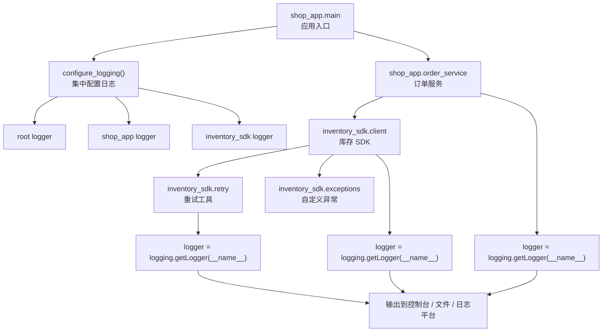

[toc]


下面设计一套**典型的“应用程序 + 可复用库”协作案例**，重点展示：一个支持 `logging` 的模块或库应该如何写，使用它的应用程序又应该如何配置日志。

案例目标是让初学者理解这几个关键问题：

| 问题                   | 本案例会展示                                |
| ---------------------- | ------------------------------------------- |
| 库代码该不该配置日志？ | 不该。库只创建 logger，不决定日志输出到哪里 |
| 应用代码该做什么？     | 在入口统一配置日志格式、级别、Handler       |
| 多个模块如何协作？     | 每个模块用 `logging.getLogger(__name__)`    |
| 如何避免重复日志？     | 只在应用入口配置 Handler                    |
| 如何让日志有上下文？   | 使用 `extra`、`LoggerAdapter` 或统一 Filter |
| 如何支持调试第三方库？ | 应用通过 logger 名称单独调整库的日志级别    |

------

## 案例背景

我们设计一个简单的电商应用。

应用名叫：

```text
shop_app
```

它依赖一个自己写的可复用库：

```text
inventory_sdk
```

`inventory_sdk` 的职责是查询库存服务，比如：

```python
client.get_stock("SKU-001")
```

`shop_app` 的职责是处理订单。它会调用 `inventory_sdk` 检查库存，然后决定是否创建订单。

这个案例非常接近真实项目中的结构：

```text
project/
    inventory_sdk/
        __init__.py
        client.py
        exceptions.py
        retry.py

    shop_app/
        __init__.py
        logging_config.py
        order_service.py
        main.py
```

------

## 整体协作关系



核心思想：

**库负责“产生日志”，应用负责“管理日志”。**

------

## 推荐的职责划分

| 角色     | 应该做                              | 不应该做                             |
| -------- | ----------------------------------- | ------------------------------------ |
| 库代码   | 使用 `getLogger(__name__)` 记录日志 | 调用 `basicConfig()`                 |
| 库代码   | 在包根添加 `NullHandler`            | 添加 `StreamHandler` / `FileHandler` |
| 库代码   | 使用合适的日志级别                  | 强制用户看到日志                     |
| 库代码   | 抛出异常，让应用决定如何处理        | 只写日志然后吞掉异常                 |
| 应用代码 | 在入口统一配置日志                  | 每个模块重复配置日志                 |
| 应用代码 | 根据环境调整日志级别                | 修改库源码控制日志                   |
| 应用代码 | 决定日志写到控制台、文件或平台      | 让库决定输出目的地                   |

------

## 库代码设计

### `inventory_sdk/__init__.py`

库的包根可以添加 `NullHandler`。

```python
# inventory_sdk/__init__.py

import logging

logging.getLogger(__name__).addHandler(logging.NullHandler())

__all__ = ["InventoryClient", "InventoryError", "InventoryTimeout"]

from .client import InventoryClient
from .exceptions import InventoryError, InventoryTimeout
```

这样做的意义是：

| 目的                               | 说明                           |
| ---------------------------------- | ------------------------------ |
| 避免库在没有配置日志时产生奇怪提示 | 对库作者更友好                 |
| 不干涉使用者应用                   | 库不会主动往控制台或文件写日志 |
| 符合可复用库的习惯                 | 应用拥有日志配置权             |

注意：这不是必须的，但对于发布给别人使用的库，是比较稳妥的做法。

------

### `inventory_sdk/exceptions.py`

库应该定义自己的异常类型，让调用者可以明确捕获。

```python
# inventory_sdk/exceptions.py

class InventoryError(Exception):
    """Base exception for inventory SDK errors."""


class InventoryTimeout(InventoryError):
    """Raised when the inventory service times out."""


class InventoryUnavailable(InventoryError):
    """Raised when the inventory service is unavailable."""
```

这里没有写日志，因为异常类只负责表达错误类型。

------

### `inventory_sdk/retry.py`

这个模块负责简单重试。

```python
# inventory_sdk/retry.py

import logging
import time
from collections.abc import Callable
from typing import TypeVar

logger = logging.getLogger(__name__)

T = TypeVar("T")


def retry(
    operation: Callable[[], T],
    *,
    attempts: int = 3,
    delay_seconds: float = 0.2,
    operation_name: str = "operation",
) -> T:
    """
    Retry an operation several times before raising the final exception.
    """
    last_error: Exception | None = None

    for attempt in range(1, attempts + 1):
        try:
            logger.debug(
                "running %s: attempt=%s max_attempts=%s",
                operation_name,
                attempt,
                attempts,
            )
            return operation()

        except Exception as exc:
            last_error = exc

            if attempt < attempts:
                logger.warning(
                    "retrying %s after error: attempt=%s max_attempts=%s error=%s",
                    operation_name,
                    attempt,
                    attempts,
                    exc,
                )
                time.sleep(delay_seconds)
            else:
                logger.error(
                    "all retry attempts failed: operation=%s attempts=%s",
                    operation_name,
                    attempts,
                )

    assert last_error is not None
    raise last_error
```

这里展示了几个重要原则：

| 写法                                   | 说明                                     |
| -------------------------------------- | ---------------------------------------- |
| `logger = logging.getLogger(__name__)` | 当前模块专属 logger                      |
| `logger.debug(...)`                    | 记录重试内部细节                         |
| `logger.warning(...)`                  | 某次调用失败，但还会继续重试             |
| `logger.error(...)`                    | 所有重试都失败                           |
| `raise last_error`                     | 不吞异常，把失败交给上层处理             |
| `"x=%s", x`                            | 使用 logging 的惰性格式化，不用 f-string |

------

### `inventory_sdk/client.py`

这个模块模拟库存查询。

```python
# inventory_sdk/client.py

import logging
import random
import time

from .exceptions import InventoryTimeout, InventoryUnavailable
from .retry import retry

logger = logging.getLogger(__name__)


class InventoryClient:
    def __init__(self, endpoint: str, *, timeout_seconds: float = 1.0) -> None:
        self.endpoint = endpoint
        self.timeout_seconds = timeout_seconds

        logger.debug(
            "inventory client initialized: endpoint=%s timeout_seconds=%s",
            endpoint,
            timeout_seconds,
        )

    def get_stock(self, sku: str) -> int:
        """
        Return current stock for a SKU.

        Raises:
            InventoryTimeout: if the request times out.
            InventoryUnavailable: if the remote service is unavailable.
        """
        logger.info("checking inventory: sku=%s", sku)

        return retry(
            lambda: self._fetch_stock(sku),
            attempts=3,
            delay_seconds=0.1,
            operation_name="get_stock",
        )

    def _fetch_stock(self, sku: str) -> int:
        logger.debug(
            "calling inventory service: endpoint=%s sku=%s",
            self.endpoint,
            sku,
        )

        time.sleep(0.05)

        simulated_result = random.choice(
            ["success", "success", "success", "timeout", "unavailable"]
        )

        if simulated_result == "timeout":
            raise InventoryTimeout(f"inventory request timed out: sku={sku}")

        if simulated_result == "unavailable":
            raise InventoryUnavailable("inventory service unavailable")

        stock = random.randint(0, 20)

        logger.info(
            "inventory service returned stock: sku=%s stock=%s",
            sku,
            stock,
        )

        return stock
```

这个库模块做到了：

| 设计点                              | 说明                               |
| ----------------------------------- | ---------------------------------- |
| 不调用 `basicConfig()`              | 不控制日志输出                     |
| 不添加控制台 Handler                | 不污染应用程序                     |
| 正常关键动作使用 `INFO`             | 查询库存、返回库存                 |
| 内部细节使用 `DEBUG`                | endpoint、请求细节                 |
| 可恢复问题交给 retry 记录 `WARNING` | 单次失败但还会重试                 |
| 最终失败抛异常                      | 调用方决定是否记录、告警、返回错误 |

------

## 应用代码设计

### `shop_app/logging_config.py`

应用入口负责集中配置日志。

```python
# shop_app/logging_config.py

import logging.config


def configure_logging(*, debug_inventory_sdk: bool = False) -> None:
    inventory_level = "DEBUG" if debug_inventory_sdk else "INFO"

    logging.config.dictConfig(
        {
            "version": 1,
            "disable_existing_loggers": False,

            "formatters": {
                "standard": {
                    "format": (
                        "%(asctime)s %(levelname)s "
                        "[%(name)s:%(lineno)d] %(message)s"
                    ),
                    "datefmt": "%Y-%m-%d %H:%M:%S",
                },
            },

            "handlers": {
                "console": {
                    "class": "logging.StreamHandler",
                    "level": "DEBUG",
                    "formatter": "standard",
                },
            },

            "loggers": {
                "shop_app": {
                    "level": "DEBUG",
                    "handlers": ["console"],
                    "propagate": False,
                },

                "inventory_sdk": {
                    "level": inventory_level,
                    "handlers": ["console"],
                    "propagate": False,
                },
            },

            "root": {
                "level": "WARNING",
                "handlers": ["console"],
            },
        }
    )
```

这里有几个非常重要的设计点：

| 配置                                | 作用                               |
| ----------------------------------- | ---------------------------------- |
| `"disable_existing_loggers": False` | 避免已有 logger 被禁用             |
| `"shop_app"` logger                 | 控制应用自己的日志                 |
| `"inventory_sdk"` logger            | 单独控制库存库的日志               |
| `"root"` logger                     | 兜底处理其他库的 warning/error     |
| `"propagate": False`                | 避免日志同时传到 root 导致重复输出 |
| `debug_inventory_sdk`               | 支持临时打开库的 DEBUG 日志        |

------

### `shop_app/order_service.py`

应用业务逻辑调用库。

```python
# shop_app/order_service.py

import logging

from inventory_sdk import InventoryClient, InventoryError

logger = logging.getLogger(__name__)


class OrderService:
    def __init__(self, inventory_client: InventoryClient) -> None:
        self.inventory_client = inventory_client

    def create_order(self, *, order_id: str, user_id: str, sku: str, quantity: int) -> bool:
        logger.info(
            "creating order: order_id=%s user_id=%s sku=%s quantity=%s",
            order_id,
            user_id,
            sku,
            quantity,
        )

        try:
            stock = self.inventory_client.get_stock(sku)

        except InventoryError:
            logger.exception(
                "failed to check inventory: order_id=%s user_id=%s sku=%s",
                order_id,
                user_id,
                sku,
            )
            return False

        if stock < quantity:
            logger.warning(
                "not enough stock: order_id=%s sku=%s required=%s available=%s",
                order_id,
                sku,
                quantity,
                stock,
            )
            return False

        logger.info(
            "order created successfully: order_id=%s user_id=%s sku=%s quantity=%s",
            order_id,
            user_id,
            sku,
            quantity,
        )

        return True
```

应用层要负责记录业务上下文：

| 上下文     | 为什么重要           |
| ---------- | -------------------- |
| `order_id` | 排查某个订单         |
| `user_id`  | 排查某个用户         |
| `sku`      | 排查某个商品         |
| `quantity` | 判断库存不足是否合理 |
| 异常堆栈   | 判断错误来自哪里     |

注意：

```python
logger.exception(...)
```

只应该在 `except` 块中使用，因为它会自动记录当前异常堆栈。

------

### `shop_app/main.py`

应用入口。

```python
# shop_app/main.py

import logging

from inventory_sdk import InventoryClient
from shop_app.logging_config import configure_logging
from shop_app.order_service import OrderService

logger = logging.getLogger(__name__)


def main() -> None:
    configure_logging(debug_inventory_sdk=False)

    logger.info("shop application started")

    inventory_client = InventoryClient(
        endpoint="https://inventory.example.com",
        timeout_seconds=1.0,
    )

    order_service = OrderService(inventory_client)

    result = order_service.create_order(
        order_id="ORD-10001",
        user_id="USER-90001",
        sku="SKU-001",
        quantity=2,
    )

    logger.info("order workflow finished: success=%s", result)


if __name__ == "__main__":
    main()
```

------

## 运行时日志示例

普通模式下，`inventory_sdk` 使用 `INFO` 级别：

```text
2026-06-28 10:00:01 INFO [shop_app.main:14] shop application started
2026-06-28 10:00:01 INFO [shop_app.order_service:15] creating order: order_id=ORD-10001 user_id=USER-90001 sku=SKU-001 quantity=2
2026-06-28 10:00:01 INFO [inventory_sdk.client:27] checking inventory: sku=SKU-001
2026-06-28 10:00:01 INFO [inventory_sdk.client:61] inventory service returned stock: sku=SKU-001 stock=12
2026-06-28 10:00:01 INFO [shop_app.order_service:43] order created successfully: order_id=ORD-10001 user_id=USER-90001 sku=SKU-001 quantity=2
2026-06-28 10:00:01 INFO [shop_app.main:30] order workflow finished: success=True
```

如果临时开启：

```python
configure_logging(debug_inventory_sdk=True)
```

则可以看到更多 SDK 内部细节：

```text
2026-06-28 10:00:01 DEBUG [inventory_sdk.client:17] inventory client initialized: endpoint=https://inventory.example.com timeout_seconds=1.0
2026-06-28 10:00:01 INFO [inventory_sdk.client:27] checking inventory: sku=SKU-001
2026-06-28 10:00:01 DEBUG [inventory_sdk.retry:22] running get_stock: attempt=1 max_attempts=3
2026-06-28 10:00:01 DEBUG [inventory_sdk.client:39] calling inventory service: endpoint=https://inventory.example.com sku=SKU-001
```

这就是 logger 层级的价值：

```text
inventory_sdk
inventory_sdk.client
inventory_sdk.retry
```

应用可以只打开整个库的 DEBUG，也可以更细粒度地只打开某个模块：

```python
"loggers": {
    "inventory_sdk.client": {
        "level": "DEBUG",
        "handlers": ["console"],
        "propagate": False,
    },
}
```

------

## 加入请求 ID：更接近真实服务

如果是 Web 服务，通常希望每条日志都有 `request_id`。

可以用 `contextvars` 实现一个简单版本。

### `shop_app/request_context.py`

```python
# shop_app/request_context.py

import contextvars

request_id_var = contextvars.ContextVar("request_id", default="-")
```

### 修改日志配置，添加 Filter

```python
# shop_app/logging_config.py

import logging
import logging.config

from shop_app.request_context import request_id_var


class RequestIdFilter(logging.Filter):
    def filter(self, record: logging.LogRecord) -> bool:
        record.request_id = request_id_var.get()
        return True


def configure_logging(*, debug_inventory_sdk: bool = False) -> None:
    inventory_level = "DEBUG" if debug_inventory_sdk else "INFO"

    logging.config.dictConfig(
        {
            "version": 1,
            "disable_existing_loggers": False,

            "filters": {
                "request_id": {
                    "()": RequestIdFilter,
                },
            },

            "formatters": {
                "standard": {
                    "format": (
                        "%(asctime)s %(levelname)s "
                        "[request_id=%(request_id)s] "
                        "[%(name)s:%(lineno)d] %(message)s"
                    ),
                    "datefmt": "%Y-%m-%d %H:%M:%S",
                },
            },

            "handlers": {
                "console": {
                    "class": "logging.StreamHandler",
                    "level": "DEBUG",
                    "formatter": "standard",
                    "filters": ["request_id"],
                },
            },

            "loggers": {
                "shop_app": {
                    "level": "DEBUG",
                    "handlers": ["console"],
                    "propagate": False,
                },

                "inventory_sdk": {
                    "level": inventory_level,
                    "handlers": ["console"],
                    "propagate": False,
                },
            },

            "root": {
                "level": "WARNING",
                "handlers": ["console"],
            },
        }
    )
```

### 在入口设置请求 ID

```python
# shop_app/main.py

import logging
import uuid

from inventory_sdk import InventoryClient
from shop_app.logging_config import configure_logging
from shop_app.order_service import OrderService
from shop_app.request_context import request_id_var

logger = logging.getLogger(__name__)


def main() -> None:
    configure_logging(debug_inventory_sdk=True)

    request_id = f"req-{uuid.uuid4()}"
    token = request_id_var.set(request_id)

    try:
        logger.info("shop application started")

        inventory_client = InventoryClient(
            endpoint="https://inventory.example.com",
            timeout_seconds=1.0,
        )

        order_service = OrderService(inventory_client)

        result = order_service.create_order(
            order_id="ORD-10001",
            user_id="USER-90001",
            sku="SKU-001",
            quantity=2,
        )

        logger.info("order workflow finished: success=%s", result)

    finally:
        request_id_var.reset(token)


if __name__ == "__main__":
    main()
```

输出会变成：

```text
2026-06-28 10:00:01 INFO [request_id=req-abc123] [shop_app.main:18] shop application started
2026-06-28 10:00:01 INFO [request_id=req-abc123] [shop_app.order_service:15] creating order: order_id=ORD-10001 user_id=USER-90001 sku=SKU-001 quantity=2
2026-06-28 10:00:01 INFO [request_id=req-abc123] [inventory_sdk.client:27] checking inventory: sku=SKU-001
```

这样即使日志来自不同模块，也能通过同一个 `request_id` 串起来。

------

## 更现代的结构化日志版本

在生产系统中，日志通常会进入 ELK、Loki、Datadog、OpenTelemetry Collector 等平台。此时 JSON 日志更容易查询。

### JSON Formatter

```python
# shop_app/json_logging.py

import json
import logging
from datetime import datetime, timezone

from shop_app.request_context import request_id_var


class JsonFormatter(logging.Formatter):
    def format(self, record: logging.LogRecord) -> str:
        data = {
            "time": datetime.fromtimestamp(record.created, tz=timezone.utc).isoformat(),
            "level": record.levelname,
            "logger": record.name,
            "message": record.getMessage(),
            "module": record.module,
            "function": record.funcName,
            "line": record.lineno,
            "request_id": request_id_var.get(),
        }

        if record.exc_info:
            data["exception"] = self.formatException(record.exc_info)

        for key in ("order_id", "user_id", "sku"):
            if hasattr(record, key):
                data[key] = getattr(record, key)

        return json.dumps(data, ensure_ascii=False)
```

### 配置 JSON 日志

```python
# shop_app/logging_config.py

import logging.config

from shop_app.json_logging import JsonFormatter


def configure_logging(*, debug_inventory_sdk: bool = False) -> None:
    inventory_level = "DEBUG" if debug_inventory_sdk else "INFO"

    logging.config.dictConfig(
        {
            "version": 1,
            "disable_existing_loggers": False,

            "formatters": {
                "json": {
                    "()": JsonFormatter,
                },
            },

            "handlers": {
                "console": {
                    "class": "logging.StreamHandler",
                    "level": "DEBUG",
                    "formatter": "json",
                },
            },

            "loggers": {
                "shop_app": {
                    "level": "DEBUG",
                    "handlers": ["console"],
                    "propagate": False,
                },
                "inventory_sdk": {
                    "level": inventory_level,
                    "handlers": ["console"],
                    "propagate": False,
                },
            },

            "root": {
                "level": "WARNING",
                "handlers": ["console"],
            },
        }
    )
```

### 业务中使用 `extra`

```python
logger.info(
    "creating order",
    extra={
        "order_id": order_id,
        "user_id": user_id,
        "sku": sku,
    },
)
```

输出：

```json
{"time":"2026-06-28T13:00:01+00:00","level":"INFO","logger":"shop_app.order_service","message":"creating order","module":"order_service","function":"create_order","line":15,"request_id":"req-abc123","order_id":"ORD-10001","user_id":"USER-90001","sku":"SKU-001"}
```

------

## 这个案例体现的核心规则

| 规则                            | 示例                                          |
| ------------------------------- | --------------------------------------------- |
| 每个模块一个 logger             | `logger = logging.getLogger(__name__)`        |
| 库不配置日志输出                | `inventory_sdk` 不调用 `basicConfig()`        |
| 应用入口集中配置                | `shop_app.main` 调用 `configure_logging()`    |
| 用 logger 名称控制粒度          | `inventory_sdk.client`、`inventory_sdk.retry` |
| 库记录技术细节                  | endpoint、重试次数、服务异常                  |
| 应用记录业务上下文              | order_id、user_id、sku、quantity              |
| 异常不要吞掉                    | 库抛出异常，应用决定如何处理                  |
| 异常日志用 `logger.exception()` | 保留 traceback                                |
| 生产日志避免敏感信息            | 不记录密码、token、完整请求头                 |
| 调试时局部打开 DEBUG            | 不要全局开启所有库的 DEBUG                    |

------

## 新手可以按这个顺序练习

| 阶段     | 练习目标                                              |
| -------- | ----------------------------------------------------- |
| 基础版   | 只用 `basicConfig()`，观察 `INFO`、`WARNING`、`ERROR` |
| 模块版   | 拆成多个模块，每个模块使用 `getLogger(__name__)`      |
| 库协作版 | 让 `inventory_sdk` 不配置日志，由 `shop_app` 统一配置 |
| 调试版   | 单独把 `inventory_sdk` 调成 `DEBUG`                   |
| 上下文版 | 给日志加 `request_id`                                 |
| 结构化版 | 改成 JSON 日志                                        |
| 异常版   | 模拟库存服务超时，观察 `logger.exception()` 的堆栈    |
| 生产版   | 加入文件轮转或输出到 stdout 给平台采集                |

------

## 最小可运行版本

初学者可以先只实现这几个文件：

```text
project/
    inventory_sdk/
        __init__.py
        client.py
        exceptions.py
        retry.py

    shop_app/
        logging_config.py
        order_service.py
        main.py
```

运行：

```bash
python -m shop_app.main
```

如果想看到 SDK 内部细节，把：

```python
configure_logging(debug_inventory_sdk=False)
```

改成：

```python
configure_logging(debug_inventory_sdk=True)
```

你就能直观看到应用如何控制库的日志输出。

------

## 进一步改造方向

| 改造方向                                                 | 学习价值                   |
| -------------------------------------------------------- | -------------------------- |
| 加 `RotatingFileHandler`                                 | 学习文件日志和轮转         |
| 加 `QueueHandler` / `QueueListener`                      | 学习高并发日志处理         |
| 改成 JSON Formatter                                      | 学习结构化日志             |
| 加 `contextvars`                                         | 学习异步服务中的请求上下文 |
| 加单元测试                                               | 验证库不会主动配置日志     |
| 接入真实 HTTP 请求                                       | 练习记录外部依赖调用日志   |
| 使用环境变量控制级别                                     | 模拟生产配置               |
| 拆分 `inventory_sdk.client` 和 `inventory_sdk.transport` | 理解 logger 层级粒度       |

------

## 最重要的结论

这套案例的核心不是代码量，而是协作边界：

**库只负责记录“发生了什么”，应用负责决定“这些日志如何输出”。**

一个成熟的支持 `logging` 的库，应该做到：

```python
logger = logging.getLogger(__name__)
```

然后在合适的位置写：

```python
logger.debug(...)
logger.info(...)
logger.warning(...)
logger.error(...)
```

但不要写：

```python
logging.basicConfig(...)
logger.addHandler(logging.StreamHandler())
```

而一个成熟的应用，应该在入口集中配置：

```python
logging.config.dictConfig(...)
```

并通过 logger 名称控制不同模块和库的日志级别。