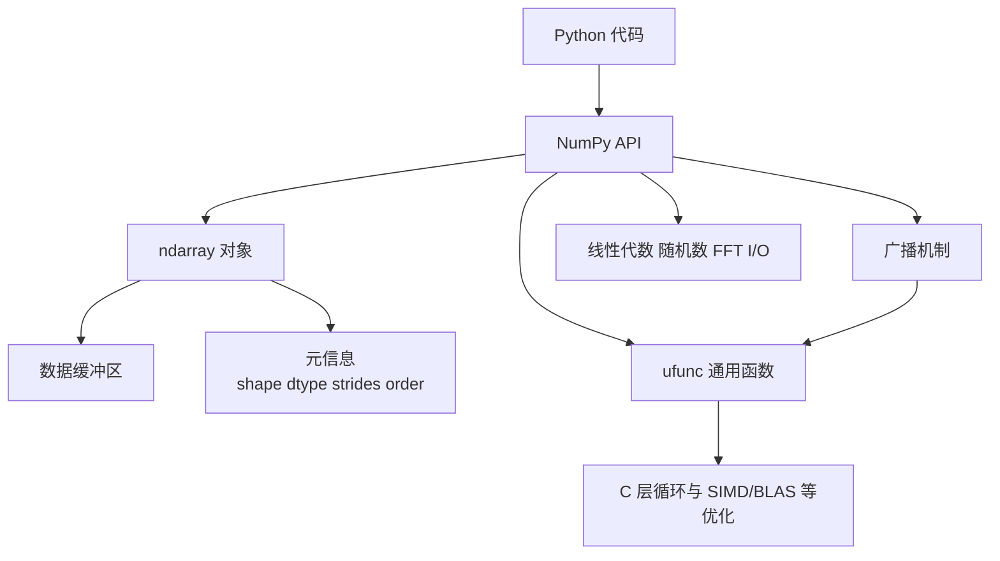

[toc]


## NumPy 是什么，适合解决什么问题

NumPy 是 Python 科学计算生态的基础库，核心对象是 `ndarray`：一个多维、同质、固定大小元素的数组对象。它提供数组运算、数学函数、随机数、线性代数、傅里叶变换等能力。当前官方稳定文档是 NumPy 2.4；现代 NumPy 学习应以 2.x 语义为准，尤其注意随机数新 API、数组副本语义、类型提升规则等变化。([NumPy](https://numpy.org/doc/stable/?utm_source=chatgpt.com))

NumPy 最适合处理“同一类数值的大批量计算”：向量、矩阵、张量、图像像素、传感器数据、仿真结果、机器学习特征矩阵等。它不适合直接替代 pandas 做带标签的表格业务分析，也不适合替代数据库处理超大规模持久化查询。

## 详细大纲

| 学习模块       | 目标                     | 核心概念                                                     | 典型练习                           |
| -------------- | ------------------------ | ------------------------------------------------------------ | ---------------------------------- |
| 环境与定位     | 知道何时使用 NumPy       | 科学计算生态、数组优先思维                                   | 安装 NumPy，检查版本               |
| `ndarray` 基础 | 理解数组的本质           | `shape`、`ndim`、`size`、`dtype`、`axis`                     | 创建一维、二维、三维数组           |
| 数组创建       | 熟练构造数组             | `array`、`asarray`、`zeros`、`ones`、`full`、`arange`、`linspace` | 构造特征矩阵、网格数据             |
| 数据类型       | 控制精度与内存           | `dtype`、类型转换、类型提升、溢出                            | 比较 `int32`、`float32`、`float64` |
| 索引与切片     | 正确读取和修改数据       | 基础切片、整数索引、布尔索引、花式索引                       | 筛选异常值、提取子矩阵             |
| 视图与副本     | 避免隐式修改和内存浪费   | view、copy、共享内存、浅拷贝                                 | 判断切片是否影响原数组             |
| 广播机制       | 写出简洁高效的数组表达式 | 维度对齐、长度为 1 的轴、隐式扩展                            | 矩阵按行或按列归一化               |
| 通用函数       | 使用 NumPy 的性能核心    | ufunc、逐元素运算、`out`、`where`、reduce                    | 批量计算 sigmoid、标准化           |
| 聚合与轴       | 掌握多维统计运算         | `axis`、`keepdims`、归约                                     | 按行、按列求均值                   |
| 形状变换       | 管理数据布局             | `reshape`、`transpose`、`ravel`、`stack`、`concatenate`      | 图像通道转换、批量样本重排         |
| 线性代数       | 解决矩阵计算问题         | `@`、`matmul`、`linalg.solve`、`lstsq`                       | 解线性方程、最小二乘               |
| 随机数         | 可复现实验与仿真         | `default_rng`、分布采样、随机种子                            | 蒙特卡洛模拟                       |
| I/O 与持久化   | 保存和读取数组           | `.npy`、`.npz`、文本读取、内存映射                           | 保存训练特征                       |
| 性能优化       | 避免慢代码和爆内存       | 向量化、广播、临时数组、连续内存                             | 优化 Python 循环                   |
| 工程实践       | 写出可维护代码           | 类型标注、测试、边界检查、迁移 NumPy 2.x                     | 封装一个数据预处理函数             |

## NumPy 的整体工作机制



你可以把 NumPy 理解成：“Python 负责表达计算意图，NumPy 负责把大批量数值计算交给底层高效实现执行。”这也是为什么 NumPy 代码通常强调数组表达式，而不是手写 Python 层循环。

## 安装与环境建议

官方安装页建议根据工作流选择安装方式；新用户可以用项目式工具，也可以使用传统的 `pip` 或 `conda`。如果不确定，从虚拟环境加 `pip install numpy` 或 conda 环境开始即可。安装后用 `np.__version__` 验证版本。([NumPy](https://numpy.org/install/?utm_source=chatgpt.com))

```bash
python -m venv .venv
source .venv/bin/activate  # Windows 使用 .venv\Scripts\activate
pip install numpy
import numpy as np

print(np.__version__)
```

常见约定是：

```python
import numpy as np
```

不要写成 `from numpy import *`。原因是 NumPy 命名空间很大，通配导入会污染当前命名空间，也会降低代码可读性。

## `ndarray` 的核心模型

NumPy 的核心对象是 `ndarray`。它表示一个多维、同质、固定大小元素的数组；每个数组都有一个关联的 `dtype`，用于描述元素如何在内存中解释，例如整数、浮点数、复数、布尔值等。([NumPy](https://numpy.org/doc/stable/reference/generated/numpy.ndarray.html?utm_source=chatgpt.com))

```python
import numpy as np

a = np.array([[1, 2, 3],
              [4, 5, 6]], dtype=np.int64)

print(a.ndim)   # 2
print(a.shape)  # (2, 3)
print(a.size)   # 6
print(a.dtype)  # int64
```

| 属性       | 含义                             | 示例                     |
| ---------- | -------------------------------- | ------------------------ |
| `ndim`     | 维度数量                         | 二维矩阵的 `ndim` 是 `2` |
| `shape`    | 每个维度的长度                   | `(2, 3)` 表示 2 行 3 列  |
| `size`     | 元素总数                         | `2 * 3 = 6`              |
| `dtype`    | 元素数据类型                     | `int64`、`float32`       |
| `itemsize` | 单个元素占用字节数               | `float64` 通常是 8 字节  |
| `strides`  | 沿每个轴移动一步需要跨过的字节数 | 与内存布局有关           |

`strides` 是理解 NumPy 性能和视图机制的重要概念。物理内存本质上是一维的，NumPy 通过 `shape` 和 `strides` 把一段连续或非连续内存解释为多维数组。官方词汇表说明，`strides` 决定在某个轴上索引前进一步时地址需要增加多少字节。([NumPy](https://numpy.org/doc/stable/glossary.html?utm_source=chatgpt.com))

## 数组创建

常用创建方式可以分成几类。

| 函数          | 用途                                   | 示例                     |
| ------------- | -------------------------------------- | ------------------------ |
| `np.array`    | 从 Python 序列创建数组，默认可能复制   | `np.array([1, 2, 3])`    |
| `np.asarray`  | 尽量把输入转换成数组，能不复制就不复制 | `np.asarray(existing)`   |
| `np.zeros`    | 全 0 数组                              | `np.zeros((2, 3))`       |
| `np.ones`     | 全 1 数组                              | `np.ones(5)`             |
| `np.full`     | 填充指定值                             | `np.full((2, 2), 7)`     |
| `np.empty`    | 分配未初始化数组                       | `np.empty((1000, 1000))` |
| `np.arange`   | 按步长生成序列                         | `np.arange(0, 10, 2)`    |
| `np.linspace` | 按数量等分区间                         | `np.linspace(0, 1, 5)`   |
| `np.eye`      | 单位矩阵                               | `np.eye(3)`              |

```python
x = np.array([1, 2, 3], dtype=np.float64)
z = np.zeros((2, 3))
o = np.ones_like(z)
f = np.full((2, 3), fill_value=9)
r = np.arange(0, 10, 2)
l = np.linspace(0, 1, 5)
```

现代 NumPy 中，`np.array` 和 `np.asarray` 的 `copy` 语义值得注意。NumPy 2.0 后，相关构造器支持更明确的 `copy` 行为：例如 `copy=False` 会在无法避免复制时抛出错误，而不是悄悄复制。([NumPy](https://numpy.org/doc/stable/reference/generated/numpy.array.html?utm_source=chatgpt.com))

实践建议：

| 场景               | 推荐写法                               | 原因                   |
| ------------------ | -------------------------------------- | ---------------------- |
| 明确要新数组       | `np.array(data, dtype=..., copy=True)` | 避免共享原始数据       |
| 尽量避免复制       | `np.asarray(data, dtype=...)`          | 更适合函数入口         |
| 大数组预分配       | `np.empty(shape, dtype=...)` 后填充    | 避免重复扩容           |
| 需要等间隔浮点点位 | `np.linspace(start, stop, num)`        | 比浮点 `arange` 更可控 |
| 需要整数区间       | `np.arange(start, stop, step)`         | 简洁直观               |

## 数据类型 `dtype`

`dtype` 决定数组元素的解释方式、精度、内存占用和运算结果。NumPy 支持比 Python 内置数字类型更丰富的数值类型。([NumPy](https://numpy.org/devdocs/user/basics.types.html?utm_source=chatgpt.com))

```python
a = np.array([1, 2, 3], dtype=np.int32)
b = np.array([1, 2, 3], dtype=np.float32)

print(a.itemsize)  # 4
print(b.itemsize)  # 4
```

| 类型                   | 常见用途                 | 注意点           |
| ---------------------- | ------------------------ | ---------------- |
| `bool`                 | 掩码、条件筛选           | 常用于布尔索引   |
| `int32`                | 节省内存的整数           | 可能溢出         |
| `int64`                | 默认整数计算常用         | 内存更大         |
| `float32`              | 深度学习、图像、GPU 生态 | 精度较低         |
| `float64`              | 科学计算默认浮点精度     | 内存翻倍         |
| `complex64/complex128` | 复数计算、信号处理       | 实部虚部都有精度 |
| `object`               | 存 Python 对象           | 慢，通常应避免   |

NumPy 2.0 采用了 NEP 50 的类型提升规则，混合类型运算的结果类型更依赖输入的 dtype，而不是输入值本身。这修复了一些旧版本中“结果类型受具体数值影响”的意外行为，但也可能让迁移代码时出现输出 dtype 或精度变化。([NumPy](https://numpy.org/neps/nep-0050-scalar-promotion.html?utm_source=chatgpt.com))

```python
x = np.array([1, 2, 3], dtype=np.float32)
y = x + 1.0

print(y.dtype)
```

最佳实践：

| 建议                                | 原因                                       |
| ----------------------------------- | ------------------------------------------ |
| 对重要数组显式指定 `dtype`          | 避免平台默认整数宽度、隐式浮点精度导致差异 |
| 财务金额不要直接依赖浮点精确表示    | 二进制浮点不能精确表示所有十进制小数       |
| 避免大规模使用 `object` dtype       | 会退化成 Python 对象数组，性能差           |
| 转换类型用 `astype`，并注意是否复制 | 类型转换通常会产生新数组                   |
| 混合 dtype 运算前先确认结果类型     | NumPy 2.x 的类型提升更严格、更一致         |

## 轴 `axis` 的理解

`axis` 是新手最容易混淆的概念之一。简单说，`axis` 指“沿哪个维度做归约或操作”。

```python
a = np.array([[1, 2, 3],
              [4, 5, 6]])

print(a.sum())        # 所有元素求和: 21
print(a.sum(axis=0))  # 沿行方向压缩，得到每列之和: [5 7 9]
print(a.sum(axis=1))  # 沿列方向压缩，得到每行之和: [6 15]
```

对于二维数组：

| 表达式                         | 结果含义               | 输出形状    |
| ------------------------------ | ---------------------- | ----------- |
| `a.sum()`                      | 所有元素聚合           | 标量        |
| `a.sum(axis=0)`                | 每列求和               | `(列数,)`   |
| `a.sum(axis=1)`                | 每行求和               | `(行数,)`   |
| `a.sum(axis=0, keepdims=True)` | 每列求和但保留二维形状 | `(1, 列数)` |
| `a.sum(axis=1, keepdims=True)` | 每行求和但保留二维形状 | `(行数, 1)` |

`keepdims=True` 在广播中非常有用：

```python
x = np.array([[1, 2, 3],
              [4, 5, 6]], dtype=float)

row_mean = x.mean(axis=1, keepdims=True)
x_centered = x - row_mean
```

## 索引、切片与筛选

NumPy 支持多种索引方式。官方文档把 ndarray 索引分为不同类别，包括基础切片、整数数组索引、布尔索引等。([NumPy](https://numpy.org/doc/stable/user/basics.indexing.html?utm_source=chatgpt.com))

```python
a = np.arange(12).reshape(3, 4)

print(a[0, 0])     # 第 0 行第 0 列
print(a[1])        # 第 1 行
print(a[:, 2])     # 第 2 列
print(a[1:, 1:3])  # 子矩阵
```

| 索引方式     | 示例             | 通常是否返回视图 |
| ------------ | ---------------- | ---------------- |
| 单个整数索引 | `a[0]`           | 可能是视图或标量 |
| 基础切片     | `a[:, 1:3]`      | 通常是视图       |
| 布尔索引     | `a[a > 5]`       | 通常是副本       |
| 整数数组索引 | `a[[0, 2]]`      | 通常是副本       |
| 混合索引     | `a[[0, 2], 1:3]` | 需谨慎判断       |

布尔筛选非常常用：

```python
scores = np.array([55, 72, 88, 43, 91])
passed = scores >= 60

print(scores[passed])  # [72 88 91]
```

修改时要注意：

```python
a = np.arange(10)
a[a % 2 == 0] = -1
print(a)
```

## 视图与副本

NumPy 的一个核心特性是：很多操作不会复制数据，而是返回同一数据缓冲区的不同“视图”。这能提高性能、节省内存，但也可能导致“改了子数组，原数组也变了”。官方文档明确说明，视图不复制数据，因此修改视图也会修改原数组；了解哪些操作返回视图、哪些返回副本非常重要。([NumPy](https://numpy.org/doc/stable/user/basics.copies.html?utm_source=chatgpt.com))

```python
a = np.array([1, 2, 3, 4])
b = a[1:3]    # 通常是视图
b[0] = 99

print(a)      # [ 1 99  3  4]
```

显式复制：

```python
a = np.array([1, 2, 3, 4])
b = a[1:3].copy()
b[0] = 99

print(a)      # [1 2 3 4]
```

判断是否共享内存：

```python
np.shares_memory(a, b)
```

| 操作        | 常见结果               | 建议                     |
| ----------- | ---------------------- | ------------------------ |
| 基础切片    | 视图                   | 修改前确认是否影响原数组 |
| `reshape`   | 可能是视图，也可能复制 | 不要盲目假设             |
| `transpose` | 通常是视图             | 可能导致非连续内存       |
| 布尔索引    | 通常是副本             | 修改结果不会自动改原数组 |
| 花式索引    | 通常是副本             | 大数组上注意内存         |
| `copy()`    | 副本                   | 需要隔离数据时使用       |

## 广播机制

广播是 NumPy 最重要的规则之一。它允许不同形状的数组参与逐元素运算，而不需要显式复制成相同形状。官方文档说明，广播让循环发生在 C 层，并且避免不必要的数据复制，但某些场景也可能造成过大的临时结果。([NumPy](https://numpy.org/doc/stable/user/basics.broadcasting.html?utm_source=chatgpt.com))

广播规则可以这样理解：

从右向左比较两个数组的形状。每一维要么相等，要么其中一个是 `1`，要么其中一个缺失。否则无法广播。

| A 形状      | B 形状      | 是否可广播 | 结果形状    |
| ----------- | ----------- | ---------- | ----------- |
| `(3,)`      | `(3,)`      | 可以       | `(3,)`      |
| `(2, 3)`    | `(3,)`      | 可以       | `(2, 3)`    |
| `(2, 3)`    | `(2, 1)`    | 可以       | `(2, 3)`    |
| `(4, 1, 3)` | `(1, 5, 3)` | 可以       | `(4, 5, 3)` |
| `(2, 3)`    | `(2,)`      | 不可以     | 无          |

示例：按列标准化。

```python
x = np.array([[1, 2, 3],
              [4, 5, 6],
              [7, 8, 9]], dtype=float)

mean = x.mean(axis=0, keepdims=True)
std = x.std(axis=0, keepdims=True)

z = (x - mean) / std
```

这里：

```python
x.shape     # (3, 3)
mean.shape  # (1, 3)
std.shape   # (1, 3)
```

`(1, 3)` 可以广播到 `(3, 3)`。

使用 `np.newaxis` 或 `None` 可以手动增加维度：

```python
x = np.array([1, 2, 3])
col = x[:, None]  # shape: (3, 1)
row = x[None, :]  # shape: (1, 3)

matrix = col + row
```

广播的风险是“逻辑上很简洁，内存上很巨大”。例如计算两组点的两两距离：

```python
a = np.random.default_rng(0).normal(size=(10000, 3))
b = np.random.default_rng(1).normal(size=(10000, 3))

# 这个中间结果形状是 (10000, 10000, 3)，内存会爆炸
# diff = a[:, None, :] - b[None, :, :]
```

这类问题应分块计算，或者使用专门算法。

## 通用函数 ufunc 与向量化

ufunc 是 NumPy 性能的核心之一。官方文档定义 ufunc 为对 ndarray 逐元素操作的函数，支持广播、类型转换等标准特性；它本质上是固定输入输出数量的向量化包装。([NumPy](https://numpy.org/doc/stable/user/basics.ufuncs.html?utm_source=chatgpt.com))

常见 ufunc：

| 类别     | 示例                                                |
| -------- | --------------------------------------------------- |
| 算术     | `np.add`、`np.subtract`、`np.multiply`、`np.divide` |
| 幂与指数 | `np.power`、`np.exp`、`np.log`                      |
| 三角函数 | `np.sin`、`np.cos`、`np.tan`                        |
| 比较     | `np.greater`、`np.less_equal`、`np.equal`           |
| 逻辑     | `np.logical_and`、`np.logical_or`、`np.logical_not` |

```python
x = np.linspace(-3, 3, 7)
y = 1 / (1 + np.exp(-x))
```

很多 ufunc 支持 `out` 和 `where`。`out` 可以减少临时数组分配，`where` 可以按条件执行。NumPy 2.3 还为 ufunc 增加了 `out=...` 的相关支持；更常用的是传入已有数组作为 `out`。([NumPy](https://numpy.org/doc/stable/reference/generated/numpy.ufunc.html?utm_source=chatgpt.com))

```python
x = np.array([1, 2, 3, 4], dtype=float)
out = np.empty_like(x)

np.sqrt(x, out=out)
print(out)
```

使用 `where`：

```python
x = np.array([-1, 0, 1, 4], dtype=float)
out = np.zeros_like(x)

np.sqrt(x, out=out, where=x >= 0)
print(out)
```

不要误解 `np.vectorize`。官方文档明确说，`np.vectorize` 主要是为了便利，不是为了性能；其实现本质上接近 Python for 循环。真正的高性能“向量化”通常是使用 NumPy 内置 ufunc、广播、聚合和线性代数函数。([NumPy](https://numpy.org/doc/stable/reference/generated/numpy.vectorize.html?utm_source=chatgpt.com))

## 聚合、归约与统计

NumPy 的聚合函数通常支持 `axis`、`dtype`、`keepdims` 等参数。

| 函数                | 含义            |
| ------------------- | --------------- |
| `sum`               | 求和            |
| `mean`              | 均值            |
| `std`               | 标准差          |
| `var`               | 方差            |
| `min` / `max`       | 最小值 / 最大值 |
| `argmin` / `argmax` | 最值位置        |
| `median`            | 中位数          |
| `quantile`          | 分位数          |
| `cumsum`            | 累积和          |
| `cumprod`           | 累积积          |

```python
x = np.array([[1, 2, 3],
              [4, 5, 6]])

print(x.mean(axis=0))                 # 每列均值
print(x.mean(axis=1))                 # 每行均值
print(x.mean(axis=1, keepdims=True))  # 保留二维形状
```

浮点累加要注意精度：

```python
x = np.array([0.1] * 10, dtype=np.float32)
print(x.sum(dtype=np.float64))
```

对于存在缺失值的浮点数组，可以使用 `nan` 系列函数：

```python
x = np.array([1.0, np.nan, 3.0])

print(np.mean(x))     # nan
print(np.nanmean(x))  # 2.0
```

## 形状变换

形状变换是日常 NumPy 代码的高频操作。

| 操作              | 函数或方法                | 说明                                     |
| ----------------- | ------------------------- | ---------------------------------------- |
| 改形状            | `reshape`                 | 元素总数必须一致                         |
| 拉平              | `ravel` / `flatten`       | `ravel` 尽量返回视图，`flatten` 返回副本 |
| 转置              | `transpose` / `.T`        | 改变轴顺序                               |
| 增加维度          | `np.expand_dims` / `None` | 为广播做准备                             |
| 删除长度为 1 的轴 | `squeeze`                 | 谨慎使用，避免误删语义轴                 |
| 拼接              | `concatenate`             | 沿已有轴拼接                             |
| 堆叠              | `stack`                   | 新增一个轴                               |
| 分割              | `split` / `array_split`   | 拆分数组                                 |

```python
x = np.arange(12)

a = x.reshape(3, 4)
b = a.T
c = a[:, :, None]  # shape: (3, 4, 1)
```

拼接与堆叠的区别：

```python
a = np.array([1, 2, 3])
b = np.array([4, 5, 6])

print(np.concatenate([a, b]))  # shape: (6,)
print(np.stack([a, b]))        # shape: (2, 3)
```

## 线性代数

NumPy 支持常见线性代数操作。需要特别注意：二维数组中 `*` 是逐元素乘法，不是矩阵乘法；矩阵乘法应使用 `@` 或 `np.matmul`。官方的 MATLAB 用户指南也提醒，NumPy 的基础类型是多维数组，二维数组的 `*` 是逐元素运算，传统矩阵乘法应使用 `@`。([NumPy](https://numpy.org/doc/stable/user/numpy-for-matlab-users.html?utm_source=chatgpt.com))

```python
A = np.array([[1, 2],
              [3, 4]])

B = np.array([[10, 20],
              [30, 40]])

print(A * B)   # 逐元素乘法
print(A @ B)   # 矩阵乘法
```

常用线性代数函数：

| 函数                    | 用途                          | 建议                     |
| ----------------------- | ----------------------------- | ------------------------ |
| `np.linalg.solve(A, b)` | 解线性方程 `Ax=b`             | 优先于显式求逆           |
| `np.linalg.inv(A)`      | 矩阵逆                        | 尽量少用，数值稳定性较差 |
| `np.linalg.det(A)`      | 行列式                        | 判断可逆性不宜只靠它     |
| `np.linalg.eig(A)`      | 特征值和特征向量              | 一般方阵                 |
| `np.linalg.eigh(A)`     | 对称 / Hermitian 矩阵特征分解 | 更稳定更快               |
| `np.linalg.svd(A)`      | 奇异值分解                    | 降维、低秩近似           |
| `np.linalg.lstsq(A, b)` | 最小二乘                      | 线性回归常用             |

```python
A = np.array([[3, 1],
              [1, 2]], dtype=float)
b = np.array([9, 8], dtype=float)

x = np.linalg.solve(A, b)
print(x)
```

不要这样：

```python
# 不推荐
x = np.linalg.inv(A) @ b
```

更推荐：

```python
x = np.linalg.solve(A, b)
```

## 随机数

现代 NumPy 推荐使用 `np.random.default_rng()` 创建随机数生成器，而不是依赖全局的旧式随机状态。官方文档说明，`default_rng` 是构造 `Generator` 的推荐方式。([NumPy](https://numpy.org/doc/stable/reference/random/generator.html?utm_source=chatgpt.com))

```python
rng = np.random.default_rng(42)

x = rng.normal(loc=0, scale=1, size=(3, 4))
u = rng.uniform(0, 1, size=5)
i = rng.integers(0, 10, size=5)
```

| 任务           | 推荐 API                                             |
| -------------- | ---------------------------------------------------- |
| 均匀分布浮点数 | `rng.random(size)` 或 `rng.uniform(low, high, size)` |
| 均匀整数       | `rng.integers(low, high, size)`                      |
| 正态分布       | `rng.normal(loc, scale, size)`                       |
| 随机打乱       | `rng.shuffle(x)`                                     |
| 随机抽样       | `rng.choice(a, size, replace=...)`                   |

`default_rng` 当前使用 PCG64 作为默认 BitGenerator，官方文档说明它相较旧的 `RandomState` 默认 MT19937 具有更好的统计性质和性能。([NumPy](https://numpy.org/doc/stable/reference/random/index.html?utm_source=chatgpt.com))

可复现实验：

```python
def simulate(seed: int = 0):
    rng = np.random.default_rng(seed)
    samples = rng.normal(size=10_000)
    return samples.mean()

print(simulate(123))
print(simulate(123))
```

最佳实践：

| 建议                                    | 原因                     |
| --------------------------------------- | ------------------------ |
| 函数中显式传入 `rng` 或 `seed`          | 便于测试和复现           |
| 避免在库代码中调用全局 `np.random.seed` | 会影响外部代码           |
| 蒙特卡洛模拟使用 `Generator`            | API 更清晰               |
| 并行随机数要使用专门策略                | 避免不同进程产生相关序列 |

## 输入输出与持久化

NumPy 自带几种常用保存方式。

| 格式     | 函数                                         | 适合场景                          |
| -------- | -------------------------------------------- | --------------------------------- |
| `.npy`   | `np.save` / `np.load`                        | 保存单个数组，保留 dtype 和 shape |
| `.npz`   | `np.savez` / `np.savez_compressed`           | 保存多个数组                      |
| 文本     | `np.savetxt` / `np.loadtxt`                  | 小型、可读数据                    |
| 复杂文本 | `np.genfromtxt`                              | 有缺失值、表头的文本数据          |
| 内存映射 | `np.memmap` 或 `np.load(..., mmap_mode=...)` | 大数组按需读取                    |

```python
x = np.arange(10)

np.save("x.npy", x)
y = np.load("x.npy")

np.savez("data.npz", x=x, y=y)
data = np.load("data.npz")
print(data["x"])
```

对于严肃的数据工程任务，NumPy 的 `.npy/.npz` 很适合保存中间数值数组；如果需要列名、索引、分组、复杂表格结构，通常应使用 pandas、Parquet、数据库或专门格式。

## 性能优化原则

NumPy 性能优化的核心不是“把 Python 写得更花”，而是减少 Python 层循环、减少临时数组、减少不必要复制、使用合适 dtype 和底层优化函数。

| 问题                       | 低效写法                              | 更好写法                      |
| -------------------------- | ------------------------------------- | ----------------------------- |
| Python 循环逐元素计算      | `for i in range(n): y[i] = x[i] ** 2` | `y = x ** 2`                  |
| 重复拼接数组               | 循环中 `np.concatenate`               | 先收集列表，最后一次拼接      |
| 无意识创建大临时数组       | 多个大表达式连写                      | 使用 `out`、分块、就地操作    |
| 用 `np.vectorize` 期待加速 | `np.vectorize(f)(x)`                  | 改写成 ufunc 表达式或用 Numba |
| 显式求逆解方程             | `inv(A) @ b`                          | `solve(A, b)`                 |
| dtype 过大                 | 全部 `float64`                        | 可接受时用 `float32`          |
| 花式索引复制大数组         | `x[idx]` 多次复制                     | 重新组织数据或分块            |

示例：从 Python 循环改为数组表达式。

```python
x = np.linspace(0, 1, 1_000_000)

# 慢
y = np.empty_like(x)
for i in range(x.size):
    y[i] = np.sin(x[i]) + np.cos(x[i])

# 快
y = np.sin(x) + np.cos(x)
```

减少临时数组：

```python
x = np.linspace(0, 1, 1_000_000)
y = np.empty_like(x)

np.sin(x, out=y)
y += np.cos(x)
```

注意：`y += ...` 是就地修改，适合你确认 `y` 不需要保留旧值的场景。

## 经典用例

### 数据标准化

```python
import numpy as np

X = np.array([[1.0, 10.0],
              [2.0, 20.0],
              [3.0, 30.0]])

mean = X.mean(axis=0, keepdims=True)
std = X.std(axis=0, keepdims=True)

Z = (X - mean) / std
print(Z)
```

关键点：

| 概念            | 体现                         |
| --------------- | ---------------------------- |
| `axis=0`        | 按列计算均值和标准差         |
| `keepdims=True` | 保持形状为 `(1, n_features)` |
| 广播            | `(m, n)` 减 `(1, n)`         |

### 条件清洗异常值

```python
x = np.array([1.2, 3.4, -999.0, 5.6, 1000.0])

mask = (x >= 0) & (x <= 100)
clean = x[mask]

print(clean)
```

注意布尔条件要用 `&`、`|`、`~`，并且每个条件用括号包起来。不要写：

```python
# 错误
# mask = x >= 0 and x <= 100
```

### 批量计算距离

```python
points = np.array([[0.0, 0.0],
                   [3.0, 4.0],
                   [6.0, 8.0]])

origin = np.array([0.0, 0.0])

dist = np.sqrt(((points - origin) ** 2).sum(axis=1))
print(dist)
```

更简洁：

```python
dist = np.linalg.norm(points - origin, axis=1)
```

### 最小二乘拟合直线

```python
x = np.array([0, 1, 2, 3, 4], dtype=float)
y = np.array([1.1, 2.0, 2.9, 4.2, 5.1], dtype=float)

A = np.column_stack([x, np.ones_like(x)])
coef, residuals, rank, s = np.linalg.lstsq(A, y, rcond=None)

slope, intercept = coef
print(slope, intercept)
```

这里不是手动求逆，而是使用 `lstsq`，更适合最小二乘问题。

### 蒙特卡洛估计圆周率

```python
rng = np.random.default_rng(42)

n = 1_000_000
points = rng.uniform(-1, 1, size=(n, 2))

inside = (points[:, 0] ** 2 + points[:, 1] ** 2) <= 1
pi_estimate = 4 * inside.mean()

print(pi_estimate)
```

这个例子结合了随机数、布尔数组、向量化和聚合。

### 分组计数

```python
labels = np.array([0, 1, 1, 2, 2, 2, 3])
counts = np.bincount(labels)

print(counts)
```

如果标签不是从 0 开始的连续非负整数，可以先映射：

```python
categories = np.array(["a", "b", "a", "c", "b", "a"])
unique, inverse = np.unique(categories, return_inverse=True)
counts = np.bincount(inverse)

print(unique)
print(counts)
```

### 累加到重复索引

普通的花式索引赋值可能因为缓冲导致重复索引不按直觉累加。`np.add.at` 会对重复索引执行未缓冲的原地累加；官方文档也特别说明了 `a[[0,0]] += 1` 与 `add.at(a, [0,0], 1)` 的区别。([NumPy](https://numpy.org/doc/stable/reference/generated/numpy.ufunc.at.html?utm_source=chatgpt.com))

```python
a = np.zeros(5, dtype=int)
idx = np.array([0, 0, 2, 2, 2])

np.add.at(a, idx, 1)
print(a)  # [2 0 3 0 0]
```

## 常见坑与修正

| 常见坑                      | 问题                                        | 修正                        |
| --------------------------- | ------------------------------------------- | --------------------------- |
| 以为切片一定复制            | 修改切片影响原数组                          | 需要隔离时用 `.copy()`      |
| 以为 `*` 是矩阵乘法         | NumPy 中 `*` 是逐元素乘法                   | 矩阵乘法用 `@`              |
| 混用 Python list 和 ndarray | list 的 `+` 是拼接，array 的 `+` 是逐元素加 | 尽早转成 ndarray            |
| 忘记 `axis` 含义            | 聚合方向错误                                | 打印 shape，配合 `keepdims` |
| 布尔条件用 `and/or`         | ndarray 条件会报错或语义不对                | 用 `&`、`                   |
| 盲目用 `np.vectorize`       | 不会带来真正底层加速                        | 用 ufunc、广播、Numba       |
| 大广播导致内存爆炸          | 隐式结果太大                                | 分块计算                    |
| 用 `np.linalg.inv` 解方程   | 数值稳定性和效率较差                        | 用 `np.linalg.solve`        |
| 未指定 dtype                | 结果精度、内存不可控                        | 关键数据显式指定            |
| 循环中不断 concatenate      | 反复分配和复制                              | 先 list 收集，最后拼接      |

## 现代 NumPy 最佳实践清单

| 主题     | 推荐做法                                                |
| -------- | ------------------------------------------------------- |
| 导入     | `import numpy as np`                                    |
| 随机数   | 使用 `rng = np.random.default_rng(seed)`                |
| 函数入口 | 用 `np.asarray` 接收 array-like 输入                    |
| 类型     | 对核心数据显式指定 `dtype`                              |
| 形状     | 在关键步骤断言或打印 `shape`                            |
| 广播     | 使用 `keepdims=True` 保持可广播形状                     |
| 副本     | 修改前确认 view/copy，必要时 `.copy()`                  |
| 性能     | 先写清楚，再用 profiling 找瓶颈                         |
| 大数组   | 分块处理，避免巨大临时数组                              |
| 线性代数 | 解方程用 `solve`，拟合用 `lstsq`                        |
| 测试     | 用 `np.testing.assert_allclose` 比较浮点数组            |
| 迁移     | NumPy 2.x 下注意类型提升、C 扩展二进制兼容和旧 API 清理 |

## 函数设计示例

一个比较工程化的 NumPy 函数通常会：

- 接收 array-like 输入；
- 转成 ndarray；
- 检查维度；
- 指定或保留 dtype；
- 使用广播和聚合；
- 返回新数组，避免意外修改输入。

```python
import numpy as np
from numpy.typing import ArrayLike, NDArray

def standardize_columns(x: ArrayLike, eps: float = 1e-12) -> NDArray[np.float64]:
    arr = np.asarray(x, dtype=np.float64)

    if arr.ndim != 2:
        raise ValueError(f"expected a 2-D array, got shape {arr.shape}")

    mean = arr.mean(axis=0, keepdims=True)
    std = arr.std(axis=0, keepdims=True)

    return (arr - mean) / (std + eps)
```

测试：

```python
X = [[1, 10],
     [2, 20],
     [3, 30]]

Z = standardize_columns(X)
print(Z)
print(Z.mean(axis=0))
print(Z.std(axis=0))
```

## 新手学习路线

| 阶段 | 重点                                        | 建议练习                       |
| ---- | ------------------------------------------- | ------------------------------ |
| 入门 | 创建数组、查看属性、基础运算                | 用 NumPy 重写 Python list 统计 |
| 基础 | 索引、切片、布尔筛选、axis                  | 清洗异常值，按列标准化         |
| 核心 | 广播、ufunc、聚合                           | 写 sigmoid、softmax、距离计算  |
| 进阶 | view/copy、strides、内存布局                | 判断哪些操作共享内存           |
| 应用 | 随机数、线性代数、I/O                       | 蒙特卡洛、最小二乘、保存数组   |
| 工程 | 性能、测试、类型标注                        | 封装可复用预处理函数           |
| 深入 | 与 SciPy、pandas、Numba、CuPy、PyTorch 协作 | 选择合适工具解决真实问题       |

## 推荐掌握的最小 API 集合

刚开始不需要背完整 NumPy API。优先掌握下面这些，已经能解决大量问题。

| 类别     | API                                                          |
| -------- | ------------------------------------------------------------ |
| 创建     | `array`、`asarray`、`zeros`、`ones`、`full`、`empty`、`arange`、`linspace` |
| 属性     | `shape`、`ndim`、`size`、`dtype`、`strides`                  |
| 变形     | `reshape`、`transpose`、`ravel`、`squeeze`、`expand_dims`    |
| 拼接     | `concatenate`、`stack`、`hstack`、`vstack`                   |
| 筛选     | 布尔索引、`where`、`nonzero`、`argwhere`                     |
| 数学     | `sum`、`mean`、`std`、`min`、`max`、`exp`、`log`、`sqrt`     |
| 排序     | `sort`、`argsort`、`argmax`、`argmin`                        |
| 集合     | `unique`、`isin`                                             |
| 线性代数 | `@`、`linalg.solve`、`linalg.lstsq`、`linalg.norm`           |
| 随机     | `random.default_rng`、`normal`、`uniform`、`integers`        |
| 保存     | `save`、`load`、`savez`                                      |

## 学习时的思维转换

学习 NumPy 的关键不是记函数，而是建立数组思维。

| Python 循环思维      | NumPy 数组思维                       |
| -------------------- | ------------------------------------ |
| 一个元素一个元素处理 | 一批元素整体处理                     |
| 手写循环控制流程     | 用数组表达式描述计算                 |
| 用嵌套 list 表示矩阵 | 用 `ndarray` 和 `shape` 表示多维数据 |
| 关注“第几个循环”     | 关注“沿哪个 axis”                    |
| 临时变量很多         | 广播和 ufunc 组合                    |
| 难以看出数学结构     | 代码接近公式                         |

一个简单判断标准：如果你发现自己在 NumPy 代码里写了很多逐元素 `for` 循环，通常说明还有更 NumPy 化的写法。