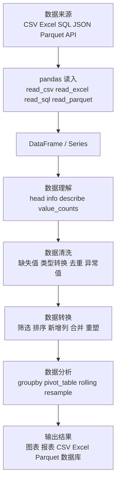
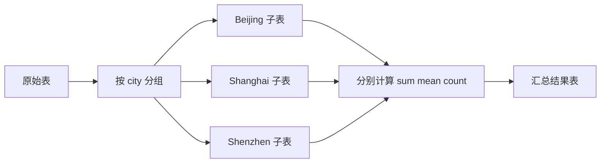
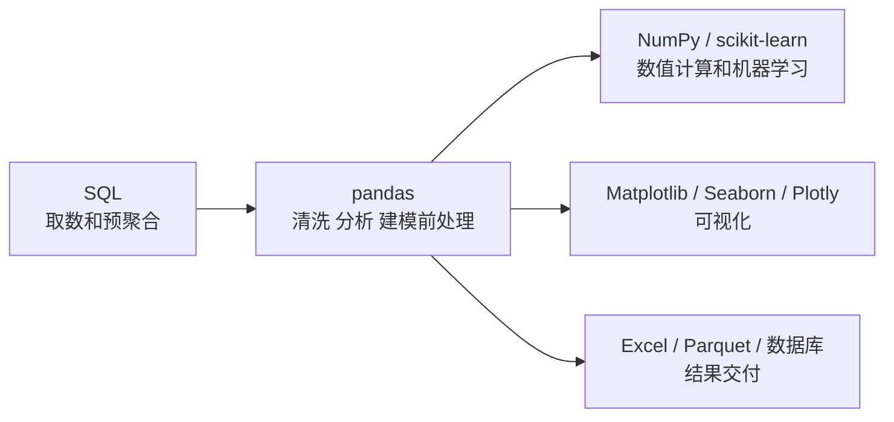

[toc]


## pandas 是什么，适合解决什么问题

`pandas` 是 Python 生态中最常用的数据分析库之一，官方将其定位为提供“高性能、易用的数据结构和数据分析工具”的开源库；截至我核对时，官方文档版本为 pandas 3.0.3。([Pandas](https://pandas.pydata.org/docs/))

它最适合处理**表格型数据**，例如 CSV、Excel、数据库查询结果、日志、指标数据、实验数据、业务报表等。你可以把 pandas 理解为：

| 类比对象           | pandas 中的对应能力                        |
| ------------------ | ------------------------------------------ |
| Excel 表格         | `DataFrame`                                |
| 一列数据           | `Series`                                   |
| 行号或标签         | `Index`                                    |
| 筛选、排序、透视表 | 条件选择、`sort_values()`、`pivot_table()` |
| VLOOKUP / SQL JOIN | `merge()`                                  |
| 分组汇总           | `groupby()`                                |
| 缺失值处理         | `isna()`、`fillna()`、`dropna()`           |
| 时间序列分析       | `DatetimeIndex`、`resample()`、滚动窗口    |

pandas 的核心思想是：**用接近表格思维的方式，在 Python 中高效地清洗、转换、分析数据。**

------

## pandas 的整体工作模型

pandas 通常处在数据分析流程的中间层：负责读入数据、清洗数据、转换结构、聚合计算，然后把结果交给可视化、机器学习、报表或数据库。



------

## 安装与导入

```bash
pip install pandas
```

常见导入方式：

```python
import pandas as pd
```

如果你经常读写 Excel，通常还需要：

```bash
pip install openpyxl
```

如果你处理较大的列式数据文件，建议学习 Parquet：

```bash
pip install pyarrow
```

pandas 3.0 开始对字符串类型、Copy-on-Write 语义等做了较大调整；官方建议从旧版本升级到 3.0 前，先升级到 pandas 2.3，并确保代码没有警告，再升级到 3.0。([Pandas](https://pandas.pydata.org/docs/whatsnew/v3.0.0.html))

------

## 核心数据结构

### Series：一维带标签数组

`Series` 可以理解为“一列数据”，既有值，也有索引。

```python
import pandas as pd

s = pd.Series([80, 90, 75], index=["Alice", "Bob", "Cindy"])
print(s)
```

结果类似：

```text
Alice    80
Bob      90
Cindy    75
dtype: int64
```

常见用途：

| 场景       | 示例               |
| ---------- | ------------------ |
| 一列成绩   | 学生成绩           |
| 一列日期   | 下单日期           |
| 一列类别   | 商品类别           |
| 一列布尔值 | 是否通过、是否缺失 |

------

### DataFrame：二维表格

`DataFrame` 是 pandas 最核心的数据结构，可以理解为“带行索引和列名的二维表”。

```python
df = pd.DataFrame({
    "name": ["Alice", "Bob", "Cindy"],
    "age": [23, 25, 22],
    "score": [80, 90, 75]
})

print(df)
```

| name  | age  | score |
| ----- | ---- | ----- |
| Alice | 23   | 80    |
| Bob   | 25   | 90    |
| Cindy | 22   | 75    |

核心理解：

| 概念  | 说明                             |
| ----- | -------------------------------- |
| 行    | 一条记录，例如一个学生、一笔订单 |
| 列    | 一个字段，例如姓名、年龄、金额   |
| 索引  | 行标签，不一定是 0、1、2         |
| dtype | 每一列的数据类型                 |
| shape | 表格维度，格式为 `(行数, 列数)`  |

------

### Index：索引不是普通行号

pandas 的索引非常重要。它不仅是“第几行”，还可以是标签、日期、分层索引。

```python
df = df.set_index("name")
```

设置索引后：

```python
df.loc["Alice"]
```

索引的作用：

| 用途     | 说明                           |
| -------- | ------------------------------ |
| 快速定位 | 用标签查找数据                 |
| 对齐计算 | 两个对象运算时会按索引自动对齐 |
| 时间序列 | 日期索引支持重采样、窗口计算   |
| 多级结构 | `MultiIndex` 可表达多维分组    |

新手常见误区是把索引当作“永远连续的行号”。实际上，经过筛选、删除、合并后，索引可能不连续。需要重置时使用：

```python
df = df.reset_index(drop=True)
```

------

## 常用数据类型

pandas 每一列都有自己的 dtype。理解 dtype 是写出稳定代码的关键。

| dtype 类型       | 示例                         | 说明                  |
| ---------------- | ---------------------------- | --------------------- |
| `int64`          | `1, 2, 3`                    | 普通整数              |
| `float64`        | `1.2, 3.5`                   | 浮点数                |
| `bool`           | `True, False`                | 布尔值                |
| `str` / `string` | `"A", "B"`                   | 字符串                |
| `datetime64[ns]` | `2026-01-01`                 | 日期时间              |
| `category`       | 性别、地区、等级             | 低基数分类变量        |
| nullable dtypes  | `Int64`, `boolean`, `string` | 支持缺失值的扩展类型  |
| Arrow dtypes     | `int64[pyarrow]`             | 基于 PyArrow 的列类型 |

pandas 3.0 的一个重要变化是：创建对象或读入数据时，字符串列会默认推断为新的 `str` dtype，而不是旧的 `object` dtype；该类型如果安装了 PyArrow，会在底层使用 PyArrow，否则回退到 NumPy object。([Pandas](https://pandas.pydata.org/docs/whatsnew/v3.0.0.html))

这意味着新手应尽量避免写这种旧式判断：

```python
df["name"].dtype == object
```

更推荐：

```python
pd.api.types.is_string_dtype(df["name"])
```

------

## 快速认识一个 DataFrame

拿到一个新数据集，不要马上分析，先做“体检”。

```python
df.head()
df.tail()
df.shape
df.columns
df.info()
df.describe()
```

常用检查方法：

| 方法             | 作用               |
| ---------------- | ------------------ |
| `head()`         | 查看前几行         |
| `tail()`         | 查看后几行         |
| `shape`          | 查看行数、列数     |
| `columns`        | 查看列名           |
| `dtypes`         | 查看每列类型       |
| `info()`         | 查看非空数量和类型 |
| `describe()`     | 数值列统计摘要     |
| `value_counts()` | 类别频次           |
| `isna().sum()`   | 每列缺失值数量     |

示例：

```python
df.info()
df.isna().sum()
df["city"].value_counts()
```

------

## 读取和写出数据

### 读取 CSV

```python
df = pd.read_csv("orders.csv")
```

实务中更推荐显式指定关键参数：

```python
df = pd.read_csv(
    "orders.csv",
    encoding="utf-8",
    parse_dates=["order_date"]
)
```

### 读取 Excel

```python
df = pd.read_excel("orders.xlsx", sheet_name="Sheet1")
```

### 读取 Parquet

```python
df = pd.read_parquet("orders.parquet")
```

### 写出数据

```python
df.to_csv("result.csv", index=False)
df.to_excel("result.xlsx", index=False)
df.to_parquet("result.parquet", index=False)
```

最佳实践：

| 场景                         | 推荐格式 |
| ---------------------------- | -------- |
| 与业务人员交换               | Excel    |
| 简单文本交换                 | CSV      |
| 大数据量、保留类型、分析链路 | Parquet  |
| 数据库存储                   | SQL 表   |
| Web 接口                     | JSON     |

------

## 选择数据：列、行、条件

### 选择列

```python
df["name"]
df[["name", "score"]]
```

单列返回 `Series`，多列返回 `DataFrame`。

```python
type(df["name"])        # Series
type(df[["name"]])      # DataFrame
```

### 按标签选择：loc

```python
df.loc[0, "name"]
df.loc[:, ["name", "score"]]
df.loc[df["score"] >= 80, ["name", "score"]]
```

### 按位置选择：iloc

```python
df.iloc[0]
df.iloc[0:3, 0:2]
```

| 方法   | 按什么选择           | 常见用途         |
| ------ | -------------------- | ---------------- |
| `loc`  | 标签、列名、布尔条件 | 推荐日常使用     |
| `iloc` | 整数位置             | 按第几行第几列选 |
| `at`   | 单个标签值           | 快速取单个元素   |
| `iat`  | 单个位置值           | 快速取单个元素   |

------

## 条件筛选

```python
df[df["score"] >= 80]
```

多个条件要用括号，并使用 `&`、`|`、`~`：

```python
df[(df["score"] >= 80) & (df["age"] < 25)]
df[(df["city"] == "Shanghai") | (df["city"] == "Beijing")]
df[~df["name"].isna()]
```

不要写：

```python
df[df["score"] >= 80 and df["age"] < 25]
```

因为 `and` 是 Python 标量逻辑，不适合 pandas 的逐元素布尔数组。

------

## 新增列与修改列

### 直接新增

```python
df["passed"] = df["score"] >= 60
```

### 基于表达式新增

```python
df["score_plus_10"] = df["score"] + 10
```

### 使用 assign

```python
df = df.assign(
    passed=df["score"] >= 60,
    score_level=lambda x: x["score"] // 10
)
```

pandas 3.0 还引入了 `pd.col()`，可在 `assign()` 等场景中更简洁地引用列构造表达式，例如 `pd.col("a") + pd.col("b")`。([Pandas](https://pandas.pydata.org/docs/whatsnew/v3.0.0.html))

------

## 缺失值处理

pandas 中常见缺失值包括 `NaN`、`None`、`pd.NA`。不要用 `== None` 或 `== np.nan` 判断缺失，应该使用：

```python
df.isna()
df.notna()
```

常见处理：

```python
df.isna().sum()

df = df.dropna()
df = df.dropna(subset=["email"])

df["age"] = df["age"].fillna(df["age"].median())
df["city"] = df["city"].fillna("Unknown")
```

| 方法            | 作用                 |
| --------------- | -------------------- |
| `isna()`        | 判断是否缺失         |
| `notna()`       | 判断是否非缺失       |
| `dropna()`      | 删除缺失值           |
| `fillna()`      | 填充缺失值           |
| `interpolate()` | 插值，常用于时间序列 |
| `replace()`     | 替换指定值           |

实践建议：

| 情况             | 建议                         |
| ---------------- | ---------------------------- |
| 缺失很少且不重要 | 可以删除                     |
| 数值列缺失       | 用中位数、均值、业务规则填充 |
| 类别列缺失       | 用 `"Unknown"` 或单独类别    |
| 时间序列缺失     | 考虑前向填充、后向填充、插值 |
| 缺失本身有含义   | 增加一列缺失标记             |

示例：

```python
df["age_missing"] = df["age"].isna()
df["age"] = df["age"].fillna(df["age"].median())
```

------

## 类型转换

很多数据问题本质上是类型问题。

```python
df["age"] = df["age"].astype("Int64")
df["price"] = df["price"].astype("float")
df["order_date"] = pd.to_datetime(df["order_date"])
```

更稳妥的数值转换：

```python
df["price"] = pd.to_numeric(df["price"], errors="coerce")
```

日期转换：

```python
df["order_date"] = pd.to_datetime(df["order_date"], errors="coerce")
```

分类变量：

```python
df["city"] = df["city"].astype("category")
```

最佳实践：

| 需求           | 推荐方式                               |
| -------------- | -------------------------------------- |
| 字符串转数值   | `pd.to_numeric(..., errors="coerce")`  |
| 字符串转日期   | `pd.to_datetime(..., errors="coerce")` |
| 可缺失整数     | 使用 `"Int64"`，不是 `"int64"`         |
| 低基数字符串   | 使用 `category`                        |
| 大数据列式处理 | 了解 `pyarrow` dtype                   |

pandas 官方文档说明，`Series`、`Index` 或 `DataFrame` 列可以直接由 `pyarrow.ChunkedArray` 支持，也可以通过类似 `"int64[pyarrow]"` 的 dtype 参数构造。([Pandas](https://pandas.pydata.org/docs/user_guide/pyarrow.html))

------

## 排序、去重与重命名

### 排序

```python
df = df.sort_values("score", ascending=False)
df = df.sort_values(["city", "score"], ascending=[True, False])
```

### 去重

```python
df = df.drop_duplicates()
df = df.drop_duplicates(subset=["email"])
```

### 重命名

```python
df = df.rename(columns={
    "old_name": "new_name",
    "amt": "amount"
})
```

### 调整列顺序

```python
df = df[["name", "age", "score"]]
```

------

## 字符串处理

pandas 使用 `.str` 访问字符串方法：

```python
df["name"] = df["name"].str.strip()
df["name_upper"] = df["name"].str.upper()
df["email_domain"] = df["email"].str.split("@").str[-1]
df["is_gmail"] = df["email"].str.contains("gmail", na=False)
```

常用 `.str` 方法：

| 方法               | 作用               |
| ------------------ | ------------------ |
| `str.strip()`      | 去除首尾空白       |
| `str.lower()`      | 转小写             |
| `str.upper()`      | 转大写             |
| `str.contains()`   | 是否包含模式       |
| `str.startswith()` | 是否以某字符串开头 |
| `str.endswith()`   | 是否以某字符串结尾 |
| `str.replace()`    | 替换文本           |
| `str.extract()`    | 正则提取           |
| `str.split()`      | 分割字符串         |

pandas 3.0 中字符串 dtype 的行为比过去更明确：`str` dtype 只能持有字符串或缺失值；对于文本数据，官方文档也区分了 `str`、`string`、`object` 等字符串相关 dtype 的差异。([Pandas](https://pandas.pydata.org/docs/whatsnew/v3.0.0.html)) ([Pandas](https://pandas.pydata.org/docs/user_guide/text.html))

------

## 分组聚合：groupby

`groupby` 是 pandas 的核心能力之一，常用于“按类别统计”。

```python
df.groupby("city")["amount"].sum()
```

多个统计指标：

```python
summary = df.groupby("city").agg(
    total_amount=("amount", "sum"),
    avg_amount=("amount", "mean"),
    order_count=("order_id", "count")
).reset_index()
```

按多个字段分组：

```python
df.groupby(["city", "category"])["amount"].sum().reset_index()
```

理解 `groupby`：



常见聚合函数：

| 函数          | 含义            |
| ------------- | --------------- |
| `sum`         | 求和            |
| `mean`        | 平均值          |
| `median`      | 中位数          |
| `min` / `max` | 最小值 / 最大值 |
| `count`       | 非缺失数量      |
| `size`        | 行数，包括缺失  |
| `nunique`     | 唯一值数量      |
| `std`         | 标准差          |

------

## 透视表：pivot_table

`pivot_table` 类似 Excel 数据透视表。

```python
pivot = pd.pivot_table(
    df,
    values="amount",
    index="city",
    columns="category",
    aggfunc="sum",
    fill_value=0
)
```

| 参数         | 说明           |
| ------------ | -------------- |
| `values`     | 要统计的数值列 |
| `index`      | 行维度         |
| `columns`    | 列维度         |
| `aggfunc`    | 聚合函数       |
| `fill_value` | 缺失组合填充值 |

适合场景：

| 问题                   | 透视表设计                                 |
| ---------------------- | ------------------------------------------ |
| 每个城市各品类销售额   | `index="city"`, `columns="category"`       |
| 每月各渠道订单数       | `index="month"`, `columns="channel"`       |
| 每个销售人员各季度业绩 | `index="salesperson"`, `columns="quarter"` |

------

## 合并数据：concat 与 merge

### concat：纵向或横向拼接

纵向拼接，类似追加行：

```python
df_all = pd.concat([df_jan, df_feb, df_mar], ignore_index=True)
```

横向拼接，类似追加列：

```python
df_wide = pd.concat([df_left, df_right], axis=1)
```

### merge：按键连接

```python
result = orders.merge(customers, on="customer_id", how="left")
```

| how     | 含义                 | 类似 SQL        |
| ------- | -------------------- | --------------- |
| `inner` | 只保留两边都匹配的行 | INNER JOIN      |
| `left`  | 保留左表全部行       | LEFT JOIN       |
| `right` | 保留右表全部行       | RIGHT JOIN      |
| `outer` | 保留两边全部行       | FULL OUTER JOIN |

示例：

```python
orders.merge(
    customers,
    on="customer_id",
    how="left",
    validate="many_to_one"
)
```

`validate` 是非常推荐的实务参数，可以防止错误的多对多合并。

| validate         | 含义                 |
| ---------------- | -------------------- |
| `"one_to_one"`   | 一对一               |
| `"one_to_many"`  | 左表一条对应右表多条 |
| `"many_to_one"`  | 左表多条对应右表一条 |
| `"many_to_many"` | 多对多               |

------

## 重塑数据：宽表与长表

### melt：宽表变长表

原始宽表：

| name  | math | english |
| ----- | ---- | ------- |
| Alice | 90   | 85      |
| Bob   | 80   | 88      |

转换：

```python
long_df = df.melt(
    id_vars="name",
    var_name="subject",
    value_name="score"
)
```

结果：

| name  | subject | score |
| ----- | ------- | ----- |
| Alice | math    | 90    |
| Bob   | math    | 80    |
| Alice | english | 85    |
| Bob   | english | 88    |

### pivot：长表变宽表

```python
wide_df = long_df.pivot(
    index="name",
    columns="subject",
    values="score"
)
```

------

## 时间序列处理

日期列先转换：

```python
df["order_date"] = pd.to_datetime(df["order_date"])
```

提取日期特征：

```python
df["year"] = df["order_date"].dt.year
df["month"] = df["order_date"].dt.month
df["weekday"] = df["order_date"].dt.day_name()
```

按月统计：

```python
monthly = (
    df.set_index("order_date")
      .resample("ME")["amount"]
      .sum()
)
```

滚动窗口：

```python
df["rolling_7d"] = (
    df.set_index("order_date")["amount"]
      .rolling("7D")
      .sum()
      .values
)
```

常用时间序列方法：

| 方法               | 用途         |
| ------------------ | ------------ |
| `pd.to_datetime()` | 转日期时间   |
| `.dt.year`         | 取年份       |
| `.dt.month`        | 取月份       |
| `.dt.day_name()`   | 取星期       |
| `set_index()`      | 设置时间索引 |
| `resample()`       | 重采样       |
| `rolling()`        | 滚动窗口     |
| `shift()`          | 滞后或前移   |
| `diff()`           | 差分         |

------

## apply、map、transform：什么时候用

### map：一列值映射

```python
level_map = {
    "A": "优秀",
    "B": "良好",
    "C": "一般"
}

df["level_name"] = df["level"].map(level_map)
```

### apply：自定义函数

```python
def score_level(score):
    if score >= 90:
        return "A"
    elif score >= 80:
        return "B"
    else:
        return "C"

df["level"] = df["score"].apply(score_level)
```

### transform：分组后返回与原表等长结果

```python
df["city_avg_amount"] = (
    df.groupby("city")["amount"].transform("mean")
)
```

选择建议：

| 需求             | 推荐                             |
| ---------------- | -------------------------------- |
| 字典映射         | `map()`                          |
| 简单条件分支     | `np.select()` 或布尔条件         |
| 按行复杂逻辑     | `apply(axis=1)`，但谨慎使用      |
| 分组后回填原表   | `transform()`                    |
| 能向量化就向量化 | 优先使用 pandas / NumPy 内置操作 |

------

## 向量化：pandas 性能的核心原则

不要把 pandas 当成普通 Python 循环工具。pandas 的优势在于**列式运算和向量化计算**。

不推荐：

```python
for i in range(len(df)):
    df.loc[i, "tax"] = df.loc[i, "amount"] * 0.1
```

推荐：

```python
df["tax"] = df["amount"] * 0.1
```

复杂条件推荐：

```python
import numpy as np

conditions = [
    df["score"] >= 90,
    df["score"] >= 80,
    df["score"] >= 60
]

choices = ["A", "B", "C"]

df["grade"] = np.select(conditions, choices, default="D")
```

------

## Copy-on-Write：现代 pandas 必须理解的规则

pandas 3.0 引入了新的 Copy-on-Write 行为：任何索引操作或返回新 `DataFrame` / `Series` 的方法，在用户 API 层面都表现得像副本；如果你想修改对象，应该直接修改该对象本身。这样做的目标是让复制和视图行为更一致、更可预测。([Pandas](https://pandas.pydata.org/docs/whatsnew/v3.0.0.html))

官方文档也说明，Copy-on-Write 是一种“延迟复制”机制：只有当对象共享数据且发生修改时，才真正复制底层数据。([Pandas](https://pandas.pydata.org/docs/user_guide/copy_on_write.html))

### 旧式链式赋值应避免

不推荐：

```python
df[df["score"] >= 80]["level"] = "high"
```

推荐：

```python
df.loc[df["score"] >= 80, "level"] = "high"
```

### 为什么要这样写

```python
df[df["score"] >= 80]
```

这一步已经产生了一个筛选后的对象。你再对它的某一列赋值，并不等于修改原始 `df`。现代 pandas 的规则更明确：**要改原表，就用一次 `.loc` 直接定位并修改。**

------

## inplace 参数不应迷信

很多方法都有 `inplace=True`，例如：

```python
df.dropna(inplace=True)
```

但实务中更推荐显式赋值：

```python
df = df.dropna()
```

原因：

| 写法               | 可读性 | 链式处理 | 调试         |
| ------------------ | ------ | -------- | ------------ |
| `inplace=True`     | 一般   | 不方便   | 状态变化隐蔽 |
| `df = df.method()` | 更清晰 | 更方便   | 更容易追踪   |

推荐风格：

```python
df = (
    df.dropna(subset=["email"])
      .assign(amount_with_tax=lambda x: x["amount"] * 1.1)
      .sort_values("amount_with_tax", ascending=False)
)
```

------

## 常见数据清洗流程模板

```python
import pandas as pd
import numpy as np

df = pd.read_csv(
    "orders.csv",
    parse_dates=["order_date"]
)

df = (
    df.rename(columns=str.lower)
      .rename(columns=lambda c: c.strip().replace(" ", "_"))
      .drop_duplicates()
)

df["amount"] = pd.to_numeric(df["amount"], errors="coerce")
df["city"] = df["city"].str.strip()
df["city"] = df["city"].fillna("Unknown")

df = df.dropna(subset=["order_id", "order_date"])

summary = (
    df.groupby("city")
      .agg(
          total_amount=("amount", "sum"),
          avg_amount=("amount", "mean"),
          order_count=("order_id", "count")
      )
      .reset_index()
      .sort_values("total_amount", ascending=False)
)

summary.to_csv("city_summary.csv", index=False)
```

这个模板体现了几个好习惯：

| 好习惯               | 说明                   |
| -------------------- | ---------------------- |
| 读入时解析日期       | 避免后续类型混乱       |
| 统一列名             | 降低大小写、空格问题   |
| 显式类型转换         | 避免字符串数字参与计算 |
| 分清关键字段缺失     | 关键字段缺失通常应删除 |
| 使用链式写法         | 清晰表达处理流水线     |
| 输出时 `index=False` | 避免多出无意义索引列   |

------

## 常见错误与正确写法

| 常见错误                   | 问题                 | 推荐写法                       |
| -------------------------- | -------------------- | ------------------------------ |
| `df[df["a"] > 1]["b"] = 0` | 链式赋值             | `df.loc[df["a"] > 1, "b"] = 0` |
| `df["x"] == np.nan`        | NaN 不可这样判断     | `df["x"].isna()`               |
| `df["a"] and df["b"]`      | 标量逻辑不适用       | `(df["a"]) & (df["b"])`        |
| 不检查 dtype               | 数字可能是字符串     | `df.dtypes`、`pd.to_numeric()` |
| 盲目 `dropna()`            | 可能删除大量数据     | 先 `df.isna().sum()`           |
| 盲目 `merge()`             | 可能行数暴涨         | 使用 `validate=`               |
| 用循环逐行计算             | 性能差               | 向量化、`np.select()`          |
| 依赖隐式索引               | 筛选后索引可能不连续 | 必要时 `reset_index()`         |

------

## pandas 与 SQL、Excel、NumPy 的关系

| 工具    | 强项                 | 与 pandas 的关系                     |
| ------- | -------------------- | ------------------------------------ |
| Excel   | 交互式查看和轻量分析 | pandas 更适合自动化和批处理          |
| SQL     | 数据查询、过滤、聚合 | pandas 适合取数后的清洗和复杂分析    |
| NumPy   | 高性能数组计算       | pandas 底层大量依赖数组思想          |
| PyArrow | 列式内存与数据交换   | pandas 可使用 Arrow dtype 和 Parquet |
| Polars  | 高性能 DataFrame 库  | 大数据场景可作为 pandas 替代或补充   |

新手建议先学 pandas，再理解 SQL 和 NumPy。三者组合非常强：



------

## 最佳实践清单

| 主题     | 建议                                                 |
| -------- | ---------------------------------------------------- |
| 导入     | 使用 `import pandas as pd`                           |
| 读取数据 | 尽量显式指定日期、编码、列类型                       |
| 列名     | 统一小写、去空格、避免中文空格和特殊符号             |
| 类型     | 分析前检查 `df.info()` 和 `df.dtypes`                |
| 缺失值   | 先统计，再决定删除或填充                             |
| 修改数据 | 使用 `.loc`，避免链式赋值                            |
| 合并     | 使用 `validate=` 检查连接关系                        |
| 性能     | 优先向量化，少用逐行循环                             |
| 可读性   | 使用清晰变量名和链式处理                             |
| 输出     | 写 CSV / Excel 时通常加 `index=False`                |
| 大文件   | 优先考虑 Parquet、分块读取、Arrow dtype              |
| 升级     | 留意 pandas 3.0 的字符串 dtype 和 Copy-on-Write 行为 |

------

## 新手学习路线

### 入门阶段

目标：能读入数据、查看数据、筛选数据、做简单统计。

重点掌握：

| 内容             | 方法                             |
| ---------------- | -------------------------------- |
| 创建 DataFrame   | `pd.DataFrame()`                 |
| 读取 CSV / Excel | `read_csv()`、`read_excel()`     |
| 查看数据         | `head()`、`info()`、`describe()` |
| 选择列           | `df["col"]`、`df[["a", "b"]]`    |
| 条件筛选         | `df[df["x"] > 0]`                |
| 缺失值           | `isna()`、`fillna()`、`dropna()` |

### 进阶阶段

目标：能完成常见数据清洗和业务分析。

重点掌握：

| 内容       | 方法                                        |
| ---------- | ------------------------------------------- |
| 类型转换   | `astype()`、`to_numeric()`、`to_datetime()` |
| 分组统计   | `groupby().agg()`                           |
| 透视表     | `pivot_table()`                             |
| 表连接     | `merge()`                                   |
| 字符串处理 | `.str`                                      |
| 时间处理   | `.dt`、`resample()`                         |
| 重塑数据   | `melt()`、`pivot()`                         |

### 实战阶段

目标：能独立完成一条数据分析流水线。

建议练习项目：

| 项目             | 练习点                       |
| ---------------- | ---------------------------- |
| 销售订单分析     | 分组、透视表、时间序列       |
| 用户行为日志分析 | 日期处理、漏斗分析、去重     |
| 成绩表分析       | 排名、分组统计、缺失值       |
| 电商商品表清洗   | 字符串处理、类型转换、异常值 |
| 财务流水分析     | 合并、分类汇总、月度报表     |

------

## 推荐掌握的核心 API 总览

| 类别   | 常用 API                                                     |
| ------ | ------------------------------------------------------------ |
| 读写   | `read_csv`, `read_excel`, `read_sql`, `read_parquet`, `to_csv`, `to_excel`, `to_parquet` |
| 查看   | `head`, `tail`, `info`, `describe`, `shape`, `columns`, `dtypes` |
| 选择   | `loc`, `iloc`, `at`, `iat`                                   |
| 清洗   | `dropna`, `fillna`, `drop_duplicates`, `replace`, `rename`   |
| 类型   | `astype`, `to_numeric`, `to_datetime`                        |
| 排序   | `sort_values`, `sort_index`                                  |
| 分组   | `groupby`, `agg`, `transform`                                |
| 合并   | `merge`, `concat`, `join`                                    |
| 重塑   | `melt`, `pivot`, `pivot_table`, `stack`, `unstack`           |
| 字符串 | `str.strip`, `str.contains`, `str.replace`, `str.extract`    |
| 日期   | `dt.year`, `dt.month`, `resample`, `rolling`, `shift`        |
| 统计   | `mean`, `sum`, `median`, `std`, `quantile`, `value_counts`   |

------

## 一个完整小案例

假设有订单数据：

```python
import pandas as pd
import numpy as np

orders = pd.DataFrame({
    "order_id": [1, 2, 3, 4, 5],
    "customer_id": [101, 102, 101, 103, 102],
    "city": ["Beijing", "Shanghai", "Beijing", None, "Shanghai"],
    "amount": ["100.5", "200", "invalid", "150", "300"],
    "order_date": ["2026-01-01", "2026-01-03", "2026-02-01", "2026-02-10", "2026-02-12"]
})
```

清洗：

```python
orders["amount"] = pd.to_numeric(orders["amount"], errors="coerce")
orders["order_date"] = pd.to_datetime(orders["order_date"], errors="coerce")
orders["city"] = orders["city"].fillna("Unknown")

orders = orders.dropna(subset=["amount", "order_date"])
```

按城市汇总：

```python
city_summary = (
    orders.groupby("city")
          .agg(
              total_amount=("amount", "sum"),
              avg_amount=("amount", "mean"),
              order_count=("order_id", "count")
          )
          .reset_index()
          .sort_values("total_amount", ascending=False)
)
```

按月汇总：

```python
monthly_summary = (
    orders.set_index("order_date")
          .resample("ME")
          .agg(
              total_amount=("amount", "sum"),
              order_count=("order_id", "count")
          )
          .reset_index()
)
```

结果输出：

```python
city_summary.to_csv("city_summary.csv", index=False)
monthly_summary.to_csv("monthly_summary.csv", index=False)
```

这个案例覆盖了 pandas 新手最常用的一条路径：**构造数据、类型转换、缺失值处理、分组汇总、时间重采样、结果输出。**

------

## 学习 pandas 时最重要的心法

pandas 学习不要从“记 API”开始，而要从“数据表变化”开始。每一步都问自己：

| 问题                 | 对应操作             |
| -------------------- | -------------------- |
| 我要看哪些行？       | 条件筛选             |
| 我要看哪些列？       | 列选择               |
| 我要新增什么信息？   | 新增列               |
| 我要按什么维度统计？ | `groupby`            |
| 我要连接哪些表？     | `merge`              |
| 我要从宽表变长表吗？ | `melt`               |
| 我要按时间统计吗？   | `resample`           |
| 我的类型对吗？       | `dtypes` / `info`    |
| 我的行数为什么变了？ | 检查筛选、合并、去重 |

真正熟练的 pandas 代码，通常不是复杂代码，而是**每一步的数据形状、列含义、类型和业务规则都清楚**。