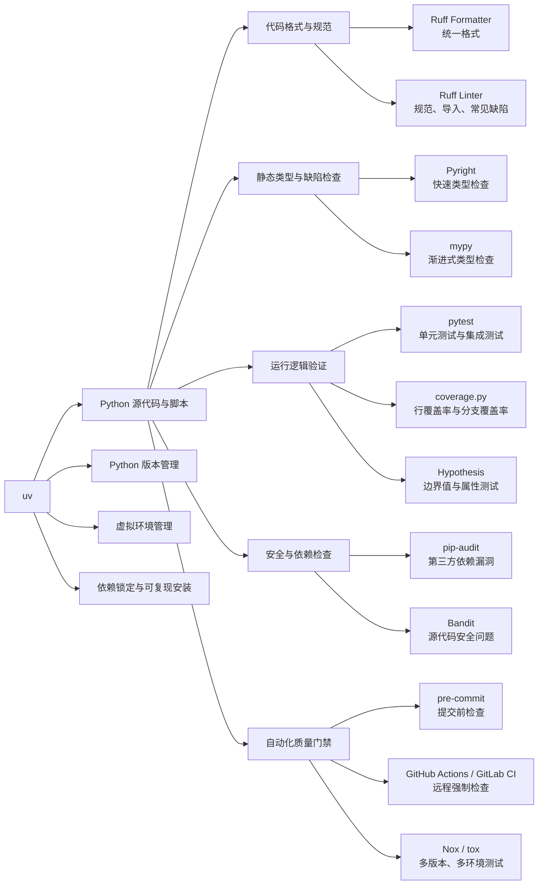
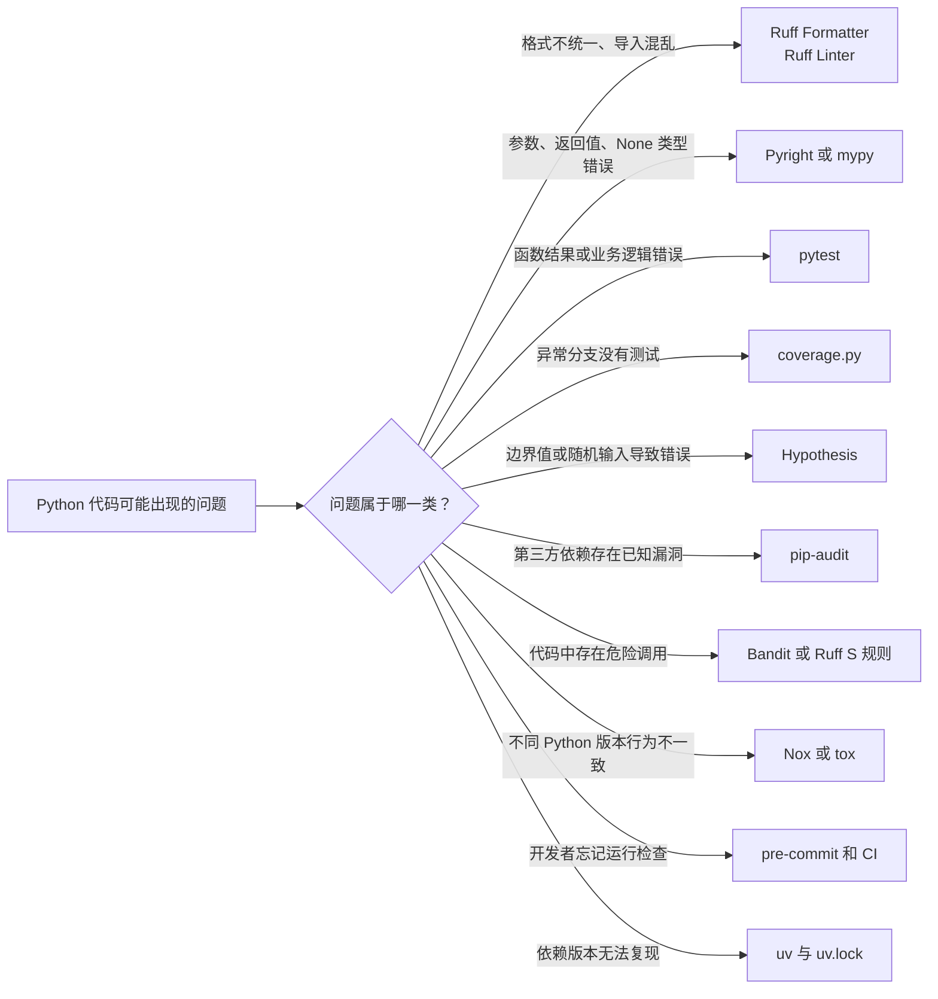
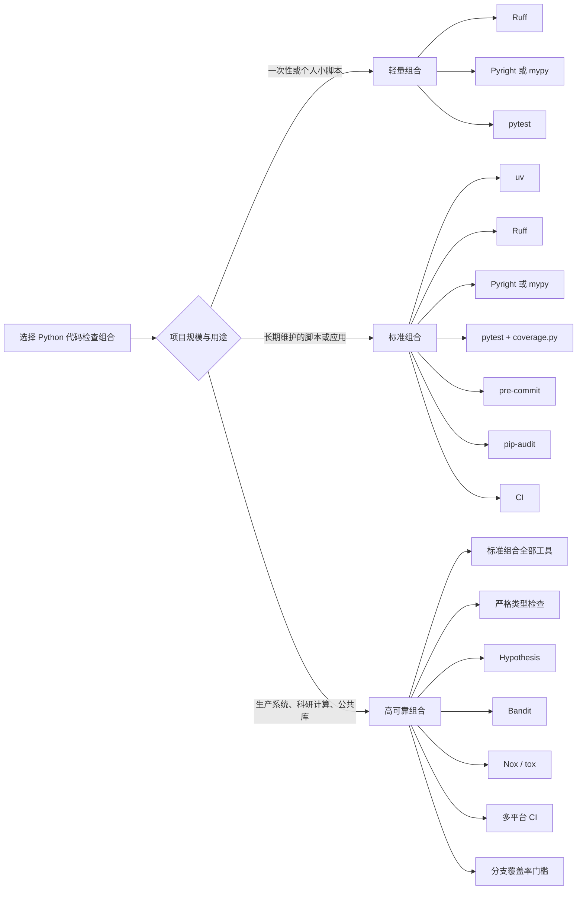
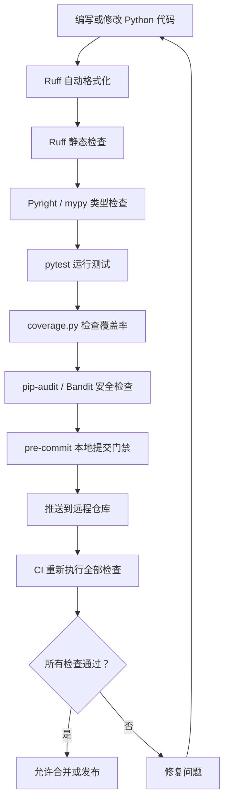
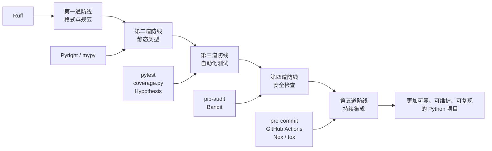
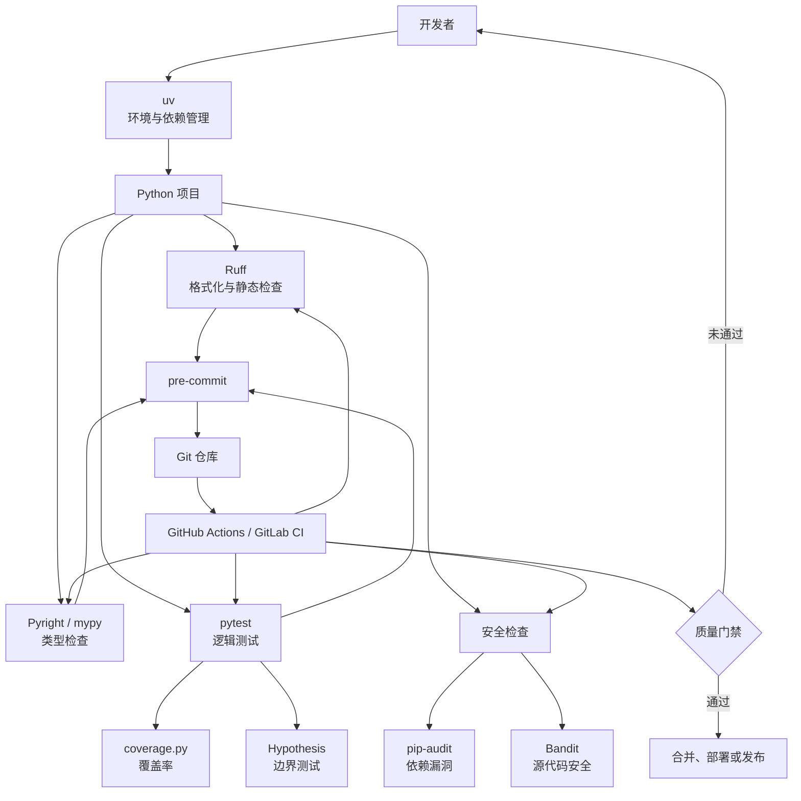

[toc]

## 现代 Python 可靠性工具链

截至 **2026 年 7 月**，普通 Python 脚本或中小型项目推荐采用：

> **uv + Ruff + Pyright / mypy（二选一）+ pytest + coverage.py + pre-commit + pip-audit + CI**

安全敏感或算法复杂时，再加入：

> **Bandit + Hypothesis + Nox/tox**

这套组合覆盖了格式、代码缺陷、类型错误、运行逻辑、边界输入、依赖漏洞和自动化检查。

------

## 一、工具分层总结

| 检查层面        | 推荐工具                       | 主要作用                                     | 推荐程度       |
| --------------- | ------------------------------ | -------------------------------------------- | -------------- |
| Python/依赖环境 | **uv**                         | 虚拟环境、Python 版本、依赖安装和锁定        | 必选           |
| 格式化          | **Ruff Formatter**             | 统一代码格式，替代 Black                     | 必选           |
| 静态规范检查    | **Ruff Linter**                | 未使用变量、错误导入、危险写法、代码简化等   | 必选           |
| 类型检查        | **Pyright 或 mypy**            | 提前发现参数、返回值、None、容器元素类型错误 | 必选           |
| 单元测试        | **pytest**                     | 验证函数和业务逻辑                           | 必选           |
| 测试覆盖率      | **coverage.py**                | 检查哪些代码行和分支没有被测试               | 推荐           |
| 自动提交检查    | **pre-commit**                 | 在 Git 提交前自动运行检查                    | 推荐           |
| 依赖漏洞        | **pip-audit**                  | 扫描第三方包的已知安全漏洞                   | 推荐           |
| 源代码安全      | **Bandit**                     | 检查 `eval`、危险 subprocess、弱随机数等     | 按需           |
| 属性测试        | **Hypothesis**                 | 自动产生边界值和异常输入                     | 高可靠项目推荐 |
| 多环境测试      | **Nox / tox**                  | 测试多个 Python 版本、依赖组合               | 库项目推荐     |
| 持续集成        | **GitHub Actions / GitLab CI** | 每次提交、合并时强制检查                     | 团队项目必选   |

------

工具链整体分层




其核心思想是：

1. `uv` 管理运行环境和依赖；
2. Ruff 管理代码格式和静态规范；
3. Pyright 或 mypy 检查类型；
4. pytest 验证实际逻辑；
5. coverage.py 检查测试遗漏；
6. pip-audit 和 Bandit 检查安全问题；
7. pre-commit 与 CI 保证检查能够持续执行。

## 二、每个工具解决什么问题




需要注意，不同工具不能完全互相替代。因此，可靠性依赖多个检查层共同完成。

### 1. uv：统一管理环境和依赖

`uv` 可以管理 Python 版本、虚拟环境、依赖安装和锁文件。`uv.lock` 会记录精确解析结果，提交到版本库后，可以提高不同计算机和 CI 环境的可复现性。([Astral 文档](https://docs.astral.sh/uv/concepts/projects/sync/?utm_source=chatgpt.com))

推荐替代传统组合：

```text
python -m venv + pip + pip-tools
```

基本用法：

```bash
uv init
uv add requests pandas
uv add --dev ruff mypy pytest coverage pre-commit pip-audit
uv sync
uv run python script.py
```

对单个独立脚本，uv 也支持脚本内联依赖；对多个脚本，建议建立正式项目并提交 `pyproject.toml` 和 `uv.lock`。

------

### 2. Ruff：格式化、导入排序和静态检查

Ruff 同时提供代码格式化与静态检查，并支持大量源自 Pyflakes、pycodestyle、isort、pyupgrade、flake8-bugbear 等工具的规则。官方规则集已经超过 900 条，并支持安全范围内的自动修复。([Astral 文档](https://docs.astral.sh/ruff/formatter/?utm_source=chatgpt.com))

因此，新项目一般不再需要叠加：

```text
Black + isort + Flake8 + pycodestyle + pyflakes + pyupgrade
```

常用命令：

```bash
uv run ruff format .
uv run ruff check .
uv run ruff check --fix .
uv run ruff format --check .
```

其中：

- `ruff format`：统一格式；
- `ruff check`：发现代码问题；
- `--fix`：自动修复确认安全的问题；
- `format --check`：只检查，不修改，适合 CI。

------

### 3. 类型检查：Pyright、mypy、ty 怎么选

#### Pyright

Pyright 是完整的静态类型检查器，性能较高，并提供命令行、语言服务器和 VS Code 集成。([GitHub Microsoft](https://microsoft.github.io/pyright/?utm_source=chatgpt.com))

适合：

- 使用 VS Code/Pylance；
- 希望编辑过程中立即显示类型错误；
- 新项目，希望采用较严格的类型检查。

#### mypy

mypy 是成熟的渐进式类型检查器，可以从少量类型注解逐渐迁移到严格模式，而且整个工具链均可通过 Python 包管理。([Mypy](https://mypy-lang.org/?utm_source=chatgpt.com))

适合：

- 希望只使用 Python/uv 管理所有工具；
- 已有大量脚本，需要逐步补类型；
- 已有 mypy 配置和插件生态。

#### ty

Astral 在 2026 年 7 月推出了新的 Rust 类型检查器 `ty`，主打速度、编辑器集成和增量分析。由于目前仍属于非常新的工具，其规则历史中仍存在 `0.0.x-alpha` 标记，关键生产项目现阶段更适合作为评估项，而不是唯一类型检查基线。([Astral 文档](https://docs.astral.sh/ty/?utm_source=chatgpt.com))

**推荐选择：**

```text
VS Code 用户：Pyright
纯 Python 工具链：mypy
实验性高速方案：ty
```

不要在 CI 中同时强制运行多个类型检查器，除非项目明确需要兼容它们的差异。


| 工具             | 当前定位                       | 主要优势                                                  | 主要不足                                                    | 推荐场景                            |
| ---------------- | ------------------------------ | --------------------------------------------------------- | ----------------------------------------------------------- | ----------------------------------- |
| **mypy**         | 老牌、成熟、生产可用           | 生态成熟；插件机制强；渐进迁移经验多                      | 冷启动较慢；IDE 体验依赖额外扩展；部分推断偏保守            | 旧项目、Django 等依赖插件的项目     |
| **Pyright**      | 现代主流、成熟                 | 类型推断好；标准符合度高；VS Code 体验优秀；速度较快      | Node.js 工具链；没有 mypy 式插件体系                        | 大多数新项目、VS Code 用户          |
| **BasedPyright** | Pyright 的增强分支             | 更严格默认值；新增诊断规则；CLI 与编辑器版本更容易统一    | 社区规模小于官方 Pyright；更严格会产生更多初始问题          | 高可靠新项目、希望严格门禁的团队    |
| **ty**           | Astral 新一代检查器，当前 Beta | Rust 实现；极快；错误信息丰富；与 uv、Ruff 生态一致       | 仍在 Beta；与 Pyright/mypy 结果可能不一致；迁移成本尚不稳定 | 愿意尝新的项目、大型代码库          |
| **Pyrefly**      | Meta 新一代检查器，已稳定 1.x  | 快速；IDE 功能强；多线程；大型代码库经验                  | 生态和第三方兼容经验仍少于 mypy/Pyright                     | 大型项目、AI 编码工作流、新项目试点 |
| **Zuban**        | mypy 兼容型高速检查器          | 可使用 mypy 配置和命令习惯；另有 Pyright 风格模式；速度快 | 较新；社区规模有限；采用 AGPL 许可证                        | 已有大型 mypy 项目的迁移试验        |

------

### 4. pytest：验证实际运行逻辑

pytest 支持自动发现测试、fixture、参数化、临时目录、mock、异常断言等，既适合小脚本，也能扩展到大型项目。([pytest 文档](https://docs.pytest.org/?utm_source=chatgpt.com))

目录建议：

```text
project/
├── scripts/
│   └── process_data.py
├── tests/
│   └── test_process_data.py
├── pyproject.toml
└── uv.lock
```

运行：

```bash
uv run pytest
```

测试至少覆盖：

- 正常输入；
- 空输入；
- 边界值；
- 非法类型；
- 文件不存在；
- 网络或外部服务失败；
- 异常是否正确抛出；
- 返回值和副作用是否正确。

------

### 5. coverage.py：检查测试遗漏

coverage.py 可以记录测试执行过的代码，并支持分支覆盖率。分支覆盖比单纯行覆盖更容易发现 `if/else`、异常处理和提前返回中的遗漏路径。([Coverage.py](https://coverage.readthedocs.io/?utm_source=chatgpt.com))

推荐：

```bash
uv run coverage run --branch -m pytest
uv run coverage report -m
uv run coverage html
```

覆盖率只能说明“代码是否执行过”，不能证明测试断言正确。因此不建议为了达到 100% 而编写无意义测试。普通项目可以先设置 **80% 左右的最低门槛**，再重点审查关键逻辑的分支覆盖。

------

### 6. Hypothesis：自动寻找边界问题

Hypothesis 是 Python 的属性测试工具。开发者描述输入范围及代码应始终满足的性质，由工具自动生成大量输入，包括容易被人工忽略的边界情况。([Hypothesis](https://hypothesis.readthedocs.io/en/latest/))

例如：

```python
from hypothesis import given
from hypothesis import strategies as st


@given(st.lists(st.integers()))
def test_sort_preserves_elements(values: list[int]) -> None:
    result = sorted(values)

    assert len(result) == len(values)
    assert sorted(result) == result
```

特别适合：

- 数据解析；
- 数值计算；
- 编码转换；
- 排序与去重；
- 日期时间；
- 文件名和路径处理；
- 状态机；
- 输入组合非常多的函数。

------

### 7. pre-commit：阻止低质量代码进入仓库

pre-commit 会在 Git 提交之前执行配置好的检查钩子，可以自动运行 Ruff、类型检查以及文件格式检查。([Pre-commit](https://pre-commit.com/?utm_source=chatgpt.com))

原则上：

- 快速检查放在 `pre-commit`；
- 完整测试放在 `pre-push` 或 CI；
- 不要让每次提交都等待很长时间。

安装：

```bash
uv run pre-commit install
uv run pre-commit run --all-files
```

------

### 8. pip-audit 与 Bandit：检查不同安全层面

#### pip-audit

检查第三方依赖的已知漏洞，分析的是依赖树，不是自己的 Python 源代码。它不能识别恶意包，也不能代替源代码安全审计。([GitHub](https://github.com/pypa/pip-audit?utm_source=chatgpt.com))

```bash
uv run pip-audit
```

#### Bandit

Bandit 会构建 Python AST，并针对常见安全问题运行检查插件，适合检查自己的代码。([Bandit](https://bandit.readthedocs.io/?utm_source=chatgpt.com))

```bash
uv run bandit -r scripts -x tests
```

两者关系：

```text
pip-audit：第三方依赖有没有已知漏洞
Bandit：自己写的代码有没有典型危险写法
```

Ruff 的 `S` 规则已经能覆盖一部分安全检查。普通脚本可先使用 Ruff；涉及外部输入、文件上传、命令执行、Web 服务或权限操作时，再增加 Bandit。

------

### 9. Nox/tox：多 Python 版本测试

Nox 和 tox 都可以自动创建隔离环境，并在不同 Python 版本或依赖组合中执行测试。Nox 使用 Python 文件配置；tox 更偏声明式配置，并长期作为多环境测试工具使用。([Nox](https://nox.thea.codes/en/stable/))

普通内部脚本通常不需要。

以下情况建议加入：

- 发布到 PyPI；
- 声称支持 Python 3.10～3.14；
- 依赖不同版本的 NumPy、Pandas、Django 等；
- 需要在 Linux、Windows、macOS 上运行。

------

## 三、推荐的三档组合

 工具组合选择决策图



对应的组合可以概括为：

```text
轻量级：
Ruff + Pyright/mypy + pytest

标准级：
uv + Ruff + Pyright/mypy + pytest
+ coverage.py + pre-commit + pip-audit + CI

高可靠级：
标准级组合
+ Hypothesis + Bandit + Nox/tox
+ 严格类型检查 + 多平台测试
```


### 轻量级：个人小脚本

`Ruff+Pyright+pytest`组合能够发现大部分格式错误、未定义变量、类型错误和基本逻辑错误。

### 标准级：长期维护项目

```text
uv
Ruff
Pyright 或 mypy
pytest
coverage.py
pre-commit
pip-audit
GitHub Actions
```

这是最推荐的默认组合。

### 高可靠级：生产、科研数据处理、自动化系统

```text
标准级组合
+ strict 类型检查
+ Hypothesis
+ Bandit
+ 分支覆盖率门槛
+ 多 Python 版本测试
+ Linux/Windows 测试矩阵
```

------

## 四、推荐的 `pyproject.toml`

下面采用 **mypy 方案**，可以完全通过 uv 管理。

```toml
[project]
name = "python-scripts"
version = "0.1.0"
requires-python = ">=3.11"
dependencies = []

[tool.ruff]
target-version = "py311"
line-length = 100
extend-exclude = [
    ".venv",
    "build",
    "dist",
]

[tool.ruff.lint]
select = [
    "E",    # pycodestyle errors
    "F",    # Pyflakes
    "W",    # pycodestyle warnings
    "I",    # import sorting
    "UP",   # Python syntax modernization
    "B",    # bugbear
    "SIM",  # code simplification
    "C4",   # comprehension checks
    "PIE",  # unnecessary code
    "RUF",  # Ruff-specific checks
    "S",    # basic security checks
]
ignore = []

[tool.ruff.lint.per-file-ignores]
"tests/**/*.py" = [
    "S101",   # Allow assert in tests
]

[tool.ruff.format]
quote-style = "double"
indent-style = "space"
line-ending = "auto"

[tool.mypy]
python_version = "3.11"
strict = true
warn_unreachable = true
warn_unused_configs = true
show_error_codes = true
pretty = true
exclude = [
    "^\\.venv/",
    "^build/",
    "^dist/",
]

[tool.pytest.ini_options]
testpaths = ["tests"]
addopts = [
    "-ra",
    "--strict-config",
    "--strict-markers",
]

[tool.coverage.run]
branch = true
omit = [
    "tests/*",
    ".venv/*",
]

[tool.coverage.report]
show_missing = true
skip_covered = true
fail_under = 80
```

安装开发工具：

```bash
uv add --dev \
    ruff \
    mypy \
    pytest \
    coverage \
    hypothesis \
    pre-commit \
    pip-audit \
    bandit
```

------

## 五、推荐的日常检查顺序

开发过程中：

```bash
uv run ruff format .
uv run ruff check --fix .
uv run mypy .
uv run pytest
```

提交代码前：

```bash
uv run ruff format --check .
uv run ruff check .
uv run mypy .
uv run coverage run -m pytest
uv run coverage report -m
```

安全检查：

```bash
uv run pip-audit
uv run bandit -r scripts -x tests
```

------

## 六、CI 应设置的质量门禁

CI 至少执行：

```yaml
name: Python quality

on:
  push:
  pull_request:

jobs:
  quality:
    runs-on: ubuntu-latest

    steps:
      - name: Check out repository
        uses: actions/checkout@v7

      - name: Install uv
        uses: astral-sh/setup-uv@11f9893b081a58869d3b5fccaea48c9e9e46f990
        with:
          enable-cache: true

      - name: Install dependencies
        run: uv sync --frozen

      - name: Check formatting
        run: uv run ruff format --check .

      - name: Run lint checks
        run: uv run ruff check .

      - name: Run type checks
        run: uv run mypy .

      - name: Run tests
        run: uv run coverage run -m pytest

      - name: Check coverage
        run: uv run coverage report -m

      - name: Audit dependencies
        run: uv run pip-audit
```

GitHub Actions 可以在仓库内自动执行测试和 CI 工作流；Astral 官方也推荐使用 `setup-uv`，并建议锁定具体版本或提交，以减少构建环境意外变化。([GitHub Docs](https://docs.github.com/en/actions))

------

## 最终推荐

对于大多数 Python 脚本，不要堆积十几个重复工具。采用下面这一套即可：

```text
uv               依赖与环境可复现
Ruff             格式、导入、规范和常见缺陷
mypy/Pyright     类型和接口一致性
pytest           运行逻辑验证
coverage.py      测试遗漏检查
pre-commit       本地提交门禁
pip-audit        依赖漏洞检查
GitHub Actions   远程强制执行
```

可靠性要求更高时，优先增加 **高质量测试、Hypothesis 和严格类型检查**，而不是继续增加功能重复的 Linter。


## Python 代码可靠性工具链示意图

------

### 从编写代码到合并代码的完整流程

这张图适合放在“日常检查顺序”之前。



该流程体现了两层保障：

1. **本地保障**：尽早发现问题，减少无效提交；
2. **远程保障**：避免开发者跳过本地检查后直接合并代码。


------

### 可靠性防线模型





------

## 推荐的最终工具架构




这些图中，最值得保留的是“整体分层图”“完整检查流程图”和“最终工具架构图”；用于正式技术文档时保留这三张即可。