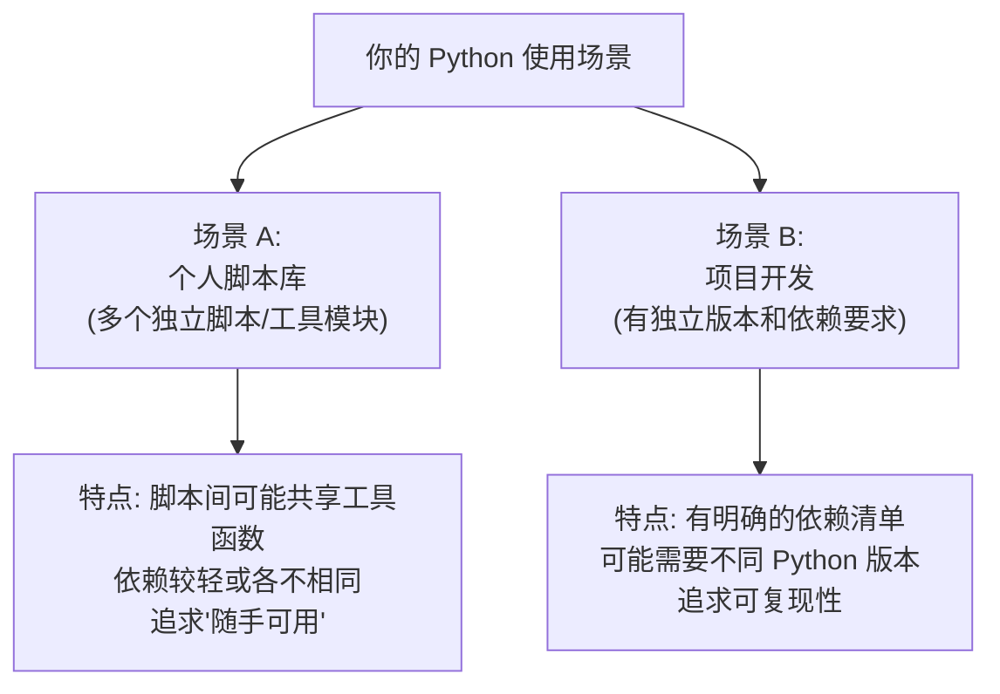
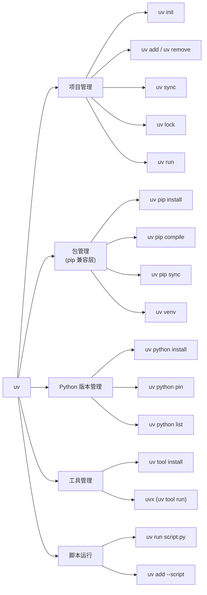
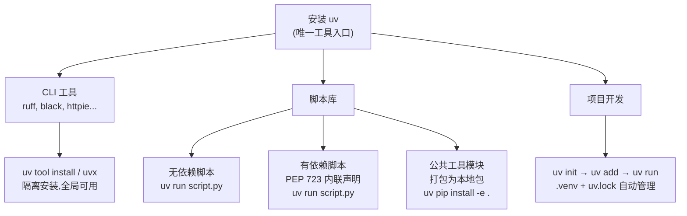

[toc]


## Python 运行环境管理：从全局环境到 uv 的完整指南

### 为什么要关心"环境问题"

Python 的 **环境管理 (Environment Management)** 是指管理 Python 解释器版本、第三方依赖包、以及它们之间隔离关系的过程。默认情况下，`pip` 将包安装到全局 Python 环境中，这意味着系统上的所有项目共用同一个目录来存储和检索包。

这会带来几个核心问题：

| 问题                                 | 说明                                                         |
| ------------------------------------ | ------------------------------------------------------------ |
| **依赖冲突** (Dependency Conflict)   | 不同项目可能依赖同一个包的不同版本（如项目 A 需要 NumPy 1.10，项目 B 需要 NumPy 1.20），Python 无法在同一个 `site-packages` 目录中区分同名包的不同版本。 |
| **环境污染** (Environment Pollution) | 全局环境容易被为各种不同项目安装的大量包所混乱，难以组织和管理。 |
| **可复现性差** (Reproducibility)     | 没有锁定文件 (Lockfile)，换一台机器可能装出不同版本的依赖，出现"我电脑上能跑"的问题。 |
| **Python 版本不匹配**                | 你的脚本库可能跑在 Python 3.10 上就够了，但新项目需要 Python 3.12+ 的特性。 |

> 你描述的场景正是典型的拐点：**一个人维护脚本库 + 开始做有独立依赖需求的项目**，此时全局环境的"方便"开始变成负担。

---

### 核心概念速览

在讨论具体工具之前，先厘清几个关键概念：

**虚拟环境 (Virtual Environment, venv)**：一个轻量级的隔离 Python 环境，拥有自己独立的 `site-packages` 目录。虚拟环境通过将项目隔离开来，防止依赖冲突、版本冲突和权限冲突。每个项目一个虚拟环境是 Python 社区的基本共识。

**包管理器 (Package Manager)**：负责安装、卸载、更新依赖包的工具。传统的是 `pip`，现代的有 `uv`、`Poetry` 等。

**锁文件 (Lockfile)**：记录所有依赖（包括传递依赖）的精确版本号，确保任何人在任何时间安装都得到完全一致的环境。`pip` 原生不提供此功能（需要 `pip freeze` 手动管理），而 `uv`、`Poetry` 原生支持。

**Python 版本管理器**：管理系统上安装的多个 Python 解释器版本的工具，传统用 `pyenv`，uv 也内置了此功能。

**`pyproject.toml`**：Python 项目的标准化配置文件（PEP 621），用于声明项目元信息和依赖，取代过去的 `setup.py` / `setup.cfg` / `requirements.txt`。

---

### 工具生态全景与对比

初学者在开始使用 Python 时，会遇到 `pip`、`venv`、`pyenv`、`pip-tools`、`pipx`、`Poetry`、`requirements.txt`、`pyproject.toml`、锁文件、shell 激活等一系列概念。下面是主要工具的功能定位对比：

| 工具            | 定位                        | 包安装     | 虚拟环境   | 锁文件                | Python 版本管理 | 状态                                              |
| --------------- | --------------------------- | ---------- | ---------- | --------------------- | --------------- | ------------------------------------------------- |
| **pip + venv**  | Python 内置基础方案         | 是         | 是（手动） | 否（需 `pip freeze`） | 否              | 官方标配，功能基础                                |
| **pip-tools**   | pip 的锁文件增强            | 是         | 否         | 是                    | 否              | 成熟稳定                                          |
| **pyenv**       | Python 版本管理专用         | 否         | 否         | 否                    | 是              | 成熟，`*nix` 为主                                 |
| **pipx**        | 全局 CLI 工具安装器         | 是（隔离） | 自动       | 否                    | 否              | 定位精准                                          |
| **Poetry**      | 全功能项目管理              | 是         | 是         | 是                    | 否              | 成熟，社区广泛                                    |
| **Pipenv**      | 早期全功能方案              | 是         | 是         | 是                    | 否              | 仍有 bug 修复，但已不推荐用于新项目               |
| **Conda/Mamba** | 科学计算 / 非 Python 原生库 | 是         | 是         | 是                    | 是              | 项目依赖非 Python 科学库（如 CUDA、GDAL）时更合适 |
| **uv**          | **现代一体化方案**          | 是         | 是         | 是                    | 是              | **2026 年新项目的推荐默认选择**                   |

对于 2026 年的新 Python 项目，默认推荐 uv：它用一个 Rust 编写的二进制文件替代了 pip、venv、virtualenv、pyenv、pip-tools 以及大部分 pipx 和 Poetry 的功能，速度比传统工具快 10–100 倍，还能管理 Python 解释器。

---

### 你的场景分析与决策框架

你的情况拆解为两个核心场景：



#### 场景 A：个人脚本库的管理策略

你说"以前全局环境很方便"——这是因为脚本库的特征是 **大量独立小脚本**，每次建虚拟环境的仪式感太重了。uv 提供了一个极好的解决方案：**内联脚本依赖 (Inline Script Metadata)**，基于 **PEP 723** 标准。

内联元数据格式允许在脚本文件自身内部声明依赖。uv 支持自动添加和更新内联脚本元数据。使用 `uv add --script` 来声明脚本的依赖，使用 `uv run` 执行脚本可以确保脚本依赖被管理，而无需手动管理环境。

**具体做法**：在脚本文件头部用特殊注释声明依赖，`uv run` 执行时自动安装到隔离环境中：

```python
#!/usr/bin/env -S uv run --script
# /// script
# requires-python = ">=3.11"
# dependencies = [
#     "requests>=2.31.0",
#     "rich",
# ]
# ///

import requests
from rich.console import Console

console = Console()
response = requests.get("https://api.github.com")
console.print(f"GitHub API status: [bold green]{response.status_code}[/bold green]")
```

然后直接运行：

```bash
# Linux/macOS: 加上执行权限后直接运行
chmod +x my_script.py
uv run my_script.py

# 或者依靠 shebang 直接执行
./my_script.py
```

在任何安装了 uv 的机器上，你可以 `chmod 755` 脚本后直接当可执行文件运行，内联元数据声明的依赖会自动安装并缓存到一个临时隔离环境中，同时使用指定的 Python 版本。

**对于不需要第三方依赖的脚本**，直接 `uv run script.py` 即可，无需任何额外声明。

**对于你自己写的公共工具模块/函数集**，有几种组织方式（由简到繁）：

| 方案                            | 适用情况             | 做法                                                         |
| ------------------------------- | -------------------- | ------------------------------------------------------------ |
| **方案 1: 直接复制/symlink**    | 工具函数很少、很稳定 | 把公共模块放在固定路径，脚本中通过 `sys.path` 或相对引用     |
| **方案 2: 打包为本地包** (推荐) | 工具函数有一定规模   | 用 `uv init` 建一个包项目，`uv pip install -e .` 以可编辑模式安装到需要的环境 |
| **方案 3: 内联依赖引用本地包**  | 结合 PEP 723         | 在脚本的 `dependencies` 中用路径引用：`"my-utils @ file:///path/to/my-utils"` |

**推荐方案 2** 的示例结构：

```
~/scripts/
├── my_utils/                    # 你的公共工具包
│   ├── pyproject.toml           # uv init 生成
│   └── src/
│       └── my_utils/
│           ├── __init__.py
│           ├── file_helpers.py
│           └── network.py
├── backup_tool.py               # 内联依赖脚本
├── log_analyzer.py              # 内联依赖脚本
└── deploy_helper.py             # 内联依赖脚本
```

#### 场景 B：独立项目开发

这是 uv 最标准的使用场景：

```bash
# 创建新项目
uv init my-project
cd my-project

# 添加项目依赖
uv add fastapi uvicorn sqlalchemy

# 添加开发依赖
uv add --dev pytest ruff mypy

# 同步环境（创建 .venv 和 uv.lock）
uv sync

# 在项目环境中运行
uv run python main.py
uv run pytest
```

uv init 会生成一个带有 `pyproject.toml` 的新项目。虚拟环境和锁文件会在你第一次运行 `uv sync`、`uv add` 或 `uv run` 时自动创建。

uv 默认在项目目录内创建 `.venv`，符合大多数编辑器的约定。`uv run` 自动在环境内执行命令。

**如果项目需要特定的 Python 版本**：

```bash
# 安装指定版本的 Python
uv python install 3.12

# 在项目中锁定 Python 版本（写入 .python-version 文件）
uv python pin 3.12

# 后续 uv sync / uv run 自动使用该版本
```

uv 可以并行安装多个 Python 版本（如 `uv python install 3.11 3.12 3.13`），并自动识别现有的 `.python-version` 文件。

---

### uv 详细入门

#### 安装 uv

uv 是跨平台的，支持 Windows、macOS 和 Linux，免费且开源。

**Linux / macOS**：

```bash
curl -LsSf https://astral.sh/uv/install.sh | sh
```

**Windows (PowerShell)**：

```powershell
powershell -ExecutionPolicy ByPass -c "irm https://astral.sh/uv/install.ps1 | iex"
```

**其他方式**：

```bash
# Homebrew (macOS)
brew install uv

# pip（任何平台，但速度较慢）
pip install uv
```

安装后验证：

```bash
uv --version
```

> **国内网络提示**：uv 安装脚本从 `astral.sh` 下载，一般可直接访问。如遇问题，可通过代理或 `pip install uv` 方式安装。uv 后续下载 Python 解释器和包时走的是 PyPI 等源，可配置国内镜像（见后文）。

**自更新**：

```bash
uv self update
```

#### uv 的核心命令体系



下面分类详解：

##### 项目管理命令（推荐的主工作流）

| 命令               | 作用                                       | 示例                            |
| ------------------ | ------------------------------------------ | ------------------------------- |
| `uv init`          | 初始化新项目，生成 `pyproject.toml`        | `uv init my-app`                |
| `uv add`           | 添加依赖到项目                             | `uv add requests "numpy>=1.26"` |
| `uv add --dev`     | 添加开发依赖                               | `uv add --dev pytest ruff`      |
| `uv remove`        | 移除依赖                                   | `uv remove requests`            |
| `uv sync`          | 同步环境，安装/更新 `.venv` 使之匹配锁文件 | `uv sync`                       |
| `uv lock`          | 仅更新锁文件，不安装                       | `uv lock`                       |
| `uv run`           | 在项目环境中执行命令                       | `uv run python main.py`         |
| `uv sync --frozen` | 严格使用现有锁文件安装（CI 推荐）          | `uv sync --frozen`              |

##### pip 兼容层（用于迁移过渡或传统工作流）

uv pip 作为 pip 的直接替代品，支持所有标准的 pip 参数，让你无需改变现有命令即可过渡。

```bash
# 创建虚拟环境
uv venv                           # 默认创建 .venv
uv venv --python 3.12             # 指定 Python 版本

# 激活（传统方式，非必须——用 uv run 可跳过激活）
source .venv/bin/activate          # Linux/macOS
.\.venv\Scripts\activate           # Windows

# 安装包（pip 风格）
uv pip install requests flask
uv pip install -r requirements.txt

# 冻结/编译
uv pip freeze > requirements.txt
uv pip compile requirements.in -o requirements.txt
```

最常见的错误是混用工具而没有规则。应该为每个项目选定一种工作流，并在 README 中写明命令。

##### Python 版本管理

```bash
# 查看可安装的 Python 版本
uv python list

# 安装特定版本
uv python install 3.11 3.12 3.13

# 锁定当前项目的 Python 版本
uv python pin 3.12

# 查看已安装 Python 的路径
uv python dir
```

uv 直接下载和管理 Python 版本——不需要 pyenv。

##### 工具运行（替代 pipx）

uv 可以执行和安装由 Python 包提供的命令行工具，类似 pipx。使用 `uvx`（`uv tool run` 的别名）可以在临时环境中运行工具。

```bash
# 一次性运行，不永久安装（临时隔离环境）
uvx ruff check .
uvx black .
uvx httpie https://api.github.com

# 永久安装到独立环境，注册到 PATH
uv tool install ruff
uv tool install httpie
```

这解决了"想全局用某个 CLI 工具但又不想污染全局环境"的问题，非常适合 `ruff`、`black`、`mypy`、`httpie` 等开发工具。

---

### 从全局环境迁移的实操路径

#### 第一步：安装 uv，保留现有环境

你不需要一步到位。安装 uv 后，现有的全局 `pip` 环境和脚本 **完全不受影响**。

#### 第二步：将常用 CLI 工具迁移到 `uv tool`

把以前 `pip install` 到全局的 CLI 工具改为 `uv tool install`：

```bash
# 以前的做法（污染全局环境）
pip install ruff black httpie

# 现在的做法（各自隔离）
uv tool install ruff
uv tool install black
uv tool install httpie
```

#### 第三步：为独立脚本添加内联依赖

逐步给你的脚本库中有第三方依赖的脚本添加 PEP 723 元数据：

```bash
# 自动给脚本添加依赖声明
uv add --script my_script.py requests rich
```

这会在脚本文件顶部插入元数据注释块。之后用 `uv run my_script.py` 运行，uv 自动处理一切。

#### 第四步：为新项目使用 `uv init` 标准流程

```bash
uv init awesome-project
cd awesome-project
uv add flask sqlalchemy
uv run flask run
```

#### 第五步：清理全局环境

当你确认所有脚本和工具都迁移完毕后，可以清理全局环境中多余的包：

```bash
pip list               # 检查全局还装了什么
pip uninstall <包名>    # 逐步清理不再需要的
```

---

### 针对国内网络环境的配置

#### 配置 PyPI 镜像源

uv 默认从 `pypi.org` 下载包，国内访问可能较慢。可以配置国内镜像：

**方式 1：环境变量（推荐，全局生效）**

Linux / macOS（写入 `~/.bashrc` 或 `~/.zshrc`）：

```bash
export UV_DEFAULT_INDEX="https://mirrors.tuna.tsinghua.edu.cn/pypi/web/simple"
```

Windows（PowerShell，写入 `$PROFILE`）：

```powershell
$env:UV_DEFAULT_INDEX = "https://mirrors.tuna.tsinghua.edu.cn/pypi/web/simple"
```

**方式 2：项目级配置**

在 `pyproject.toml` 中指定：

```toml
[tool.uv]
index-url = "https://mirrors.tuna.tsinghua.edu.cn/pypi/web/simple"
```

**常用镜像站**：

| 镜像      | URL                                                    |
| --------- | ------------------------------------------------------ |
| 清华 TUNA | `https://mirrors.tuna.tsinghua.edu.cn/pypi/web/simple` |
| 阿里云    | `https://mirrors.aliyun.com/pypi/simple/`              |
| 腾讯云    | `https://mirrors.cloud.tencent.com/pypi/simple`        |
| 华为云    | `https://repo.huaweicloud.com/repository/pypi/simple`  |

#### 代理配置（访问 GitHub 等外网资源）

如果你使用 mihomo 等本地代理服务：

Linux / macOS：

```bash
export https_proxy=http://127.0.0.1:7890
export http_proxy=http://127.0.0.1:7890
```

Windows（PowerShell）：

```powershell
$env:https_proxy = "http://127.0.0.1:7890"
$env:http_proxy = "http://127.0.0.1:7890"
```

Windows（CMD）：

```cmd
set https_proxy=http://127.0.0.1:7890
set http_proxy=http://127.0.0.1:7890
```

> uv 下载 Python 解释器时需要访问 GitHub Releases，国内可能需要代理。无代理时也可考虑 ghproxy 等 GitHub 加速方案。

---

### 初学者 vs 进阶者的建议差异

#### 给初学者的建议

**策略：简单起步，先解决隔离问题即可**

1. **安装 uv**，它就是你唯一需要的工具
2. **每个项目用 `uv init`**，不要往全局环境装项目依赖
3. **用 `uv run` 代替手动激活环境**——uv run 命令处理执行，你不再需要手动激活虚拟环境。这避免了"忘了激活环境，装到全局去了"的经典错误
4. 如果你从 pip 过来，把 uv 想象为一条更安全的默认路径：先项目、再环境、然后安装。
5. 独立小脚本直接 `uv run script.py`，有第三方依赖时用 `uv add --script` 声明

**初学者常见误区**：

| 误区                                | 正确做法                                   |
| ----------------------------------- | ------------------------------------------ |
| 所有东西都 `pip install` 到全局     | **每个项目隔离**，用 `uv init` + `uv add`  |
| 在全局安装 `jupyter`、`ruff` 等工具 | **用 `uv tool install` 或 `uvx`** 隔离安装 |
| 手动管理 `requirements.txt`         | **用 `uv lock` 自动生成锁文件**            |
| 混用 `pip install` 和 `uv add`      | **一个项目只用一种工作流**                 |

#### 给进阶者的建议

**策略：利用 uv 的高级特性提升工作效率和可复现性**

1. **脚本库治理**：
   - 将公共工具函数打包成可编辑安装的本地包
   - 独立脚本全部使用 PEP 723 内联依赖
   - 考虑使用 `exclude-newer` 锁定依赖时间点，防止依赖突然升级导致脚本失效

2. **多 Python 版本测试**：

   ```bash
   # 安装多个版本
   uv python install 3.11 3.12 3.13
   
   # 分别测试
   uv run --python 3.11 pytest
   uv run --python 3.12 pytest
   uv run --python 3.13 pytest
   ```

3. **Workspace（工作区）管理 Monorepo**：
   uv 支持工作区 (Workspaces)，让多个包共享一个锁文件（Monorepo 模式）。
   
   ```toml
   # 根目录 pyproject.toml
   [tool.uv.workspace]
   members = ["packages/*"]
   ```

4. **CI/CD 集成**（以 GitHub Actions 为例）：

   ```yaml
   - name: Install uv
     uses: astral-sh/setup-uv@v5
     with:
       version: "latest"
       enable-cache: true
   
   - name: Install dependencies
     run: uv sync --frozen
   
   - name: Run tests
     run: uv run pytest
   ```

5. **缓存管理**：
   uv 使用全局依赖缓存，跨多个项目安装大量不同的包会导致缓存逐渐膨胀。虽然全局缓存避免了重复下载，但应定期清理（`uv cache clean`）。

   ```bash
   # 清理过时的缓存条目
   uv cache prune
   
   # 完全清理缓存
   uv cache clean
   
   # 查看缓存位置
   uv cache dir
   ```

---

### 何时不应使用 uv

uv 并非万能，以下场景需要注意：

| 场景                                           | 建议                                                 |
| ---------------------------------------------- | ---------------------------------------------------- |
| 遗留项目使用了 pip 的旧的、更宽松的包解析方式  | uv 的严格解析可能导致兼容性问题，先测试再迁移        |
| 科学计算需要非 Python 原生库（CUDA、GDAL 等）  | 考虑 **Conda / Mamba**，它们专门处理跨语言二进制依赖 |
| 现有 Poetry 或 Pipenv 项目运行良好             | 没有具体理由就不必强制迁移                           |
| 团队成员对 Poetry 已经很熟练且 CI 速度不是瓶颈 | 保持使用 Poetry 也完全没问题                         |

---

### 跨平台注意事项

#### 换行符 (Line Ending)

不同系统默认换行符不同（Windows: CRLF，Linux/macOS: LF）。Python 脚本在 Linux 上运行时，如果文件包含 CRLF，shebang 行会识别失败。

**最佳实践**：

- `.gitattributes` 中设置 `*.py text eol=lf`，确保 Python 文件在所有平台上统一使用 LF
- 编辑器统一配置为 LF（VS Code 中可在 `.editorconfig` 或 settings 中设置）

#### 路径差异

- **虚拟环境激活路径**：Linux/macOS 是 `.venv/bin/activate`，Windows 是 `.venv\Scripts\activate`
- **但用 `uv run` 就不需要激活**，这是跨平台最干净的方式

#### Shebang

- `#!/usr/bin/env -S uv run --script` 在 Linux/macOS 上工作
- Windows 上 shebang 无效，需要用 `uv run script.py` 显式调用

---

### 推荐的整体方案总结

结合你的场景，推荐的工具链和工作流如下：



**一句话总结**：

> **安装 uv，用 `uv tool install` 管理 CLI 工具，用 PEP 723 内联依赖管理独立脚本，用 `uv init` + `uv add` + `uv run` 管理项目。一个工具解决所有问题，同时保留了随时回退到 `pip` 的能力。**

---

### 快速参考卡片

| 你想做的事               | 命令                                               |
| ------------------------ | -------------------------------------------------- |
| 安装 uv                  | `curl -LsSf https://astral.sh/uv/install.sh \| sh` |
| 创建新项目               | `uv init my-project`                               |
| 添加依赖                 | `uv add requests flask`                            |
| 添加开发依赖             | `uv add --dev pytest ruff`                         |
| 同步环境                 | `uv sync`                                          |
| 运行代码                 | `uv run python main.py`                            |
| 运行测试                 | `uv run pytest`                                    |
| 安装特定 Python 版本     | `uv python install 3.12`                           |
| 锁定项目 Python 版本     | `uv python pin 3.12`                               |
| 给脚本添加内联依赖       | `uv add --script script.py requests`               |
| 运行独立脚本             | `uv run script.py`                                 |
| 安装全局 CLI 工具        | `uv tool install ruff`                             |
| 临时运行 CLI 工具        | `uvx black .`                                      |
| 从 requirements.txt 安装 | `uv pip install -r requirements.txt`               |
| 清理缓存                 | `uv cache prune`                                   |
| 更新 uv 自身             | `uv self update`                                   |

---

### 延伸阅读

- **uv 官方文档**：https://docs.astral.sh/uv/
- **uv GitHub 仓库**：https://github.com/astral-sh/uv
- **PEP 723（内联脚本元数据）**：https://peps.python.org/pep-0723/
- **pydevtools 的 uv 指南**：https://pydevtools.com/handbook/reference/uv/