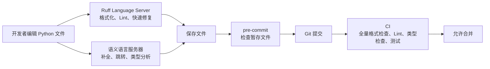
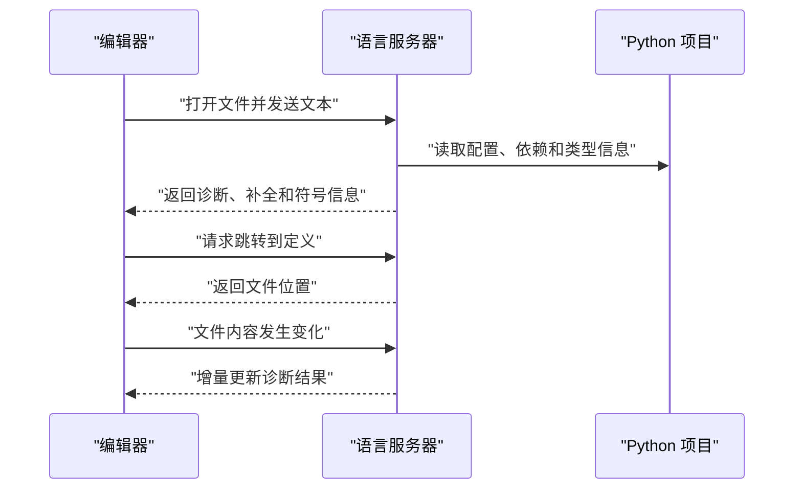

[toc]


## Python 编程常用工具调研与现代化推荐

下面的调研以 **2026 年 7 月**仍在维护的官方文档为依据，并将“成熟稳健方案”和“前沿试用方案”分开说明。

## 结论先行

对于一个新建的、常规 Python 项目，当前比较稳健且现代化的默认工具链是：

| 领域                       | 默认推荐                         | 主要职责                                            |
| -------------------------- | -------------------------------- | --------------------------------------------------- |
| Python、虚拟环境和依赖管理 | `uv`                             | 安装 Python、创建环境、管理依赖、锁定版本、运行命令 |
| 代码规范检查               | Ruff Linter                      | 检查未使用导入、潜在错误、不推荐写法、导入顺序等    |
| 代码格式化                 | Ruff Formatter                   | 自动统一缩进、换行、引号和代码布局                  |
| 导入排序                   | Ruff 的 `I` 规则                 | 取代大多数项目中的 isort                            |
| 静态类型检查               | Pyright                          | 在运行前发现类型不匹配、错误调用和属性访问问题      |
| VS Code 语言服务           | Pylance                          | 基于 Pyright，提供补全、跳转、类型提示和类型诊断    |
| 其他编辑器语言服务         | Pyright、Pyrefly 或 BasedPyright | 通过语言服务器协议提供语义分析                      |
| Git 提交前检查             | pre-commit                       | 在提交代码前自动执行格式化和快速检查                |
| 最终质量门禁               | CI                               | 对整个项目执行格式、Lint、类型检查和测试            |
| 统一配置入口               | `pyproject.toml`                 | 保存项目元数据及 Ruff、Pyright 等工具配置           |

Ruff 已同时提供 **Linter、Formatter、导入排序和原生语言服务器**，并实现了大量来自 Flake8、isort、pyupgrade、pydocstyle 等工具的规则。官方文档列出的内置规则已经超过 900 条。其 Formatter 以兼容 Black 风格为目标。([Astral Docs](https://docs.astral.sh/ruff/?utm_source=chatgpt.com))

> 但要注意：**Ruff Language Server 不是完整的 Python 语义语言服务器**。
>
> 它主要负责 Ruff 诊断、修复和格式化，官方仍建议将它与另一个 Python Language Server 配合使用，以获得补全、跳转和完整类型分析。([Astral Docs](https://docs.astral.sh/ruff/editors/))

因此，一个典型组合是：`uv + Ruff + Pyright/Pylance + pre-commit + CI`.

更前沿的组合是：`uv + Ruff + Pyrefly`或者：`uv + Ruff + ty`

> 其中 Pyrefly 已于 2026 年 5 月发布稳定的 1.0 版本，并在 2026 年 6 月发布 1.1；([Pyrefly](https://pyrefly.org/blog/v1.0/?utm_source=chatgpt.com))
>
> ty 目前仍由官方标记为 Beta，更适合愿意验证新工具的项目，而不是最保守的默认选择。

------

## 详细大纲

本文围绕以下内容展开：

- Python 工具链中各类工具的职责
  - Formatter
  - Linter
  - Import Sorter
  - Static Type Checker
  - Language Server
  - Package and Project Manager
  - Git Hook
  - CI Quality Gate
- 为什么现代项目倾向于减少工具数量
- Ruff 如何替代传统的 Black、isort 和 Flake8 组合
- Pyright、Pylance、Pyrefly、ty、mypy、BasedPyright 的区别
- 语言服务器协议及编辑器工作机制
- `pyproject.toml` 作为配置中心
- 一套可直接使用的新项目配置
- Ruff 规则集的分层启用方法
- 类型检查的渐进式落地
- 编辑器、pre-commit 和 CI 的职责划分
- 旧项目迁移到现代工具链的步骤
- 常见错误和最佳实践
- 适合新手的学习路线

------

## 工具职责地图

很多初学者会把 **Formatter、Linter、类型检查器和语言服务器**混为一谈。它们虽然可能显示相似的错误提示，但检查目标不同。

| 工具类型       | 英文术语                    | 主要回答的问题                               | 是否修改代码         |
| -------------- | --------------------------- | -------------------------------------------- | -------------------- |
| 格式化器       | Formatter                   | 代码应该怎样排版                             | 通常会               |
| **规范检查器** | Linter                      | 代码是否违反规则或包含可疑写法               | 部分问题可以修复     |
| 静态类型检查器 | Static Type Checker         | 值和接口的类型是否兼容                       | 通常不会             |
| 语言服务器     | Language Server             | 编辑器如何获得补全、跳转、悬停信息和实时诊断 | 通过代码操作间接修改 |
| 导入排序器     | Import Sorter               | import 是否分组、排序正确                    | 会                   |
| 包与项目管理器 | Package and Project Manager | Python、依赖、虚拟环境和锁文件如何管理       | 修改项目配置和环境   |
| Git Hook 框架  | Git Hook Framework          | 提交代码前自动运行什么                       | 取决于 Hook          |
| CI             | Continuous Integration      | 仓库中的代码能否通过统一质量门禁             | 通常只检查           |

一个完整工作流可以表示为：



这里最重要的原则是：

> 编辑器负责快速反馈，pre-commit 负责减少低级错误，CI 才是仓库的最终质量标准。

------

## Formatter、Linter 和类型检查器的区别

考虑下面的代码：

```python
def parse_count(raw: str) -> int:
    return raw.strip()
```

1. Formatter 只会调整代码排版，不会改变其含义。
2. Linter 可能检查**函数命名、无效语句、未使用变量或其他规则**，但未必会发现这里的返回值问题。
3. 类型检查器会发现：声明返回值和实际返回值类型不匹配问题,例如:"声明返回 int，实际返回 str".

再看下面的代码：

```python
import json
import os

value = unknown_name
```

Linter 通常可以发现：

- `json` 没有使用；
- `os` 没有使用；
- `unknown_name` 未定义。

这三类工具之间不是替代关系：

```text
Formatter 负责统一形式
Linter 负责规则和常见缺陷
Type Checker 负责类型一致性
```

PEP 8 是代码风格指导，而不是可以自动证明程序正确性的形式规范。PEP 8 本身也强调，项目内部的一致性通常比机械遵守所有通用规则更加重要。([Python Enhancement Proposals (PEPs)](https://peps.python.org/pep-0008/?utm_source=chatgpt.com))

> ruff这个工具同时提供了`formatter`和`linter`以及更多功能.
>
> ty,pyright,pyrefly等工具则同时提供`类型检查器`和`语言服务器`.

------

## 静态类型检查不是运行时类型验证

Python 的类型注解默认不会在运行时强制执行：

```python
def add_one(value: int) -> int:
    return value + 1
```

调用者仍然可以在运行时传入字符串；是否报错取决于函数实际执行了什么，而不是注解本身。Python 官方文档明确说明，运行时不会自动强制执行函数和变量的类型注解，类型注解主要由类型检查器、IDE 和 Linter 等工具使用。([Python Enhancement Proposals (PEPs)](https://peps.python.org/pep-0484/?utm_source=chatgpt.com))

因此，下面两件事不能相互替代：

- 静态类型检查：在运行前检查类型关系；
- 运行时数据验证：验证网络请求、配置文件、JSON、数据库结果等外部数据。

例如，类型检查器可以验证程序内部约定：

```python
def handle_user(user_id: int) -> None:
    ...
```

但来自 HTTP 请求的 `"123"` 是否应转换为整数，仍需要运行时代码或数据验证库处理。

------

## 渐进式类型系统

Python 采用渐进式类型系统（Gradual Typing）。代码可以全部标注、部分标注，也可以暂时不标注。

其中 `Any` 表示类型检查器无法可靠了解的动态值：

```python
from typing import Any

payload: Any = load_external_data()
payload.not_a_real_method()
```

由于 `payload` 是 `Any`，类型检查器通常无法判断 `not_a_real_method` 是否存在。

所以 `Any` 可以理解为类型系统中的逃生口：

- 在外部系统边界处可能不可避免；
- 在核心业务逻辑中应限制传播；
- 应尽快将其转换成已知类型；
- 不应为了消除错误而随意添加 `Any`。

Python 类型规范将 `Any` 描述为静态类型未知的动态形式；对 `Any` 执行的操作无法得到完整的静态类型保护。([Typing 文档](https://typing.python.org/en/latest/spec/concepts.html?utm_source=chatgpt.com))

------

## 为什么推荐 Ruff

传统 Python 代码质量工具链经常包含：

```text
Black
isort
Flake8
pyupgrade
autoflake
pydocstyle
若干 Flake8 插件
```

这套方案仍然可以工作，但会带来一些问题：

- 工具安装数量较多；
- 每个工具有自己的配置；
- 规则可能互相冲突；
- 编辑器需要分别配置多个扩展；
- pre-commit 和 CI 启动多个 Python 进程；
- 升级时需要协调兼容性；
- 不同工具可能对相同代码给出不同处理。

Ruff 将其中的大量功能整合进一个二进制程序：

```text
ruff check
ruff format
ruff server
```

### Ruff Linter

Ruff Linter 可以检查：

- 未使用的导入和变量；
- 未定义名称；
- 导入顺序；
- 过时的 Python 写法；
- 容易产生 Bug 的表达式；
- 不必要的条件和控制流；
- 异常处理问题；
- 安全相关的可疑写法；
- 性能相关问题；
- 文档字符串规范；
- 测试代码规范；
- 项目自定义规则。

Ruff 默认只启用比较基础的 Pyflakes `F` 规则和部分 pycodestyle `E` 规则，不是安装后就自动启用所有规则。([Astral Docs](https://docs.astral.sh/ruff/rules/?utm_source=chatgpt.com))

### Ruff Formatter

Ruff Formatter 负责统一：

- 缩进；
- 空格；
- 换行；
- 括号布局；
- 字符串引号；
- 尾随逗号；
- 长表达式拆分；
- 文档字符串中的 Python 示例。

它被设计成 Black 的近似直接替代品。Black 本身仍然是稳定、成熟的 Formatter；对于已经稳定使用 Black 的大型项目，没有必要仅为追求新工具而强制迁移。([Black](https://black.readthedocs.io/?utm_source=chatgpt.com))

### Ruff 导入排序

启用 `I` 规则后，Ruff 可以承担大多数 isort 工作：

```toml
[tool.ruff.lint]
extend-select = ["I"]
```

因此，新项目通常不需要再单独运行 isort。

### Ruff Language Server

Ruff 自带原生语言服务器：

```text
ruff server
```

它可以提供：

- 实时 Ruff 诊断；
- Quick Fix；
- Fix All；
- Organize Imports；
- 文档格式化；
- 选区格式化。

原来的独立 `ruff-lsp` 已被原生的 `ruff server` 取代。([Astral Docs](https://docs.astral.sh/ruff/editors/migration/?utm_source=chatgpt.com))

------

## Ruff 规则集的现代化分层方案

不建议新手一开始就使用：

```toml
select = ["ALL"]
```

这会同时启用大量风格、文档、安全、类型注解和框架相关规则，容易产生大量噪声。

更合理的方法是分层启用。

### 基础正确性规则

| 规则前缀         | 来源或类别  | 作用                     |
| ---------------- | ----------- | ------------------------ |
| `E4`、`E7`、`E9` | pycodestyle | 基础语法和布局问题       |
| `F`              | Pyflakes    | 未定义名称、未使用导入等 |
| `I`              | isort       | 导入排序和分组           |

这些规则适合几乎所有项目。

### 常见 Bug 和现代语法规则

| 规则前缀 | 类别            | 作用                           |
| -------- | --------------- | ------------------------------ |
| `B`      | flake8-bugbear  | 检查容易产生 Bug 的写法        |
| `UP`     | pyupgrade       | 将旧语法升级为现代 Python 写法 |
| `SIM`    | flake8-simplify | 简化不必要的控制流和表达式     |
| `RUF`    | Ruff 专有规则   | Ruff 提供的通用质量规则        |

这是比较合适的新项目起始组合：

```toml
[tool.ruff.lint]
extend-select = ["I", "B", "UP", "SIM", "RUF"]
```

`extend-select` 是在默认规则上增加规则；`select` 则会替换默认规则集。Ruff 官方文档建议，在只是增加规则时优先使用 `extend-select`。([Astral Docs](https://docs.astral.sh/ruff/settings/))

### 按项目需要启用的规则

| 规则前缀 | 适合场景               | 注意事项                     |
| -------- | ---------------------- | ---------------------------- |
| `C4`     | 大量使用容器推导式     | 通常噪声较低                 |
| `PIE`    | 通用代码质量           | 适合逐步启用                 |
| `RET`    | 强调函数返回结构       | 可能带有风格倾向             |
| `PTH`    | 希望统一使用 `pathlib` | 迁移旧代码时改动较多         |
| `PERF`   | 性能敏感项目           | 不应代替真实性能分析         |
| `ARG`    | 检查未使用参数         | 回调、接口实现中可能需要忽略 |
| `S`      | 安全规则               | 测试代码经常需要按文件忽略   |
| `D`      | 文档字符串规范         | 更适合公共库，不适合所有应用 |
| `ANN`    | 强制类型注解           | 只有确定类型策略后再开启     |
| `PL`     | Pylint 风格规则        | 规则较多，应选择性采用       |
| `TRY`    | 异常处理风格           | 部分规则具有较强观点         |
| `C90`    | 圈复杂度               | 阈值应结合团队情况制定       |

------

## 自动修复的安全边界

Ruff 将修复分为安全修复（Safe Fix）和不安全修复（Unsafe Fix）。

常规操作：

```bash
uv run ruff check --fix .
```

只应自动应用安全修复。

不建议日常默认执行：

```bash
uv run ruff check --fix --unsafe-fixes .
```

不安全修复可能改变程序含义，例如删除看似未使用但实际依赖副作用的导入。

建议遵循：

- 编辑器保存时仅执行安全修复；
- pre-commit 仅执行安全修复；
- 不安全修复由开发者显式运行；
- 不安全修复后必须查看 Git Diff；
- 大规模修复使用单独提交。

Ruff 官方允许单独调整某些规则的修复安全级别，但除非团队理解具体规则，否则不建议修改默认分类。([Astral Docs](https://docs.astral.sh/ruff/settings/))

Ruff 的推荐执行顺序是：

```text
ruff check --fix
ruff format
```

原因是 Linter 修复可能生成需要重新格式化的代码。官方集成文档也建议在启用 `--fix` 时先运行 Linter Hook，再运行 Formatter Hook。([Astral Docs](https://docs.astral.sh/ruff/integrations/))

------

## 类型检查器和语言服务器选择

### 主要工具对比

| 工具                 | 类型                   | 当前定位                             | 推荐场景                       |
| -------------------- | ---------------------- | ------------------------------------ | ------------------------------ |
| **Pyright**          | 类型检查器和语言服务器 | 成熟、通用、标准兼容性强             | 通用默认选择                   |
| Pylance              | VS Code 语言扩展       | 基于 Pyright，并提供额外编辑器能力   | VS Code 默认选择               |
| Pyrefly              | 类型检查器和语言服务器 | 已进入稳定版本，强调速度和大型代码库 | 希望使用现代开源语言服务器     |
| ty                   | 类型检查器和语言服务器 | 高性能，但目前仍是 Beta              | 前沿试用或可接受迁移成本的项目 |
| BasedPyright         | **Pyright** 社区分支   | 提供更严格默认值和额外语言服务能力   | 非 VS Code、偏严格的开源方案   |
| mypy                 | 静态类型检查器         | 成熟、生态广、可配置性强             | 已有 mypy 项目、依赖插件的项目 |
| python-lsp-server    | 插件式语言服务器       | 组合 Jedi、Flake8、Rope 等插件       | 需要高度插件化或特定编辑器集成 |
| Jedi Language Server | 语义语言服务器         | 侧重补全和代码导航                   | 轻量补全或传统编辑器环境       |

### Pyright

Pyright 同时提供：

- 命令行类型检查；
- Language Server；
- VS Code 扩展；
- `pyproject.toml` 配置；
- `basic`、`standard`、`strict` 等检查模式；
- 大型项目分析；
- 渐进式严格检查。

官方当前将默认类型检查模式定义为 `standard`。Pyright 可以在 `[tool.pyright]` 中配置；如果同时存在 `pyrightconfig.json`，后者优先。([GitHub](https://github.com/microsoft/pyright/blob/main/docs/configuration.md?utm_source=chatgpt.com))

### Pylance

Pylance 是 VS Code 中推荐的 Python 语言支持扩展，底层使用 Pyright，并增加：

- 语义高亮；
- 符号索引；
- 自动导入；
- 更完整的 IntelliSense；
- 编辑器集成功能。

Pyright 官方也建议大多数 VS Code 用户使用 Pylance，而不是同时安装独立 Pyright 扩展。([Visual Studio Marketplace](https://marketplace.visualstudio.com/items?itemName=ms-python.vscode-pylance&utm_source=chatgpt.com))

推荐组合：

```text
VS Code Python 扩展
Pylance
Ruff
```

不要同时运行：

```text
Pylance
Pyright VS Code Extension
BasedPyright
Pyrefly
ty
```

这些工具会争夺相同的补全、跳转和类型诊断能力，造成：

- 重复错误；
- 重复补全；
- 额外 CPU 和内存使用；
- 不同检查器给出冲突结果；
- 自动导入来源不一致。

原则是：

> 同一工作区只选择一个主要语义语言服务器。

Ruff 可以与它并行，因为 Ruff 的职责主要是 Lint 和格式化。

### Pyrefly

Pyrefly 是由 Meta 推动的现代 Python 类型检查器和语言服务器，支持 CLI 和 IDE 集成。它在 2026 年进入稳定版本，并提供补全、跳转、重构和类型诊断。([Pyrefly](https://pyrefly.org/en/docs/?utm_source=chatgpt.com))

适合：

- 希望使用完整开源语言服务器；
- 大型代码库；
- 对分析速度敏感；
- 希望尝试新一代 Rust 类型检查器；
- 不依赖 mypy 专有插件。

Pyrefly 还支持 Baseline：

```bash
pyrefly check --baseline="pyrefly-baseline.json" --update-baseline
```

Baseline 可以暂时隐藏旧错误，仅阻止新错误进入，适合为大型旧项目渐进引入类型检查。([Pyrefly](https://pyrefly.org/en/docs/configuration/))

### ty

ty 由 Ruff 和 uv 的开发团队提供，是用 Rust 编写的类型检查器和语言服务器：

```text
ty check
ty server
```

它已经提供编辑器集成和完整语言服务器方向，但官方仓库目前仍明确标记为 Beta。([Astral Docs](https://docs.astral.sh/ty/?utm_source=chatgpt.com))

适合：

- 新建内部项目；
- 团队愿意跟随工具升级；
- 非常重视响应速度；
- 可以接受类型推断和诊断在升级中发生变化。

不建议直接作为以下项目的保守默认：

- 长期维护的公共库；
- 对类型检查结果稳定性要求很高的 SDK；
- 强依赖特定 mypy 插件的项目；
- 无力处理工具版本变化的团队。

此外，ty 当前正式支持的目标代码主要是 Python 3.10 及以上；较旧版本可以选择，但标准库 Stub 可能出现不完整情况。([Astral Docs](https://docs.astral.sh/ty/reference/configuration/))

### mypy

mypy 仍然是非常重要的成熟类型检查器，尤其适合：

- 已经使用 mypy 的大型项目；
- 依赖 mypy 插件的框架；
- 需要高度可定制的逐模块配置；
- 已经建立 mypy Baseline 或严格模式流程；
- 公共库需要验证多种类型检查器兼容性。

mypy 的 `strict = true` 会启用一组可选严格检查，但官方指出，这组具体规则可能随版本变化。对于大型旧项目，也不宜一开始就在整个仓库启用严格模式。([mypy.readthedocs.io](https://mypy.readthedocs.io/en/stable/config_file.html?utm_source=chatgpt.com))

不建议仅仅因为“新工具更快”就立即移除 mypy。更合理的迁移方式是：

- 先保持 mypy 为 CI 权威检查器；
- 新类型检查器只在实验分支运行；
- 比较两者差异；
- 清理依赖于特定检查器行为的代码；
- 最终明确选择一个主要检查器。

------

## Language Server 和 LSP 的工作原理

语言服务器协议（Language Server Protocol，LSP）规定了编辑器和语言分析程序之间如何通信。

编辑器是客户端（LSP Client），Pyright、Pyrefly、ty 等是服务器（Language Server）。



语言服务器通常需要理解：

- 项目根目录；
- Python 目标版本；
- 虚拟环境；
- 安装的第三方包；
- `.pyi` 类型 Stub；
- `py.typed` 标记；
- 源代码目录；
- 排除目录；
- 类型检查级别。

因此，编辑器必须打开正确的项目根目录，而不只是单独打开某个 `.py` 文件。

------

## 类型 Stub 和 `py.typed`

第三方库的类型信息可能来自：

- `.py` 文件中的内联类型注解；
- 包内的 `.pyi` Stub 文件；
- 独立的 `*-stubs` 包；
- typeshed；
- 类型检查器对源码的推断。

公共 Python 库如果通过内联注解提供类型信息，通常还应在包内包含：

```text
py.typed
```

例如：

```text
src/
└── example_package/
    ├── __init__.py
    ├── service.py
    └── py.typed
```

Python 类型文档推荐库作者优先使用内联注解，并说明 `py.typed` 用于告知类型工具该发行包提供类型信息。([Typing 文档](https://typing.python.org/en/latest/guides/libraries.html?utm_source=chatgpt.com))

------

## 为什么推荐 `pyproject.toml`

现代 Python 项目应尽量将项目级配置集中到：

```text
pyproject.toml
```

它可以保存：

- 项目名称和版本；
- Python 版本要求；
- 运行依赖；
- 开发依赖组；
- 构建系统；
- Ruff 配置；
- Pyright 配置；
- pytest 配置；
- coverage 配置；
- 其他支持该文件的工具配置。

Python Packaging Authority 的规范将 `[build-system]`、`[project]` 和 `[tool]` 定义为 `pyproject.toml` 的主要标准区域，工具专用配置一般放在 `[tool.<工具名>]` 下。([packaging.python.org](https://packaging.python.org/en/latest/specifications/pyproject-toml/))

开发工具依赖可以使用标准化的 Dependency Groups：

```toml
[dependency-groups]
dev = [
    "pre-commit",
    "pyright",
    "pytest",
    "ruff",
]
```

Dependency Groups 专门适合 Lint、测试和其他不应进入包运行时元数据的开发依赖。([packaging.python.org](https://packaging.python.org/en/latest/specifications/dependency-groups/))

------

## 为什么推荐 uv

uv 可以统一完成：

- 安装和管理 Python；
- 创建 `.venv`；
- 添加和删除依赖；
- 解析依赖；
- 生成锁文件；
- 同步环境；
- 运行项目命令；
- 执行一次性工具；
- 构建和发布 Python 包。

官方将其定位为 Python 包和项目管理器。`uv run` 会在执行命令前检查项目环境是否与项目配置和锁文件一致。([Astral Docs](https://docs.astral.sh/uv/?utm_source=chatgpt.com))

常见命令：

```bash
uv init --lib example-project
cd example-project

uv add requests
uv add --dev ruff pyright pytest pre-commit

uv sync
uv run python -m example_project
uv run pytest
```

开发依赖默认可以放在：

```toml
[dependency-groups]
dev = [...]
```

uv 默认会在 `uv run` 和 `uv sync` 时包含 `dev` 组。([Astral Docs](https://docs.astral.sh/uv/concepts/projects/dependencies/?utm_source=chatgpt.com))

对于项目内使用的工具，应优先使用：

```bash
uv run ruff check .
```

而不是：

```bash
uvx ruff check .
```

`uv run` 使用项目锁定的工具版本和项目环境；`uvx` 更适合临时运行隔离工具。uv 官方也指出，需要访问当前项目及其依赖的工具通常应使用 `uv run`。([Astral Docs](https://docs.astral.sh/uv/guides/tools/?utm_source=chatgpt.com))

------

## 推荐的新项目目录结构

对于可发布库：

```text
example-project/
├── src/
│   └── example_project/
│       ├── __init__.py
│       ├── service.py
│       └── py.typed
├── tests/
│   └── test_service.py
├── .pre-commit-config.yaml
├── pyproject.toml
├── uv.lock
├── README.md
└── .gitignore
```

对于不发布的应用，也可以使用：

```text
example-project/
├── src/
│   └── example_project/
├── tests/
├── pyproject.toml
├── uv.lock
└── README.md
```

`src` Layout 的主要价值是避免项目根目录被意外当作可导入包，从而更接近安装后的真实运行环境。

------

## 推荐的 `pyproject.toml`

下面是一份适合新项目起步的配置。示例以 Python 3.12 为最低版本，实际项目应根据部署环境调整。

```toml
[project]
name = "example-project"
version = "0.1.0"
description = "Example modern Python project"
readme = "README.md"
requires-python = ">=3.12"
dependencies = []

[dependency-groups]
dev = [
    "pre-commit",
    "pyright",
    "pytest",
    "ruff",
]

[tool.ruff]
line-length = 88
fix = false
unsafe-fixes = false
extend-exclude = [
    ".venv",
    "build",
    "dist",
    "generated",
]

[tool.ruff.lint]
extend-select = [
    "I",
    "B",
    "UP",
    "SIM",
    "RUF",
]

[tool.ruff.lint.per-file-ignores]
"tests/**/*.py" = [
    "ARG",
]

[tool.ruff.format]
quote-style = "double"
indent-style = "space"
line-ending = "auto"
skip-magic-trailing-comma = false
docstring-code-format = true

[tool.pyright]
include = [
    "src",
    "tests",
]
exclude = [
    "**/__pycache__",
    ".venv",
    "build",
    "dist",
    "generated",
]
pythonVersion = "3.12"
typeCheckingMode = "standard"
reportUnnecessaryTypeIgnoreComment = "warning"

[tool.pytest.ini_options]
testpaths = ["tests"]
addopts = [
    "-ra",
    "--strict-config",
    "--strict-markers",
]
```

### 配置说明

`requires-python` 是项目声明的最低 Python 版本。

Ruff 在没有显式设置 `target-version` 时，可以从相邻 `pyproject.toml` 的 `requires-python` 推断最低目标版本，因此不一定要重复配置。([Astral Docs](https://docs.astral.sh/ruff/configuration/))

`fix = false` 表示普通的：

```bash
ruff check .
```

不会在未明确请求时修改代码。

需要修复时显式执行：

```bash
ruff check --fix .
```

`unsafe-fixes = false` 防止团队成员意外应用可能改变含义的修复。

`docstring-code-format = true` 会格式化文档字符串中可识别的 doctest、Markdown 和 reStructuredText Python 代码示例。([Astral Docs](https://docs.astral.sh/ruff/settings/))

`typeCheckingMode = "standard"` 比较适合作为初始级别：

- 比 `basic` 更有保护；
- 比 `strict` 更容易引入；
- 不会因大量未知类型立即阻碍开发；
- 后续可以逐目录升级到严格模式。

------

## 推荐的日常命令

### 自动修复和格式化

```bash
uv run ruff check --fix .
uv run ruff format .
```

### 只检查，不修改

```bash
uv run ruff format --check .
uv run ruff check .
```

### 类型检查

```bash
uv run pyright
```

### 测试

```bash
uv run pytest
```

### 一次执行完整本地检查

```bash
uv run ruff format --check .
uv run ruff check .
uv run pyright
uv run pytest
```

可以把这些命令封装在：

- Makefile；
- Justfile；
- Taskfile；
- 项目脚本；
- CI 工作流。

关键不是选择哪种命令封装工具，而是本地和 CI 执行相同的底层命令。

------

## 推荐的 pre-commit 配置

pre-commit 通过仓库根目录下的 `.pre-commit-config.yaml` 定义 Hook，并可以手动对所有文件执行。([pre-commit](https://pre-commit.com/))

为了让 Hook 与项目共享 `uv.lock` 中的工具版本，可以使用本地 Hook：

```yaml
repos:
  - repo: local
    hooks:
      - id: ruff-check
        name: Ruff check and safe fixes
        entry: uv run ruff check --fix
        language: system
        files: \.(py|pyi)$

      - id: ruff-format
        name: Ruff format
        entry: uv run ruff format
        language: system
        files: \.(py|pyi)$

      - id: pyright
        name: Pyright
        entry: uv run pyright
        language: system
        pass_filenames: false
        stages:
          - pre-push
```

安装 Hook：

```bash
uv run pre-commit install
uv run pre-commit install --hook-type pre-push
```

对整个仓库执行：

```bash
uv run pre-commit run --all-files
```

这里将 Pyright 放在 `pre-push` 而不是每次 `pre-commit`，原因是：

- Ruff 可以高效检查少量暂存文件；
- 类型检查通常需要分析整个模块依赖图；
- 每次小提交都执行全量类型检查可能影响提交体验；
- CI 仍然会执行最终全量检查。

小型项目也可以将 Pyright 放在普通 `pre-commit` 阶段。

------

## CI 中的质量门禁

无论使用 GitHub Actions、GitLab CI、Jenkins 还是其他系统，建议至少执行：

```bash
uv sync --locked
uv run ruff format --check .
uv run ruff check .
uv run pyright
uv run pytest
```

推荐顺序：


各步骤含义：

- `uv sync --locked`：确保锁文件与项目配置一致；
- `ruff format --check`：确认开发者已经格式化；
- `ruff check`：确认没有 Lint 错误；
- `pyright`：确认类型关系成立；
- `pytest`：确认运行时行为符合预期。

CI 中不要自动修改代码：

```text
CI 负责拒绝不合格代码
本地工具负责修复代码
```

因此 CI 应使用：

```bash
ruff check .
```

而不是：

```bash
ruff check --fix .
```

------

## VS Code 推荐配置

推荐安装：

- Python；
- Pylance；
- Ruff。

工作区 `.vscode/settings.json` 可以使用：

```json
{
  "[python]": {
    "editor.defaultFormatter": "charliermarsh.ruff",
    "editor.formatOnSave": true,
    "editor.codeActionsOnSave": {
      "source.fixAll.ruff": "explicit",
      "source.organizeImports.ruff": "explicit"
    }
  }
}
```

类型检查级别应优先放在版本控制中的：

```toml
[tool.pyright]
typeCheckingMode = "standard"
```

而不是仅放在个人 VS Code 设置中。

这是因为：

- 团队成员获得相同规则；
- 命令行 Pyright 和 Pylance 使用相同配置；
- CI 可以复现编辑器诊断；
- 配置修改可以接受代码审查。

Pyright 官方文档说明，存在项目配置时，相关 VS Code 设置可能由项目配置取代。([GitHub](https://github.com/microsoft/pyright/blob/main/docs/configuration.md?utm_source=chatgpt.com))

------

## Neovim、Emacs、Helix 和其他 LSP 编辑器

推荐使用两个职责不重叠的服务器：

```text
ruff server
pyright-langserver
```

或者：

```text
ruff server
basedpyright-langserver
```

也可以选择：

```text
ruff server
pyrefly lsp
```

原则是：

- Ruff 负责格式化、Lint、修复和导入排序；
- 另一个服务器负责补全、跳转、引用、重命名和类型分析；
- 关闭语义语言服务器自带的格式化和 Organize Imports，防止冲突；
- 不要同时启用多个完整 Python 语义服务器。

Ruff 官方文档明确说明其编辑器服务目前用于与另一个 Python Language Server 配合。([Astral Docs](https://docs.astral.sh/ruff/editors/))

------

## PyCharm 用户的选择

PyCharm 已经有自己的 Python 语义分析和重构系统，因此通常不需要额外强制接入 Pyright Language Server。

可以采用：

```text
PyCharm 内置语义能力
Ruff 外部工具或 Ruff 插件
CI 中运行 Pyright、mypy 或其他指定类型检查器
```

要明确区分：

- IDE 实时分析结果；
- 仓库指定的权威类型检查器结果。

团队不能只依赖某个成员的 IDE 检查，因为 CI 必须能在无图形界面的环境中复现规则。

------

## 类型检查的渐进式落地

### 新项目

新项目可以从：

```toml
[tool.pyright]
typeCheckingMode = "standard"
```

开始。

优先标注：

- 公共函数参数；
- 公共函数返回值；
- 类属性；
- 数据模型；
- 服务边界；
- 回调；
- 容易混淆的容器；
- 可能返回 `None` 的函数。

例如：

```python
def load_user(user_id: int) -> User | None:
    ...
```

不要为了追求“注解覆盖率”给每个局部变量重复写显而易见的注解：

```python
name: str = "Alice"
count: int = 1
```

类型检查器已经可以正确推断这些类型。

### 大型旧项目

旧项目不应第一天就开启全仓库 Strict。

推荐顺序：

- 先确保代码可以正常测试；
- 引入 Formatter；
- 引入基础 Ruff 规则；
- 清理未使用导入和明显错误；
- 启用标准类型检查；
- 优先标注公共接口；
- 将核心目录逐步提升到 Strict；
- 禁止新增未标注公共接口；
- 最后处理低价值旧模块。

Pyright 支持通过 `strict` 路径列表逐目录升级：

```toml
[tool.pyright]
typeCheckingMode = "standard"
strict = [
    "src/example_project/domain",
    "src/example_project/services",
]
```

这种方式比直接对整个仓库设置：

```toml
typeCheckingMode = "strict"
```

更适合渐进迁移。

### 处理第三方无类型库

不建议一看到第三方类型缺失就全局关闭导入错误或使用 `Any`。

优先顺序应是：

- 检查库是否已经内置类型；
- 检查是否存在官方 Stub；
- 检查是否存在 typeshed 或 `types-*` 包；
- 为少量接口创建本地 `.pyi`；
- 在边界处建立带类型的 Adapter；
- 最后才考虑局部忽略。

忽略应带具体错误码，并解释原因：

```python
result = legacy_api.call()  # pyright: ignore[reportUnknownMemberType]
```

优于无范围的：

```python
result = legacy_api.call()  # type: ignore
```

------

## Suppression 注释的最佳实践

常见抑制方式包括：

```python
value = something  # noqa: F841
value = something  # type: ignore[assignment]
value = something  # pyright: ignore[reportAssignmentType]
```

推荐规则：

- 必须尽量指定具体错误码；
- 必须放在最小作用范围；
- 应说明工具无法理解的原因；
- 不得用忽略注释隐藏真实 Bug；
- 应启用“无效忽略注释”检查；
- 工具升级后定期清理已经不需要的忽略。

以下做法风险很高：

```python
# noqa
# type: ignore
# pyright: ignore
```

它们可能同时隐藏未来出现的其他错误。

------

## Formatter 的最佳实践

### 不讨论个人排版偏好

团队采用 Formatter 后，不应继续在代码审查中争论：

- 单引号还是双引号；
- 参数何时换行；
- 列表元素如何缩进；
- 长表达式如何拆分；
- 尾随逗号是否保留。

代码审查应重点关注：

- 业务逻辑；
- 接口设计；
- 错误处理；
- 安全性；
- 性能；
- 可测试性；
- 命名和抽象。

### 格式化变更使用独立提交

首次引入 Formatter 时，应创建单独提交：

```text
chore: format codebase with Ruff
```

不要将全仓库格式化与功能修改混在一起，否则：

- Git Diff 难以审查；
- Git Blame 噪声增加；
- 合并冲突增多；
- 真实行为变化容易被隐藏。

### 不频繁修改行宽

行宽一旦确定，应保持稳定。

常见选择：

- 88：Black 和 Ruff 的传统默认风格；
- 100：部分团队认为更适合现代显示器；
- 120：适合特定内部系统，但容易产生过长表达式。

行宽不是“越大越现代”。它应综合考虑：

- 并排代码审查；
- 笔记本屏幕；
- 文档代码块；
- 日志和终端；
- 长类型注解；
- 团队既有习惯。

------

## Lint 规则的最佳实践

### 规则必须服务于缺陷预防

优先启用能够发现真实问题的规则：

- 未定义名称；
- 未使用导入；
- 可变默认参数；
- 无效异常处理；
- 错误布尔判断；
- 无法到达的代码；
- 资源未正确管理；
- 不安全的临时文件和命令调用。

谨慎启用纯风格规则：

- 强制所有函数写文档字符串；
- 强制所有局部变量写注解；
- 强制所有异常使用固定结构；
- 强制函数只有某个复杂度；
- 强制特定函数写法。

规则越多不代表代码质量越高。

### 不要每天改变规则集

规则变更应像 API 变更一样经过评估：

- 为什么需要该规则；
- 它能预防什么问题；
- 会产生多少现有错误；
- 是否支持自动修复；
- 是否会误报框架约定；
- 测试目录是否需要例外；
- 是否应先仅在新代码中执行。

### 固定工具版本

开发环境和 CI 应使用同一个锁文件。

不要让：

```text
开发者使用全局最新版 Ruff
CI 使用三个月前的 Ruff
pre-commit 自己安装另一个 Ruff
```

更合理的是：

```text
pyproject.toml 声明工具依赖
uv.lock 固定版本
uv run 执行工具
CI 使用相同 uv.lock
```

------

## 编辑器、pre-commit 和 CI 的职责划分

| 层级       | 目标                     | 推荐执行内容                        |
| ---------- | ------------------------ | ----------------------------------- |
| 编辑器保存 | 亚秒级反馈               | Ruff 格式化、安全修复、当前文件诊断 |
| pre-commit | 防止低级问题进入提交     | Ruff 修复、Ruff 格式化              |
| pre-push   | 提交远程前的中等成本检查 | 类型检查、快速测试                  |
| CI         | 权威全量验证             | 格式检查、Lint、类型检查、全部测试  |
| 定时 CI    | 发现环境和依赖漂移       | 多 Python 版本测试、依赖审计        |

不建议在每次保存时执行：

- 整个测试套件；
- 全仓库类型检查；
- 安全依赖扫描；
- 构建发行包；
- 大规模代码生成。

保存操作必须足够快，否则开发者会关闭自动检查。

------

## 传统工具仍然适用的情况

### Black

继续使用 Black 是合理的，当：

- 项目已经稳定使用 Black；
- 团队不希望产生 Formatter 差异；
- 外部贡献者熟悉 Black；
- 工具迁移没有明显收益；
- 项目明确要求 Black 的输出。

### isort

继续单独使用 isort 是合理的，当：

- 有复杂自定义导入 Section；
- 需要特殊排序策略；
- 项目依赖 isort 特定扩展能力；
- Ruff 的导入排序不能完全表达现有规则。

若同时使用 Black 和 isort，应使用 isort 的 Black Profile。isort 官方也建议同时使用两者的项目配置 Black Profile。([pycqa.github.io](https://pycqa.github.io/isort/docs/configuration/black_compatibility.html?utm_source=chatgpt.com))

### Flake8

继续使用 Flake8 是合理的，当：

- 依赖 Ruff 尚未实现的插件；
- 已经开发了内部 Flake8 插件；
- 规则行为必须与历史完全一致；
- 迁移成本超过收益。

需要注意的是，Flake8 官方配置位置主要仍是 `.flake8`、`setup.cfg` 和 `tox.ini`，不像 Ruff 那样以 `pyproject.toml` 为主要配置入口。([flake8.pycqa.org](https://flake8.pycqa.org/en/latest/user/configuration.html?utm_source=chatgpt.com))

### Pylint

Pylint 在以下情况仍有价值：

- 项目已有精细的 Pylint 策略；
- 依赖 Astroid 推断能力；
- 需要 Ruff 尚未覆盖的特定检查；
- 团队希望运行第二层较慢的深度分析。

可以采用：

```text
Ruff 负责快速日常检查
Pylint 在 CI 或定时任务中执行少量专用规则
```

不必在所有文件保存操作中同时运行 Ruff 和完整 Pylint。

------

## 从 Black、isort、Flake8 迁移到 Ruff

推荐分阶段迁移。

### 盘点现有规则

记录：

- Flake8 的 `select`；
- Flake8 的 `ignore`；
- 安装的 Flake8 插件；
- Black 行宽和目标版本；
- isort Profile 和 Section；
- 文件排除模式；
- 每文件忽略规则；
- CI 和 pre-commit 命令。

### 先引入 Ruff Linter，但不修复

```bash
uv add --dev ruff
uv run ruff check .
```

先观察诊断，不要立即：

```bash
uv run ruff check --fix .
```

### 映射规则

将常用规则迁移到：

```toml
[tool.ruff.lint]
extend-select = [
    "I",
    "B",
    "UP",
]
```

对于 Ruff 尚未覆盖的插件，可以暂时保留 Flake8，并在 Ruff 中声明外部错误码，以避免 `noqa` 注释被误判。

### 迁移导入排序

单独提交：

```bash
uv run ruff check --select I --fix .
```

### 迁移 Formatter

在干净工作树中执行：

```bash
uv run ruff format .
```

将纯格式变化放入独立提交。

### 更新编辑器和 Hook

删除重复的：

- Black Formatter；
- isort 保存操作；
- Flake8 编辑器扩展；
- `ruff-lsp`。

保留：

- Ruff 扩展；
- 一个主要 Python 语义语言服务器。

### 最后删除旧依赖

确认本地、pre-commit 和 CI 都通过后，再移除：

```text
black
isort
flake8
已被 Ruff 覆盖的 Flake8 插件
```

不要在迁移初期就删除旧工具，否则难以比较规则差异。

------

## 从 mypy 迁移到其他类型检查器

类型检查器之间不是完全兼容的。

它们可能在以下方面存在差异：

- 空容器推断；
- `Any` 传播；
- `None` 处理；
- 泛型方差；
- Protocol；
- 重载选择；
- 装饰器推断；
- 动态属性；
- 第三方库源码推断；
- 未标注函数分析；
- 类型 Stub 解析。

推荐迁移流程：

- 固定当前 mypy 版本；
- 保持 mypy 为 CI 权威；
- 添加候选检查器，但暂不阻止合并；
- 收集差异；
- 区分真实错误、工具缺陷和配置差异；
- 修复公共接口类型；
- 替换 mypy 专用插件；
- 选择一个权威检查器；
- 删除重复检查。

长期同时强制两个类型检查器通常会增加维护成本，除非项目是类型库、Stub 项目或需要验证多检查器兼容性的公共 SDK。

------

## 常见误区

### 认为 Formatter 等于代码质量

格式整齐不代表：

- 算法正确；
- 类型正确；
- 没有安全漏洞；
- 没有并发问题；
- 错误处理合理；
- 测试充分。

### 同时安装多个 Formatter

例如同时启用：

```text
Black
Ruff Formatter
autopep8
YAPF
```

会导致保存时反复修改代码。

一个项目只应有一个权威 Python Formatter。

### 同时启用多个导入整理器

例如：

```text
isort
Ruff Organize Imports
Pylance Organize Imports
```

可能产生相互覆盖。

一个项目只应指定一个权威导入排序器。

### 同时启用多个完整语言服务器

例如：

```text
Pylance
Pyright
BasedPyright
Pyrefly
ty
```

会造成重复诊断和资源浪费。

### 只在编辑器中配置规则

个人编辑器设置无法保证：

- 其他成员使用相同规则；
- CI 使用相同规则；
- 自动化工具可以复现；
- 配置变更经过审查。

项目规则应提交到仓库。

### 在 CI 中自动修复并继续通过

CI 如果自动格式化代码但不提交修改，仓库中的代码仍然不合格。

CI 应检查并失败，而不是静默修复。

### 使用 `noqa` 和 `type: ignore` 消灭所有错误

忽略注释不是修复。

每个忽略都应有：

- 明确错误码；
- 局部范围；
- 技术原因；
- 后续清理可能性。

### 一开始启用全部 Ruff 规则

`ALL` 更适合规则评估，不适合作为不加筛选的团队默认。

### 一开始开启全仓库 Strict

严格模式应该是目标，而不是旧项目的第一步。

------

## 推荐方案选择矩阵

| 项目情况                   | 推荐组合                                      |
| -------------------------- | --------------------------------------------- |
| 普通新项目                 | uv + Ruff + Pyright/Pylance + pre-commit + CI |
| VS Code 团队               | uv + Ruff + Pylance + Pyright CLI             |
| Neovim、Emacs、Helix       | uv + Ruff Server + Pyright 或 BasedPyright    |
| 希望使用现代开源语义服务器 | uv + Ruff + Pyrefly                           |
| 愿意采用前沿 Astral 工具链 | uv + Ruff + ty                                |
| 已有成熟 mypy 项目         | uv 或现有依赖管理 + Ruff + mypy               |
| 依赖 mypy 插件             | Ruff + mypy，暂不迁移类型检查器               |
| 传统稳定项目               | Black + isort + Flake8 可以继续维护           |
| 公共类型库或 Stub 项目     | Ruff + mypy + Pyright，可有意识地验证多检查器 |
| 大型未类型化旧项目         | Ruff 基础规则 + 标准类型检查 + 渐进式 Strict  |

------

## 最适合新手的学习路线

### 先理解 Formatter

学习：

```bash
ruff format .
ruff format --check .
```

目标是理解：

- 自动格式化不是代码逻辑修改；
- 不手工对抗 Formatter；
- 格式检查为什么要进入 CI。

### 再理解 Linter

学习：

```bash
ruff check .
ruff check --fix .
ruff rule F401
```

重点理解：

- 规则码；
- Safe Fix；
- Unsafe Fix；
- `noqa`；
- 全局忽略与按文件忽略；
- `select` 和 `extend-select`。

### 再学习基本类型注解

优先掌握：

```python
str
int
float
bool
None
list[str]
dict[str, int]
tuple[int, ...]
str | None
Callable
Iterable
Sequence
Mapping
```

然后学习：

```text
TypeAlias
Literal
TypedDict
Protocol
TypeVar
Generic
overload
TypeGuard
TypeIs
```

### 再理解 Language Server

学习区分：

- 补全；
- Hover；
- Go to Definition；
- Find References；
- Rename；
- Diagnostics；
- Code Actions；
- Formatting。

### 最后学习自动化

依次建立：

```text
编辑器保存检查
pre-commit
pre-push
CI
多 Python 版本测试
依赖安全扫描
```

------

## 最终推荐配置

对于大多数团队，推荐从下面这套方案开始：

```text
Python 版本和依赖：uv
项目配置：pyproject.toml
代码格式化：Ruff Formatter
代码规范检查：Ruff Linter
导入排序：Ruff I 规则
类型检查：Pyright
VS Code 语言服务：Pylance
提交前检查：pre-commit
权威检查：CI
测试：pytest
```

Ruff 初始规则：

```toml
[tool.ruff.lint]
extend-select = [
    "I",
    "B",
    "UP",
    "SIM",
    "RUF",
]
```

类型检查初始级别：

```toml
[tool.pyright]
typeCheckingMode = "standard"
```

完整质量命令：

```bash
uv run ruff format --check .
uv run ruff check .
uv run pyright
uv run pytest
```

这套组合的主要优势是：

- 工具数量少；
- 运行速度快；
- 配置集中；
- 本地和 CI 易于保持一致；
- 适合从小项目扩展到大型项目；
- 支持渐进式类型检查；
- 编辑器反馈及时；
- 不会过度依赖某一个 IDE；
- 对新手相对容易理解；
- 保留了后续切换 Pyrefly、ty 或 mypy 的空间。

真正需要统一的不是“每个人安装了哪些扩展”，而是：

```text
仓库中声明了什么规则
锁文件固定了什么版本
CI 最终执行了什么命令
```

这份内容也可以进一步拆成“团队编码规范”“VS Code 配置手册”或“旧项目迁移指南”三个独立文档。