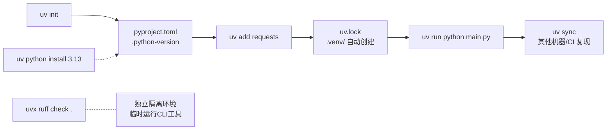
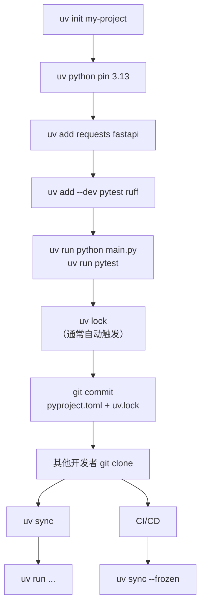
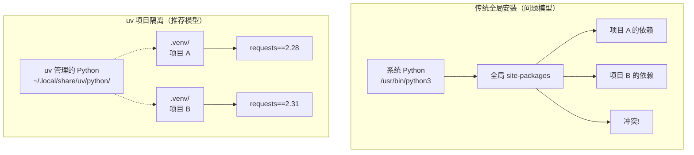

[toc]


---

**知识截止与资料来源：** 内容综合自 uv 官方文档（docs.astral.sh/uv）、uv GitHub 仓库（CHANGELOG / Issues / PR）、USTC 镜像帮助文档、清华 PyPI 镜像文档、pydevtools.com、知乎国内镜像配置专题等 2025–2026 年资料。uv 最新稳定版约为 **0.12.x**（2026 年 8 月），搜索时间 **2026 年 9 月 10 日**。

---

## 深入理解 uv — Python 生态的现代化一站式工具

### uv 是什么

uv 是一个现代化、高性能的 Python 包管理器和项目管理工具，用 Rust 编写。它可作为传统 Python 包管理工具（如 pip）的直接替代品（Drop-in Replacement），在速度、可靠性和依赖解析方面有显著提升。

uv 用一个二进制文件替代了五个独立工具，运行速度比传统工具快 10 到 100 倍。 它由 Astral 团队（Ruff linter 的创建者）开发，采用 MIT 开源协议。

2026 年 3 月，OpenAI 收购了 uv 背后的 Astral 公司。但 uv 仍保持开源。

#### uv 替代了哪些工具

这是理解 uv 定位最重要的一张表：

| 传统工具              | uv 中的对应能力   | uv 命令                                      |
| --------------------- | ----------------- | -------------------------------------------- |
| **pip**               | 安装包            | `uv pip install` / `uv add`                  |
| **pip-tools**         | 依赖锁定          | `uv lock` / `uv pip compile`                 |
| **virtualenv / venv** | 虚拟环境管理      | `uv venv`（通常自动管理）                    |
| **pyenv**             | Python 版本管理   | `uv python install` / `uv python pin`        |
| **pipx**              | 运行 CLI 工具     | `uvx` / `uv tool`                            |
| **Poetry / PDM**      | 项目管理 + 锁文件 | `uv init` / `uv add` / `uv lock` / `uv sync` |

#### 工作流全景图



---

### 安装 uv

#### Linux / macOS

```bash
curl -LsSf https://astral.sh/uv/install.sh | sh
```

安装后 uv 位于 `~/.local/bin/uv`。如果安装器提示 `$HOME/.local/bin` 不在 PATH 中，重启终端或运行 `uv python update-shell` 使其生效。

#### Windows（PowerShell）

```powershell
powershell -ExecutionPolicy ByPass -c "irm https://astral.sh/uv/install.ps1 | iex"
```

在 Windows 上，`uv tool update-shell` 可更新 PATH。

#### 国内环境安装 uv 本体

`astral.sh` 域名在国内通常可达，但如遇困难：

- **有代理：** `https_proxy=http://127.0.0.1:7890 curl -LsSf https://astral.sh/uv/install.sh | sh`
- **pip 安装（备选）：** `pip install uv`（较慢，但国内 PyPI 镜像可加速）

#### 更新 uv

不同方式安装的uv更新方案不同,对于单独安装的情况下,使用`uv self update`;其他情况参考各自包管理器的更新方法.

> If you installed uv with pip, brew, or another package manager, **update uv** with `pip install -U`(`pip install --upgrade`, `brew upgrade`, or similar.

升级 uv 不会影响它管理的 Python 版本。

---

### 核心概念与心智模型的转变

这是全文**最重要的章节之一**。从传统 pip+venv 工作流迁移到 uv，最大的挑战不是命令差异，而是**思维方式的转变**。

#### 传统思维 vs uv 思维

| 维度          | 传统思维（pip + venv）                               | **uv 思维**                                                  |
| ------------- | ---------------------------------------------------- | ------------------------------------------------------------ |
| 环境管理      | 手动 `python -m venv .venv` 再 `source activate`     | **uv 自动创建和管理 `.venv`，不需要手动激活**                |
| 安装包        | `pip install requests` 然后手动更新 requirements.txt | **`uv add requests` 一步完成安装 + 声明 + 锁定**             |
| 运行脚本      | 先激活环境，再 `python main.py`                      | **`uv run python main.py` 自动使用正确环境**                 |
| 依赖记录      | requirements.txt（手动维护，容易漂移）               | **`pyproject.toml`（声明）+ `uv.lock`（精确锁定），自动管理** |
| 复现环境      | `pip install -r requirements.txt`（版本可能不一致）  | **`uv sync`（严格按 lockfile 复现，跨平台一致）**            |
| Python 版本   | 系统安装 / pyenv 管理                                | **`uv python install` 自动下载管理**                         |
| 全局 CLI 工具 | `pip install --user ruff` 或 pipx                    | **`uvx ruff` 或 `uv tool install ruff`**                     |

#### 关键心智模型：「以项目为中心」

uv 思维的核心区别在于：它以项目（Project）而不是单个依赖为单位来思考。 当你添加 requests 时，uv 不仅安装它，还会将其作为项目依赖添加到 `pyproject.toml`、更新锁文件、并同步项目环境。

**几条核心规则需要形成肌肉记忆：**

- **不要 `pip install`** — 用 `uv add`（项目依赖）或 `uv pip install`（兼容模式）
- **不要手动 `activate`** — 用 `uv run` 执行命令，它自动使用 `.venv`
- **不要手动编辑 `uv.lock`** — 它由 uv 自动生成和维护
- **`pyproject.toml` 和 `uv.lock` 都要提交到 Git** — `.venv/` 不提交
- 坚持用 `uv add` 管理项目依赖、用 `uv sync` 复现环境，就能避开大多数问题

#### `uv add` vs `uv pip install` 的区别

这是初学者最容易混淆的地方：

| 命令                                 | 性质                  | 修改 pyproject.toml？ | 修改 uv.lock？ | 适用场景                        |
| ------------------------------------ | --------------------- | --------------------- | -------------- | ------------------------------- |
| **`uv add requests`**                | 声明式（Declarative） | **是**                | **是**         | **日常开发首选**                |
| `uv pip install requests`            | 命令式（Imperative）  | 否                    | 否             | 临时安装、迁移过渡、CI 特殊场景 |
| `uv pip install -r requirements.txt` | 命令式                | 否                    | 否             | 兼容旧项目                      |

`uv add` 管理的是项目的依赖声明，而 `uv pip install` 是对环境的一次性操作。对于可复现的项目，你应该几乎总是使用 `uv add`。

---

### 完整项目工作流

#### 创建项目

```bash
uv init my-project
cd my-project
```

从 uv 0.12.0（2026 年 7 月）起，`uv init` 默认创建带有 `src/` 布局、构建系统和脚本入口点的打包应用程序（Packaged Application）。

生成的项目结构：


```
my-project/
├── .git/
├── .gitignore
├── .python-version
├── pyproject.toml
├── README.md
└── src/
    └── my_project/
        └── __init__.py
```


如果你只想创建一个简单脚本项目（不需要 `src/` 布局）：

```bash
uv init --script my-project
# 或在已有目录中：
uv init .
```

#### 指定 Python 版本

```bash
# 安装指定版本
uv python install 3.13

# 为项目绑定版本（写入 .python-version 文件）
uv python pin 3.13

# 创建项目时直接指定
uv init --python 3.13 my-project
```

#### 管理依赖

```bash
# 添加运行时依赖
uv add requests
uv add "fastapi>=0.100"

# 添加开发依赖
uv add --dev pytest ruff mypy

# 添加可选依赖组
uv add --group docs mkdocs

# 移除依赖
uv remove requests

# 从已有 requirements.txt 迁移
uv add -r requirements.txt

# 查看依赖树
uv tree
```

当你执行 `uv add` 时，uv 会一次性完成环境创建（如果尚不存在）、安装、和更新项目配置。

#### 运行代码

```bash
# 运行 Python 脚本（自动同步环境）
uv run python main.py

# 运行项目中声明的脚本入口
uv run my-project

# 运行 pytest
uv run pytest

# 临时使用其他 Python 版本运行
uv run --python 3.12 python main.py
```

当使用 `uv run` 时，项目会在执行请求的命令之前自动进行锁定（lock）和同步（sync），确保项目环境始终是最新的。

#### 锁定与同步（Lock & Sync）

锁定（Locking）是将项目依赖解析为锁文件的过程；同步（Syncing）是将锁文件中的包子集安装到项目环境中的过程。

```bash
# 手动生成/更新锁文件
uv lock

# 从锁文件同步环境（其他开发者克隆项目后执行）
uv sync

# CI 中推荐：严格检查锁文件是否与 pyproject.toml 一致
uv sync --frozen
```

`--frozen` 标志确保依赖精确匹配 `uv.lock` 中的内容。

`uv.lock` 是跨平台的锁文件，包含了精确的已解析版本信息（不同于 `pyproject.toml` 中的宽泛需求声明）。这个文件应当纳入版本控制，以确保跨机器的一致、可复现安装。

重要选项：

| 选项        | 含义                                               | 典型场景       |
| ----------- | -------------------------------------------------- | -------------- |
| `--frozen`  | 不检查锁文件是否过期，直接使用                     | **CI/CD 推荐** |
| `--locked`  | 检查锁文件是否与 pyproject.toml 一致，不一致则报错 | CI 验证        |
| `--no-sync` | 运行命令但不同步环境                               | 快速执行、调试 |

#### 完整生命周期小结



---

### 环境工具相关命令

#### `uvx` — 临时运行 CLI 工具（替代 pipx）

uvx 在临时的隔离环境中运行工具，无需安装。工具会被缓存以加速后续运行。

```bash
# 临时运行（不安装到全局）
uvx ruff check .
uvx black --check .
uvx httpie https://example.com

# 持久安装到用户级别
uv tool install ruff
uv tool install jupyterlab
```

每个工具拥有自己的隔离环境，因此工具之间不会发生冲突，也不会与你的项目依赖冲突。

#### `uv venv` — 手动创建虚拟环境

通常 uv 的项目工作流会自动管理 `.venv`，但你也可以手动操作：

```bash
# 在当前目录创建 .venv
uv venv

# 指定 Python 版本
uv venv --python 3.12

# 指定目录名
uv venv my-env

# 激活（如果你习惯传统方式）
source .venv/bin/activate      # Linux/macOS
.venv\Scripts\activate         # Windows (cmd)
.venv\Scripts\Activate.ps1     # Windows (PowerShell)
```

#### `uv python` — Python 版本管理

```bash
# 列出可安装的版本
uv python list

# 仅列出已安装版本
uv python list --only-installed

# 安装多个版本
uv python install 3.12 3.13 3.14

# 查找特定版本的安装路径
uv python find 3.13

# 升级已安装的 Python 到最新补丁版
uv python upgrade
```

uv 安装的 Python 来自 **python-build-standalone** 项目（预编译的独立 Python 分发），无需从源码编译，几秒即可完成安装。

---

### 国内环境加速配置（重要）

uv 的资源获取涉及两个独立场景，需分开配置且互不影响：PyPI 源（用于下载第三方包）和 CPython 代理（用于 `uv python install` 下载 Python 解释器）。

#### 场景一：PyPI 包下载加速

国内主流镜像源：

| 镜像                 | 地址                                                      |
| -------------------- | --------------------------------------------------------- |
| 清华大学（TUNA）     | `https://pypi.tuna.tsinghua.edu.cn/simple`                |
| 中国科技大学（USTC） | `https://mirrors.ustc.edu.cn/pypi/simple`                 |
| 阿里云               | `https://mirrors.aliyun.com/pypi/simple/`                 |
| 腾讯云               | `https://mirrors.cloud.tencent.com/pypi/simple/`          |
| 华为云               | `https://mirrors.huaweicloud.com/repository/pypi/simple/` |

##### 方式一：环境变量（全局生效，最简单）

```bash
# Linux/macOS — 写入 ~/.bashrc 或 ~/.zshrc
export UV_DEFAULT_INDEX="https://mirrors.ustc.edu.cn/pypi/simple"
```

```powershell
# Windows — 设置用户环境变量
[Environment]::SetEnvironmentVariable("UV_DEFAULT_INDEX", "https://mirrors.ustc.edu.cn/pypi/simple", "User")
```

##### 方式二：全局配置文件（推荐，持久且清晰）

配置文件路径：

| 系统          | 路径                   |
| ------------- | ---------------------- |
| Linux / macOS | `~/.config/uv/uv.toml` |
| Windows       | `%APPDATA%\uv\uv.toml` |

```toml
# ~/.config/uv/uv.toml（Linux）或 %APPDATA%\uv\uv.toml（Windows）

[[index]]
url = "https://mirrors.ustc.edu.cn/pypi/simple"
default = true
```

##### 方式三：项目级配置（写入 pyproject.toml）

```toml
# pyproject.toml 中添加

[[tool.uv.index]]
url = "https://pypi.tuna.tsinghua.edu.cn/simple"
default = true
```

##### 关于 `uv.lock` 中镜像 URL 污染问题

设置 index 会改变 `uv.lock` 的内容（记录镜像 URL 而非官方 URL）。 这在 CI/CD 环境或不使用相同镜像的协作者之间是不理想的。

**推荐做法：** 国内开发者使用镜像加速日常开发，但在提交 `uv.lock` 到版本控制前，执行一次还原：

```bash
UV_INDEX=https://pypi.org/simple uv lock --refresh
```

这样 `uv.lock` 中记录的是官方 PyPI 地址，其他人（包括国外 CI）能正常使用。或者将镜像配置放在**环境变量 / 全局配置**中而非 `pyproject.toml` 中，这样 `uv.lock` 不会受到影响。

> **最佳实践：**
> - **个人开发环境：** 镜像配置放在**全局 `uv.toml` 或环境变量**中
> - **`pyproject.toml`：** 不写镜像配置（保持项目可移植性）
> - **提交前：** 如果 `uv.lock` 被镜像 URL 污染，用上述命令还原

##### `uv pip` 的镜像配置差异（重要坑点）

`[tool.uv.pip]` 中的 `index-url` 配置仅对 `uv pip install` 生效，`uv add` 和 `uv tool install` 不会读取它。

**正确的配置对应关系：**

| 你的使用方式                     | 正确的配置位置                                              |
| -------------------------------- | ----------------------------------------------------------- |
| `uv add` / `uv lock` / `uv sync` | `[[tool.uv.index]]` 或 `UV_DEFAULT_INDEX` 环境变量          |
| `uv pip install`                 | `[tool.uv.pip]` 下的 `index-url` 或 `UV_INDEX_URL` 环境变量 |
| `uv tool install` / `uvx`        | `[[tool.uv.index]]` 或 `UV_DEFAULT_INDEX` 环境变量          |

**要覆盖所有场景，最省心的方式是使用 `UV_DEFAULT_INDEX` 环境变量。**

#### 场景二：Python 解释器下载加速

`uv python install` 从 GitHub Releases（`astral-sh/python-build-standalone`）下载预编译 Python，国内直连 GitHub 通常很慢。

##### 方式一：环境变量

```bash
# Linux/macOS
export UV_PYTHON_INSTALL_MIRROR="https://ghfast.top/https://github.com/astral-sh/python-build-standalone/releases/download"
```

```powershell
# Windows
[Environment]::SetEnvironmentVariable("UV_PYTHON_INSTALL_MIRROR", "https://ghfast.top/https://github.com/astral-sh/python-build-standalone/releases/download", "User")
```

> **`ghfast.top` 是 GitHub 加速代理的一种**，你也可以替换为其他可用的 GitHub 加速服务。如果你有本地代理（如 mihomo），也可以直接设 `https_proxy` 让 uv 通过代理下载。

##### 方式二：全局配置文件

`python-install-mirror` 和 `pypy-install-mirror` 可以作为 `uv.toml` 的配置项。

```toml
# ~/.config/uv/uv.toml（Linux）或 %APPDATA%\uv\uv.toml（Windows）

python-install-mirror = "https://ghfast.top/https://github.com/astral-sh/python-build-standalone/releases/download"

[[index]]
url = "https://mirrors.ustc.edu.cn/pypi/simple"
default = true
```

##### USTC 镜像的 python-build-standalone

USTC 提供了 `python-build-standalone` 的镜像。可以使用其 github-release 镜像路径。

##### 完整的国内一键配置脚本

以下脚本在 Linux/macOS 上一键配置全局加速：

```bash
#!/bin/bash
# uv 国内加速配置脚本
# 配置 PyPI 镜像 + Python 下载镜像

UV_CONFIG_DIR="${XDG_CONFIG_HOME:-$HOME/.config}/uv"
mkdir -p "$UV_CONFIG_DIR"

cat > "$UV_CONFIG_DIR/uv.toml" << 'EOF'
# Python 解释器下载加速（GitHub 加速代理）
# 可替换为其他可用的 GitHub 加速地址
python-install-mirror = "https://ghfast.top/https://github.com/astral-sh/python-build-standalone/releases/download"

# PyPI 包下载加速（默认使用 USTC 镜像）
[[index]]
url = "https://mirrors.ustc.edu.cn/pypi/simple"
default = true
EOF

echo "uv 全局配置已写入: $UV_CONFIG_DIR/uv.toml"
cat "$UV_CONFIG_DIR/uv.toml"
```

Windows (PowerShell) 版：

```powershell
# uv 国内加速配置脚本（Windows）
$uvConfigDir = "$env:APPDATA\uv"
New-Item -ItemType Directory -Force -Path $uvConfigDir | Out-Null

@"
python-install-mirror = "https://ghfast.top/https://github.com/astral-sh/python-build-standalone/releases/download"

[[index]]
url = "https://mirrors.ustc.edu.cn/pypi/simple"
default = true
"@ | Set-Content -Path "$uvConfigDir\uv.toml" -Encoding UTF8

Write-Host "uv 全局配置已写入: $uvConfigDir\uv.toml"
Get-Content "$uvConfigDir\uv.toml"
```

##### 验证镜像是否生效

```bash
# 加 -v 查看详细日志，确认请求的是镜像地址
uv add requests -v
```

在输出的日志中，如果看到你配置的镜像地址（如 `mirrors.ustc.edu.cn`）而不是 `pypi.org`，就说明配置成功。

---

### Windows 与 Linux 的差异和注意事项

总体来说，uv 的设计使得不同操作系统之间的差异几乎消失了，但仍有一些细节需要注意：

#### 路径与配置差异

| 项目            | Linux / macOS                       | Windows                                       |
| --------------- | ----------------------------------- | --------------------------------------------- |
| uv 二进制位置   | `~/.local/bin/uv`                   | `%USERPROFILE%\.local\bin\uv.exe`             |
| 全局配置文件    | `~/.config/uv/uv.toml`              | `%APPDATA%\uv\uv.toml`                        |
| Python 安装目录 | `~/.local/share/uv/python/`         | `%APPDATA%\uv\python\`                        |
| 工具安装目录    | `~/.local/share/uv/tools/`          | `%APPDATA%\uv\tools\`                         |
| 缓存目录        | `~/.cache/uv/`                      | `%LOCALAPPDATA%\uv\cache\`                    |
| 虚拟环境激活    | `source .venv/bin/activate`         | `.venv\Scripts\activate`                      |
| 环境变量设置    | `export VAR=value`（写入 shell rc） | 系统设置或 `$env:VAR = "value"`（PowerShell） |

#### 虚拟环境激活方式差异

使用 `uv run` 时**不需要**手动激活，但如果你的 IDE 或调试器需要，激活方式因平台而异：

```bash
# Linux / macOS (bash/zsh)
source .venv/bin/activate

# Windows (cmd.exe)
.venv\Scripts\activate.bat

# Windows (PowerShell)
.venv\Scripts\Activate.ps1
```

> Windows PowerShell 首次激活可能遇到执行策略限制，需执行：
> `Set-ExecutionPolicy -ExecutionPolicy RemoteSigned -Scope CurrentUser`

#### Windows 特有注意事项

- **路径长度限制：** Windows 默认有 260 字符的路径长度限制。深层 `node_modules` 风格的依赖树（如某些 Python 包的嵌套依赖）可能触碰这个限制。建议在 Windows 上开启长路径支持（注册表 `LongPathsEnabled`）
- **文件锁定：** Windows 上进程持有的文件无法被其他进程删除/覆盖。如果 `.venv` 中的文件被 IDE 占用，`uv sync` 可能报错。关闭 IDE 或重启后重试
- **Python Launcher (`py.exe`)：** Windows 上可能已装有 `py.exe`（Python Launcher for Windows）。uv 管理的 Python 与之独立，不冲突，但注意 `py -3.13` 和 `uv run python` 可能指向不同的解释器
- **换行符：** `uv.lock` 在所有平台生成一致的内容（LF），Git 的 `autocrlf` 配置不应影响它，但建议 `.gitattributes` 中明确指定

#### Linux 特有注意事项

- **系统 Python 不要动：** 即使用了 uv，系统的 `/usr/bin/python3` 也不要去修改
- **无头服务器（Headless）：** 某些依赖 `tkinter` 的包需要额外安装 `python3.x-tk` 系统包。uv 安装的 python-build-standalone 自带 tkinter 支持（静态编译），通常无此问题
- **glibc 兼容性：** python-build-standalone 的预编译 Python 有 glibc 最低版本要求（一般 >= 2.17）。极老的发行版（如 CentOS 6）可能无法使用
- **定时任务 / cron：** 参见下一节

---

### uv 与全局 Python 环境的对比

#### 什么是「全局安装」的问题

传统方式中，很多人习惯 `pip install requests`（没有虚拟环境），包被安装到系统 Python 或用户级 `site-packages`。这导致：

- **依赖冲突：** 项目 A 需要 `requests==2.28`，项目 B 需要 `requests==2.31`，全局只能存在一个版本
- **环境污染：** 全局环境积累大量包，搞不清哪个项目需要哪些依赖
- **不可复现：** `pip freeze` 输出包含大量不相关的包，新机器无法干净复现
- **权限问题：** 系统级安装需要 `sudo`，可能影响系统工具

#### uv 的隔离模型



uv 的设计哲学是：

- **每个项目有自己的 `.venv`**，依赖完全隔离
- **Python 解释器按版本安装在用户级目录**，多版本共存
- **CLI 工具通过 `uvx` 或 `uv tool` 在独立隔离环境中运行**，不污染任何项目

如果你确实需要在容器基础环境中全局安装（如 Docker 中），应使用 `uv pip install --system` 来避免 uv 默认期望虚拟环境的报错。

---

### 定时任务 / 自动化场景

这个场景在上一轮对话中已详细讨论，这里从 uv 的角度补充关键要点。

#### 推荐方式：直接用 `.venv` 中的 Python 绝对路径

```bash
# 查找项目虚拟环境中的 Python 路径
realpath /opt/app/.venv/bin/python

# crontab -e
0 3 * * * /opt/app/.venv/bin/python -u /opt/app/task.py >> /var/log/task.log 2>&1
```

#### 用 `uv run` 执行

```bash
# crontab -e
0 3 * * * /home/deploy/.local/bin/uv run --project /opt/app python task.py >> /var/log/task.log 2>&1
```

注意：cron 环境中 `uv` 可能不在 `PATH` 中，必须使用 **绝对路径 `/home/user/.local/bin/uv`**。

#### systemd timer 中使用

```ini
[Service]
Type=oneshot
User=deploy
WorkingDirectory=/opt/app
ExecStart=/home/deploy/.local/bin/uv run python task.py
# 或直接使用虚拟环境：
# ExecStart=/opt/app/.venv/bin/python task.py
Environment="PYTHONUNBUFFERED=1"
```

---

### Docker 中使用 uv

uv 可以显著加速 Docker 构建并减小镜像体积。通过先仅复制 `pyproject.toml` 和 `uv.lock` 文件，可以充分利用 Docker 的层缓存。

```dockerfile
FROM python:3.13-slim

# 安装 uv
COPY --from=ghcr.io/astral-sh/uv:latest /uv /usr/local/bin/uv

WORKDIR /app

# 先复制依赖声明文件（利用层缓存）
COPY pyproject.toml uv.lock ./

# 安装依赖（--frozen 确保严格按锁文件安装）
RUN uv sync --frozen --no-dev --no-install-project

# 复制应用代码
COPY . .

# 安装项目本身
RUN uv sync --frozen --no-dev

CMD ["uv", "run", "python", "-m", "my_app"]
```

> 国内构建 Docker 镜像时，可通过 `--build-arg` 传入镜像配置：
> ```dockerfile
> ARG UV_DEFAULT_INDEX="https://mirrors.ustc.edu.cn/pypi/simple"
> ENV UV_DEFAULT_INDEX=${UV_DEFAULT_INDEX}
> ```

---

### 从已有项目迁移到 uv

#### 从 requirements.txt 迁移

```bash
cd existing-project

# 初始化 uv 项目（在已有目录中）
uv init .

# 导入已有的依赖
uv add -r requirements.txt

# 如果有 dev 依赖
uv add --dev -r requirements-dev.txt

# 验证
uv run python -c "import requests; print(requests.__version__)"
```

#### 从 Poetry 迁移

uv 能直接读取 Poetry 的 `pyproject.toml` 中的依赖声明：

```bash
cd poetry-project

# uv 可以直接理解 [tool.poetry.dependencies]
uv sync
```

如果需要完全迁移，将 Poetry 的依赖格式转换为标准 PEP 621 格式（`[project.dependencies]`）。

#### 迁移检查清单

在称迁移完成之前，将仓库克隆到一个干净目录。确认 `uv sync` 能重建环境、`.venv` 被忽略、直接依赖在 `pyproject.toml` 中有合理声明、且审查过的锁文件已提交。

---

### 配置体系详解

uv 的配置层级（优先级从高到低）：

1. **命令行参数** — `uv add --index https://...`
2. **环境变量** — `UV_DEFAULT_INDEX`、`UV_PYTHON_INSTALL_MIRROR` 等
3. **项目配置** — 项目根目录的 `pyproject.toml`（`[tool.uv]`）或 `uv.toml`
4. **用户全局配置** — `~/.config/uv/uv.toml`（Linux）或 `%APPDATA%\uv\uv.toml`（Windows）

常用环境变量速查：

| 环境变量                   | 作用                                        |
| -------------------------- | ------------------------------------------- |
| `UV_DEFAULT_INDEX`         | 默认 PyPI 源 URL                            |
| `UV_INDEX_URL`             | `uv pip` 兼容模式的源 URL                   |
| `UV_PYTHON_INSTALL_MIRROR` | CPython 下载镜像地址                        |
| `UV_PYPY_INSTALL_MIRROR`   | PyPy 下载镜像地址                           |
| `UV_CACHE_DIR`             | 缓存目录路径                                |
| `UV_LINK_MODE`             | 链接模式（`copy` / `hardlink` / `symlink`） |
| `UV_PYTHON`                | 默认 Python 解释器路径                      |
| `UV_NO_SYNC`               | 禁用自动同步                                |

---

### 常见陷阱与最佳实践

#### 应该做的

- **始终用 `uv add` 管理项目依赖**，而非 `uv pip install`
- **提交 `pyproject.toml` 和 `uv.lock` 到 Git**
- **`.venv/` 加入 `.gitignore`**（它可以随时从 lockfile 重建）
- **CI 中使用 `uv sync --frozen`**，确保锁文件与环境精确一致
- 如果需要从头开始，可以删除 `.venv` 然后运行 `uv sync`，它会按照锁文件精确重建环境
- **镜像配置放全局**，不放 `pyproject.toml`（保持项目可移植性）

#### 不应该做的

- **不要 `pip install` 到 uv 管理的 `.venv` 中** — 会导致环境与锁文件不一致，下次 `uv sync` 可能清理掉手动安装的包
- **不要手动编辑 `uv.lock`** — 它是自动生成的
- **不要在本地固定一个解释器版本但声明不兼容的 `requires-python` 范围**
- **避免混用多个项目管理器**（如同时用 Poetry 和 uv），除非有文档化的理由
- **不要在生产主机上执行首次依赖解析** — 应在开发/CI 阶段完成 lock，生产只做 sync
- **Windows 上不要在路径中使用中文目录** — 某些 C 扩展编译可能出问题

#### `uv add` 忘记了要添加到哪个组？

```bash
# 运行时依赖（默认）
uv add requests

# 开发依赖
uv add --dev pytest ruff mypy

# 自定义依赖组
uv add --group lint ruff
uv add --group test pytest

# 安装时控制组
uv sync                  # 安装所有组
uv sync --no-dev         # 不安装 dev 依赖（生产部署用）
uv sync --group test     # 只安装 test 组
```

---

### 命令速查表

| 任务                  | 命令                                  |
| --------------------- | ------------------------------------- |
| 创建新项目            | `uv init my-project`                  |
| 在已有目录初始化      | `uv init .`                           |
| 安装 Python           | `uv python install 3.13`              |
| 绑定项目 Python 版本  | `uv python pin 3.13`                  |
| 添加依赖              | `uv add requests`                     |
| 添加开发依赖          | `uv add --dev pytest`                 |
| 移除依赖              | `uv remove requests`                  |
| 运行脚本              | `uv run python main.py`               |
| 运行测试              | `uv run pytest`                       |
| 同步环境              | `uv sync`                             |
| CI 同步               | `uv sync --frozen`                    |
| 更新依赖              | `uv lock --upgrade`                   |
| 更新单个包            | `uv lock --upgrade-package requests`  |
| 查看依赖树            | `uv tree`                             |
| 临时运行 CLI 工具     | `uvx ruff check .`                    |
| 全局安装工具          | `uv tool install ruff`                |
| 创建虚拟环境          | `uv venv`                             |
| 导出 requirements.txt | `uv export --format requirements-txt` |
| 清理缓存              | `uv cache clean`                      |
| 查看缓存大小          | `uv cache size`                       |
| 更新 uv 自身          | `uv self update`                      |
| 兼容模式安装          | `uv pip install requests`             |

---

### uv 的局限性（适用边界）

如果你的工作流依赖非 Python 依赖（如 CUDA 库或 C 扩展），uv 不能替代 Conda。

- **Conda 生态：** 需要 CUDA、MKL、系统级 C/C++ 库的数据科学/ML 项目，仍推荐 Conda（或 mamba）
- **PyTorch CUDA 版本：** 带特定 CUDA 的 PyTorch 不在 PyPI 上，需配置 PyTorch 官方源或其国内镜像（上海交大、阿里云）
- uv 目前没有插件系统
- 某些基于 `setup.py` 的遗留包可能需要 `uv pip install --no-build-isolation` 才能正确构建

---

### 总结：从今天开始的推荐实践

1. **安装 uv**（一条命令），**配置国内镜像**（一个配置文件）
2. 新项目用 **`uv init`** 创建，已有项目用 **`uv init .` + `uv add -r requirements.txt`** 迁移
3. 日常开发：**`uv add`** 添加依赖 → **`uv run`** 运行脚本 → **`uv sync`** 同步环境
4. 提交 **`pyproject.toml` + `uv.lock`** 到 Git，`.venv/` 加入 `.gitignore`
5. CI/CD 使用 **`uv sync --frozen`** 确保精确复现
6. 定时任务使用 **`.venv/bin/python` 的绝对路径**或 **`uv run --project`** 的绝对路径
7. 临时 CLI 工具用 **`uvx`**，不要全局 `pip install`
8. 忘掉 `activate`，拥抱 `uv run`