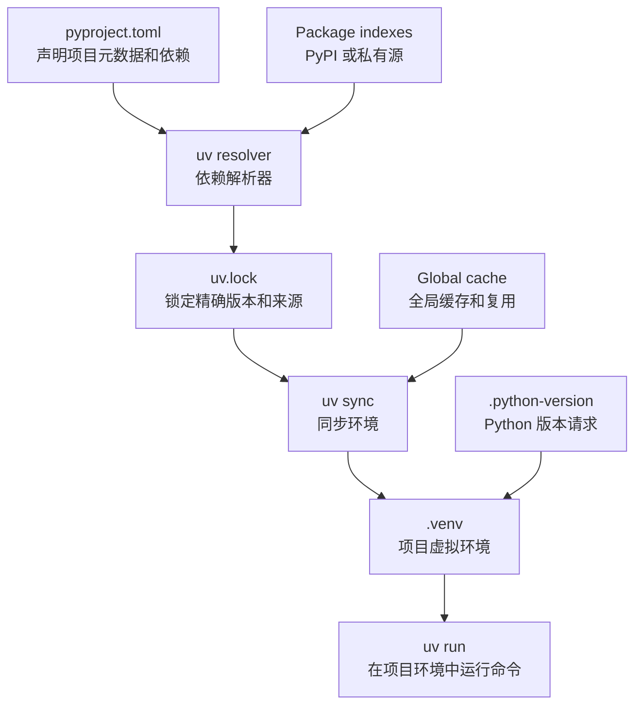
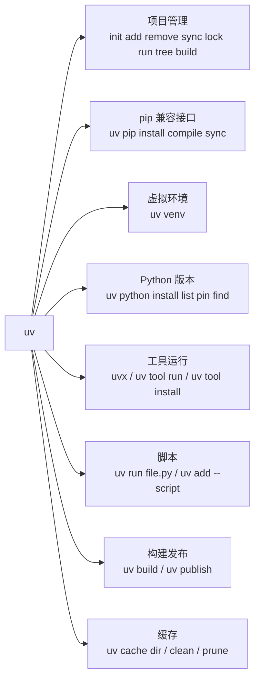
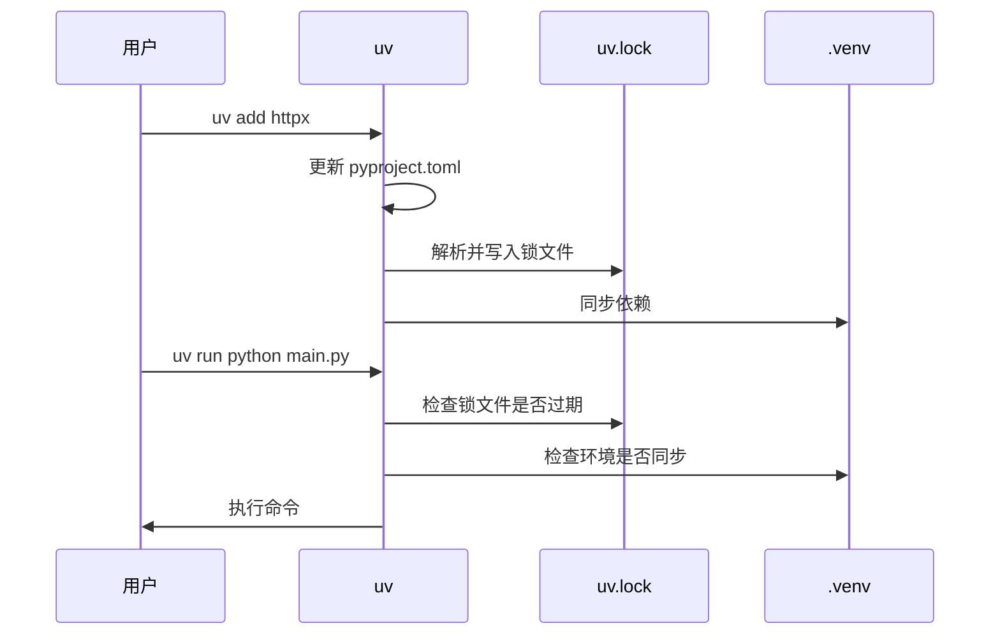

[toc]


## 学习目标与完整大纲

这份笔记围绕 **uv：Python 包与项目管理工具** 展开。uv 由 Astral 维护，官方定位已经从“更快的 `pip` 替代品”扩展为更完整的 Python 项目管理工具：它覆盖依赖解析、虚拟环境、锁文件、Python 版本、脚本运行、命令行工具安装、构建与发布等场景。官方文档称 uv 提供 `pip`、`pip-tools`、`pipx`、`poetry`、`pyenv`、`twine`、`virtualenv` 等工具的部分替代能力，并提供跨平台锁文件、全局缓存、Python 版本管理和 `uvx` 工具运行能力。([GitHub](https://github.com/astral-sh/uv))

下面的大纲可以作为新手学习路线：

| 主题           | 你要掌握什么                                                 | 典型命令                                          |
| -------------- | ------------------------------------------------------------ | ------------------------------------------------- |
| uv 的定位      | uv 是包安装器、项目管理器、虚拟环境工具、Python 版本管理器、工具运行器的组合 | `uv --help`                                       |
| 安装 uv        | 推荐使用官方独立安装器，也可用 `pipx`、Homebrew、WinGet、Scoop 等 | `curl -LsSf https://astral.sh/uv/install.sh | sh` |
| 项目管理       | 用 `pyproject.toml` 声明项目，用 `uv.lock` 锁定解析结果，用 `.venv` 承载环境 | `uv init`、`uv add`、`uv run`、`uv sync`          |
| 依赖管理       | 区分运行依赖、开发依赖、可选依赖、依赖组、依赖来源           | `uv add requests`、`uv add --dev pytest`          |
| 锁定与同步     | 理解 lock、sync、frozen、locked 的区别                       | `uv lock`、`uv sync --locked`                     |
| 脚本运行       | 用 PEP 723 inline script metadata 写自带依赖的单文件脚本     | `uv init --script`、`uv add --script`             |
| 工具管理       | 用 `uvx` 临时运行 CLI 工具，用 `uv tool install` 持久安装    | `uvx ruff check`                                  |
| Python 版本    | 用 uv 安装、查找、锁定 Python 版本                           | `uv python install 3.12`、`uv python pin 3.12`    |
| 与其他工具对比 | 何时用 uv，何时继续用 pip、Poetry、PDM、Conda/Mamba          | 见后文对比表                                      |
| 最佳实践       | CI、Docker、团队协作、安全、迁移、发布                       | `uv sync --locked --no-dev`                       |

------

## uv 是什么

**uv** 是一个用 Rust 编写的 Python 包管理与项目管理工具。它最初常被理解为“更快的 pip”，但现在更准确的理解是：

> uv 是一个面向现代 Python 项目的“一体化工作流工具”：既能安装包，也能创建项目、管理依赖、生成锁文件、同步虚拟环境、运行脚本、安装 Python 解释器、运行命令行工具、构建和发布包。

官方文档明确说明，`uv pip` 提供了对常见 `pip`、`pip-tools`、`virtualenv` 命令的替代接口，同时增加了平台无关解析、可复现解析、依赖覆盖、替代解析策略等能力；官方也强调 uv 并不是 `pip` 的逐 bug 克隆，在一些复杂或边缘行为上会有差异。([docs.astral.sh](https://docs.astral.sh/uv/))

### uv 的核心价值

| 价值     | 解释                                                         |
| -------- | ------------------------------------------------------------ |
| 快       | uv 官方宣称常见场景可比 `pip` 快 10 到 100 倍；速度来自 Rust 实现、并行下载、全局缓存、快速解析器等设计。([GitHub](https://github.com/astral-sh/uv)) |
| 统一     | 一个工具覆盖 `pip`、`venv`、`pip-tools`、`pipx`、`pyenv`、`twine`、Poetry/PDM 的一部分场景。([GitHub](https://github.com/astral-sh/uv)) |
| 可复现   | 使用 `uv.lock` 锁定精确依赖版本，让团队、CI、部署环境使用一致依赖。([docs.astral.sh](https://docs.astral.sh/uv/concepts/projects/layout/)) |
| 跨平台   | `uv.lock` 是 universal lockfile，会捕获不同操作系统、架构、Python 版本等 marker 下可能安装的包。([docs.astral.sh](https://docs.astral.sh/uv/concepts/projects/layout/)) |
| 现代标准 | 以 `pyproject.toml` 为中心，支持依赖组（Dependency Groups）、脚本内联元数据（Inline Script Metadata）等现代 Python 打包规范。([Python 包装指南](https://packaging.python.org/en/latest/guides/writing-pyproject-toml/)) |

------

## 整体心智模型

可以先把 uv 想成下面这套流程：



这个图里最重要的是三件事：

| 文件或动作       | 作用                                                         | 是否提交到版本控制                      |
| ---------------- | ------------------------------------------------------------ | --------------------------------------- |
| `pyproject.toml` | 声明项目名称、版本、Python 版本范围、运行依赖、可选依赖、构建系统、工具配置 | 是                                      |
| `uv.lock`        | 记录 uv 解析出的精确依赖版本、来源、跨平台信息               | 通常是，特别是应用、服务、CLI、团队项目 |
| `.venv`          | 本机虚拟环境，实际安装包的位置                               | 否                                      |

uv 官方说明，`pyproject.toml` 用于标识项目根目录和项目元数据；uv 会在项目旁边创建 `.venv`，不建议把 `.venv` 加入版本控制；`uv.lock` 会放在 `pyproject.toml` 旁边，是 uv 管理的 TOML 锁文件，不应该手动编辑。([docs.astral.sh](https://docs.astral.sh/uv/concepts/projects/layout/))

------

## 安装 uv

官方支持多种安装方式：独立安装器、PyPI、Homebrew、MacPorts、WinGet、Scoop、Docker、GitHub Releases、Cargo 等。官方文档推荐如果从 PyPI 安装，最好通过 `pipx` 把 uv 装进隔离环境，而不是直接混进某个项目环境。([docs.astral.sh](https://docs.astral.sh/uv/getting-started/installation/))

macOS / Linux：

```bash
curl -LsSf https://astral.sh/uv/install.sh | sh
```

Windows PowerShell：

```powershell
powershell -ExecutionPolicy ByPass -c "irm https://astral.sh/uv/install.ps1 | iex"
```

通过 `pipx`：

```bash
pipx install uv
```

通过 Homebrew：

```bash
brew install uv
```

验证安装：

```bash
uv --version
uv --help
```

更新 uv：

```bash
uv self update
```

官方独立安装器允许指定版本，例如把版本号放进安装 URL；这对企业环境、CI 镜像、教学材料很有用，因为可以避免“今天能跑、明天命令行为变了”的问题。([docs.astral.sh](https://docs.astral.sh/uv/getting-started/installation/))

------

## uv 的命令地图



常用命令速查：

| 场景         | 命令                       | 说明                               |
| ------------ | -------------------------- | ---------------------------------- |
| 创建项目     | `uv init myapp`            | 新建 Python 项目                   |
| 添加依赖     | `uv add requests`          | 写入 `pyproject.toml` 并更新锁文件 |
| 添加开发依赖 | `uv add --dev pytest ruff` | 写入 `dependency-groups.dev`       |
| 运行命令     | `uv run python main.py`    | 在项目环境中运行                   |
| 同步环境     | `uv sync`                  | 根据锁文件安装依赖                 |
| 检查依赖树   | `uv tree`                  | 查看直接和间接依赖                 |
| 生成锁文件   | `uv lock`                  | 只解析并更新 `uv.lock`             |
| 临时运行工具 | `uvx ruff check .`         | 类似 `npx` / `pipx run`            |
| 安装工具     | `uv tool install ruff`     | 用户级安装 CLI 工具                |
| 创建虚拟环境 | `uv venv`                  | 类似 `python -m venv .venv`        |
| 安装 Python  | `uv python install 3.12`   | 安装 uv 管理的 Python              |
| 锁定 Python  | `uv python pin 3.12`       | 创建 `.python-version`             |

uv 官方的 feature 列表把这些能力分为 Python 版本、脚本、项目、工具等几类，并列出了 `uv init`、`uv add`、`uv sync`、`uv lock`、`uv run`、`uv tree`、`uv build`、`uvx`、`uv tool install` 等核心命令。([docs.astral.sh](https://docs.astral.sh/uv/getting-started/features/))

------

## 从零创建一个项目

假设你要创建一个小型应用：

```bash
uv init weather-app --python 3.12
cd weather-app
```

添加运行依赖：

```bash
uv add requests rich
```

添加开发依赖：

```bash
uv add --dev pytest ruff
```

运行代码：

```bash
uv run python main.py
```

运行测试：

```bash
uv run pytest
```

查看依赖树：

```bash
uv tree
```

同步环境：

```bash
uv sync
```

一个典型项目结构可能长这样：

```text
weather-app/
├── .python-version
├── .venv/
├── README.md
├── main.py
├── pyproject.toml
└── uv.lock
```

其中 `.venv/` 是本机环境，不提交；`pyproject.toml` 和 `uv.lock` 应提交。uv 官方文档说明 `.venv` 默认放在项目目录旁边，方便编辑器发现解释器并提供补全、类型提示；同时不建议手动用 `uv pip install` 修改项目环境，项目依赖应通过 `uv add` 管理，一次性临时依赖应使用 `uvx` 或 `uv run --with`。([docs.astral.sh](https://docs.astral.sh/uv/concepts/projects/layout/))

------

## pyproject.toml 是什么

`pyproject.toml` 是现代 Python 项目的中心配置文件。Python Packaging User Guide 说明，它可以包含三个主要区域：`[build-system]` 用于声明构建后端及构建依赖；`[project]` 用于声明项目元数据，例如项目依赖、名称等；`[tool]` 用于放置工具专属配置，例如 `[tool.uv]`、`[tool.ruff]`、`[tool.pytest.ini_options]` 等。([Python 包装指南](https://packaging.python.org/en/latest/guides/writing-pyproject-toml/))

一个简单例子：

```toml
[project]
name = "weather-app"
version = "0.1.0"
requires-python = ">=3.12"
dependencies = [
    "requests>=2.32",
    "rich>=13.0",
]

[dependency-groups]
dev = [
    "pytest>=8.0",
    "ruff>=0.5",
]
```

这里要区分几类依赖：

| 依赖类型                                            | 写在哪里                          | 适合放什么                                                   | 是否面向最终用户 |
| --------------------------------------------------- | --------------------------------- | ------------------------------------------------------------ | ---------------- |
| 运行依赖（Runtime Dependencies）                    | `[project].dependencies`          | 程序运行必须安装的库，例如 `requests`、`pydantic`            | 是               |
| 可选依赖 / extras（Optional Dependencies / Extras） | `[project.optional-dependencies]` | 用户按功能选择安装，例如 `plot`、`excel`、`postgres`         | 是               |
| 依赖组（Dependency Groups）                         | `[dependency-groups]`             | 本地开发、测试、格式化、文档，例如 `pytest`、`ruff`、`mkdocs` | 否               |
| uv 专属来源（Dependency Sources）                   | `[tool.uv.sources]`               | Git、路径、本地 workspace、指定 index 等开发来源             | 主要给 uv 使用   |

PEP 735 定义了 Dependency Groups，它们适合内部开发场景，例如 lint、test、docs，也适合不打包发布的脚本集合；uv 使用 `[dependency-groups]` 来声明开发依赖，`uv add --dev pytest` 会创建或更新 `dev` 组，且 `dev` 组默认会被同步。([Python Enhancement Proposals (PEPs)](https://peps.python.org/pep-0735/?utm_source=chatgpt.com))

------

## lock 与 sync：uv 的关键规则

这是 uv 新手最容易混淆的地方。

| 概念 | 英文术语   | 作用                                                         |
| ---- | ---------- | ------------------------------------------------------------ |
| 解析 | Resolution | 根据依赖约束、Python 版本、平台 marker 等计算可兼容的版本组合 |
| 锁定 | Locking    | 把解析结果写入 `uv.lock`                                     |
| 同步 | Syncing    | 按 `uv.lock` 把包安装到 `.venv`                              |
| 运行 | Running    | 在项目环境中执行命令，必要时自动 lock 和 sync                |

uv 官方定义：**locking** 是把项目依赖解析为 lockfile；**syncing** 是把 lockfile 中的一部分包安装到项目环境中。`uv run` 会在运行命令前自动锁定并同步，`uv tree` 等读取锁文件的命令也会自动更新锁文件。([docs.astral.sh](https://docs.astral.sh/uv/concepts/projects/sync/))



几个重要开关：

| 选项              | 作用                                   | 适合场景                             |
| ----------------- | -------------------------------------- | ------------------------------------ |
| `--locked`        | 如果锁文件不是最新的就报错，不自动修改 | CI 中防止忘记提交 `uv.lock`          |
| `--frozen`        | 直接使用锁文件，不检查是否过期         | 部署环境中追求稳定、避免修改解析状态 |
| `--no-sync`       | 不检查环境是否同步                     | 你非常确定环境已经准备好，想节省时间 |
| `uv lock --check` | 检查锁文件是否最新                     | CI 校验                              |
| `uv sync`         | 根据锁文件同步环境                     | 本地或 CI 安装依赖                   |

uv 文档特别说明：当新版本包发布时，uv 不会仅因为有新版本就认为 lockfile 过期；如果你要升级依赖，需要显式更新锁文件。([docs.astral.sh](https://docs.astral.sh/uv/concepts/projects/sync/))

------

## uv.lock 为什么重要

`uv.lock` 不是传统 `requirements.txt` 的简单替代，而是 uv 项目接口的核心。

官方文档说明，`uv.lock` 是 universal 或 cross-platform lockfile，会记录不同操作系统、架构、Python 版本等 marker 下可能安装的包；它包含项目环境要安装的精确版本，应提交到版本控制，以便团队和部署环境获得一致依赖。`uv.lock` 是 uv 专属格式，虽然人类可读，但应由 uv 管理，不应手动编辑。([docs.astral.sh](https://docs.astral.sh/uv/concepts/projects/layout/))

### `pyproject.toml` 与 `uv.lock` 的区别

| 文件             | 表达的是                         | 示例                                         |
| ---------------- | -------------------------------- | -------------------------------------------- |
| `pyproject.toml` | “我接受哪些版本”                 | `requests>=2.32,<3`                          |
| `uv.lock`        | “这次解析最终选中了哪些精确版本” | `requests==2.32.5`、其传递依赖、hash、来源等 |
| `.venv`          | “当前机器实际安装了哪些包”       | site-packages 中的真实文件                   |

### 新手最佳实践

应用、服务、数据管道、CLI 工具、团队项目：提交 `uv.lock`。

库项目：也建议提交 `uv.lock` 以保证开发、测试、CI 环境一致；但发布给用户时，真正影响用户安装的是 `pyproject.toml` 中的元数据，而不是你的 lockfile。也就是说，库作者仍应在 `dependencies` 中写合理的版本范围，而不是只依赖 lockfile。

------

## 依赖解析的核心原理

Python 依赖解析本质上是在做约束求解：

```text
你的项目要求：
  fastapi >= 0.115
  pydantic >= 2
  python >= 3.12

fastapi 又要求：
  starlette >= 某版本
  pydantic 满足某范围

其他依赖继续要求：
  anyio
  typing-extensions
  sniffio
  ...

解析器要找到一组互相兼容的版本。
```

uv 的解析需要同时考虑：

| 约束来源          | 例子                         | 说明                   |
| ----------------- | ---------------------------- | ---------------------- |
| 直接依赖          | `fastapi>=0.115`             | 你显式添加的包         |
| 传递依赖          | `starlette`、`anyio`         | 依赖的依赖             |
| Python 版本       | `requires-python = ">=3.12"` | 影响可安装包版本       |
| 平台 marker       | `sys_platform == "win32"`    | 不同系统依赖可能不同   |
| extras            | `httpx[socks]`               | 可选功能带来的额外依赖 |
| dependency groups | `dev`、`test`、`docs`        | 开发、测试、文档依赖   |
| source / index    | 私有源、Git、path、workspace | 包的来源也会影响解析   |

uv 文档说明，它要求项目声明的所有依赖彼此兼容，并在创建 lockfile 时一起解析项目依赖、optional dependencies 和 dependency groups；如果 extras 或 groups 之间存在冲突，除非显式声明冲突关系，否则解析会失败。([docs.astral.sh](https://docs.astral.sh/uv/concepts/resolution/))

------

## 运行依赖、开发依赖、可选依赖

### 运行依赖

运行依赖是程序正常运行所需的依赖：

```bash
uv add fastapi uvicorn
```

对应 `pyproject.toml`：

```toml
[project]
dependencies = [
    "fastapi>=0.115",
    "uvicorn>=0.30",
]
```

### 开发依赖

开发依赖只服务于开发者，例如测试、格式化、静态检查：

```bash
uv add --dev pytest ruff mypy
```

对应：

```toml
[dependency-groups]
dev = [
    "pytest>=8.0",
    "ruff>=0.5",
    "mypy>=1.10",
]
```

uv 使用 PEP 735 的 `[dependency-groups]` 来声明开发依赖；`dev` 组被特殊处理，`--dev`、`--only-dev`、`--no-dev` 分别等价于 `--group dev`、`--only-group dev`、`--no-group dev`。([docs.astral.sh](https://docs.astral.sh/uv/concepts/projects/dependencies/))

### 可选依赖 / extras

可选依赖适合“用户按功能选择安装”的情况。例如你的库默认不依赖绘图库，但用户需要绘图功能时可以安装：

```bash
uv add matplotlib --optional plot
```

对应：

```toml
[project.optional-dependencies]
plot = [
    "matplotlib>=3.8",
]
```

使用时：

```bash
uv sync --extra plot
```

uv 文档说明 optional dependencies 写在 `[project.optional-dependencies]`，也常称为 extras；默认不会同步 extras，需要用 `--extra` 或 `--all-extras` 显式包含。([docs.astral.sh](https://docs.astral.sh/uv/concepts/projects/sync/?utm_source=chatgpt.com))

### 选择规则

| 你要表达的意思                           | 应该放哪里              | 例子                          |
| ---------------------------------------- | ----------------------- | ----------------------------- |
| 程序运行离不开                           | `dependencies`          | `fastapi`、`requests`         |
| 只有开发者需要                           | `dependency-groups`     | `pytest`、`ruff`、`mypy`      |
| 用户可选功能需要                         | `optional-dependencies` | `pandas[excel]`、`matplotlib` |
| 只在本地开发时从 Git/path/workspace 获取 | `tool.uv.sources`       | 本地包、私有 Git 仓库         |

------

## Python 版本管理

uv 可以管理 Python 解释器本身，常见命令包括：

```bash
uv python install 3.12
uv python list
uv python find
uv python pin 3.12
uv python uninstall 3.12
```

官方文档说明，uv 支持安装和管理 Python 版本；`.python-version` 可以声明默认 Python 版本请求，uv 会从当前目录及父目录查找 `.python-version`，也可以通过 `uv python pin` 创建该文件。uv 默认可按需自动下载 Python 版本，但可用配置关闭自动下载。([docs.astral.sh](https://docs.astral.sh/uv/concepts/python-versions/))

### 推荐做法

| 场景     | 推荐                                                         |
| -------- | ------------------------------------------------------------ |
| 新项目   | 用 `uv init --python 3.12` 或 `uv python pin 3.12` 固定 minor 版本 |
| 团队项目 | 提交 `.python-version`，并在 `pyproject.toml` 写 `requires-python` |
| CI       | 显式指定 Python 版本，避免 CI runner 默认版本漂移            |
| Docker   | 如果基础镜像已经提供 Python，可设置不自动下载 Python，避免重复安装 |

`requires-python` 和 `.python-version` 的区别：

| 项                           | 作用                                                 |
| ---------------------------- | ---------------------------------------------------- |
| `requires-python = ">=3.12"` | 声明项目支持的 Python 版本范围，是项目元数据         |
| `.python-version`            | 声明本仓库默认使用哪个 Python 解释器，是开发环境提示 |
| `uv python install 3.12`     | 在本机安装某个 Python                                |
| `uv python pin 3.12`         | 写入 `.python-version`                               |

------

## 脚本管理：单文件脚本也能声明依赖

uv 对单文件脚本支持很好，尤其适合数据处理脚本、运维脚本、临时分析脚本、教学示例。

创建脚本：

```bash
uv init --script example.py --python 3.12
```

添加脚本依赖：

```bash
uv add --script example.py "requests<3" rich
```

脚本顶部会出现类似元数据：

```python
# /// script
# requires-python = ">=3.12"
# dependencies = [
#   "requests<3",
#   "rich",
# ]
# ///

import requests
from rich.pretty import pprint

resp = requests.get("https://peps.python.org/api/peps.json")
pprint(resp.json())
```

运行：

```bash
uv run example.py
```

PEP 723 定义了 Python 脚本的 inline script metadata，其中 `dependencies` 表示脚本运行依赖，`requires-python` 表示兼容的 Python 版本范围；uv 支持自动添加和更新这种脚本内元数据，并会为脚本创建所需环境。([Python Enhancement Proposals (PEPs)](https://peps.python.org/pep-0723/?utm_source=chatgpt.com))

一个重要规则：当脚本使用 inline metadata 时，即使你在某个 uv 项目内运行它，脚本依赖也会与项目依赖隔离；uv 文档明确说明这种情况下项目依赖会被忽略。([docs.astral.sh](https://docs.astral.sh/uv/guides/scripts/))

------

## 工具管理：uvx 与 uv tool

很多 Python 包不是库，而是命令行工具，例如 `ruff`、`black`、`httpie`、`pycowsay`。uv 提供两种使用方式：

| 方式     | 命令                   | 适合                       |
| -------- | ---------------------- | -------------------------- |
| 临时运行 | `uvx ruff check .`     | 偶尔运行、不想安装         |
| 持久安装 | `uv tool install ruff` | 希望命令长期在 PATH 中可用 |

`uvx` 是 `uv tool run` 的别名。官方文档说明，`uv tool run` 会在与当前项目隔离的临时虚拟环境中安装工具依赖；`uv tool install` 则会安装到持久隔离环境，并把可执行文件暴露到 PATH。官方也建议多数情况下临时执行工具比安装工具更合适，除非你需要让其他程序或 Docker 镜像中的用户直接调用该命令。([docs.astral.sh](https://docs.astral.sh/uv/concepts/tools/))

示例：

```bash
uvx ruff check .
uvx black --check .
uvx pycowsay "hello uv"
```

指定工具版本：

```bash
uvx ruff@latest check .
uvx --from "ruff==0.6.0" ruff check .
```

这相当于 Python 生态里的 `npx`，也是对 `pipx run` 的现代替代。

------

## uv pip：兼容传统 pip 工作流

如果你暂时还不想迁移到 uv 项目模式，可以使用 `uv pip`：

```bash
uv venv
uv pip install requests
uv pip freeze
```

从 `requirements.txt` 安装：

```bash
uv pip install -r requirements.txt
```

用 `requirements.in` 锁定：

```bash
uv pip compile requirements.in -o requirements.txt
uv pip sync requirements.txt
```

uv 官方说明，`uv pip` 是对常见 `pip`、`pip-tools`、`virtualenv` 命令的替代接口，目标是让用户在不改变既有工作流的情况下获得性能提升；但 uv 也明确说明它不是 `pip` 的精确克隆，越偏离常见 pip 工作流，越可能遇到行为差异。([docs.astral.sh](https://docs.astral.sh/uv/))

### uv pip 的一个坑

uv 不读取 `pip.conf` 或 `PIP_INDEX_URL` 这类 pip 专属配置和环境变量；官方解释这是为了避免与 pip 的配置格式和兼容性绑定。使用 uv 时应改用 uv 自己的配置，例如 `UV_INDEX`、`UV_DEFAULT_INDEX`、`[[tool.uv.index]]` 等。([docs.astral.sh](https://docs.astral.sh/uv/pip/compatibility/))

------

## 构建与发布

uv 也能构建和发布包：

```bash
uv build
uv publish
```

构建后通常会生成：

```text
dist/
├── your_package-0.1.0-py3-none-any.whl
└── your_package-0.1.0.tar.gz
```

uv 支持 PEP 517 规定的所有构建后端，同时也提供原生构建后端 `uv_build`。官方文档说明，`uv_build` 目标是为多数 Python 项目提供低配置、高性能、较好错误提示的构建体验；但它目前只支持纯 Python 代码，带扩展模块的项目需要使用其他构建后端。([docs.astral.sh](https://docs.astral.sh/uv/concepts/build-backend/))

使用 `uv_build` 的示例：

```toml
[build-system]
requires = ["uv_build>=0.11,<0.12"]
build-backend = "uv_build"
```

发布安全方面，PyPI 不再支持用户名密码发布，需要使用 token；uv publish 也支持上传 attestations 到支持的仓库，例如 PyPI，但 uv 当前不会生成 attestations，需要你在发布前另外生成。([docs.astral.sh](https://docs.astral.sh/uv/guides/package/?utm_source=chatgpt.com))

------

## 与其他方案对比

### 总体对比

| 工具           | 核心定位                                           | 优点                                                      | 局限                                                         | 适合人群                          |
| -------------- | -------------------------------------------------- | --------------------------------------------------------- | ------------------------------------------------------------ | --------------------------------- |
| `pip` + `venv` | Python 官方基础安装和虚拟环境方案                  | 最通用、最基础、文档最多                                  | 依赖锁定、项目管理、工具隔离都要另配                         | 学习 Python 基础、极简项目        |
| `pip-tools`    | `requirements.in` 到 `requirements.txt` 的锁定工具 | 简单、兼容传统部署                                        | 项目管理能力弱                                               | 维护老项目、偏 requirements 流程  |
| `pipx`         | 安装和运行 Python CLI 应用                         | 每个工具隔离安装，保持系统干净                            | 不管理项目依赖                                               | 安装 CLI 工具                     |
| Poetry         | 项目管理、依赖锁定、打包发布                       | 成熟、生态广、概念完整                                    | 命令和配置体系相对自成一套                                   | 已使用 Poetry 的团队              |
| PDM            | 现代 Python 项目和依赖管理器                       | 重视标准、支持现代 PEP，支持虚拟环境和 PEP 582 相关模式   | PEP 582 已被拒绝，官方也推荐虚拟环境                         | 喜欢标准化 pyproject 流程的团队   |
| Conda / Mamba  | 跨语言、二进制包和环境管理                         | 强在科学计算、C/C++/Fortran/R、CUDA 等非纯 Python 依赖    | 与 PyPI/pip 生态模型不同，环境较重                           | 数据科学、科研、高性能计算        |
| uv             | 高速一体化 Python 包与项目管理                     | 快、统一、锁文件强、Python 版本管理、工具管理、脚本体验好 | 新工具，部分行为与 pip/Poetry 不完全相同，`uv.lock` 是 uv 专属 | 新项目、应用服务、CLI、团队工程化 |

pip 官方定义自己是 Python package installer，可从 PyPI 和其他 index 安装包；pipx 官方定位是隔离安装和运行 Python 终端应用；Poetry 使用 `poetry.lock` 保证团队安装一致版本；PDM 是现代 Python 包与依赖管理器，并保留 PEP 582 支持但其文档也说明 PEP 582 已被拒绝且推荐虚拟环境；Conda 官方定义自己提供跨语言的包、依赖和环境管理。([pip](https://pip.pypa.io/?utm_source=chatgpt.com))

### 什么时候优先选 uv

| 场景                         | 是否推荐 uv                     | 理由                                       |
| ---------------------------- | ------------------------------- | ------------------------------------------ |
| 新建 Python Web 服务         | 推荐                            | 项目、锁文件、CI、Docker 都适合            |
| 新建 CLI 工具                | 推荐                            | `uv init`、`uv build`、`uv tool` 体验完整  |
| 教学或脚本分发               | 推荐                            | PEP 723 脚本依赖非常方便                   |
| 已有 requirements 项目       | 推荐渐进迁移                    | 可先用 `uv pip`，再迁移到项目模式          |
| 已稳定使用 Poetry 的大型团队 | 谨慎迁移                        | 迁移成本可能高，先在新项目试点             |
| 强依赖 Conda 二进制生态      | 不一定替代                      | Conda/Mamba 更适合跨语言和复杂 native 依赖 |
| 只想安装一个命令行工具       | 推荐 `uvx` 或 `uv tool install` | 替代大量 pipx 场景                         |
| 极简一次性学习               | pip 也可以                      | Python 初学阶段理解 pip/venv 仍有价值      |

------

## 迁移策略

### 从 pip + requirements 迁移

保守方式：先用 `uv pip` 替换安装速度。

```bash
uv venv
uv pip install -r requirements.txt
```

如果你有 `requirements.in`：

```bash
uv pip compile requirements.in -o requirements.txt
uv pip sync requirements.txt
```

进一步迁移到 uv 项目：

```bash
uv init
uv add -r requirements.txt
uv lock
uv sync
```

迁移完成后，推荐逐渐把“手写 requirements”改为“维护 `pyproject.toml`，提交 `uv.lock`”。uv 官方迁移文档也说明，uv 项目模式下 `uv.lock` 替代多个 `requirements.txt` 锁定文件，并且它是 universal lockfile，可以覆盖不同平台和依赖组。([docs.astral.sh](https://docs.astral.sh/uv/guides/migration/pip-to-project/?utm_source=chatgpt.com))

### 从 Poetry 迁移

迁移重点不是命令一一替换，而是概念对应：

| Poetry                   | uv                    |
| ------------------------ | --------------------- |
| `poetry add requests`    | `uv add requests`     |
| `poetry install`         | `uv sync`             |
| `poetry run pytest`      | `uv run pytest`       |
| `poetry.lock`            | `uv.lock`             |
| Poetry dependency groups | `[dependency-groups]` |
| `poetry build`           | `uv build`            |
| `poetry publish`         | `uv publish`          |

迁移时注意检查 `pyproject.toml` 中 Poetry 专属配置，例如 `[tool.poetry]`。uv 更偏向使用标准 `[project]` 元数据和 `[dependency-groups]`，这通常是迁移时最值得清理的地方。

### 从 Conda/Mamba 迁移

不建议简单地把 Conda 项目“全量迁移”到 uv，尤其是涉及 GPU、CUDA、GDAL、R、C/C++ 库、系统级二进制依赖时。Conda 的强项是跨语言二进制依赖和环境管理；Mamba 是 Conda 包管理器的 C++ 重新实现，支持 Conda 包并强调更快解析和并行下载。([Conda 文档](https://docs.conda.io/?utm_source=chatgpt.com))

更现实的组合是：

| 场景                       | 推荐组合                                                     |
| -------------------------- | ------------------------------------------------------------ |
| 纯 Python 应用             | uv                                                           |
| Python + 少量 C 扩展 wheel | uv 通常足够                                                  |
| 科学计算 + 系统库复杂      | Conda/Mamba 管底层，uv 管 Python 项目需谨慎混用              |
| Docker 部署                | 优先 uv + 官方 Python slim 镜像，复杂 native 依赖再考虑 Conda |

------

## CI 最佳实践

典型 CI 目标：

| 目标                     | 做法                                                |
| ------------------------ | --------------------------------------------------- |
| 不让 CI 偷偷改锁文件     | 使用 `uv sync --locked`                             |
| 保证依赖来自锁文件       | 提交 `uv.lock`                                      |
| 不安装开发依赖到生产镜像 | 使用 `uv sync --no-dev`                             |
| 测试环境需要 dev 依赖    | 默认 `dev` 组会同步，也可显式 `uv sync --group dev` |
| 检查锁文件是否最新       | `uv lock --check`                                   |
| 避免意外联网             | 可结合缓存和 `--offline`，但要先准备好缓存          |

示例：

```yaml
steps:
  - uses: actions/checkout@v4

  - name: Install uv
    run: curl -LsSf https://astral.sh/uv/install.sh | sh

  - name: Sync dependencies
    run: uv sync --locked

  - name: Run tests
    run: uv run pytest
```

`--locked` 会在锁文件不是最新时失败，而不是自动更新；这正适合 CI，因为 CI 不应该替开发者修改依赖状态。uv 文档也说明 `uv lock --check` 等价于其他命令中的 `--locked` 语义。([docs.astral.sh](https://docs.astral.sh/uv/concepts/projects/sync/))

------

## Docker 最佳实践

Docker 中通常有两种思路：

### 使用项目模式

```dockerfile
FROM python:3.12-slim

COPY --from=ghcr.io/astral-sh/uv:latest /uv /uvx /bin/

WORKDIR /app

COPY pyproject.toml uv.lock ./
RUN uv sync --frozen --no-dev --no-editable

COPY . .
RUN uv sync --frozen --no-dev --no-editable

CMD ["uv", "run", "python", "main.py"]
```

### 使用系统 Python 环境

容器本身已经提供隔离，所以在容器里使用系统 Python 环境有时是可接受的：

```dockerfile
FROM python:3.12-slim

COPY --from=ghcr.io/astral-sh/uv:latest /uv /uvx /bin/

RUN uv pip install --system ruff
```

uv 官方 Docker 文档说明，在容器上下文里系统 Python 环境是安全可用的，因为容器已经隔离；如果使用虚拟环境，则应省略 `--system`。官方还建议在安装项目时先复制依赖声明文件再复制源码，以便 Docker layer 缓存第三方依赖。([docs.astral.sh](https://docs.astral.sh/uv/guides/integration/docker/?utm_source=chatgpt.com))

生产镜像中建议使用 `--no-editable`，因为 uv 默认会以 editable mode 安装项目和 workspace members，开发时这很方便，但部署时通常希望环境不依赖源码目录。官方文档也指出 `--no-editable` 适合 Docker 等部署场景。([docs.astral.sh](https://docs.astral.sh/uv/concepts/projects/config/?utm_source=chatgpt.com))

------

## 安全与供应链注意事项

uv 不能自动解决所有供应链风险，但它提供了一些有帮助的机制：

| 风险                    | 建议                                                        |
| ----------------------- | ----------------------------------------------------------- |
| 依赖版本漂移            | 提交 `uv.lock`，CI 使用 `--locked` 或 `--frozen`            |
| 恶意包 / typo-squatting | 审查新增依赖名称，必要时启用 malware check                  |
| 私有源凭据泄漏          | 不要把 token 写入仓库，使用环境变量或凭据管理               |
| 误用系统 Python         | 本地项目优先使用 `.venv`，容器中才谨慎使用 `--system`       |
| 手动改环境              | 不要手动改 `.venv`，用 `uv add`、`uv remove`、`uv sync`     |
| 发布凭据风险            | PyPI 使用 token 或 trusted publishing，不使用明文用户名密码 |

uv 文档说明，on-sync malware checking 仍是 preview；启用后，uv 可以在同步时对 lockfile 做轻量检查，对照 OSV 和 OpenSSF malicious packages 数据库，如果锁定依赖命中恶意包 advisory，同步会终止。启用方式是设置 `UV_MALWARE_CHECK=1`。([docs.astral.sh](https://docs.astral.sh/uv/concepts/projects/sync/?utm_source=chatgpt.com))

------

## 常见错误与纠正

| 错误做法                         | 问题                                  | 正确做法                                        |
| -------------------------------- | ------------------------------------- | ----------------------------------------------- |
| 手动编辑 `uv.lock`               | lockfile 是工具生成物，容易破坏一致性 | 修改 `pyproject.toml` 或用 `uv add/remove/lock` |
| 把 `.venv` 提交到 Git            | 体积大、平台相关、不可复现            | 提交 `pyproject.toml` 和 `uv.lock`              |
| 用 `uv pip install` 给项目加依赖 | 会绕开项目依赖声明                    | 用 `uv add`                                     |
| 把测试工具放进 `dependencies`    | 用户安装你的包时也会安装测试工具      | 放到 `[dependency-groups].dev`                  |
| 把可选功能放进 dev 组            | 用户无法通过 extra 安装该功能         | 放到 `[project.optional-dependencies]`          |
| 以为 `uv run` 永远只是运行       | `uv run` 默认会检查 lock 和 sync      | 需要跳过时才用 `--no-sync`                      |
| 以为 uv 完全等同 pip             | uv 与 pip 有兼容差异                  | 复杂 pip 配置迁移时阅读兼容文档                 |
| 以为 Conda 可被 uv 全替代        | Conda 强在非 Python 二进制依赖        | 科学计算复杂栈谨慎选择                          |

------

## 推荐工作流

### 新项目应用

```bash
uv init myapp --python 3.12
cd myapp
uv add fastapi uvicorn
uv add --dev pytest ruff
uv run uvicorn myapp.main:app --reload
uv lock
git add pyproject.toml uv.lock .python-version
```

### 日常开发

```bash
uv sync
uv run pytest
uv run ruff check .
uv add package-name
uv remove package-name
uv tree
```

### 升级依赖

升级某个包：

```bash
uv lock --upgrade-package requests
uv sync
```

升级全部允许范围内的包：

```bash
uv lock --upgrade
uv sync
```

### 生产同步

```bash
uv sync --locked --no-dev --no-editable
```

### 临时运行工具

```bash
uvx ruff check .
uvx httpie https://example.com
```

### 单文件脚本

```bash
uv init --script report.py --python 3.12
uv add --script report.py pandas rich
uv run report.py
```

------

## 新手学习路线

| 阶段       | 学习重点                                           | 练习                                     |
| ---------- | -------------------------------------------------- | ---------------------------------------- |
| 入门       | 安装 uv、理解 `.venv`、`pyproject.toml`、`uv.lock` | 创建项目、添加 `requests`、运行脚本      |
| 基础项目   | `uv add`、`uv run`、`uv sync`、`uv tree`           | 写一个 CLI 或 FastAPI 小项目             |
| 依赖分层   | runtime dependencies、dev groups、extras           | 添加 `pytest`、`ruff`、可选 `plot` extra |
| 可复现     | lockfile、`--locked`、`--frozen`                   | 模拟 CI 检查锁文件                       |
| 脚本与工具 | PEP 723、`uvx`、`uv tool install`                  | 写一个自带依赖的单文件脚本               |
| 工程化     | Docker、CI、私有源、发布                           | 构建镜像、运行测试、`uv build`           |
| 迁移       | 从 pip/Poetry/Conda 迁移                           | 把旧 requirements 项目迁到 uv            |

------

## 最后给新手的判断口诀

| 问题                         | 选择                      |
| ---------------------------- | ------------------------- |
| 我要给项目加依赖             | `uv add`                  |
| 我要删除项目依赖             | `uv remove`               |
| 我要运行项目命令             | `uv run`                  |
| 我要让环境和锁文件一致       | `uv sync`                 |
| 我要只更新锁文件             | `uv lock`                 |
| 我要临时运行一个 CLI 工具    | `uvx`                     |
| 我要长期安装一个 CLI 工具    | `uv tool install`         |
| 我要管理 Python 版本         | `uv python`               |
| 我要兼容旧 requirements 流程 | `uv pip`                  |
| 我要发布包                   | `uv build` + `uv publish` |

一句话总结：**新项目优先从 uv 项目模式开始；旧项目可以先用 `uv pip` 加速，再逐步迁移到 `pyproject.toml` + `uv.lock`；复杂科学计算环境不要盲目替代 Conda/Mamba。**